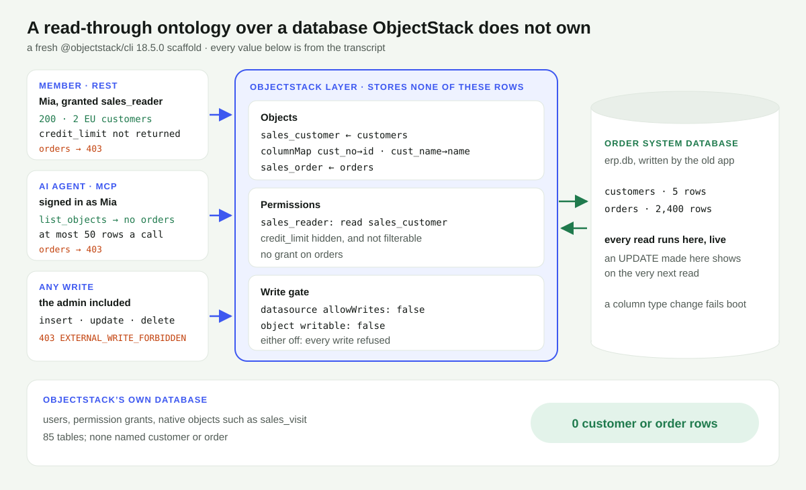

**答え**：データベースをコピーせず、作り直しもしない。プラットフォームが読むだけで決して変更しないソースとして接続し、各テーブルに業務上の名前を付け、誰が何を見てよいかを決める。すると人もレポートも AI エージェントも、一つの管理された入口からライブのデータを読み、各人の権限はすべての回答に効く。エージェントが受け取る回答も例外ではない。代償は、すべての読み取りがソースのデータベースで実行されることだ。何もコピーしないので、古くなるものもない。旧システムでの変更は次の読み取りで見えた。二か所で書き込みを有効にするまで、何も書き戻されない。

*ObjectStack 18.5.0（現行リリース）で、顧客 5 件・注文 2,400 件の模擬受注システムを相手に実測。すべての記録は最後の節「証拠」にある。*

これを**リードスルー・オントロジー**と呼ぶことにする。自分のものではないテーブルの上に業務名、関係、権限、AI ツールを重ね、すべての読み取りを本来の持ち主であるシステムへ通す仕組みだ。数字で言えば、2,400 件の注文をすべて返している間、ObjectStack 自身のデータベースが持っていた注文は **0 件**だった。

## 稼働中のデータベースを使えるようにする三つの道

「データを AI 対応にせよ」と求められる会社の多くは、データをすでに持っている。別のシステムが書き込むデータベースの中にだ。その上に統制された業務層を載せる正直な方法は三つあり、それぞれ代償が違う。

| | 作り直す | コピーする | 透過的に読む |
|:--|:--|:--|:--|
| 動くもの | データとシステム | データ（定期的に） | 何も動かない |
| 鮮度 | 新システムが正 | 最後の同期の時点 | 読み取り時点のソース |
| スキーマの持ち主 | あなた | あなた（コピーについて） | ソースシステム |
| 初日のコスト | 移行プロジェクト | 作って監視するパイプライン | 接続ファイル一つとテーブルごとに一ファイル |
| ソースをまたぐ結合 | できる | できる（コピーする主な理由） | 二回読んでメモリ上で結合 |
| ソースへの負荷 | 切り替え後はなし | 一度に一回の同期 | 読み取りのたび |

コピーを選ぶ理由は本物だ。コピーならインデックスを張れるし、何とでも結合でき、検索もでき、ソースが遅くても止まっていてもレポートを出せる。本番の受注システムにダッシュボードのクエリを載せることもない。それが必要ならコピーすればよい。透過的に読む理由はもっと狭いが、当てはまる場面ではもっと強い。接続したその日から業務層は最新の状態にある。遅れていくコピーが存在しないからだ。



## 何を接続し、何が返ってきたか

ソースは、旧来の受注システムに見立てた短い Python スクリプトが書いた SQLite ファイルだ。顧客テーブルと注文テーブルがあり、列名は古いシステムにありがちな分かりにくい略語になっている。仕事をしたのは三つの短いファイルだ。**データソース**は、データベースがどこにあり、プラットフォームがそこで何をしてよいかを宣言する。このデータソースは、スキーマはソースのものなので ObjectStack は決して変更しないこと、そして書き込みはオフであることを述べている。

```ts
export const Erp = defineDatasource({
  name: 'erp',
  label: 'Order system (SQLite)',
  driver: 'sqlite',
  schemaMode: 'external',            // ObjectStack never runs DDL here
  config: { filename: '/…/legacy/erp.db' },   // absolute path, trimmed
  external: {
    allowWrites: false,
    validation: { onMismatch: 'fail', checkOnBoot: true },
  },
});
```

**オブジェクト**はテーブルごとに一つで、人やレポートやエージェントが名前で求める業務レコードだ。それぞれが古い列を分かりやすい名前に対応づける。たとえば `cust_no` は `id` になる。プラットフォームはソースのテーブルを一覧し、これらのオブジェクトの下書きを作れる。**権限セット**は人に付与する名前付きの権限のまとまりだ。この権限セットは閲覧者に顧客を見せるが、与信限度額は見せず、注文については何も許さない。

それから、承認の前にあなたが尋ねるはずの質問を、動いているアプリに投げた。管理者として、Mia というメンバーとして、そして **MCP** 経由で Mia としてサインインした AI エージェントとして。MCP は、AI エージェントがアプリケーションのツールを呼ぶためのオープンなプロトコルだ。

| やったこと | システムの答え | あなたにとっての意味 |
|:--|:--|:--|
| 受注システム側で与信限度額を変え、ObjectStack 経由で読んだ | 次の読み取りで 180,000 ではなく 95,000。同期は一度も走らず、ObjectStack 自身のデータベースにある 85 のテーブルに顧客や注文のテーブルはなかった | 読んでいるのはソースであり、古くなりうるコピーではない |
| 保留中の注文を顧客付きで求めた | 480 件の注文。ソース側で絞り込まれ、それぞれにもう一方のテーブルの顧客が付いていた | 自分のものではないテーブルでも絞り込みと関係が使える |
| 注文日を日付型で宣言した（ソースはテキストで保存） | アプリは起動を拒み、その列を名指しした | この層が自分に合わせてスキーマを変えることはない |
| 管理者として作成・編集・削除した | すべて拒否され、二つの書き込みスイッチが名指しされた。ソースは顧客 5 件・注文 2,400 件のまま | 二つのスイッチを開くまで、誰もソースに書き込めない |
| 閲覧用の権限セットを付与する前と後に、Mia として読んだ | 前：両テーブルとも拒否。後：EU の顧客二件、与信限度額なし。注文は引き続き拒否 | 付与されるまでは閉じている。プラットフォームが作っていないデータベースでも列の非表示が効く |
| Mia が与信限度額で絞り込み、次に並べ替えた | どちらも拒否。答えが値を漏らすため | 隠された数値による絞り込みや並べ替えは拒否されるので、その方法では推測できない |
| Mia としてサインインしたエージェントが、オブジェクトを一覧し、顧客を読み、51 行を求め、書き込みを試みた | 顧客と同僚ディレクトリ、注文はなし。NA の顧客二件、与信限度額なし。50 行を超える要求は拒否。書き込みも拒否 | エージェントが得るのは Mia のビューを超えず、一回あたり最大 50 行、読み取り専用 |
| **データセット**（名前の付いたレポート数値の集まり）に顧客地域別の売上を求めた | APAC 6,127,544.10、EU 11,995,588.50、NA 12,470,792.17。受注システム自身のクエリと小数点以下二桁まで完全に一致 | レポートは二つのテーブルをまたいで動く（限界 1 を参照） |

ソースのデータベースは Mia が誰かを知らない。権限は読み取りのたびにこの層が執行し、エージェントがデータベースと直接話すことはない。

## リードスルー層が止まるところ

以下は私が実測した境界と、私が動かしていないドライバーについてドキュメントが明記している二つだ。書き込みスイッチは一度もオンにしていないので、両方を開いたときに書き込みがどうなるかはここでは測っていない。

**1. 二つのデータベースを結合する単一のクエリはない。** 売上レポートは SQLite に送られた一本の結合ではなかった。フェデレーテッドオブジェクト、つまり外部テーブルに結び付けられたオブジェクトについて、分析コンパイラ自身のコメントは、データセットが「the ObjectQL FK-expand path (two reads, joined in memory)」（ObjectQL の外部キー展開パス。二回読み、メモリ上で結合）で処理されると述べている。ObjectStack 自身のデータベースと受注システムの間でも同じだ。顧客へのルックアップを持つネイティブの訪問オブジェクトは、顧客を展開し、その地域で絞り込めたが、いずれも別々の読み取りだった。存在しないのは、二つのデータベースにまたがる一つの文だ。ランタイムの設計記録（ADR）は非目標にこう挙げている。「cross-datasource JOINs in one query (federated objects are queried per-datasource)」（一つのクエリでのデータソース横断 JOIN。フェデレーテッドオブジェクトはデータソースごとに問い合わせる）。

**2. 大量の読み取りに上限があるのは追加コネクタで、組み込みの SQL データベースではない。** 組み込みの SQLite ドライバーには上限がない。注文を 5,000 件求めると 2,400 件すべてが返り、このデータソースに上限を付けると、何の効果もないとして検証時に拒否される。追加コネクタ（ObjectStack の呼び方ではプラグインドライバー）は別途インストールするもので、OData も含まれる。その上では、ガイドが上限を定めている。「A read that matches more rows than the datasource's row cap is refused with `422 EXTERNAL_ROW_CAP_EXCEEDED` rather than answered from a partial set」（データソースの行数上限を超える行に一致する読み取りは、部分集合で答えるのではなく拒否される）、「The default is 1000 rows」（既定は 1000 行）、最大 10,000。ここでは動かしていない。

**3. 「親が見えれば見える」は SQL では動き、追加コネクタでは拒否される。** 親による共有制御とは、注文がその顧客を見られる人に見えるということだ。追加コネクタでは、こうした読み取りは拒否されるとガイドは言う（原文は「証拠」に引用）。SQL では逆の結果を測った。Mia は顧客を通じて注文を読め、顧客が彼女から見えなくなると注文も一緒に見えなくなった（次項）。

**4. 所有者による共有には所有者列が要る。** 顧客を非公開（下書きされたオブジェクトの既定値）にし、テーブルに所有者列がないと、Mia は何も読めなかった。顧客もその注文も見えず、管理者は引き続き 5 件と 2,400 件すべてを読めた。ガイドはこう警告している。「only an `owner_id` declared in `fields`, or named by an `external.columnMap` entry, counts as one. Without it a member reads no row.」（`fields` で宣言された `owner_id`、または `external.columnMap` のエントリで名指しされたものだけが所有者として数えられる。それがなければメンバーは一行も読めない。）ソースの所有者列を対応づけるか、上のようにテーブルを閲覧可能にしたうえで権限セットで絞り込むことだ。

**5. 性能はソースの性能だ。** すべての読み取りはその瞬間の受注システムで実行される。一覧ページは行と総数を読み、誰かが開きっぱなしにしたダッシュボードは本番データベースへのクエリになる。この層はソースにないインデックスを追加しない。ソースが負荷に耐えられないなら、すでに運用しているレプリカにデータソースを向けるか、データをコピーすることだ。

## コピーのほうがよい道具になるとき

ObjectStack の仮想オブジェクトのガイドは、規則を一文で述べている。「Make the object virtual when a copy would be **wrong**, and real when a copy is merely **convenient**」（コピーが誤りになるならオブジェクトは仮想に、コピーが単に便利なだけなら実体に）。リモートがリクエスト時に答えを計算する場合、データをソースの外に保存してはならない場合（データ所在地、ライセンス、監査）、あるいはどの同期よりも速く変わる場合、コピーは誤りだ。変化の遅い参照データや、多くのソースを結合するレポートでは、コピーは便利なだけだ。前者は透過的に読み、後者はコピーする。すでに停止したシステムには書き出したファイルしか残らない。そのファイルを古いコードごと持ち込まずに取り込む方法が、[インポートマッピングとその試行](/ja/blog/how-to-import-a-spreadsheet-from-an-old-system/)だ。

コピーして取り込むのがもう一つの道で、その中核は 18.5.0 で出荷されている。スケジュールされたジョブがフェデレーテッドオブジェクトを同期コピーに写し、メンバーはそれを読めるが書けない。この記事のためには測っていない。ADR-0153 の指針は、「Reports, analysis, AI question answering, joins across sources; a slow or fragile legacy system」（レポート、分析、AI による質問応答、ソース横断の結合。遅いか壊れやすいレガシーシステム）を sync-in（コピーして取り込むことの呼び名）に、「Live data, one table at a time; the legacy system must not be touched; data that must not land」（ライブのデータ、一度に一テーブル。レガシーシステムに触れてはならない。着地させてはならないデータ）をフェデレーション（このリードスルーの結び付けの呼び名）に振り分けている。[Connect existing systems](/en/connect-existing-systems/) は三つの道を並べて示している。ライブで読む、コピーして取り込む、宣言されたアクションでソースを変える、の三つだ。

## 開発中：sync-in の残り

18.5.0 にはまだないもの：ソースが削除した行への印付け（ジョブのガイドには「The delete keys change nothing yet」、削除のキーはまだ何も変えない、とある）、コネクタソースのページング（キーは宣言できるが「nothing reads it yet」、まだ何もそれを読まない）、そして sync-in のガイドとスキル。この節の内容は何も測っていない。

## diff で読むところ

エージェントが結び付けを書いたなら、決定はそれぞれ diff の一行になる。

| diff の行 | それが決めること |
|:--|:--|
| `schemaMode: 'external'` | ObjectStack はソースを決して変えない。ずれがあれば起動に失敗する |
| `allowWrites` / `writable` | 両方が `true` でなければ書き込みはソースに届かない |
| `columnMap` | ソースの列がどの業務名で現れるか |
| `sharingModel` | `private` には対応づけた所有者列が必要。なければメンバーは何も読めない |
| 権限セットの `fields` | メンバーが決して見られず、絞り込みにも使えないソースの列 |
| `rowCap` | プラグインドライバー専用。組み込みの SQL ドライバーでは拒否される |

フェデレーションによって、[オントロジー](/ja/glossary/ontology/)は自分で作っていないデータベースにも名前を付けられる。そして[権限モデル](/en/glossary/permission-model/)は、人であれエージェントであれ、すべての読み手に適用される。

## エージェントに任せる

コーディングエージェントに渡すべきは、この記事ではなく規則だ。`external` データソース一つ、`remoteName` と `columnMap` を持つテーブルごとのオブジェクト、明示的に書いた `sharingModel`、オフにした二つの書き込みスイッチ、そして対象者ごとの権限セット。[コーディングエージェントの設定方法](/en/blog/how-to-point-your-agent-at-objectstack/)は、規則ファイル、動いているアプリが公開する MCP エンドポイント、仕様を扱っている。エージェントが読むべきリファレンスは[外部データソースのガイド](https://objectstack.ai/docs/data-modeling/external-datasources)だ。

## 証拠

以下はすべて、`npm create objectstack@latest` で作ったプロジェクトを 18.5.0 の `objectstack dev` で動かした実際の出力で、印を付けた箇所だけを省略している。`$B` は開発サーバーのアドレス、`sql.py` はファイルに対して一文を実行する三行の Python ヘルパーだ。そのマシンには `sqlite3` コマンドがなかった。

### ソースと方言

顧客 5 件と注文 2,400 件、スキーマは次のとおり。

```sql
CREATE TABLE customers (
  cust_no      TEXT PRIMARY KEY,
  cust_name    TEXT NOT NULL,
  cust_region  TEXT,
  credit_limit REAL
);
CREATE TABLE orders (
  order_no   TEXT PRIMARY KEY,
  cust_no    TEXT NOT NULL REFERENCES customers(cust_no),
  amount     REAL,
  status     TEXT,
  placed_on  TEXT
);
```

最初に Postgres を試したところ、起動時にはっきりこう言われた。「The database client package `pg` is not installed, so no connection was attempted. It is an OPTIONAL install of @objectstack/driver-sql … `npm install pg` (pnpm add pg / yarn add pg)」（データベースクライアントのパッケージ `pg` がインストールされていないので接続は試みなかった。これは @objectstack/driver-sql のオプションのインストールだ）。ガイドは Oracle と SQL Server をフェデレーション専用の方言としても記載しており（「ObjectStack reads an existing Oracle schema live … but it never owns one」、ObjectStack は既存の Oracle スキーマをライブで読むが、決して所有しない）、SAP S/4HANA や Dynamics 365 のような OData v4 サービスも同梱のドライバーで扱える。この三つはここでは動かしていない。

### 結び付け

`sales` プロジェクトでは、上のデータソースと並んで、顧客オブジェクトが `external.columnMap`（リモートの列 → ローカルのフィールド）を使い、`cust_no`、`cust_name`、`cust_region` を `id`、`name`、`region` に変えている。

```ts
export const Customer = ObjectSchema.create({
  name: 'sales_customer',
  label: 'Customer',
  sharingModel: 'public_read',
  datasource: 'erp',
  external: {
    remoteName: 'customers',
    columnMap: { cust_no: 'id', cust_name: 'name', cust_region: 'region' },
  },
  fields: {
    name: Field.text({ label: 'Name', searchable: true }),
    region: Field.text({ label: 'Region' }),
    credit_limit: Field.currency({ label: 'Credit limit' }),
  },
});
```

`sales_order` は `orders` の上に同じ形で作り、`cust_no` を `customer` ルックアップに対応づけた。権限セットは次のとおり。

```ts
export const SalesReader = definePermissionSet({
  name: 'sales_reader',
  objects: { sales_customer: { allowRead: true } },
  fields: { 'sales_customer.credit_limit': { readable: false, editable: false } },
});
```

管理用ルート `GET …/datasources/erp/external/tables` は `customers`（4 列）と `orders`（5 列）を返し、`POST …/external/tables/customers/draft` はそのテーブルのオブジェクトの下書きを返した。下書きはリモートの名前をそのままフィールド名にし、`sharingModel: 'private'` で始まる（限界 4）。そこで私は `columnMap` で名前を変え、`public_read` を選んだ。

`placed_on` を `date` フィールドとして宣言すると、起動に失敗した。

```text
✗ Object 'sales_order' does not match its remote table on datasource 'erp':
✗ type_mismatch: orders.placed_on (expected date, actual text)
```

これは `schemaMode: 'external'` が設計どおりに働いている姿だ。ガイドの言い方では「A mature external DB — **DDL forbidden**; a schema mismatch **fails** boot.」（成熟した外部 DB では DDL 禁止。スキーマの不一致は起動を失敗させる。）私はフィールドを、受注システムが実際に格納している `text` に変えた。

### ライブか、コピーか？

読み、受注システムで変更し、もう一度読む。

```bash
curl -s -b admin.cookies "$B/api/v1/data/sales_customer/C-1002"
```

```json
{"object":"sales_customer","id":"C-1002","record":{"credit_limit":180000,"id":"C-1002","name":"Borealis GmbH","region":"EU"}}
```

```bash
python3 sql.py erp.db "UPDATE customers SET credit_limit = 95000 WHERE cust_no = 'C-1002'"
curl -s -b admin.cookies "$B/api/v1/data/sales_customer/C-1002"
```

```json
{"object":"sales_customer","id":"C-1002","record":{"credit_limit":95000,"id":"C-1002","name":"Borealis GmbH","region":"EU"}}
```

同期は走っていない。そもそも同期がないからだ。その時点で ObjectStack 自身のデータベースには 85 のテーブルがあり、名前を `customer` や `order` で検索しても何も出なかった。絞り込みはソースに渡され、ルックアップは二つのリモートテーブルをまたいで展開される。

```bash
curl -s -b admin.cookies "$B/api/v1/data/sales_order?status=pending&top=2&expand=customer"
```

```json
{"object":"sales_order","records":[
  {"amount":7020.73,"status":"pending","placed_on":"2026-04-04","id":"SO-00003",
   "customer":{"credit_limit":60000,"id":"C-1003","name":"Cyan Pacific","region":"APAC"}},
  … one more row, trimmed …],
 "total":480,"hasMore":true}
```

### 何かが書き込めるか？

プラットフォーム管理者として：

```bash
curl -s -b admin.cookies -X POST "$B/api/v1/data/sales_customer" \
  -H "content-type: application/json" -d '{"id":"C-9999","name":"Test Co","region":"EU"}'
```

```json
HTTP 403
{"error":"Write 'insert' blocked on object 'sales_customer': datasource 'erp' is external (schemaMode=external). Requires datasource.external.allowWrites=true (got false) AND object.external.writable=true (got false).","code":"EXTERNAL_WRITE_FORBIDDEN","object":"sales_customer"}
```

`C-1002` への `PATCH` と注文 `SO-00001` の `DELETE` も同じ `403` を返し、それぞれ `update` と `delete` を名指しした。受注システムは顧客 5 件、注文 2,400 件のままで、与信限度額も自分で設定したものから変わっていなかった。ガイド：「With either gate off, insert/update/delete on the federated object is rejected.」（どちらかのゲートが閉じていれば、フェデレーテッドオブジェクトへの挿入・更新・削除は拒否される。）この仕組みを定める設計記録（ADR）は、目標として「Register existing remote tables as ObjectStack objects **without touching the remote schema**」（既存のリモートテーブルを、リモートのスキーマに触れずに ObjectStack のオブジェクトとして登録する）と「Default to read-only; require **two explicit opt-ins** (datasource level + object level) to enable writes.」（既定は読み取り専用。書き込みを有効にするには、データソースとオブジェクトの二つのレベルで明示的な有効化が必要）を挙げている。

### メンバーには何が見えるか？

Mia は管理者が `POST /api/v1/auth/admin/create-user` で作ったメンバーだ。付与がないうちは、どちらのオブジェクトも `403 PERMISSION_DENIED` を返す。フェデレーテッドオブジェクトも、ほかのオブジェクトと同じく既定で拒否される。管理者が彼女に `sales_reader` を付与したあと：

```bash
curl -s -b member.cookies "$B/api/v1/data/sales_customer?region=EU"
```

```json
HTTP 200
{"object":"sales_customer","records":[{"id":"C-1002","name":"Borealis GmbH","region":"EU"},{"id":"C-1004","name":"Delta Freight","region":"EU"}],"total":2,"hasMore":false}
```

`credit_limit` はない。注文は引き続き `403` だ。間接的に尋ねると：

```bash
curl -s -b member.cookies "$B/api/v1/data/sales_customer?credit_limit=95000"
```

```json
HTTP 403
{"error":"[Security] Access denied: query on 'sales_customer' references field(s) not readable by the caller: credit_limit. Filtering, sorting, grouping, or aggregating by a hidden field would leak its values (filter oracle) — remove these predicates or grant field read access.","code":"PERMISSION_DENIED","object":"sales_customer"}
```

それで並べ替えても同じ答えだった。

### AI エージェントならすり抜けられるか？

ObjectStack のアプリはどれも `/api/v1/mcp` にある MCP サーバーだ。Mia としてサインインしたエージェントの `list_objects` は、`sys_user`（18.5.0 は、人物フィールドに同僚を探せるようエージェントにこれを開放している）と `sales_customer` を返した。その後の結果を、ツールの結果だけに省略して示す。

```text
query_records  sales_customer  where {"region":"NA"}  → 2 records: Aurora Labs, Ember Foods (no credit_limit)
query_records  sales_order     limit 1                → {"code":"PERMISSION_DENIED","status":403}
query_records  sales_customer  limit 51               → Too big: expected number to be <=50 at limit
create_record  sales_customer  {"id":"C-9998",…}      → {"code":"EXTERNAL_WRITE_FORBIDDEN","status":403}
```

### レポートはテーブルをまたいで動くか？

このデータセットは、注文の売上をもう一方のテーブルの列で集計する。

```ts
export const OrderRevenue: Dataset = {
  name: 'sales_order_revenue',
  label: 'Order revenue',
  object: 'sales_order',
  include: ['customer'],
  dimensions: [{ name: 'region', label: 'Region', field: 'customer.region', type: 'string' }],
  measures: [
    { name: 'revenue', label: 'Revenue', aggregate: 'sum', field: 'amount' },
    { name: 'orders', label: 'Orders', aggregate: 'count' },
  ],
};
```

MCP の `query_dataset` ツールで問い合わせ、受注システム自身で実行した `JOIN` と照合した。

| 地域 | 売上（データセット） | 注文数 |
|:--|--:|--:|
| APAC | 6,127,544.10 | 480 |
| EU | 11,995,588.50 | 960 |
| NA | 12,470,792.17 | 960 |

```text
$ python3 sql.py erp.db "SELECT c.cust_region, round(sum(o.amount),2), count(*) FROM orders o JOIN customers c ON c.cust_no=o.cust_no GROUP BY 1 ORDER BY 1"
('APAC', 6127544.1, 480)
('EU', 11995588.5, 960)
('NA', 12470792.17, 960)
```

### 実測した限界

データソースをまたぐ場合（限界 1）：ネイティブの `sales_visit` は `sales_customer` へのルックアップを持ち、`?expand=customer` と入れ子のフィルター `{"customer":{"region":"EU"}}` を受け付けた。`?customer.region=EU` のようなドット区切りのフィルターと、`customer.region` でグループ化した `aggregate_records` は、ネイティブの `sales_visit` でも `sales_order` とまったく同じく `400 INVALID_FIELD` を返した。つまりこの二つの拒否はフェデレーションの限界ではない。

行数上限（限界 2）：注文に対する `?top=5000` は 2,400 行すべてを返した。SQLite データソースに `rowCap` を付けると、検証時にこうなる。

```text
✗ external.rowCap: `external.rowCap` caps the rows the engine reads from a plugin driver, which it holds behind its correctness floor; the 'sqlite' driver is built in, runs the whole query itself and is never capped, so the key would do nothing here. Remove `rowCap`.
```

親による制御（限界 3）：`sales_order` を `controlled_by_parent` にし、`master_detail` で顧客に結び付けた。Mia は注文を読めた。プラグインドライバーについてのガイドの記述：「A read whose scope composes a `ReadableIds` leaf, such as an object `controlled_by_parent`, is refused」（スコープに `ReadableIds` の葉を含む読み取り、たとえば `controlled_by_parent` のオブジェクトは拒否される）。

所有者列（限界 4）：`sales_customer` を `private` にすると、Mia への答えは顧客についても親が制御する注文についても `{"records":[],"total":0}` だった。管理者は引き続き 5 件と 2,400 件すべてを読めた。

コピーして取り込む道の名前（18.5.0 で出荷、ここでは未計測）：`pull` が `datasourceSource` を持つ `mapping` を指す `job` は、フェデレーテッドオブジェクトをウィンドウ単位で読み、`managedBy: 'synced'` と宣言されたオブジェクトに upsert する。メンバーはそれを読めるが、書き込みはエンジンが `403` で拒否する。実行のたびに、何を読みどこまで進んだかを記録した `sys_sync_run` の行が残り、次の実行はそこから読み進める。リリースノート：「A mapping's `datasourceSource` now does what it declares」（マッピングの `datasourceSource` は、宣言したとおりに動くようになった）。アプリで宣言したジョブは、`OS_AUTOMATION_SCHEDULED_WORK_ENABLED` を `true` にしたデプロイメントでしか動かず、既定ではオフだ。
