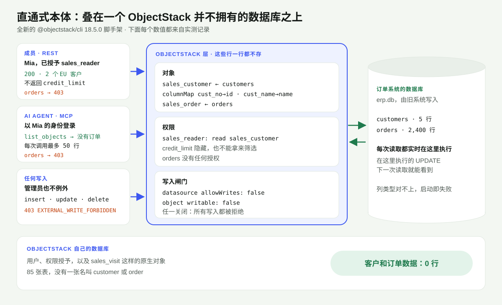

**先给答案**：不要复制这个数据库，也不要重建它。把它接成一个平台只读、永不改动的来源，给每张表起一个业务名，再决定谁能看什么。人、报表和 AI Agent 随后通过同一个受控入口读取实时数据，每个人的权限作用于每一次回答，Agent 代人拿到的回答也一样。代价是：每一次读取都落在你的源数据库上。没有任何复制，所以不会有过时的数据：在老系统里改的一行，下一次读取就看到了。在你于两个地方打开写入之前，什么都不会写回去。

*在 ObjectStack 18.5.0（当前版本）上实测，对象是一个模拟的订单系统，5 个客户、2,400 条订单。全部实测记录都在最后一节「证据」里。*

我把这叫作**直通式本体**（read-through ontology）：业务名、关系、权限和 AI 工具叠在你并不拥有的表之上，每一次读取都穿过去，交给真正拥有它们的那个系统。一个数字就能说明它：在提供全部 2,400 条订单的同时，ObjectStack 自己的数据库里**一条都没有**。

## 让在跑的数据库可用，有三条路

大多数被要求「让数据为 AI 做好准备」的公司，数据早就有了，躺在某个别的系统写入的数据库里。要在上面加一层受治理的业务层，诚实地说有三条路，每条的代价不一样。

| | 重建 | 复制 | 直通读取 |
|:--|:--|:--|:--|
| 搬动什么 | 数据和系统 | 数据，按计划同步 | 什么都不搬 |
| 新鲜度 | 新系统就是真相 | 停在上一次同步 | 读取那一刻的源库 |
| 谁拥有 schema | 你 | 你（对副本而言） | 源系统 |
| 第一天的成本 | 一个迁移项目 | 一条要建、要盯的管道 | 一个连接文件，每张表一个文件 |
| 跨源关联 | 可以 | 可以，这正是复制的主要理由 | 两次读取，在内存里拼接 |
| 源库的负载 | 切换后为零 | 同步时一次 | 每一次读取 |

复制的理由是真实的：副本可以建索引、和任何东西关联、被搜索，源库慢了或宕了也照样能出报表，而且永远不会把仪表盘的查询压到生产订单系统上。如果你要的是这些，就复制。直通读取的理由更窄，但在适用的地方更硬：接上的那一天，业务层就是最新的，因为根本没有会落后的副本。



## 我接了什么，它又怎么回答

源库是一个 SQLite 文件，由一段很短的 Python 脚本写入，扮演一个老订单系统：一张客户表、一张订单表，列名是老系统常见的那种难懂的缩写。干活的是三个很短的文件。**数据源**声明一个数据库在哪里、平台能在那里做什么。这一个声明 schema 归源库所有，所以 ObjectStack 永远不去改它，而且写入是关闭的：

```ts
export const Erp = defineDatasource({
  name: 'erp',
  label: 'Order system (SQLite)',
  driver: 'sqlite',
  schemaMode: 'external',            // ObjectStack never runs DDL here
  config: { filename: '/…/legacy/erp.db' },   // absolute path, trimmed
  external: {
    allowWrites: false,
    validation: { onMismatch: 'fail', checkOnBoot: true },
  },
});
```

**对象**是人、报表和 Agent 按名字索取的业务记录，每张表一个；每个对象把旧列映射成直白的名字，比如 `cust_no` 变成 `id`。平台可以列出源库的表，并替你起草这些对象。**权限集**是一组有名字的权限，你把它授予人；这一个让读者看到客户，但看不到他们的信用额度，对订单则什么都不给。

然后我向运行中的应用提出你在签字前会问的问题：以管理员身份、以一名叫 Mia 的成员身份，以及以一个用 Mia 身份通过 **MCP** 登录的 AI Agent 身份。MCP 是 AI Agent 调用应用工具时使用的开放协议。

| 我做了什么 | 系统怎么回答 | 这对你意味着什么 |
|:--|:--|:--|
| 直接在订单系统里改了一个信用额度，再通过 ObjectStack 读取 | 下一次读取就是 95,000，而不是 180,000；没有运行任何同步，ObjectStack 自己数据库的 85 张表里没有一张是客户表或订单表 | 你读的是源库，不是可能过时的副本 |
| 查询待处理订单，并带上它们的客户 | 480 条订单，在源库筛选，每条都带着另一张表里的客户 | 筛选和关系在不归你所有的表上也能用 |
| 把订单日期声明成日期类型，而源库存的是文本 | 应用拒绝启动，并点名了那一列 | 这一层永远不会为了迁就自己去改你的 schema |
| 以管理员身份创建、编辑、删除 | 全部拒绝，并点名两个写入开关；源库仍是 5 个客户、2,400 条订单 | 在你打开两个开关之前，谁也写不进源库 |
| 以 Mia 身份读取，授予她读者权限集之前和之后各一次 | 之前：两张表都拒绝。之后：两个 EU 客户，没有信用额度；订单仍被拒绝 | 授权之前一律关闭；列级隐藏在一个不是平台建的数据库上同样有效 |
| Mia 先按信用额度筛选，再按它排序 | 两次都拒绝：回答会泄露这个值 | 按隐藏的数字筛选或排序会被拒绝，所以没法用这种办法猜出来 |
| 以 Mia 身份登录的 Agent 列出它的对象、读取客户、要 51 行、尝试写入 | 客户和同事目录，没有订单；两个 NA 客户，没有信用额度；超过 50 行被拒绝；写入被拒绝 | Agent 拿到的不超过 Mia 的视图，每次调用最多 50 行，只读 |
| 向一个**数据集**（一组有名字的报表数字）要按客户区域汇总的收入 | APAC 6,127,544.10、EU 11,995,588.50、NA 12,470,792.17，和订单系统自己的查询精确一致，到小数点后两位 | 报表能跨两张表工作（见第 1 条边界） |

源数据库并不知道 Mia 是谁：权限由这一层在每一次读取时执行，而 Agent 根本不和数据库对话。

## 直通层止步于哪里

下面是我实测到的边界，外加文档为我没有跑的驱动写明的两条。我从没打开过写入开关，所以两个开关都打开后写入会怎样，这里没有实测。

**1. 没有一条查询能关联两个数据库。** 收入报表并不是发给 SQLite 的一条关联查询。联邦对象，即绑定到外部表的对象，按分析编译器自己的注释，它的数据集走的是「the ObjectQL FK-expand path (two reads, joined in memory)」（ObjectQL 外键展开路径：两次读取，在内存里拼接）。在 ObjectStack 自己的数据库和订单系统之间也一样：一个带着指向客户的查找字段的原生拜访对象，能展开客户，也能按客户区域筛选，都是分开的读取。不存在的是一条横跨两个数据库的语句；运行时的设计记录（ADR）把它列为非目标：「cross-datasource JOINs in one query (federated objects are queried per-datasource)」（单条查询里的跨数据源 JOIN；联邦对象按数据源分别查询）。

**2. 大批量读取在附加连接器上有上限，在内置的 SQL 数据库上没有。** 在内置的 SQLite 驱动上没有上限：要 5,000 条订单，返回了全部 2,400 条；给这个数据源加上限，校验时会以「不起作用」为由被拒绝。附加连接器是单独安装的连接器，ObjectStack 称之为插件驱动，OData 也在其中；在这类连接器上，指南规定了上限：「A read that matches more rows than the datasource's row cap is refused with `422 EXTERNAL_ROW_CAP_EXCEEDED` rather than answered from a partial set」（匹配行数超过数据源上限的读取会被拒绝，而不是只回一部分），「The default is 1000 rows」（默认 1000 行），最多 10,000。这里没有跑。

**3. 「父记录可见则可见」在 SQL 上能用，在附加连接器上会被拒绝。** 由父记录控制的共享，意思是一条订单对能看到它所属客户的人可见。指南说，在附加连接器上这样的读取会被拒绝（原文见「证据」）。在 SQL 上我测到的正相反：Mia 通过客户读到了订单，而当客户对她不可见时，订单也跟着不可见（见下一条）。

**4. 按所有者划分的共享需要一个所有者列。** 把客户设成私有（这是起草出的对象的默认值），而底层表没有所有者列，Mia 就什么都读不到，客户和它们的订单都没有，管理员却仍能读到全部 5 个客户和 2,400 条订单。指南对此有警告：「only an `owner_id` declared in `fields`, or named by an `external.columnMap` entry, counts as one. Without it a member reads no row.」（只有在 `fields` 里声明、或由 `external.columnMap` 条目点名的 `owner_id` 才算数；没有它，成员一行都读不到。）要么映射源库的所有者列，要么像上面那样把表开放为可读，再用权限集收窄。

**5. 性能是源库的性能。** 每一次读取都在那一刻落到订单系统上：一个列表页要读行和总数，有人一直开着的仪表盘就是压在你生产数据库上的查询。这一层不会给源库添加它没有的索引。如果源库扛不住，就把数据源指向一个你已经在运维的副本库，或者干脆复制数据。

## 什么时候复制才是更好的工具

ObjectStack 关于虚拟对象的指南用一句话说明了规则：「Make the object virtual when a copy would be **wrong**, and real when a copy is merely **convenient**」（复制会出错时，让对象保持虚拟；复制只是方便时，让它成为真实对象）。远端在请求时才算出答案、数据不能存放到源库之外（数据驻留、许可、审计），或者变化快过任何同步，复制就是错的。变化缓慢的参考数据、要关联很多来源的报表，复制只是方便。前一类直通读取，后一类复制。对一个已经停用的系统，剩下的只有一份导出文件，[一份导入映射和它的试运行](/zh-Hans/blog/how-to-import-a-spreadsheet-from-an-old-system/)就是让那份文件落进模型、又不把旧编码一起带进来的办法。

拷贝进来是另一条路，它的核心已经随 18.5.0 发布：一个定时作业把联邦对象拷贝成一份同步副本，成员能读，不能写。本文没有实测它。ADR-0153 的指引把「Reports, analysis, AI question answering, joins across sources; a slow or fragile legacy system」（报表、分析、AI 问答、跨源关联；慢或脆弱的老系统）分给 sync-in，也就是它对拷贝进来的叫法；把「Live data, one table at a time; the legacy system must not be touched; data that must not land」（实时数据、一次一张表；不能碰老系统；不能落地的数据）分给联邦，也就是它对这种直通绑定的叫法。[对接现有系统](/zh-Hans/connect-existing-systems/)把三条路并排摆开：实时读取、拷贝进来，或者通过声明的动作修改源系统。

## 开发中：sync-in 的其余部分

不在 18.5.0 里的有：标记源系统已删除的行（作业指南的原话是「The delete keys change nothing yet」，删除相关的键暂时什么都不改变）；连接器来源的分页，它的键已经可以声明，但「nothing reads it yet」（还没有任何东西读取它）；以及 sync-in 的指南和技能。本节内容都没有实测。

## 在 diff 里该看什么

如果是 Agent 写的绑定，每个决定只占 diff 里的一行：

| diff 里的这一行 | 它决定什么 |
|:--|:--|
| `schemaMode: 'external'` | ObjectStack 永不改动源库；漂移会让启动失败 |
| `allowWrites` / `writable` | 两者都为 `true`，写入才能到达源库 |
| `columnMap` | 源库的列以什么业务名出现 |
| `sharingModel` | `private` 需要映射所有者列，否则成员什么都读不到 |
| 权限集的 `fields` | 成员永远看不到、也不能拿来筛选的源库列 |
| `rowCap` | 只用于插件驱动；在内置 SQL 驱动上会被拒绝 |

联邦让[本体](/zh-Hans/glossary/ontology/)能为一个不是你建的数据库命名，而[权限模型](/zh-Hans/glossary/permission-model/)作用于每一个读者，人也好，Agent 也好。

## 让你的 Agent 来做

交给你的编码 Agent 的，应该是一条规则，而不是这篇文章：一个 `external` 数据源；每张表一个对象，带 `remoteName` 和 `columnMap`；一个明确写出的 `sharingModel`；两个写入开关都关闭；每类受众一个权限集。[怎样配置编码 Agent](/en/blog/how-to-point-your-agent-at-objectstack/) 讲了规则文件、运行中的应用暴露的 MCP 端点和规范；[外部数据源指南](https://objectstack.ai/docs/data-modeling/external-datasources)是 Agent 该读的参考。

## 证据

下面都是 18.5.0 上 `objectstack dev` 的真实输出，项目由 `npm create objectstack@latest` 生成，只在标明处做了删节。`$B` 是开发服务器的地址；`sql.py` 是一个三行的 Python 小工具，对文件执行一条语句，因为那台机器上没有 `sqlite3` 命令。

### 源库和方言

5 个客户、2,400 条订单，schema 如下：

```sql
CREATE TABLE customers (
  cust_no      TEXT PRIMARY KEY,
  cust_name    TEXT NOT NULL,
  cust_region  TEXT,
  credit_limit REAL
);
CREATE TABLE orders (
  order_no   TEXT PRIMARY KEY,
  cust_no    TEXT NOT NULL REFERENCES customers(cust_no),
  amount     REAL,
  status     TEXT,
  placed_on  TEXT
);
```

我先试的是 Postgres，启动时说得很明白：「The database client package `pg` is not installed, so no connection was attempted. It is an OPTIONAL install of @objectstack/driver-sql … `npm install pg` (pnpm add pg / yarn add pg)」（数据库客户端包 `pg` 没有安装，所以没有尝试连接；它是 @objectstack/driver-sql 的可选安装）。指南还把 Oracle 和 SQL Server 记为只做联邦的方言（「ObjectStack reads an existing Oracle schema live … but it never owns one」，ObjectStack 实时读取现有的 Oracle schema，但从不拥有它），并通过一个随附的驱动支持 SAP S/4HANA、Dynamics 365 这类 OData v4 服务。这三种我这里都没有跑。

### 绑定

在 `sales` 项目里，数据源就是上面那段；客户对象用 `external.columnMap`（远程列 → 本地字段）把 `cust_no`、`cust_name` 和 `cust_region` 变成 `id`、`name` 和 `region`：

```ts
export const Customer = ObjectSchema.create({
  name: 'sales_customer',
  label: 'Customer',
  sharingModel: 'public_read',
  datasource: 'erp',
  external: {
    remoteName: 'customers',
    columnMap: { cust_no: 'id', cust_name: 'name', cust_region: 'region' },
  },
  fields: {
    name: Field.text({ label: 'Name', searchable: true }),
    region: Field.text({ label: 'Region' }),
    credit_limit: Field.currency({ label: 'Credit limit' }),
  },
});
```

`sales_order` 是同样的结构，落在 `orders` 上，`cust_no` 映射成一个 `customer` 查找字段。权限集：

```ts
export const SalesReader = definePermissionSet({
  name: 'sales_reader',
  objects: { sales_customer: { allowRead: true } },
  fields: { 'sales_customer.credit_limit': { readable: false, editable: false } },
});
```

管理员路由 `GET …/datasources/erp/external/tables` 回答了 `customers`（4 列）和 `orders`（5 列），`POST …/external/tables/customers/draft` 为这张表返回了一个草稿对象。草稿把远程名直接当字段名，并以 `sharingModel: 'private'` 开头（第 4 条边界），所以我通过 `columnMap` 改了名，并选了 `public_read`。

把 `placed_on` 声明成 `date` 字段，启动失败：

```text
✗ Object 'sales_order' does not match its remote table on datasource 'erp':
✗ type_mismatch: orders.placed_on (expected date, actual text)
```

这就是 `schemaMode: 'external'` 按设计在工作：按指南的说法，「A mature external DB — **DDL forbidden**; a schema mismatch **fails** boot.」（成熟的外部数据库：禁止 DDL；schema 不匹配则启动失败。）我把字段改成了 `text`，也就是订单系统实际存的类型。

### 是实时的，还是副本？

读取，在订单系统里修改，再读取：

```bash
curl -s -b admin.cookies "$B/api/v1/data/sales_customer/C-1002"
```

```json
{"object":"sales_customer","id":"C-1002","record":{"credit_limit":180000,"id":"C-1002","name":"Borealis GmbH","region":"EU"}}
```

```bash
python3 sql.py erp.db "UPDATE customers SET credit_limit = 95000 WHERE cust_no = 'C-1002'"
curl -s -b admin.cookies "$B/api/v1/data/sales_customer/C-1002"
```

```json
{"object":"sales_customer","id":"C-1002","record":{"credit_limit":95000,"id":"C-1002","name":"Borealis GmbH","region":"EU"}}
```

没有运行任何同步，因为根本没有同步。那时 ObjectStack 自己的数据库有 85 张表，按 `customer` 或 `order` 搜索表名，什么都没有。筛选下推到源库，查找字段能跨两张远程表展开：

```bash
curl -s -b admin.cookies "$B/api/v1/data/sales_order?status=pending&top=2&expand=customer"
```

```json
{"object":"sales_order","records":[
  {"amount":7020.73,"status":"pending","placed_on":"2026-04-04","id":"SO-00003",
   "customer":{"credit_limit":60000,"id":"C-1003","name":"Cyan Pacific","region":"APAC"}},
  … one more row, trimmed …],
 "total":480,"hasMore":true}
```

### 有什么能写进去吗？

以平台管理员身份：

```bash
curl -s -b admin.cookies -X POST "$B/api/v1/data/sales_customer" \
  -H "content-type: application/json" -d '{"id":"C-9999","name":"Test Co","region":"EU"}'
```

```json
HTTP 403
{"error":"Write 'insert' blocked on object 'sales_customer': datasource 'erp' is external (schemaMode=external). Requires datasource.external.allowWrites=true (got false) AND object.external.writable=true (got false).","code":"EXTERNAL_WRITE_FORBIDDEN","object":"sales_customer"}
```

对 `C-1002` 的 `PATCH` 和对订单 `SO-00001` 的 `DELETE` 都回了同样的 `403`，分别点名 `update` 和 `delete`。订单系统仍是 5 个客户、2,400 条订单，信用额度也还是它自己设的那个。指南：「With either gate off, insert/update/delete on the federated object is rejected.」（任一闸门关闭，联邦对象上的插入、更新、删除都会被拒绝。）规定这套机制的设计记录（ADR）在目标里写着「Register existing remote tables as ObjectStack objects **without touching the remote schema**」（把现有远程表注册成 ObjectStack 对象，而不碰远程 schema），以及「Default to read-only; require **two explicit opt-ins** (datasource level + object level) to enable writes.」（默认只读；要开启写入，需要两处显式开启：数据源级和对象级。）

### 成员能看到什么？

Mia 是管理员通过 `POST /api/v1/auth/admin/create-user` 创建的成员。没有授权时，两个对象都回 `403 PERMISSION_DENIED`：联邦对象和其他对象一样，默认拒绝。管理员授予她 `sales_reader` 之后：

```bash
curl -s -b member.cookies "$B/api/v1/data/sales_customer?region=EU"
```

```json
HTTP 200
{"object":"sales_customer","records":[{"id":"C-1002","name":"Borealis GmbH","region":"EU"},{"id":"C-1004","name":"Delta Freight","region":"EU"}],"total":2,"hasMore":false}
```

没有 `credit_limit`；订单仍回 `403`。换个间接的问法：

```bash
curl -s -b member.cookies "$B/api/v1/data/sales_customer?credit_limit=95000"
```

```json
HTTP 403
{"error":"[Security] Access denied: query on 'sales_customer' references field(s) not readable by the caller: credit_limit. Filtering, sorting, grouping, or aggregating by a hidden field would leak its values (filter oracle) — remove these predicates or grant field read access.","code":"PERMISSION_DENIED","object":"sales_customer"}
```

按它排序，回答相同。

### AI Agent 能绕过去吗？

每个 ObjectStack 应用都是一个 MCP 服务器，地址是 `/api/v1/mcp`。以 Mia 身份登录后，Agent 的 `list_objects` 回答了 `sys_user`（18.5.0 向 Agent 开放它，好让 Agent 为人员字段找到同事）和 `sales_customer`。接着，删节到只剩工具结果：

```text
query_records  sales_customer  where {"region":"NA"}  → 2 records: Aurora Labs, Ember Foods (no credit_limit)
query_records  sales_order     limit 1                → {"code":"PERMISSION_DENIED","status":403}
query_records  sales_customer  limit 51               → Too big: expected number to be <=50 at limit
create_record  sales_customer  {"id":"C-9998",…}      → {"code":"EXTERNAL_WRITE_FORBIDDEN","status":403}
```

### 报表能跨表工作吗？

这个数据集按另一张表里的一列汇总订单收入：

```ts
export const OrderRevenue: Dataset = {
  name: 'sales_order_revenue',
  label: 'Order revenue',
  object: 'sales_order',
  include: ['customer'],
  dimensions: [{ name: 'region', label: 'Region', field: 'customer.region', type: 'string' }],
  measures: [
    { name: 'revenue', label: 'Revenue', aggregate: 'sum', field: 'amount' },
    { name: 'orders', label: 'Orders', aggregate: 'count' },
  ],
};
```

通过 MCP 的 `query_dataset` 工具查询，并和在订单系统里直接跑的 `JOIN` 对照：

| 区域 | 收入（数据集） | 订单数 |
|:--|--:|--:|
| APAC | 6,127,544.10 | 480 |
| EU | 11,995,588.50 | 960 |
| NA | 12,470,792.17 | 960 |

```text
$ python3 sql.py erp.db "SELECT c.cust_region, round(sum(o.amount),2), count(*) FROM orders o JOIN customers c ON c.cust_no=o.cust_no GROUP BY 1 ORDER BY 1"
('APAC', 6127544.1, 480)
('EU', 11995588.5, 960)
('NA', 12470792.17, 960)
```

### 边界的实测记录

跨数据源（第 1 条）：原生的 `sales_visit` 带着指向 `sales_customer` 的查找字段，接受了 `?expand=customer` 和嵌套筛选 `{"customer":{"region":"EU"}}`。像 `?customer.region=EU` 这样的点路径筛选，以及按 `customer.region` 分组的 `aggregate_records`，在原生的 `sales_visit` 上和在 `sales_order` 上一样，都回 `400 INVALID_FIELD`，所以这两处拒绝不是联邦的限制。

行数上限（第 2 条）：订单上 `?top=5000` 返回了全部 2,400 行。在 SQLite 数据源上加 `rowCap`，校验时：

```text
✗ external.rowCap: `external.rowCap` caps the rows the engine reads from a plugin driver, which it holds behind its correctness floor; the 'sqlite' driver is built in, runs the whole query itself and is never capped, so the key would do nothing here. Remove `rowCap`.
```

由父记录控制（第 3 条）：把 `sales_order` 设成 `controlled_by_parent`，通过 `master_detail` 挂到客户上；Mia 能读订单。指南对插件驱动的说法是：「A read whose scope composes a `ReadableIds` leaf, such as an object `controlled_by_parent`, is refused」（作用域组合了 `ReadableIds` 叶子的读取，比如 `controlled_by_parent` 的对象，会被拒绝）。

所有者列（第 4 条）：把 `sales_customer` 设成 `private` 后，Mia 对客户和由父记录控制的订单拿到的都是 `{"records":[],"total":0}`；管理员仍能读到全部 5 个客户和 2,400 条订单。

拷贝进来，按名字（随 18.5.0 发布，这里没有实测）：一个 `job` 的 `pull` 指向一份带 `datasourceSource` 的 `mapping`，按窗口读取一个联邦对象，把行 upsert 进一个声明为 `managedBy: 'synced'` 的对象，成员可以读，引擎会以 `403` 拒绝他们的写入；每次运行都留下一行 `sys_sync_run`，记录读了什么、读到了哪个位置，下一次运行从那里接着读。发布说明：「A mapping's `datasourceSource` now does what it declares」（映射的 `datasourceSource` 现在会做它声明的事）。应用里声明的作业，只在把 `OS_AUTOMATION_SCHEDULED_WORK_ENABLED` 设为 `true` 的部署上运行，这个开关默认关闭。
