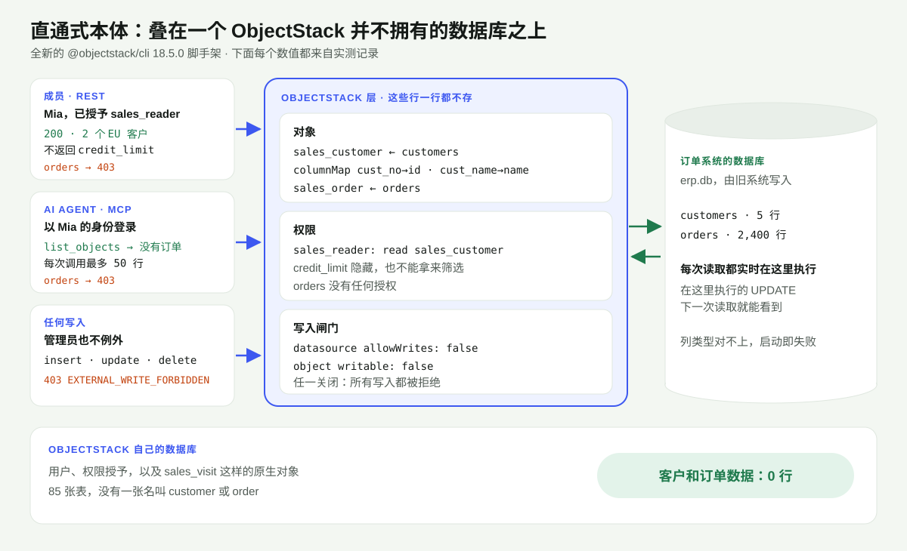

---
# @generated zh-Hant from zh-Hans (s2twp) — edit the zh-Hans file; delete this line to hand-maintain.
title: 不搬資料，怎樣讓已有的資料庫為 AI 做好準備？
description: 把你已經在跑的資料庫接成只讀來源：讀取即時落到源庫，寫入在兩個開關都開啟之前一律拒絕，每個人的權限對人和 AI Agent 同樣生效。在 ObjectStack 18.5.0 上實測。
author: ObjectStack Team
date: 2026-11-18
status: published
topic: integration-data
audience: it
solutions: []
industries: []
cover: ./cover.svg
tags:
  - 聯邦查詢
  - 現有資料庫
  - 資料建模
---

**先給答案**：不要複製這個資料庫，也不要重建它。把它接成一個平台只讀、永不改動的來源，給每張表起一個業務名，再決定誰能看什麼。人、報表和 AI Agent 隨後通過同一個受控入口讀取即時資料，每個人的權限作用於每一次回答，Agent 代人拿到的回答也一樣。代價是：每一次讀取都落在你的源資料庫上。沒有任何複製，所以不會有過時的資料：在老系統裡改的一行，下一次讀取就看到了。在你於兩個地方開啟寫入之前，什麼都不會寫回去。

*在 ObjectStack 18.5.0（當前版本）上實測，物件是一個模擬的訂單系統，5 個客戶、2,400 條訂單。全部實測記錄都在最後一節「證據」裡。*

我把這叫作**直通式本體**（read-through ontology）：業務名、關係、權限和 AI 工具疊在你並不擁有的表之上，每一次讀取都穿過去，交給真正擁有它們的那個系統。一個數字就能說明它：在提供全部 2,400 條訂單的同時，ObjectStack 自己的資料庫裡**一條都沒有**。

## 讓在跑的資料庫可用，有三條路

大多數被要求「讓資料為 AI 做好準備」的公司，資料早就有了，躺在某個別的系統寫入的資料庫裡。要在上面加一層受治理的業務層，誠實地說有三條路，每條的代價不一樣。

| | 重建 | 複製 | 直通讀取 |
|:--|:--|:--|:--|
| 搬動什麼 | 資料和系統 | 資料，按計劃同步 | 什麼都不搬 |
| 新鮮度 | 新系統就是真相 | 停在上一次同步 | 讀取那一刻的源庫 |
| 誰擁有 schema | 你 | 你（對副本而言） | 源系統 |
| 第一天的成本 | 一個遷移專案 | 一條要建、要盯的管道 | 一個連線檔案，每張表一個檔案 |
| 跨源關聯 | 可以 | 可以，這正是複製的主要理由 | 兩次讀取，在記憶體裡拼接 |
| 源庫的負載 | 切換後為零 | 同步時一次 | 每一次讀取 |

複製的理由是真實的：副本可以建索引、和任何東西關聯、被搜尋，源庫慢了或宕了也照樣能出報表，而且永遠不會把儀表盤的查詢壓到生產訂單系統上。如果你要的是這些，就複製。直通讀取的理由更窄，但在適用的地方更硬：接上的那一天，業務層就是最新的，因為根本沒有會落後的副本。



## 我接了什麼，它又怎麼回答

源庫是一個 SQLite 檔案，由一段很短的 Python 腳本寫入，扮演一個老訂單系統：一張客戶表、一張訂單表，列名是老系統常見的那種難懂的縮寫。幹活的是三個很短的檔案。**資料來源**宣告一個數據庫在哪裡、平台能在那裡做什麼。這一個宣告 schema 歸源庫所有，所以 ObjectStack 永遠不去改它，而且寫入是關閉的：

```ts
export const Erp = defineDatasource({
  name: 'erp',
  label: 'Order system (SQLite)',
  driver: 'sqlite',
  schemaMode: 'external',            // ObjectStack never runs DDL here
  config: { filename: '/…/legacy/erp.db' },   // absolute path, trimmed
  external: {
    allowWrites: false,
    validation: { onMismatch: 'fail', checkOnBoot: true },
  },
});
```

**物件**是人、報表和 Agent 按名字索取的業務記錄，每張表一個；每個物件把舊列對映成直白的名字，比如 `cust_no` 變成 `id`。平台可以列出源庫的表，並替你起草這些物件。**權限集**是一組有名字的權限，你把它授予人；這一個讓讀者看到客戶，但看不到他們的信用額度，對訂單則什麼都不給。

然後我向執行中的應用提出你在簽字前會問的問題：以管理員身份、以一名叫 Mia 的成員身份，以及以一個用 Mia 身份通過 **MCP** 登入的 AI Agent 身份。MCP 是 AI Agent 呼叫應用工具時使用的開放協議。

| 我做了什麼 | 系統怎麼回答 | 這對你意味著什麼 |
|:--|:--|:--|
| 直接在訂單系統裡改了一個信用額度，再通過 ObjectStack 讀取 | 下一次讀取就是 95,000，而不是 180,000；沒有執行任何同步，ObjectStack 自己資料庫的 85 張表裡沒有一張是客戶表或訂單表 | 你讀的是源庫，不是可能過時的副本 |
| 查詢待處理訂單，並帶上它們的客戶 | 480 條訂單，在源庫篩選，每條都帶著另一張表裡的客戶 | 篩選和關係在不歸你所有的表上也能用 |
| 把訂單日期宣告成日期型別，而源庫存的是文本 | 應用拒絕啟動，並點名了那一列 | 這一層永遠不會為了遷就自己去改你的 schema |
| 以管理員身份建立、編輯、刪除 | 全部拒絕，並點名兩個寫入開關；源庫仍是 5 個客戶、2,400 條訂單 | 在你開啟兩個開關之前，誰也寫不進源庫 |
| 以 Mia 身份讀取，授予她讀者權限集之前和之後各一次 | 之前：兩張表都拒絕。之後：兩個 EU 客戶，沒有信用額度；訂單仍被拒絕 | 授權之前一律關閉；列級隱藏在一個不是平台建的資料庫上同樣有效 |
| Mia 先按信用額度篩選，再按它排序 | 兩次都拒絕：回答會洩露這個值 | 按隱藏的數字篩選或排序會被拒絕，所以沒法用這種辦法猜出來 |
| 以 Mia 身份登入的 Agent 列出它的物件、讀取客戶、要 51 行、嘗試寫入 | 客戶和同事目錄，沒有訂單；兩個 NA 客戶，沒有信用額度；超過 50 行被拒絕；寫入被拒絕 | Agent 拿到的不超過 Mia 的檢視，每次呼叫最多 50 行，只讀 |
| 向一個**資料集**（一組有名字的報表數字）要按客戶區域彙總的收入 | APAC 6,127,544.10、EU 11,995,588.50、NA 12,470,792.17，和訂單系統自己的查詢精確一致，到小數點後兩位 | 報表能跨兩張表工作（見第 1 條邊界） |

源資料庫並不知道 Mia 是誰：權限由這一層在每一次讀取時執行，而 Agent 根本不和資料庫對話。

## 直通層止步於哪裡

下面是我實測到的邊界，外加文件為我沒有跑的驅動寫明的兩條。我從沒開啟過寫入開關，所以兩個開關都開啟後寫入會怎樣，這裡沒有實測。

**1. 沒有一條查詢能關聯兩個資料庫。** 收入報表並不是發給 SQLite 的一條關聯查詢。聯邦物件，即繫結到外部表的物件，按分析編譯器自己的註釋，它的資料集走的是「the ObjectQL FK-expand path (two reads, joined in memory)」（ObjectQL 外部索引鍵展開路徑：兩次讀取，在記憶體裡拼接）。在 ObjectStack 自己的資料庫和訂單系統之間也一樣：一個帶著指向客戶的查詢欄位的原生拜訪物件，能展開客戶，也能按客戶區域篩選，都是分開的讀取。不存在的是一條橫跨兩個資料庫的語句；執行環境的設計記錄（ADR）把它列為非目標：「cross-datasource JOINs in one query (federated objects are queried per-datasource)」（單條查詢裡的跨資料來源 JOIN；聯邦物件按資料來源分別查詢）。

**2. 大批次讀取在附加聯結器上有上限，在內建的 SQL 資料庫上沒有。** 在內建的 SQLite 驅動上沒有上限：要 5,000 條訂單，返回了全部 2,400 條；給這個資料來源加上限，校驗時會以「不起作用」為由被拒絕。附加聯結器是單獨安裝的聯結器，ObjectStack 稱之為外掛驅動，OData 也在其中；在這類聯結器上，指南規定了上限：「A read that matches more rows than the datasource's row cap is refused with `422 EXTERNAL_ROW_CAP_EXCEEDED` rather than answered from a partial set」（匹配行數超過資料來源上限的讀取會被拒絕，而不是隻回一部分），「The default is 1000 rows」（預設 1000 行），最多 10,000。這裡沒有跑。

**3. 「父記錄可見則可見」在 SQL 上能用，在附加聯結器上會被拒絕。** 由父記錄控制的共享，意思是一條訂單對能看到它所屬客戶的人可見。指南說，在附加聯結器上這樣的讀取會被拒絕（原文見「證據」）。在 SQL 上我測到的正相反：Mia 通過客戶讀到了訂單，而當客戶對她不可見時，訂單也跟著不可見（見下一條）。

**4. 按所有者劃分的共享需要一個所有者列。** 把客戶設成私有（這是起草出的物件的預設值），而底層表沒有所有者列，Mia 就什麼都讀不到，客戶和它們的訂單都沒有，管理員卻仍能讀到全部 5 個客戶和 2,400 條訂單。指南對此有警告：「only an `owner_id` declared in `fields`, or named by an `external.columnMap` entry, counts as one. Without it a member reads no row.」（只有在 `fields` 裡宣告、或由 `external.columnMap` 條目點名的 `owner_id` 才算數；沒有它，成員一行都讀不到。）要麼對映源庫的所有者列，要麼像上面那樣把表開放為可讀，再用權限集收窄。

**5. 效能是源庫的效能。** 每一次讀取都在那一刻落到訂單系統上：一個列表頁要讀行和總數，有人一直開著的儀表盤就是壓在你生產資料庫上的查詢。這一層不會給源庫新增它沒有的索引。如果源庫扛不住，就把資料來源指向一個你已經在運維的副本庫，或者乾脆複製資料。

## 什麼時候複製才是更好的工具

ObjectStack 關於虛擬物件的指南用一句話說明了規則：「Make the object virtual when a copy would be **wrong**, and real when a copy is merely **convenient**」（複製會出錯時，讓物件保持虛擬；複製只是方便時，讓它成為真實物件）。遠端在請求時才算出答案、資料不能存放到源庫之外（資料駐留、許可、審計），或者變化快過任何同步，複製就是錯的。變化緩慢的參考資料、要關聯很多來源的報表，複製只是方便。前一類直通讀取，後一類複製。對一個已經停用的系統，剩下的只有一份匯出檔案，[一份匯入對映和它的試執行](/zh-Hant/blog/how-to-import-a-spreadsheet-from-an-old-system/)就是讓那份檔案落進模型、又不把舊編碼一起帶進來的辦法。

複製進來是另一條路，它的核心已經隨 18.5.0 釋出：一個定時作業把聯邦物件複製成一份同步副本，成員能讀，不能寫。本文沒有實測它。ADR-0153 的指引把「Reports, analysis, AI question answering, joins across sources; a slow or fragile legacy system」（報表、分析、AI 問答、跨源關聯；慢或脆弱的老系統）分給 sync-in，也就是它對複製進來的叫法；把「Live data, one table at a time; the legacy system must not be touched; data that must not land」（即時資料、一次一張表；不能碰老系統；不能落地的資料）分給聯邦，也就是它對這種直通繫結的叫法。[對接現有系統](/zh-Hant/connect-existing-systems/)把三條路並排擺開：即時讀取、複製進來，或者通過宣告的動作修改源系統。

## 開發中：sync-in 的其餘部分

不在 18.5.0 裡的有：標記源系統已刪除的行（作業指南的原話是「The delete keys change nothing yet」，刪除相關的鍵暫時什麼都不改變）；聯結器來源的分頁，它的鍵已經可以宣告，但「nothing reads it yet」（還沒有任何東西讀取它）；以及 sync-in 的指南和技能。本節內容都沒有實測。

## 在 diff 裡該看什麼

如果是 Agent 寫的繫結，每個決定只佔 diff 裡的一行：

| diff 裡的這一行 | 它決定什麼 |
|:--|:--|
| `schemaMode: 'external'` | ObjectStack 永不改動源庫；漂移會讓啟動失敗 |
| `allowWrites` / `writable` | 兩者都為 `true`，寫入才能到達源庫 |
| `columnMap` | 源庫的列以什麼業務名出現 |
| `sharingModel` | `private` 需要對映所有者列，否則成員什麼都讀不到 |
| 權限集的 `fields` | 成員永遠看不到、也不能拿來篩選的源庫列 |
| `rowCap` | 只用於外掛驅動；在內建 SQL 驅動上會被拒絕 |

聯邦讓[本體](/zh-Hant/glossary/ontology/)能為一個不是你建的資料庫命名，而[權限模型](/zh-Hant/glossary/permission-model/)作用於每一個讀者，人也好，Agent 也好。

## 讓你的 Agent 來做

交給你的編碼 Agent 的，應該是一條規則，而不是這篇文章：一個 `external` 資料來源；每張表一個物件，帶 `remoteName` 和 `columnMap`；一個明確寫出的 `sharingModel`；兩個寫入開關都關閉；每類受眾一個權限集。[怎樣配置編碼 Agent](/en/blog/how-to-point-your-agent-at-objectstack/) 講了規則檔案、執行中的應用暴露的 MCP 端點和規範；[外部資料來源指南](https://objectstack.ai/docs/data-modeling/external-datasources)是 Agent 該讀的參考。

## 證據

下面都是 18.5.0 上 `objectstack dev` 的真實輸出，專案由 `npm create objectstack@latest` 生成，只在標明處做了刪節。`$B` 是開發伺服器的地址；`sql.py` 是一個三行的 Python 小工具，對檔案執行一條語句，因為那臺機器上沒有 `sqlite3` 命令。

### 源庫和方言

5 個客戶、2,400 條訂單，schema 如下：

```sql
CREATE TABLE customers (
  cust_no      TEXT PRIMARY KEY,
  cust_name    TEXT NOT NULL,
  cust_region  TEXT,
  credit_limit REAL
);
CREATE TABLE orders (
  order_no   TEXT PRIMARY KEY,
  cust_no    TEXT NOT NULL REFERENCES customers(cust_no),
  amount     REAL,
  status     TEXT,
  placed_on  TEXT
);
```

我先試的是 Postgres，啟動時說得很明白：「The database client package `pg` is not installed, so no connection was attempted. It is an OPTIONAL install of @objectstack/driver-sql … `npm install pg` (pnpm add pg / yarn add pg)」（資料庫客戶端包 `pg` 沒有安裝，所以沒有嘗試連線；它是 @objectstack/driver-sql 的可選安裝）。指南還把 Oracle 和 SQL Server 記為只做聯邦的方言（「ObjectStack reads an existing Oracle schema live … but it never owns one」，ObjectStack 即時讀取現有的 Oracle schema，但從不擁有它），並通過一個隨附的驅動支援 SAP S/4HANA、Dynamics 365 這類 OData v4 服務。這三種我這裡都沒有跑。

### 繫結

在 `sales` 專案裡，資料來源就是上面那段；客戶物件用 `external.columnMap`（遠端列 → 本地欄位）把 `cust_no`、`cust_name` 和 `cust_region` 變成 `id`、`name` 和 `region`：

```ts
export const Customer = ObjectSchema.create({
  name: 'sales_customer',
  label: 'Customer',
  sharingModel: 'public_read',
  datasource: 'erp',
  external: {
    remoteName: 'customers',
    columnMap: { cust_no: 'id', cust_name: 'name', cust_region: 'region' },
  },
  fields: {
    name: Field.text({ label: 'Name', searchable: true }),
    region: Field.text({ label: 'Region' }),
    credit_limit: Field.currency({ label: 'Credit limit' }),
  },
});
```

`sales_order` 是同樣的結構，落在 `orders` 上，`cust_no` 對映成一個 `customer` 查詢欄位。權限集：

```ts
export const SalesReader = definePermissionSet({
  name: 'sales_reader',
  objects: { sales_customer: { allowRead: true } },
  fields: { 'sales_customer.credit_limit': { readable: false, editable: false } },
});
```

管理員路由 `GET …/datasources/erp/external/tables` 回答了 `customers`（4 列）和 `orders`（5 列），`POST …/external/tables/customers/draft` 為這張表返回了一個草稿物件。草稿把遠端名直接當欄位名，並以 `sharingModel: 'private'` 開頭（第 4 條邊界），所以我通過 `columnMap` 改了名，並選了 `public_read`。

把 `placed_on` 宣告成 `date` 欄位，啟動失敗：

```text
✗ Object 'sales_order' does not match its remote table on datasource 'erp':
✗ type_mismatch: orders.placed_on (expected date, actual text)
```

這就是 `schemaMode: 'external'` 按設計在工作：按指南的說法，「A mature external DB — **DDL forbidden**; a schema mismatch **fails** boot.」（成熟的外部資料庫：禁止 DDL；schema 不匹配則啟動失敗。）我把欄位改成了 `text`，也就是訂單系統實際存的型別。

### 是即時的，還是副本？

讀取，在訂單系統裡修改，再讀取：

```bash
curl -s -b admin.cookies "$B/api/v1/data/sales_customer/C-1002"
```

```json
{"object":"sales_customer","id":"C-1002","record":{"credit_limit":180000,"id":"C-1002","name":"Borealis GmbH","region":"EU"}}
```

```bash
python3 sql.py erp.db "UPDATE customers SET credit_limit = 95000 WHERE cust_no = 'C-1002'"
curl -s -b admin.cookies "$B/api/v1/data/sales_customer/C-1002"
```

```json
{"object":"sales_customer","id":"C-1002","record":{"credit_limit":95000,"id":"C-1002","name":"Borealis GmbH","region":"EU"}}
```

沒有執行任何同步，因為根本沒有同步。那時 ObjectStack 自己的資料庫有 85 張表，按 `customer` 或 `order` 搜尋表名，什麼都沒有。篩選下推到源庫，查詢欄位能跨兩張遠端表展開：

```bash
curl -s -b admin.cookies "$B/api/v1/data/sales_order?status=pending&top=2&expand=customer"
```

```json
{"object":"sales_order","records":[
  {"amount":7020.73,"status":"pending","placed_on":"2026-04-04","id":"SO-00003",
   "customer":{"credit_limit":60000,"id":"C-1003","name":"Cyan Pacific","region":"APAC"}},
  … one more row, trimmed …],
 "total":480,"hasMore":true}
```

### 有什麼能寫進去嗎？

以平台管理員身份：

```bash
curl -s -b admin.cookies -X POST "$B/api/v1/data/sales_customer" \
  -H "content-type: application/json" -d '{"id":"C-9999","name":"Test Co","region":"EU"}'
```

```json
HTTP 403
{"error":"Write 'insert' blocked on object 'sales_customer': datasource 'erp' is external (schemaMode=external). Requires datasource.external.allowWrites=true (got false) AND object.external.writable=true (got false).","code":"EXTERNAL_WRITE_FORBIDDEN","object":"sales_customer"}
```

對 `C-1002` 的 `PATCH` 和對訂單 `SO-00001` 的 `DELETE` 都回了同樣的 `403`，分別點名 `update` 和 `delete`。訂單系統仍是 5 個客戶、2,400 條訂單，信用額度也還是它自己設的那個。指南：「With either gate off, insert/update/delete on the federated object is rejected.」（任一閘門關閉，聯邦物件上的插入、更新、刪除都會被拒絕。）規定這套機制的設計記錄（ADR）在目標裡寫著「Register existing remote tables as ObjectStack objects **without touching the remote schema**」（把現有遠端表註冊成 ObjectStack 物件，而不碰遠端 schema），以及「Default to read-only; require **two explicit opt-ins** (datasource level + object level) to enable writes.」（預設只讀；要開啟寫入，需要兩處顯式開啟：資料來源級和物件級。）

### 成員能看到什麼？

Mia 是管理員通過 `POST /api/v1/auth/admin/create-user` 建立的成員。沒有授權時，兩個物件都回 `403 PERMISSION_DENIED`：聯邦物件和其他物件一樣，預設拒絕。管理員授予她 `sales_reader` 之後：

```bash
curl -s -b member.cookies "$B/api/v1/data/sales_customer?region=EU"
```

```json
HTTP 200
{"object":"sales_customer","records":[{"id":"C-1002","name":"Borealis GmbH","region":"EU"},{"id":"C-1004","name":"Delta Freight","region":"EU"}],"total":2,"hasMore":false}
```

沒有 `credit_limit`；訂單仍回 `403`。換個間接的問法：

```bash
curl -s -b member.cookies "$B/api/v1/data/sales_customer?credit_limit=95000"
```

```json
HTTP 403
{"error":"[Security] Access denied: query on 'sales_customer' references field(s) not readable by the caller: credit_limit. Filtering, sorting, grouping, or aggregating by a hidden field would leak its values (filter oracle) — remove these predicates or grant field read access.","code":"PERMISSION_DENIED","object":"sales_customer"}
```

按它排序，回答相同。

### AI Agent 能繞過去嗎？

每個 ObjectStack 應用都是一個 MCP 伺服器，地址是 `/api/v1/mcp`。以 Mia 身份登入後，Agent 的 `list_objects` 回答了 `sys_user`（18.5.0 向 Agent 開放它，好讓 Agent 為人員欄位找到同事）和 `sales_customer`。接著，刪節到只剩工具結果：

```text
query_records  sales_customer  where {"region":"NA"}  → 2 records: Aurora Labs, Ember Foods (no credit_limit)
query_records  sales_order     limit 1                → {"code":"PERMISSION_DENIED","status":403}
query_records  sales_customer  limit 51               → Too big: expected number to be <=50 at limit
create_record  sales_customer  {"id":"C-9998",…}      → {"code":"EXTERNAL_WRITE_FORBIDDEN","status":403}
```

### 報表能跨表工作嗎？

這個資料集按另一張表裡的一列彙總訂單收入：

```ts
export const OrderRevenue: Dataset = {
  name: 'sales_order_revenue',
  label: 'Order revenue',
  object: 'sales_order',
  include: ['customer'],
  dimensions: [{ name: 'region', label: 'Region', field: 'customer.region', type: 'string' }],
  measures: [
    { name: 'revenue', label: 'Revenue', aggregate: 'sum', field: 'amount' },
    { name: 'orders', label: 'Orders', aggregate: 'count' },
  ],
};
```

通過 MCP 的 `query_dataset` 工具查詢，並和在訂單系統裡直接跑的 `JOIN` 對照：

| 區域 | 收入（資料集） | 訂單數 |
|:--|--:|--:|
| APAC | 6,127,544.10 | 480 |
| EU | 11,995,588.50 | 960 |
| NA | 12,470,792.17 | 960 |

```text
$ python3 sql.py erp.db "SELECT c.cust_region, round(sum(o.amount),2), count(*) FROM orders o JOIN customers c ON c.cust_no=o.cust_no GROUP BY 1 ORDER BY 1"
('APAC', 6127544.1, 480)
('EU', 11995588.5, 960)
('NA', 12470792.17, 960)
```

### 邊界的實測記錄

跨資料來源（第 1 條）：原生的 `sales_visit` 帶著指向 `sales_customer` 的查詢欄位，接受了 `?expand=customer` 和巢狀篩選 `{"customer":{"region":"EU"}}`。像 `?customer.region=EU` 這樣的點路徑篩選，以及按 `customer.region` 分組的 `aggregate_records`，在原生的 `sales_visit` 上和在 `sales_order` 上一樣，都回 `400 INVALID_FIELD`，所以這兩處拒絕不是聯邦的限制。

行數上限（第 2 條）：訂單上 `?top=5000` 返回了全部 2,400 行。在 SQLite 資料來源上加 `rowCap`，校驗時：

```text
✗ external.rowCap: `external.rowCap` caps the rows the engine reads from a plugin driver, which it holds behind its correctness floor; the 'sqlite' driver is built in, runs the whole query itself and is never capped, so the key would do nothing here. Remove `rowCap`.
```

由父記錄控制（第 3 條）：把 `sales_order` 設成 `controlled_by_parent`，通過 `master_detail` 掛到客戶上；Mia 能讀訂單。指南對外掛驅動的說法是：「A read whose scope composes a `ReadableIds` leaf, such as an object `controlled_by_parent`, is refused」（作用域組合了 `ReadableIds` 葉子的讀取，比如 `controlled_by_parent` 的物件，會被拒絕）。

所有者列（第 4 條）：把 `sales_customer` 設成 `private` 後，Mia 對客戶和由父記錄控制的訂單拿到的都是 `{"records":[],"total":0}`；管理員仍能讀到全部 5 個客戶和 2,400 條訂單。

複製進來，按名字（隨 18.5.0 釋出，這裡沒有實測）：一個 `job` 的 `pull` 指向一份帶 `datasourceSource` 的 `mapping`，按視窗讀取一個聯邦物件，把行 upsert 進一個宣告為 `managedBy: 'synced'` 的物件，成員可以讀，引擎會以 `403` 拒絕他們的寫入；每次執行都留下一行 `sys_sync_run`，記錄讀了什麼、讀到了哪個位置，下一次執行從那裡接著讀。釋出說明：「A mapping's `datasourceSource` now does what it declares」（對映的 `datasourceSource` 現在會做它宣告的事）。應用裡宣告的作業，只在把 `OS_AUTOMATION_SCHEDULED_WORK_ENABLED` 設為 `true` 的部署上執行，這個開關預設關閉。
