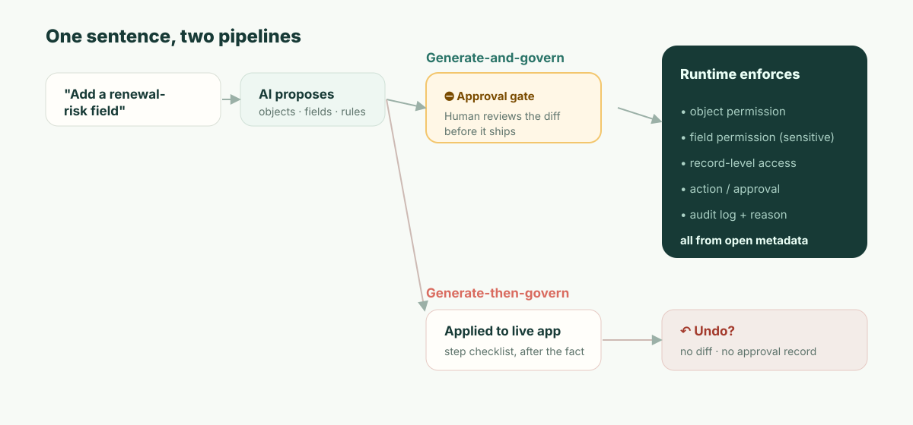

**TL;DR:** Wenn Sie mit Airtable Omni bauen, behalten Sie die volle Kontrolle, das Ergebnis zu bearbeiten. Seine Tabellen, Felder und Automatisierungen sind gewöhnliche Airtable-Objekte, seine Interface-Seiten öffnen sich im Interface Designer, und die benutzerdefinierten Elemente, die es erzeugt, haben Quellcode, den ein Creator oder Owner der Base bearbeiten oder herunterladen kann. Omni ist kein Vibe Coding: Es setzt Apps aus produktionserprobten Komponenten zusammen, nicht aus Wegwerf-Code. Die Lücke ist nicht die Bearbeitbarkeit, sondern *wann* geprüft wird. Omnis Änderungen gehen live, während es sie baut. Vor dem Löschen, dem Veröffentlichen eines Interface oder dem Einschalten einer Automatisierung fragt es nach; ansonsten verlässt es sich auf Rückgängig und ein Audit-Log. Ein reguliertes System of Record braucht eine *präventive* Kontrolle: ein geprüftes Diff, vor dem Ausrollen freigegeben, das benennt, wer worauf Zugriff erhält. Kommt hinzu, dass Airtable nur in der Cloud läuft, ist die Plattformentscheidung für manche Systems of Record gefallen, bevor Sie ein einziges Feature vergleichen.

Beginnen wir mit einem Dienstag, denn da beißt es wirklich — nicht in der Demo.

Eine Revenue-Ops-Managerin öffnet Omni und tippt: *„Füge zu Customers ein Feld für Verlängerungsrisiko hinzu, packe Konten mit hohem Risiko auf ein Board und erinnere den CSM jeden Montag."* Omni erledigt es, wunderschön. Das Feld erscheint in dem Moment, in dem Omni es anlegt, das Board wird entworfen, und die Automatisierung wird eingerichtet und ausgeschaltet gelassen. Um das „Risiko" zu berechnen, greift es auf den ARR des Kontos zu. Damit das Board für die Leute nützlich ist, die Verlängerungen verfolgen, setzt es das neue Feld auf eine Interface-Seite, die die **CSM-Rolle** sehen kann. Das Veröffentlichen dieser Seite und das Einschalten der Automatisierung überlässt Omni der Managerin, die beides anklickt. Alle sind zufrieden. Die Managerin klickt weiter.

Sechs Wochen später stellt ein SOC-2-Auditor, der bei Ihrem Security-Team sitzt, eine einzige Frage: *„Customer-ARR ist vertraulich. Dieses Interface blendet der CSM-Rolle ein von ARR abgeleitetes Feld ein. Wer hat das wann freigegeben?"*

Und die ehrliche Antwort lautet: Die Person, die es angefordert hat, hat es freigegeben, ohne dass ihr gezeigt wurde, was es bedeutet. Die Managerin hat bei einem Board auf Veröffentlichen geklickt. Niemand wurde gefragt, ob CSMs nun von ARR abgeleitete Daten sehen sollen, denn der Klick galt einer Seite, nicht einer Aussage darüber, wer worauf Zugriff erhält. Eine KI hat an einem Dienstag eine Zugriffssteuerungs-Entscheidung getroffen, die Anforderin hat sie durchgewinkt, und der einzige Nachweis dieser Entscheidung ist ein nachträglicher Aktivitätseintrag — falls überhaupt jemand nachschaut. Das ist der ganze Artikel. Alles weiter unten erklärt, warum diese Lücke strukturell ist und nicht nur ein fehlendes Kontrollkästchen.

## Kann man bearbeiten, was Airtable Omni baut? Ja. So weit reicht es.

Die Frage, nach der Leute tatsächlich suchen, lautet: Gibt man die Kontrolle über das Ergebnis ab, wenn man mit Omni baut? Nein, und die präzise Antwort lohnt sich vor dem Governance-Argument, denn mit einer vagen Antwort läuft diese Debatte schief. Jede Zeile unten stammt aus Airtables eigener Support-Dokumentation, Stand November 2026 ([Using Omni AI](https://support.airtable.com/docs/using-airtable-cobuilder), [AI-generated interface elements](https://support.airtable.com/docs/ai-generated-interface-elements-in-airtable)).

| Was Omni erstellt hat | Bearbeitbar? | Was man wissen sollte |
| --- | --- | --- |
| **Tabellen, Felder, Datensätze** | Ja, wie jedes Airtable-Objekt | Omni „strukturiert nur um oder überschreibt nur, was es selbst gebaut hat", lässt Ihre eigenen Tabellen also in Ruhe |
| **Interface-Seiten** | Ja, im Interface Designer | Omni kann keine klassischen Layouts wie Gantt oder leere Seiten bauen; die bauen Sie von Hand |
| **KI-generierte Interface-Elemente** | Ja, einschließlich des Codes | **Edit source code** (Quellcode bearbeiten) und der Download liegen im Überlaufmenü des Elements, nur für Creators und Owners der Base |
| **Automatisierungen** | Ja | Omni legt sie ausgeschaltet an; das Einschalten bleibt Ihnen überlassen |
| **Rückgängig** | Teilweise | Omni „kann Bearbeitungen bestehender Datensatzwerte oder das Anlegen einer Tabelle, eines Interface oder einer Seite nicht rückgängig machen" und macht nur seine eigenen Aktionen in der aktuellen Unterhaltung rückgängig; das History-Menü und Omnis Revert-Button reichen weiter zurück |

In dieser Tabelle stecken zwei Vorbehalte. Generierte Elemente „können nicht über mehrere Seiten oder Apps hinweg wiederverwendet werden", und das Duplizieren einer Seite oder App forkt sie, sodass eine Korrektur am Original die Kopie nicht erreicht. Und Bearbeiten ist nicht dasselbe wie Besitzen: Der Quellcode, den Sie herunterladen, ist ein Element, das innerhalb eines Airtable-Interface läuft, keine App, die Sie anderswo deployen können.

Bei der Bearbeitbarkeit ist Omni also besser, als sein Ruf als „KI-Blackbox" vermuten lässt. In diesem Artikel geht es um eine andere Frage, und Airtables Dokumentation beantwortet sie in einem Satz: „Was Omni baut, ist live in Ihrer Base, während es baut." Omni hält an und fragt nach, bevor es Datensätze, Tabellen oder Seiten löscht, bevor es ein Interface veröffentlicht oder eine Automatisierung einschaltet, und nachdem es externe Inhalte wie Websuchergebnisse gelesen hat. Alles andere — ein neues Feld, eine geänderte Formel, eine umstrukturierte Tabelle — greift, während Omni arbeitet. Das ist eine Designentscheidung, und für die meisten Bases eine gute. Der Rest dieses Artikels handelt von den Bases, für die sie es nicht ist.

## Die Unterscheidung, die Ihr Auditor bereits nutzt: präventiv vs. detektivisch

Geben wir Airtable zuerst seinen verdienten Respekt, und zwar präzise, denn vage Kritik ist hier wertlos. Omni ist wirklich kein Vibe Coding — sein komponentenbasierter Ansatz ist die richtige Richtung und schlägt das fragile Neugenerieren von Code bei jedem Prompt. Auch Airtables Enterprise-Scale-Plan hat echte Kontrollen: ein Admin-Panel, Audit-Logs, die „180 Tage lang gespeichert und durchsuchbar" sind und über eine API bereitstehen ([Enterprise audit logs](https://support.airtable.com/docs/accessing-enterprise-audit-logs-in-airtable)), sowie Omnis eigene Rückfragen vor Löschungen, dem Veröffentlichen von Interfaces und Automatisierungen. Ein ernsthafter Airtable-Admin liest eine faule „hat keine Governance"-These und hört auf, Ihnen zu vertrauen. Schreiben Sie diese also nicht.

Schreiben Sie stattdessen die präzise. Security- und Audit-Frameworks teilen Kontrollen in zwei Arten, und Ihr Auditor lebt nach dieser Unterscheidung:

- Eine **detektivische** Kontrolle sagt Ihnen, dass etwas geschehen ist — *nachdem* es geschah. Ein Audit-Log ist das kanonische Beispiel. Es ist notwendig, und Airtable hat es.
- Eine **präventive** Kontrolle verhindert, dass etwas Unautorisiertes *überhaupt* geschieht. Ein Freigabe-Gate für eine sensible Änderung ist das kanonische Beispiel.

Rückgängig ist *keines von beiden*. Es ist keine Kontrolle, sondern eine persönliche Bequemlichkeit, die abläuft, nachdem die Änderung bereits live ist, davon abhängt, dass eine Person es bemerkt, und keinen Nachweis hinterlässt, *wer die Änderung für akzeptabel befunden hat* — nur, dass sie zurückgenommen wurde. SOC 2s Change-Management-Kriterien (CC8.1) und jeder ernsthafte Änderungsprozess existieren genau deshalb, weil detektivisch-allein bei sensiblen Änderungen nicht ausreicht. Sie dürfen nicht *entdecken*, dass ARR offengelegt wurde; Sie müssen verhindert haben, dass es ohne Abzeichnung offengelegt wird.

Hier ist derselbe Sachverhalt, abgebildet auf das Framework, das ein Auditor tatsächlich anwendet:

| | Omni heute | Was ein System of Record braucht |
| --- | --- | --- |
| Wann die Kontrolle wirkt | Die meisten Änderungen sind live, während Omni sie baut (detektivisch) | Bevor die Änderung ausgerollt wird (präventiv) |
| Menschlicher Kontrollpunkt | Rückfrage vor Löschen, Interface-Veröffentlichung und Einschalten von Automatisierungen; Rückgängig für den Rest | Ein Diff genau dessen freigeben, was sich ändert |
| Erzeugter Nachweis | „Durchgeführte Schritte" + Dass-es-sich-änderte-Log | Wer genau diese Änderung freigegeben hat und warum |
| Antwort auf „Wer hat das erlaubt?" | Aus Logs rekonstruieren, vielleicht | Namentlicher Freigeber, an die Änderung gebunden |
| Fehlermodus | Jemand muss es rechtzeitig bemerken | Die Änderung kann nicht unfreigegeben live gehen |

Deshalb schließt „Omni zeigt seine Schritte, fragt vor dem Veröffentlichen nach, und Sie können es rückgängig machen" die Lücke nicht. Die Schrittliste ist eine Quittung, keine Kontrolle; Rückgängig ist ein nachträgliches Wiederherstellungswerkzeug. Die Veröffentlichungs-Rückfrage kommt einem präventiven Kontrollpunkt am nächsten, und sie ist ein echter, aber sie bittet die Anfordernde, eine Seite freizugeben, nicht einen Prüfer, eine Konsequenz freizugeben. Nichts darin sagt: „Das legt dem CSM von ARR abgeleitete Daten offen." Keines der drei ist der Kontrollpunkt, den das ARR-Offenlegungs-Szenario erforderte.



## Was „das Diff prüfen" wirklich bedeutet — gezeigt, nicht behauptet

Die Formulierung „geprüftes Diff" ist leicht gesagt und leicht beiseitezuwischen, deshalb hier die konkrete Sache. Wenn eine KI eine Änderung an einer governten App vorschlägt, sollte das Artefakt, das ein Mensch freigibt, die *Konsequenzen* lesbar machen — nicht den Prosatext der Anfrage, sondern das tatsächliche Metadaten-Delta:

```diff
  object: Customer
+ field: renewal_risk
+   type: enum[low, medium, high]
+   derived_from: account.arr
+   sensitivity: confidential        # von der ARR-Quelle geerbt
+ permission: field.renewal_risk
+   read:  [RevOps, AccountExec]
+   edit:  [RevOps]
!   read:  CSM  ← angefordert von der neuen Board-Ansicht — FREIGEBEN? (legt von ARR abgeleitete Daten offen)
+ view: "Renewal risk board"  exposes: [account, renewal_risk]
+ automation: notify_csm_weekly
  change #4827 · proposed by Omni · approved_by: __________ · reason: __________
```

Lesen Sie, was das der Managerin aus der Eröffnungsszene bringt. Das Feld ist als `confidential` markiert, weil es vom ARR abstammt — automatisch, denn Sensitivität ist eine Eigenschaft der Daten, nicht etwas, an dessen Tagging ein Mensch denken muss. Und die eine Zeile, auf die es ankam — die Board-Ansicht möchte dem CSM Lesezugriff auf von ARR abgeleitete Daten gewähren — wird *als Entscheidung* hervorgehoben, für sich allein, bevor irgendetwas ausgerollt wird. Die Managerin (oder ihr Security-Partner) gibt sie absichtlich frei oder eben nicht. So oder so hat Change #4827 jetzt einen Namen und einen Grund. Wenn der Auditor in sechs Wochen fragt, existiert die Antwort, *weil die Frage im Moment der Änderung erzwungen wurde.*

Das ist der Unterschied zwischen „die KI kann es bauen" und „die Änderung der KI ist governbar". Es geht nicht darum, dem Modell weniger zu vertrauen. Es geht darum, dass die Änderung ein prüfbares Objekt ist statt ein Ereignis, das bereits eingetreten ist.

## Die Kennzahl: Ihre mittlere Zeit bis zur unautorisierten Offenlegung

Hier ist eine Größe, die Sie für Ihre eigene Organisation berechnen können, denn sie macht das Abstrakte konkret. Nennen wir sie **mean time to unauthorized exposure (MTUE)**: Vom Moment, in dem eine KI-Änderung eine Grenze überschreitet, die sie nicht sollte, bis zu dem Moment, in dem sie nicht mehr live ist.

- Mit einem **präventiven** Gate nähert sich MTUE **konstruktionsbedingt null.** Die grenzüberschreitende Änderung geht ohne Freigabe nicht live; sie wartet am Freigabeschritt. Das Offenlegungsfenster wird durch das Design geschlossen.
- Mit **Rückgängig + einem detektivischen Log** ist MTUE die *Zeit bis zur Entdeckung* — und die sollten Sie ehrlich beziffern. Bestenfalls bemerkt es ein Kollege am selben Nachmittag. Realistisch ist es, wann immer jemand die Ansicht prüft, oder das vierteljährliche Access-Review läuft, oder — wie im Szenario — der externe Auditor es zuerst findet. Für Daten, die weiter in andere Systeme synchronisiert werden, kann sich die Offenlegung ausbreiten, bevor ein Mensch hinschaut.

Setzen Sie Ihre eigene Access-Review-Taktung ein. Wenn Sie sensible Berechtigungen vierteljährlich prüfen, misst sich Ihre rückgängig-basierte MTUE für eine stille Fehlkonfiguration in *Wochen bis zu einem Quartal*. Das präventive Modell macht diese Zahl nicht dadurch zu null, dass es schlauer ist, sondern dadurch, dass es den Kontrollpunkt vor die Änderung verlegt statt dahinter. Sie können sich nicht zu MTUE = 0 prompten; es ist eine architektonische Eigenschaft davon, *wann* der Mensch in der Schleife ist.

## „Aber wir betreiben bereits Airtable Enterprise, und die Security hat zugestimmt"

Das ist die Position des echten Lesers, also begegnen wir ihr direkt. Ja — und wozu Ihr Security-Team zugestimmt hat, war Airtables *Zugriffsmodell und Infrastruktur*: SSO, Verschlüsselung, Audit-Logging, die Berechtigungsstufen. Die sind real, und diese Zustimmung war vernünftig.

Sie geht mit ziemlicher Sicherheit der Zeit voraus, in der Omni Änderungen an diesem Zugriffsmodell schreibt. Die Frage, die Ihrem Security-Team höchstwahrscheinlich nicht gestellt wurde, ist eng und beantwortbar: **„Wenn die KI ändert, wer-was-sehen-kann, was prüft diese Änderung, bevor sie live ist — und wo ist die namentliche Freigabe?"** Nehmen Sie diesen Satz mit in Ihr nächstes Anbietergespräch. Die Antwort, die Sie zurückbekommen — „Sie können es rückgängig machen" / „es steht im Audit-Log" / „Omni zeigt einen Plan" — sagt Ihnen genau, auf welcher Seite der präventiv/detektivisch-Linie Sie stehen. Dafür brauchen Sie nicht unsere Meinung; Sie brauchen die Frage.

## Wo dieses Argument *nicht* gilt

Intellektuelle Redlichkeit, denn der Fehlermodus eines solchen Textes ist, so zu tun, als sei der Trade-off umsonst. Das präventive Modell hat reale Kosten: **Reibung.** Ein Freigabe-Gate bei jeder sensiblen Änderung ist genau die falsche Ergonomie für ein Drei-Personen-Team, das an einem internen Tracker iteriert. Für diese *ist* Rückgängig das richtige Design, die Tabellen-UX eine echte Freude, und Airtables Template-Ökosystem und Time-to-First-App sind allem Schwergewichtigeren voraus — uns eingeschlossen. Wir werden Airtable bei der Geschwindigkeit zur ersten App nicht überbieten, und etwas anderes vorzugeben wäre dieselbe Unredlichkeit in die andere Richtung.

Das präventive Modell zahlt sich erst aus, wenn die Kosten einer ungeprüften Änderung die Kosten des Prüfens von Änderungen übersteigen — also wenn es vertrauliche Daten gibt, ein echtes Berechtigungsmodell und jemanden, der es irgendwann prüfen wird. Das ist die Linie. Darunter gewinnt Airtable nach Verdienst. Darüber ist die Rückgängig-Lücke das, was die Evaluierung beendet, und sie beendet sie vor den Features.

Und noch eine, getrennt von all dem und für manche Käufer ebenso endgültig: **Airtable läuft in Airtables Cloud, nicht als selbst gehostete Laufzeit.** Kunden mit Enterprise Scale können wählen, wo bestimmte Daten ruhend gespeichert werden — in den USA, in Europa oder in Australien —, aber in jedem Fall auf Airtables Infrastruktur ([data residency at Airtable](https://support.airtable.com/docs/data-residency-at-airtable)). Wenn Ihre Laufzeit dort leben muss, wo Ihre Daten und Ihre Regulatoren es verlangen — Souveränität, Air-Gap, Residenz —, hilft kein noch so ausgefeilter Governance-Grad, denn die Plattform kann nicht dort sein, wo Sie sie brauchen. Für diese Käuferklasse ist der Vergleich bei der ersten Anforderung vorbei.

## ObjectStacks Position

ObjectStack ist für die Welt oberhalb dieser Linie gebaut, und nur für diese Welt. Der Anwendungskern ist **offene, lesbare Metadaten** — Objekte, Felder, Beziehungen, Berechtigungen, Aktionen —, sodass eine KI-Änderung das oben gezeigte prüfbare Diff ist: ein *präventiver* Kontrollpunkt, den ein Mensch freigibt, bevor es ausgerollt wird, mit der Konsequenz (diese Ansicht legt dem CSM von ARR abgeleitete Daten offen) als Entscheidung hervorgehoben und an einen namentlichen Freigeber gebunden. Berechtigungen werden von der **Laufzeit auf Objekt-, Datensatz-, Feld- und Aktionsebene** durchgesetzt, sodass sie nicht still durch das Bearbeiten einer Ansicht umgeordnet werden können. Es ist **self-hostbar** und es **verbindet sich mit dem CRM/ERP/der DB, die Sie bereits betreiben**, statt Ihr Geschäft in noch eine Cloud zu synchronisieren.

Der Pitch ist nicht „so einfach wie Airtable" — das ist es bewusst nicht, denn der Freigabeschritt ist das Produkt. Er lautet: Behalten Sie das Tabellen-und-Chat-Erlebnis, das Airtable lesbar macht, und legen Sie eine präventive Kontrolle, ein Laufzeit-Berechtigungsmodell und Ihre eigene Infrastruktur darunter — damit die Antwort auf „Wer hat die ARR-Offenlegung an einem Dienstag freigegeben" ein Name ist, keine Suche.
