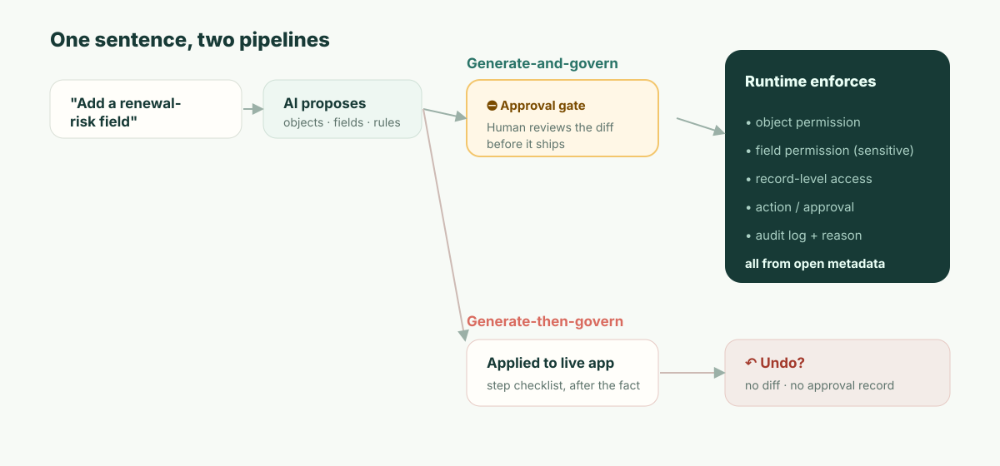

**TL;DR:** Si construyes con Airtable Omni, sí tienes control total para editar lo que crea. Sus tablas, campos y automatizaciones son objetos normales de Airtable, sus páginas de interfaz se abren en Interface Designer y los elementos personalizados que genera tienen código fuente que un Creator u Owner de la base puede editar o descargar. Omni no es vibe coding: ensambla apps a partir de componentes probados en producción, no de código desechable. La brecha no es la editabilidad; es *cuándo* ocurre la revisión. Los cambios de Omni entran en producción a medida que los construye. Pregunta antes de eliminar, publicar una interfaz o activar una automatización, y por lo demás se apoya en deshacer y en un registro de auditoría. Un sistema de registro regulado necesita un control *preventivo*: un diff revisado, aprobado antes de desplegarse, que diga quién obtiene acceso a qué. Si a eso le sumas que Airtable solo se despliega en su nube, para algunos sistemas de registro la decisión de plataforma está tomada antes de comparar una sola función.

Empieza por un martes, porque ahí es donde esto muerde de verdad, no en la demo.

Una responsable de revenue ops abre Omni y escribe: *"Añade un campo de riesgo de renovación a Customers, pon las cuentas de alto riesgo en un tablero y recuérdale al CSM cada lunes."* Omni lo hace, de forma impecable. El campo aparece en el momento en que Omni lo crea, el tablero queda en borrador y la automatización se configura y se deja desactivada. Para calcular el "riesgo", extrae datos del ARR de la cuenta. Para que el tablero sea útil a quienes persiguen renovaciones, coloca el nuevo campo en una página de interfaz que el **rol CSM** puede ver. Omni deja en manos de la responsable publicar esa página y activar la automatización, y ella hace clic en ambas. Todos contentos. La responsable cierra y sigue.

Seis semanas después, un auditor de SOC 2 sentado junto a tu equipo de seguridad hace una sola pregunta: *"El ARR de cliente es confidencial. Esta interfaz expone al rol CSM un campo derivado del ARR. ¿Quién lo aprobó, y cuándo?"*

Y la respuesta honesta es: lo aprobó quien lo pidió, sin que nadie le mostrara lo que significaba. La responsable hizo clic en Publicar sobre un tablero. A nadie se le preguntó si los CSM debían ver ahora datos derivados del ARR, porque el clic fue sobre una página, no sobre una declaración de quién obtiene acceso a qué. Una IA tomó una decisión de control de acceso un martes, quien la pidió le dio luz verde sin más, y el único registro de esa decisión es una entrada de actividad a posteriori, si a alguien se le ocurre mirar. Ese es todo el artículo. Todo lo que sigue explica por qué esa brecha es estructural, no una casilla de verificación pendiente.

## ¿Puedes editar lo que construye Airtable Omni? Sí. Hasta aquí llega.

La pregunta que la gente busca de verdad es si construir con Omni significa renunciar al control del resultado. No es así, y conviene tener la respuesta precisa antes del argumento de gobernanza, porque una respuesta vaga es justo como se tuerce este debate. Cada fila de abajo procede de la propia documentación de soporte de Airtable a noviembre de 2026 ([Using Omni AI](https://support.airtable.com/docs/using-airtable-cobuilder), [AI-generated interface elements](https://support.airtable.com/docs/ai-generated-interface-elements-in-airtable)).

| Lo que creó Omni | ¿Se puede editar? | Qué conviene saber |
| --- | --- | --- |
| **Tablas, campos, registros** | Sí, como cualquier objeto de Airtable | Omni "solo reestructurará o sobrescribirá algo que haya construido", así que deja en paz tus propias tablas |
| **Páginas de interfaz** | Sí, en Interface Designer | Omni no puede construir diseños tradicionales como Gantt o páginas en blanco; esos los construyes a mano |
| **Elementos de interfaz generados por IA** | Sí, incluido el código | **Edit source code** (editar código fuente) y la descarga están en el menú de desbordamiento del elemento, solo para Creators y Owners de la base |
| **Automatizaciones** | Sí | Omni las crea desactivadas; activarlas queda en tus manos |
| **Deshacer** | En parte | Omni "no puede deshacer ediciones de valores de registros existentes, ni la creación de una tabla, interfaz o página", y solo deshace sus propias acciones en la conversación actual; el menú History y el botón Revert de Omni llegan más atrás |

Esa tabla esconde dos salvedades. Los elementos generados "no se pueden reutilizar en varias páginas o apps", y duplicar una página o app los bifurca, de modo que una corrección en el original no llega a la copia. Y editar no es lo mismo que poseer: el código fuente que descargas es un elemento que se ejecuta dentro de una interfaz de Airtable, no una app que puedas desplegar en otro sitio.

Así que, en editabilidad, Omni es mejor de lo que sugiere su fama de "caja negra de IA". La pregunta de este artículo es otra, y la documentación de Airtable la responde en una frase: "lo que Omni construye está en producción en tu base a medida que lo construye". Omni se detiene a preguntar antes de eliminar registros, tablas o páginas, antes de publicar una interfaz o activar una automatización, y después de leer contenido externo como resultados web. Todo lo demás —un campo nuevo, una fórmula modificada, una tabla reestructurada— se aplica mientras Omni trabaja. Es una decisión de diseño y, para la mayoría de las bases, una buena. El resto de este artículo trata de las bases para las que no lo es.

## La distinción que tu auditor ya usa: preventivo vs. detectivo

Reconozcamos primero los méritos de Airtable, con precisión, porque aquí la crítica vaga no vale nada. Omni no es vibe coding de verdad: su enfoque basado en componentes es la dirección correcta y supera a regenerar código frágil en cada prompt. El plan Enterprise Scale de Airtable también tiene controles reales: un panel de administración, registros de auditoría que se "almacenan y se pueden buscar durante 180 días" y se exponen mediante una API ([Enterprise audit logs](https://support.airtable.com/docs/accessing-enterprise-audit-logs-in-airtable)), y las propias confirmaciones de Omni antes de eliminar, publicar interfaces y activar automatizaciones. Un admin serio de Airtable lee una postura perezosa de "no tiene gobernanza" y deja de confiar en ti. Así que no escribas esa.

Escribe la precisa. Los marcos de seguridad y auditoría dividen los controles en dos tipos, y tu auditor vive según esa distinción:

- Un control **detectivo** te dice que algo ocurrió *después* de que ocurriera. Un registro de auditoría es el ejemplo canónico. Es necesario y Airtable lo tiene.
- Un control **preventivo** impide que algo no autorizado ocurra *en absoluto*. Una compuerta de aprobación sobre un cambio sensible es el ejemplo canónico.

Deshacer no es *ninguno de los dos*. No es un control; es una comodidad personal que se ejecuta cuando el cambio ya está en producción, depende de que una persona se dé cuenta y no deja registro de *quién decidió que el cambio era aceptable*, solo de que se revirtió. Los criterios de gestión de cambios de SOC 2 (CC8.1) y todo proceso serio de cambios existen precisamente porque, para cambios sensibles, lo detectivo solo no basta. No te corresponde descubrir que el ARR quedó expuesto; tienes que haber impedido que se expusiera sin visto bueno.

Aquí está el mismo hecho mapeado sobre el marco que un auditor aplicará de verdad:

| | Omni hoy | Lo que necesita un sistema de registro |
| --- | --- | --- |
| Cuándo actúa el control | La mayoría de los cambios están en producción a medida que Omni los construye (detectivo) | Antes de que el cambio se despliegue (preventivo) |
| Punto de control humano | Confirmación antes de eliminar, publicar una interfaz o activar una automatización; deshacer para lo demás | Aprobar un diff de exactamente lo que cambia |
| Registro que produce | "Pasos dados" + log de que-cambió | Quién aprobó este cambio concreto, y por qué |
| Respuesta a "¿quién permitió esto?" | Reconstruir desde los logs, quizá | Aprobador con nombre, vinculado al cambio |
| Modo de fallo | Alguien tiene que darse cuenta a tiempo | El cambio no puede entrar en producción sin aprobar |

Por eso "Omni muestra sus pasos, pregunta antes de publicar y puedes deshacerlo" no cierra la brecha. La lista de pasos es un recibo, no un control; deshacer es una herramienta de recuperación a posteriori. La confirmación de publicación es lo más parecido a un punto de control preventivo, y es uno real, pero le pide a quien hizo la solicitud que apruebe una página, no a un revisor que apruebe una consecuencia. Nada en ella dice "esto expone al CSM datos derivados del ARR". Ninguno de los tres es el punto de control que exigía el escenario de exposición del ARR.



## Qué significa de verdad "revisar el diff" — mostrado, no afirmado

La frase "diff revisado" es fácil de decir y fácil de despachar, así que aquí está la cosa concreta. Cuando una IA propone un cambio a una app gobernada, el artefacto que un humano aprueba debería hacer legibles las *consecuencias*, no la prosa de la petición, sino el delta de metadatos real:

```diff
  object: Customer
+ field: renewal_risk
+   type: enum[low, medium, high]
+   derived_from: account.arr
+   sensitivity: confidential        # heredado de la fuente ARR
+ permission: field.renewal_risk
+   read:  [RevOps, AccountExec]
+   edit:  [RevOps]
!   read:  CSM  ← solicitado por la nueva vista de tablero — ¿APROBAR? (expone datos derivados del ARR)
+ view: "Renewal risk board"  exposes: [account, renewal_risk]
+ automation: notify_csm_weekly
  change #4827 · proposed by Omni · approved_by: __________ · reason: __________
```

Lee lo que esto le aporta a la responsable de la escena inicial. El campo está marcado como `confidential` porque desciende del ARR, automáticamente, porque la sensibilidad es una propiedad del dato, no algo que un humano recuerde etiquetar. Y la única línea que importaba —la vista de tablero quiere conceder al CSM acceso de lectura a datos derivados del ARR— aparece resaltada *como una decisión*, por sí sola, antes de que se despliegue nada. La responsable (o su compañero de seguridad) la aprueba a propósito o no la aprueba. En cualquier caso, el cambio #4827 ahora tiene un nombre y un motivo asociados. Cuando el auditor pregunte dentro de seis semanas, la respuesta existe *porque la pregunta se forzó en el momento del cambio.*

Esa es la diferencia entre "la IA puede construirlo" y "el cambio de la IA es gobernable". No se trata de confiar menos en el modelo. Se trata de que el cambio sea un objeto revisable en lugar de un evento que ya ocurrió.

## El número: tu tiempo medio hasta la exposición no autorizada

Aquí tienes una cifra que puedes calcular para tu propia organización, porque vuelve concreto lo abstracto. Llámala **tiempo medio hasta la exposición no autorizada (MTUE)**: desde el momento en que un cambio de IA cruza una línea que no debería, ¿cuánto tarda en dejar de estar en producción?

- Con una compuerta **preventiva**, el MTUE se acerca a **cero por construcción.** El cambio que cruza la línea no entra en producción sin aprobación; espera en el paso de aprobación. La ventana de exposición se cierra por diseño.
- Con **deshacer + un registro detectivo**, el MTUE es el *tiempo hasta la detección*, y deberías ponerle precio con honestidad. En el mejor caso, un compañero se da cuenta esa tarde. En el caso realista, es cuando alguien audita la vista, o se ejecuta la revisión trimestral de accesos, o —como en el escenario— el auditor externo lo encuentra primero. Para datos que se siguen sincronizando hacia otros sistemas, la exposición puede propagarse antes de que ningún humano mire.

Sustituye tu propia cadencia de revisión de accesos. Si revisas los permisos sensibles cada trimestre, tu MTUE basado en deshacer para una mala configuración silenciosa se mide en *semanas a un trimestre*. El modelo preventivo lleva ese número a cero no por ser más listo, sino por mover el punto de control a antes del cambio en lugar de después. No puedes llegar a MTUE = 0 a fuerza de prompts; es una propiedad arquitectónica de *cuándo* el humano está en el bucle.

## "Pero ya usamos Airtable Enterprise y seguridad dio el visto bueno"

Esta es la posición del lector real, así que afrontémosla de frente. Sí, y lo que tu equipo de seguridad aprobó fue el *modelo de acceso y la infraestructura* de Airtable: SSO, cifrado, registro de auditoría, los niveles de permisos. Eso es real y ese visto bueno fue razonable.

Casi con seguridad fue anterior a que Omni escribiera cambios en ese modelo de acceso. La pregunta que a tu equipo de seguridad muy probablemente no le han hecho es estrecha y respondible: **"Cuando la IA cambia quién-puede-ver-qué, ¿qué revisa ese cambio antes de que esté en producción, y dónde está la aprobación con nombre?"** Lleva esa frase a tu próxima reunión con el proveedor. La respuesta que recibas —"puedes deshacerlo" / "está en el registro de auditoría" / "Omni muestra un plan"— te dirá exactamente de qué lado de la línea preventivo/detectivo estás. Para eso no necesitas nuestra opinión; necesitas la pregunta.

## Dónde *no* aplica este argumento

Honestidad intelectual, porque el modo de fallo de un texto como este es fingir que el compromiso es gratis. El modelo preventivo tiene un coste real: **fricción.** Una compuerta de aprobación en cada cambio sensible es exactamente la ergonomía equivocada para un equipo de tres personas iterando sobre un tracker interno. Para ellos, deshacer *es* el diseño correcto, la UX de tablas es un placer genuino, y el ecosistema de plantillas de Airtable y su tiempo hasta la primera app van por delante de cualquier cosa más pesada, incluidos nosotros. No vamos a superar a Airtable en velocidad hasta la primera app, y pretender lo contrario sería la misma deshonestidad en el otro sentido.

El modelo preventivo solo se paga a sí mismo cuando el coste de un cambio no revisado supera el coste de revisar los cambios; es decir, cuando hay datos confidenciales, un modelo de permisos real y alguien que tarde o temprano lo auditará. Esa es la línea. Por debajo, Airtable gana por méritos. Por encima, la brecha de deshacer es lo que termina la evaluación, y la termina antes de las funciones.

Y una más, separada de todo lo anterior e igual de definitiva para algunos compradores: **Airtable se ejecuta en la nube de Airtable, no como un runtime autoalojado.** Los clientes de Enterprise Scale pueden elegir dónde residen en reposo algunos datos —Estados Unidos, Europa o Australia—, pero en todos los casos sobre la infraestructura de Airtable ([data residency at Airtable](https://support.airtable.com/docs/data-residency-at-airtable)). Si tu runtime debe vivir donde lo exigen tus datos y tus reguladores —soberanía, air-gap, residencia—, ninguna sofisticación de gobernanza ayuda, porque la plataforma no puede estar donde la necesitas. Para esa clase de comprador, la comparación termina en el primer requisito.

## La posición de ObjectStack

ObjectStack está construido para el mundo por encima de esa línea, y solo para ese mundo. El núcleo de la aplicación son **metadatos abiertos y legibles** —objetos, campos, relaciones, permisos, acciones—, de modo que un cambio de IA es el diff revisable mostrado arriba: un punto de control *preventivo* que un humano aprueba antes de desplegarlo, con la consecuencia (esta vista expone al CSM datos derivados del ARR) resaltada como decisión y vinculada a un aprobador con nombre. Los permisos los aplica el **runtime sobre el objeto, el registro, el campo y la acción**, de modo que no pueden reordenarse en silencio editando una vista. Es **autoalojable** y **se conecta al CRM/ERP/BD que ya usas** en lugar de sincronizar tu negocio hacia una nube más.

El pitch no es "tan fácil como Airtable"; no lo es, por diseño, porque el paso de aprobación es el producto. Es este: conserva la experiencia de tabla y chat que hace legible a Airtable, y pon debajo un control preventivo, un modelo de permisos en runtime y tu propia infraestructura, para que la respuesta a "quién aprobó exponer el ARR un martes" sea un nombre, no una búsqueda.
