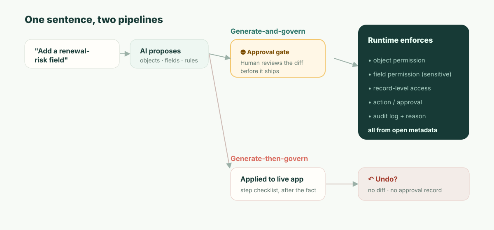

**TL;DR :** Si vous construisez avec Airtable Omni, vous gardez bel et bien le plein contrôle pour modifier ce qu'il crée. Ses tables, champs et automatisations sont des objets Airtable ordinaires, ses pages d'interface s'ouvrent dans Interface Designer, et les éléments personnalisés qu'il génère ont un code source qu'un Creator ou un Owner de la base peut modifier ou télécharger. Omni n'est pas du vibe coding : il assemble des apps à partir de composants éprouvés en production, pas de code jetable. L'écart n'est pas la modifiabilité ; c'est *le moment* où la revue a lieu. Les changements d'Omni passent en production au fur et à mesure qu'il les construit. Il demande d'abord avant de supprimer, de publier une interface ou d'activer une automatisation, et s'en remet sinon à l'annulation et à un journal d'audit. Un système de référence régulé a besoin d'un contrôle *préventif* : un diff relu, approuvé avant le déploiement, qui nomme qui obtient l'accès à quoi. Ajoutez le déploiement uniquement dans le cloud d'Airtable, et pour certains systèmes de référence la décision de plateforme est prise avant même de comparer une seule fonctionnalité.

Commencez par un mardi, parce que c'est là que ça mord vraiment, pas dans la démo.

Une responsable revenue ops ouvre Omni et tape : *« Ajoute un champ risque de renouvellement à Customers, mets les comptes à haut risque sur un tableau, et rappelle au CSM chaque lundi. »* Omni le fait, magnifiquement. Le champ apparaît dès qu'Omni le crée, le tableau est esquissé, et l'automatisation est configurée puis laissée désactivée. Pour calculer le « risque », il puise dans l'ARR du compte. Pour rendre le tableau utile à ceux qui relancent les renouvellements, il place le nouveau champ sur une page d'interface que le **rôle CSM** peut voir. Omni laisse à la responsable le soin de publier cette page et d'activer l'automatisation, et elle clique sur les deux. Tout le monde est content. La responsable passe à autre chose.

Six semaines plus tard, un auditeur SOC 2 assis avec votre équipe sécurité pose une seule question : *« L'ARR client est confidentiel. Cette interface expose au rôle CSM un champ dérivé de l'ARR. Qui a approuvé cela, et quand ? »*

Et la réponse honnête est : la personne qui l'a demandé l'a approuvé, sans qu'on lui montre ce que cela impliquait. La responsable a cliqué sur Publier sur un tableau. Personne n'a été invité à dire si les CSM devaient désormais voir des données dérivées de l'ARR, parce que le clic portait sur une page, pas sur une déclaration de qui obtient l'accès à quoi. Une IA a pris une décision de contrôle d'accès un mardi, la demandeuse l'a laissée passer, et la seule trace de cette décision est une entrée d'activité après coup — si quelqu'un pense à regarder. C'est tout l'article. Tout ce qui suit explique pourquoi cet écart est structurel pour un système de référence, pas une simple case à cocher.

## Peut-on modifier ce que construit Airtable Omni ? Oui. Voici jusqu'où.

La question que les gens tapent vraiment est de savoir si construire avec Omni revient à renoncer au contrôle du résultat. Ce n'est pas le cas, et la réponse précise mérite d'être posée avant l'argument sur la gouvernance, parce que c'est par une réponse vague que ce débat dérape. Chaque ligne ci-dessous provient de la documentation d'assistance d'Airtable elle-même, en novembre 2026 ([Using Omni AI](https://support.airtable.com/docs/using-airtable-cobuilder), [AI-generated interface elements](https://support.airtable.com/docs/ai-generated-interface-elements-in-airtable)).

| Ce qu'Omni a créé | Modifiable ? | Ce qu'il faut savoir |
| --- | --- | --- |
| **Tables, champs, enregistrements** | Oui, comme tout objet Airtable | Omni « ne restructurera ou n'écrasera que ce qu'il a construit », il laisse donc vos propres tables tranquilles |
| **Pages d'interface** | Oui, dans Interface Designer | Omni ne peut pas construire de mises en page traditionnelles comme un Gantt ou une page vierge ; celles-là, vous les construisez à la main |
| **Éléments d'interface générés par IA** | Oui, y compris le code | **Edit source code** (modifier le code source) et le téléchargement se trouvent dans le menu de débordement de l'élément, réservés aux Creators et Owners de la base |
| **Automatisations** | Oui | Omni les crée désactivées ; les activer vous revient |
| **Annuler** | En partie | Omni « ne peut pas annuler les modifications de valeurs d'enregistrements existants, ni la création d'une table, d'une interface ou d'une page », et n'annule que ses propres actions dans la conversation en cours ; le menu History et le bouton Revert d'Omni remontent plus loin |

Ce tableau contient deux réserves. Les éléments générés « ne peuvent pas être réutilisés sur plusieurs pages ou apps », et dupliquer une page ou une app les duplique en copies indépendantes, de sorte qu'un correctif sur l'original n'atteint pas la copie. Et modifier n'est pas posséder : le code source que vous téléchargez est un élément qui s'exécute dans une interface Airtable, pas une app que vous pouvez déployer ailleurs.

Sur la modifiabilité, Omni vaut donc mieux que sa réputation de « boîte noire IA ». La question de cet article est une autre, et la documentation d'Airtable y répond en une phrase : « ce qu'Omni construit est en production dans votre base au fur et à mesure qu'il le construit ». Omni s'arrête pour demander avant de supprimer des enregistrements, des tables ou des pages, avant de publier une interface ou d'activer une automatisation, et après avoir lu du contenu externe comme des résultats web. Tout le reste — un nouveau champ, une formule modifiée, une table restructurée — s'applique pendant qu'Omni travaille. C'est un choix de conception, et pour la plupart des bases un bon choix. Le reste de cet article porte sur les bases pour lesquelles il ne l'est pas.

## La distinction que votre auditeur utilise déjà : préventif vs détectif

Rendons d'abord justice à Airtable, avec précision, parce qu'une critique vague ne vaut rien ici. Omni n'est vraiment pas du vibe coding : son approche par composants est la bonne direction et bat la régénération de code fragile à chaque prompt. Le plan Enterprise Scale d'Airtable a lui aussi de vrais contrôles : un panneau d'administration, des journaux d'audit « stockés et consultables pendant 180 jours » et exposés via une API ([Enterprise audit logs](https://support.airtable.com/docs/accessing-enterprise-audit-logs-in-airtable)), et les propres confirmations d'Omni avant les suppressions, la publication d'interfaces et les automatisations. Un admin Airtable sérieux lit un argument paresseux du genre « ça n'a pas de gouvernance » et cesse de vous faire confiance. Alors n'écrivez pas celui-là.

Écrivez plutôt le précis. Les cadres de sécurité et d'audit divisent les contrôles en deux types, et votre auditeur vit selon cette distinction :

- Un contrôle **détectif** vous dit que quelque chose s'est produit *après* que c'est arrivé. Un journal d'audit en est l'exemple canonique. Il est nécessaire, et Airtable l'a.
- Un contrôle **préventif** empêche qu'une chose non autorisée se produise *du tout*. Une porte d'approbation sur un changement sensible en est l'exemple canonique.

Annuler n'est *ni l'un ni l'autre*. Ce n'est pas un contrôle ; c'est une commodité personnelle qui s'exécute une fois le changement déjà en production, dépend de ce qu'une personne le remarque, et ne laisse aucune trace de *qui a décidé que le changement était acceptable* — seulement qu'il a été annulé. Les critères de gestion du changement de SOC 2 (CC8.1) et tout processus de changement sérieux existent précisément parce que, pour les changements sensibles, le détectif seul ne suffit pas. Vous n'avez pas le droit de découvrir que l'ARR a été exposé ; vous devez avoir empêché qu'il soit exposé sans validation.

Voici le même fait projeté sur le cadre qu'un auditeur appliquera réellement :

| | Omni aujourd'hui | Ce dont un système de référence a besoin |
| --- | --- | --- |
| Quand le contrôle agit | La plupart des changements sont en production au fur et à mesure qu'Omni les construit (détectif) | Avant que le changement soit déployé (préventif) |
| Point de contrôle humain | Confirmation avant suppression, publication d'interface et activation d'automatisation ; annuler pour le reste | Approuver un diff de exactement ce qui change |
| Trace produite | « Étapes effectuées » + journal de que-ça-a-changé | Qui a approuvé ce changement précis, et pourquoi |
| Réponse à « qui a autorisé cela ? » | Reconstruire depuis les journaux, peut-être | Approbateur nommé, rattaché au changement |
| Mode de défaillance | Quelqu'un doit le remarquer à temps | Le changement ne peut pas passer en production sans approbation |

C'est pourquoi « Omni montre ses étapes, demande avant de publier, et vous pouvez annuler » ne comble pas l'écart. La liste des étapes est un reçu, pas un contrôle ; annuler est un outil de récupération après coup. La confirmation de publication est ce qui se rapproche le plus d'un point de contrôle préventif, et c'en est un vrai, mais elle demande au demandeur d'approuver une page, pas à un relecteur d'approuver une conséquence. Rien n'y dit « ceci expose au CSM des données dérivées de l'ARR ». Aucun des trois n'est le point de contrôle qu'exigeait le scénario d'exposition de l'ARR.



## Ce que « relire le diff » veut vraiment dire — montré, pas affirmé

L'expression « diff relu » est facile à dire et facile à balayer, alors voici la chose concrète. Quand une IA propose un changement à une app gouvernée, l'artefact qu'un humain approuve devrait rendre les *conséquences* lisibles — pas la prose de la demande, mais le delta de métadonnées réel :

```diff
  object: Customer
+ field: renewal_risk
+   type: enum[low, medium, high]
+   derived_from: account.arr
+   sensitivity: confidential        # hérité de la source ARR
+ permission: field.renewal_risk
+   read:  [RevOps, AccountExec]
+   edit:  [RevOps]
!   read:  CSM  ← demandé par la nouvelle vue de tableau — APPROUVER ? (expose des données dérivées de l'ARR)
+ view: "Renewal risk board"  exposes: [account, renewal_risk]
+ automation: notify_csm_weekly
  change #4827 · proposed by Omni · approved_by: __________ · reason: __________
```

Lisez ce que cela apporte à la responsable de la scène d'ouverture. Le champ est marqué `confidential` parce qu'il descend de l'ARR — automatiquement, car la sensibilité est une propriété de la donnée, pas quelque chose qu'un humain pense à étiqueter. Et la seule ligne qui comptait — la vue de tableau veut accorder au CSM un accès en lecture à des données dérivées de l'ARR — est mise en avant *comme une décision*, à part, avant que rien ne soit déployé. La responsable (ou son partenaire sécurité) l'approuve exprès ou ne l'approuve pas. Dans les deux cas, le changement #4827 a désormais un nom et une raison rattachés. Quand l'auditeur posera la question dans six semaines, la réponse existe *parce que la question a été imposée au moment du changement.*

C'est la différence entre « l'IA peut le construire » et « le changement de l'IA est gouvernable ». Il ne s'agit pas de faire moins confiance au modèle. Il s'agit de ce que le changement soit un objet relisable plutôt qu'un événement déjà survenu.

## Le chiffre : votre temps moyen avant exposition non autorisée

Voici une grandeur que vous pouvez calculer pour votre propre organisation, parce qu'elle rend l'abstrait concret. Appelez-la **temps moyen avant exposition non autorisée (MTUE)** : à partir du moment où un changement d'IA franchit une ligne qu'il ne devrait pas, combien de temps avant qu'il cesse d'être en production ?

- Avec une porte **préventive**, le MTUE se rapproche de **zéro** : le changement qui franchit la ligne ne passe pas en production tant qu'il attend l'approbation.
- Avec **annuler + un journal détectif**, le MTUE est le *temps jusqu'à la détection* — et vous devriez le chiffrer honnêtement. Au mieux, un collègue le remarque l'après-midi même. Dans le cas réaliste, c'est quand quelqu'un audite la vue, ou quand la revue d'accès trimestrielle s'exécute, ou — comme dans le scénario — quand l'auditeur externe le trouve en premier. Pour des données qui se synchronisent ensuite vers d'autres systèmes, l'exposition peut se propager avant qu'aucun humain ne regarde.

Insérez votre propre cadence de revue d'accès. Si vous revoyez les permissions sensibles chaque trimestre, votre MTUE basé sur annuler pour une mauvaise configuration silencieuse se mesure en *semaines à un trimestre*. Le modèle préventif ramène ce chiffre à zéro non pas en étant plus malin, mais en déplaçant le point de contrôle avant le changement plutôt qu'après. Vous ne pouvez pas atteindre MTUE = 0 à coups de prompts ; c'est une propriété architecturale du *moment* où l'humain est dans la boucle.

## « Mais nous utilisons déjà Airtable Enterprise et la sécurité a validé »

C'est la position du vrai lecteur, alors affrontons-la directement. Oui — et ce que votre équipe sécurité a validé, c'était le *modèle d'accès et l'infrastructure* d'Airtable : SSO, chiffrement, journalisation d'audit, les niveaux de permissions. Ils sont réels et cette validation était raisonnable.

Elle est presque certainement antérieure à ce qu'Omni écrive des changements dans ce modèle d'accès. La question qu'on n'a très probablement pas posée à votre équipe sécurité est étroite et a une réponse : **« Quand l'IA change qui-peut-voir-quoi, qu'est-ce qui relit ce changement avant qu'il soit en production — et où est l'approbation nommée ? »** Emportez cette phrase à votre prochain échange avec le fournisseur. La réponse que vous obtiendrez — « vous pouvez l'annuler » / « c'est dans le journal d'audit » / « Omni montre un plan » — vous dira exactement de quel côté de la ligne préventif/détectif vous vous tenez. Pour cela, vous n'avez pas besoin de notre avis ; vous avez besoin de la question.

## Là où cet argument ne s'applique *pas*

Honnêteté intellectuelle, parce que le mode de défaillance d'un texte comme celui-ci est de prétendre que le compromis est gratuit. Le modèle préventif a un coût réel : **la friction.** Une porte d'approbation sur chaque changement sensible est exactement la mauvaise ergonomie pour une équipe de trois personnes qui itère sur un tracker interne. Pour elle, annuler *est* le bon design, l'UX des tables est un vrai plaisir, et l'écosystème de templates d'Airtable et son délai jusqu'à la première app devancent tout ce qui est plus lourd — nous compris. Nous n'allons pas dépasser Airtable sur la vitesse jusqu'à la première app, et prétendre le contraire serait la même malhonnêteté dans l'autre sens.

Le modèle préventif ne se rentabilise que lorsque le coût d'un changement non relu dépasse le coût de relire les changements — c'est-à-dire quand il y a des données confidentielles, un vrai modèle de permissions, et quelqu'un qui finira par l'auditer. C'est la ligne. En dessous, Airtable gagne au mérite. Au-dessus, l'écart d'annulation est ce qui met fin à l'évaluation, et il y met fin avant les fonctionnalités.

Et une dernière, séparée de tout ce qui précède et tout aussi importante pour certains acheteurs : **Airtable tourne dans le cloud d'Airtable, pas comme un runtime auto-hébergé.** Les clients Enterprise Scale peuvent choisir où certaines données sont stockées au repos — États-Unis, Europe ou Australie —, mais dans tous les cas sur l'infrastructure d'Airtable ([data residency at Airtable](https://support.airtable.com/docs/data-residency-at-airtable)). Si votre runtime doit vivre là où vos données et vos régulateurs l'exigent — souveraineté, air-gap, résidence —, la forme de déploiement devient une exigence de départ. Pour cette catégorie d'acheteur, la comparaison se joue avant même la liste de fonctionnalités.

## La position d'ObjectStack

ObjectStack est conçu pour le monde au-dessus de cette ligne, et uniquement ce monde-là. Le cœur applicatif, ce sont des **métadonnées ouvertes et lisibles** — objets, champs, relations, permissions, actions — de sorte qu'un changement d'IA est le diff relisable montré plus haut : un point de contrôle *préventif* qu'un humain approuve avant le déploiement, avec la conséquence (cette vue expose au CSM des données dérivées de l'ARR) mise en avant comme décision et liée à un approbateur nommé. Les permissions sont appliquées par le **runtime sur l'objet, l'enregistrement, le champ et l'action**, de sorte qu'elles ne peuvent pas être réorganisées en silence en éditant une vue. Il est **auto-hébergeable** et il **se connecte au CRM/ERP/à la BD que vous utilisez déjà** au lieu de synchroniser votre activité vers un cloud de plus.

L'argumentaire n'est pas « aussi facile qu'Airtable » — il ne l'est pas, par conception, parce que l'étape d'approbation est le produit. C'est celui-ci : gardez l'expérience table-et-chat qui rend Airtable lisible, et placez en dessous un contrôle préventif, un modèle de permissions au runtime et votre propre infrastructure — pour que la réponse à « qui a approuvé l'exposition de l'ARR un mardi » soit un nom, pas une recherche.
