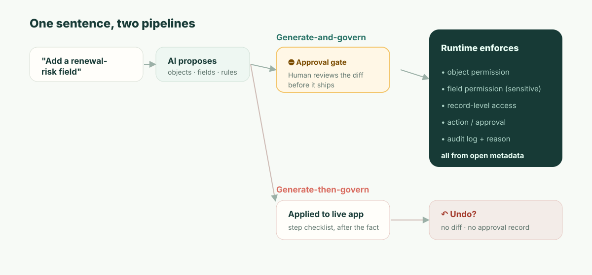

**TL;DR:** Airtable Omniで作るなら、生成物を編集する完全なコントロールは確かに手に入る。テーブル、フィールド、自動化は通常のAirtableオブジェクトであり、インターフェースページはInterface Designerで開け、Omniが生成するカスタム要素には、ベースのCreatorまたはOwnerが編集・ダウンロードできるソースコードがある。Omniはバイブコーディングではない。使い捨てコードではなく、本番で実証済みのコンポーネントからアプリを組み立てる。差は編集できるかどうかではなく、レビューが*いつ*行われるかにある。Omniの変更は、構築と同時に本番へ反映される。削除、インターフェースの公開、自動化の有効化の前には確認を求めるが、それ以外は「元に戻す」と監査ログに頼る。規制対象の記録システムには*予防的（preventive）*なコントロールが必要だ。すなわち、反映前に承認され、誰が何へのアクセスを得るのかを明示するレビュー済みのdiffである。さらにAirtableがクラウド専用のデプロイであることを加えると、一部の記録システムでは、機能を一つ比べる前にプラットフォームの判断がついてしまう。

ある火曜日から始めよう。デモではなく、ここでこそ本当に痛い目を見るからだ。

レベニューオペレーションのマネージャーがOmniを開き、こう打ち込む。*「Customersに更新リスクのフィールドを追加して、高リスクのアカウントをボードに載せ、毎週月曜にCSMへリマインドして」*。Omniはそれを見事にこなす。フィールドはOmniが作成した瞬間に現れ、ボードは下書きされ、自動化はセットアップされたうえでオフのまま残される。「リスク」を計算するため、OmniはそのアカウントのARRを参照する。そして更新を追いかける人たちにとってボードを役立つものにするため、新しいフィールドを**CSMロール**が見られるインターフェースページに載せる。そのページの公開と自動化の有効化はマネージャーに委ねられ、マネージャーは両方をクリックする。みんな満足だ。マネージャーは画面を閉じて次へ進む。

6週間後、セキュリティチームに同席したSOC 2監査人が一つだけ質問する。*「顧客のARRは機密です。このインターフェースはARRから派生したフィールドをCSMロールに公開しています。誰がいつ承認したのですか?」*

そして正直な答えはこうだ。依頼した本人が承認した——ただし、それが何を意味するのかを示されないまま。マネージャーはボードの「公開」をクリックした。CSMがARR派生データを見られるようになってよいかを問われた者は誰もいない。クリックした対象はページであって、「誰が何へのアクセスを得るのか」を述べた文ではなかったからだ。AIがある火曜日にアクセス制御の判断を下し、依頼者はそれをそのまま通した。その判断の記録は事後のアクティビティ項目だけ——誰かが見ようと思えば、の話だ。これが記事のすべてである。以下のすべては、なぜこの差が構造的なものであり、単なるチェックボックス一つの問題ではないのかを説明するものだ。

## Airtable Omniが作ったものは編集できるのか？ できる。その範囲はここまでだ。

実際に検索される問いは、Omniで作ると結果のコントロールを手放すことになるのか、というものだ。そうはならない。そしてガバナンスの議論に入る前に、正確な答えを持っておく価値がある。この議論がこじれるのは、曖昧な答えから始まるときだからだ。以下の各行は、2026年11月時点のAirtable自身のサポートドキュメントに基づく（[Using Omni AI](https://support.airtable.com/docs/using-airtable-cobuilder)、[AI-generated interface elements](https://support.airtable.com/docs/ai-generated-interface-elements-in-airtable)）。

| Omniが作ったもの | 編集できるか | 知っておくべきこと |
| --- | --- | --- |
| **テーブル、フィールド、レコード** | できる。他のAirtableオブジェクトと同じ | Omniは「自分が作ったものだけを再構成または上書きする」ため、あなた自身のテーブルには手を付けない |
| **インターフェースページ** | できる。Interface Designerで | Omniはガントやブランクページのような従来型レイアウトを作れない。それらは手で作る |
| **AI生成のインターフェース要素** | できる。コードも含めて | **Edit source code**（ソースコードを編集）とダウンロードは要素のオーバーフローメニューにあり、使えるのはベースのCreatorとOwnerだけ |
| **自動化** | できる | Omniは自動化をオフの状態で作成する。オンにするのはあなたに委ねられる |
| **元に戻す** | 一部のみ | Omniは「既存のレコード値の編集や、テーブル・インターフェース・ページの作成は元に戻せない」うえ、元に戻せるのは現在の会話における自分自身の操作だけだ。HistoryメニューとOmniのRevertボタンなら、さらに前まで遡れる |

この表の中には2つの注意点がある。生成された要素は「複数のページやアプリをまたいで再利用できない」。そしてページやアプリを複製すると要素はフォークされるため、元の要素への修正はコピーには届かない。また、編集できることは所有することと同じではない。ダウンロードしたソースはAirtableのインターフェース内で動く要素であって、他の場所にデプロイできるアプリではない。

だから編集可能性について言えば、Omniは「AIのブラックボックス」という評判が示唆するよりも優れている。この記事が扱う問いは別のものであり、Airtableのドキュメントはそれに一文で答えている。「Omniが構築するものは、構築と同時にあなたのベースで本番稼働する」。Omniが立ち止まって確認を求めるのは、レコード・テーブル・ページを削除する前、インターフェースを公開したり自動化をオンにしたりする前、そしてWebの検索結果のような外部コンテンツを読んだ後だ。それ以外——新しいフィールド、変更された数式、再構成されたテーブル——は、Omniの作業と同時に反映される。これは設計上の選択であり、大半のベースにとっては良い選択だ。この記事の残りは、そうではないベースについての話である。

## あなたの監査人がすでに使っている区別：予防的 vs 検知的

まずはAirtableを正当に、しかも正確に評価しよう。ここで曖昧な批判は無価値だからだ。Omniは本当にバイブコーディングではない。コンポーネントベースのアプローチは正しい方向であり、プロンプトのたびに脆いコードを再生成するやり方に勝る。AirtableのEnterprise Scaleプランにも本物のコントロールがある。管理パネル、「180日間保存され検索可能」でAPIからも利用できる監査ログ（[Enterprise audit logs](https://support.airtable.com/docs/accessing-enterprise-audit-logs-in-airtable)）、そして削除・インターフェースの公開・自動化の前にOmni自身が求める確認だ。本気のAirtable管理者は「ガバナンスがない」という怠惰な主張を読めば、あなたを信用しなくなる。だからそれは書かないことだ。

代わりに正確なほうを書こう。セキュリティと監査のフレームワークはコントロールを2種類に分け、あなたの監査人はその区別に従って生きている。

- **検知的**（detective）コントロールは、何かが起きた*後で*それが起きたと教えてくれる。監査ログがその典型例だ。これは必要であり、Airtableはそれを備えている。
- **予防的**（preventive）コントロールは、認可されていないことを*そもそも*起こさせない。機密な変更に対する承認ゲートがその典型例だ。

「元に戻す」は*どちらでもない*。それはコントロールではなく、変更がすでに本番に出た後で動く個人的な便利機能であり、誰か一人が気づくことに依存し、*誰がその変更を許容できると判断したのか*の記録を残さない——残るのは取り消されたという事実だけだ。SOC 2の変更管理基準（CC8.1）と、あらゆる本気の変更プロセスが存在するのは、まさに機密な変更については検知的なものだけでは足りないからだ。ARRが公開されたと*発見する*ことは許されない。あなたは、承認なしに公開されることを*阻止していた*のでなければならない。

同じ事実を、監査人が実際に当てはめるフレームワークに写し取ると、次のようになる。

| | 今日のOmni | 記録システムに必要なもの |
| --- | --- | --- |
| コントロールが作用するタイミング | 大半の変更はOmniの構築と同時に本番に出る（検知的） | 変更が反映される前（予防的） |
| 人間のチェックポイント | 削除・インターフェース公開・自動化の有効化の前に確認、それ以外は元に戻す | 何が変わるかを正確に示すdiffを承認する |
| 生成される記録 | 「実行したステップ」＋変わったというログ | この特定の変更を誰が、なぜ承認したか |
| 「誰が許可したのか?」への答え | ログから再構成、たぶん | 変更に紐づいた、名前のある承認者 |
| 故障モード | 誰かが間に合うように気づかねばならない | 変更は未承認では本番に出られない |

だからこそ「Omniはステップを見せるし、公開前に確認するし、元に戻せる」では差は埋まらない。ステップの一覧は領収書であってコントロールではない。元に戻すは事後の復旧手段だ。公開前の確認は予防的なチェックポイントに最も近いものであり、本物のチェックポイントではある。だがそれは依頼者にページの承認を求めるものであって、レビュー担当者に帰結の承認を求めるものではない。そこには「これはARR派生データをCSMに公開する」とはどこにも書かれていない。この3つのどれも、ARR公開のシナリオが要求したチェックポイントではない。



## 「diffをレビューする」とは実際どういうことか——主張ではなく、見せる

「レビュー済みのdiff」という言い回しは口にするのも簡単なら、受け流すのも簡単だ。だから具体物を示そう。AIがガバナンス対象のアプリへの変更を提案するとき、人間が承認する成果物は、その*帰結*を読み取れるものでなければならない——リクエストの散文ではなく、実際のメタデータの差分だ。

```diff
  object: Customer
+ field: renewal_risk
+   type: enum[low, medium, high]
+   derived_from: account.arr
+   sensitivity: confidential        # ARRソースから継承
+ permission: field.renewal_risk
+   read:  [RevOps, AccountExec]
+   edit:  [RevOps]
!   read:  CSM  ← 新しいボードビューからの要求 — 承認しますか? (ARR派生データを公開します)
+ view: "Renewal risk board"  exposes: [account, renewal_risk]
+ automation: notify_csm_weekly
  change #4827 · proposed by Omni · approved_by: __________ · reason: __________
```

冒頭のシーンのマネージャーにとって、これが何をもたらすかを読み取ってほしい。このフィールドはARRに由来するため`confidential`とフラグが立つ——自動的に、だ。機密度はデータの属性であって、人間がタグ付けを覚えておくものではないからだ。そして肝心だった一行——ボードビューがCSMにARR派生データへの読み取り権を与えたい——が、何かが反映される前に、それ単独で*一つの判断として*前面に出される。マネージャー（あるいはそのセキュリティパートナー）は、意図して承認するか、しないかだ。いずれにせよ、変更#4827にはいま名前と理由が紐づいている。6週間後に監査人が尋ねるとき、答えは存在する——*変更の瞬間に、その問いが強制されたからだ*。

これが「AIはそれを作れる」と「AIの変更はガバナンス可能だ」の違いである。モデルをより信用しないという話ではない。変更が、すでに起きてしまった出来事ではなく、レビュー可能なオブジェクトであるという話だ。

## その数字：認可外公開までの平均時間

自分の組織について計算できる数値がある。抽象を具体にしてくれるからだ。これを**認可外公開までの平均時間**（mean time to unauthorized exposure、MTUE）と呼ぼう。AIの変更が越えてはならない一線を越えた瞬間から、それが本番から消えるまで、どれだけかかるか。

- **予防的**ゲートがあれば、MTUEは**構造上ゼロ**に近づく。一線を越える変更は未承認では本番に出ず、承認ステップで待つ。公開の窓を設計上なくせる。
- **元に戻す＋検知的ログ**の場合、MTUEは*検知までの時間*であり、これは正直に見積もるべきだ。最良の場合、同僚がその日の午後に気づく。現実的な場合、それは誰かがそのビューを監査するとき、あるいは四半期ごとのアクセスレビューが走るとき、あるいは——シナリオのように——外部監査人が最初に見つけるときだ。他システムへさらに同期されていくデータでは、誰かが見る前に公開が伝播しうる。

あなた自身のアクセスレビューの周期を当てはめてほしい。機密権限を四半期ごとにレビューするなら、静かな設定ミスに対する「元に戻す」ベースのMTUEは*数週間から一四半期*で測られる。予防的モデルがこの数字をゼロにするのは、より賢いからではなく、チェックポイントを変更の後ではなく前へ移すからだ。プロンプトでMTUE = 0にたどり着くことはできない。それは、人間がループの*いつ*に入るかという、アーキテクチャ上の性質である。

## 「でもうちはもうAirtable Enterpriseを使っていて、セキュリティも承認済みだ」

これが実際の読者の立場だから、正面から向き合おう。そのとおり——そしてあなたのセキュリティチームが承認したのは、Airtableの*アクセスモデルとインフラ*だった。SSO、暗号化、監査ログ、権限の階層だ。それらは本物であり、その承認は妥当だった。

それはほぼ確実に、Omniがそのアクセスモデルへ変更を書き込むようになる前のものだ。あなたのセキュリティチームがおそらく問われていない問いは、狭く、かつ答えられるものだ。**「AIが『誰が何を見られるか』を変えるとき、それが本番に出る前に何がその変更をレビューするのか——そして名前のある承認はどこにあるのか?」** この一文を次のベンダーとの打ち合わせに持っていこう。返ってくる答え——「元に戻せます」/「監査ログにあります」/「Omniがプランを見せます」——が、あなたが予防的／検知的の線のどちら側に立っているかを、正確に教えてくれる。そのために我々の意見は要らない。要るのはこの問いだ。

## この論が当てはまら*ない*ところ

知的誠実さのために言う。この種の文章の故障モードは、トレードオフが無料であるかのように振る舞うことだからだ。予防的モデルには本物のコストがある。**摩擦**だ。あらゆる機密変更に承認ゲートをかけるのは、社内トラッカーを反復している3人チームにとってはまさに間違ったエルゴノミクスだ。彼らにとっては元に戻すこと*こそ*正しい設計であり、テーブルのUXは純粋な喜びであり、Airtableのテンプレートエコシステムと最初のアプリまでの時間は、より重いどんなものより——我々を含め——先を行っている。我々は最初のアプリまでの速さでAirtableを上回るつもりはないし、そうでないふりをするのは、逆方向の同じ不誠実だ。

予防的モデルが元を取るのは、レビューされない変更1件のコストが、変更をレビューするコストを上回るときだけだ——すなわち、機密データがあり、本物の権限モデルがあり、いずれそれを監査する誰かがいるときだ。それが線である。その下ではAirtableが実力で勝つ。その上では、「元に戻す」の差こそが評価を終わらせるものであり、しかも機能を比べる前に終わらせる。

そしてもう一つ、以上のすべてとは別で、一部の買い手にとっては同じくらい決定的なものがある。**AirtableはAirtableのクラウドで動くものであり、自己ホスト型のランタイムではない**。Enterprise Scaleの顧客は一部のデータの保存場所——米国、欧州、オーストラリア——を選べるが、いずれの場合もAirtableのインフラ上である（[data residency at Airtable](https://support.airtable.com/docs/data-residency-at-airtable)）。あなたのランタイムが、データと規制当局が要求する場所——主権、エアギャップ、所在地——になければならないなら、ガバナンスの精緻さがいくらあっても助けにはならない。プラットフォームが、あなたの必要とする場所に存在できないからだ。その層の買い手にとって、比較は最初の要件で終わっている。

## ObjectStackの立ち位置

ObjectStackはその線の上の世界のために、そしてその世界のためだけに作られている。アプリケーションのコアは**オープンで可読なメタデータ**——オブジェクト、フィールド、リレーション、権限、アクション——であり、だからAIの変更は上に示したレビュー可能なdiffになる。すなわち、人間が反映前に承認する*予防的*チェックポイントであり、帰結（このビューはCSMにARR派生データを公開する）が一つの判断として前面に出され、名前のある承認者に結び付けられる。権限は**ランタイムがオブジェクト・レコード・フィールド・アクションに対して**強制するため、ビューを編集することでこっそり組み替えることはできない。それは**自己ホスト可能**であり、あなたのビジネスをもう一つのクラウドへ同期するのではなく、**あなたがすでに運用しているCRM/ERP/DBに接続する**。

売り文句は「Airtableと同じくらい簡単」ではない——設計上そうではない。承認ステップこそが製品だからだ。売り文句はこうだ。Airtableを可読にしているテーブルとチャットの体験を保ったまま、その下に予防的コントロールと、ランタイムの権限モデルと、あなた自身のインフラを置く——そうすれば「火曜日にARR公開を承認したのは誰か」への答えは、検索ではなく、名前になる。
