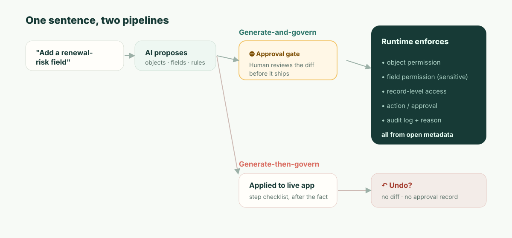

**TL;DR:** If you build with Airtable Omni, you do get full control to edit what it makes. Its tables, fields and automations are ordinary Airtable objects, its interface pages open in Interface Designer, and the custom elements it generates have source code a base Creator or Owner can edit or download. Omni is not vibe coding: it assembles apps from production-tested components, not throwaway code. The gap is not editability; it is *when* review happens. Omni's changes go live as it builds them. It asks first before deleting, publishing an interface or turning on an automation, and otherwise relies on undo and an audit log. A regulated system of record needs a *preventive* control: a reviewed diff, approved before it ships, that names who gains access to what. Add Airtable's cloud-only deployment, and for some systems of record the platform decision is made before you compare a single feature.

Start with an ordinary Tuesday, because this is where the issue appears: not in the demo, but in daily operations.

A revenue-ops manager opens Omni and types: *"Add a renewal-risk field to Customers, put high-risk accounts on a board, and remind the CSM every Monday."* Omni does it, beautifully. The field appears the moment Omni creates it, the board is drafted, and the automation is set up and left switched off. To compute "risk," it pulls from the account's ARR. To make the board useful to the people who chase renewals, it puts the new field on an interface page the **CSM role** can see. Omni leaves publishing that page and turning on the automation to the manager, who clicks both. Everyone's happy. The manager clicks away.

Six weeks later a SOC 2 auditor sitting with your security team asks one question: *"Customer ARR is confidential. This interface exposes a field derived from ARR to the CSM role. Who approved that, and when?"*

And the honest answer is: the person who asked for it approved it, without being shown what it meant. The manager clicked Publish on a board. Nobody was asked whether CSMs should now see ARR-derived data, because the click was on a page, not on a statement of who gains access to what. An AI made an access-control decision on a Tuesday, the requester waved it through, and the only record of the decision is an after-the-fact activity entry if anyone thinks to look. That is the whole article. Everything below explains why that gap is structural, not just a missing feature.

## Can You Edit What Airtable Omni Builds? Yes. Here Is How Far.

The question people actually search is whether building with Omni means giving up control of the result. It does not, and the precise answer is worth having before the governance argument, because a vague one is how this debate goes wrong. Every row below is from Airtable's own support documentation as of November 2026 ([Using Omni AI](https://support.airtable.com/docs/using-airtable-cobuilder), [AI-generated interface elements](https://support.airtable.com/docs/ai-generated-interface-elements-in-airtable)).

| What Omni made | Can you edit it? | What to know |
| --- | --- | --- |
| **Tables, fields, records** | Yes, like any Airtable object | Omni "will only restructure or overwrite something it built," so it leaves your own tables alone |
| **Interface pages** | Yes, in Interface Designer | Omni cannot build traditional layouts such as Gantt or blank pages; those you build by hand |
| **AI-generated interface elements** | Yes, including the code | **Edit source code** and download sit in the element's overflow menu, for base Creators and Owners only |
| **Automations** | Yes | Omni creates them switched off; turning one on is left to you |
| **Undo** | Partly | Omni "can't undo edits to existing record values, or creating a table, interface, or page," and only undoes its own actions in the current conversation; the History menu and Omni's Revert button go further back |

Two caveats sit inside that table. Generated elements "cannot be reused across multiple pages or apps," and duplicating a page or app forks them, so a fix to the original does not reach the copy. And editing is not the same as owning: the source you download is an element that runs inside an Airtable interface, not an app you can deploy elsewhere.

So on editability, Omni is better than the "AI black box" reputation suggests. The question this article is about is a different one, and Airtable's documentation answers it in one sentence: "what Omni builds is live in your base as it builds it." Omni stops to ask before it deletes records, tables or pages, before it publishes an interface or turns on an automation, and after it reads outside content such as web results. Everything else — a new field, a changed formula, a restructured table — applies as Omni works. That is a design choice, and for most bases a good one. The rest of this article is about the bases where it is not.

## The Distinction Your Auditor Already Uses: Preventive vs. Detective

Give Airtable its due first, precisely, because vague criticism is not useful here. Omni is not vibe coding. Its component-based approach is the right direction, and it is better than regenerating fragile code after every prompt. Airtable's Enterprise Scale plan also has real controls: an admin panel, audit logs that are "stored and searchable for 180 days" and exposed through an API ([Enterprise audit logs](https://support.airtable.com/docs/accessing-enterprise-audit-logs-in-airtable)), and Omni's own confirmations before deletes, interface publishing and automations. A serious Airtable admin will read a lazy "it has no governance" take and stop trusting you. So do not write that one.

Write the precise one instead. Security and audit frameworks divide controls into two kinds, and your auditor lives by the distinction:

- A **detective** control tells you something happened *after* it happened. An audit log is the canonical example. It is necessary and Airtable has it.
- A **preventive** control stops an unauthorized thing from happening *at all*. An approval gate on a sensitive change is the canonical example.

Undo is *neither*. It is not a control; it is an after-the-fact safety net that runs after the change is already live, depends on one person noticing, and leaves no record of *who decided the change was acceptable*, only that it was reverted. SOC 2's change-management criteria (CC8.1) and every serious change process exist because, for sensitive changes, detective-only is not enough. You should not discover that ARR was exposed after the fact; the system should stop that exposure until someone signs off.

Here is the same fact mapped onto the framework an auditor will actually apply:

| | Omni today | What a system of record needs |
| --- | --- | --- |
| When the control acts | Most changes are live as Omni builds them (detective) | Before the change ships (preventive) |
| Human checkpoint | Confirm before deletes, interface publish and automation on; undo for the rest | Approve a diff of exactly what changes |
| Record produced | "Steps taken" plus a record that the change happened | Who approved this specific change, and why |
| Answer to "who allowed this?" | Reconstruct from logs, maybe | Named approver, attached to the change |
| Failure mode | Someone has to notice in time | The change can't go live unapproved |

This is why "Omni shows its steps, asks before publishing, and you can undo it" does not close the gap. The steps list is a receipt, not a control; undo is an after-the-fact recovery tool. The publish confirmation is the closest thing to a preventive checkpoint, and it is a real one, but it asks the requester to approve a page, not a reviewer to approve a consequence. Nothing in it says "this exposes ARR-derived data to CSM." None of the three is the checkpoint the ARR-exposure scenario required.



## What "Review the Diff" Actually Means

The phrase "reviewed diff" is easy to say and easy to wave away, so here is the concrete thing. When an AI proposes a change to a governed app, the artifact a human approves should make the *consequences* legible — not the prose of the request, the actual metadata delta:

```diff
  object: Customer
+ field: renewal_risk
+   type: enum[low, medium, high]
+   derived_from: account.arr
+   sensitivity: confidential        # inherited from ARR source
+ permission: field.renewal_risk
+   read:  [RevOps, AccountExec]
+   edit:  [RevOps]
!   read:  CSM  ← requested by the new board view — APPROVE? (exposes ARR-derived data)
+ view: "Renewal risk board"  exposes: [account, renewal_risk]
+ automation: notify_csm_weekly
  change #4827 · proposed by Omni · approved_by: __________ · reason: __________
```

Read what that buys the manager from the opening scene. The field is flagged `confidential` because it descends from ARR — automatically, because sensitivity is a property of the data, not something a human remembers to tag. And the one line that mattered — the board view wants to grant CSM read access to ARR-derived data — is surfaced *as a decision*, on its own, before anything ships. The manager (or their security partner) either approves it on purpose or doesn't. Either way, change #4827 now has a name and a reason attached to it. When the auditor asks in six weeks, the answer exists *because the question was forced at the moment of change.*

That is the difference between "the AI can build it" and "the AI's change is governable." It isn't about trusting the model less. It's about the change being a reviewable object instead of an event that already occurred.

## The Number: Your Mean Time to Unauthorized Exposure

Here is a figure you can compute for your own organization, because it makes the abstract concrete. Call it **mean time to unauthorized exposure (MTUE)**: from the moment an AI change crosses a line it should not cross, how long until it stops being live?

- With a **preventive** gate, MTUE is **zero by construction.** The change that crosses the line never goes live; it waits at the approval step. There is no exposure window.
- With **undo + a detective log**, MTUE is *time-to-detection* — and you should price that honestly. Best case, a teammate notices that afternoon. Realistic case, it's whenever someone audits the view, or the quarterly access review runs, or — as in the scenario — the external auditor finds it first. For data that syncs onward to other systems, the exposure can propagate before any human looks.

Plug in your own access-review cadence. If you review sensitive permissions quarterly, your undo-based MTUE for a quiet misconfiguration is measured in *weeks to a quarter*. The preventive model makes that number zero not by being smarter, but by moving the checkpoint to before the change instead of after. You cannot prompt your way to MTUE = 0; it's an architectural property of *when* the human is in the loop.

## "But We Already Run Airtable Enterprise and Security Signed Off"

This is the real reader's position, so meet it directly. Yes — and what your security team signed off on was Airtable's *access model and infrastructure*: SSO, encryption, audit logging, the permission tiers. Those are real and that sign-off was reasonable.

It almost certainly predated Omni writing changes to that access model. The question your security team has very likely not been asked is narrow and answerable: **"When the AI changes who-can-see-what, what reviews that change before it is live, and where is the named approval?"** Take that sentence into your next vendor call. The answer you get back, whether "you can undo it," "it is in the audit log," or "Omni shows a plan," will tell you which side of the preventive/detective line you are standing on. You do not need our opinion for that; you need the question.

## Where This Argument Does *Not* Apply

Intellectual honesty, because the failure mode of a piece like this is to pretend the trade-off is free. The preventive model has a real cost: **friction.** An approval gate on every sensitive change is exactly the wrong ergonomics for a three-person team iterating on an internal tracker. For them, undo *is* the correct design, the table UX is a genuine joy, and Airtable's template ecosystem and time-to-first-app are ahead of anything heavier — including us. We are not going to out-Airtable Airtable on speed-to-first-app, and pretending otherwise would be the same dishonesty in the other direction.

The preventive model only pays for itself when the cost of one unreviewed change exceeds the cost of reviewing changes — i.e., when there's confidential data, a real permission model, and someone who will eventually audit it. That's the line. Below it, Airtable wins on merit. Above it, the undo gap is the thing that ends the evaluation, and it ends it before features.

And one more, separate from all of the above and just as final for some buyers: **Airtable runs in Airtable's cloud, not as a self-hosted runtime.** Enterprise Scale customers can choose where some data sits at rest — the United States, Europe or Australia — but on Airtable's infrastructure in each case ([data residency at Airtable](https://support.airtable.com/docs/data-residency-at-airtable)). If your runtime must live where your data and your regulators require, because of sovereignty, air-gap, or residency requirements, no amount of governance sophistication helps if the platform cannot run where you need it. For that class of buyer, the comparison is over at the first requirement.

## ObjectStack's Position

ObjectStack is built for the world above that line, and only that world. The application core is **open, readable metadata** — objects, fields, relationships, permissions, actions — so an AI change is the reviewable diff shown above: a *preventive* checkpoint a human approves before it ships, with the consequence (this view exposes ARR-derived data to CSM) surfaced as a decision and bound to a named approver. Permissions are enforced by the **runtime on the object, record, field, and action**, so they can't be silently rearranged by editing a view. It is **self-hostable**, and it **connects to the CRM/ERP/DB you already run** rather than syncing your business into one more cloud.

The pitch is not "as easy as Airtable." It is not, by design, because the approval step is part of the product. The pitch is this: keep the table-and-chat experience that makes Airtable legible, and put a preventive control, a runtime permission model, and your own infrastructure underneath it, so the answer to "who approved exposing ARR on a Tuesday?" is a name, not a search.
