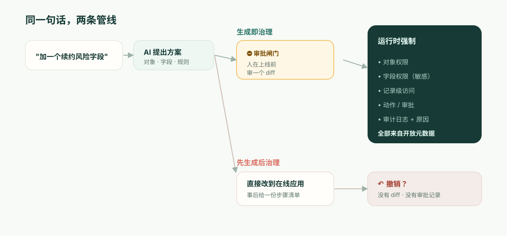

**TL;DR：** 用 Airtable Omni 构建，你确实能完全掌控、编辑它做出来的东西。它建的表、字段和自动化都是普通的 Airtable 对象，界面页面可以在 Interface Designer 里打开，它生成的自定义元素也有源代码，base 的 Creator 或 Owner 可以编辑或下载。Omni 不是氛围编程（vibe coding）：它用经生产验证的组件来组装应用，而不是生成一次性代码。差距不在“能不能改”，而在审阅发生在*什么时候*。Omni 的改动在它构建时就上线了。删除、发布界面或开启自动化之前，它会先征求确认；除此之外，就依靠撤销和审计日志。受监管的记录系统需要的是*预防型*控制：一份在发布之前获得批准、写明谁将获得对什么的访问权的可审阅 diff。再加上 Airtable 只能在其云上部署，对某些记录系统而言，平台选择在比较任何一项功能之前就已经定了。

从一个星期二说起，因为真正咬到你的地方在这里，而不是在演示里。

一位收入运营经理打开 Omni，输入：*"给 Customers 加一个续约风险字段，把高风险客户放到一个看板上，并每周一提醒 CSM。"* Omni 漂亮地完成了。字段在 Omni 创建的那一刻就出现了，看板起好了草稿，自动化也已配置好、处于关闭状态。为计算"风险"，它从客户的 ARR 中取数。为了让看板对那些追续约的人有用，它把这个新字段放在一个 **CSM 角色**能看到的界面页面上。发布这个页面、开启这个自动化，Omni 留给了经理，经理两个都点了。皆大欢喜。经理点开别处，去忙下一件事。

六周后，一位与你的安全团队坐在一起的 SOC 2 审计师只问了一个问题：*"客户 ARR 是机密的。这个界面把一个由 ARR 派生的字段暴露给了 CSM 角色。谁批准的，什么时候批准的？"*

而诚实的答案是：提出需求的人批准了它，却没有人告诉他这意味着什么。经理在一个看板上点了“发布”。没有人被问到 CSM 现在是否应该看到由 ARR 派生的数据，因为那一下点的是一个页面，而不是一句“谁将获得对什么的访问权”的陈述。某个 AI 在一个星期二做了一个访问控制决策，提需求的人顺手放行，而这个决策唯一的记录，只是一条事后的活动记录——如果有人想得起来去看的话。这就是整篇文章。下面的所有内容，都是在解释为什么这个缺口是结构性的，而不是 Airtable 下个季度就会补上的某项缺失功能。

## Airtable Omni 生成的东西能改吗？能。能改到什么程度，看这里。

人们真正在搜的问题是：用 Omni 构建，是否意味着放弃对结果的控制。并不会。而在进入治理的讨论之前，值得先拿到一个精确的答案，因为这场争论往往正是从含糊的答案开始走偏的。下表每一行都来自 Airtable 自己截至 2026 年 11 月的支持文档（[Using Omni AI](https://support.airtable.com/docs/using-airtable-cobuilder)、[AI-generated interface elements](https://support.airtable.com/docs/ai-generated-interface-elements-in-airtable)）。

| Omni 做出的东西 | 能改吗？ | 需要知道的 |
| --- | --- | --- |
| **表、字段、记录** | 能，和任何 Airtable 对象一样 | Omni“只会重构或覆盖它自己构建的东西”，所以不会动你自己的表 |
| **界面页面** | 能，在 Interface Designer 里 | Omni 无法构建甘特图或空白页这类传统布局，这些需要你手工搭建 |
| **AI 生成的界面元素** | 能，包括代码 | **Edit source code**（编辑源代码）和下载位于元素的溢出菜单中，只有 base 的 Creator 和 Owner 可用 |
| **自动化** | 能 | Omni 创建的自动化默认关闭，开启由你决定 |
| **撤销** | 部分可以 | Omni“无法撤销对已有记录值的编辑，也无法撤销创建表、界面或页面”，并且只能撤销它在当前对话中的操作；History 菜单和 Omni 的 Revert 按钮可以回溯得更远 |

这张表里藏着两条注意事项。生成的元素“不能在多个页面或应用之间复用”，而复制页面或应用会把它们分叉出去，所以对原件的修复不会传到副本上。另外，能编辑不等于拥有：你下载的源代码是一个运行在 Airtable 界面里的元素，而不是一个可以部署到别处的应用。

所以在可编辑性上，Omni 比“AI 黑箱”的名声要好。本文讨论的是另一个问题，而 Airtable 的文档用一句话就回答了它：“Omni 构建的内容，在它构建的同时就已在你的 base 中上线。”Omni 会停下来征求确认的时机是：删除记录、表或页面之前，发布界面或开启自动化之前，以及读取网页搜索结果等外部内容之后。其余的一切——一个新字段、一个改动的公式、一张重构的表——都在 Omni 工作时直接生效。这是一个设计选择，对大多数 base 来说是个好选择。本文余下的部分，讲的是那些它不是好选择的 base。

## 你的审计师早已在用的区分：预防型 vs 检测型

先精确地把该给 Airtable 的肯定给足，因为含糊的批评在这里一文不值。Omni 确实不是氛围编程（vibe coding）——它基于组件的做法方向是对的，胜过每次提示都重新生成脆弱代码。Airtable 的 Enterprise Scale 套餐也有真正的控制：管理面板、“存储并可搜索 180 天”且可通过 API 获取的审计日志（[Enterprise audit logs](https://support.airtable.com/docs/accessing-enterprise-audit-logs-in-airtable)），以及 Omni 自己在删除、发布界面和开启自动化之前的确认。一个认真的 Airtable 管理员读到"它没有治理"这种偷懒的论调，就会不再信任你。所以别写那一种。

写精确的那一种。安全与审计框架把控制分为两类，而你的审计师正是依这个区分行事：

- **检测型**（detective）控制在某件事发生*之后*告诉你它发生了。审计日志就是典型例子。它是必要的，而 Airtable 有它。
- **预防型**（preventive）控制*根本*不让未经授权的事情发生。对敏感变更设一道审批闸门就是典型例子。

撤销*两者都不是*。它不是一种控制，而是一种个人便利，它在变更已经上线之后才运行，依赖某个人去注意到，而且不留下*谁判断这个变更可以接受*的记录——只留下它被回退了。SOC 2 的变更管理准则（CC8.1）以及一切认真的变更流程之所以存在，恰恰是因为对敏感变更而言，只有检测型是不够的。你不该是去*发现* ARR 被暴露了；你必须是已经阻止了它在未经签字的情况下被暴露。

把同一个事实映射到审计师真正会套用的框架上，就是下面这样：

| | 今天的 Omni | 记录系统需要的 |
| --- | --- | --- |
| 控制起作用的时点 | 大多数变更在 Omni 构建时即已上线（检测型） | 在变更发布之前（预防型） |
| 人工检查点 | 删除、发布界面、开启自动化前确认；其余靠撤销 | 批准一份精确描述改了什么的 diff |
| 产生的记录 | "已执行的步骤" + 它变过的日志 | 谁批准了这个具体变更，以及为什么 |
| 对"谁允许的？"的回答 | 从日志里重建，也许吧 | 具名审批人，附在该变更上 |
| 失败模式 | 得有人及时注意到 | 未经批准的变更无法上线 |

这就是为什么"Omni 会展示它的步骤，发布前会先问，而且你可以撤销"并不能填上这个缺口。步骤列表是回执，不等于控制；撤销是事后的恢复手段。发布确认是最接近预防型检查点的东西，而且它确实是一个检查点，但它请提需求的人批准一个页面，而不是请审阅者批准一个后果。它里面没有任何一处写着“这会把 ARR 派生数据暴露给 CSM”。三者都不是 ARR 暴露场景所需要的那个检查点。



## "审阅 diff"究竟是什么意思——展示出来，而非空口断言

"经审阅的 diff"这个说法既好说出口，也好被挥手打发掉，所以这里给出具体的东西。当一个 AI 对一个受治理的应用提出变更时，人去批准的那个产物，应当让*后果*变得可读——不是请求的那段散文，而是真正的元数据增量：

```diff
  object: Customer
+ field: renewal_risk
+   type: enum[low, medium, high]
+   derived_from: account.arr
+   sensitivity: confidential        # 继承自 ARR 来源
+ permission: field.renewal_risk
+   read:  [RevOps, AccountExec]
+   edit:  [RevOps]
!   read:  CSM  ← 由新的看板视图请求 — 批准吗？（会暴露由 ARR 派生的数据）
+ view: "Renewal risk board"  exposes: [account, renewal_risk]
+ automation: notify_csm_weekly
  change #4827 · proposed by Omni · approved_by: __________ · reason: __________
```

读一读这给开篇那位经理带来了什么。这个字段被标记为 `confidential`，因为它衍生自 ARR——是自动标的，因为敏感度是数据的属性，而不是某个人需要记得去打的标签。而那唯一要紧的一行——看板视图想授予 CSM 对 ARR 派生数据的读取权限——被*当作一个决策*单独凸显出来，在任何东西发布之前。经理（或她的安全搭档）要么是有意去批准它，要么不批。无论哪种，变更 #4827 现在都附上了一个名字和一个理由。当审计师在六周后来问，答案存在——*因为在变更的那一刻，这个问题就被强制提出来了。*

这就是"AI 能造出来"和"AI 的变更是可治理的"之间的区别。这无关乎少信任模型几分。这关乎变更是一个可审阅的对象，而不是一桩已经发生了的事件。

## 那个数字：你的"未授权暴露平均时间"

这里有一个你可以为自己组织算出来的量，因为它把抽象变成了具体。把它叫作**未授权暴露平均时间（mean time to unauthorized exposure，MTUE）**：从一个 AI 变更越过一条它不该越过的线那一刻起，到它不再处于线上为止，要多久？

- 有了**预防型**闸门，MTUE **在构造上就是零**。那个越线的变更从不上线；它停在审批这一步等待。不存在暴露窗口。
- 用**撤销 + 一份检测型日志**，MTUE 就是*检测所需的时间*——而你应该诚实地给它定价。最好的情况，某个同事当天下午就注意到了。现实的情况，是在有人审计那个视图时，或季度访问复核运行时，或——如场景里那样——外部审计师先发现了它。对那些会继续同步到其他系统的数据，在任何人去看之前，暴露就可能已经扩散。

代入你自己的访问复核节奏。如果你每季度复核一次敏感权限，那么对一个悄无声息的错配，你那基于撤销的 MTUE 要以*数周到一个季度*来计量。预防型模型把这个数字变成零，靠的不是更聪明，而是把检查点挪到了变更之前而非之后。你无法靠提示把 MTUE 提到 0；它是关于人*在何时*进入回路的一种架构性质。

## "可我们已经在用 Airtable Enterprise，而且安全团队已经批过了"

这是真实读者的立场，所以正面回应它。是的——而你的安全团队当初批的，是 Airtable 的*访问模型与基础设施*：SSO、加密、审计日志、那几层权限。这些是真的，那次批准也是合理的。

它几乎可以肯定早于 Omni 开始往那个访问模型里写变更。你的安全团队极可能从未被问到的那个问题，既具体又可回答：**"当 AI 改动谁能看到什么时，是什么在它上线之前审阅了这个变更——具名的批准又在哪里？"** 把这句话带到你下一次的供应商沟通里。你拿回来的答案——"你可以撤销它"/"它在审计日志里"/"Omni 会展示一个计划"——会精确地告诉你，你正站在预防型/检测型那条线的哪一侧。为此你不需要我们的意见；你需要的是这个问题。

## 这套论证*不*适用的地方

为了智识上的诚实——因为这类文章的失败模式，就是假装这个取舍是免费的。预防型模型有真实的代价：**摩擦**。对每一个敏感变更都设一道审批闸门，对一个在内部追踪表上迭代的三人小队来说，恰恰是错误的人机工学。对他们而言，撤销*才是*正确的设计，表格的使用体验是真正的愉悦，而 Airtable 的模板生态和"做出第一个应用"的时间，领先于任何更重的东西——包括我们。我们不会在"做出第一个应用"的速度上去超过 Airtable，假装能超过，会是反方向上同样的不诚实。

预防型模型只有在一个未经审阅的变更的代价超过审阅变更的代价时才划得来——也就是说，当存在机密数据、一个真正的权限模型，以及一个终将去审计它的人时。这就是那条线。线之下，Airtable 凭实力取胜。线之上，撤销缺口才是那个终结评估的东西，而且它在功能比较之前就把评估终结了。

还有一条，独立于以上所有，并且对某些买家同样重要：**Airtable 运行在 Airtable 的云上，而不是一个可自托管的运行时。** Enterprise Scale 客户可以选择部分数据的静态存储位置——美国、欧洲或澳大利亚——但无论选哪一个，都是在 Airtable 的基础设施上（[data residency at Airtable](https://support.airtable.com/docs/data-residency-at-airtable)）。如果你的运行时必须存在于你的数据和监管要求所在之处——主权、隔离、特定驻留地——那么再好的协作体验也不能替代部署形态本身。对这一类买家而言，比较会先从运行边界开始，而不是从功能清单开始。

## ObjectStack 的立场

ObjectStack 是为那条线之上的世界而造的，且只为那个世界。应用内核是**开放、可读的元数据**——对象、字段、关系、权限、动作——因此一个 AI 变更就是上面展示的那份可审阅的 diff：一个由人在发布前批准的*预防型*检查点，其后果（这个视图会把 ARR 派生数据暴露给 CSM）被当作一个决策凸显出来，并绑定到一位具名审批人。权限由**运行时在对象、记录、字段和动作上**强制执行，因此无法靠编辑一个视图就被悄悄重排。它**可自托管**，并且它**接入你已经在运行的 CRM/ERP/数据库**，而不是把你的业务再同步进一朵云里。

这套主张不是"像 Airtable 一样简单"——它有意不是，因为审批这一步本身就是产品。它是这样的：保留那种让 Airtable 易读的"表格加聊天"体验，在它底下放上一个预防型控制、一个运行时权限模型，以及你自己的基础设施——这样，对"星期二是谁批准暴露 ARR 的"这个问题的回答，就是一个名字，而不是一次搜索。
