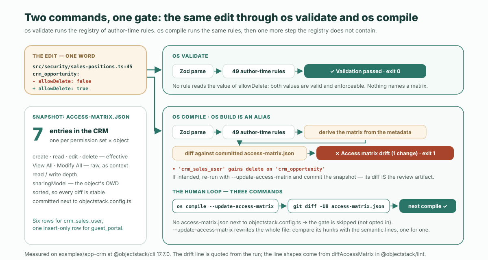

**답부터 말하면.** `os validate`는 `allowDelete`의 *값*을 읽지 않는다. 그래서 에이전트가 권한 집합에서 이 키를 `false`에서 `true`로 바꿔도 검증은 아무 지적 없이 통과한다. [리뷰 체크리스트](/en/blog/how-to-review-ai-generated-app-changes/)가 "어떤 규칙도 발화하지 않는다"고 쓴 것이 바로 이 뜻이고, 그 문장은 여전히 참이다. 다만 앱이 옵트인했다면 발화하는 게이트가 하나 있다. 커밋된 **접근 매트릭스**, 즉 (권한 집합 × 객체)마다 한 행씩 실효적인 create·read·edit·delete 비트를 담은 표를 `os compile`이 빌드할 때마다 메타데이터에서 다시 도출해 스냅샷과 비교한다. 드리프트가 있으면 빌드는 실패하고, `'crm_sales_user' gains delete on 'crm_opportunity'`라는 의미 있는 한 줄을 찍은 뒤 사람이 스냅샷을 다시 생성할 때까지 멈춘다. 그리고 스냅샷의 git diff가 리뷰어가 서명하는 대상이 된다. 공개된 `@objectstack/cli` 18.2.0, 곧 `npm create objectstack@latest`가 설치하는 버전에서 번들 CRM 예제를 대상으로 측정했다. 그 매트릭스는 **일곱 항목**이다. 편집 하나, 드리프트 한 줄, JSON 변경 한 줄.

이 글에서 가져갈 개념은 **원시 플래그가 아니라 실효적 능력**이다. 매트릭스는 슈퍼유저 비트를 접어 넣은 뒤 권한 집합이 실제로 *할 수 있는 것*을 보고하고, 같은 행에 객체의 레코드 기준선을 함께 적는다. 변경에는 여전히 사람이 필요하다. 그러나 더는 조용히 지나갈 수 없다.

## 변경, 그리고 두 명령

대상은 ObjectStack 저장소의 태그 `@objectstack/cli@18.2.0`에 있는 `examples/app-crm`을 모노레포가 아닌 공개된 18.2.0 패키지에 대해 설치한 것이다. 옵트인된 상태로, `objectstack.config.ts` 옆에 `access-matrix.json`이 있다. 편집은 리뷰 글이 짚어 간 바로 그것, `src/security/sales-positions.ts` 50행의 한 단어다.

```diff
  export const SalesUserPermissionSet = definePermissionSet({
    name: 'crm_sales_user',
    label: 'CRM Sales User',
    objects: {
      crm_account: { allowRead: true, allowCreate: true, allowEdit: true, allowDelete: false },
      crm_contact: { allowRead: true, allowCreate: true, allowEdit: true, allowDelete: false },
-     crm_opportunity: { allowRead: true, allowCreate: true, allowEdit: true, allowDelete: false },
+     crm_opportunity: { allowRead: true, allowCreate: true, allowEdit: true, allowDelete: true },
```

첫 번째 문, `npx os validate`. 출력은 중요한 줄만 남겼다. 생략한 부분 어디에도 `allowDelete`, `crm_sales_user`, 매트릭스는 등장하지 않는다.

```text
$ npx os --version
@objectstack/cli/18.2.0 linux-x64 node-v22.22.0

$ npx os validate
◆ Validate
  → Loading configuration...
  → Validating against ObjectStack Protocol...
  → Running author-time rules (53)...
  → Checking that every required capability has a provider installable in this edition...
  → Checking package docs (ADR-0046)...

  ✓ Validation passed (824ms)
  Security: 3 Positions  2 Permissions
$ echo $?
0
```

쉰세 개의 저작 시점 규칙이 돌았다. 영업 담당자가 영업 기회를 삭제해도 되는지에 대해 의견을 가진 규칙은 하나도 없다. 그것은 메타데이터의 사실이 아니라 당신 회사의 사실이기 때문이다. 리뷰 글의 문장은 정확히 옳다. 두 값 모두 유효하고, 두 값 모두 강제 가능하며, 어느 쪽을 머지하든 런타임은 그것을 강제한다.

두 번째 문, `npx os compile`. 같은 설정, 같은 53개 규칙, 그리고 `validate`에는 없는 한 단계가 더 있다.

```text
$ npx os compile
◆ Compile
  → Loading configuration...
  → Normalizing stack definition...
  → Lowering inline handlers...
  → Validating protocol compliance...
  → Running author-time rules (53)...
  → Checking that every required capability has a provider installable in this edition...
  → Checking access-matrix snapshot (ADR-0090 D6)...

  ✗ Access matrix drift (1 change) — capability changes must be reviewed
  • 'crm_sales_user' gains delete on 'crm_opportunity'
  If intended, re-run with --update-access-matrix and commit the snapshot — its diff IS the review artifact.
$ echo $?
1
```

`os build`는 같은 명령의 다른 이름이며(18.2.0 CLI 소스에서 `Build extends Compile`), 같은 줄로 실패한다. `--json`을 붙이면 실패는 CI 단계가 읽을 수 있는 페이로드가 된다.

```json
{ "success": false, "error": "access matrix drift",
  "changes": ["'crm_sales_user' gains delete on 'crm_opportunity'"],
  "warnings": [ … ], "conversions": [] }
```



메커니즘은 이것이 전부다. 나머지는 이 줄이 무엇을 뜻하는지, 소스에는 `allowDelete`라고 적혀 있는데 왜 *delete*라고 말하는지, 그리고 이 게이트가 무엇을 하지 않는지에 관한 이야기다.

## 이 게이트는 무엇인가

ObjectStack 문서는 한 단락으로 설명한다. 풀어 쓰기보다 그대로 인용할 가치가 있다.

<blockquote lang="en">
AI drafts permission metadata on this platform; the one thing it must never do is *silently* change who can do what. The access-matrix gate makes every capability change a **visible, reviewable build event**: the (permission set × object) matrix is derived purely from metadata on every `os compile`, diffed against a committed snapshot, and any drift **fails the build** with a semantic explanation until a human regenerates the snapshot.
</blockquote>

(이 플랫폼에서는 AI가 권한 메타데이터의 초안을 쓴다. AI가 절대 하면 안 되는 한 가지는 누가 무엇을 할 수 있는지를 *조용히* 바꾸는 것이다. 접근 매트릭스 게이트는 모든 능력 변경을 **눈에 보이고 리뷰 가능한 빌드 이벤트**로 만든다. (권한 집합 × 객체) 매트릭스는 `os compile`마다 순수하게 메타데이터에서 도출되어 커밋된 스냅샷과 비교되며, 어떤 드리프트든 사람이 스냅샷을 다시 생성할 때까지 의미 있는 설명과 함께 **빌드를 실패시킨다**.)

이 게이트에 관한 세 가지 사실. 모두 18.2.0에서 확인했다.

- **앱 단위이며 옵트인이다.** `objectstack.config.ts` 옆에 `access-matrix.json`을 커밋한다. 첫 스냅샷은 `os compile --update-access-matrix`로 생성한다. 파일이 없으면 게이트도 없다. CLI는 이 경로를 한 번만 읽고, 파일이 없으면 "옵트인하지 않음"으로 취급한다. 번들된 두 예제 `app-crm`과 `app-showcase`는 옵트인된 채 출시된다. 새로 만든 `npm create objectstack@latest` 스캐폴드는 그렇지 않다. 18.2.0 템플릿에는 `access-matrix.json`이 없으므로 옵트인의 첫 명령은 당신이 실행해야 한다.
- **53개 규칙 중 하나가 아니다.** CLI 소스는 이것을 "레지스트리 규칙이 아니다. 스택에 관한 질문에 답하는 대신 설정 옆의 파일을 읽는다(플래그가 있으면 쓴다)"로 분류한다. `validate`와 `lint`가 이 게이트를 전혀 보지 못하는 이유가 여기 있다. 그들은 레지스트리를 실행하고, 스냅샷 게이트는 `compile`에 산다.
- **작다.** CRM의 커밋된 매트릭스 전체는 일곱 항목이고, 일곱 행이 이 앱이 선언한 모든 권한 부여다. `crm_sales_user`의 객체 여섯 개, 그리고 공개 web-to-lead 폼 뒤의 익명 `guest_portal` 프로필에 삽입만 가능한 한 행.

| 권한 집합 | 객체 | create | read | edit | delete | View All | Modify All | 레코드 기준선(OWD) |
| :--- | :--- | :-: | :-: | :-: | :-: | :-: | :-: | :--- |
| `crm_sales_user` | `crm_account` | ✓ | ✓ | ✓ | – | – | – | `public_read_write` |
| `crm_sales_user` | `crm_activity` | ✓ | ✓ | ✓ | – | – | – | `public_read_write` |
| `crm_sales_user` | `crm_contact` | ✓ | ✓ | ✓ | – | – | – | `public_read_write` |
| `crm_sales_user` | `crm_lead` | ✓ | ✓ | ✓ | – | – | – | `public_read_write` |
| `crm_sales_user` | `crm_opportunity` | ✓ | ✓ | ✓ | – | – | – | `public_read_write` |
| `crm_sales_user` | `crm_opportunity_line_item` | ✓ | ✓ | ✓ | – | – | – | `controlled_by_parent` |
| `guest_portal` | `crm_lead` | ✓ | – | – | – | – | – | `public_read_write` |

CRM 소스를 한 번도 열어 본 적 없는 리뷰어도 이 표를 일 분 안에 읽고 이 앱이 영업 사용자에게 무엇을 허용하는지 말할 수 있다. 커밋된 파일로 유지하는 이유가 바로 그것이다. 애플리케이션의 능력 모델이 저장소 안의 일곱 행짜리 표이고, 그 표를 바꾸는 모든 풀 리퀘스트는 자신의 diff에서 그 사실을 말해야 한다.

디스크에서는 각 행이 하나의 JSON 객체다. 편집 전의 `crm_opportunity` 행은 다음과 같다.

```json
{
  "permissionSet": "crm_sales_user",
  "object": "crm_opportunity",
  "create": true,
  "read": true,
  "edit": true,
  "delete": false,
  "viewAllRecords": false,
  "modifyAllRecords": false,
  "sharingModel": "public_read_write"
}
```

드리프트 줄은 이런 표 두 장의 diff에서 생성되며, 줄의 형태는 정확히 다섯 가지뿐이다. 리뷰어가 읽게 될 어휘이므로 18.2.0의 `diffAccessMatrix` 소스에서 그대로 옮긴다.

| 무엇이 바뀌었나 | 출력되는 줄 |
| :--- | :--- |
| 행이 사라졌다 | `'SET' loses ALL access to 'OBJECT' (entry removed)` |
| 행이 생겼다 | `'SET' gains access to 'OBJECT' (create, read, …)` |
| 기존 행의 비트 하나가 뒤집혔다 | `'SET' gains delete on 'OBJECT'` 또는 `'SET' loses read on 'OBJECT'`. View All과 Modify All도 같은 형태 |
| 읽기 또는 쓰기 깊이가 움직였다 | `'SET' read depth on 'OBJECT': own → org` |
| 객체의 레코드 기준선이 움직였다 | `'OBJECT' record baseline (OWD): private → public_read_write (affects every principal)` |

우리의 편집은 세 번째 형태다. 줄은 키 이름을 인용하지 않고 *gains delete*라고 말한다. 그것이 다음 절의 주제다.

## 원시 플래그가 아니라 실효적 능력

위의 행을 다시 보라. 열은 `allowDelete`가 아니라 `delete`이고, 이 차이는 의도된 것이다. 매트릭스는 **실효적** 능력을 보고한다. 18.2.0 스펙에서는 객체 권한이 어떤 동사를 허용하는지를 함수 하나가 결정하며, 런타임의 강제 관문이 403을 돌려주기 전에 묻는 것도 같은 함수다. `@objectstack/spec`의 `objectPermissionGrants`에 있는 그 접기 규칙은 다음과 같다.

- `read`는 `allowRead`가 참이거나, **또는** `viewAllRecords`가 참이거나, **또는** `modifyAllRecords`가 참이면 참이다.
- `edit`, `delete`, `transfer`는 각자의 비트가 참이거나 **또는** `modifyAllRecords`가 참이면 참이다.
- `create`에는 슈퍼유저 우회가 없다. Modify All은 edit과 delete를 넓히지만 create 권한을 만들어 내지는 않는다.
- `export`는 논리곱, 즉 `allowExport` **그리고** `read`다. 읽을 수 없는 객체에 내보내기를 허용하는 집합은 아무것도 허용하지 않은 것이다. (매트릭스는 CRUD 네 열만 담는다. `transfer`와 `export`는 접기의 나머지 동사인데, 접기 자체가 요점이므로 여기 적었다.)

왜 `permission[target] === true`가 아닌지에 대한 스펙 자체의 주석은, 선언과 강제 사이의 간극이 "위험한 방향으로 드러난 것, 즉 어떤 동작을 쓸 권한을 가진 유일한 관리자에게서 조건식이 그 동작을 숨겨 버리는 것"이라고 설명한다. 원시 `allow*` 비트로 짠 매트릭스는 같은 맹점을 가진다. 그래서 매트릭스는 접기에게 묻고, 슈퍼유저 두 열은 원시 비트 그대로 옆에 남겨 둔다. 그것이 리뷰어가 CRUD 열을 읽을 때의 맥락이기 때문이다.


측정 가능한 결과는 이렇다. 같은 행에 대한 또 다른 한 줄 편집, 즉 `allowDelete: false`를 `modifyAllRecords: true`로 바꾸면 한 줄이 아니라 두 줄이 나오고, 그 첫 줄이 아무도 입력하지 않은 delete다.

```text
$ npx os compile
  ✗ Access matrix drift (2 changes) — capability changes must be reviewed
  • 'crm_sales_user' gains delete on 'crm_opportunity'
  • 'crm_sales_user' gains Modify All Data on 'crm_opportunity'
```

이 편집에 대한 `npx os validate`는 `✓ Validation passed (732ms)`. 소스 줄은 더 이상 delete에 관해 아무 말도 하지 않는다. 매트릭스는 `true`라고 말한다. 런타임이 그 삭제를 통과시킬 것이기 때문이고, 매트릭스의 일은 소스 파일이 무엇을 적었는지가 아니라 403이 무엇을 말할지를 리뷰어에게 전하는 것이다.

스펙이 더 이상 받지 않는 조합이 하나 있다. 가장 먼저 시도해 보게 되는 편집이기 때문에 적어 둔다. `allowDelete: false`를 그대로 두고 옆에 `modifyAllRecords: true`를 추가하는 형태다. 18.2.0 이전에는 이 조합이 로드되었고, 그것이 부여하는 delete를 보고하는 문은 매트릭스뿐이었다. 18.2.0부터는 어떤 규칙이나 게이트가 실행되기 전에 스펙이 거부한다. `validate`는 종료 코드 1, `compile`은 2, 메시지는 같다.

```text
$ npx os validate
  ✗ [ { "code": "custom", "path": ["objects", "crm_opportunity", "allowDelete"],
        "message": "allowDelete: false is refused beside modifyAllRecords: true since @objectstack/spec 18 (ADR-0049): Modify All Records is the write bypass for edit, delete and transfer, and the permission evaluator grants delete on the bypass bit before it reads allowDelete, so this false is never enforced. …" } ]
$ echo $?
1
```

위의 접기를 한 문 앞에서 강제한 것이다. 런타임이 무시할 `false`는 이제 조용한 거짓이 아니라 스키마 오류가 되고, 허용되는 표기가 무엇을 뜻하는지는 매트릭스 행이 말해 준다.

마지막 열이 중요한 이유도 같다. 리뷰 글의 두 번째 패스는 diff가 건드리지 않았어도 객체의 `sharingModel`을 읽으라고 했다. 복사해 온 데모 객체의 `public_read_write`는 모든 게이트가 녹색인 채로 조직 전체 읽기·쓰기를 뜻하기 때문이다. 여기서는 기준선이 권한 부여 옆 같은 행에 놓이고, 기준선 변경은 그 자체로 하나의 드리프트 줄이 되어 *affects every principal*(모든 주체에 영향)이라는 표시가 붙는다. OWD가 흔들리면 그 객체의 모든 행의 의미가 한꺼번에 바뀌기 때문이다.

## 다시 생성하고, diff를 읽는다

실패 메시지는 변경이 의도된 것이라면 무엇을 해야 하는지 말해 주고, 루프는 세 명령으로 닫힌다.

```text
$ npx os compile --update-access-matrix
  → Checking that every required capability has a provider installable in this edition...
  → Access matrix snapshot written to access-matrix.json (ADR-0090 D6) — review the diff.
  → Writing artifact...

  ✓ Build complete (1121ms)

$ git diff -U8 access-matrix.json
@@ -46,17 +46,17 @@
       "sharingModel": "public_read_write"
     },
     {
       "permissionSet": "crm_sales_user",
       "object": "crm_opportunity",
       "create": true,
       "read": true,
       "edit": true,
-      "delete": false,
+      "delete": true,
       "viewAllRecords": false,
       "modifyAllRecords": false,
       "sharingModel": "public_read_write"
     },

$ npx os compile
  → Checking access-matrix snapshot (ADR-0090 D6)...
  ✓ Build complete (702ms)
```

실제로 돌려 보고 얻은 실용적인 메모 두 가지. 이 플래그는 파일 전체를 무조건 다시 쓰므로, 재생성 뒤에는 `access-matrix.json`의 헝크 수와 실패한 compile이 출력한 의미 있는 줄 수를 비교하라. 한 줄에 한 헝크, 그 이상은 당신이 요청하지 않은 변경이다. 그리고 헝크는 기본 세 줄 문맥이 아니라 `-U8`로 읽어라. 행의 `permissionSet`과 `object` 키는 바뀐 비트의 다섯, 여섯 줄 위에 있어서, 기본 `git diff`는 행 이름이 잘린 `"delete": false → true`만 보여 주고, 그러면 그것이 *누구의* delete였는지 알려 주는 것은 compile의 의미 있는 줄만 남는다.

풀 리퀘스트에는 이제 같은 것을 두 어휘로 말하는 헝크가 둘 있다. 에이전트가 쓴 소스의 뒤집기와 사람이 다시 생성한 능력 행. 후자에 대한 문서의 표현이 옳고, 그것이 이 글이 측정하려 존재한 문장이다. "its diff IS the review artifact", 그 diff가 바로 리뷰 산출물이다.

## 다른 방어선 사이에서의 위치

이 게이트는 같은 구조화된 권한 부여 위에 세워진 세 메커니즘 중 하나이며, 각각 다른 둘이 잡을 수 없는 것을 잡는다.

| 메커니즘 | 무엇을 잡나 | 언제 돌아가나 | 무엇을 하나 |
| :--- | :--- | :--- | :--- |
| 보안 자세 린터(ADR-0090 D7) | *그 자체로 위험한* 선언: 설정되지 않은 OWD, 고권한 앵커 제안, 퇴역한 별칭 | `validate`, `build`, `lint`, 레지스트리 규칙으로 | 규칙 자신의 메시지로 빌드를 실패시킨다 |
| 접근 매트릭스 스냅샷 게이트(ADR-0090 D6) | *겉보기엔 정당한* 변경이지만 영향 범위에 사람의 서명이 필요한 것 | `compile`과 `build`, 앱이 옵트인했을 때 | 스냅샷이 다시 생성될 때까지 의미 있는 줄로 빌드를 실패시킨다 |
| 설명 엔진 | 한 주체의 한 요청이 왜 그렇게 결정되었는지 | 런타임에서, 결정마다 | 질문에 답한다. 새로 강제하는 것은 없다 |

뒤의 둘 사이 관계를 문서는 한 문장으로 말한다. 매트릭스는 "is the same evaluation run over representative (permission set × object) pairs; explain is the per-decision zoom lens", 즉 대표적인 (권한 집합 × 객체) 쌍에 대해 같은 평가를 돌린 것이고, 설명 엔진은 결정마다의 줌 렌즈다. 셋이 존재하는 이유도 하나다. 권한 부여가 닫힌 어휘를 가진 구조화된 데이터라서 빌드 단계가 거기서 표를 도출할 수 있다. 애플리케이션 코드 속 자유 형식 조건식으로 쓰인 권한 모델에는 비교할 표가 없다.

## 이 게이트가 하지 않는 것

다섯 가지 한계를 분명히 적는다. "빌드가 권한 변경을 잡아낸다"는 문장은 조건을 떼고 반복되기 쉬운 종류이기 때문이다.

1. **옵트인이며 기본값은 꺼짐이다.** 새 18.2.0 스캐폴드에는 스냅샷이 없고, 따라서 게이트도 없다. 옵트인은 명령 하나와 커밋된 파일 하나이며, 그 파일을 추가하는 풀 리퀘스트가 가장 주의 깊게 리뷰해야 할 대상이다. 그 스냅샷이 이후 모든 diff를 비추는 기준선이다.
2. **`compile`과 `build`에서 돌고, `validate`나 `lint`에서는 결코 돌지 않는다.** 위에서 측정했듯 같은 편집에 대해 `validate`는 exit 0이고 매트릭스를 언급하지 않으며, `compile`은 exit 1이다. `os validate`만 돌리고 앱을 검사했다고 하는 CI 파이프라인은 이 게이트를 돌리지 않은 것이다.
3. **변경을 보이게 하지, 불가능하게 하지는 않는다.** `--update-access-matrix`는 플래그 하나이고, 에이전트가 직접 실행해 새 스냅샷을 커밋할 수도 있다. 에이전트가 할 수 없는 것은 능력 변경을 풀 리퀘스트에서 사라지게 하는 일이다. 사람이 다시 생성했든 모델이 다시 생성했든 그 행은 diff 안에 있다. 리뷰 사다리의 세 번째 단, *이것이 옳은가*는 여전히 리뷰어의 것이고, 게이트의 기여는 그 질문이 이제 답의 형태를 띤 한 줄과 함께 도착한다는 점이다.
4. **범위는 (권한 집합 × 객체)다.** create, read, edit, delete, 두 슈퍼유저 비트, 읽기·쓰기 깊이, 객체의 기준선. 필드 수준 보안은 아니고, 공유 규칙도, 행 수준 조건식도, 어떤 사용자가 그 집합을 보유하는지(리뷰 글의 한계에서 이미 말했듯 그것은 런타임 데이터다)도, 액션 본문이 실행되면 무엇을 하는지도 아니다.
5. **한 단어 뒤집기라면 소스 diff에 이미 보인다.** 이것은 정당한 반론이다. `allowDelete: false → true`는 diff를 읽는 누구에게나 `sales-positions.ts`에서 보인다. 매트릭스가 값어치를 하는 곳은 소스 변경과 능력 변경의 형태가 다른 지점이다. `modifyAllRecords: true` 하나는 소스 한 줄이지만 능력 두 줄이다. 객체 파일의 `sharingModel` 편집 하나는 소스 한 줄이지만 그 객체에 대한 모든 집합의 행에 한 줄씩이다. 여러 파일에 걸쳐 조립된 권한 모델도 결국 정렬된 표 한 장으로 떨어지고, 리뷰어는 어느 파일도 열지 않고 읽을 수 있다. 게이트의 가치는 뒤집기를 본다는 데 있지 않다. 런타임이 강제하는 어휘로 뒤집기를 본다는 데 있다.

## 체크리스트에 더할 두 줄

리뷰 글은 체크리스트로 끝났다. 이 게이트는 그 두 번째 패스에 한 줄을, 첫 번째 패스에 질문 하나를 더한다.

```text
[ ] Which door? If the pipeline ran only os validate, the access-matrix gate did not run.
[ ] Pass 2 — permissions:
    [ ] access-matrix.json is committed (opt in once: npx os compile --update-access-matrix)
    [ ] on drift: one semantic line per hunk in access-matrix.json, and the PR says why
    [ ] read each hunk with -U8, so the permissionSet and object are in it
    [ ] for every "gains" line, say who gains what, and read the OWD on the same row
```

## 권한 부여가 표인 대상을 에이전트에게 가리켜라

에이전트는 어떤 스택에서든 권한 모델을 생성할 수 있다. 대부분의 스택에서 할 수 없는 것은 빌드가 매번 다시 도출해 비교하는 일곱 행짜리 표를 건네는 일이다. 대부분의 스택에서는 권한 모델이 미들웨어, 쿼리 필터, 템플릿 한두 개에 흩어져 있어 비교할 표가 없기 때문이다. 위의 게이트가 존재하는 이유는 ObjectStack의 권한 부여가 닫힌 어휘를 가진 타입 있는 메타데이터라는 데 있고, 그것은 diff를 [리뷰 가능](/en/glossary/reviewable-diff/)하게 만들고 선언된 권한이 [주석에 그치지](/en/glossary/declared-vs-enforced/) 않게 하는 바로 그 성질이다. 강제 자체가 어디서 실행되는지에 대한 논증은 [AI 에이전트 권한은 어디서 강제되는가](/en/blog/objectos-agent-permission-boundaries/)에 있다.

그러니 에이전트를 그 대상에 가리키고, [규칙 파일](/en/blog/how-to-point-your-agent-at-objectstack/)로든 스펙과 MCP 표면에 직접이든, 스냅샷을 가장 먼저 커밋하는 것으로 삼으라.

```bash
npm create objectstack@latest my-app && cd my-app
# 코딩 에이전트로 열고, 비즈니스에 필요한 것을 설명한다
npx os compile --update-access-matrix   # 첫 스냅샷: 읽고, 커밋한다
npx os compile                          # CI에서 매번. os validate만으로는 이 게이트가 돌지 않는다
```

그 뒤로 에이전트는 자유롭게 권한 부여 초안을 쓸 수 있고, 할 수 없는 단 하나는 빌드 출력에 한 줄, diff에 한 행도 남기지 않고 누가 무엇을 할 수 있는지를 바꾸는 것이다.

같은 루프를 호스팅으로, 브라우저에서, 아무것도 설치하지 않고 쓰고 싶다면? 그것이 ObjectOS, ObjectStack 위에 구축된 상용 런타임 환경입니다.
