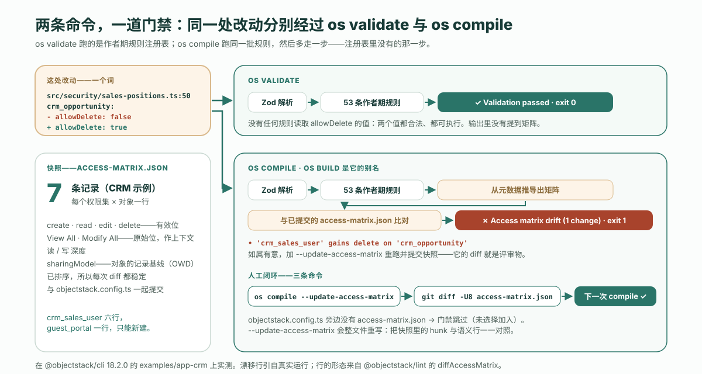

---
# @generated zh-Hant from zh-Hans (s2twp) — edit the zh-Hans file; delete this line to hand-maintain.
title: 怎樣在上線前抓住 AI 悄悄改掉的權限？訪問矩陣快照門禁，在一張 7 條記錄的 CRM 矩陣上實測
description: 在 @objectstack/cli 18.2.0 上，os validate 對 Agent 把 allowDelete 從 false 改成 true 毫無發現；在選擇加入的應用裡，os compile 會讓構建失敗，並用一行話說清誰多了什麼權限，直到有人重新生成快照。
author: ObjectStack Team
date: 2026-10-30
status: published
topic: governance
audience: developer
solutions: []
industries: []
cover: ./cover.svg
tags:
  - AI Agent
  - Agent 權限
  - 可評審的 diff
---

**先說答案。** `os validate` 不讀取 `allowDelete` 的*值*，所以 Agent 把某個權限集上的這個鍵從 `false` 改成 `true`，驗證照樣通過，沒有任何發現。這就是[那篇評審清單](/en/blog/how-to-review-ai-generated-app-changes/)說的「沒有規則被觸發」，而且這句話現在依然成立。但有一道門禁會被觸發——前提是應用選擇加入：一份提交進倉庫的**訪問矩陣**，每個（權限集 × 物件）一行，記錄有效的 create、read、edit、delete 位；`os compile` 每次構建都會從後設資料重新推導這張矩陣，再與快照比對。只要有漂移，構建就失敗，並列印一行語義化的說明——`'crm_sales_user' gains delete on 'crm_opportunity'`——直到有人重新生成快照；而快照的 git diff，就是評審人要簽字的東西。全部在已釋出的 `@objectstack/cli` 18.2.0 上實測，也就是 `npm create objectstack@latest` 裝上的那個版本，物件是自帶的 CRM 示例，它的矩陣共有**七條記錄**：一處改動，一行漂移，一行 JSON 變化。

這篇文章值得記住的概念是：**有效能力，不是原始標誌位**。矩陣報告的是把超級使用者位摺疊進去之後，一個權限集到底*能做什麼*，並把物件的記錄基線寫在同一行。改動仍然需要人來判斷，但它再也無法悄無聲息。

## 這處改動，和兩條命令

物件是 ObjectStack 倉庫裡 `@objectstack/cli@18.2.0` 標籤下的 `examples/app-crm`，裝的是已釋出的 18.2.0 包，而不是 monorepo。它已經選擇加入：`objectstack.config.ts` 旁邊放著一份 `access-matrix.json`。改動就是評審那篇文章走過的那一處，`src/security/sales-positions.ts` 第 50 行，一個詞：

```diff
  export const SalesUserPermissionSet = definePermissionSet({
    name: 'crm_sales_user',
    label: 'CRM Sales User',
    objects: {
      crm_account: { allowRead: true, allowCreate: true, allowEdit: true, allowDelete: false },
      crm_contact: { allowRead: true, allowCreate: true, allowEdit: true, allowDelete: false },
-     crm_opportunity: { allowRead: true, allowCreate: true, allowEdit: true, allowDelete: false },
+     crm_opportunity: { allowRead: true, allowCreate: true, allowEdit: true, allowDelete: true },
```

第一道門，`npx os validate`。輸出只保留要緊的幾行；中間被省略的部分裡，沒有任何一處提到 `allowDelete`、`crm_sales_user` 或矩陣。

```text
$ npx os --version
@objectstack/cli/18.2.0 linux-x64 node-v22.22.0

$ npx os validate
◆ Validate
  → Loading configuration...
  → Validating against ObjectStack Protocol...
  → Running author-time rules (53)...
  → Checking that every required capability has a provider installable in this edition...
  → Checking package docs (ADR-0046)...

  ✓ Validation passed (824ms)
  Security: 3 Positions  2 Permissions
$ echo $?
0
```

五十三條作者期規則跑完了。沒有一條對「銷售代表該不該刪除商機」有看法，因為那是關於你公司的事實，不是關於後設資料的事實。評審那篇文章的句子一字不差地成立：兩個值都合法，兩個值都可執行，你合併哪個，執行時就執行哪個。

第二道門，`npx os compile`。同一份配置，同樣的 53 條規則，然後多了一步 `validate` 沒有的：

```text
$ npx os compile
◆ Compile
  → Loading configuration...
  → Normalizing stack definition...
  → Lowering inline handlers...
  → Validating protocol compliance...
  → Running author-time rules (53)...
  → Checking that every required capability has a provider installable in this edition...
  → Checking access-matrix snapshot (ADR-0090 D6)...

  ✗ Access matrix drift (1 change) — capability changes must be reviewed
  • 'crm_sales_user' gains delete on 'crm_opportunity'
  If intended, re-run with --update-access-matrix and commit the snapshot — its diff IS the review artifact.
$ echo $?
1
```

`os build` 是同一條命令的另一個名字（在 18.2.0 的 CLI 原始碼裡，`Build extends Compile`），它以同一行失敗。加上 `--json`，失敗就是一份 CI 步驟能讀的載荷：

```json
{ "success": false, "error": "access matrix drift",
  "changes": ["'crm_sales_user' gains delete on 'crm_opportunity'"],
  "warnings": [ … ], "conversions": [] }
```



機制就這麼多。文章接下來講這一行是什麼意思、原始碼裡寫的明明是 `allowDelete` 為什麼它說 *delete*，以及這道門禁不做什麼。

## 這道門禁是什麼

ObjectStack 的文件用一段話說清了它，值得原文引用而不是轉述：

<blockquote lang="en">
AI drafts permission metadata on this platform; the one thing it must never do is *silently* change who can do what. The access-matrix gate makes every capability change a **visible, reviewable build event**: the (permission set × object) matrix is derived purely from metadata on every `os compile`, diffed against a committed snapshot, and any drift **fails the build** with a semantic explanation until a human regenerates the snapshot.
</blockquote>

（AI 在這個平臺上起草權限後設資料；它唯一絕不能做的事，是*悄悄*改變誰能做什麼。訪問矩陣門禁把每一次能力變化都變成**看得見、可評審的構建事件**：（權限集 × 物件）矩陣在每次 `os compile` 時純粹由後設資料推導，與已提交的快照比對，任何漂移都會**讓構建失敗**並給出語義化解釋，直到有人重新生成快照。）

關於它的三個事實，每一條都在 18.2.0 上核對過：

- **按應用、選擇加入。** 在 `objectstack.config.ts` 旁邊提交一份 `access-matrix.json`；第一份用 `os compile --update-access-matrix` 生成。沒有檔案，就沒有門禁：CLI 只讀一次這個路徑，檔案不存在就當作「未選擇加入」。自帶的兩個示例 `app-crm` 和 `app-showcase` 都已加入。而一個新的 `npm create objectstack@latest` 腳手架沒有：18.2.0 的模板裡不含 `access-matrix.json`，所以加入的第一條命令得由你來跑。
- **它不是那 53 條規則之一。** CLI 原始碼把它歸為「不是登錄檔規則：它讀取（帶上標誌時還會寫入）配置旁邊的一個檔案，而不是回答一個關於棧的問題」。這正是 `validate` 和 `lint` 永遠看不到它的原因：它們跑的是登錄檔，而快照門禁住在 `compile` 裡。
- **它很小。** CRM 已提交的整張矩陣只有七條記錄，而七行就是這個應用宣告的全部授權：`crm_sales_user` 的六個物件，加上公開 web-to-lead 表單背後匿名 `guest_portal` 配置那一條只能新建的記錄。

| 權限集 | 物件 | create | read | edit | delete | View All | Modify All | 記錄基線（OWD） |
| :--- | :--- | :-: | :-: | :-: | :-: | :-: | :-: | :--- |
| `crm_sales_user` | `crm_account` | ✓ | ✓ | ✓ | – | – | – | `public_read_write` |
| `crm_sales_user` | `crm_activity` | ✓ | ✓ | ✓ | – | – | – | `public_read_write` |
| `crm_sales_user` | `crm_contact` | ✓ | ✓ | ✓ | – | – | – | `public_read_write` |
| `crm_sales_user` | `crm_lead` | ✓ | ✓ | ✓ | – | – | – | `public_read_write` |
| `crm_sales_user` | `crm_opportunity` | ✓ | ✓ | ✓ | – | – | – | `public_read_write` |
| `crm_sales_user` | `crm_opportunity_line_item` | ✓ | ✓ | ✓ | – | – | – | `controlled_by_parent` |
| `guest_portal` | `crm_lead` | ✓ | – | – | – | – | – | `public_read_write` |

一個從沒開啟過 CRM 原始碼的評審人，不到一分鐘就能讀完這張表，並說出這個應用讓銷售使用者做什麼。把它作為一份提交進倉庫的檔案來維護，意義就在這裡：應用的能力模型是倉庫裡的一張七行表，任何改動這張表的 pull request，都必須在它的 diff 裡把這件事說出來。

落在磁碟上，每一行就是一個 JSON 物件。改動之前的 `crm_opportunity` 那一行：

```json
{
  "permissionSet": "crm_sales_user",
  "object": "crm_opportunity",
  "create": true,
  "read": true,
  "edit": true,
  "delete": false,
  "viewAllRecords": false,
  "modifyAllRecords": false,
  "sharingModel": "public_read_write"
}
```

漂移行由兩張這樣的表做 diff 生成，而且行的形態恰好只有五種。它們是評審人將要閱讀的詞彙，所以按 18.2.0 裡 `diffAccessMatrix` 的原始碼列在這裡：

| 發生了什麼 | 列印的行 |
| :--- | :--- |
| 一行消失了 | `'SET' loses ALL access to 'OBJECT' (entry removed)` |
| 一行出現了 | `'SET' gains access to 'OBJECT' (create, read, …)` |
| 已有的一行上某一位翻轉 | `'SET' gains delete on 'OBJECT'` 或 `'SET' loses read on 'OBJECT'`；View All 與 Modify All 用同樣的形式 |
| 讀或寫的深度變了 | `'SET' read depth on 'OBJECT': own → org` |
| 物件的記錄基線變了 | `'OBJECT' record baseline (OWD): private → public_read_write (affects every principal)` |

我們的改動是第三種。這一行說的是 *gains delete*，而不是引用那個鍵名，這正是下一節的主題。

## 有效能力，不是原始標誌位

再看一眼上面那一行。它有一列 `delete`，而不是 `allowDelete`，這個差別是有意為之：矩陣報告的是**有效**能力。在 18.2.0 的規範裡，由一個函式決定一條物件權限是否授予某個動作，而執行時的執行門在回答 403 之前問的也是同一個函式。它的摺疊規則，出自 `@objectstack/spec` 裡的 `objectPermissionGrants`：

- `read` 為真，當 `allowRead` 為真，**或** `viewAllRecords` 為真，**或** `modifyAllRecords` 為真。
- `edit`、`delete`、`transfer` 為真，當各自的位為真**或** `modifyAllRecords` 為真。
- `create` 沒有超級使用者旁路：Modify All 擴大 edit 和 delete，但不會憑空製造一個 create 授權。
- `export` 是一個合取，`allowExport` **且** `read`，所以一個權限集若對自己讀不了的物件授予匯出，等於什麼都沒授予。（矩陣只帶四個 CRUD 列；`transfer` 和 `export` 是摺疊裡的另外兩個動作，列在這裡是因為摺疊本身才是重點。）

規範自己對「為什麼不是 `permission[target] === true`」的註釋，說的是宣告與執行之間的缺口「指向危險的那一邊：一個謂詞把某個動作藏起來，不讓唯一有權使用它的管理員看見」。一張用原始 `allow*` 位拼出來的矩陣會有同一個盲點。所以矩陣去問摺疊，而兩個超級使用者列作為原始位留在旁邊，因為它們是評審人閱讀 CRUD 列時的上下文。


可以測量的後果是：對同一行做另一處只改一行的改動，把 `allowDelete: false` 換成 `modifyAllRecords: true`，得到的是兩行而不是一行，而其中第一行就是誰也沒有敲過的那個 delete：

```text
$ npx os compile
  ✗ Access matrix drift (2 changes) — capability changes must be reviewed
  • 'crm_sales_user' gains delete on 'crm_opportunity'
  • 'crm_sales_user' gains Modify All Data on 'crm_opportunity'
```

對這處改動跑 `npx os validate`：`✓ Validation passed (732ms)`。原始碼那一行已經不再提 delete；矩陣說的是 `true`，因為執行時會放這個刪除過去，而矩陣的職責是告訴評審人 403 會怎麼說，不是原始檔怎麼寫。

有一種寫法規範已經不再接受，而它恰恰是最先會想到的改法：`allowDelete: false` 原樣不動，在旁邊加上 `modifyAllRecords: true`。18.2.0 之前這個組合能載入，而報告它所授予的那個 delete 的，只有矩陣這一道門。從 18.2.0 起，規範在任何規則或門禁跑起來之前就拒絕它，`validate` 退出碼 1，`compile` 退出碼 2，訊息相同：

```text
$ npx os validate
  ✗ [ { "code": "custom", "path": ["objects", "crm_opportunity", "allowDelete"],
        "message": "allowDelete: false is refused beside modifyAllRecords: true since @objectstack/spec 18 (ADR-0049): Modify All Records is the write bypass for edit, delete and transfer, and the permission evaluator grants delete on the bypass bit before it reads allowDelete, so this false is never enforced. …" } ]
$ echo $?
1
```

這就是上面那個摺疊，提前一道門執行：一個執行時本來會忽略的 `false`，現在是 schema 錯誤而不是無聲的謊言；被接受的那種寫法意味著什麼，由矩陣的那一行來說。

最後一列重要的理由也一樣。評審那篇文章的第二遍要求你即使 diff 沒碰到某個物件，也要去讀它的 `sharingModel`，因為一個照抄來的演示物件上的 `public_read_write`，意味著全組織可讀可寫，而所有門禁一路綠燈。在這裡，基線就寫在授權旁邊的同一行上，基線的變化是一條獨立的漂移行，還標著 *affects every principal*（影響每一個主體），因為 OWD 一擺動，該物件的每一行的含義都同時變了。

## 重新生成，然後讀 diff

失敗資訊已經說了改動若屬有意該怎麼辦，閉環是三條命令。

```text
$ npx os compile --update-access-matrix
  → Checking that every required capability has a provider installable in this edition...
  → Access matrix snapshot written to access-matrix.json (ADR-0090 D6) — review the diff.
  → Writing artifact...

  ✓ Build complete (1121ms)

$ git diff -U8 access-matrix.json
@@ -46,17 +46,17 @@
       "sharingModel": "public_read_write"
     },
     {
       "permissionSet": "crm_sales_user",
       "object": "crm_opportunity",
       "create": true,
       "read": true,
       "edit": true,
-      "delete": false,
+      "delete": true,
       "viewAllRecords": false,
       "modifyAllRecords": false,
       "sharingModel": "public_read_write"
     },

$ npx os compile
  → Checking access-matrix snapshot (ADR-0090 D6)...
  ✓ Build complete (702ms)
```

跑下來有兩條實用的提醒。這個標誌會無條件重寫整個檔案，所以重新生成之後，把 `access-matrix.json` 裡的 hunk 數和失敗那次 compile 列印的語義行數對一對：一行對一個 hunk，多出來的就是你沒要求的變化。另外，讀 hunk 時用 `-U8`，別用預設的三行上下文。這一行的 `permissionSet` 和 `object` 鍵在被改的那一位上方五、六行處，預設的 `git diff` 給你看的是 `"delete": false → true`，卻把這一行的名字截掉了，這時能告訴你那是*誰的* delete 的，就只剩 compile 列印的那條語義行。

現在這個 pull request 帶著兩個用兩種詞彙說同一件事的 hunk：Agent 寫下的原始碼翻轉，和人重新生成的能力行。文件對後者的說法是對的，也正是這篇文章要實測的那句話：「its diff IS the review artifact」——它的 diff 就是評審物。

## 它在整套防線裡的位置

這道門禁是建立在同一批結構化授權之上的三種機制之一，每一種都能抓住另外兩種抓不住的東西。

| 機制 | 抓什麼 | 何時執行 | 做什麼 |
| :--- | :--- | :--- | :--- |
| 安全姿態 linter（ADR-0090 D7） | *單獨就危險*的宣告：未設定的 OWD、高權限的錨點建議、已退役的別名 | `validate`、`build`、`lint`，作為登錄檔規則 | 以規則自己的資訊讓構建失敗 |
| 訪問矩陣快照門禁（ADR-0090 D6） | *看起來合理*、但影響面仍該由人簽字的改動 | `compile` 與 `build`，在應用選擇加入時 | 以語義行讓構建失敗，直到快照被重新生成 |
| 解釋引擎 | 某個主體的某一次請求為什麼是那個結果 | 執行時，逐次決策 | 回答問題，不新增任何執行 |

文件用一句話說明了後兩者的關係：矩陣「is the same evaluation run over representative (permission set × object) pairs; explain is the per-decision zoom lens」——是同一套評估跑在有代表性的（權限集 × 物件）對上；解釋引擎則是逐次決策的放大鏡。三者之所以存在，原因也是同一個：授權是詞彙封閉的結構化資料，所以構建步驟能從中推匯出一張表。把權限模型寫成應用程式碼裡自由形式的謂詞，就沒有表可比。

## 這道門禁不做什麼

五條限制，直說，因為「構建會抓住權限變化」這種句子，最容易被去掉條件之後轉述。

1. **它是選擇加入的，預設關閉。** 一個新的 18.2.0 腳手架沒有快照，也就沒有門禁。加入只需一條命令和一份提交的檔案，而新增這份檔案的那個 pull request，正是最該仔細評審的：那份快照是之後每一次 diff 的比對基線。
2. **它跑在 `compile` 和 `build` 裡，從不跑在 `validate` 或 `lint` 裡。** 上面測過了：同一處改動，`validate` exit 0 且完全不提矩陣，`compile` exit 1。一條只跑 `os validate` 就宣佈應用已檢查的 CI 流水線，並沒有跑過這道門禁。
3. **它讓改動變得可見，而不是變得不可能。** `--update-access-matrix` 只是一個標誌，Agent 自己也能跑它、自己提交新快照。Agent 做不到的是讓能力變化從 pull request 裡消失：不管是人還是模型重新生成的，那一行都在 diff 裡。評審階梯的第三級——*這樣對嗎*——仍然歸評審人，門禁的貢獻在於，這個問題現在帶著答案的形狀，用一行話送到你面前。
4. **它的範圍是（權限集 × 物件）。** create、read、edit、delete，兩個超級使用者位，讀寫深度，以及物件的基線。不包括欄位級安全，不包括共享規則，不包括行級謂詞，不包括哪些使用者持有這個權限集（那是執行時資料，評審那篇的限制裡已經說過），也不包括一個動作體跑起來之後做了什麼。
5. **對一個詞的翻轉，原始碼 diff 本來就看得見。** 這是公平的反對意見：任何讀 diff 的人都能在 `sales-positions.ts` 裡看到 `allowDelete: false → true`。矩陣的價值，在於原始碼變化和能力變化形狀不一樣的地方。一個 `modifyAllRecords: true` 是一行原始碼、兩行能力。物件檔案上一處 `sharingModel` 改動是一行原始碼，卻落在每個權限集關於該物件的那一行上。分散在好幾個檔案裡拼出來的權限模型，最終仍然落成一張有序的表，評審人不必開啟任何一個檔案就能讀。門禁的價值不在於它看見了翻轉，而在於它用執行時執行的那套詞彙看見了翻轉。

## 加到清單裡的兩行

評審那篇文章以一份清單收尾。這道門禁給它的第二遍加一行，給第一遍加一個問題。

```text
[ ] Which door? If the pipeline ran only os validate, the access-matrix gate did not run.
[ ] Pass 2 — permissions:
    [ ] access-matrix.json is committed (opt in once: npx os compile --update-access-matrix)
    [ ] on drift: one semantic line per hunk in access-matrix.json, and the PR says why
    [ ] read each hunk with -U8, so the permissionSet and object are in it
    [ ] for every "gains" line, say who gains what, and read the OWD on the same row
```

## 把 Agent 指向一個授權本身就是一張表的目標

Agent 在任何技術棧裡都能生成一套權限模型。它在大多數棧裡做不到的，是交給你一張七行的表，由構建每次重新推導、每次比對——因為在大多數棧裡，權限模型散落在中介軟體、查詢過濾器和一兩個模板之間，根本沒有表可比。上面這道門禁之所以存在，是因為 ObjectStack 裡的授權是詞彙封閉的型別化後設資料，而正是這個性質讓 diff [可評審](/zh-Hant/glossary/reviewable-diff/)，也讓一條宣告出來的權限不至於[只是一句註釋](/zh-Hant/glossary/declared-vs-enforced/)。如果你想看執行本身發生在哪裡的論證，它在[AI Agent 的權限究竟在哪一層被執行](/zh-Hant/blog/objectos-agent-permission-boundaries/)。

所以，把你的 Agent 指向這個目標——用[一份規則檔案](/en/blog/how-to-point-your-agent-at-objectstack/)，或直接用規範和 MCP 介面——並把快照作為你提交的第一樣東西：

```bash
npm create objectstack@latest my-app && cd my-app
# 在你的編碼 Agent 裡開啟它，描述業務需要什麼
npx os compile --update-access-matrix   # 第一份快照：讀一遍，提交
npx os compile                          # CI 裡每次都跑；只跑 os validate 不會經過這道門禁
```

從此之後，Agent 可以自由起草授權，而它唯一做不到的，是在構建輸出裡沒有一行、diff 裡沒有一行的情況下，改變誰能做什麼。

想把同一個迴圈託管起來、在瀏覽器裡用、什麼都不用安裝？那就是 ObjectOS——建立在 ObjectStack 之上的商業執行環境。
