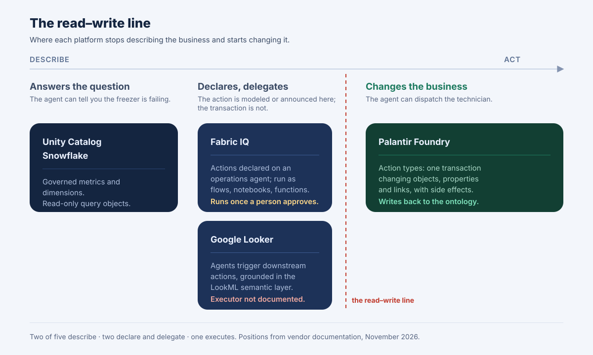

**The short version:** all five platforms model business objects and the relationships between them. Only three model **actions** — the operations that change the business, not just describe it. Only one of those executes actions as a transaction inside the ontology itself. That single row is the difference between a [semantic layer](/en/glossary/semantic-layer/) your agent can *read* and an [ontology](/en/glossary/ontology/) your agent can *act* in, and it is the row most comparison posts get wrong. **Palantir Foundry vs Microsoft Fabric IQ**, the pairing most buyers ask about, is the sharpest case of it: Foundry executes actions inside the ontology as transactions, while Fabric IQ's ontology, still in preview, describes the business and hands actions to separate operations agents that run them once a person approves.

Call it **the read–write line**: the point where a platform stops describing your business and starts changing it. Every cell below is sourced to the vendor's own documentation or announcement. When this table first ran, 29 of its 30 cells could be confirmed from a vendor source and one was marked *Unverified* rather than guessed. The November 2026 refresh re-checked every Fabric IQ and Palantir cell against current documentation: the unverified cell is now confirmed, and two Fabric IQ cells changed because Microsoft changed the product. Each change is marked where it happens.

This post is the table. The argument about *who should own* this layer — and why fragmentation, not lock-in, is the expensive failure — is a separate piece: [Open vs. Closed Enterprise Ontologies](/en/blog/enterprise-ontology-race-open-vs-closed/).

## 1. What each vendor actually shipped, and when

The category did not arrive at once. It arrived across nine months, from four different starting positions — a data platform, a lakehouse, a warehouse, a BI tool — plus the incumbent that has had an ontology for years and spent 2026 doing something else with it.

| Platform | What shipped | When | Status today |
| --- | --- | --- | --- |
| **Microsoft Fabric IQ** | Ontology item + agent workload | Ignite 2025, Nov 18–21 | Ontology item in preview |
| **Databricks Unity Catalog** | Business Semantics, metric views | 2026 | GA |
| **Snowflake** | Semantic View Autopilot | Feb 3, 2026 | GA |
| **Google Looker** | BI Agents on the LookML semantic layer | Next '26, Apr 22, 2026 | Mixed — see below |
| **Palantir Foundry** | SuperRepo: Ontology-as-code | Week of Aug 3, 2026 | Beta |

Five notes that change how you read that table.

**Microsoft entered highest up the stack.** Fabric IQ is a full workload, not a feature: Ontology, Graph, Data Agent and Operations Agent as separate items. The ontology item defines entity types, properties, relationships, rules and metrics and binds them to live data; business experts can author it visually or generate it from an existing Power BI semantic model. *Updated November 2026:* Microsoft has since rebuilt the ontology item. In the new experience, which retires the old one on January 31, 2027, a rule is a natural-language statement and "Ontology doesn't run the rule against data or execute actions"; actions moved to the operations agent. Microsoft Learn still labels the ontology item, and the IQ workload around it, as preview.

**Snowflake and Databricks entered from analytics, and both bet on automation over authoring.** Snowflake's Semantic View Autopilot autogenerates semantic views from your existing query history and BI assets — its stated premise is that your semantics are *already* defined in the SQL people run and the dashboards they trust, so modeling becomes curation rather than authoring. Databricks made Business Semantics GA during 2026 and is open sourcing the core metric-view implementation into Apache Spark.

**The missing month on the Databricks row is deliberate.** Databricks published a semantics-layer GA announcement, and separately a Data + AI Summit round-up in June 2026 carrying Business Glossary and Domains. The two are easy to conflate, and we could not open the vendor's own announcement to settle which of them carried the GA. So this table says 2026 rather than attributing a month we cannot source. What *is* well sourced is the June 2026 summit as the moment Glossary and Domains landed on top of Business Semantics — which is a different claim from when the GA happened.

**Google entered from the BI seat, and its row is thinner than the other four.** Looker's agentic BI updates were announced at Google Cloud Next '26 on April 22, 2026, and the framing is explicitly agent-first: Looker BI Agents "don't just provide static answers, but trigger downstream business actions grounded in the Looker semantic layer and your existing enterprise governance framework." What shipped is a mix of states rather than one release. The Conversational Analytics agent "is already GA", and embedding those agents in your own applications went GA alongside it; the upgraded Conversational Agents, Dashboard Agents, agentic workflows and the Knowledge Catalog integration are all preview. Knowledge Catalog is the former Dataplex under a new name, and it is where, per Google, "Looker transforms metadata into a semantic graph, providing the essential context AI agents need to complete tasks autonomously." Every Google cell below traces to that one announcement — a single launch post, against four vendors' documentation sets for the others — so those cells are written at the granularity it supports and no further. Where the other four columns cite an action model or a permission model, Google's column cites an announcement of one.

**Palantir did not ship an ontology in 2026 — it already had one.** What it shipped is the thing the other four are converging toward: SuperRepo, a single monorepo holding Ontology definitions, functions and the React application, developed and deployed as one versioned artifact. Object types, links, interfaces and actions are declared in TypeScript, and those code definitions are the source of truth. Hold that thought for section 5; it is the most uncomfortable fact in this post.

## 2. The comparison table

Six capabilities, five platforms. Cells are deliberately terse so this reads on a phone; the sourcing for each is in section 9.

| Capability | Fabric IQ | Unity Catalog | Snowflake | Google Looker | Palantir Foundry |
| --- | --- | --- | --- | --- | --- |
| **Business objects** | Entity types | Metric views | Logical tables | Explores, LookML dimensions | Object types |
| **Relationships** | Typed, graph view | Joins in the view | Joins on shared keys | Semantic graph (preview) | Link types |
| **Actions** | Delegated to agents | Read-only by design | Read-only by design | Triggered downstream | Native, transactional |
| **Permissions** | Item + source RLS/CLS | Inherited from UC | Public/private fields | Inherited from Looker | Object + dynamic |
| **Agent interface** | Ontology MCP (preview) | Genie, AI/BI | Cortex Analyst, MCP | Conversational Analytics, MCP | Ontology MCP, OSDK |
| **Definition portable** | RDF/Turtle export, partial | Spark OSS, OSI | YAML spec | LookML, version-controlled | Git repo, Foundry-bound |

**On the two "read-only by design" cells.** This is a positive claim, not an absence claim. Databricks documents metric views as read-only query objects — creating one "does not process or write any data. Only the query text is registered to the metastore." Snowflake semantic views are queried by putting a `SEMANTIC_VIEW` clause in a `FROM` clause. Neither product is *missing* actions; neither is trying to have them. They are semantic layers over a warehouse, and a warehouse semantic layer that wrote back to operational systems would be a different product.

**On Google's "triggered downstream" cell.** This is the weakest-sourced cell in the table and it is worth saying why it is not simply "declared, delegated" like Fabric IQ's. Google states that BI Agents "trigger downstream business actions"; it does not, in that announcement, describe an action type, a transaction boundary, or what executes the action. Fabric IQ's cell names its executor because Microsoft's documentation names it. Google's does not, so the cell records the claim and stops there. If Google documents the action model, this cell gets more specific — and possibly moves.

**On the formerly *Unverified* cell.** In September this cell read *Unverified*: Microsoft's documentation did not say whether an ontology's definition could leave Fabric as a file. It now does. The ontology item exports "as a TTL or RDF file" and imports TTL, RDF and OWL, in preview ([Import and export ontologies](https://learn.microsoft.com/en-us/fabric/iq/ontology/how-to-import-export)). The export carries entity types, properties, relationships, descriptions, names, synonyms and single-parent inheritance. Rules, metrics and data bindings are not in the export mapping, and Microsoft says the round trip is not "complete or lossless." So the cell reads *partial*: the shape of your model leaves with you, the business logic attached to it does not.

**On the two Fabric IQ cells that changed.** *Actions* moved from "declared, delegated" to "delegated to agents" because the new ontology experience no longer models actions; the operations agent declares them instead (section 3). Fabric IQ stays on the declare-and-delegate side of the line; what moved is *where* the declaration lives. *Permissions* moved from "item-level sharing" because Microsoft now documents that authoring and querying respect the bound data's own row-, object- and column-level security, alongside Fabric workspace and item permissions ([ontology overview](https://learn.microsoft.com/en-us/fabric/iq/ontology/overview)).

## 3. Where each one stops — the read–write line



**Unity Catalog and Snowflake stop at the answer.** A metric view or a semantic view gives an agent one governed definition of "revenue" so that the dashboard, the notebook and the agent all return the same number. That is a genuinely hard problem and both solved it well. The agent can then tell you the freezer is failing. It cannot dispatch the technician.

**Fabric IQ delegates actions to agents.** When this post first ran, the ontology itself modeled actions as operations on entities and wired each one to Activator and a Power Automate flow. The rebuilt ontology no longer does: a rule is natural language, and the ontology MCP tool that returns rules is read-only, "leaving it up to you to interpret and operationalize the rules because ontology doesn't execute on them" ([business rules](https://learn.microsoft.com/en-us/fabric/iq/ontology/how-to-use-rules)). Actions now live on the operations agent, which watches the data, sends a recommendation to Teams, and can run a notebook, pipeline, user-defined function or Power Automate flow. It runs one only "when a recipient approves a recommendation," and then "on behalf of the creator, using the creator's permissions" ([operations agent actions](https://learn.microsoft.com/en-us/fabric/real-time-intelligence/operations-agent-actions)). So the action is real, there is a human approval in front of it, and it is attributed to an Entra agent identity; but it is defined on an agent next to the ontology, not in it, and the transaction, retries and [audit trail](/en/glossary/audit-trail/) live in whatever the action calls.

**Google Looker sits beside Fabric IQ, on one sentence rather than a model.** The announcement puts the agents on the same side of the line: BI Agents "trigger downstream business actions grounded in the Looker semantic layer and your existing enterprise governance framework," and the agentic workflows it describes monitor metrics and surface "what's next" recommendations. Both halves of that — grounded in a governed semantic layer, executing somewhere else — are the declare-and-delegate shape. The difference from Fabric IQ is evidential, not architectural as far as anyone outside Google can tell: Microsoft documents the action, the executor and the approve-before-it-runs behaviour, and Google has announced the capability. Treat the placement as provisional.

**Palantir executes actions inside the ontology.** An [action type](/en/glossary/object-type-and-action-type/) is "the definition of a set of changes or edits to objects, property values, and links that a user can take at once", including side-effect behaviors on submission, and an action is "a single transaction that changes the properties of one or more objects." Palantir's own framing splits the ontology into semantic elements (objects, properties, links) and kinetic elements (actions, functions, dynamic security). Edits land in the object type's writeback dataset. This is the mature implementation of the thing the other four are approaching from different sides, and pretending otherwise would make this table useless.

**So the honest score on actions is 3–2, not 4–1.** The lazy version of this post says "only Palantir has actions." That is wrong: Fabric IQ's agents run them, and Google says its agents trigger them. The accurate version is that five platforms sit at three different places on the read–write line — two describe, two declare and delegate, one executes inside the ontology — and which one you need depends entirely on whether an agent reading your ontology is expected to *do* anything.

## 4. Palantir Foundry vs Microsoft Fabric IQ, head to head

This is the comparison most people arrive at this post looking for, and the five-column table flattens it. The two are not two versions of the same product. Foundry is an operational platform whose ontology has executed transactions for years; Fabric IQ is a context layer for agents over data that already lives in OneLake, and it is still in preview. Here they are side by side, every cell from current vendor documentation:

| | Palantir Foundry | Microsoft Fabric IQ |
| --- | --- | --- |
| **Maturity** | Ontology is the core product; Ontology MCP generally available from the week of June 16, 2026 ([announcement](https://www.palantir.com/docs/foundry/announcements/2026-06)) | Ontology item, IQ workload and ontology MCP server all labeled preview on Microsoft Learn |
| **What the ontology holds** | Object types, properties, links, action types, functions ([Ontology overview](https://www.palantir.com/docs/foundry/ontology/overview)) | Entity types, properties, relationships, natural-language rules, metrics from Power BI, data bindings ([ontology overview](https://learn.microsoft.com/en-us/fabric/iq/ontology/overview)) |
| **How it is authored** | Ontology Manager, or TypeScript in a SuperRepo monorepo (beta) | Visual editor, generated from a Power BI semantic model, drafted by the ontology agent "under a proposal-first model", or imported from RDF/OWL |
| **Who executes an action** | The ontology: an action is "a single transaction that changes the properties of one or more objects" ([action types](https://www.palantir.com/docs/foundry/action-types/overview)) | An operations agent next to the ontology, running a notebook, pipeline, function or Power Automate flow once a person approves |
| **Permissions** | Object-level and dynamic security as part of the ontology | Fabric workspace and item permissions, plus the bound sources' row-, object- and column-level security |
| **Agent interface** | Ontology MCP: object types, action types and functions as MCP tools | Ontology MCP server (preview); the rules tool is read-only |
| **Where the definition can go** | TypeScript in your repo that "materialize[s] as real entities on your enrollment" ([SuperRepo announcement](https://www.palantir.com/docs/foundry/announcements/2026-08)) | TTL or RDF export of the model's structure; rules, metrics and bindings stay behind |
| **What it assumes you already have** | Nothing; forward-deployed engineers help integrate your systems into it | Your data in OneLake and, ideally, Power BI semantic models to generate from |

Three conclusions follow, and none of them is "one is better."

**If agents must change records with a transaction and an audit trail, Foundry is the only one of the two that does that inside the ontology today.** Fabric IQ's answer is a human-approved recommendation that calls out to something else. For many operational decisions — reroute this shipment, open this work order — an approval in Teams in front of a Power Automate flow is perfectly adequate. It is not the same guarantee as a transactional action type, and a buyer should know which one they are signing up for.

**If your semantics already live in Power BI, Fabric IQ starts much further along.** Generating an ontology from a semantic model already in production, with source-owned DAX measures carried over as metrics, is a real head start, and it is the opposite of Foundry's integration-first motion. Fabric IQ's weak spot is maturity, not starting cost.

**On portability the two fail in opposite directions.** Foundry gives you the whole definition, actions included, as code, but that code only runs on Foundry. Fabric IQ lets the structure leave as an open RDF file any triple store can read, but the rules and metrics that make it a business model stay behind. Neither gives you a definition *and* an engine you can take elsewhere, which is the gap section 8 is about.

## 5. After a Foundry pilot: what carries over and what you rebuild

A common way to arrive at this comparison is the end of a long pilot: a year on Foundry, a working ontology, and a renewal decision. The useful exercise is not re-reading feature lists; it is inventorying what a year of work produced and asking which of it is portable. Using Palantir's own documentation, the inventory sorts into three piles.

**What you keep regardless of the decision:**

- **The domain model you discovered.** Which object types exist, how they link, which properties matter, what the business calls things. That knowledge is the most expensive output of any ontology project, and it is yours in your team's heads and documents even if the artifact is not.
- **The action inventory.** The list of operations the business actually performs on those objects, with who may perform them. Even if every action type is rebuilt, the list is the specification.

**What leaves as a file, but needs a new engine:**

- **Ontology-as-code, if you adopted SuperRepo.** Object types, links, interfaces and actions declared in TypeScript are "the source of truth" — on Foundry. Off Foundry they are a precise, readable specification, not something another platform executes. SuperRepo is also beta and "may not be available on your enrollment" ([SuperRepo](https://www.palantir.com/docs/foundry/superrepo/overview)), so many pilots will not have this file at all.

**What you rebuild:**

- **Action types and their side effects**, which are where the transactional guarantee lives.
- **Writeback, permissions and dynamic security**, which are properties of the platform, not of the definition.
- **The agent tool surface.** Ontology MCP projects Foundry's object types, actions and functions into tools; another platform projects its own.
- **The applications** built on top.

Five questions turn that inventory into a decision:

1. Did agents in the pilot *act*, or only answer? If only answer, the warehouse semantic layers in section 7 may cover it at a fraction of the cost.
2. How many action types does the pilot depend on? That number, not the object count, is the rebuild estimate.
3. Is the model in SuperRepo TypeScript, or only in Ontology Manager? That decides whether you leave with a specification or a screenshot.
4. Where does the data already live? A OneLake estate pulls toward Fabric IQ; a Databricks or Snowflake estate toward their semantic layers.
5. Who will maintain the model in year two: forward-deployed engineers, your data team, or your coding agents?

The honest steelman: if the pilot's agents act on records and the answers to questions 2 and 5 are "many" and "Palantir's engineers," renewing is often the right call. Lock-in is a cost, not a verdict, and a working operational ontology is worth paying for.

## 6. Lock-in profile

Lock-in is not one thing. Three questions separate the platforms, and the answers are less one-sided than the category's reputation suggests.

| Question | Fabric IQ | Unity Catalog | Snowflake | Google Looker | Palantir |
| --- | --- | --- | --- | --- | --- |
| Definition in a file you hold | Partial (TTL/RDF) | Yes (Spark OSS) | Yes (YAML) | Yes (LookML) | Yes (monorepo) |
| Runs off the vendor | No | Spark OSS path | No | No | No |
| In an open standard body | Not named | Named member | Co-founder | Not named | Not named |

**The honest counterweight: this category is standardizing, and quickly.** Snowflake co-founded the Open Semantic Interchange with Salesforce, dbt Labs, BlackRock and RelationalAI in September 2025 — a vendor-neutral, Apache-2.0 spec for exchanging semantic models (metrics, dimensions, relationships) between platforms. Spec v0.1 was finalized in January 2026. In July 2026 the initiative entered the Apache Incubator as **Apache Ossie**, with 50+ member organizations including Databricks, Oracle and Collibra. Databricks is separately open sourcing the metric-view implementation into Apache Spark.

That matters for anyone arguing that a closed platform is definitionally a trap. Two of the five are actively moving their definition format toward a neutral standard body. If Ossie succeeds, "my metrics are portable" stops being a differentiator for anyone.

Two limits worth stating just as plainly. First, Ossie covers **analytical** semantics — metrics, dimensions, relationships. Actions and permissions, the two rows where these platforms differ most, are not in scope, so the read–write line is exactly where portability currently stops. Second, portability of the definition is not portability of the system: a Snowflake semantic view exported as YAML still needs a Snowflake to run against, and a SuperRepo still materializes onto a Foundry enrollment.

## 7. Which to pick, by starting position

Nobody picks one of these on features. You pick the one that matches where your data and your engineers already are.

**Your business already runs on Microsoft 365 and OneLake.** Fabric IQ, and the fact that it is still in preview is the main cost. You get the highest-level model of the five, authored by business experts rather than engineers, the option to generate it from Power BI semantic models you already trust, and actions that operations agents run through Power Automate, notebooks or functions once someone approves. Know what the export leaves behind before you model your entire company in it: the structure leaves as RDF, the rules and metrics do not.

**Your analytics team lives in Databricks.** Unity Catalog Business Semantics. It is GA, the permission model is the one your team already administers, Genie is grounded in it, and the open-sourcing into Spark gives you the strongest portability story of the five. Do not expect it to operate anything.

**Your warehouse is Snowflake and you have years of query history.** Semantic View Autopilot is the only product here that bootstraps the model from what your organization already does, instead of asking a committee to define "revenue" from scratch. If your obstacle is the six-month modeling project rather than the technology, this is the strongest answer on the list — and it is a genuine capability gap for everyone else, including the approach at the end of this post.

**Your reporting layer is Looker and your analysts live in LookML.** Google, and the reason is that you already did the modeling. LookML is a governed semantic layer your organization has been maintaining for years, in files under version control, and the 2026 announcement points the agents at it rather than asking you to build something new: Conversational Analytics is GA, a managed MCP server native to Looker is in preview, and Knowledge Catalog turns the metadata into a semantic graph for agents. The honest caveat is the one in section 2 — the agent story is a launch post, not yet a documented action model — so weigh it as the lowest-effort path from an existing semantic layer to agents, not as a settled answer on what those agents may change.

**You need agents that act, with a transaction and an audit trail.** Palantir Foundry, and it is not close. The kinetic half of the ontology is a decade of engineering and none of the other four have shipped an equivalent.

**None of the above, or more than one of the above.** That is the case the five platforms handle worst, because each is strongest inside its own estate — and it is the case the companion post is about.

## 8. Where an open business ontology fits — and where it does not

Full disclosure: we build one, so read this section as the interested party's answer rather than a neutral verdict.

[ObjectStack](https://github.com/objectstack-ai/objectstack) is an **open business ontology**: objects, relationships, permissions, flows and actions as [typed metadata](/en/glossary/typed-metadata/) in your own repository, Apache-2.0, with a runtime that derives the database, REST API, UI and MCP server from it and enforces permissions and audit on every call. On the read–write line, it sits with Palantir: actions are permission-checked server operations, and every exposed action doubles as a governed MCP tool.

```ts
import { ObjectSchema, Field } from '@objectstack/spec/data';

export const Ticket = ObjectSchema.create({
  name: 'support_desk_ticket',
  label: 'Ticket',
  sharingModel: 'private',
  fields: {
    subject: Field.text({ label: 'Subject', required: true }),
    status: Field.select({
      label: 'Status',
      required: true,
      options: [
        { label: 'Open', value: 'open', default: true },
        { label: 'Resolved', value: 'resolved' },
      ],
    }),
  },
});
```

Now the part that belongs in an honest comparison. **All five beat this approach on something real:**

- **Snowflake beats it on cold start.** Semantic View Autopilot reads your query history and drafts the model. There is no equivalent here — you and your agent author the definition. If your problem is that nobody can agree on "revenue," Snowflake's answer is better than ours.
- **Databricks and Snowflake beat it on analytical semantics.** Metric views and semantic views carry aggregation semantics — facts, dimensions, metrics, semi-additive rules — over warehouse-scale data. An application ontology models objects and operations, not a metrics layer, and it is not a substitute for one.
- **Palantir beats it on modeling depth and accountability.** A decade of ontology engineering, forward-deployed engineers who will sit with your team, and one vendor on the phone when it breaks. An open format gives you the file; it does not give you someone to call.
- **Fabric IQ beats it on who can author.** Business experts building the model in a visual tool, or generating it from a Power BI model they already maintain, is a different and broader distribution than "your coding agent writes typed metadata in a repo."
- **Looker beats it on the semantic layer you already have.** LookML has been in place at these companies for years, and Google's self-service Explores let someone blend an ad-hoc CSV into it while "the underlying business logic is still accurate." Starting from a governed model your analysts already trust is a genuinely easier first step than authoring one, however portable the file we hand you is.

What is different here is narrower than "better": the definition is an ordinary file in your repository under an open license, the runtime that enforces it is self-hostable, and both halves — semantic *and* kinetic — are in the same portable artifact rather than split across a portable spec and a proprietary execution engine. Whether that is worth more than modeling depth, autogeneration or ecosystem integration is a judgment about your starting position, not a fact this table can settle.

## 9. Sources

Every claim above traces to one of these.

- **Microsoft Fabric IQ** — [What is Fabric IQ?](https://learn.microsoft.com/en-us/fabric/iq/overview) · [What Is Ontology (Preview)?](https://learn.microsoft.com/en-us/fabric/iq/ontology/overview) · [Introducing Fabric IQ](https://blog.fabric.microsoft.com/en-us/blog/introducing-fabric-iq-the-semantic-foundation-for-enterprise-ai) · [Use Ontology MCP Server](https://learn.microsoft.com/en-us/fabric/iq/ontology/how-to-use-ontology-mcp-server) · [Create an Operations Agent](https://learn.microsoft.com/en-us/fabric/iq/ontology/how-to-create-operations-agent) · [Import and export ontologies](https://learn.microsoft.com/en-us/fabric/iq/ontology/how-to-import-export) · [Define business rules](https://learn.microsoft.com/en-us/fabric/iq/ontology/how-to-use-rules) · [Operations agent actions](https://learn.microsoft.com/en-us/fabric/real-time-intelligence/operations-agent-actions) · [Create and configure operations agents](https://learn.microsoft.com/en-us/fabric/real-time-intelligence/operations-agent)
- **Databricks Unity Catalog** — [GA and open sourcing of Business Semantics](https://www.databricks.com/blog/redefining-semantics-data-layer-future-bi-and-ai) · [Unity Catalog semantics](https://docs.databricks.com/aws/en/uc-semantics/) · [Metric views](https://docs.databricks.com/aws/en/uc-semantics/metric-views/) · [Manage metric views](https://docs.databricks.com/aws/en/uc-semantics/metric-views/manage)
- **Snowflake** — [Semantic View Autopilot GA press release](https://www.snowflake.com/en/news/press-releases/snowflake-delivers-semantic-view-autopilot-as-the-foundation-for-trusted-scalable-enterprise-ready-AI/) · [Semantic View Autopilot docs](https://docs.snowflake.com/en/user-guide/views-semantic/autopilot) · [Overview of semantic views](https://docs.snowflake.com/en/user-guide/views-semantic/overview) · [CREATE SEMANTIC VIEW](https://docs.snowflake.com/en/sql-reference/sql/create-semantic-view) · [Snowflake-managed MCP server](https://docs.snowflake.com/en/user-guide/snowflake-cortex/cortex-agents-mcp)
- **Google Looker** — [Looker updates for agentic BI at Next '26](https://cloud.google.com/blog/products/business-intelligence/looker-updates-for-agentic-bi-at-next26) (April 22, 2026) · [Knowledge Catalog, formerly Dataplex](https://cloud.google.com/products/knowledge-catalog). The first of these is the only vendor-attributable source behind every Google cell above; the second is cited only for the rename.
- **Palantir Foundry** — [Ontology overview](https://www.palantir.com/docs/foundry/ontology/overview) · [Action types](https://www.palantir.com/docs/foundry/action-types/overview) · [The Ontology system](https://www.palantir.com/docs/foundry/architecture-center/ontology-system) · [SuperRepo](https://www.palantir.com/docs/foundry/superrepo/overview) · [August 2026 announcements](https://www.palantir.com/docs/foundry/announcements/2026-08) · [June 2026 announcements](https://www.palantir.com/docs/foundry/announcements/2026-06) · [Ontology MCP](https://www.palantir.com/docs/foundry/ontology-mcp/overview)
- **Open Semantic Interchange / Apache Ossie** — [OSI announcement](https://www.snowflake.com/en/blog/open-semantic-interchange-ai-standard/) · [Ossie enters the Apache Incubator](https://ossie.apache.org/updates/ossie-enters-apache-incubator/)

Vendor documentation moves. Where a cell is time-sensitive — Fabric IQ's preview status, its partial export, Ossie's incubation — check the source before you quote this table in a decision document.

## Closing

The useful question in 2026 is not "which ontology is best." It is **where on the read–write line do you need to be**, because that single answer eliminates two of the five platforms immediately. If your agents only need to answer questions about the business, the two warehouse-native semantic layers are cheaper, GA today, and standardizing fast. If your agents need to change the business, the field narrows to platforms that model actions — and then the real question is who holds the definition when your vendor mix changes.

```bash
npm create objectstack@latest my-app
```

Model one object, point your coding agent at it, and `git commit` the definition. Whatever you decide about the five platforms above, knowing what the definition looks like as a file you own makes the lock-in column much easier to read.
