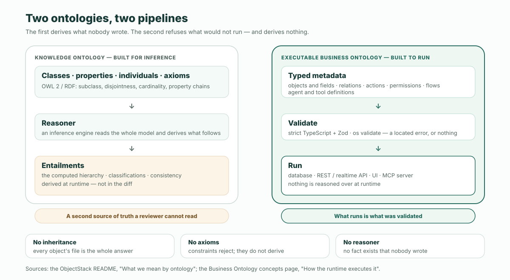
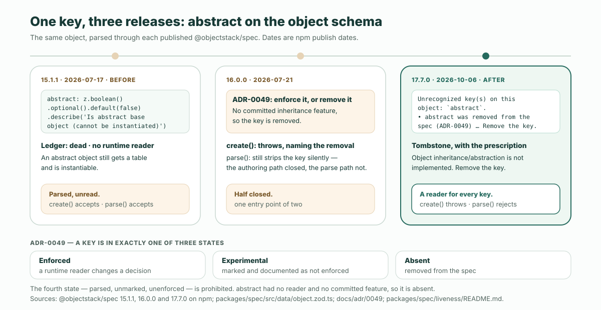

知識オントロジーは推論されるために作られている。実行可能なビジネスオントロジーは、検証され、レビューされ、実行されるために作られている。ObjectStack の README はその違いを三つの「ない」——「no inheritance, no axioms, no reasoner」（継承なし、公理なし、推論器なし）——として書いており、この三つの「ない」はロードマップ上の空白ではない。それこそが、あらゆる定義を検査可能にし、あらゆる diff をレビュー可能にしているものだ：あなたが書けるキーは、ランタイムに読み手を持つか、さもなければ取り除かれる。本稿はこの主張を最後まで論じる。証拠はひとつのキーだ。

そのキーがこれだ。知識オントロジーのクラスがそうであり得るように、abstract と印を付けられたオブジェクト：

```ts
export const Party = ObjectSchema.create({
  name: 'crm_party',
  label: 'Party',
  abstract: true,
  sharingModel: 'private',
  fields: { name: Field.text({ label: 'Name', required: true }) },
});
```

2026-07-17 に公開された `@objectstack/spec@15.1.1` では、この定義はパースを通り、`abstract` は `true` のまま返ってくる。現行リリースの `@objectstack/spec@17.7.0` では、拒否される：

```text
Unrecognized key(s) on this object: `abstract`.
  • `abstract` was removed from the spec (ADR-0049) — object inheritance/abstraction is not implemented, so an abstract object still got a table and was instantiable. Remove the key.
```

その間に何かが作られたわけではない。継承は来なかった。変わったのは、ランタイムが一度も読まなかったキーが、理由を述べるメッセージとともに仕様から取り除かれたことだけだ。以下はすべて、それが一方の種類のオントロジーにとってはなぜ正しい手であり、もう一方にとってはなぜ誤った手になるのかの論証である。材料は README、その [Business Ontology](https://github.com/objectstack-ai/objectstack/blob/8caa131e52717ef35fe71742d758f10b8f2b77ee/content/docs/concepts/ontology.mdx) 概念ページ、この削除を統べる決定記録、そして公開済みパッケージ——記述ではなく計測したものだ。

## 二つのオントロジー、二つの仕事

*オントロジー*という語は同じ会話の中で二つの異なるものを指しており、[定義の記事](/ja/blog/what-does-the-ontology-is-the-software-mean/)は、実行可能なビジネスオントロジーが「ではないもの」三つのうち最初のものとしてこれを挙げた。README のこの主題についての段落は、丸ごと引用できるほど短い：

<blockquote lang="en">

Your app's definition — objects and fields, relations, actions, permissions, flows, and agent and tool definitions — is a **business ontology**: open, versioned, and yours, not code scattered across a framework. It is executable, not a knowledge-representation ontology: no inheritance, no axioms, no reasoner — validated rather than reasoned over — and it is not a semantic layer over your existing systems (federating an external datasource is read-only by default and early).

— objectstack `README.md`, ["What we mean by ontology"](https://github.com/objectstack-ai/objectstack/blob/8caa131e52717ef35fe71742d758f10b8f2b77ee/README.md#L79-L89)

</blockquote>

（大意：あなたのアプリの定義——オブジェクトとフィールド、リレーション、アクション、権限、フロー、エージェントとツールの定義——は**ビジネスオントロジー**である：オープンで、バージョン管理され、あなたのものであり、フレームワークに散らばったコードではない。それは実行可能であって、知識表現のオントロジーではない：継承なし、公理なし、推論器なし——推論されるのではなく検証される——そして既存システムの上のセマンティックレイヤーでもない（外部データソースの連合はデフォルトで読み取り専用で、まだ初期段階だ）。）

二つの種類を順に見ていこう。そして最初のほうを真剣に扱おう。それはより古く、より厳密なほうだからだ。

**知識オントロジーは推論のために作られている**。W3C の [OWL 2](https://www.w3.org/TR/owl2-primer/) とその下の RDF スタックでは、クラス、プロパティ、そして*公理*を書く：このクラスはあのクラスのサブクラスである；この二つのクラスは互いに素である；このプロパティは高々ひとつの値を持つ；このプロパティ連鎖はあの別のプロパティを含意する。そして*推論器*がモデル全体を読み、そこから何が従うかを導出する。クラス階層は宣言されるだけでなく、計算される。個体は、誰かが打ち込んだクラスではなく、それについて知られていることによって分類される。公理間の矛盾は発見される。そして全体は開世界仮説のもとで動く：不在の事実は未知であって、偽ではない。データが多くの出所から来て、語彙を機関を越えて共有しなければならず、問いが「我々が知るすべてから何が従うか？」であるとき、それはまさに正しい設計だ。[セマンティックレイヤーおよびナレッジグラフとの比較](/en/blog/ontology-vs-semantic-layer-vs-knowledge-graph/)はこの伝統に相応の敬意を払っている；本稿が必要とするのはその輪郭だけだ。

**実行可能なビジネスオントロジーは、ソフトウェアを生成し、検証し、レビューし、実行できるように作られている**。概念ページはパイプラインを一行で示す：

```text
objectstack.config.ts -> objectstack.json -> ObjectStack runtime -> database · REST / realtime API · UI · MCP server
```

そしてそれを統べる規則をもう一行で：「Nothing is reasoned over at runtime: what runs is what was validated.」（ランタイムでは何も推論されない：動くのは検証されたものだ。）定義とはひとつの事業のアプリケーションであり、型付きメタデータとして書かれ、Zod スキーマと `os validate` で検査され、それから実行される。導出された事実からなる第二の成果物は存在しない。世界は構成上閉じている：定義が述べることをシステムは行い、定義が述べないことをシステムは行わない。

| | 知識オントロジー | 実行可能なビジネスオントロジー |
| :--- | :--- | :--- |
| **何のために作るか** | 記述された領域に対する推論 | ひとつのアプリケーションを生成し、検証し、レビューし、実行すること |
| **定義の単位** | クラス、プロパティ、個体、公理 | オブジェクトとフィールド、リレーション、アクション、権限、フロー、エージェントとツールの定義 |
| **定義を読むのは何か** | 推論器。モデル全体から含意を導出する | キーごとに名指しされたランタイムの読み手——データベースドライバ、API、権限評価器、コンソール、MCP サーバー |
| **ランタイムに存在するが誰も書いていないもの** | 推論された事実：計算された階層、分類、帰結 | 何もない。「動くのは検証されたものだ。」 |
| **誤った定義はどう失敗するか** | 推論器が報告する不整合、あるいは誰も予期しなかった含意 | 何かが動く前の、執筆時点での位置付きのエラー |
| **システムが何をするかを知るには、どこを見るか** | モデル*と*それが含意するもの | diff |

二つの列は順位付けではない。二つの問いに対する二つの答えであり、二つ目の問い——レビュアーはこの変更が何をするか分かるか、ランタイムは動かない定義を拒否できるか——が、アプリケーションが答えなければならない問いだ。



## 三つの「ない」を、ひとつずつ

それぞれの「ない」は、知識オントロジーが持っていて正しい何かを取り除いている。それぞれがそこにあるのは、それがレビュアーとゲートにどんな代償を課すかのためだ。

### 継承なし

クラス階層では、子は親の制約を継承し、あるクラスが最終的にどの制約の集合を背負うかを教えてくれるのは推論器だ。語彙にとってそれは機能である：一般的な場合を一度宣言し、エンジンに伝播させればよい。アプリケーション定義にとっては、それは読み手が支払う代償だ。親への一行の変更があらゆる子の振る舞いを変え、そのどれも diff には現れず、「このオブジェクトは実際に何を強制しているのか？」という問いにオブジェクト自身のファイルから答えることができない。

ObjectStack のオブジェクトは継承しない。概念ページはオブジェクト間の唯一のリンクの種類を「Lookups and master-detail links between objects」（オブジェクト間のルックアップと主従リンク）と挙げている——レコード間のリレーションであり、それを持つオブジェクトの上で宣言される。あらゆるオブジェクトのテーブル、フィールド、権限、セキュリティ姿勢はそのオブジェクトの上に述べられているので、ファイルが答えのすべてであり、diff が変更のすべてだ。

### 公理なし

公理とは、推論器が*導出*するために使う制約だ：「すべての注文はちょうど一人の顧客を持つ」と、二人の顧客を持つ注文から、推論器は二人の顧客が同一の個体であるか、モデルが不整合であるかを結論する。実行可能なオントロジーにも制約はある——必須フィールド、選択肢、ルックアップの参照先、CEL 述語、あらゆるオブジェクトが宣言しなければならないセキュリティ姿勢——しかしそれらは導出ではなく、*拒否*のために使われる。README の第二のゲートはこの一文だ：`os validate` は「rejects metadata that type-checks but would fail silently at runtime: dangling bindings, bad CEL predicates, missing security posture」（型検査は通るがランタイムで静かに失敗するメタデータを拒否する：宙に浮いたバインディング、誤った CEL 述語、欠けたセキュリティ姿勢）。制約に違反する定義は帰結を獲得するのではない。位置付きのエラーを獲得するのだ。

### 推論器なし

これは、他の二つが仕える「ない」だ。推論エンジンは第二の真実の源である：それがランタイムで導出する事実は、レビュアーが読める場所にはどこにも書かれていない。「Nothing is reasoned over at runtime: what runs is what was validated」が概念ページの規則であり、その実践的な形は定義の記事が与えたものだ：権限が diff になければ、それはシステムにもない。ランタイムは成果物から各面——スキーマ、API、UI、MCP ツール——を*導出*し、あらゆる呼び出しで定義を*強制*する。定義が述べなかったことを結論したりはしない。

## 証拠：継承を約束し、何もしなかったキー

推論器を拒むのは、言うのは安く、守るのは高くつく。機能のように聞こえるキーに対して一番楽なのは、スキーマに残しておいて、あとで何かにそれの意味を与えさせることだからだ。`abstract` は、それがどう見えるか、そしてその反対がどう見えるかの実例だ。

### 以前：宣言され、パースされ、読まれない

`@objectstack/spec@15.1.1` でオブジェクトスキーマはこのキーを宣言していた。添えられた説明は抽象クラスの教科書的定義そのものだ：

```ts
abstract: z.boolean().optional().default(false).describe("Is abstract base object (cannot be instantiated)")
```

Studio のオブジェクトフォームはそれを真偽値フィールドとして並べ、ヘルプテキストは「Abstract base (cannot be instantiated)」だった。そして同じパッケージ自身の活性台帳（liveness ledger）——ランタイムの読み手が存在するかどうかをキーごとに述べるためにプロジェクトが保守しているファイル——は、これについてこう言っていた：

```json
"abstract": {
  "status": "dead",
  "evidence": "no runtime reader",
  "authorWarn": true,
  "authorHint": "No runtime reader — an abstract object still gets a table and is instantiable. Object inheritance/abstraction is not implemented."
}
```

つまり 15.1.1 では、キーはパースを通り、フォームはそれを提供し、パース出力は `abstract: true` を保持し、そして——台帳の言葉を借りれば——抽象オブジェクトは「still gets a table and is instantiable」（依然としてテーブルを得て、インスタンス化できる）、まるでその行が存在しないかのように。知識オントロジーでは、抽象クラスは推論器が尊重する言明だ。ここではそれは何も尊重しない言明だった：妥当な構文、diff の中のもっともらしい一行、そして読み手なし。

### 規則：強制される、実験的、あるいは不在

これを統べる決定記録は [ADR-0049](https://github.com/objectstack-ai/objectstack/blob/8caa131e52717ef35fe71742d758f10b8f2b77ee/docs/adr/0049-no-unenforced-security-properties.md) だ。それはセキュリティプロパティについて、<span lang="en">"found that **roughly half of all spec properties are dead**"</span>（仕様のプロパティのおよそ半分が死んでいることを見つけた）監査のあとに書かれ、規則を三つの状態として述べる：

<blockquote lang="en">

1. **Enforced** — a runtime consumer reads it and changes a decision (`file:line`).
2. **`experimental`** — explicitly marked and documented as *not yet enforced*, so authoring it is a known no-op (roadmapped, not a promise).
3. **Absent** — removed from the spec.

Shipping a security property in a fourth state — *parsed, unmarked, unenforced* — is prohibited. This is the **enforce-or-remove gate**.

</blockquote>

（大意：**強制される**——ランタイムの消費者がそれを読み、決定を変える（`file:line`）。**`experimental`**——*まだ強制されていない*と明示的に印を付け文書化されており、それを書くのは既知の無操作である（ロードマップにはあるが、約束ではない）。**不在**——仕様から取り除かれている。第四の状態——*パースされ、印がなく、強制されない*——でセキュリティプロパティを出荷することは禁止される。これが**強制するか取り除くかのゲート**だ。）

その理由はセキュリティキーに限らずあらゆるキーにとって重要なものだ：<span lang="en">"A security property that parses but does nothing is **worse than absent**: it produces a *false sense of compliance*."</span>（パースを通るが何もしないセキュリティプロパティは**不在より悪い**：*偽りの準拠感*を生む。）そして、約束された機能がない場合のデフォルトは削除だ：<span lang="en">"Removal is preferred over marking when there is no committed roadmap for the property — a smaller spec surface is the stronger default pre-MVP."</span>（プロパティに確約されたロードマップがないとき、印を付けるより削除が望ましい——より小さな仕様面が MVP 前のより強いデフォルトだ。）`abstract` はセキュリティキーではない；ADR 自身のスコープ注記は、リポジトリが<span lang="en">"cites this ADR as the enforce-or-remove policy for spec-property retirement generally"</span>（この ADR を仕様プロパティ退役一般の「強制するか取り除くか」方針として引用している）と記録しており、それを退役させた作業指示 [#2377](https://github.com/objectstack-ai/objectstack/issues/2377) は、その一般化がなぜ意図的なのかを述べている：<span lang="en">"Authoring them is a false affordance — especially dangerous for AI-authored metadata."</span>（それらを書くことは偽のアフォーダンスだ——AI が書くメタデータにとっては特に危険である。）

### 以後：何をすべきかを告げる墓碑

削除は 16.0.0 で出荷された。パッケージの[変更履歴](https://github.com/objectstack-ai/objectstack/blob/8caa131e52717ef35fe71742d758f10b8f2b77ee/packages/spec/CHANGELOG.md#L98572-L98573)はそれを一文で記録している：<span lang="en">"object `tags`/`active`/`abstract`: `ObjectSchema.create()` now throws a located error naming the removal. None gated anything at runtime — remove them."</span>（`ObjectSchema.create()` は今や削除を名指しする位置付きのエラーを投げる。どれもランタイムで何も門番していなかった——取り除け。）今日このキーはオブジェクトスキーマの未知キー案内の中の墓碑であり、それを書くあらゆる著者が目にするメッセージは、本稿冒頭のあれ、[`object.zod.ts`](https://github.com/objectstack-ai/objectstack/blob/8caa131e52717ef35fe71742d758f10b8f2b77ee/packages/spec/src/data/object.zod.ts#L1538-L1541) にあるものだ：

```ts
abstract:
  '`abstract` was removed from the spec (ADR-0049) — object ' +
  'inheritance/abstraction is not implemented, so an abstract object still ' +
  'got a table and was instantiable. Remove the key.',
```

[活性台帳の object 行](https://github.com/objectstack-ai/objectstack/blob/8caa131e52717ef35fe71742d758f10b8f2b77ee/packages/spec/liveness/README.md#L958)は記録を保っている：「tags/active/abstract REMOVED (#2377) — tombstoned in UNKNOWN_KEY_GUIDANCE」。以前と以後は公開済みパッケージの上で計測した。上の `Party` オブジェクトをそれぞれのバージョンでパースさせたのだ：

| `@objectstack/spec` | `ObjectSchema.create()` | `ObjectSchema.safeParse()` |
| :--- | :--- | :--- |
| **15.1.1**（2026-07-17） | 受理；`abstract: true` を保持 | 受理；`abstract: true` を保持 |
| **16.0.0**（2026-07-21） | 例外を投げ、削除を名指し | 受理；`abstract` を静かに除去 |
| **17.7.0**（2026-10-06） | 例外を投げ、削除を名指し | 拒否：`unrecognized_keys`、処方付き |

真ん中の行には一文を割く価値がある。16.0.0 では執筆経路は閉じられたがパース経路は閉じられなかった——`parse()` は依然として一言もなくキーを落としていた。これはスキーマ自身のコメントが Zod のデフォルト `.strip()` と [#1535](https://github.com/objectstack-ai/objectstack/issues/1535) に遡らせる振る舞いで、そこではオブジェクトレベルの `workflows: [...]` が「vanished with no error, no warning, and a green `tsc`」（エラーも警告もなく、`tsc` は緑のまま消えた）。17.x のメッセージは最後の一文で自らそう述べている：<span lang="en">"Until this shape was closed these were dropped silently on the PARSE path — `ObjectSchema.create()` has rejected them, but `defineStack({ objects })`, `/api/v1/meta/types/object` and the Studio form all go through `parse()`, which did not."</span>（この形が閉じられるまで、これらはパース経路で静かに落とされていた——`ObjectSchema.create()` はそれらを拒否してきたが、`defineStack({ objects })`、`/api/v1/meta/types/object`、Studio のフォームはすべて `parse()` を通り、それは拒否しなかった。）キーを閉じるのはひとつの決定ではない。入口ごとにひとつの決定であり、一方の入口で完全でもう一方で沈黙するゲートは、別の上着を着た第四の状態だ。



### なぜこれが要点なのか

台帳が「no runtime reader」と言ったその時点で、誠実な手は二つあった。オブジェクト継承を作り、`abstract: true` に読み手と意味を与える。あるいはキーを取り除く。知識オントロジーの習慣——それが由来する伝統においては、これは誤りではなく習慣だ——は宣言を残すことだ。その伝統では意味はモデルに宿り、エンジンがそれを尊重するからだ。実行可能の習慣はその逆だ：書けるキーの集合*が*ランタイムの行うことの集合であり、読み手のないキーは待機中の機能ではなく、待機中の、レビュアーの誤った信念である。

これを**あらゆるキーに読み手を**と呼ぼう。「推論されるのではなく検証される」の具体的な形だ。検証器が完全であり得るのは、あらゆる語に消費者がいる語彙の上だけだ；ある語がパースされながら読まれなくなった瞬間、「妥当」は「書いてある通りに動く」を意味しなくなる。`abstract` の削除は、オントロジーを小さくすること自体のためではなかった。ゲートを通る定義はランタイムが強制する定義である、という約束を守ったのだ。

## レビュアーが得るもの、エージェントが得るもの

変更をレビューする人間にとっての見返りは、diff が振る舞いそのものだということだ。開くべき親はなく、計算すべき含意はなく、あるかもしれないしないかもしれない機能にその効果が左右されるキーもない。`sharingModel: 'private'` が diff にあればレコードはプライベートであり、権限が diff になければ誰もそれを持たない。「この行は何をするのか？」は、その行が持つランタイムの読み手によって答えられ、読み手のない行はそもそも diff に入ることができない。

変更を書くエージェントにとっての見返りは、同じ事実を反対側から見たものだ。AI が書くメタデータがなぜ機能するのかについての README の主張は、<span lang="en">"an agent's errors become located, corrective text it can read and fix itself"</span>（エージェントの誤りは、位置付きの、修正を促すテキストになり、エージェント自身がそれを読んで直せる）というものだ。偽のアフォーダンスはまさにそれを打ち負かす：例からフォーマットを学ぶエージェントは、強制されるキーとパースされるだけのキーを区別できない。どちらも検証を通り、どちらも権威ありげに見え、どちらもサンプルに現れるからだ——[「宣言 vs 強制」](/en/glossary/declared-vs-enforced/)の用語項目が、妥当で、もっともらしく、不活性な宣言と記述している失敗である。キーを取り除き、「Remove the key.」で終わる墓碑を残すことは、その失敗を、問題があったことに人間が気づく必要すらない、エージェントが自分で行える一行の修正に変える。

## 推論器の弁護：これがしないこと

この論証の誠実な版は、実行可能なオントロジーが何を諦めているかを言わなければならない。諦めているのは本物のものだからだ。

**推論しない**。含意なし、記述による分類なし、モデル横断の整合性検査なし。導出された事実こそがあなたに必要な成果であるなら——「この一万件のレコードのうち、それについて分かっていることからして、高リスクの取引相手のインスタンスはどれか？」——推論器はそれに答え、検証器は答えない。

**開世界推論をしない**。閉じた世界はこの設計の要点そのものであり、本性的に部分的なデータにとっては誤った仮定だ：組織を越えて共有される語彙、あなたのシステムがそれを真にする事実を一度も見ていなくても真であるレコード。知識オントロジーはその場合のために作られており、こちらはそうではない。

**スキーマレベルの継承をしない**。ベースオブジェクトはない。六つのオブジェクトが共有するフィールドは六つのオブジェクトの上で宣言されるか、共有オブジェクトへのルックアップとして明示的にモデル化される。この繰り返しは意図的だ——それこそが各オブジェクトのファイルを答えのすべてにしている——しかしそれでも繰り返しであり、繰り返しが持つ保守コストを伴う。

**二つのものが同じものだと決めない**。あるシステムの「customer」と別のシステムの「account」がひとつの実体かどうかは、誰かが行わなければならない宣言であって、ランタイムが引き出す推論ではない；[企業オントロジーの記事](/ja/blog/enterprise-ontology-race-open-vs-closed/)は、その整合がどのモデルでも依然として仕事であることについて書いている。

そしてひとつの限界は、フォーマットではなく規律そのものに属する：「検証済み」は検証器が真である程度にしか真ではない。ADR-0049 の背後にある監査は、規則が存在する*前に*仕様のプロパティの半分が死んでいることを見つけた；活性台帳とそれを読むゲートが、その後も規則を真に保ち続けるものであり、それは一度到達すれば終わる状態ではなく、常設の保守作業だ。`abstract` の物語はこの規律が実践されている証拠であって、完了している証拠ではない。

## ホスト型で、あるいは自社インフラで

README はこのループ——エージェントがあなたのリポジトリに型付きメタデータを書き、ゲートが動かないものを拒否し、ランタイムが通ったものを実行する——を記述したあと、こう言う：「同じループをホスト型で、ブラウザだけで、何もインストールせずに使いたい？それが ObjectOS — ObjectStack の上に構築された商用ランタイム環境です。」ObjectOS は、ブラウザ上でホストされインストール不要の ObjectOS Cloud としても、自社インフラでセルフマネージドの ObjectOS Enterprise としても動作します。どちらのエディションでも、オントロジーをエクスポートしてオープンソースの ObjectStack ランタイムで実行できます。ゲートはどのホストでも同じであり、それが守るオントロジーも同じだ。

## 拒否を自分で試す

README のエージェント経路は、本稿が扱う成果物を数分で生み出す。そして見る価値があるのは、その拒否の部分だ。

```bash
npm create objectstack@latest my-app && cd my-app
```

コーディングエージェントでプロジェクトを開き、ビジネスオブジェクトをひとつ——顧客、チケット、作業指示——説明する。それから本稿が始まったあの行を求める：他のオブジェクトのベースになるのだから、`abstract: true` を加えてくれ、と。先に届いたゲートがどちらであれ——エディタの型のゲートか、ビルド時の `ObjectSchema.create()` か——上で引用したメッセージでそれを拒否し、メッセージは修正法で終わる。エージェントにその修正を取らせ、それから結果をプレビューする：

```bash
npx os dev --ui   # → http://localhost:3000/_console/
```

diff に見つかるのは、ベースのない、何も継承していない、ランタイムが読まないキーを持たないオブジェクトだ——つまり、レビューできるほど小さく、実行できるほど厳密な定義である。エージェントに舵取りが要るなら、[エージェントを ObjectStack に向ける方法](/en/blog/how-to-point-your-agent-at-objectstack/)がルールファイル、スキルバンドル、ツールサーバーを扱っている。README の三つの「ない」はこのフォーマットに欠けているものではない。それが強制しているものだ。
