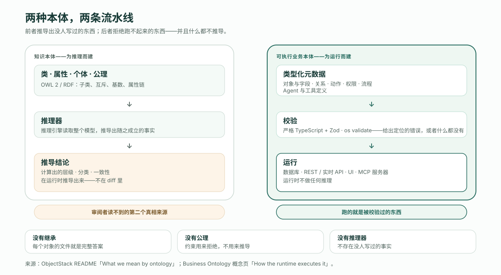
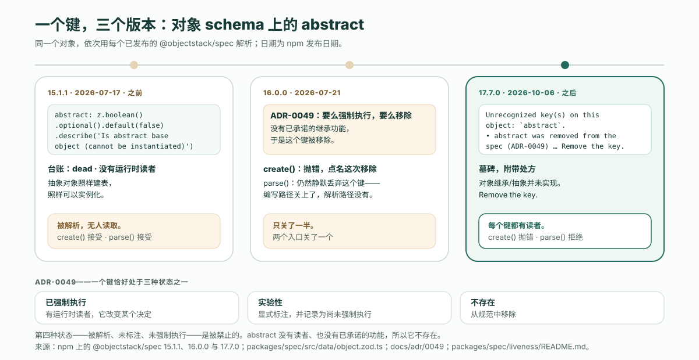

---
# @generated zh-Hant from zh-Hans (s2twp) — edit the zh-Hans file; delete this line to hand-maintain.
title: 可執行本體 vs 知識本體：為什麼「沒有繼承、沒有公理、沒有推理器」正是重點
description: 知識本體是為了被推理而建的；可執行業務本體是為了被校驗、被執行而建的。證據是一個鍵：abstract 承諾了繼承、什麼都沒做，於是它被移除，而不是被保留。
author: ObjectStack Team
date: 2026-10-13
status: published
topic: app-building
audience: developer
solutions: []
industries: []
cover: ./cover.svg
tags:
  - 本體
  - 可執行業務本體
  - 知識圖譜
---

知識本體是為了被推理而建的。可執行業務本體是為了被校驗、被審閱、被執行而建的。ObjectStack 的 README 把這個區別寫成三個「不」——「no inheritance, no axioms, no reasoner」（沒有繼承、沒有公理、沒有推理器）——而這三個「不」不是路線圖上的空缺。它們正是讓每一份定義可檢查、每一個 diff 可審閱的原因：你能寫下的每一個鍵，要麼在執行時裡有一個讀者，要麼就被移除。本文把這個論點完整講一遍，證據是一個鍵。

就是這個鍵。一個被標記為 abstract 的物件，就像知識本體裡的一個類可以是抽象類那樣：

```ts
export const Party = ObjectSchema.create({
  name: 'crm_party',
  label: 'Party',
  abstract: true,
  sharingModel: 'private',
  fields: { name: Field.text({ label: 'Name', required: true }) },
});
```

在 2026-07-17 釋出的 `@objectstack/spec@15.1.1` 上，這份定義能解析，`abstract` 原樣返回 `true`。在當前版本 `@objectstack/spec@17.7.0` 上，它被拒絕：

```text
Unrecognized key(s) on this object: `abstract`.
  • `abstract` was removed from the spec (ADR-0049) — object inheritance/abstraction is not implemented, so an abstract object still got a table and was instantiable. Remove the key.
```

這中間什麼都沒有建。繼承沒有到來。變化只有一件：一個執行時從未讀過的鍵被從規範中拿掉了，並附上一條說明原因的訊息。下文全部是在論證：為什麼對一種本體來說這是正確的做法，而對另一種本體來說會是錯誤的做法。來源是 README、它連結的 [Business Ontology](https://github.com/objectstack-ai/objectstack/blob/8caa131e52717ef35fe71742d758f10b8f2b77ee/content/docs/concepts/ontology.mdx) 概念頁、管轄這次移除的決策記錄，以及已釋出的包——測量而非描述。

## 兩種本體，兩種職責

「本體」這個詞在同一場對話裡指著兩種不同的東西，[那篇定義文章](/zh-Hant/blog/what-does-the-ontology-is-the-software-mean/)把它列為可執行業務本體「不是」的三樣東西中的第一樣。README 關於這件事的那一段短到可以整段引用：

> Your app's definition — objects and fields, relations, actions, permissions, flows, and agent and tool definitions — is a **business ontology**: open, versioned, and yours, not code scattered across a framework. It is executable, not a knowledge-representation ontology: no inheritance, no axioms, no reasoner — validated rather than reasoned over — and it is not a semantic layer over your existing systems (federating an external datasource is read-only by default and early).
>
> —— objectstack `README.md`，[「What we mean by ontology」](https://github.com/objectstack-ai/objectstack/blob/8caa131e52717ef35fe71742d758f10b8f2b77ee/README.md#L79-L89)

（大意：你的應用定義——物件與欄位、關係、動作、權限、流程、Agent 與工具定義——是一份**業務本體**：開放、有版本、歸你所有，不是散落在框架裡的程式碼。它是可執行的，不是知識表示意義上的本體：沒有繼承、沒有公理、沒有推理器——先校驗，不推理——它也不是架在你現有系統之上的語義層。）

兩種本體依次來看，而且要認真對待第一種，因為它更古老，也更嚴謹。

**知識本體是為推理而建的。** 在 W3C 的 [OWL 2](https://www.w3.org/TR/owl2-primer/) 及其底下的 RDF 技術棧裡，你寫的是類、屬性和*公理*：這個類是那個類的子類；這兩個類互斥；這個屬性至多一個值；這條屬性鏈蘊含另一個屬性。然後由一個*推理器*讀取整個模型，推匯出隨之成立的東西。類的層級是算出來的，不只是宣告出來的。一個個體按照「關於它已知什麼」被歸類，而不是按照某人打上去的類名。公理之間的矛盾會被找出來。整件事執行在開放世界假設之下：一個缺席的事實是未知的，不是假的。當資料來自許多來源、詞彙需要跨機構共享、要問的問題是「從我們知道的一切能推出什麼」時，這正是對的設計。[與語義層、知識圖譜的比較](/en/blog/ontology-vs-semantic-layer-vs-knowledge-graph/)給了這一傳統應有的公道；本文只需要它的輪廓。

**可執行業務本體是為了讓軟體能被生成、校驗、審閱和執行而建的。** 概念頁用一行寫出整條流水線：

```text
objectstack.config.ts -> objectstack.json -> ObjectStack runtime -> database · REST / realtime API · UI · MCP server
```

再用一句寫出管轄它的規則：「Nothing is reasoned over at runtime: what runs is what was validated.」（執行時不做任何推理：跑的就是被校驗過的東西。）定義是一家企業的應用，以型別化後設資料編寫，由 Zod schema 和 `os validate` 檢查，然後被執行。不存在第二份由推導事實構成的工件。世界按構造就是封閉的：定義說了什麼，系統就做什麼；定義沒說的，系統就不做。

| | 知識本體 | 可執行業務本體 |
| :--- | :--- | :--- |
| **為什麼而建** | 對一個被描述的領域做推理 | 生成、校驗、審閱並執行一個應用 |
| **定義的單元** | 類、屬性、個體、公理 | 物件與欄位、關係、動作、權限、流程、Agent 與工具定義 |
| **誰來讀定義** | 推理器，從整個模型推匯出結論 | 每個鍵一個具名的執行時讀者——資料庫驅動、API、權限評估器、控制台、MCP 伺服器 |
| **執行時存在、卻沒人寫過的東西** | 推匯出的事實：算出來的層級、分類、後果 | 沒有。「跑的就是被校驗過的東西。」 |
| **錯誤的定義如何失敗** | 推理器報告一處不一致，或者推出一條沒人預料到的結論 | 編寫時就給出一個帶位置的錯誤，在任何東西執行之前 |
| **想知道系統做什麼，去看哪裡** | 模型*加上*它蘊含的一切 | diff |

這兩列不是排名。它們是對兩個問題的兩個回答，而第二個問題——審閱者能否看出這次改動做了什麼、執行時能否拒絕一份跑不起來的定義——是一個應用必須回答的那個。



## 三個「不」，逐個來看

每一個「不」都拿掉了一樣知識本體理應擁有的東西。每一個「不」都在那裡，是因為它對審閱者和門禁意味著什麼代價。

### 沒有繼承

在類層級裡，子類繼承父類的約束，而推理器負責告訴你某個類最終揹負的全部約束。對一份詞彙表來說這是功能：把一般情況宣告一次，讓引擎去傳播。對一份應用定義來說，這是由讀者支付的代價。父類上改一行，每個子類的行為都變了，而它們一個都不出現在 diff 裡；「這個物件到底強制執行了什麼？」這個問題，從物件自己的檔案裡答不出來。

ObjectStack 的物件不繼承。概念頁把物件之間唯一的幾種連結列為「Lookups and master-detail links between objects」（物件之間的查詢與主從連結）——記錄之間的關係，宣告在持有它的那個物件上。每個物件的表、欄位、權限和安全姿態都寫在那個物件上，所以檔案就是完整的答案，diff 就是完整的改動。

### 沒有公理

公理是推理器用來*推導*的約束：從「每張訂單恰好有一個客戶」和一張有兩個客戶的訂單出發，它會得出兩個客戶是同一個個體，或者模型不一致。可執行本體也有約束——必填欄位、選項列表、查詢目標、CEL 謂詞、每個物件必須宣告的安全姿態——但它們用來*拒絕*，不用來推導。README 的第二道門就是這句話：`os validate`「rejects metadata that type-checks but would fail silently at runtime: dangling bindings, bad CEL predicates, missing security posture」（拒絕那些能通過型別檢查、卻會在執行時靜默失敗的後設資料：懸空繫結、錯誤的 CEL 謂詞、缺失的安全姿態）。一份違反約束的定義不會獲得一個後果，它獲得的是一個帶位置的錯誤。

### 沒有推理器

這是另外兩個「不」所服務的那一個。推理引擎是第二個真相來源：它在執行時推匯出的事實，從未寫在任何審閱者讀得到的地方。「Nothing is reasoned over at runtime: what runs is what was validated」是概念頁的規則，它的實踐形態就是那篇定義文章給出的那句：如果一條權限不在 diff 裡，它就不在系統裡。執行時從工件*推導*出各個表面——schema、API、UI、MCP 工具——並在每一次呼叫上*強制執行*這份定義。它不會得出任何定義沒說過的結論。

## 證據：一個承諾了繼承、卻什麼都沒做的鍵

拒絕推理器說起來便宜，守起來昂貴，因為面對一個聽起來像功能的鍵，最省事的做法就是把它留在 schema 裡，等以後有什麼東西來賦予它意義。`abstract` 就是那種做法的樣子，也是相反做法的樣子。

### 之前：被宣告、被解析、無人讀取

在 `@objectstack/spec@15.1.1` 裡，物件 schema 聲明瞭這個鍵，附帶一句教科書式的抽象類定義：

```ts
abstract: z.boolean().optional().default(false).describe("Is abstract base object (cannot be instantiated)")
```

Studio 的物件表單把它列為一個布林欄位，幫助文本是「Abstract base (cannot be instantiated)」。而同一個包自帶的活性臺賬——專案用來逐鍵記錄「是否存在執行時讀者」的那個檔案——是這麼說它的：

```json
"abstract": {
  "status": "dead",
  "evidence": "no runtime reader",
  "authorWarn": true,
  "authorHint": "No runtime reader — an abstract object still gets a table and is instantiable. Object inheritance/abstraction is not implemented."
}
```

所以在 15.1.1 裡，這個鍵能解析，表單提供它，解析輸出帶著 `abstract: true`，而——用臺賬的原話——抽象物件「still gets a table and is instantiable」（照樣建表、照樣可以實例化），就像那一行根本不存在一樣。在知識本體裡，抽象類是一條推理器會遵守的陳述。在這裡，它是一條無人遵守的陳述：合法的語法，diff 裡一行看著像那麼回事的內容，沒有讀者。

### 規則：已強制執行、實驗性，或者不存在

管轄這件事的決策記錄是 [ADR-0049](https://github.com/objectstack-ai/objectstack/blob/8caa131e52717ef35fe71742d758f10b8f2b77ee/docs/adr/0049-no-unenforced-security-properties.md)。它是針對安全屬性寫的，起因是一次審計「found that **roughly half of all spec properties are dead**」（發現規範裡大約一半的屬性是死的），它把規則寫成三種狀態：

> 1. **Enforced** — a runtime consumer reads it and changes a decision (`file:line`).
> 2. **`experimental`** — explicitly marked and documented as *not yet enforced*, so authoring it is a known no-op (roadmapped, not a promise).
> 3. **Absent** — removed from the spec.
>
> Shipping a security property in a fourth state — *parsed, unmarked, unenforced* — is prohibited. This is the **enforce-or-remove gate**.

（大意：一個鍵恰好處於三種狀態之一——**已強制執行**：有執行時消費者讀取它並改變某個決定；**實驗性**：顯式標註並記錄為尚未強制執行，寫它是已知的空操作；**不存在**：從規範中移除。以第四種狀態——被解析、未標註、未強制執行——釋出，是被禁止的。這就是「要麼強制執行，要麼移除」門禁。）

它給出的理由對任何鍵都成立，不只是安全鍵：「A security property that parses but does nothing is **worse than absent**: it produces a *false sense of compliance*.」（一個能解析卻什麼都不做的安全屬性，**比不存在更糟**：它製造一種*虛假的合規感*。）而它在沒有已承諾功能時的預設選擇是移除：「Removal is preferred over marking when there is no committed roadmap for the property — a smaller spec surface is the stronger default pre-MVP.」（當這個屬性沒有已承諾的路線圖時，移除優於標註——更小的規範面是 MVP 之前更穩的預設值。）`abstract` 不是安全鍵；ADR 自己的範圍說明記錄了，倉庫「cites this ADR as the enforce-or-remove policy for spec-property retirement generally」（把這份 ADR 作為規範屬性退役的通用「要麼強制執行、要麼移除」政策來引用），而退役它的工單 [#2377](https://github.com/objectstack-ai/objectstack/issues/2377) 說明了這種推廣為什麼是有意的：「Authoring them is a false affordance — especially dangerous for AI-authored metadata.」（編寫它們是一種虛假的可供性——對 AI 編寫的後設資料尤其危險。）

### 之後：一塊告訴你該怎麼做的墓碑

這次移除隨 16.0.0 釋出。包的[變更日誌](https://github.com/objectstack-ai/objectstack/blob/8caa131e52717ef35fe71742d758f10b8f2b77ee/packages/spec/CHANGELOG.md#L98572-L98573)用一句話記錄了它：「object `tags`/`active`/`abstract`: `ObjectSchema.create()` now throws a located error naming the removal. None gated anything at runtime — remove them.」（`ObjectSchema.create()` 現在會丟擲一個帶位置的錯誤，點名這次移除。它們在執行時從未把關任何事——移除它們。）今天這個鍵是物件 schema 未知鍵指引裡的一塊墓碑，每個寫下它的作者看到的訊息，就是本文開頭那一條，出自 [`object.zod.ts`](https://github.com/objectstack-ai/objectstack/blob/8caa131e52717ef35fe71742d758f10b8f2b77ee/packages/spec/src/data/object.zod.ts#L1538-L1541)：

```ts
abstract:
  '`abstract` was removed from the spec (ADR-0049) — object ' +
  'inheritance/abstraction is not implemented, so an abstract object still ' +
  'got a table and was instantiable. Remove the key.',
```

[活性臺賬的 object 一行](https://github.com/objectstack-ai/objectstack/blob/8caa131e52717ef35fe71742d758f10b8f2b77ee/packages/spec/liveness/README.md#L958)保留著記錄：「tags/active/abstract REMOVED (#2377) — tombstoned in UNKNOWN_KEY_GUIDANCE」。之前與之後是在已釋出的包上實測的：把上面那個 `Party` 物件依次交給每個版本解析。

| `@objectstack/spec` | `ObjectSchema.create()` | `ObjectSchema.safeParse()` |
| :--- | :--- | :--- |
| **15.1.1**（2026-07-17） | 接受；`abstract: true` 保留 | 接受；`abstract: true` 保留 |
| **16.0.0**（2026-07-21） | 拋錯，點名這次移除 | 接受；`abstract` 被靜默丟棄 |
| **17.7.0**（2026-10-06） | 拋錯，點名這次移除 | 拒絕：`unrecognized_keys`，附帶處方 |

中間那一行值得多說一句。在 16.0.0 裡，編寫路徑關上了，解析路徑沒有——`parse()` 仍然一聲不響地丟掉這個鍵，這正是 schema 自己的註釋追溯到 Zod 預設 `.strip()` 和 [#1535](https://github.com/objectstack-ai/objectstack/issues/1535) 的那種行為：當時一個物件級的 `workflows: [...]`「vanished with no error, no warning, and a green `tsc`」（消失得無聲無息，沒有錯誤、沒有警告，`tsc` 還是綠的）。17.x 的訊息在它的最後一句裡自己說了這件事：「Until this shape was closed these were dropped silently on the PARSE path — `ObjectSchema.create()` has rejected them, but `defineStack({ objects })`, `/api/v1/meta/types/object` and the Studio form all go through `parse()`, which did not.」（在這個形狀被關閉之前，它們在解析路徑上被靜默丟棄——`ObjectSchema.create()` 已經拒絕它們，但 `defineStack({ objects })`、`/api/v1/meta/types/object` 和 Studio 表單都走 `parse()`，而 `parse()` 沒有拒絕。）關閉一個鍵不是一個決定，而是每個入口各一個決定；在一個入口完整、在另一個入口沉默的門禁，就是換了件外套的第四種狀態。



### 為什麼這正是重點

在臺賬寫下「no runtime reader」的那一刻，誠實的做法有兩種。要麼建出物件繼承，讓 `abstract: true` 有讀者、有意義；要麼移除這個鍵。知識本體的習慣——在它所來自的傳統裡，這是習慣，不是錯誤——是保留宣告，因為在那個傳統裡意義住在模型中，引擎會遵守它。可執行的習慣正相反：你能寫下的鍵的集合*就是*執行時做的事的集合，一個沒有讀者的鍵不是等待中的功能，而是等待中的、審閱者的錯誤信念。

姑且把這叫作**每個鍵都有讀者**。它是「先校驗，不推理」的具體形態。校驗器只有在每個詞都有消費者的詞彙表上才可能完整；一旦某個詞被解析卻無人讀取，「合法」就不再意味著「會照它說的去做」。移除 `abstract` 不是為了讓本體更小而更小。它守住的是一個承諾：通過門禁的定義，就是執行時會強制執行的定義。

## 審閱者得到什麼，Agent 得到什麼

對審閱改動的人來說，回報是：diff 就是行為。沒有需要開啟的父類，沒有需要計算的推導結論，沒有哪個鍵的效果取決於某個可能存在也可能不存在的功能。如果 `sharingModel: 'private'` 在 diff 裡，記錄就是私有的；如果一條權限不在 diff 裡，就沒人擁有它。「這一行做什麼？」由這一行的執行時讀者來回答，而一行沒有讀者的內容根本進不了 diff。

對寫改動的 Agent 來說，回報是同一件事的另一面。README 對「AI 編寫的後設資料為什麼行得通」的主張是：「an agent's errors become located, corrective text it can read and fix itself」（Agent 的錯誤變成了有定位的、可糾正的文本，它自己能讀、能改）。一個虛假的可供性恰恰打敗這一點：從示例裡學會一種格式的 Agent，分不清一個被強制執行的鍵和一個只被解析的鍵，因為兩者都能通過校驗、都看著權威、都出現在樣本中——這正是[「宣告 vs 強制執行」](/zh-Hant/glossary/declared-vs-enforced/)詞條描述的失敗：合法、可信、卻無效的宣告。移除這個鍵，並留下一塊以「Remove the key.」結尾的墓碑，把那種失敗變成一個 Agent 自己就能完成的一行修復，連人都不必注意到曾經有過問題。

## 為推理器辯護：這個本體不做什麼

這個論點的誠實版本必須說清可執行本體放棄了什麼，因為它放棄的是實打實的東西。

**它不推理。** 沒有推導結論，沒有按描述歸類，沒有跨整個模型的一致性檢查。如果推匯出來的事實正是你需要的產品——「這一萬條記錄裡，按我們對它們的瞭解，哪些是高風險交易對手的實例？」——推理器能回答，校驗器不能。

**它不做開放世界推理。** 封閉世界是整個設計的要點，而對於天然不完整的資料，它是錯誤的假設：一套跨組織共享的詞彙；一條即便你的系統從未見過使它為真的那個事實、卻依然為真的記錄。知識本體是為那種情形而建的，這個不是。

**它不做 schema 層面的繼承。** 沒有基礎物件。六個物件共有的一個欄位，要在六個物件上宣告，或者顯式建模為指向某個共享物件的查詢。這種重複是有意的——它正是讓每個物件的檔案成為完整答案的原因——但它仍然是重複，帶著重複固有的維護成本。

**它不替你判定兩樣東西是同一樣東西。** 一個系統裡的「客戶」和另一個系統裡的「賬戶」是不是同一個實體，是某個人必須做出的宣告，不是執行時得出的推論；[那篇企業本體文章](/zh-Hant/blog/enterprise-ontology-race-open-vs-closed/)講的正是為什麼這種對齊在任何模型下都仍然是工作。

還有一個限制屬於這套紀律本身，而不屬於格式：「校驗過」只在校驗器本身可信的程度上為真。ADR-0049 背後的審計是在這條規則存在*之前*發現規範裡一半屬性已死的；活性臺賬和讀取它的門禁，才是此後讓規則持續為真的東西，而那是一項常設的維護工作，不是一次到達的狀態。`abstract` 的故事是這套紀律被踐行的證據，不是它已經完成的證據。

## 託管，或在你自己的基礎設施上

README 描述了這個迴圈——Agent 在你的倉庫裡寫型別化後設資料，門禁拒絕跑不起來的東西，執行時執行通過的東西——然後說：「想把同一個迴圈託管起來、在瀏覽器裡用、什麼都不用安裝？那就是 ObjectOS——建立在 ObjectStack 之上的商業執行環境。」ObjectOS 既可託管在瀏覽器中、無需安裝（ObjectOS Cloud），也可自管部署在你自己的基礎設施上（ObjectOS Enterprise）；無論哪個版本，你都可以匯出本體，拿到開源的 ObjectStack 執行時上執行。門禁在每個宿主上都一樣，它守護的本體也一樣。

## 自己試一次這個拒絕

README 的 Agent 路徑幾分鐘就能產出本文討論的那份工件，而那個拒絕正是值得親眼看一次的部分。

```bash
npm create objectstack@latest my-app && cd my-app
```

在你的編碼 Agent 裡開啟專案，描述一個業務物件——客戶、工單、工作訂單。然後要求本文開頭的那一行：給它加上 `abstract: true`，理由是它將來要做其他物件的基礎。無論哪道門先碰到它——編輯器裡的型別門，還是構建時的 `ObjectSchema.create()`——都會用上面引用的那條訊息拒絕它，而訊息以修復方法結尾。讓 Agent 採納這個修復，然後預覽結果：

```bash
npx os dev --ui   # → http://localhost:3000/_console/
```

你在 diff 裡看到的會是一個沒有基類、沒有任何繼承而來的東西、沒有任何執行時不讀的鍵的物件——也就是說，一份小到可以審閱、嚴到可以執行的定義。如果 Agent 需要引導，[如何讓它對準 ObjectStack](/en/blog/how-to-point-your-agent-at-objectstack/)覆蓋了規則檔案、技能包和工具伺服器。README 裡的三個「不」不是這個格式缺少的東西，而是它強制執行的東西。
