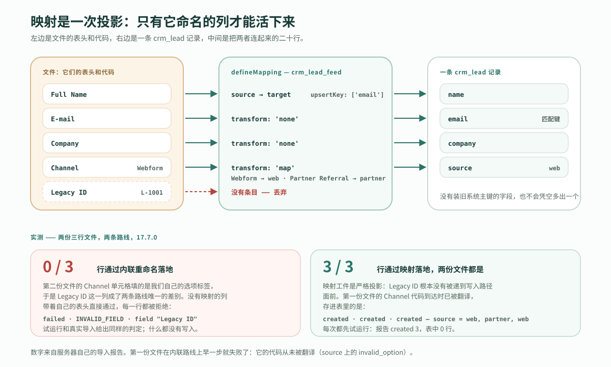
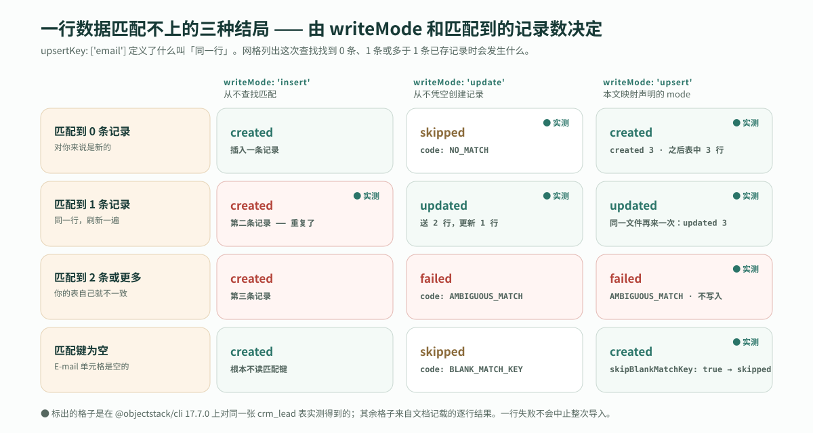

---
# @generated zh-Hant from zh-Hans (s2twp) — edit the zh-Hans file; delete this line to hand-maintain.
title: 怎樣把舊系統的電子表格匯入 AI 生成的應用？匯入對映、試執行，以及一行資料匹配不上的三種結局
description: 在 ObjectStack 17.7.0 上實測：一份命名的匯入對映把陌生的表頭和程式碼投影到一個物件的欄位上，試執行返回完整的逐行報告而什麼都不寫入，匹配不上的一行要麼建立、要麼跳過、要麼失敗。
author: ObjectStack Team
date: 2026-10-25
status: published
topic: integration-data
audience: business
solutions:
  - crm
industries: []
cover: ./cover.svg
tags:
  - 資料匯入
  - 匯入對映
  - 試執行
---

**先給結論。** 舊系統匯出的電子表格，表頭不是你的欄位名，程式碼也不是你的程式碼。解決辦法是一份**匯入對映**：從檔案的列到一個物件的欄位之間，一份有名字、有版本的投影——`map` 翻譯對方系統的程式碼，`upsertKey` 決定什麼叫「同一行」。對映是嚴格的，它沒有命名的列永遠到不了寫入路徑。`dryRun: true` 返回完整的逐行報告，什麼都不寫入。在已釋出的 `@objectstack/cli` 17.7.0 上實測：一份三行的 CSV，試執行答 `created: 3` 而表裡仍是 0 行；真實匯入後表裡 3 行；同一檔案再送一次，答 `updated: 3`。**試執行就是評審**：一個前後對照的計數，在任何一行落地之前由你籤掉。

下面的一切都是跑出來的，不是描述出來的。應用是 `npm create objectstack@latest` 在 17.7.0 上生成的新腳手架，裝著 ObjectStack 倉庫自帶 CRM 示例裡的 `Lead` 物件；每個數字都引自伺服器自己的報告。

## 每週一都會到的那份檔案

檔案在這裡。它只有三行，是為了整個檔案能放進這一頁；三千行時機制一模一樣。

```text
Full Name,E-mail,Company,Channel,Legacy ID
Ada Lovelace,ada@example.com,Analytical Engines,Webform,L-1001
Alan Turing,alan@example.com,NPL,Partner Referral,L-1002
Grace Hopper,grace@example.com,Eckert-Mauchly,Webform,L-1003
```

這是它要落進去的物件。CRM 示例的 `crm_lead` 聲明瞭 `name`、`email`、`company`，以及一個 `source` 單選欄位，儲存值是 `web`、`referral`、`event`、`social`、`cold_outreach` 和 `partner`。

這份檔案有三處不對，而這三處正是每一份來自別的系統的匯出都會犯的錯：

1. **表頭是它們的。** `Full Name` 是我們的 `name`；`E-mail` 是我們的 `email`。
2. **程式碼是它們的。** 它們的 `Webform` 是我們的 `web`；它們的 `Partner Referral` 是我們的 `partner`。這兩種拼寫在我們這邊都不存在。
3. **有一列絕不能落地。** `Legacy ID` 是舊系統的主鍵。這裡沒有對應欄位，也不該因為疏忽憑空多出一個。

匯入嚮導裡的一次性重新命名能解決第一個問題，別的都解決不了。另外兩個需要的是寫下一次、每週都照著執行的東西。

## 匯入對映是一次投影，不是一次重新命名

ObjectStack 文件用一句話定義了這個工件：「**匯入對映**是從原始檔的列到一個物件的欄位之間，一份有名字、可複用的投影。」它是一等公民的後設資料型別，所以既可以隨包釋出，也可以在執行時儲存，而 `POST /api/v1/data/:object/import` 按名字應用它。下面測量用的就是這一份，和物件並排宣告在應用原始碼裡：

```ts
import { defineMapping } from '@objectstack/spec/data';

export const LeadFeedMapping = defineMapping({
  name: 'crm_lead_feed',
  label: 'Lead feed (legacy CRM export)',
  sourceFormat: 'csv',
  targetObject: 'crm_lead',
  fieldMapping: [
    { source: 'Full Name', target: 'name' },
    { source: 'E-mail', target: 'email' },
    { source: 'Company', target: 'company' },
    {
      source: 'Channel',
      target: 'source',
      transform: 'map',
      params: { valueMap: { Webform: 'web', 'Partner Referral': 'partner' } },
    },
  ],
  mode: 'upsert',
  upsertKey: ['email'],
});
```

它用 `mappings: [LeadFeedMapping]` 註冊到 stack 上，`defineStack()` 在構建時就校驗它，而不是等到第一次使用：`targetObject` 指向 stack 沒有定義的物件會讓構建失敗，`javascript` 轉換也會（下文再說）。因為 `defineMapping()` 在匯入時就解析配置，一個拼錯的鍵會在你寫下它的地方被拒絕，錯誤資訊裡直接給出規範拼寫。這就是對映之所以是[型別化後設資料](/zh-Hant/glossary/typed-metadata/)而不是配置檔案的原因：評審者讀完二十行，就知道這份投影在任何一行被讀取之前是結構正確的。

| 鍵 | 它決定什麼 |
| :--- | :--- |
| `fieldMapping[]` | 每個目標欄位一個條目：哪一列餵給它，經過哪種轉換 |
| `transform: 'map'` + `valueMap` | 把源系統的程式碼翻譯成你的。表裡沒有條目的值原樣通過 |
| `mode` | 請求省略 `writeMode` 時由它補上：`insert`、`update` 或 `upsert` |
| `upsertKey` | 請求省略 `matchFields` 時由它補上：決定一行是否與某條已存記錄是「同一行」的那些欄位 |



定義裡真正重要的詞是*投影*。匯入端點接受兩種對映機制，而兩者恰好在上面的第三個問題上分道揚鑣。請求裡的內聯 `mapping` 是一張平鋪的重命名錶，它沒有命名的列「帶著自己的表頭直接進入寫入路徑」。命名對映正相反：沒有對映的列被「**丟棄**。工件是嚴格投影：只有被對映的目標才能活下來。」

這個差別是可以測量的，所以測了，用的是第二份三行檔案，特意做成讓多餘的那一列成為兩條路線唯一可能分歧的地方：它的 `Channel` 單元格填的是我們自己的選項標籤（`Website`、`Partner`），不需要任何對映就能解析，並且帶著 `Legacy ID` 這一列。它先用內聯重新命名改寫四個已知列送出，試執行和真實匯入各一次，再用 `mappingName: "crm_lead_feed"` 試執行一次：

| 路線 | 落地的行數 | 報告對每一行說了什麼 |
| :--- | :--- | :--- |
| 內聯 `mapping`，試執行 | 3 行中的 0 行 | `failed`，`code: "INVALID_FIELD"`，`field: "Legacy ID"`，"Unknown field 'Legacy ID' on object 'crm_lead'" |
| 內聯 `mapping`，真實匯入 | 3 行中的 0 行 | 同樣的三條判定；什麼都沒有寫入 |
| `mappingName`，試執行 | 3 行中的 3 行 | `created` |

內聯路線沒有壞。它做了重新命名該做的事：讓 `Legacy ID` 帶著自己的表頭通過，然後寫入路徑拒絕了一個物件沒有宣告的欄位。對映則根本沒讓這一列靠近寫入路徑。第一份檔案帶著 `Webform` 和 `Partner Referral` 這些程式碼，在內聯路線上早一步就失敗了：每一行都因 `source` 上的 `invalid_option` 被拒絕，"Lead Source: "Webform" is not a known option"，因為沒有任何東西翻譯這些程式碼。對於一份每週從你無法控制的系統裡到來的檔案，這兩個保證就是寫那二十行的理由。

對映也可以在執行時儲存，而不是隨包釋出：用同樣的形狀、換一個名字 `PUT /api/v1/meta/mapping/crm_lead_feed_saved`，答覆是 `Saved mapping 'crm_lead_feed_saved' (env-wide, state=active)`，按這個名字做的試執行報告 `created 3`。不管哪種來源，匯入請求都按名字解析對映；執行時先讀儲存的對映，再回退到包裡那份。包裡那個名字本身是鎖住的：同樣的 `PUT` 發到 `crm_lead_feed`，被 `403 NOT_OVERRIDABLE` 拒絕。

## 試執行就是評審

讓對映物有所值的那個請求很短，因為寫入模式和匹配欄位都由工件提供：

```json
POST /api/v1/data/crm_lead/import
{
  "format": "csv",
  "csv": "Full Name,E-mail,Company,Channel,Legacy ID\nAda Lovelace,...",
  "mappingName": "crm_lead_feed",
  "dryRun": true
}
```

試執行返回了整份報告，彙總計數加上每一行一條判定：

```json
{ "object": "crm_lead", "dryRun": true, "writeMode": "upsert",
  "total": 3, "ok": 3, "errors": 0, "created": 3, "updated": 0, "skipped": 0,
  "results": [
    { "row": 1, "ok": true, "action": "created" },
    { "row": 2, "ok": true, "action": "created" },
    { "row": 3, "ok": true, "action": "created" } ] }
```

然後讀表：`"total": 0`。什麼都沒有存。同一個請求體去掉 `dryRun`，答 `"created": 3`，每一行都帶上 `id`，表裡讀到 `"total": 3`，`source` 裡是 `web`、`partner`、`web`——翻譯後的程式碼，而不是檔案裡的。同一檔案第三次送出，答 `"created": 0, "updated": 3`，表裡仍是 3。這就是整個前後對照，三個數字：

| 步驟 | 報告 | 之後表中的行數 |
| :--- | :--- | :--- |
| 試執行 | `total 3 · created 3 · updated 0` | **0** |
| 真實匯入 | `created 3` | **3** |
| 同一檔案再來一次 | `created 0 · updated 3` | **3** |

為什麼叫它評審而不是預覽？因為它正是評審者真正能簽字的那份東西。文件說得很準確：`"dryRun": true` 返回「同一份報告，但什麼都不持久化；判定來自引擎自己的寫入路徑校驗」。它不是對寫入會做什麼的猜測；它對每一行向寫入路徑要來判定，然後在持久化之前停住。所以業務負責人在週一匯入跑起來之前批准的，是兩個很小的東西：對映（二十行型別化後設資料，放在版本控制裡，能當 diff 讀）和試執行報告（多少行會建立、多少行會更新、哪些行會失敗、失敗在哪一列）。簽字的時候什麼都還沒發生，而第二次執行就是第一次說到做到的證明。

## 一行資料匹配不上的三種結局

`upsertKey: ['email']` 說明了什麼叫「同一行」。有意思的是那次查詢找到的不是恰好一條記錄的情況。文件對此說得很直白：「一行匹配不上」不是一種行為，而是三種，由 `writeMode` 和匹配到多少條記錄決定。



三種結局都是對同一張表製造出來的，而且每一種都是不同性質的回答：

| 匹配到的記錄數 | `writeMode: 'upsert'` | `writeMode: 'update'` | 對這份檔案意味著什麼 |
| :--- | :--- | :--- | :--- |
| **0** | `created` | `skipped`，`code: "NO_MATCH"` | 對你來說是新的。upsert 接納它；update 拒絕憑空造一條記錄 |
| **1** | `updated` | `updated` | 同一行，重新整理一遍 |
| **2 條或更多** | `failed`，`code: "AMBIGUOUS_MATCH"` | `failed`，`code: "AMBIGUOUS_MATCH"` | 你的表自己就不一致；這一行什麼都不寫 |

實測過程：一份兩行的檔案用 `writeMode: "update"` 送出，答 `updated 1, skipped 1`，那個陌生人的行讀作 `"action": "skipped", "code": "NO_MATCH"`。然後把一行用 `writeMode: "insert"` 裝了兩次——insert 從不查詢匹配——於是表裡有了兩條同一個 email 的記錄；同一行再以 upsert 送出，答 `"action": "failed", "code": "AMBIGUOUS_MATCH"`，資訊是 "matchFields matched more than one crm_lead record"。重複是這張表自身的事實，匯入把它報出來，而不是替你挑一條。

還有第四種行值得知道：匹配欄位為空的那一行。`E-mail` 單元格為空的一行被 upsert **建立**了，因為 upsert 預設會建立這樣的行；請求上加 `"skipBlankMatchKey": true`，同一行回來是 `"action": "skipped", "code": "BLANK_MATCH_KEY"`。兩者選哪個，取決於一個沒有 email 的線索到底是線索還是筆誤——而這個決定由請求攜帶，不由對映攜帶。

## 對映之後，單元格仍然得合法

對映決定哪個值落到哪個欄位。把那個值變成儲存接受的東西是另一個步驟，在對映之後按目標物件自己的欄位後設資料執行，兩個步驟的失敗方式不一樣。一份四行的檔案在一次請求裡把它們都試了一遍：

| 單元格 | 發生了什麼 | 這一行的判定 |
| :--- | :--- | :--- |
| `Channel` = `Trade Show`，`valueMap` 不認識的程式碼 | `map` 按文件所說原樣放行；接著單選欄位的強制轉換找不到叫 `Trade Show` 的選項 | `failed`，`field: "source"`，`code: "invalid_option"`，"Lead Source: "Trade Show" is not a known option" |
| `Channel` = `Event`，不在 `valueMap` 裡，但是某個現有選項的標籤 | 原樣放行；按標籤解析成儲存值 `event`，沒有用到任何對映條目 | `created` |
| `E-mail` = `not-an-email` | email 欄位自己的強制轉換拒絕了它 | `failed`，`field: "email"`，`code: "invalid_email"` |
| `E-mail` 為空 | 如上，被 upsert 接納 | `created` |

四行裡兩行落地、兩行沒有，報告讀作 `"ok": 2, "errors": 2`。一行失敗不會中止整次匯入；它得到自己的一條記錄，點名出問題的列——這正是下週一之前有人要在表格裡改掉的那一行。

第二種情況值得多說一句，因為它劃定了 `map` 的用途。單選的**標籤**本來就能在沒有任何對映的情況下解析成儲存值，應用自己的語言和它的翻譯都行。所以 `valueMap` 不是用來教匯入認識你的選項標籤的；它是給對方系統的**程式碼**用的——那些既不是你的值、也不是你的標籤的拼寫。`Webform` 需要對映。`Event` 從來不需要。

## 在讀任何一行之前就被拒絕

有些請求會被整體拒絕，沒有逐行報告，因為逐行回答只會掩蓋請求本身的錯誤。其中三種實測過；其餘來自文件的表。

| 狀態 | `code` | 原因 |
| :--- | :--- | :--- |
| 404 | `MAPPING_NOT_FOUND` | 那個名字下沒有註冊對映。實測："No mapping artifact named "crm_lead_feed_nope" is registered" |
| 400 | `CONFLICTING_MAPPING` | 一個請求裡同時有 `mappingName` 和內聯 `mapping`。實測："Provide either mappingName or an inline mapping, not both" |
| 400 | `MAPPING_TARGET_MISMATCH` | 工件的 `targetObject` 不是 URL 裡的物件 |
| 400 | `UNSUPPORTED_TRANSFORM` | 某個條目聲明瞭 `javascript`，或者流水線沒有實現的轉換 |
| 413 | `PAYLOAD_TOO_LARGE` | 同步路線上超過 5,000 行 |

上限是精確的。一份 5,001 行的檔案被拒絕，資訊是 "Import limit is 5000 rows per request (got 5001). Use an async import job for larger files."。一份 5,000 行的檔案以試執行送出，在一次響應裡返回 `"total": 5000, "ok": 5000, "created": 5000`。超過這個數，`POST /api/v1/data/:object/import/jobs` 解析完全相同的請求體，最多接受 50,000 行，返回一個可輪詢的任務 id；那條路線本文沒有跑。

## 這解決不了什麼

**對映裡的自定義程式碼。** `TransformType` 聲明瞭七個值：`none`、`constant`、`map`、`split`、`join`、`lookup` 和 `javascript`。前五個逐行執行，`lookup` 是有意為之的直通、交給匯入自己的引用解析，`javascript` 則被拒絕，因為「沒有服務端沙箱，而悄悄跳過一個聲明瞭的轉換會損壞資料」。這個拒絕的兩半在 17.7.0 上都測過。把包內對映的一個條目改成 `transform: 'javascript'`，`objectstack build` 失敗，資訊是 "Mapping 'crm_lead_feed' uses transform 'javascript', which the import path does not execute (no server-side sandbox). Use none/constant/map/split/join/lookup, or model the logic as a flow."。把同樣的東西通過 `PUT /api/v1/meta/mapping/...` 在執行時儲存，儲存被接受，而第一次按名字引用它的匯入被拒絕，`400 UNSUPPORTED_TRANSFORM`。超出這五種轉換的邏輯，文件的答案是在提交之前先轉換資料，或者在目標物件上建模成一個 flow。對評審者來說這也是正確的邊界：能一口氣讀完的對映，才是能批准的對映。

**當規則讀取檔案裡沒有的欄位時，對更新的試執行。** 有一個實測結果與本文的主旨相悖，所以它屬於本文。在三行都已存在之後，對同一檔案做試執行——此時每一行都會解析成 `updated`——三行全部失敗，`code: "rule_violation"`，落在 Lead 物件的 `lead_score_range` 校驗規則上：規則的謂詞讀取 `record.lead_score`，檔案裡沒有這一列，預覽只拿進來的單元格去評估了規則。片刻之後同一請求體的真實匯入答 `updated: 3`，用同樣四個欄位直接更新一條記錄也成功了。所以在 17.7.0 上，對一行匯入將要**更新**的記錄，當預覽報出 `rule_violation`、而規則讀取的是你的檔案裡沒有的欄位時，這是對規則的一個問題，而不是對這一行的判定。對將要**建立**的行，這裡的每一次執行裡預覽與寫入都一致。ObjectStack 團隊已經拿到了這份測量。

**決定舊的那一列是什麼意思。** 對映記錄了「`Partner Referral` 就是 `partner`」這個決定，但它不做這個決定。仍然需要一個同時瞭解兩個系統的人來說，一個 `Trade Show` 線索屬於六個來源值裡的哪一個，以及一個沒有 email 的線索算不算線索。

**匯入嚮導、自動化和非同步路線。** 把使用者剛選好的列儲存成對映的那個嚮導是一個產品介面，本文不覆蓋；這裡的一切都停留在 agent 或腳本會使用的 REST 路線上。請求接受一個 `runAutomations` 鍵；這些行在進入的路上觸發了什麼，是另一篇文章的題目。50,000 行的任務路線只是被點了名，沒有跑。

## 它在一次遷移裡的位置

這是裝載這一步，而且刻意很小。如果問題是舊系統到底要不要搬，[從遺留內部系統分階段遷出的路徑](/en/blog/how-to-move-an-internal-system-to-metadata/)是策略：只讀連線，用歷史資料校驗你宣告的規則，然後逐物件開放寫入。如果舊系統要留著，你想在什麼都不搬的前提下把 AI 放到它的資料上，[連線你已經在跑的資料庫](/zh-Hant/blog/extend-existing-systems-with-ai/)是機制，[製造業版本](/zh-Hant/blog/manufacturing-legacy-systems-ai/)則說明當系統是 ERP 時從哪裡下手。匯入對映針對的是兩者之間的情形：系統要下線了，或者它從來沒有 API，你手裡有的只是一份檔案。

## 託管，或者在你自己的基礎設施上

上面的一切都跑在腳手架裝好的開源執行時上。想把同一個迴圈託管起來、在瀏覽器裡用、什麼都不用安裝？那就是 ObjectOS——建立在 ObjectStack 之上的商業執行環境。ObjectOS 既可託管在瀏覽器中、無需安裝（ObjectOS Cloud），也可自管部署在你自己的基礎設施上（ObjectOS Enterprise）；無論哪個版本，你都可以匯出本體，拿到開源的 ObjectStack 執行時上執行。對映是這份本體的一部分：它隨包一起走。

## 從 agent 路徑開始

```bash
npm create objectstack@latest crm && cd crm
```

然後把檔案和匯入對映的文件頁（`objectstack.ai/docs/data-modeling/import-mappings`）交給你的編碼 agent，提三個要求：這些行屬於哪個物件，一份 `defineMapping`、其 `valueMap` 翻譯檔案用到的每一個程式碼，以及對真實檔案做一次試執行。拿回來的就是評審材料：一份一口氣能讀完的對映，和一份報告，說明多少行會建立、多少行會更新、哪些單元格需要有人去改。簽了它，再跑匯入。下週一再跑一次，在你預期的地方讀到 `updated`。
