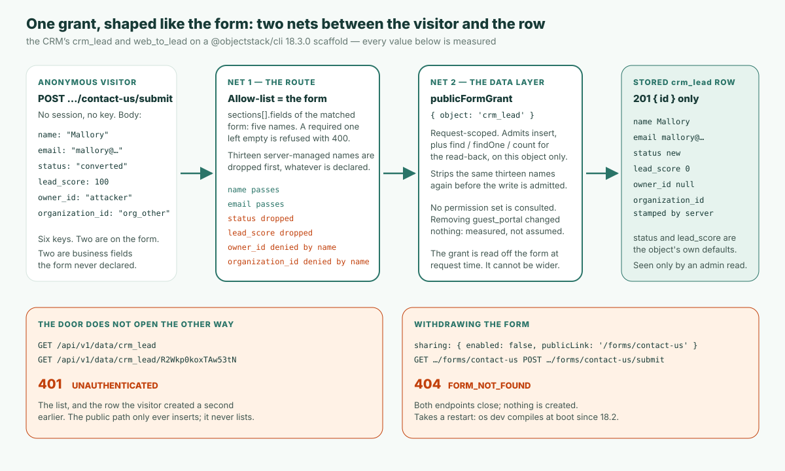

**要点**：v17 以降、ObjectStack アプリでは認証されていないオブジェクトデータへのリクエストは `401 UNAUTHENTICATED` で拒否される——どのオブジェクトでも、どのエンドポイントでも、例外のスイッチはない。統制されたアプリが公衆に向けて開けておく唯一の扉が**公開フォームビュー**だ。フォームを宣言し、その `sharing` ブロックに `allowAnonymous: true` を付ければ、ランタイムはその宣言から訪問者の権限をまるごと導出する——そのひとつのオブジェクトにレコードを一件作る。それ以外は何もできず、返ってくるのは新しいレコードの id だけだ。フォームのフィールド一覧が、そのままセキュリティ境界になる。CRM サンプルの web-to-lead フォームは五つのフィールドを列挙しているので、届くのは五つ。残り八つの業務フィールドとすべてのシステム列は、訪問者が何を送ろうと届かない。フォームが必須にしたフィールドが空なら、何も書き込まれない。これを私は**フォームの形をした権限**（form-shaped grant）と呼ぶ。権限はリクエスト時にフォームから計算されるから、フォームより広く設定しようがない。以下はすべて、公開されている `@objectstack/cli` 18.3.0——今日 `npm create objectstack@latest` がインストールするバージョン——で実測した。`guest_portal` 権限セットは必要なのか、という問いも含めて。答えは「不要」で、18.0 以降は同梱サンプルもそう書いている。

## 問題を、ドキュメント自身の言葉で

ObjectStack の公開データ収集ガイドは、利用者の言い回しでシナリオを書き出している：

> 匿名の訪問者に「お問い合わせ」「デモ申込」「受付」といったフォームを送信させて、レコードを作らせたい。だが、土台のデータへのアクセスは**絶対に**与えてはならず、設定できるのはフォーム上のフィールドだけでなければならない。

業務アプリにはどれにもこういうフォームがある。サイトのリード獲得フォーム、サポート受付、デモ申込、保証申請。よくある答えにはそれぞれ代償がある。「guest」ロールにテーブルへの書き込み権を与えるのは、誰も読み返さない常設の権限で、漂流する。エンドポイントを手書きすれば、他のすべてを統制している権限モデルを迂回する。外部のフォームツールと webhook を使えば、スキーマを持つシステムが二つになり、そのうちひとつはレビュアーが見ていない方だ。

v17 以降、最初の答えはそもそも使えない。権限のドキュメントがその理由を一言で記録している：「since v17 anonymous access to object data is always denied anyway — the `requireAuth: false` opt-out was retired」（v17 以降、匿名のオブジェクトデータアクセスはどのみち常に拒否される——`requireAuth: false` によるオプトアウトは退役した）。[セルフホストの手順記事](/en/blog/how-to-self-host-objectstack/)はこれを検証ステップに変えている——資格情報なしでオブジェクトのエンドポイントに `curl` し、機械可読な `code` 付きの `401` を要求し、そこで `200` が返れば事故として扱う。だから問いを正直に言い直すとこうなる。データプレーンが構造的に匿名呼び出しに閉じているなら、公開フォームはどうやって通るのか？

## 公開フォームは宣言であって、権限ではない

これが CRM サンプルの web-to-lead フォームの全体で、`@objectstack/cli@18.3.0` タグで出荷されているままだ：

```ts
formViews: {
  web_to_lead: {
    type: 'simple',
    data: { provider: 'object', object: 'crm_lead' },
    sections: [
      {
        name: 'contact_us',
        label: 'Contact us',
        columns: 1,
        fields: [
          { field: 'name', required: true },
          { field: 'company' },
          { field: 'email', required: true },
          { field: 'phone' },
          { field: 'title' },
        ],
      },
    ],
    sharing: {
      enabled: true,
      allowAnonymous: true,
      publicLink: '/forms/contact-us',
    },
  },
},
```

権限については一言もない。扉を開けるのは `sharing` ブロックだ。`enabled`、`allowAnonymous`、`publicLink` の三つが揃うと、ランタイムは匿名エンドポイントを二つ登録する——解決済みのフォームとホワイトリスト化されたスキーマを返す `GET /api/v1/forms/contact-us` と、`crm_lead` を一件挿入する `POST /api/v1/forms/contact-us/submit` だ。訪問者が書けるものについてのドキュメントの一行ルールは「Only the fields listed in `sections[].fields` are accepted on submit; everything else is stripped server-side」（送信時に受け付けるのは `sections[].fields` に列挙されたフィールドだけで、それ以外はサーバー側で剥がされる）。18.0 で加わった次の一文によれば、送信ルートは「also enforces each entry's `required: true` before anything is written」（何かを書き込む前に、各エントリーの `required: true` も強制する）。そして、なぜこう作ったのかという理由こそ、この記事が検証するために存在する一文だ：「Authorization is **derived from the declaration**, not configured separately — so the grant can't drift wider than the form」（権限は宣言から導出されるのであって、別に設定するのではない——だから権限がフォームより広く漂流することはない）。



仕組みとしては網が二つあり、それぞれに名前を付ける価値がある。レビュアーが一つずつ確認できるからだ。

**一つ目の網はルート。** 送信ハンドラーは、一致したフォームの `sections[].fields` から許可リストを組み立て、リクエストボディからそのキーだけを写し取る。その前に、spec パッケージが公開する集合 `PUBLIC_FORM_SERVER_MANAGED_FIELDS` に含まれるキー——`id`、`owner_id`、`owning_business_unit_id`、`queue`、`organization_id`、`tenant_id`、`created_at`、`created_by`、`updated_at`、`updated_by`、`is_deleted`、`deleted_at`、`__search` の十三の名前——を名前で落とす。ドキュメントいわく、これらは「**never** accepted from a public submission — not even when a section declares them」（公開送信からは決して受け付けない——セクションが宣言していても）。（`queue` が最も新しく、18.2 では十二だった。）フィールドがひとつもないフォームは、届いたものを何でも受け付けるのではなく `400` で拒否される。続いてルートは、何かを書き込む前にフォームそのものに照らして判定する。フォームが `required` にして常に表示するフィールドには値が要り（18.0 以降）、ファイルフィールドの値は拒否され（18.2 以降）、フォームのエントリーが示す `options` の部分集合から外れた値も拒否される（18.3 以降）——どれも、フィールドを一つずつ名指しする一つの `400 VALIDATION_FAILED` で返る。

**二つ目の網はデータ層。** ルートは書き込みに、リクエストスコープの `publicFormGrant: { object: 'crm_lead' }` を添える。セキュリティプラグインが認めるのは正確にそれだけ——`insert` と、直後の読み返しのための `find`、`findOne`、`count`、しかもそのオブジェクトに限る。挿入を認める前に同じ十三の名前をもう一度剥がすので、フォームがセクションで `owner_id` を宣言していても、ルートのフィルターとデータ層がいつか別々に編集されても、訪問者は所有者やテナントの所属を偽造できない。権限はフォームの形で、リクエスト時に読み取られる。権限テーブルに「匿名はリードに書ける」という行はない。設定するものが何もないからだ。読み返した結果はルートまでで止まり、訪問者には届かない。ルートが答えるのは作成された id だけで、挿入が保存した他のものは何も返さない。

## 18.3.0 での記録

`npm create objectstack@latest` で新しいアプリを作り——`@objectstack/cli` 18.3.0——`@objectstack/cli@18.3.0` タグから CRM サンプルの `crm_lead` オブジェクト（そのルックアップが指す二つのオブジェクトも）、web-to-lead フォームを含む `lead.view.ts`、そして `guest_portal` 権限セットをコピーした。あとは `objectstack dev`。起動時に設定をコンパイルし、空のデータベースに管理者アカウントをシードする。以下のレスポンスはすべて実物で、長さのために切り詰めただけだ。

**1. 扉は自分を説明する——幅はフィールド五つ。** 資格情報なしで：

```bash
curl -s http://localhost:49900/api/v1/forms/contact-us
```

```json
{ "slug": "contact-us", "object": "crm_lead",
  "form": { "sections": [ { "name": "contact_us", "label": "Contact us", "fields": [
      { "field": "name", "required": true }, { "field": "company" },
      { "field": "email", "required": true }, { "field": "phone" }, { "field": "title" } ] } ],
    "sharing": { "enabled": true, "publicLink": "/forms/contact-us", "allowAnonymous": true } },
  "objectSchema": { "name": "crm_lead", "label": "Lead", "fields": {
      "name":    { "label": "Lead Name", "type": "text",  "required": true, "maxLength": 200 },
      "email":   { "label": "Email",     "type": "email", "required": false },
      "phone":   { "label": "Phone",     "type": "phone", "required": false },
      "company": { "label": "Company",   "type": "text",  "required": false, "maxLength": 200 },
      "title":   { "label": "Title",     "type": "text",  "required": false, "maxLength": 120 } } } }
```

`objectSchema` が運ぶのはホワイトリストの五つのフィールドだけで、それぞれにフロントエンドが描画に要るラベル、型、長さ制限が付く。`crm_lead` のオブジェクト定義は十三の業務フィールドを宣言しているが、公開スキーマが見せるのは五つで、`status`、`lead_score`、`assigned_to`、`account`、`notes` などについては何も言わない。訪問者は何を試せばいいかすら知りようがない。ラベルは訪問者の言語にも従う。CRM の中国語翻訳バンドルを読み込んだ状態で、同じ呼び出しを `Accept-Language: zh-CN` 付きで送ると、セクション見出し、オブジェクトのラベル、五つのフィールドラベルがすべて中国語で返り、`Vary: Accept-Language` が付いた。

**2. きれいな送信は一行を作り、答えはその id だ。**

```bash
curl -s -X POST http://localhost:49900/api/v1/forms/contact-us/submit \
  -H 'content-type: application/json' \
  -d '{"name":"Ada Lovelace","email":"ada@example.com"}'
```

```json
HTTP 201
{ "id": "dgYZFAvljruviVy9" }
```

答えはこれで全部だ。新しいレコードの id だけで、挿入が保存したものは何もない。管理者として読み返すと、訪問者が送らなかった値が見える：

```bash
curl -s -b admin.cookies http://localhost:49900/api/v1/data/crm_lead/dgYZFAvljruviVy9
```

```json
{ "id": "dgYZFAvljruviVy9", "name": "Ada Lovelace", "email": "ada@example.com",
  "status": "new", "source": "web", "lead_score": 0, "owner_id": null, "queue": null,
  "organization_id": "org_mw8n9qe618ypwdpk", "created_by": null }
```

`status: "new"` は送っていない。オブジェクトの書き込みパスのデフォルトで、リードオブジェクトはその理由をこう書いている：「a create that omits `status` (e.g. the public Web-to-Lead form, which doesn't collect it) is stored as 'new', so it satisfies `required`」（`status` を省いた作成——たとえばそれを集めない公開 Web-to-Lead フォーム——は 'new' として保存され、`required` を満たす）。`source: "web"` と `lead_score: 0` もデフォルトだ。17.7.0 では、`201` がこの行をまるごと匿名の呼び出し手にエコーしていた。私はそれを報告し、18.0 以降、答えは id だけになった（objectstack issue #22437、PR #22462 で修正）。

**3. 敵対的な送信も、同じ一行を作る。** 送ったキーは六つで、フォームにあるのは二つ：

```bash
curl -s -X POST http://localhost:49900/api/v1/forms/contact-us/submit \
  -H 'content-type: application/json' \
  -d '{"name":"Mallory","email":"mallory@example.com",
       "status":"converted","lead_score":100,
       "owner_id":"attacker","organization_id":"org_other"}'
```

```json
HTTP 201
{ "id": "R2Wkp0koxTAw53tN" }
```

答えの形は前回と同じなので、何が残ったかは何も語らない。その id を管理者として読み返すと分かる：

```json
{ "id": "R2Wkp0koxTAw53tN", "name": "Mallory", "email": "mallory@example.com",
  "status": "new", "lead_score": 0, "owner_id": null, "queue": null,
  "organization_id": "org_mw8n9qe618ypwdpk" }
```

ホワイトリストの二つのフィールドは届き、フォームにない二つの業務フィールドは落とされてオブジェクトのデフォルトが適用され、二つのシステムアンカーは落とされたうえでサーバーが刻印した——`organization_id` は `org_other` ではなくデプロイ自身の組織で、`owner_id` は `null`。別の起動で、同じボディに `queue`、`id`、`created_by` を足してみた。保存された行の id はサーバーが生成したもので、残りの二つは `null` だった。`201` はどのキーが拒否されたかを言わない。ルートは黙ってそれらを落とす。

| 送ったキー | フォームにある？ | 保存された値（管理者の読み返し） | 理由 |
|:--|:--|:--|:--|
| `name`、`email` | はい | 送ったとおり | ホワイトリスト内 |
| `status: "converted"` | いいえ | `"new"` | `sections[].fields` にない。オブジェクトのデフォルトが適用 |
| `lead_score: 100` | いいえ | `0` | `sections[].fields` にない。オブジェクトのデフォルトが適用 |
| `owner_id: "attacker"` | いいえ | `null` | サーバー管理の名前、両方の網で拒否 |
| `organization_id: "org_other"` | いいえ | サーバー自身の値 | サーバー管理の名前。ランタイムが刻印 |
| `queue`、`id`、`created_by`（別の起動） | いいえ | `null`、サーバー生成の id、`null` | サーバー管理の名前 |

**4. 必須フィールドが抜けた送信は、書き込みの前に拒否される。** フォームは `email` を必須にしているが、オブジェクトはしていない。

```bash
curl -s -X POST http://localhost:49900/api/v1/forms/contact-us/submit \
  -H 'content-type: application/json' \
  -d '{"name":"No Email"}'
```

```json
HTTP 400
{ "error": "Email is required", "code": "VALIDATION_FAILED",
  "fields": [ { "field": "email", "code": "required", "message": "Email is required", "label": "Email" } ] }
```

空白だけの `"  "` のメールも同じ答えで、空のボディは二つのフィールドを一つの封筒で名指しした（`"Lead Name is required; Email is required"`）。17.7.0 では同じ `POST` が `201` と `email: null` を返していた。このパスで強制されるのはオブジェクトの `required` だけだったからだ。これも私が報告し、18.0 以降、ルートはまずフォーム自身の `required` を強制する（objectstack issue #24131、PR #24161）。

**5. 扉は逆向きには開かない。** 同じ匿名クライアントが、今度は読みに行く：

```bash
curl -s -w '\n%{http_code}\n' http://localhost:49900/api/v1/data/crm_lead
curl -s -w '\n%{http_code}\n' http://localhost:49900/api/v1/data/crm_lead/R2Wkp0koxTAw53tN
```

```json
{"error":"UNAUTHENTICATED","code":"UNAUTHENTICATED","message":"Authentication is required to access this endpoint."}
401
```

どちらも `401` だ——一覧も、訪問者が一秒前に作ったその一行も。送信者は保存されたレコードをまったく目にしない。`201` が運ぶのはその id で、id では何も開かない。「The public path only ever **inserts**; it never lists」（公開パスは挿入するだけで、一覧は決して返さない）。

**6. フォームを撤回すると、両方のエンドポイントが閉じる。** `publicLink` はそのままに `enabled: false` を設定し、`objectstack dev` を再起動する：

```json
GET  /api/v1/forms/contact-us         → 404 {"code":"FORM_NOT_FOUND","error":"No public form configured at /forms/contact-us"}
POST /api/v1/forms/contact-us/submit  → 404 {"code":"FORM_NOT_FOUND","error":"No public form configured at /forms/contact-us"}
```

管理者として読んだリード数は、この二つの呼び出しの前後で同じだった。何も作られていない。五つのステータスコードが扉の物語のすべてを語る：`201`、`201`、`400`、`401`、`404`。

## guest プロファイルの問いは、上流で決着した

17.7.0 では、何が書き込みを認可するのかについて、ドキュメントと同梱サンプルが食い違っていた。ガイドは当時も今もこう言う：「Declare a public form view; the submit route derives a narrow authorization from that declaration. No `guest` profile, no broad grant」（公開フォームビューを宣言せよ。送信ルートはその宣言から狭い権限を導出する。`guest` プロファイルも、広い権限も不要）。CRM サンプルは `crm_lead` に `allowCreate: true` を持つ `guest_portal` という権限セットを同梱し、そのコメントはこのプロファイルが「authorizes the write」（書き込みを認可する）と言い、ルートの docstring はそれがなければミドルウェアが「falls open」（開いたまま落ちる）と警告していた。私は 17.7.0 の CRM からそのセットを外してプローブを走らせ直し、同一の答えを得て、その食い違いを報告した（objectstack issue #24130）。

それは 18.0 で修正された（PR #24237）。18.3.0 タグでは、セットの上のコメントが「It does NOT authorize the public Web-to-Lead form (lead.view.ts `web_to_lead`). That form's own declaration does」（これは公開 Web-to-Lead フォームを認可しない。認可するのはそのフォーム自身の宣言だ）と書き、「the submit answers the created id only」（送信は作成された id だけを答える）で終わる。フォーム自身のコメントは「No permission set is needed, `GuestPortalProfile` included」（権限セットは不要、`GuestPortalProfile` も含めて）と言う。ガイドには「The submit's execution context also names a `guest_portal` permission set. That name authorizes nothing」（送信の実行コンテキストは `guest_portal` 権限セットの名前も挙げる。その名前は何も認可しない）で始まる段落が加わり、「falls open」の docstring は消えた。サンプルがこのセットを残しているのは、送信コンテキストが求める名前の参照として ADR-0138 が記録しているからだ。

それでも 18.3.0 で比較を走らせ直した。セットありのスキャフォールドと、`permissions: []` にして、コンパイルされたアーティファクトに権限セットがひとつもない状態とで。

| プローブ | `guest_portal` あり | `guest_portal` なし |
|:--|:--|:--|
| `name`、`email` を送る `POST …/submit` | `201 { id }`、行が作られる | `201 { id }`、行が作られる |
| `status`、`lead_score`、`owner_id`、`organization_id`、`queue` を紛れ込ませる `POST …/submit` | `201 { id }`。読み返すと `status: "new"`、`lead_score: 0`、`owner_id: null`、`queue: null`、サーバーの `organization_id` | 同一 |
| `email` なしの `POST …/submit` | `400 VALIDATION_FAILED`、`email` が `required` | 同一 |
| 匿名の `GET /api/v1/data/crm_lead` | `401 UNAUTHENTICATED` | `401 UNAUTHENTICATED` |
| 作った行への匿名 `GET` | `401 UNAUTHENTICATED` | `401 UNAUTHENTICATED` |

17.7.0 のときと同じく、一行ずつ同一だった。この名前がいまも届く範囲は狭い。`guest_portal` として登録されたセットは、権限の結果マスカーがルートに返されるレコードに適用するフィールド権限を供給する——訪問者がもう目にしないレコードだ。だから実務上の助言は変わらない。公開フォームを動かすために guest プロファイルを足してはいけない。それは公開の扉が決して参照しない常設の権限をアクセスマトリクスに加える。アプリがアクセスマトリクスのスナップショットをコミットしているなら（完全な CRM はそうしている）、そうしたセットの追加や削除はビルドがレビューを求める変更になる。[そのゲート](/ja/blog/catch-ai-silent-permission-change-access-matrix-gate/)はそれ自体がひとつの話題だ。

サンプルとガイドが今も袂を分かつ場所がひとつある。ガイドの第三ステップは「Set `sharingModel: 'private'` on the object so submissions are staff-scoped after creation」（オブジェクトに `sharingModel: 'private'` を設定し、送信後はスタッフの範囲に収める）だが、CRM のリードオブジェクトはあえて `public_read_write` で、デモが意図的に組織共有であることをコメントが説明している。これは扉を弱めない——組織全体のデフォルトが決めるのは**サインイン済み**ユーザーが互いの行をどこまで見るかで、匿名呼び出しはそれが参照される前に拒否される——が、自分の受付オブジェクトでは従う価値のある助言だ。

## この扉がしないこと

- **デフォルトではレート制限も、CAPTCHA も、スパム対策もない。** デフォルトのスキャフォールドで、ひとつのクライアントから 0.89 秒に 40 回送信すると、すべて `201` だった。ランタイムはリミッターをひとつ同梱しているが、サーバー全体に効くもので、デフォルトでは無効だ。スタックに `server: { security: { rateLimit: { enabled: true, windowMs: 60_000, maxRequests: 10 } } }` を書くと、同じクライアントは `201` を九回受け取ったあと、`Retry-After` ヘッダー付きの `429 RATE_LIMIT_EXCEEDED` を受けた。その前のフォームの `GET` も同じ予算から引かれていた。リミッターはすべてのルートを計量し、セッションがなければ呼び出し手のアドレスで数える。だからリバースプロキシの後ろではプロキシのアドレスを数えてしまう。`server.trustProxy` を宣言すれば別だが、それが安全なのはプロキシが転送ヘッダーを上書きする場合だけだ。これは予算であってボット対策ではない。`/api/v1/forms/*` の手前にいつものエッジ防御を置くこと。
- **フォームの `required` が及ぶのは、フォームが常に表示するものだけだ。** `hidden: true` のエントリーや、エントリー自身かそのセクションに `visibleWhen` があるエントリーは、送信時に判定されない。サーバー側でフォームの `visibleWhen` を評価するものが何もないからだ。そうしたフィールドが必ず存在しなければならないなら、オブジェクトで必須にするかフックで検査すること。
- **答えは訪問者にほとんど何も伝えない。意図的にだ。** `201` が運ぶのは新しい id で、何が残り何が落とされたかの説明はない。参照番号を見せたいフォームは、サンクスパネルで `{{record.case_number}}` のようにエンジンが生成するフィールド（たとえば `autonumber` のケース番号）を名指しできる。ガイドによれば、そのとき答えは `fields` の下にその値を載せ、他のフィールドの名指しは `os validate` と公開ゲートが拒否する。CRM のフォームは何も名指ししていないので、この分岐は実測していない。17.7.0 では、エコーに `beforeInsert` や `afterInsert` フックが刻印した値も含まれていて、この記事は既存レコードを照会するフックを公開受付オブジェクトから外すよう勧めていた。18.0 以降は訪問者に見せるものをルートが絞るので、その助言は取り下げる。
- **所有者は誰でもない。** 公開送信では `owner_id` は `null` のままで、セキュリティプラグインはそれを「for object hooks / the first-admin bootstrap to assign」（オブジェクトフックまたは最初の管理者ブートストラップが割り当てるために）残している。パイプラインでリードを割り当てるなら、フックかフローでやること。行が誰かに属していることを期待してはいけない。
- **撤回には再起動が要る。** 18.2 以降、`objectstack dev` はデフォルトで起動時に設定をコンパイルし、ここでは普通の再起動でフォームが閉じた。17.7.0 では最初の試みが何も変えなかった。`--no-watch` の起動が前回のビルドを提供していたからだ。ステータスコードしか読まないエージェント駆動のループは、`404` を想定するのではなく確かめるべきだ。
- **メタデータ層をまたぐ撤回には、この記事が歩かなかった縁がある。** 組織が保存したビューのコピーや、パッケージが出荷するフォームは、ガイドの中で独自のルールに従う。ここで試した単一のスイッチが、ほとんどのアプリに必要なものだ。

## レビュアーの五つの問い

フォームを書いたのが人でもエージェントでも、レビューは同じで、しかも短い。権限がフォームそのものだからだ。

1. **どのフォームが公開か？** `sharing.enabled`、`sharing.allowAnonymous`、`publicLink` が揃ったフォームビューはすべて匿名エンドポイントだ。コンパイルされたアーティファクトがそれらを列挙している。他に見る場所はない。
2. **`sections[].fields` に何があるか？** その一覧から十三のサーバー管理名を除いたものが、公開の書き込み面だ。ファイアウォールのルールを読むように読むこと。
3. **フォームが省いたものをオブジェクトが埋めるか？** フォームが集めない必須フィールドにはオブジェクトレベルのデフォルト——サンプルの `status`——が要る。さもなければ送信は失敗する。フォームが表示して `required` にしたフィールドは扉で強制される。フォームが隠すか条件付きで表示するフィールドは、オブジェクトに `required` を持たせること。
4. **どこかに常設の匿名権限がないか？** `guest` や `everyone` のポジションに結びついた権限セットや、「フォームを動かすために」足した `guest_portal` セットは不要で、扉が使うものを何も広げない。その存在は問いとして扱うこと。
5. **扉の手前には何があるか？** ボット対策はデプロイの仕事だ。ランタイム自身のリミッターはサーバー全体の予算で、宣言するまでは無効だ。

これは[エージェントの権限はどこで強制されるか](/en/blog/objectos-agent-permission-boundaries/)と同じ「強制の場所」の論法を、アイデンティティをまったく持たない呼び出し手に当てはめたものだ。チェックはルートとデータ層で走るのであって、たまたまフィールドを隠している UI で走るのではない。そして[Lovable の記事](/ja/blog/is-lovable-safe-for-production/)が述べるレビュー問題への答えでもある——説明責任を負う所有者は五行のフィールド一覧を読んで承認できるが、生成されたポリシーではそうはいかない。用語集の[権限モデル](/en/glossary/permission-model/)の項に全体の形がある。この扉は「デフォルト拒否」に対する唯一の意図的な例外で、その形はフォームそのものだ。

## エージェントを向ける

アプリをエージェントが書くなら、渡すべきはこの記事ではなくルールだ。公開フォームは `sharing` ブロックを持つ `formViews` のエントリであり、フィールド一覧が境界であり、フォームの `required` は扉で検査され、デフォルトはオブジェクトが持ち、権限セットは関与しない。[ObjectStack 向けにコーディングエージェントを設定するガイド](/en/blog/how-to-point-your-agent-at-objectstack/)は、そのルールがエージェントにどう届くかを扱っている——ルールファイル、起動中のアプリが公開する MCP エンドポイント、そして spec だ。`npm create objectstack@latest` がインストールするのは 18.3.0、この記録を走らせたバージョンである。

それを実行するために、ObjectStack リポジトリは ObjectOS Community（ghcr.io/objectstack-ai/objectstack イメージ、os start、Console からなる、無料のセルフホスト版）を提供し、ObjectOS Cloud はホスト型のエディション、ObjectOS Enterprise はセルフマネージドのライセンス制のエディションです。
