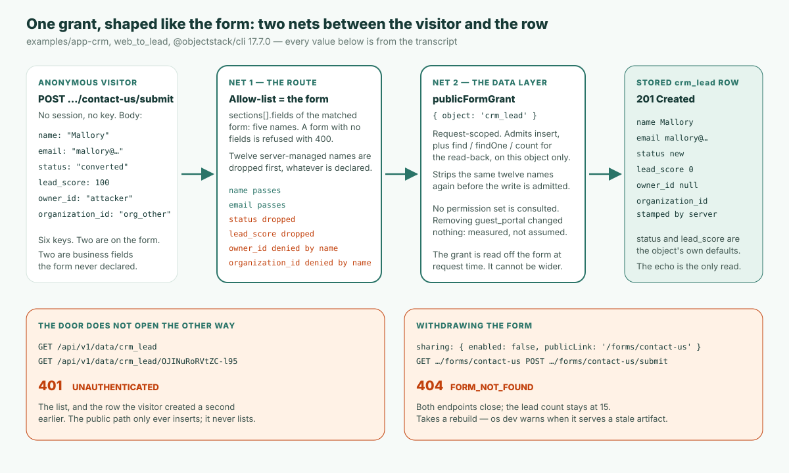

**요약.** v17부터 ObjectStack 앱에서 인증되지 않은 객체 데이터 요청은 `401 UNAUTHENTICATED`로 거부된다 — 모든 객체, 모든 엔드포인트에서, 예외 스위치 없이. 거버넌스된 앱이 외부에 열어 두는 유일한 문은 **공개 폼 뷰**다. 폼을 선언하고 `sharing` 블록에 `allowAnonymous: true`를 표시하면, 런타임은 그 선언에서 방문자의 권한 전체를 도출한다 — 그 한 객체에 레코드 하나를 만들고, 방금 만든 행을 읽어 돌려주고, 그 외에는 아무것도 하지 않는다. 폼의 필드 목록이 곧 보안 경계다. CRM 예제의 web-to-lead 폼은 필드 다섯 개를 나열하므로 다섯 개가 들어올 수 있다. 나머지 업무 필드 여덟 개와 모든 시스템 컬럼은 방문자가 무엇을 보내든 들어오지 못한다. 나는 이것을 **폼 모양의 권한**(form-shaped grant)이라 부르겠다. 권한이 요청 시점에 폼에서 계산되므로, 폼보다 넓게 설정될 수가 없다. 아래의 모든 내용은 공개된 `@objectstack/cli` 17.7.0 — 오늘 `npm create objectstack@latest`가 설치하는 버전 — 에서 실측했다. 문서와 동봉 예제가 유일하게 엇갈리는 질문, `guest_portal` 프로필이 필요한가도 포함해서. 답은 “필요 없다”이다.

## 문제, 문서 자신의 말로

ObjectStack의 공개 데이터 수집 가이드는 사용자가 말할 법한 시나리오로 시작한다:

> 익명 방문자가 “문의하기”, “데모 신청”, 접수 폼 같은 것을 제출해 레코드가 생성되게 하고 싶다. 하지만 기반 데이터에 대한 접근은 **절대** 주어서는 안 되고, 그들은 폼에 있는 필드만 설정할 수 있어야 한다.

모든 업무 앱에는 이런 폼이 하나씩 있다. 웹사이트의 리드 폼, 지원 접수, 데모 신청, 보증 청구. 흔한 답들에는 저마다 대가가 따른다. “guest” 역할에 테이블 쓰기 권한을 주는 것은 아무도 다시 읽지 않는 상설 권한이고, 표류한다. 손으로 짠 엔드포인트는 나머지 모든 것을 다스리는 권한 모델을 우회한다. 외부 폼 도구에 webhook을 붙이면 이제 스키마를 가진 시스템이 둘이 되고, 그중 하나는 검토자가 보지 않는 쪽이다.

v17부터는 첫 번째 답이 아예 존재하지 않는다. 권한 문서가 지나가듯 그 이유를 기록한다: “since v17 anonymous access to object data is always denied anyway — the `requireAuth: false` opt-out was retired” (v17부터 익명의 객체 데이터 접근은 어차피 항상 거부된다 — `requireAuth: false` 옵트아웃은 은퇴했다). [셀프 호스팅 안내 글](/en/blog/how-to-self-host-objectstack/)은 이를 검증 단계로 만든다 — 자격 증명 없이 객체 엔드포인트에 `curl`을 날려 기계가 읽을 수 있는 `code`가 붙은 `401`을 요구하고, 거기서 `200`이 나오면 사고로 취급한다. 그러니 질문을 정직하게 바꾸면 이렇다. 데이터 플레인이 구조적으로 익명 호출자에게 닫혀 있다면, 공개 폼은 도대체 어떻게 통과하는가?

## 공개 폼은 선언이지, 권한이 아니다

다음은 CRM 예제의 web-to-lead 폼 전문으로, 17.7.0 태그에 출하된 그대로다:

```ts
formViews: {
  web_to_lead: {
    type: 'simple',
    data: { provider: 'object', object: 'crm_lead' },
    sections: [
      {
        name: 'contact_us',
        label: 'Contact us',
        columns: 1,
        fields: [
          { field: 'name', required: true },
          { field: 'company' },
          { field: 'email', required: true },
          { field: 'phone' },
          { field: 'title' },
        ],
      },
    ],
    sharing: {
      enabled: true,
      allowAnonymous: true,
      publicLink: '/forms/contact-us',
    },
  },
},
```

권한을 언급하는 말은 한마디도 없다. 문을 여는 것은 `sharing` 블록이다. `enabled`, `allowAnonymous`, `publicLink`가 모두 설정되면 런타임은 익명 엔드포인트 둘을 등록한다 — 해석된 폼과 화이트리스트된 스키마를 돌려주는 `GET /api/v1/forms/contact-us`, 그리고 `crm_lead` 하나를 삽입하는 `POST /api/v1/forms/contact-us/submit`. 방문자가 쓸 수 있는 것에 대한 문서의 한 줄 규칙은 “Only the fields listed in `sections[].fields` are accepted on submit; everything else is stripped server-side” (제출 시 `sections[].fields`에 나열된 필드만 받고, 나머지는 서버 측에서 벗겨낸다)이다. 그리고 왜 이렇게 만들었는지에 대한 이유야말로 이 글이 검증하려고 존재하는 문장이다: “Authorization is **derived from the declaration**, not configured separately — so the grant can't drift wider than the form” (권한은 선언에서 도출되는 것이지 따로 설정되는 것이 아니다 — 그래서 권한이 폼보다 넓게 표류할 수 없다).



기계적으로는 그물이 둘이고, 각각 이름을 붙일 가치가 있다. 검토자가 하나씩 확인할 수 있기 때문이다.

**첫 번째 그물은 라우트다.** 제출 핸들러는 일치한 폼의 `sections[].fields`에서 허용 목록을 만들고, 요청 본문에서 그 키들만 복사한다. 그 전에 spec 패키지가 내보내는 집합 `PUBLIC_FORM_SERVER_MANAGED_FIELDS`의 모든 키 — `id`, `owner_id`, `owning_business_unit_id`, `organization_id`, `tenant_id`, `created_at`, `created_by`, `updated_at`, `updated_by`, `is_deleted`, `deleted_at`, `__search`, 열두 개의 이름 — 를 이름으로 버린다. 문서에 따르면 이들은 “**never** accepted from a public submission — not even when a section declares them” (공개 제출에서는 절대 받지 않는다 — 섹션이 선언하더라도). 필드가 하나도 없는 폼은 들어오는 것을 무엇이든 받는 대신 `400`으로 거부된다.

**두 번째 그물은 데이터 계층이다.** 라우트는 쓰기에 요청 범위의 `publicFormGrant: { object: 'crm_lead' }`를 붙이고, 보안 플러그인은 정확히 그것만 존중한다 — `insert`, 그리고 읽기 반환을 위한 `find`, `findOne`, `count`, 그것도 그 객체에 한해서. 삽입을 허용하기 전에 같은 열두 개의 이름을 한 번 더 벗겨내므로, 폼이 섹션에 `owner_id`를 선언했더라도, 라우트 필터와 데이터 계층이 언젠가 따로 편집되더라도, 방문자는 소유권이나 테넌트 소속을 위조할 수 없다. 권한은 폼의 모양이고, 요청 시점에 읽힌다. 권한 테이블에 “익명은 리드에 쓸 수 있다”는 행은 없다. 설정할 것이 아무것도 없기 때문이다.

## 17.7.0에서의 기록

`@objectstack/cli@17.7.0` 태그에서 `examples/app-crm`을 가져와 의존성을 공개된 17.7.0 패키지에 고정하고 `objectstack dev`로 시작했다. 개발 서버는 빈 데이터베이스에 관리자 계정을 시드하며, 시드된 리드 다섯 개는 그 관리자 소유다. 아래의 모든 응답은 실제이며 길이 때문에만 잘라냈다.

**1. 문은 스스로를 설명한다 — 너비는 필드 다섯 개.** 자격 증명 없이:

```bash
curl -s http://localhost:49160/api/v1/forms/contact-us
```

```json
{ "slug": "contact-us", "object": "crm_lead",
  "form": { "sections": [ { "name": "contact_us", "fields": [
      { "field": "name", "required": true }, { "field": "company" },
      { "field": "email", "required": true }, { "field": "phone" }, { "field": "title" } ] } ],
    "sharing": { "enabled": true, "publicLink": "/forms/contact-us", "allowAnonymous": true } },
  "objectSchema": { "name": "crm_lead", "fields": { "name": {}, "email": {}, "phone": {}, "company": {}, "title": {} } } }
```

`objectSchema`에는 화이트리스트된 필드 다섯 개가 정확히 담겨 있다. `crm_lead`의 객체 정의는 업무 필드 열세 개를 선언하지만, 공개 스키마는 다섯 개만 보여 주고 `status`, `lead_score`, `assigned_to`, `account`, `notes`와 나머지에 대해서는 아무 말도 하지 않는다. 방문자는 무엇을 시도해야 할지조차 알 수 없다.

**2. 정상적인 제출은 한 행을 만든다.**

```bash
curl -s -X POST http://localhost:49160/api/v1/forms/contact-us/submit \
  -H 'content-type: application/json' \
  -d '{"name":"Ada Lovelace","email":"ada@example.com"}'
```

```json
HTTP 201
{ "object": "crm_lead", "id": "lY0qNhApoHwyYMtk",
  "record": { "id": "lY0qNhApoHwyYMtk", "name": "Ada Lovelace", "email": "ada@example.com",
    "status": "new", "source": "web", "lead_score": 0, "owner_id": null,
    "organization_id": "org_mvbpxfocznjyqv4e", "created_by": null } }
```

`status: "new"`는 보내지 않았다. 객체의 쓰기 경로 기본값이며, 리드 객체는 그 이유를 명시해 선언한다: “so minimal creates (e.g. the public Web-to-Lead form, which doesn't expose status) satisfy `required`” (status를 노출하지 않는 공개 Web-to-Lead 폼 같은 최소한의 생성도 `required`를 만족하도록). `source: "web"`과 `lead_score: 0`도 기본값이다.

**3. 악의적인 제출도 같은 행을 만든다.** 키 여섯 개를 보냈고, 폼에 있는 것은 둘:

```bash
curl -s -X POST http://localhost:49160/api/v1/forms/contact-us/submit \
  -H 'content-type: application/json' \
  -d '{"name":"Mallory","email":"mallory@example.com",
       "status":"converted","lead_score":100,
       "owner_id":"attacker","organization_id":"org_other"}'
```

```json
HTTP 201
{ "record": { "id": "OJINuRoRVtZC-l95", "name": "Mallory", "email": "mallory@example.com",
    "status": "new", "lead_score": 0, "owner_id": null,
    "organization_id": "org_mvbpxfocznjyqv4e" } }
```

관리자로 다시 읽어 보면 저장된 행은 똑같다. 화이트리스트된 두 필드는 도착했고, 폼에 없는 업무 필드 둘은 버려졌으며, 시스템 앵커 둘은 버려진 뒤 서버가 도장을 찍었다 — `organization_id`는 `org_other`가 아니라 이 배포 자신의 조직이고, `owner_id`는 `null`이다. `201`은 어떤 키가 거부됐는지 말하지 않는다. 라우트는 말없이 버린다.

| 보낸 키 | 폼에 있나? | 저장된 값 | 이유 |
|:--|:--|:--|:--|
| `name`, `email` | 예 | 보낸 그대로 | 화이트리스트 |
| `status: "converted"` | 아니오 | `"new"` | `sections[].fields`에 없음. 객체 기본값 적용 |
| `lead_score: 100` | 아니오 | `0` | `sections[].fields`에 없음. 객체 기본값 적용 |
| `owner_id: "attacker"` | 아니오 | `null` | 서버가 관리하는 이름. 두 그물 모두에서 거부 |
| `organization_id: "org_other"` | 아니오 | 서버 자신의 값 | 서버가 관리하는 이름. 런타임이 도장 |

**4. 문은 반대 방향으로 열리지 않는다.** 같은 익명 클라이언트가 이번에는 읽는다:

```bash
curl -s -w '\n%{http_code}\n' http://localhost:49160/api/v1/data/crm_lead
curl -s -w '\n%{http_code}\n' http://localhost:49160/api/v1/data/crm_lead/OJINuRoRVtZC-l95
```

```json
{"error":"UNAUTHENTICATED","code":"UNAUTHENTICATED","message":"Authentication is required to access this endpoint."}
401
```

둘 다 `401`이다 — 목록도, 방문자가 1초 전에 만든 바로 그 행도. `201` 본문이 제출자가 그 레코드를 보는 유일한 순간이다. “The public path only ever **inserts**; it never lists” (공개 경로는 삽입만 한다. 결코 목록을 돌려주지 않는다).

**5. 폼을 철회하면 두 엔드포인트가 모두 닫힌다.** `publicLink`는 유지하고 `enabled: false`로 두고, 다시 빌드하고, 재시작한다:

```json
GET  /api/v1/forms/contact-us         → 404 {"code":"FORM_NOT_FOUND","error":"No public form configured at /forms/contact-us"}
POST /api/v1/forms/contact-us/submit  → 404 {"code":"FORM_NOT_FOUND","error":"No public form configured at /forms/contact-us"}
```

관리자로 읽은 리드 수는 전후 모두 15였다. 상태 코드 네 개가 이 문의 이야기 전부를 말해 준다: `201`, `201`, `401`, `404`.

## 어느 쪽 이야기가 하중을 받는가: guest 프로필인가, 선언인가

여기서 문서와 동봉 예제가 엇갈리는데, 나는 읽기만으로 편을 들고 싶지 않았다. 가이드는 말한다: “Declare a public form view; the submit route derives a narrow authorization from that declaration. No `guest` profile, no broad grant” (공개 폼 뷰를 선언하라. 제출 라우트가 그 선언에서 좁은 권한을 도출한다. `guest` 프로필도, 넓은 권한도 없다). CRM 예제는 `GuestPortalProfile`을 동봉한다 — `crm_lead`에 `allowCreate: true`이고 다른 모든 비트는 false인, `guest_portal`이라는 이름의 권한 집합이다 — 그리고 폼 위의 주석은 “`sharing.allowAnonymous`가 공개 엔드포인트를 열고, `guest_portal` 프로필(crm_lead에 INSERT만)이 쓰기를 인가한다”고 말한다. 런타임 자신의 17.7.0 소스는 수백 줄을 사이에 두고 두 이야기를 모두 품고 있다. 라우트의 docstring은 보안이 “실행 컨텍스트에 실린 `guest_portal` 권한 집합에 위임된다”고 하고, 그것이 없으면 미들웨어가 “falls open” (열린 채로 떨어진다)한다고 경고한다. 그 아래의 핸들러 코드는 공개 폼이 “work under secure-by-default (anonymous-deny) WITHOUT a deployment-configured `guest_portal`” (배포에 `guest_portal`을 설정하지 않아도 기본 보안(익명 거부) 아래에서 동작한다)고 하고, 프로필 이름을 컨텍스트에 남기는 것은 “for back-compat with object hooks” (객체 훅과의 하위 호환을 위해)일 뿐이라고 한다.

그래서 `GuestPortalProfile`을 스택의 `permissions`에서 제거하고 다시 빌드했다. 처음 일어난 일은 빌드의 거부였다:

```text
✗ Access matrix drift (1 change) — capability changes must be reviewed
• 'guest_portal' loses ALL access to 'crm_lead' (entry removed)
  If intended, re-run with --update-access-matrix and commit the snapshot — its diff IS the review artifact.
```

그 게이트는 그 자체로 하나의 주제이고, 여기서는 안심시켜 주는 여담이다 — 권한 집합이 사라지는 것은, 그 집합이 결국 아무것도 하지 않는 것으로 드러나더라도, 검토할 변경으로 취급된다. 나는 드리프트를 받아들이고, 컴파일된 아티팩트에 권한 집합이 둘이 아닌 하나만 있음을 확인한 뒤, 네 가지 프로브를 다시 돌렸다.

| 프로브 | `guest_portal` 있음 | `guest_portal` 없음 |
|:--|:--|:--|
| `name`, `email`을 보내는 `POST …/submit` | `201`, 행 생성 | `201`, 행 생성 |
| `status`, `owner_id`, `organization_id`를 끼워 넣는 `POST …/submit` | `201`; `status: "new"`, `owner_id: null`, 서버의 `organization_id` | 동일 |
| 익명 `GET /api/v1/data/crm_lead` | `401 UNAUTHENTICATED` | `401 UNAUTHENTICATED` |
| 만든 행에 대한 익명 `GET` | `401 UNAUTHENTICATED` | `401 UNAUTHENTICATED` |

한 줄 한 줄 동일했다. 17.7.0에서는 선언이 하중을 받고, 프로필은 이 경로에서 비활성이다. 실무적 의미는 이렇다. 공개 폼을 동작시키려고 guest 프로필을 추가하지 말라. 그것은 공개된 문이 결코 참조하지 않는 상설 권한을 접근 행렬에 더하고, 다음 검토자 — 사람이든 에이전트든 — 에게 런타임이 공유하지 않는 “경계가 어디인가”에 대한 이야기를 들려준다. 예제의 주석은 17.7.0에 관해서는 틀렸고, 나는 그렇게 보고했다. 그것이 바뀔 때까지는 주석이 아니라 가이드를 읽으라.

예제와 가이드가 갈라지는 곳이 하나 더 있다. 가이드의 세 번째 단계는 “Set `sharingModel: 'private'` on the object so submissions are staff-scoped after creation” (객체에 `sharingModel: 'private'`을 설정해 제출이 생성 후 직원 범위로 묶이게 하라)인데, CRM의 리드 객체는 의도적으로 `public_read_write`이고, 데모가 일부러 조직 공유라는 설명이 주석에 있다. 이것이 문을 약하게 하지는 않는다 — 조직 전체 기본값이 다스리는 것은 **로그인한** 사용자들이 서로의 행을 얼마나 보는가이고, 익명 호출자는 그것이 참조되기 전에 거부된다 — 하지만 자신의 접수 객체에서는 따를 만한 조언이다.

## 이 문이 하지 않는 것

- **속도 제한도, 캡차도, 스팸 방지도 없다.** 공개 폼 경로에 대해 문서화된 것은 없고, 나도 아무것도 찾지 못했다. 이 글의 프로브는 자격 증명 없이 리드 열 개를 만들었고, 런타임은 세지도 늦추지도 않았다. `/api/v1/forms/*` 앞에 평소의 엣지 보호를 두라. 런타임이 지키는 것은 무엇이 쓰이는가이지, 얼마나 자주 쓰이는가가 아니다.
- **폼의 `required`는 공개 제출에서 강제되지 않는다.** web-to-lead 폼은 `email`을 필수로 표시하지만, 그것 없는 `POST`는 `201`과 `email: null`로 응답했다. 객체의 `required`는 강제된다 — `name` 없는 `POST`는 `400 VALIDATION_FAILED`와 “Lead Name is required”로 응답했다. 어떤 필드가 반드시 있어야 한다면 객체에서 필수로 만들거나 훅에서 검사하라. 이 경로에서 폼의 플래그는 렌더링 힌트다.
- **`201`은 행 전체를 되돌려 준다.** 권한이 허용하는 읽기 반환은 방문자가 만든 행이며, 서버가 도장을 찍은 값과 기본값 — `organization_id`를 포함해 — 도 들어 있다. 내 경우에 민감한 것은 없었다. 접수 객체에 의미 있는 기본값을 가진 내부 필드가 있다면, 제출자가 그것을 한 번은 보게 된다고 가정하라.
- **소유자는 아무도 아니다.** 공개 제출에서 `owner_id`는 `null`로 남고, 보안 플러그인은 그것을 “for object hooks / the first-admin bootstrap to assign” (객체 훅 또는 첫 관리자 부트스트랩이 할당하도록) 남겨 둔다. 파이프라인이 리드를 배정한다면 훅이나 플로우에서 하라 — 행이 누군가에게 속해 있을 것이라 기대하지 말라.
- **철회에는 재빌드가 필요하다 — 잊으면 `os dev`가 알려 준다.** 5단계의 첫 시도는 아무것도 바꾸지 못했다. `objectstack dev --no-watch`가 이전의 `dist/objectstack.json`을 제공했고, 로그 다섯째 줄에서 그렇게 말했기 때문이다: “dist/objectstack.json is OLDER than your sources — this boot serves the STALE build” (dist/objectstack.json이 소스보다 오래됐다 — 이번 부팅은 오래된 빌드를 제공한다). 출력된 해결책은 효과가 있었다. 이를 언급하는 이유는, 상태 코드만 읽는 에이전트 구동 루프라면 이 스위치가 동작하지 않는다고 결론 내렸을 것이기 때문이다.
- **메타데이터 계층을 가로지르는 철회에는 이 글이 걷지 않은 가장자리가 있다.** 조직이 저장한 뷰 사본과 패키지가 출하하는 폼은 가이드 안에서 각자의 규칙을 따른다. 여기서 시험한 단일 스위치가 대부분의 앱에 필요한 것이다.

## 검토자의 다섯 가지 질문

폼을 사람이 썼든 에이전트가 썼든 검토는 같고, 권한이 폼 자체이기 때문에 짧다.

1. **어떤 폼이 공개인가?** `sharing.enabled`, `sharing.allowAnonymous`, `publicLink`가 모두 설정된 모든 폼 뷰가 익명 엔드포인트다. 컴파일된 아티팩트가 그것들을 나열한다. 다른 곳을 볼 필요가 없다.
2. **`sections[].fields`에 무엇이 있는가?** 그 목록에서 서버가 관리하는 열두 개의 이름을 뺀 것이 공개 쓰기 표면이다. 방화벽 규칙을 읽듯 읽으라.
3. **폼이 빠뜨린 것을 객체가 채우는가?** 폼이 수집하지 않는 모든 필수 필드에는 객체 수준의 기본값 — 예제의 `status` — 이 필요하다. 아니면 제출이 실패한다. 그리고 반드시 있어야 하는 모든 필드는 폼이 아니라 객체에 `required`가 있어야 한다.
4. **어딘가에 상설 익명 권한이 있는가?** `guest`나 `everyone` 포지션에 바인딩된 권한 집합이나 “폼을 동작시키려고” 추가한 `guest_portal` 집합은 필요하지 않으며, 문이 사용하는 것을 전혀 넓히지 않는다. 그 존재를 질문으로 취급하라.
5. **문 앞에는 무엇이 있는가?** 속도 제한과 봇 보호는 배포의 일이다.

이것은 [에이전트 권한이 어디서 강제되는가](/en/blog/objectos-agent-permission-boundaries/)와 같은 “강제의 위치” 논증을, 정체성이 전혀 없는 호출자에게 적용한 것이다. 검사는 라우트와 데이터 계층에서 실행되지, 우연히 필드를 숨기고 있는 UI에서 실행되지 않는다. 그리고 [Lovable 글](/ko/blog/is-lovable-safe-for-production/)이 묘사하는 검토 문제에 대한 답이기도 하다 — 책임지는 소유자는 다섯 줄짜리 필드 목록을 읽고 승인할 수 있지만, 생성된 정책에 대해서는 그럴 수 없다. 용어집의 [권한 모델](/en/glossary/permission-model/) 항목에 전체적인 모양이 있다. 이 문은 “기본 거부”에 대한 유일하게 의도된 예외이며, 그 모양은 폼이다.

## 에이전트를 가리키게 하라

앱을 에이전트가 쓴다면, 건네야 할 것은 이 글이 아니라 규칙이다. 공개 폼은 `sharing` 블록을 가진 `formViews` 항목이고, 필드 목록이 경계이며, 기본값과 필수 여부는 객체가 소유하고, 권한 집합은 관여하지 않는다. [ObjectStack용 코딩 에이전트 설정 가이드](/en/blog/how-to-point-your-agent-at-objectstack/)는 그 규칙이 에이전트에 어떻게 도달하는지 다룬다 — 규칙 파일, 실행 중인 앱이 노출하는 MCP 엔드포인트, 그리고 spec. `npm create objectstack@latest`는 이 기록이 실행된 버전인 17.7.0을 설치한다.

같은 루프를 호스팅으로, 브라우저에서, 아무것도 설치하지 않고 쓰고 싶다면? 그것이 ObjectOS, ObjectStack 위에 구축된 상용 런타임 환경입니다.
