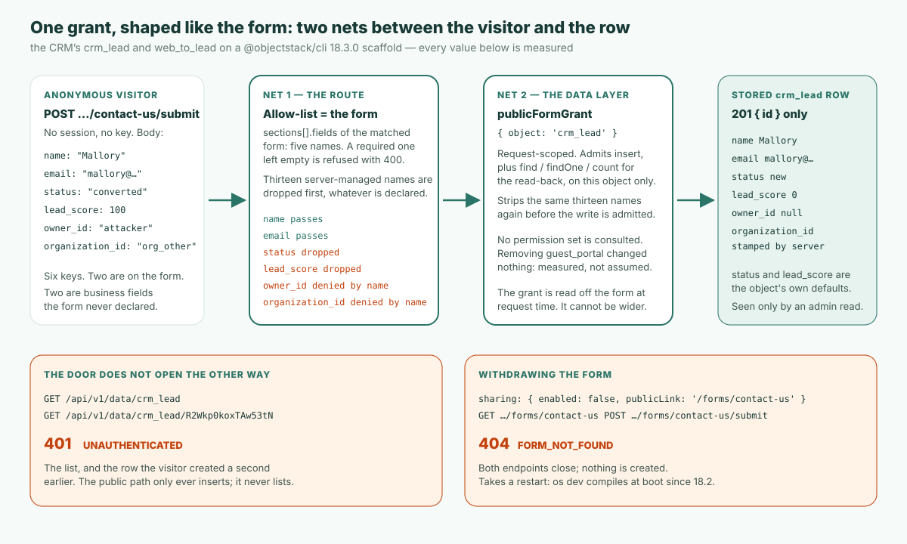

**요약.** v17부터 ObjectStack 앱에서 인증되지 않은 객체 데이터 요청은 `401 UNAUTHENTICATED`로 거부된다 — 모든 객체, 모든 엔드포인트에서, 예외 스위치 없이. 거버넌스된 앱이 외부에 열어 두는 유일한 문은 **공개 폼 뷰**다. 폼을 선언하고 `sharing` 블록에 `allowAnonymous: true`를 표시하면, 런타임은 그 선언에서 방문자의 권한 전체를 도출한다 — 그 한 객체에 레코드 하나를 만들고, 그 외에는 아무것도 하지 않으며, 돌려주는 것은 새 레코드의 id뿐이다. 폼의 필드 목록이 곧 보안 경계다. CRM 예제의 web-to-lead 폼은 필드 다섯 개를 나열하므로 다섯 개가 들어올 수 있다. 나머지 업무 필드 여덟 개와 모든 시스템 컬럼은 방문자가 무엇을 보내든 들어오지 못하고, 폼이 필수로 표시한 필드가 비어 있으면 아무것도 쓰이지 않는다. 나는 이것을 **폼 모양의 권한**(form-shaped grant)이라 부르겠다. 권한이 요청 시점에 폼에서 계산되므로, 폼보다 넓게 설정될 수가 없다. 아래의 모든 내용은 공개된 `@objectstack/cli` 18.3.0 — 오늘 `npm create objectstack@latest`가 설치하는 버전 — 에서 실측했다. `guest_portal` 권한 세트가 필요한가라는 질문도 포함해서. 답은 “필요 없다”이고, 18.0부터는 동봉 예제도 그렇게 적고 있다.

## 문제, 문서 자신의 말로

ObjectStack의 공개 데이터 수집 가이드는 사용자가 말할 법한 시나리오로 시작한다:

> 익명 방문자가 “문의하기”, “데모 신청”, 접수 폼 같은 것을 제출해 레코드가 생성되게 하고 싶다. 하지만 기반 데이터에 대한 접근은 **절대** 주어서는 안 되고, 그들은 폼에 있는 필드만 설정할 수 있어야 한다.

모든 업무 앱에는 이런 폼이 하나씩 있다. 웹사이트의 리드 폼, 지원 접수, 데모 신청, 보증 청구. 흔한 답들에는 저마다 대가가 따른다. “guest” 역할에 테이블 쓰기 권한을 주는 것은 아무도 다시 읽지 않는 상설 권한이고, 표류한다. 손으로 짠 엔드포인트는 나머지 모든 것을 다스리는 권한 모델을 우회한다. 외부 폼 도구에 webhook을 붙이면 이제 스키마를 가진 시스템이 둘이 되고, 그중 하나는 검토자가 보지 않는 쪽이다.

v17부터는 첫 번째 답이 아예 존재하지 않는다. 권한 문서가 지나가듯 그 이유를 기록한다: “since v17 anonymous access to object data is always denied anyway — the `requireAuth: false` opt-out was retired” (v17부터 익명의 객체 데이터 접근은 어차피 항상 거부된다 — `requireAuth: false` 옵트아웃은 은퇴했다). [셀프 호스팅 안내 글](/en/blog/how-to-self-host-objectstack/)은 이를 검증 단계로 만든다 — 자격 증명 없이 객체 엔드포인트에 `curl`을 날려 기계가 읽을 수 있는 `code`가 붙은 `401`을 요구하고, 거기서 `200`이 나오면 사고로 취급한다. 그러니 질문을 정직하게 바꾸면 이렇다. 데이터 플레인이 구조적으로 익명 호출자에게 닫혀 있다면, 공개 폼은 도대체 어떻게 통과하는가?

## 공개 폼은 선언이지, 권한이 아니다

다음은 CRM 예제의 web-to-lead 폼 전체로, `@objectstack/cli@18.3.0` 태그에 실린 그대로다:

```ts
formViews: {
  web_to_lead: {
    type: 'simple',
    data: { provider: 'object', object: 'crm_lead' },
    sections: [
      {
        name: 'contact_us',
        label: 'Contact us',
        columns: 1,
        fields: [
          { field: 'name', required: true },
          { field: 'company' },
          { field: 'email', required: true },
          { field: 'phone' },
          { field: 'title' },
        ],
      },
    ],
    sharing: {
      enabled: true,
      allowAnonymous: true,
      publicLink: '/forms/contact-us',
    },
  },
},
```

권한을 언급하는 말은 한마디도 없다. 문을 여는 것은 `sharing` 블록이다. `enabled`, `allowAnonymous`, `publicLink`가 모두 설정되면 런타임은 익명 엔드포인트 둘을 등록한다 — 해석된 폼과 화이트리스트된 스키마를 돌려주는 `GET /api/v1/forms/contact-us`, 그리고 `crm_lead` 하나를 삽입하는 `POST /api/v1/forms/contact-us/submit`. 방문자가 쓸 수 있는 것에 대한 문서의 한 줄 규칙은 “Only the fields listed in `sections[].fields` are accepted on submit; everything else is stripped server-side” (제출 시 `sections[].fields`에 나열된 필드만 받고, 나머지는 서버 측에서 벗겨낸다)이다. 18.0에서 덧붙은 바로 다음 문장에 따르면 제출 라우트는 “also enforces each entry's `required: true` before anything is written” (무엇이든 쓰기 전에 각 항목의 `required: true`도 강제한다). 그리고 왜 이렇게 만들었는지에 대한 이유야말로 이 글이 검증하려고 존재하는 문장이다: “Authorization is **derived from the declaration**, not configured separately — so the grant can't drift wider than the form” (권한은 선언에서 도출되는 것이지 따로 설정되는 것이 아니다 — 그래서 권한이 폼보다 넓게 표류할 수 없다).



기계적으로는 그물이 둘이고, 각각 이름을 붙일 가치가 있다. 검토자가 하나씩 확인할 수 있기 때문이다.

**첫 번째 그물은 라우트다.** 제출 핸들러는 일치한 폼의 `sections[].fields`에서 허용 목록을 만들고, 요청 본문에서 그 키들만 복사한다. 그 전에 spec 패키지가 내보내는 집합 `PUBLIC_FORM_SERVER_MANAGED_FIELDS`의 모든 키 — `id`, `owner_id`, `owning_business_unit_id`, `queue`, `organization_id`, `tenant_id`, `created_at`, `created_by`, `updated_at`, `updated_by`, `is_deleted`, `deleted_at`, `__search`, 열세 개의 이름 — 를 이름으로 버린다. 문서에 따르면 이들은 “**never** accepted from a public submission — not even when a section declares them” (공개 제출에서는 절대 받지 않는다 — 섹션이 선언하더라도). (`queue`가 가장 최근에 추가되었고, 18.2에서는 열두 개였다.) 필드가 하나도 없는 폼은 들어오는 것을 무엇이든 받는 대신 `400`으로 거부된다. 이어서 라우트는 무엇이든 쓰기 전에 폼 자체를 기준으로 판정한다. 폼이 `required`로 표시하고 항상 보여 주는 필드에는 값이 있어야 하고(18.0부터), 파일 필드의 값은 거부되며(18.2부터), 폼 항목이 제시하는 `options` 부분집합을 벗어난 값도 거부된다(18.3부터) — 모두 필드를 하나하나 짚는 하나의 `400 VALIDATION_FAILED`로 돌아온다.

**두 번째 그물은 데이터 계층이다.** 라우트는 쓰기에 요청 범위의 `publicFormGrant: { object: 'crm_lead' }`를 붙이고, 보안 플러그인은 정확히 그것만 존중한다 — `insert`, 그리고 직후의 읽기 반환을 위한 `find`, `findOne`, `count`, 그것도 그 객체에 한해서. 삽입을 허용하기 전에 같은 열세 개의 이름을 한 번 더 벗겨내므로, 폼이 섹션에 `owner_id`를 선언했더라도, 라우트 필터와 데이터 계층이 언젠가 따로 편집되더라도, 방문자는 소유권이나 테넌트 소속을 위조할 수 없다. 권한은 폼의 모양이고, 요청 시점에 읽힌다. 권한 테이블에 “익명은 리드에 쓸 수 있다”는 행은 없다. 설정할 것이 아무것도 없기 때문이다. 읽기 반환의 결과는 라우트에서 멈추고 방문자에게는 가지 않는다. 라우트는 생성된 id만 답하고, 삽입이 저장한 나머지는 아무것도 돌려주지 않는다.

## 18.3.0에서의 기록

`npm create objectstack@latest`로 새 앱을 만들고 — `@objectstack/cli` 18.3.0 — `@objectstack/cli@18.3.0` 태그에서 CRM 예제의 `crm_lead` 객체(그 조회 필드가 가리키는 객체 둘과 함께), web-to-lead 폼이 들어 있는 `lead.view.ts`, 그리고 `guest_portal` 권한 세트를 복사해 넣었다. 그다음 `objectstack dev`. 부팅할 때 설정을 컴파일하고, 빈 데이터베이스에 관리자 계정을 시드한다. 아래의 모든 응답은 실제이며 길이 때문에만 잘라냈다.

**1. 문이 스스로를 설명한다 — 너비는 필드 다섯 개.** 자격 증명 없이:

```bash
curl -s http://localhost:49900/api/v1/forms/contact-us
```

```json
{ "slug": "contact-us", "object": "crm_lead",
  "form": { "sections": [ { "name": "contact_us", "label": "Contact us", "fields": [
      { "field": "name", "required": true }, { "field": "company" },
      { "field": "email", "required": true }, { "field": "phone" }, { "field": "title" } ] } ],
    "sharing": { "enabled": true, "publicLink": "/forms/contact-us", "allowAnonymous": true } },
  "objectSchema": { "name": "crm_lead", "label": "Lead", "fields": {
      "name":    { "label": "Lead Name", "type": "text",  "required": true, "maxLength": 200 },
      "email":   { "label": "Email",     "type": "email", "required": false },
      "phone":   { "label": "Phone",     "type": "phone", "required": false },
      "company": { "label": "Company",   "type": "text",  "required": false, "maxLength": 200 },
      "title":   { "label": "Title",     "type": "text",  "required": false, "maxLength": 120 } } } }
```

`objectSchema`는 화이트리스트의 필드 다섯 개만 담고, 각각에 프런트엔드가 그리는 데 필요한 레이블, 타입, 길이 제한이 붙는다. `crm_lead`의 객체 정의는 업무 필드 열세 개를 선언하지만, 공개 스키마는 다섯 개만 보여 주고 `status`, `lead_score`, `assigned_to`, `account`, `notes` 등에 대해서는 아무 말도 하지 않는다. 방문자는 무엇을 시도해야 할지조차 알 수 없다. 레이블은 방문자의 언어도 따른다. CRM의 중국어 번역 번들을 불러온 상태에서 같은 호출을 `Accept-Language: zh-CN`과 함께 보내자, 섹션 제목, 객체 레이블, 필드 레이블 다섯 개가 모두 중국어로 왔고 `Vary: Accept-Language`가 붙었다.

**2. 깨끗한 제출은 한 행을 만들고, 답은 그 id다.**

```bash
curl -s -X POST http://localhost:49900/api/v1/forms/contact-us/submit \
  -H 'content-type: application/json' \
  -d '{"name":"Ada Lovelace","email":"ada@example.com"}'
```

```json
HTTP 201
{ "id": "dgYZFAvljruviVy9" }
```

이것이 답의 전부다. 새 레코드의 id뿐이고, 삽입이 저장한 것은 아무것도 없다. 관리자로 읽어 보면 방문자가 보내지 않은 값이 보인다:

```bash
curl -s -b admin.cookies http://localhost:49900/api/v1/data/crm_lead/dgYZFAvljruviVy9
```

```json
{ "id": "dgYZFAvljruviVy9", "name": "Ada Lovelace", "email": "ada@example.com",
  "status": "new", "source": "web", "lead_score": 0, "owner_id": null, "queue": null,
  "organization_id": "org_mw8n9qe618ypwdpk", "created_by": null }
```

`status: "new"`는 보내지 않았다. 객체의 쓰기 경로 기본값이며, 리드 객체는 그 이유를 이렇게 적는다: “a create that omits `status` (e.g. the public Web-to-Lead form, which doesn't collect it) is stored as 'new', so it satisfies `required`” (`status`를 빠뜨린 생성 — 예를 들어 그것을 받지 않는 공개 Web-to-Lead 폼 — 은 'new'로 저장되어 `required`를 충족한다). `source: "web"`와 `lead_score: 0`도 기본값이다. 17.7.0에서는 `201`이 이 행 전체를 익명 호출자에게 되돌려 주었다. 내가 그것을 보고했고, 18.0부터 답은 id뿐이다(objectstack issue #22437, PR #22462로 수정).

**3. 적대적인 제출도 같은 행을 만든다.** 보낸 키는 여섯 개, 폼에 있는 것은 두 개:

```bash
curl -s -X POST http://localhost:49900/api/v1/forms/contact-us/submit \
  -H 'content-type: application/json' \
  -d '{"name":"Mallory","email":"mallory@example.com",
       "status":"converted","lead_score":100,
       "owner_id":"attacker","organization_id":"org_other"}'
```

```json
HTTP 201
{ "id": "R2Wkp0koxTAw53tN" }
```

답의 모양이 앞과 같으므로, 무엇이 남았는지는 아무것도 말해 주지 않는다. 그 id를 관리자로 읽어 보면 알 수 있다:

```json
{ "id": "R2Wkp0koxTAw53tN", "name": "Mallory", "email": "mallory@example.com",
  "status": "new", "lead_score": 0, "owner_id": null, "queue": null,
  "organization_id": "org_mw8n9qe618ypwdpk" }
```

화이트리스트의 두 필드는 도착했고, 폼에 없는 두 업무 필드는 버려지고 객체 기본값이 적용되었으며, 두 시스템 앵커는 버려진 뒤 서버가 도장을 찍었다 — `organization_id`는 `org_other`가 아니라 배포 자체의 조직이고, `owner_id`는 `null`이다. 다른 부팅에서 같은 본문에 `queue`, `id`, `created_by`를 더해 보았다. 저장된 행의 id는 서버가 생성한 것이었고, 나머지 둘은 `null`이었다. `201`은 어떤 키가 거부되었는지 말하지 않는다. 라우트는 아무 말 없이 그것들을 버린다.

| 보낸 키 | 폼에 있나? | 저장된 값(관리자 읽기) | 이유 |
|:--|:--|:--|:--|
| `name`, `email` | 예 | 보낸 그대로 | 화이트리스트 |
| `status: "converted"` | 아니요 | `"new"` | `sections[].fields`에 없음. 객체 기본값 적용 |
| `lead_score: 100` | 아니요 | `0` | `sections[].fields`에 없음. 객체 기본값 적용 |
| `owner_id: "attacker"` | 아니요 | `null` | 서버가 관리하는 이름, 두 그물 모두에서 거부 |
| `organization_id: "org_other"` | 아니요 | 서버 자체의 값 | 서버가 관리하는 이름. 런타임이 도장을 찍음 |
| `queue`, `id`, `created_by`(다른 부팅) | 아니요 | `null`, 서버가 생성한 id, `null` | 서버가 관리하는 이름 |

**4. 필수 필드를 빠뜨린 제출은 쓰기 전에 거부된다.** 폼은 `email`을 필수로 표시하지만, 객체는 그렇지 않다.

```bash
curl -s -X POST http://localhost:49900/api/v1/forms/contact-us/submit \
  -H 'content-type: application/json' \
  -d '{"name":"No Email"}'
```

```json
HTTP 400
{ "error": "Email is required", "code": "VALIDATION_FAILED",
  "fields": [ { "field": "email", "code": "required", "message": "Email is required", "label": "Email" } ] }
```

공백뿐인 `"  "` 이메일도 같은 답을 받았고, 빈 본문은 두 필드를 하나의 봉투에 함께 짚었다(`"Lead Name is required; Email is required"`). 17.7.0에서는 같은 `POST`가 `201`과 `email: null`로 응답했다. 이 경로에서는 객체의 `required`만 강제되었기 때문이다. 이것도 내가 보고했고, 18.0부터 라우트는 폼 자신의 `required`를 먼저 강제한다(objectstack issue #24131, PR #24161).

**5. 문은 반대쪽으로 열리지 않는다.** 같은 익명 클라이언트가 이번에는 읽으려 한다:

```bash
curl -s -w '\n%{http_code}\n' http://localhost:49900/api/v1/data/crm_lead
curl -s -w '\n%{http_code}\n' http://localhost:49900/api/v1/data/crm_lead/R2Wkp0koxTAw53tN
```

```json
{"error":"UNAUTHENTICATED","code":"UNAUTHENTICATED","message":"Authentication is required to access this endpoint."}
401
```

둘 다 `401`이다 — 목록도, 방문자가 1초 전에 만든 바로 그 행도. 제출자는 저장된 레코드를 전혀 보지 못한다. `201`이 담은 것은 그 id이고, 그 id로는 아무것도 열리지 않는다. “The public path only ever **inserts**; it never lists” (공개 경로는 삽입만 할 뿐, 목록은 절대 돌려주지 않는다).

**6. 폼을 철회하면 두 엔드포인트가 함께 닫힌다.** `publicLink`는 그대로 두고 `enabled: false`로 설정한 뒤 `objectstack dev`를 재시작한다:

```json
GET  /api/v1/forms/contact-us         → 404 {"code":"FORM_NOT_FOUND","error":"No public form configured at /forms/contact-us"}
POST /api/v1/forms/contact-us/submit  → 404 {"code":"FORM_NOT_FOUND","error":"No public form configured at /forms/contact-us"}
```

관리자로 읽은 리드 수는 이 두 호출 전후에 같았다. 아무것도 만들어지지 않았다. 상태 코드 다섯 개가 이 문의 이야기 전부를 말해 준다: `201`, `201`, `400`, `401`, `404`.

## guest 프로필 문제는 업스트림에서 정리되었다

17.7.0에서는 무엇이 쓰기를 허가하는지를 두고 문서와 동봉 예제가 엇갈렸다. 가이드는 그때도 지금도 이렇게 말한다: “Declare a public form view; the submit route derives a narrow authorization from that declaration. No `guest` profile, no broad grant” (공개 폼 뷰를 선언하라. 제출 라우트는 그 선언에서 좁은 권한을 도출한다. `guest` 프로필도, 넓은 권한도 필요 없다). CRM 예제는 `crm_lead`에 `allowCreate: true`를 둔 `guest_portal`이라는 권한 세트를 동봉했고, 그 주석은 이 프로필이 “authorizes the write” (쓰기를 허가한다)라고 했으며, 라우트의 docstring은 그것이 없으면 미들웨어가 “falls open” (열린 채로 실패한다)이라고 경고했다. 나는 17.7.0 CRM에서 그 세트를 빼고 프로브를 다시 돌려 같은 답을 얻었고, 그 엇갈림을 보고했다(objectstack issue #24130).

그것은 18.0에서 수정되었다(PR #24237). 18.3.0 태그에서 그 세트 위의 주석은 “It does NOT authorize the public Web-to-Lead form (lead.view.ts `web_to_lead`). That form's own declaration does” (이것은 공개 Web-to-Lead 폼을 허가하지 않는다. 허가하는 것은 그 폼 자신의 선언이다)라고 쓰고, “the submit answers the created id only” (제출은 생성된 id만 답한다)로 끝난다. 폼 자신의 주석은 “No permission set is needed, `GuestPortalProfile` included” (권한 세트는 필요 없다, `GuestPortalProfile`도 포함해서)라고 말한다. 가이드에는 “The submit's execution context also names a `guest_portal` permission set. That name authorizes nothing” (제출의 실행 컨텍스트는 `guest_portal` 권한 세트의 이름도 든다. 그 이름은 아무것도 허가하지 않는다)으로 시작하는 단락이 생겼고, “falls open” docstring은 사라졌다. 예제가 이 세트를 남겨 둔 것은, 제출 컨텍스트가 요청하는 이름의 참조로 ADR-0138이 그것을 기록하기 때문이다.

그래도 18.3.0에서 비교를 다시 돌렸다. 세트가 있는 스캐폴드와, `permissions: []`로 바꿔 컴파일된 아티팩트에 권한 세트가 하나도 없는 상태로.

| 프로브 | `guest_portal` 있음 | `guest_portal` 없음 |
|:--|:--|:--|
| `name`, `email`을 보내는 `POST …/submit` | `201 { id }`, 행 생성 | `201 { id }`, 행 생성 |
| `status`, `lead_score`, `owner_id`, `organization_id`, `queue`를 끼워 넣은 `POST …/submit` | `201 { id }`. 읽어 보면 `status: "new"`, `lead_score: 0`, `owner_id: null`, `queue: null`, 서버의 `organization_id` | 동일 |
| `email` 없는 `POST …/submit` | `400 VALIDATION_FAILED`, `email`이 `required` | 동일 |
| 익명 `GET /api/v1/data/crm_lead` | `401 UNAUTHENTICATED` | `401 UNAUTHENTICATED` |
| 생성된 행에 대한 익명 `GET` | `401 UNAUTHENTICATED` | `401 UNAUTHENTICATED` |

17.7.0에서처럼 한 줄 한 줄 동일했다. 이 이름이 지금도 닿는 범위는 좁다. `guest_portal`로 등록된 세트는, 권한의 결과 마스커가 라우트로 넘겨지는 레코드에 적용하는 필드 권한을 공급한다 — 방문자가 이제 보지 못하는 레코드다. 그러니 실무 조언은 그대로다. 공개 폼을 동작시키려고 guest 프로필을 추가하지 말라. 그것은 공개 문이 결코 참조하지 않는 상설 권한을 접근 매트릭스에 더한다. 앱이 접근 매트릭스 스냅숏을 커밋한다면(전체 CRM이 그렇다), 그런 세트를 더하거나 빼는 것은 빌드가 검토를 요구하는 변경이 된다. [그 게이트](/ko/blog/catch-ai-silent-permission-change-access-matrix-gate/)는 그 자체로 하나의 주제다.

예제와 가이드가 지금도 갈라지는 곳이 하나 있다. 가이드의 세 번째 단계는 “Set `sharingModel: 'private'` on the object so submissions are staff-scoped after creation” (객체에 `sharingModel: 'private'`를 설정해 제출 후에는 직원 범위로 한정하라)인데, CRM의 리드 객체는 일부러 `public_read_write`이고, 데모가 의도적으로 조직 공유임을 주석이 설명한다. 이것이 문을 약하게 만들지는 않는다 — 조직 전체 기본값이 정하는 것은 **로그인한** 사용자가 서로의 행을 얼마나 보는가이고, 익명 호출자는 그것이 참조되기 전에 거부된다 — 하지만 당신 자신의 접수 객체에서는 따를 가치가 있는 조언이다.

## 이 문이 하지 않는 것

- **기본적으로 속도 제한도, 캡차도, 스팸 방지도 없다.** 기본 스캐폴드에서 한 클라이언트가 0.89초 동안 40번 제출하자 모두 `201`이었다. 런타임은 제한기를 하나 동봉하지만, 서버 전체에 걸리고 기본적으로 꺼져 있다. 스택에 `server: { security: { rateLimit: { enabled: true, windowMs: 60_000, maxRequests: 10 } } }`를 두자, 같은 클라이언트는 `201`을 아홉 번 받은 뒤 `Retry-After` 헤더가 붙은 `429 RATE_LIMIT_EXCEEDED`를 받았다. 그 전에 보낸 폼 `GET`도 같은 예산에서 빠져나갔다. 이 제한기는 모든 라우트를 계량하고, 세션이 없으면 호출자의 주소로 센다. 그래서 리버스 프록시 뒤에서는 프록시의 주소를 센다. `server.trustProxy`를 선언하면 달라지지만, 그것이 안전한 것은 프록시가 전달 헤더를 덮어쓸 때뿐이다. 이것은 예산이지 봇 방어가 아니다. `/api/v1/forms/*` 앞에 평소의 엣지 보호를 두라.
- **폼의 `required`는 폼이 항상 보여 주는 것에만 미친다.** `hidden: true`인 항목, 또는 항목 자체나 그 섹션에 `visibleWhen`이 있는 항목은 제출 시 판정되지 않는다. 서버 측에서 폼의 `visibleWhen`을 평가하는 것이 아무것도 없기 때문이다. 그런 필드가 반드시 있어야 한다면 객체에서 필수로 만들거나 훅에서 검사하라.
- **답은 방문자에게 거의 아무것도 알려 주지 않는다. 의도된 것이다.** `201`이 담은 것은 새 id이고, 무엇이 남고 무엇이 버려졌는지에 대한 설명은 없다. 참조 번호를 보여 줘야 하는 폼은 감사 패널에서 `{{record.case_number}}`처럼 엔진이 생성하는 필드(예: `autonumber` 케이스 번호)를 지목할 수 있다. 가이드에 따르면 그때 답은 그 값을 `fields` 아래에 싣고, 다른 필드를 지목하면 `os validate`와 게시 게이트가 거부한다. CRM 폼은 아무 필드도 지목하지 않으므로 이 분기는 실측하지 않았다. 17.7.0에서는 되돌려 준 행에 `beforeInsert`나 `afterInsert` 훅이 찍은 값도 들어 있어서, 이 글은 기존 레코드를 조회하는 훅을 공개 접수 객체 밖에 두라고 권했다. 18.0부터는 방문자에게 보이는 것을 라우트가 걸러 내므로 그 조언은 철회한다.
- **소유자는 아무도 아니다.** 공개 제출에서 `owner_id`는 `null`로 남고, 보안 플러그인은 그것을 “for object hooks / the first-admin bootstrap to assign” (객체 훅 또는 첫 관리자 부트스트랩이 할당하도록) 남겨 둔다. 파이프라인이 리드를 배정한다면 훅이나 플로우에서 하라 — 행이 누군가에게 속해 있을 것이라 기대하지 말라.
- **철회에는 재시작이 필요하다.** 18.2부터 `objectstack dev`는 기본적으로 부팅할 때 설정을 컴파일하며, 여기서는 평범한 재시작으로 폼이 닫혔다. 17.7.0에서는 첫 시도가 아무것도 바꾸지 못했다. `--no-watch` 부팅이 이전 빌드를 제공했기 때문이다. 상태 코드만 읽는 에이전트 구동 루프는 `404`를 가정하지 말고 확인해야 한다.
- **메타데이터 계층을 가로지르는 철회에는 이 글이 걸어 보지 않은 가장자리가 있다.** 조직이 저장한 뷰 사본과 패키지가 배포하는 폼은 가이드 안에서 저마다의 규칙을 따른다. 여기서 시험한 단일 스위치가 대부분의 앱에 필요한 것이다.

## 검토자의 다섯 가지 질문

폼을 사람이 썼든 에이전트가 썼든 검토는 같고, 짧다. 권한이 곧 폼이기 때문이다.

1. **어떤 폼이 공개인가?** `sharing.enabled`, `sharing.allowAnonymous`, `publicLink`가 모두 설정된 폼 뷰는 모두 익명 엔드포인트다. 컴파일된 아티팩트가 그것들을 나열한다. 다른 데를 볼 필요가 없다.
2. **`sections[].fields`에 무엇이 있나?** 그 목록에서 서버가 관리하는 이름 열세 개를 뺀 것이 공개 쓰기 면이다. 방화벽 규칙을 읽듯 읽어라.
3. **폼이 빠뜨린 것을 객체가 채우나?** 폼이 받지 않는 필수 필드마다 객체 수준의 기본값 — 예제의 `status` — 이 필요하다. 그렇지 않으면 제출이 실패한다. 폼이 보여 주고 `required`로 표시한 필드는 문에서 강제된다. 폼이 숨기거나 조건부로 보여 주는 필드는 객체에 `required`를 두어야 한다.
4. **어딘가에 상설 익명 권한이 있나?** `guest`나 `everyone` 포지션에 묶인 권한 세트, 또는 “폼을 동작시키려고” 추가한 `guest_portal` 세트는 필요 없으며, 문이 쓰는 것을 아무것도 넓히지 않는다. 그 존재를 하나의 질문으로 다뤄라.
5. **문 앞에는 무엇이 있나?** 봇 방어는 배포의 몫이다. 런타임 자체의 제한기는 서버 전체의 예산이고, 선언하기 전까지는 꺼져 있다.

이것은 [에이전트 권한은 어디에서 강제되는가](/en/blog/objectos-agent-permission-boundaries/)와 같은 ‘강제 지점’ 논증을, 정체성이 전혀 없는 호출자에게 적용한 것이다. 검사는 라우트와 데이터 계층에서 돌지, 우연히 필드를 숨기는 UI에서 돌지 않는다. 그리고 [Lovable 글](/ko/blog/is-lovable-safe-for-production/)이 말하는 검토 문제에 대한 답이기도 하다 — 책임 있는 소유자는 다섯 줄짜리 필드 목록을 읽고 승인할 수 있지만, 생성된 정책으로는 그럴 수 없다. 용어집의 [권한 모델](/en/glossary/permission-model/) 항목에 전체적인 모양이 있다. 이 문은 ‘기본 거부’에 대한 유일한 의도적 예외이며, 그 모양은 폼이다.

## 에이전트를 가리키게 하라

에이전트가 앱을 쓴다면 건네야 할 것은 이 글이 아니라 규칙이다. 공개 폼은 `sharing` 블록을 가진 `formViews` 항목이고, 필드 목록이 경계이며, 폼의 `required`는 문에서 검사되고, 기본값은 객체가 책임지며, 권한 세트는 관여하지 않는다. [ObjectStack용 코딩 에이전트 설정 가이드](/en/blog/how-to-point-your-agent-at-objectstack/)가 그 규칙이 에이전트에 어떻게 닿는지 — 규칙 파일, 실행 중인 앱이 노출하는 MCP 엔드포인트, 그리고 spec — 를 다룬다. `npm create objectstack@latest`가 설치하는 것은 18.3.0, 이 기록을 돌린 버전이다.

이를 실행하기 위해 ObjectStack 저장소는 ObjectOS Community(ghcr.io/objectstack-ai/objectstack 이미지, os start, Console로 이루어진 무료 직접 호스팅 에디션)를 제공하며, ObjectOS Cloud는 호스팅 에디션, ObjectOS Enterprise는 직접 운영하는 라이선스 에디션입니다.
