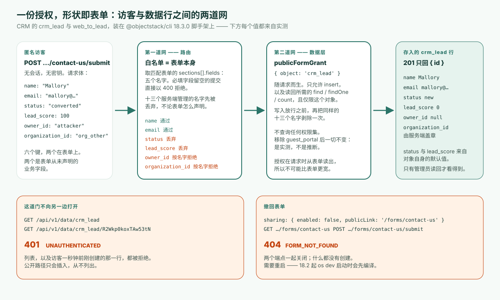

**先给结论**：从 v17 起，ObjectStack 应用里任何未经认证的对象数据请求都会被 `401 UNAUTHENTICATED` 拒绝——每个对象、每个端点，没有例外开关。一个受治理的应用向公众留下的唯一一道门，是**公开表单视图**：声明一个表单，把它的 `sharing` 块标为 `allowAnonymous: true`，运行时就从这份声明推导出访客的全部授权——在那一个对象上创建一条记录，别的什么都不能做，回给访客的只有新记录的 id。表单的字段列表就是安全边界。CRM 示例的 web-to-lead 表单列了五个字段，于是五个字段能进来；其余八个业务字段和每一个系统列都进不来，不管访客发了什么；表单标为必填的字段不填，什么都不会写入。我把它称为**表单形状的授权**（form-shaped grant）：授权在请求时从表单算出来，所以它不可能被配置得比表单更宽。下文的每一项都在已发布的 `@objectstack/cli` 18.3.0 上实测，也就是今天 `npm create objectstack@latest` 装上的版本——包括到底需不需要一个 `guest_portal` 权限集。答案是不需要，而且从 18.0 起自带示例也这么写了。

## 问题，用文档自己的话说

ObjectStack 关于公开数据收集的指南，开头就用用户的口吻写下了场景：

> 我想让匿名访客提交一个表单——「联系我们」「申请演示」或者录入表单——它会创建一条记录。但我绝对**不能**把底层数据开放给他们，而且他们只能设置表单上的那些字段。

每个业务应用都有这么一张表：网站上的线索表单、支持工单录入、演示申请、保修申请。常见的几种做法各有代价。给一个「guest」角色加上对这张表的写权限，是一份没人会再读的常设授权，它会漂移。手写一个端点，绕开了治理其他一切的权限模型。用第三方表单工具加 webhook，意味着现在有两套系统各持一份 schema，而审阅者看的不是其中那一份。

从 v17 起，第一种做法根本不存在了。权限文档顺带记录了原因：「since v17 anonymous access to object data is always denied anyway — the `requireAuth: false` opt-out was retired」（自 v17 起匿名访问对象数据本来就一律拒绝——`requireAuth: false` 这个退出开关已经退役）。[自托管实操](/en/blog/how-to-self-host-objectstack/)把它变成了一个验证步骤——不带凭据 `curl` 一个对象端点，坚持要看到带机器可读 `code` 的 `401`——并把那里出现 `200` 当作事故处理。所以这个问题诚实的问法是：既然数据平面从结构上就对匿名调用者关闭，公开表单到底是怎么进来的？

## 公开表单是一份声明，不是一条权限

下面是 CRM 示例 web-to-lead 表单的全部内容，照 `@objectstack/cli@18.3.0` 标签里发布的原样：

```ts
formViews: {
  web_to_lead: {
    type: 'simple',
    data: { provider: 'object', object: 'crm_lead' },
    sections: [
      {
        name: 'contact_us',
        label: 'Contact us',
        columns: 1,
        fields: [
          { field: 'name', required: true },
          { field: 'company' },
          { field: 'email', required: true },
          { field: 'phone' },
          { field: 'title' },
        ],
      },
    ],
    sharing: {
      enabled: true,
      allowAnonymous: true,
      publicLink: '/forms/contact-us',
    },
  },
},
```

里面没有一个字提到权限。开门的是 `sharing` 块：`enabled`、`allowAnonymous` 和 `publicLink` 三者齐备时，运行时注册两个匿名端点——`GET /api/v1/forms/contact-us` 返回解析后的表单和白名单 schema，`POST /api/v1/forms/contact-us/submit` 插入一条 `crm_lead`。文档用一句话规定访客能写什么：「Only the fields listed in `sections[].fields` are accepted on submit; everything else is stripped server-side」（提交时只接受 `sections[].fields` 里列出的字段；其余一切在服务端剥除）。18.0 起紧接着的一句是：提交路由「also enforces each entry's `required: true` before anything is written」（在写入任何东西之前，还会强制每个条目的 `required: true`）。而文档给出的这样设计的理由，正是本文要验证的那句话：「Authorization is **derived from the declaration**, not configured separately — so the grant can't drift wider than the form」（授权是从声明推导出来的，不是单独配置的——所以授权不可能漂移得比表单更宽）。



从机制上说有两道网，值得分别起名，因为审阅者可以逐一核对。

**第一道网是路由。** 提交处理器用匹配到的表单的 `sections[].fields` 构建允许列表，只把这些键从请求体里拷出来。在此之前，它按名字丢掉 `PUBLIC_FORM_SERVER_MANAGED_FIELDS` 里的每一个键——这是 spec 包导出的一个集合：`id`、`owner_id`、`owning_business_unit_id`、`queue`、`organization_id`、`tenant_id`、`created_at`、`created_by`、`updated_at`、`updated_by`、`is_deleted`、`deleted_at` 和 `__search`——十三个名字，文档说它们「**never** accepted from a public submission — not even when a section declares them」（永远不从公开提交接受——即使某个分区声明了它们也不接受）。（`queue` 是最新加入的；18.2 时是十二个。）一个字段都没有的表单会以 `400` 拒绝，而不是来什么收什么。接着，路由在写入任何东西之前先按表单本身做判断：表单标为 `required` 且始终显示的字段必须有值（18.0 起），文件字段里的值一律拒绝（18.2 起），超出表单条目所给 `options` 子集的值也拒绝（18.3 起）——全部合在一个 `400 VALIDATION_FAILED` 里，逐一点名字段。

**第二道网是数据层。** 路由给这次写入附上一个随请求而生的 `publicFormGrant: { object: 'crm_lead' }`，安全插件只认这个：`insert`，加上紧随其后读回所需的 `find`、`findOne` 和 `count`，而且仅限这一个对象。在放行插入之前，它把同样的十三个名字再剥一次，所以即使某个表单在分区里声明了 `owner_id`，或者路由过滤器和数据层将来被改得不一致，访客也伪造不了归属和租户位置。这份授权就是表单的形状，在请求时读出来。权限表里没有一行写着「匿名可以写线索」，因为根本没有什么可配置的。读回的结果只到路由为止，不到访客手里：路由只回答新记录的 id，插入存下的其余内容一概不回。

## 18.3.0 上的实测记录

我用 `npm create objectstack@latest` 新建了一个应用——`@objectstack/cli` 18.3.0——再从 `@objectstack/cli@18.3.0` 标签拷入 CRM 示例的 `crm_lead` 对象（连同它的查找字段指向的两个对象）、带 web-to-lead 表单的 `lead.view.ts`，以及它的 `guest_portal` 权限集。然后运行 `objectstack dev`：它在启动时编译配置，并在空数据库上播种一个管理员账号。下面每个响应都是真实的，只为篇幅做了裁剪。

**1. 这道门会自我描述——五个字段宽。** 不带任何凭据：

```bash
curl -s http://localhost:49900/api/v1/forms/contact-us
```

```json
{ "slug": "contact-us", "object": "crm_lead",
  "form": { "sections": [ { "name": "contact_us", "label": "Contact us", "fields": [
      { "field": "name", "required": true }, { "field": "company" },
      { "field": "email", "required": true }, { "field": "phone" }, { "field": "title" } ] } ],
    "sharing": { "enabled": true, "publicLink": "/forms/contact-us", "allowAnonymous": true } },
  "objectSchema": { "name": "crm_lead", "label": "Lead", "fields": {
      "name":    { "label": "Lead Name", "type": "text",  "required": true, "maxLength": 200 },
      "email":   { "label": "Email",     "type": "email", "required": false },
      "phone":   { "label": "Phone",     "type": "phone", "required": false },
      "company": { "label": "Company",   "type": "text",  "required": false, "maxLength": 200 },
      "title":   { "label": "Title",     "type": "text",  "required": false, "maxLength": 120 } } } }
```

`objectSchema` 恰好只带五个白名单字段，每个都附上前端绘制它所需的标签、类型和长度限制。`crm_lead` 的对象定义声明了十三个业务字段；公开 schema 只显示五个，对 `status`、`lead_score`、`assigned_to`、`account`、`notes` 和其余字段只字不提。访客连该试什么都无从得知。标签还会跟随访客的语言：加载 CRM 的中文翻译包后，带 `Accept-Language: zh-CN` 发出同一个请求，分区标题成了「联系我们」，对象成了「线索」，`name` 成了「线索名称」，其余字段标签也都是中文，响应头带 `Vary: Accept-Language`。

**2. 一次干净的提交创建一行，回答是它的 id。**

```bash
curl -s -X POST http://localhost:49900/api/v1/forms/contact-us/submit \
  -H 'content-type: application/json' \
  -d '{"name":"Ada Lovelace","email":"ada@example.com"}'
```

```json
HTTP 201
{ "id": "dgYZFAvljruviVy9" }
```

这就是全部回答：新记录的 id，插入存下的内容一概没有。以管理员身份读回，这一行才显出访客没有发送的那些值：

```bash
curl -s -b admin.cookies http://localhost:49900/api/v1/data/crm_lead/dgYZFAvljruviVy9
```

```json
{ "id": "dgYZFAvljruviVy9", "name": "Ada Lovelace", "email": "ada@example.com",
  "status": "new", "source": "web", "lead_score": 0, "owner_id": null, "queue": null,
  "organization_id": "org_mw8n9qe618ypwdpk", "created_by": null }
```

`status: "new"` 并没有被发送；它是对象的写路径默认值，线索对象的注释写明了声明它的理由：「a create that omits `status` (e.g. the public Web-to-Lead form, which doesn't collect it) is stored as 'new', so it satisfies `required`」（省略 `status` 的创建——比如不收集它的公开 Web-to-Lead 表单——会存为 'new'，因而满足 `required`）。`source: "web"` 和 `lead_score: 0` 同样是默认值。在 17.7.0 上，`201` 会把这一整行回显给匿名调用者。我上报了这个问题，从 18.0 起回答只剩 id（objectstack issue #22437，由 PR #22462 修复）。

**3. 一次恶意的提交创建的是同样的一行。** 发了六个键，两个在表单上：

```bash
curl -s -X POST http://localhost:49900/api/v1/forms/contact-us/submit \
  -H 'content-type: application/json' \
  -d '{"name":"Mallory","email":"mallory@example.com",
       "status":"converted","lead_score":100,
       "owner_id":"attacker","organization_id":"org_other"}'
```

```json
HTTP 201
{ "id": "R2Wkp0koxTAw53tN" }
```

回答和上一次形状相同，所以它对保留了什么只字不提。以管理员身份读回这个 id，才看得到：

```json
{ "id": "R2Wkp0koxTAw53tN", "name": "Mallory", "email": "mallory@example.com",
  "status": "new", "lead_score": 0, "owner_id": null, "queue": null,
  "organization_id": "org_mw8n9qe618ypwdpk" }
```

两个白名单字段到了，两个不在表单上的业务字段被丢弃、对象默认值生效，两个系统锚点先被丢弃、再由服务端盖章——`organization_id` 是这个部署自己的组织，不是 `org_other`；`owner_id` 是 `null`。在另一次启动里，我往同一个请求体里加了 `queue`、`id` 和 `created_by`：存下的行用的是服务端生成的 id，另外两个都是 `null`。`201` 不会说明哪些键被拒绝；路由一声不响地把它们丢掉。

| 发送的键 | 在表单上？ | 存储为（管理员读回） | 原因 |
|:--|:--|:--|:--|
| `name`、`email` | 是 | 照发送的值 | 在白名单内 |
| `status: "converted"` | 否 | `"new"` | 不在 `sections[].fields` 里；对象默认值生效 |
| `lead_score: 100` | 否 | `0` | 不在 `sections[].fields` 里；对象默认值生效 |
| `owner_id: "attacker"` | 否 | `null` | 服务端管理的名字，两道网都拒绝 |
| `organization_id: "org_other"` | 否 | 服务端自己的值 | 服务端管理的名字；由运行时盖章 |
| `queue`、`id`、`created_by`（另一次启动） | 否 | `null`、服务端生成的 id、`null` | 服务端管理的名字 |

**4. 漏填必填字段，在写入之前就被拒绝。** 表单把 `email` 标为必填，对象没有。

```bash
curl -s -X POST http://localhost:49900/api/v1/forms/contact-us/submit \
  -H 'content-type: application/json' \
  -d '{"name":"No Email"}'
```

```json
HTTP 400
{ "error": "Email is required", "code": "VALIDATION_FAILED",
  "fields": [ { "field": "email", "code": "required", "message": "Email is required", "label": "Email" } ] }
```

空白的 `"  "` 邮箱得到同样的回答；空请求体则在同一个信封里点名了两个字段（`"Lead Name is required; Email is required"`）。在 17.7.0 上，同样的 `POST` 答 `201`、`email: null`，因为这条路径只强制对象上的 `required`。这个我也上报了，从 18.0 起路由会先强制表单自己的 `required`（objectstack issue #24131，PR #24161）。

**5. 这道门不向另一边打开。** 同一个匿名客户端，这次来读：

```bash
curl -s -w '\n%{http_code}\n' http://localhost:49900/api/v1/data/crm_lead
curl -s -w '\n%{http_code}\n' http://localhost:49900/api/v1/data/crm_lead/R2Wkp0koxTAw53tN
```

```json
{"error":"UNAUTHENTICATED","code":"UNAUTHENTICATED","message":"Authentication is required to access this endpoint."}
401
```

两个都答 `401`——列表，以及访客一秒钟前刚创建的那一行。提交者根本看不到存下的记录：`201` 只带它的 id，而这个 id 什么也打不开。「The public path only ever **inserts**; it never lists」（公开路径只会插入，从不列出）。

**6. 撤回表单会同时关闭两个端点。** 保留 `publicLink`，把 `enabled` 设为 `false`，重启 `objectstack dev`：

```json
GET  /api/v1/forms/contact-us         → 404 {"code":"FORM_NOT_FOUND","error":"No public form configured at /forms/contact-us"}
POST /api/v1/forms/contact-us/submit  → 404 {"code":"FORM_NOT_FOUND","error":"No public form configured at /forms/contact-us"}
```

以管理员身份读到的线索总数在这两次调用前后相同：什么都没有创建。五个状态码讲完了这道门的全部故事：`201`、`201`、`400`、`401`、`404`。

## guest 配置文件之争，已在上游解决

在 17.7.0 上，文档和自带示例对「是什么授权了这次写入」说法不一。指南当时这样写，现在也还这样写：「Declare a public form view; the submit route derives a narrow authorization from that declaration. No `guest` profile, no broad grant」（声明一个公开表单视图；提交路由从这份声明推导一份窄授权。不需要 `guest` 配置文件，不需要宽泛授权）。CRM 示例附带了一个名为 `guest_portal` 的权限集，在 `crm_lead` 上 `allowCreate: true`，它的注释说这个配置文件「authorizes the write」（授权这次写入），路由的文档注释还警告没有它中间件会「falls open」（失守放行）。我把这个集合从 17.7.0 的 CRM 里删掉，重跑探测，得到完全相同的回答，并上报了这处分歧（objectstack issue #24130）。

它在 18.0 里被修复了（PR #24237）。在 18.3.0 标签上，这个集合上方的注释写着「It does NOT authorize the public Web-to-Lead form (lead.view.ts `web_to_lead`). That form's own declaration does」（它并不授权公开的 Web-to-Lead 表单；授权它的是那个表单自己的声明），结尾是「the submit answers the created id only」（提交只回答新建的 id）。表单自己的注释写着「No permission set is needed, `GuestPortalProfile` included」（不需要任何权限集，`GuestPortalProfile` 也不例外）。指南新增了一段，开头是「The submit's execution context also names a `guest_portal` permission set. That name authorizes nothing」（提交的执行上下文也点了一个 `guest_portal` 权限集的名字。这个名字什么也不授权），那句「falls open」的文档注释也已删掉。示例保留这个集合，是因为 ADR-0138 把它记录为提交上下文所请求的那个名字的参照。

我还是在 18.3.0 上把对比重跑了一遍：一次带着这个集合，一次改成 `permissions: []`，编译出的工件里一个权限集都没有。

| 探测 | 有 `guest_portal` | 没有 `guest_portal` |
|:--|:--|:--|
| 带 `name`、`email` 的 `POST …/submit` | `201 { id }`，创建一行 | `201 { id }`，创建一行 |
| 夹带 `status`、`lead_score`、`owner_id`、`organization_id`、`queue` 的 `POST …/submit` | `201 { id }`；读回 `status: "new"`、`lead_score: 0`、`owner_id: null`、`queue: null`、服务端的 `organization_id` | 完全相同 |
| 不带 `email` 的 `POST …/submit` | `400 VALIDATION_FAILED`，`email` `required` | 完全相同 |
| 匿名 `GET /api/v1/data/crm_lead` | `401 UNAUTHENTICATED` | `401 UNAUTHENTICATED` |
| 匿名 `GET` 刚创建的那一行 | `401 UNAUTHENTICATED` | `401 UNAUTHENTICATED` |

逐行一致，和 17.7.0 上一样。这个名字如今能触及的范围很窄：以 `guest_portal` 注册的集合，为授权的结果脱敏器提供字段权限，脱敏的对象是交回给路由的那条记录——而访客已经看不到那条记录了。所以实际建议不变：不要为了让公开表单工作而添加 guest 配置文件。它给你的访问矩阵加了一份公开之门从不查询的常设授权。如果你的应用提交了访问矩阵快照（完整的 CRM 就是这样），增删这样一个集合就是构建会要求你审阅的变更；[那道门禁](/zh-Hans/blog/catch-ai-silent-permission-change-access-matrix-gate/)是另一个话题。

示例和指南仍有一处分道扬镳：指南的第三步是「Set `sharingModel: 'private'` on the object so submissions are staff-scoped after creation」（把对象的 `sharingModel` 设为 `'private'`，让提交在创建后只对内部人员可见），而 CRM 的线索对象刻意用了 `public_read_write`，注释解释说这个演示有意按组织共享。这不会削弱这道门——组织级默认值管的是**已登录**用户彼此能看到多少行，匿名调用者在那之前就已经被拒绝——但对你自己的录入对象，这条建议值得照做。

## 这道门做不到的事

- **默认没有限流、没有验证码、没有反垃圾。** 在默认的脚手架上，同一个客户端 0.89 秒内提交 40 次，全部答 `201`。运行时确实带了一个限流器，作用于整个服务器、默认关闭：在 stack 里写上 `server: { security: { rateLimit: { enabled: true, windowMs: 60_000, maxRequests: 10 } } }` 之后，同一个客户端拿到九个 `201`，然后是带 `Retry-After` 头的 `429 RATE_LIMIT_EXCEEDED`——它先前对表单的 `GET` 也算在同一份预算里。它计量每一条路由，没有会话时按调用者的地址计数，所以在反向代理后面它数的是代理的地址，除非你声明 `server.trustProxy`——而只有当代理会覆写转发头时，这样声明才安全。它是一份预算，不是机器人防护：把常规的边缘防护放在 `/api/v1/forms/*` 前面。
- **表单的 `required` 只管表单始终显示的字段。** 带 `hidden: true` 的条目，或者条目本身、所在分区带 `visibleWhen` 的条目，提交时不做判断，因为服务端没有任何东西会求值表单的 `visibleWhen`。如果这样的字段必须存在，就在对象上要求它，或者在钩子里检查。
- **回答几乎什么都不告诉访客，这是有意的。** `201` 只带新 id，不说明保留了什么、丢弃了什么。需要向访客显示一个参考号的表单，可以在感谢面板里用 `{{record.case_number}}` 的写法点名一个引擎生成的字段，比如 `autonumber` 工单号；指南说回答随后会在 `fields` 下带上这个值，而 `os validate` 和发布门禁会拒绝点名任何其他字段。CRM 表单没有点名任何字段，所以这个分支我没有实测。在 17.7.0 上，回显里还带着 `beforeInsert` 或 `afterInsert` 钩子盖上去的任何值，本文当时建议把会查询已有记录的钩子放在公开录入对象之外；从 18.0 起由路由过滤访客能看到的内容，那条建议也就作废了。
- **所有者是「无人」。** 公开提交的 `owner_id` 保持 `null`；安全插件把它留给「object hooks / the first-admin bootstrap to assign」（对象钩子或首位管理员引导流程来分配）。如果你的流程要分派线索，在钩子或流程里做——别指望这一行天然属于某个人。
- **撤回需要重启。** 从 18.2 起，`objectstack dev` 默认在启动时编译配置，这里普通的一次重启就关闭了表单。在 17.7.0 上，我第一次尝试什么都没变，因为 `--no-watch` 启动提供的是上一次的构建。一个只读状态码的 Agent 驱动循环应该去确认 `404`，而不是想当然。
- **跨元数据层的撤回有本文没走到的边缘。** 组织保存的视图副本、包随附的表单，在指南中各有规则。这里测的单个开关，是大多数应用需要的那一个。

## 审阅者的五个问题

不管表单是人写的还是 Agent 写的，审阅是一样的，而且很短，因为授权就是表单。

1. **哪些表单是公开的？** 每一个 `sharing.enabled`、`sharing.allowAnonymous` 和 `publicLink` 三者齐备的表单视图都是一个匿名端点。编译出的工件列出了它们；没有别的地方可查。
2. **`sections[].fields` 里有什么？** 这份列表减去十三个服务端管理的名字，就是公开写入面。像读防火墙规则那样读它。
3. **对象会补上表单没收的东西吗？** 表单不收集的每一个必填字段都需要对象级默认值——示例里的 `status`——否则提交失败。表单显示并标为 `required` 的字段会在门口被强制；表单隐藏或有条件显示的字段，`required` 要写在对象上。
4. **哪里有常设的匿名授权吗？** 绑定到 `guest` 或 `everyone` 岗位的权限集，或者「为了让表单工作」而添加的 `guest_portal` 集合，既不需要，也不会拓宽这道门用到的任何东西。把它的存在当成一个问题。
5. **门前有什么？** 机器人防护是部署的工作。运行时自带的限流器是一份作用于整个服务器的预算，在你声明之前是关闭的。

这和[Agent 权限在哪里被强制](/zh-Hans/blog/objectos-agent-permission-boundaries/)是同一个「在何处执行」的论证，只是套在一个完全没有身份的调用者身上：检查在路由和数据层里跑，而不是在恰好把字段藏起来的 UI 里。它也是[那篇 Lovable 文章](/zh-Hans/blog/is-lovable-safe-for-production/)描述的审阅难题的答案——负责任的所有者能读懂五行字段列表并签字，这对一份生成出来的策略可做不到。术语表里的[权限模型](/zh-Hans/glossary/permission-model/)条目有总体的形状；这道门是「默认拒绝」唯一一个有意为之的例外，而它的形状就是表单。

## 把你的 Agent 指向它

如果你的应用由 Agent 来写，该交给它的不是这篇文章，而是这条规则：公开表单是一个带 `sharing` 块的 `formViews` 条目，字段列表就是边界，表单的 `required` 在门口检查，默认值由对象负责，不涉及任何权限集。[为 ObjectStack 配置编码 Agent 的指南](/en/blog/how-to-point-your-agent-at-objectstack/)讲了这条规则如何到达 Agent——规则文件、运行中的应用暴露的 MCP 端点，以及 spec。`npm create objectstack@latest` 装的是 18.3.0，正是这份记录运行的版本。

为了运行它，ObjectStack 仓库提供 ObjectOS Community —— ghcr.io/objectstack-ai/objectstack 镜像、os start 和 Console，免费且自托管 —— 而 ObjectOS Cloud 是托管版本，ObjectOS Enterprise 是自管理、需许可的版本。
