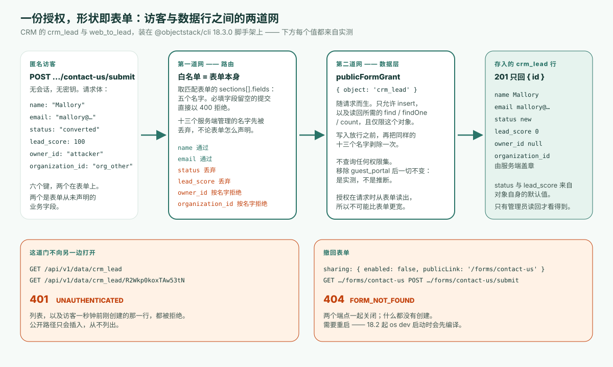

---
# @generated zh-Hant from zh-Hans (s2twp) — edit the zh-Hans file; delete this line to hand-maintain.
title: 怎樣讓匿名訪客把表單提交進一個受治理的業務應用？一道公開的門，五個欄位寬
description: v17 起匿名訪問物件資料一律拒絕。唯一開著的門是公開表單檢視：執行環境從表單自身推導授權——五個欄位進來，建立一行，只回給訪客它的 id。在 18.3.0 上實測。
author: ObjectStack Team
date: 2026-10-22
status: published
topic: app-building
audience: business
solutions: []
industries: []
cover: ./cover.svg
tags:
  - 公開表單
  - Web-to-Lead
  - 匿名訪問
---

**先給結論**：從 v17 起，ObjectStack 應用裡任何未經認證的物件資料請求都會被 `401 UNAUTHENTICATED` 拒絕——每個物件、每個端點，沒有例外開關。一個受治理的應用向公眾留下的唯一一道門，是**公開表單檢視**：宣告一個表單，把它的 `sharing` 塊標為 `allowAnonymous: true`，執行環境就從這份宣告推匯出訪客的全部授權——在那一個物件上建立一條記錄，別的什麼都不能做，回給訪客的只有新記錄的 id。表單的欄位列表就是安全邊界。CRM 示例的 web-to-lead 表單列了五個欄位，於是五個欄位能進來；其餘八個業務欄位和每一個系統列都進不來，不管訪客發了什麼；表單標為必填的欄位不填，什麼都不會寫入。我把它稱為**表單形狀的授權**（form-shaped grant）：授權在請求時從表單算出來，所以它不可能被配置得比表單更寬。下文的每一項都在已釋出的 `@objectstack/cli` 18.3.0 上實測，也就是今天 `npm create objectstack@latest` 裝上的版本——包括到底需不需要一個 `guest_portal` 權限集。答案是不需要，而且從 18.0 起自帶示例也這麼寫了。

## 問題，用文件自己的話說

ObjectStack 關於公開資料收集的指南，開頭就用使用者的口吻寫下了場景：

> 我想讓匿名訪客提交一個表單——「聯絡我們」「申請演示」或者錄入表單——它會建立一條記錄。但我絕對**不能**把底層資料開放給他們，而且他們只能設定表單上的那些欄位。

每個業務應用都有這麼一張表：網站上的線索表單、支援工單錄入、演示申請、保修申請。常見的幾種做法各有代價。給一個「guest」角色加上對這張表的寫權限，是一份沒人會再讀的常設授權，它會漂移。手寫一個端點，繞開了治理其他一切的權限模型。用第三方表單工具加 webhook，意味著現在有兩套系統各持一份 schema，而審閱者看的不是其中那一份。

從 v17 起，第一種做法根本不存在了。權限文件順帶記錄了原因：「since v17 anonymous access to object data is always denied anyway — the `requireAuth: false` opt-out was retired」（自 v17 起匿名訪問物件資料本來就一律拒絕——`requireAuth: false` 這個退出開關已經退役）。[自託管實操](/en/blog/how-to-self-host-objectstack/)把它變成了一個驗證步驟——不帶憑據 `curl` 一個物件端點，堅持要看到帶機器可讀 `code` 的 `401`——並把那裡出現 `200` 當作事故處理。所以這個問題誠實的問法是：既然資料平面從結構上就對匿名呼叫者關閉，公開表單到底是怎麼進來的？

## 公開表單是一份宣告，不是一條權限

下面是 CRM 示例 web-to-lead 表單的全部內容，照 `@objectstack/cli@18.3.0` 標籤裡釋出的原樣：

```ts
formViews: {
  web_to_lead: {
    type: 'simple',
    data: { provider: 'object', object: 'crm_lead' },
    sections: [
      {
        name: 'contact_us',
        label: 'Contact us',
        columns: 1,
        fields: [
          { field: 'name', required: true },
          { field: 'company' },
          { field: 'email', required: true },
          { field: 'phone' },
          { field: 'title' },
        ],
      },
    ],
    sharing: {
      enabled: true,
      allowAnonymous: true,
      publicLink: '/forms/contact-us',
    },
  },
},
```

裡面沒有一個字提到權限。開門的是 `sharing` 塊：`enabled`、`allowAnonymous` 和 `publicLink` 三者齊備時，執行環境註冊兩個匿名端點——`GET /api/v1/forms/contact-us` 返回解析後的表單和白名單 schema，`POST /api/v1/forms/contact-us/submit` 插入一條 `crm_lead`。文件用一句話規定訪客能寫什麼：「Only the fields listed in `sections[].fields` are accepted on submit; everything else is stripped server-side」（提交時只接受 `sections[].fields` 裡列出的欄位；其餘一切在服務端剝除）。18.0 起緊接著的一句是：提交路由「also enforces each entry's `required: true` before anything is written」（在寫入任何東西之前，還會強制每個條目的 `required: true`）。而文件給出的這樣設計的理由，正是本文要驗證的那句話：「Authorization is **derived from the declaration**, not configured separately — so the grant can't drift wider than the form」（授權是從宣告推匯出來的，不是單獨配置的——所以授權不可能漂移得比表單更寬）。



從機制上說有兩道網，值得分別起名，因為審閱者可以逐一核對。

**第一道網是路由。** 提交處理器用匹配到的表單的 `sections[].fields` 構建允許列表，只把這些鍵從請求體裡拷出來。在此之前，它按名字丟掉 `PUBLIC_FORM_SERVER_MANAGED_FIELDS` 裡的每一個鍵——這是 spec 包匯出的一個集合：`id`、`owner_id`、`owning_business_unit_id`、`queue`、`organization_id`、`tenant_id`、`created_at`、`created_by`、`updated_at`、`updated_by`、`is_deleted`、`deleted_at` 和 `__search`——十三個名字，文件說它們「**never** accepted from a public submission — not even when a section declares them」（永遠不從公開提交接受——即使某個分割槽聲明瞭它們也不接受）。（`queue` 是最新加入的；18.2 時是十二個。）一個欄位都沒有的表單會以 `400` 拒絕，而不是來什麼收什麼。接著，路由在寫入任何東西之前先按表單本身做判斷：表單標為 `required` 且始終顯示的欄位必須有值（18.0 起），檔案欄位裡的值一律拒絕（18.2 起），超出表單條目所給 `options` 子集的值也拒絕（18.3 起）——全部合在一個 `400 VALIDATION_FAILED` 裡，逐一點名欄位。

**第二道網是資料層。** 路由給這次寫入附上一個隨請求而生的 `publicFormGrant: { object: 'crm_lead' }`，安全外掛只認這個：`insert`，加上緊隨其後讀回所需的 `find`、`findOne` 和 `count`，而且僅限這一個物件。在放行插入之前，它把同樣的十三個名字再剝一次，所以即使某個表單在分割槽裡聲明瞭 `owner_id`，或者路由過濾器和資料層將來被改得不一致，訪客也偽造不了歸屬和租戶位置。這份授權就是表單的形狀，在請求時讀出來。權限表裡沒有一行寫著「匿名可以寫線索」，因為根本沒有什麼可配置的。讀回的結果只到路由為止，不到訪客手裡：路由只回答新記錄的 id，插入存下的其餘內容一概不回。

## 18.3.0 上的實測記錄

我用 `npm create objectstack@latest` 新建了一個應用——`@objectstack/cli` 18.3.0——再從 `@objectstack/cli@18.3.0` 標籤拷入 CRM 示例的 `crm_lead` 物件（連同它的查詢欄位指向的兩個物件）、帶 web-to-lead 表單的 `lead.view.ts`，以及它的 `guest_portal` 權限集。然後執行 `objectstack dev`：它在啟動時編譯配置，並在空資料庫上播種一個管理員賬號。下面每個響應都是真實的，只為篇幅做了裁剪。

**1. 這道門會自我描述——五個欄位寬。** 不帶任何憑據：

```bash
curl -s http://localhost:49900/api/v1/forms/contact-us
```

```json
{ "slug": "contact-us", "object": "crm_lead",
  "form": { "sections": [ { "name": "contact_us", "label": "Contact us", "fields": [
      { "field": "name", "required": true }, { "field": "company" },
      { "field": "email", "required": true }, { "field": "phone" }, { "field": "title" } ] } ],
    "sharing": { "enabled": true, "publicLink": "/forms/contact-us", "allowAnonymous": true } },
  "objectSchema": { "name": "crm_lead", "label": "Lead", "fields": {
      "name":    { "label": "Lead Name", "type": "text",  "required": true, "maxLength": 200 },
      "email":   { "label": "Email",     "type": "email", "required": false },
      "phone":   { "label": "Phone",     "type": "phone", "required": false },
      "company": { "label": "Company",   "type": "text",  "required": false, "maxLength": 200 },
      "title":   { "label": "Title",     "type": "text",  "required": false, "maxLength": 120 } } } }
```

`objectSchema` 恰好只帶五個白名單欄位，每個都附上前端繪製它所需的標籤、型別和長度限制。`crm_lead` 的物件定義聲明瞭十三個業務欄位；公開 schema 只顯示五個，對 `status`、`lead_score`、`assigned_to`、`account`、`notes` 和其餘欄位隻字不提。訪客連該試什麼都無從得知。標籤還會跟隨訪客的語言：載入 CRM 的中文翻譯包後，帶 `Accept-Language: zh-CN` 發出同一個請求，分割槽標題成了「聯絡我們」，物件成了「線索」，`name` 成了「線索名稱」，其餘欄位標籤也都是中文，響應頭帶 `Vary: Accept-Language`。

**2. 一次乾淨的提交建立一行，回答是它的 id。**

```bash
curl -s -X POST http://localhost:49900/api/v1/forms/contact-us/submit \
  -H 'content-type: application/json' \
  -d '{"name":"Ada Lovelace","email":"ada@example.com"}'
```

```json
HTTP 201
{ "id": "dgYZFAvljruviVy9" }
```

這就是全部回答：新記錄的 id，插入存下的內容一概沒有。以管理員身份讀回，這一行才顯出訪客沒有傳送的那些值：

```bash
curl -s -b admin.cookies http://localhost:49900/api/v1/data/crm_lead/dgYZFAvljruviVy9
```

```json
{ "id": "dgYZFAvljruviVy9", "name": "Ada Lovelace", "email": "ada@example.com",
  "status": "new", "source": "web", "lead_score": 0, "owner_id": null, "queue": null,
  "organization_id": "org_mw8n9qe618ypwdpk", "created_by": null }
```

`status: "new"` 並沒有被髮送；它是物件的寫路徑預設值，線索物件的註釋寫明瞭宣告它的理由：「a create that omits `status` (e.g. the public Web-to-Lead form, which doesn't collect it) is stored as 'new', so it satisfies `required`」（省略 `status` 的建立——比如不收集它的公開 Web-to-Lead 表單——會存為 'new'，因而滿足 `required`）。`source: "web"` 和 `lead_score: 0` 同樣是預設值。在 17.7.0 上，`201` 會把這一整行回顯給匿名呼叫者。我上報了這個問題，從 18.0 起回答只剩 id（objectstack issue #22437，由 PR #22462 修復）。

**3. 一次惡意的提交建立的是同樣的一行。** 發了六個鍵，兩個在表單上：

```bash
curl -s -X POST http://localhost:49900/api/v1/forms/contact-us/submit \
  -H 'content-type: application/json' \
  -d '{"name":"Mallory","email":"mallory@example.com",
       "status":"converted","lead_score":100,
       "owner_id":"attacker","organization_id":"org_other"}'
```

```json
HTTP 201
{ "id": "R2Wkp0koxTAw53tN" }
```

回答和上一次形狀相同，所以它對保留了什麼隻字不提。以管理員身份讀回這個 id，才看得到：

```json
{ "id": "R2Wkp0koxTAw53tN", "name": "Mallory", "email": "mallory@example.com",
  "status": "new", "lead_score": 0, "owner_id": null, "queue": null,
  "organization_id": "org_mw8n9qe618ypwdpk" }
```

兩個白名單欄位到了，兩個不在表單上的業務欄位被丟棄、物件預設值生效，兩個系統錨點先被丟棄、再由服務端蓋章——`organization_id` 是這個部署自己的組織，不是 `org_other`；`owner_id` 是 `null`。在另一次啟動裡，我往同一個請求體里加了 `queue`、`id` 和 `created_by`：存下的行用的是服務端生成的 id，另外兩個都是 `null`。`201` 不會說明哪些鍵被拒絕；路由一聲不響地把它們丟掉。

| 傳送的鍵 | 在表單上？ | 儲存為（管理員讀回） | 原因 |
|:--|:--|:--|:--|
| `name`、`email` | 是 | 照發送的值 | 在白名單內 |
| `status: "converted"` | 否 | `"new"` | 不在 `sections[].fields` 裡；物件預設值生效 |
| `lead_score: 100` | 否 | `0` | 不在 `sections[].fields` 裡；物件預設值生效 |
| `owner_id: "attacker"` | 否 | `null` | 服務端管理的名字，兩道網都拒絕 |
| `organization_id: "org_other"` | 否 | 服務端自己的值 | 服務端管理的名字；由執行環境蓋章 |
| `queue`、`id`、`created_by`（另一次啟動） | 否 | `null`、服務端生成的 id、`null` | 服務端管理的名字 |

**4. 漏填必填欄位，在寫入之前就被拒絕。** 表單把 `email` 標為必填，物件沒有。

```bash
curl -s -X POST http://localhost:49900/api/v1/forms/contact-us/submit \
  -H 'content-type: application/json' \
  -d '{"name":"No Email"}'
```

```json
HTTP 400
{ "error": "Email is required", "code": "VALIDATION_FAILED",
  "fields": [ { "field": "email", "code": "required", "message": "Email is required", "label": "Email" } ] }
```

空白的 `"  "` 郵箱得到同樣的回答；空請求體則在同一個信封裡點名了兩個欄位（`"Lead Name is required; Email is required"`）。在 17.7.0 上，同樣的 `POST` 答 `201`、`email: null`，因為這條路徑只強制物件上的 `required`。這個我也上報了，從 18.0 起路由會先強制表單自己的 `required`（objectstack issue #24131，PR #24161）。

**5. 這道門不向另一邊開啟。** 同一個匿名客戶端，這次來讀：

```bash
curl -s -w '\n%{http_code}\n' http://localhost:49900/api/v1/data/crm_lead
curl -s -w '\n%{http_code}\n' http://localhost:49900/api/v1/data/crm_lead/R2Wkp0koxTAw53tN
```

```json
{"error":"UNAUTHENTICATED","code":"UNAUTHENTICATED","message":"Authentication is required to access this endpoint."}
401
```

兩個都答 `401`——列表，以及訪客一秒鐘前剛建立的那一行。提交者根本看不到存下的記錄：`201` 只帶它的 id，而這個 id 什麼也打不開。「The public path only ever **inserts**; it never lists」（公開路徑只會插入，從不列出）。

**6. 撤回表單會同時關閉兩個端點。** 保留 `publicLink`，把 `enabled` 設為 `false`，重啟 `objectstack dev`：

```json
GET  /api/v1/forms/contact-us         → 404 {"code":"FORM_NOT_FOUND","error":"No public form configured at /forms/contact-us"}
POST /api/v1/forms/contact-us/submit  → 404 {"code":"FORM_NOT_FOUND","error":"No public form configured at /forms/contact-us"}
```

以管理員身份讀到的線索總數在這兩次呼叫前後相同：什麼都沒有建立。五個狀態碼講完了這道門的全部故事：`201`、`201`、`400`、`401`、`404`。

## guest 配置檔案之爭，已在上游解決

在 17.7.0 上，文件和自帶示例對「是什麼授權了這次寫入」說法不一。指南當時這樣寫，現在也還這樣寫：「Declare a public form view; the submit route derives a narrow authorization from that declaration. No `guest` profile, no broad grant」（宣告一個公開表單檢視；提交路由從這份宣告推導一份窄授權。不需要 `guest` 配置檔案，不需要寬泛授權）。CRM 示例附帶了一個名為 `guest_portal` 的權限集，在 `crm_lead` 上 `allowCreate: true`，它的註釋說這個配置檔案「authorizes the write」（授權這次寫入），路由的文件註釋還警告沒有它中介軟體會「falls open」（失守放行）。我把這個集合從 17.7.0 的 CRM 裡刪掉，重跑探測，得到完全相同的回答，並上報了這處分歧（objectstack issue #24130）。

它在 18.0 裡被修復了（PR #24237）。在 18.3.0 標籤上，這個集合上方的註釋寫著「It does NOT authorize the public Web-to-Lead form (lead.view.ts `web_to_lead`). That form's own declaration does」（它並不授權公開的 Web-to-Lead 表單；授權它的是那個表單自己的宣告），結尾是「the submit answers the created id only」（提交只回答新建的 id）。表單自己的註釋寫著「No permission set is needed, `GuestPortalProfile` included」（不需要任何權限集，`GuestPortalProfile` 也不例外）。指南新增了一段，開頭是「The submit's execution context also names a `guest_portal` permission set. That name authorizes nothing」（提交的執行上下文也點了一個 `guest_portal` 權限集的名字。這個名字什麼也不授權），那句「falls open」的文件註釋也已刪掉。示例保留這個集合，是因為 ADR-0138 把它記錄為提交上下文所請求的那個名字的參照。

我還是在 18.3.0 上把對比重跑了一遍：一次帶著這個集合，一次改成 `permissions: []`，編譯出的工件裡一個權限集都沒有。

| 探測 | 有 `guest_portal` | 沒有 `guest_portal` |
|:--|:--|:--|
| 帶 `name`、`email` 的 `POST …/submit` | `201 { id }`，建立一行 | `201 { id }`，建立一行 |
| 夾帶 `status`、`lead_score`、`owner_id`、`organization_id`、`queue` 的 `POST …/submit` | `201 { id }`；讀回 `status: "new"`、`lead_score: 0`、`owner_id: null`、`queue: null`、服務端的 `organization_id` | 完全相同 |
| 不帶 `email` 的 `POST …/submit` | `400 VALIDATION_FAILED`，`email` `required` | 完全相同 |
| 匿名 `GET /api/v1/data/crm_lead` | `401 UNAUTHENTICATED` | `401 UNAUTHENTICATED` |
| 匿名 `GET` 剛建立的那一行 | `401 UNAUTHENTICATED` | `401 UNAUTHENTICATED` |

逐行一致，和 17.7.0 上一樣。這個名字如今能觸及的範圍很窄：以 `guest_portal` 註冊的集合，為授權的結果脫敏器提供欄位權限，脫敏的物件是交回給路由的那條記錄——而訪客已經看不到那條記錄了。所以實際建議不變：不要為了讓公開表單工作而新增 guest 配置檔案。它給你的訪問矩陣加了一份公開之門從不查詢的常設授權。如果你的應用提交了訪問矩陣快照（完整的 CRM 就是這樣），增刪這樣一個集合就是構建會要求你審閱的變更；[那道門禁](/zh-Hant/blog/catch-ai-silent-permission-change-access-matrix-gate/)是另一個話題。

示例和指南仍有一處分道揚鑣：指南的第三步是「Set `sharingModel: 'private'` on the object so submissions are staff-scoped after creation」（把物件的 `sharingModel` 設為 `'private'`，讓提交在建立後只對內部人員可見），而 CRM 的線索物件刻意用了 `public_read_write`，註釋解釋說這個演示有意按組織共享。這不會削弱這道門——組織級預設值管的是**已登入**使用者彼此能看到多少行，匿名呼叫者在那之前就已經被拒絕——但對你自己的錄入物件，這條建議值得照做。

## 這道門做不到的事

- **預設沒有限流、沒有驗證碼、沒有反垃圾。** 在預設的腳手架上，同一個客戶端 0.89 秒內提交 40 次，全部答 `201`。執行環境確實帶了一個限流器，作用於整個伺服器、預設關閉：在 stack 裡寫上 `server: { security: { rateLimit: { enabled: true, windowMs: 60_000, maxRequests: 10 } } }` 之後，同一個客戶端拿到九個 `201`，然後是帶 `Retry-After` 頭的 `429 RATE_LIMIT_EXCEEDED`——它先前對錶單的 `GET` 也算在同一份預算裡。它計量每一條路由，沒有會話時按呼叫者的地址計數，所以在反向代理後面它數的是代理的地址，除非你宣告 `server.trustProxy`——而只有當代理會覆寫轉發頭時，這樣宣告才安全。它是一份預算，不是機器人防護：把常規的邊緣防護放在 `/api/v1/forms/*` 前面。
- **表單的 `required` 只管表單始終顯示的欄位。** 帶 `hidden: true` 的條目，或者條目本身、所在分割槽帶 `visibleWhen` 的條目，提交時不做判斷，因為服務端沒有任何東西會求值表單的 `visibleWhen`。如果這樣的欄位必須存在，就在物件上要求它，或者在鉤子裡檢查。
- **回答幾乎什麼都不告訴訪客，這是有意的。** `201` 只帶新 id，不說明保留了什麼、丟棄了什麼。需要向訪客顯示一個參考號的表單，可以在感謝面板裡用 `{{record.case_number}}` 的寫法點名一個引擎生成的欄位，比如 `autonumber` 工單號；指南說回答隨後會在 `fields` 下帶上這個值，而 `os validate` 和釋出門禁會拒絕點名任何其他欄位。CRM 表單沒有點名任何欄位，所以這個分支我沒有實測。在 17.7.0 上，回顯裡還帶著 `beforeInsert` 或 `afterInsert` 鉤子蓋上去的任何值，本文當時建議把會查詢已有記錄的鉤子放在公開錄入物件之外；從 18.0 起由路由過濾訪客能看到的內容，那條建議也就作廢了。
- **所有者是「無人」。** 公開提交的 `owner_id` 保持 `null`；安全外掛把它留給「object hooks / the first-admin bootstrap to assign」（物件鉤子或首位管理員引導流程來分配）。如果你的流程要分派線索，在鉤子或流程裡做——別指望這一行天然屬於某個人。
- **撤回需要重啟。** 從 18.2 起，`objectstack dev` 預設在啟動時編譯配置，這裡普通的一次重啟就關閉了表單。在 17.7.0 上，我第一次嘗試什麼都沒變，因為 `--no-watch` 啟動提供的是上一次的構建。一個只讀狀態碼的 Agent 驅動迴圈應該去確認 `404`，而不是想當然。
- **跨中繼資料層的撤回有本文沒走到的邊緣。** 組織儲存的檢視副本、包隨附的表單，在指南中各有規則。這裡測的單個開關，是大多數應用需要的那一個。

## 審閱者的五個問題

不管表單是人寫的還是 Agent 寫的，審閱是一樣的，而且很短，因為授權就是表單。

1. **哪些表單是公開的？** 每一個 `sharing.enabled`、`sharing.allowAnonymous` 和 `publicLink` 三者齊備的表單檢視都是一個匿名端點。編譯出的工件列出了它們；沒有別的地方可查。
2. **`sections[].fields` 裡有什麼？** 這份列表減去十三個服務端管理的名字，就是公開寫入面。像讀防火牆規則那樣讀它。
3. **物件會補上表單沒收的東西嗎？** 表單不收集的每一個必填欄位都需要物件級預設值——示例裡的 `status`——否則提交失敗。表單顯示並標為 `required` 的欄位會在門口被強制；表單隱藏或有條件顯示的欄位，`required` 要寫在物件上。
4. **哪裡有常設的匿名授權嗎？** 繫結到 `guest` 或 `everyone` 崗位的權限集，或者「為了讓表單工作」而新增的 `guest_portal` 集合，既不需要，也不會拓寬這道門用到的任何東西。把它的存在當成一個問題。
5. **門前有什麼？** 機器人防護是部署的工作。執行環境自帶的限流器是一份作用於整個伺服器的預算，在你宣告之前是關閉的。

這和[Agent 權限在哪裡被強制](/zh-Hant/blog/objectos-agent-permission-boundaries/)是同一個「在何處執行」的論證，只是套在一個完全沒有身份的呼叫者身上：檢查在路由和資料層裡跑，而不是在恰好把欄位藏起來的 UI 裡。它也是[那篇 Lovable 文章](/zh-Hant/blog/is-lovable-safe-for-production/)描述的審閱難題的答案——負責任的所有者能讀懂五行欄位列表並簽字，這對一份生成出來的策略可做不到。術語表裡的[權限模型](/zh-Hant/glossary/permission-model/)條目有總體的形狀；這道門是「預設拒絕」唯一一個有意為之的例外，而它的形狀就是表單。

## 把你的 Agent 指向它

如果你的應用由 Agent 來寫，該交給它的不是這篇文章，而是這條規則：公開表單是一個帶 `sharing` 塊的 `formViews` 條目，欄位列表就是邊界，表單的 `required` 在門口檢查，預設值由物件負責，不涉及任何權限集。[為 ObjectStack 配置編碼 Agent 的指南](/en/blog/how-to-point-your-agent-at-objectstack/)講了這條規則如何到達 Agent——規則檔案、執行中的應用暴露的 MCP 端點，以及 spec。`npm create objectstack@latest` 裝的是 18.3.0，正是這份記錄執行的版本。

為了執行它，ObjectStack 倉庫提供 ObjectOS Community —— ghcr.io/objectstack-ai/objectstack 映像、os start 和 Console，免費且自託管 —— 而 ObjectOS Cloud 是託管版本，ObjectOS Enterprise 是自管理、需許可的版本。
