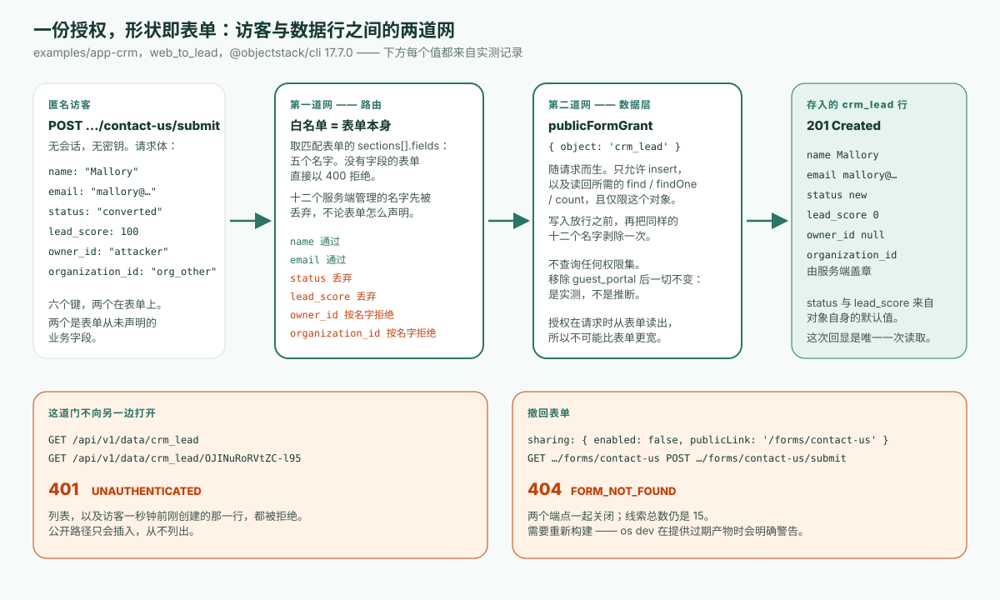

---
# @generated zh-Hant from zh-Hans (s2twp) — edit the zh-Hans file; delete this line to hand-maintain.
title: 怎樣讓匿名訪客把表單提交進一個受治理的業務應用？一道公開的門，五個欄位寬
description: v17 起匿名訪問物件資料一律拒絕。唯一開著的門是公開表單檢視：執行時從表單自身推導授權——建立一行、讀回這一行、五個欄位，僅此而已。在 17.7.0 上實測。
author: ObjectStack Team
date: 2026-10-26
status: published
topic: app-building
audience: business
solutions: []
industries: []
cover: ./cover.svg
tags:
  - 公開表單
  - Web-to-Lead
  - 匿名訪問
---

**先給結論**：從 v17 起，ObjectStack 應用裡任何未經認證的物件資料請求都會被 `401 UNAUTHENTICATED` 拒絕——每個物件、每個端點，沒有例外開關。一個受治理的應用向公眾留下的唯一一道門，是**公開表單檢視**：宣告一個表單，把它的 `sharing` 塊標為 `allowAnonymous: true`，執行時就從這份宣告推匯出訪客的全部授權——在那一個物件上建立一條記錄，讀回它剛建立的那一行，別的什麼都不能做。表單的欄位列表就是安全邊界。CRM 示例的 web-to-lead 表單列了五個欄位，於是五個欄位能進來；其餘八個業務欄位和每一個系統列都進不來，不管訪客發了什麼。我把它稱為**表單形狀的授權**（form-shaped grant）：授權在請求時從表單算出來，所以它不可能被配置得比表單更寬。下文的每一項都在已釋出的 `@objectstack/cli` 17.7.0 上實測，也就是今天 `npm create objectstack@latest` 裝上的版本——包括文件和自帶示例唯一一處說法不一致的問題：到底需不需要一個 `guest_portal` 配置檔案。答案是不需要。

## 問題，用文件自己的話說

ObjectStack 關於公開資料收集的指南，開頭就用使用者的口吻寫下了場景：

> 我想讓匿名訪客提交一個表單——「聯絡我們」「申請演示」或者錄入表單——它會建立一條記錄。但我絕對**不能**把底層資料開放給他們，而且他們只能設定表單上的那些欄位。

每個業務應用都有這麼一張表：網站上的線索表單、支援工單錄入、演示申請、保修申請。常見的幾種做法各有代價。給一個「guest」角色加上對這張表的寫權限，是一份沒人會再讀的常設授權，它會漂移。手寫一個端點，繞開了治理其他一切的權限模型。用第三方表單工具加 webhook，意味著現在有兩套系統各持一份 schema，而審閱者看的不是其中那一份。

從 v17 起，第一種做法根本不存在了。權限文件順帶記錄了原因：「since v17 anonymous access to object data is always denied anyway — the `requireAuth: false` opt-out was retired」（自 v17 起匿名訪問物件資料本來就一律拒絕——`requireAuth: false` 這個退出開關已經退役）。[自託管實操](/en/blog/how-to-self-host-objectstack/)把它變成了一個驗證步驟——不帶憑據 `curl` 一個物件端點，堅持要看到帶機器可讀 `code` 的 `401`——並把那裡出現 `200` 當作事故處理。所以這個問題誠實的問法是：既然資料平面從結構上就對匿名呼叫者關閉，公開表單到底是怎麼進來的？

## 公開表單是一份宣告，不是一條權限

下面是 CRM 示例 web-to-lead 表單的全部內容，照 17.7.0 標籤裡釋出的原樣：

```ts
formViews: {
  web_to_lead: {
    type: 'simple',
    data: { provider: 'object', object: 'crm_lead' },
    sections: [
      {
        name: 'contact_us',
        label: 'Contact us',
        columns: 1,
        fields: [
          { field: 'name', required: true },
          { field: 'company' },
          { field: 'email', required: true },
          { field: 'phone' },
          { field: 'title' },
        ],
      },
    ],
    sharing: {
      enabled: true,
      allowAnonymous: true,
      publicLink: '/forms/contact-us',
    },
  },
},
```

裡面沒有一個字提到權限。開門的是 `sharing` 塊：`enabled`、`allowAnonymous` 和 `publicLink` 三者齊備時，執行時註冊兩個匿名端點——`GET /api/v1/forms/contact-us` 返回解析後的表單和白名單 schema，`POST /api/v1/forms/contact-us/submit` 插入一條 `crm_lead`。文件用一句話規定訪客能寫什麼：「Only the fields listed in `sections[].fields` are accepted on submit; everything else is stripped server-side」（提交時只接受 `sections[].fields` 裡列出的欄位；其餘一切在服務端剝除）。而它給出的這樣設計的理由，正是本文要驗證的那句話：「Authorization is **derived from the declaration**, not configured separately — so the grant can't drift wider than the form」（授權是從宣告推匯出來的，不是單獨配置的——所以授權不可能漂移得比表單更寬）。



從機制上說有兩道網，值得分別起名，因為審閱者可以逐一核對。

**第一道網是路由。** 提交處理器用匹配到的表單的 `sections[].fields` 構建允許列表，只把這些鍵從請求體裡拷出來。在此之前，它按名字丟掉 `PUBLIC_FORM_SERVER_MANAGED_FIELDS` 裡的每一個鍵——這是 spec 包匯出的一個集合：`id`、`owner_id`、`owning_business_unit_id`、`organization_id`、`tenant_id`、`created_at`、`created_by`、`updated_at`、`updated_by`、`is_deleted`、`deleted_at` 和 `__search`——十二個名字，文件說它們「**never** accepted from a public submission — not even when a section declares them」（永遠不從公開提交接受——即使某個分割槽聲明瞭它們也不接受）。一個一個欄位都沒有的表單會以 `400` 拒絕，而不是來什麼收什麼。

**第二道網是資料層。** 路由給這次寫入附上一個隨請求而生的 `publicFormGrant: { object: 'crm_lead' }`，安全外掛只認這個：`insert`，加上讀回所需的 `find`、`findOne` 和 `count`，而且僅限這一個物件。在放行插入之前，它把同樣的十二個名字再剝一次，所以即使某個表單在分割槽裡聲明瞭 `owner_id`，或者路由過濾器和資料層將來被改得不一致，訪客也偽造不了歸屬和租戶位置。這份授權就是表單的形狀，在請求時讀出來。權限表裡沒有一行寫著「匿名可以寫線索」，因為根本沒有什麼可配置的。

## 17.7.0 上的實測記錄

我從 `@objectstack/cli@17.7.0` 標籤取出 `examples/app-crm`，把依賴釘到已釋出的 17.7.0 包，用 `objectstack dev` 啟動。開發伺服器在空資料庫上會播種一個管理員賬號；預置的五條線索歸它所有。下面每個響應都是真實的，只為篇幅做了裁剪。

**1. 這道門會自我描述——五個欄位寬。** 不帶任何憑據：

```bash
curl -s http://localhost:49160/api/v1/forms/contact-us
```

```json
{ "slug": "contact-us", "object": "crm_lead",
  "form": { "sections": [ { "name": "contact_us", "fields": [
      { "field": "name", "required": true }, { "field": "company" },
      { "field": "email", "required": true }, { "field": "phone" }, { "field": "title" } ] } ],
    "sharing": { "enabled": true, "publicLink": "/forms/contact-us", "allowAnonymous": true } },
  "objectSchema": { "name": "crm_lead", "fields": { "name": {}, "email": {}, "phone": {}, "company": {}, "title": {} } } }
```

`objectSchema` 恰好只帶五個白名單欄位。`crm_lead` 的物件定義聲明瞭十三個業務欄位；公開 schema 只顯示五個，對 `status`、`lead_score`、`assigned_to`、`account`、`notes` 和其餘欄位隻字不提。訪客連該試什麼都無從得知。

**2. 一次乾淨的提交建立一行。**

```bash
curl -s -X POST http://localhost:49160/api/v1/forms/contact-us/submit \
  -H 'content-type: application/json' \
  -d '{"name":"Ada Lovelace","email":"ada@example.com"}'
```

```json
HTTP 201
{ "object": "crm_lead", "id": "lY0qNhApoHwyYMtk",
  "record": { "id": "lY0qNhApoHwyYMtk", "name": "Ada Lovelace", "email": "ada@example.com",
    "status": "new", "source": "web", "lead_score": 0, "owner_id": null,
    "organization_id": "org_mvbpxfocznjyqv4e", "created_by": null } }
```

`status: "new"` 並沒有被髮送；它是物件的寫路徑預設值，線索物件宣告它的理由寫得很明確：「so minimal creates (e.g. the public Web-to-Lead form, which doesn't expose status) satisfy `required`」（讓最小化建立——比如不暴露 status 的公開 Web-to-Lead 表單——也能滿足 `required`）。`source: "web"` 和 `lead_score: 0` 同樣是預設值。

**3. 一次惡意的提交建立的是同樣的一行。** 發了六個鍵，兩個在表單上：

```bash
curl -s -X POST http://localhost:49160/api/v1/forms/contact-us/submit \
  -H 'content-type: application/json' \
  -d '{"name":"Mallory","email":"mallory@example.com",
       "status":"converted","lead_score":100,
       "owner_id":"attacker","organization_id":"org_other"}'
```

```json
HTTP 201
{ "record": { "id": "OJINuRoRVtZC-l95", "name": "Mallory", "email": "mallory@example.com",
    "status": "new", "lead_score": 0, "owner_id": null,
    "organization_id": "org_mvbpxfocznjyqv4e" } }
```

以管理員身份讀回，儲存的行一模一樣：兩個白名單欄位到了，兩個不在表單上的業務欄位被丟棄，兩個系統錨點先被丟棄、再由服務端蓋章——`organization_id` 是這個部署自己的組織，不是 `org_other`；`owner_id` 是 `null`。`201` 不會說明哪些鍵被拒絕；路由一聲不響地把它們丟掉。

| 傳送的鍵 | 在表單上？ | 儲存為 | 原因 |
|:--|:--|:--|:--|
| `name`、`email` | 是 | 照發送的值 | 在白名單內 |
| `status: "converted"` | 否 | `"new"` | 不在 `sections[].fields` 裡；物件預設值生效 |
| `lead_score: 100` | 否 | `0` | 不在 `sections[].fields` 裡；物件預設值生效 |
| `owner_id: "attacker"` | 否 | `null` | 服務端管理的名字，兩道網都拒絕 |
| `organization_id: "org_other"` | 否 | 服務端自己的值 | 服務端管理的名字；由執行時蓋章 |

**4. 這道門不向另一邊開啟。** 同一個匿名客戶端，這次來讀：

```bash
curl -s -w '\n%{http_code}\n' http://localhost:49160/api/v1/data/crm_lead
curl -s -w '\n%{http_code}\n' http://localhost:49160/api/v1/data/crm_lead/OJINuRoRVtZC-l95
```

```json
{"error":"UNAUTHENTICATED","code":"UNAUTHENTICATED","message":"Authentication is required to access this endpoint."}
401
```

兩個都答 `401`——列表，以及訪客一秒鐘前剛建立的那一行。`201` 的響應體是提交者唯一一次看到這條記錄的機會。「The public path only ever **inserts**; it never lists」（公開路徑只會插入，從不列出）。

**5. 撤回表單會同時關閉兩個端點。** 保留 `publicLink`，把 `enabled` 設為 `false`，重新構建，重啟：

```json
GET  /api/v1/forms/contact-us         → 404 {"code":"FORM_NOT_FOUND","error":"No public form configured at /forms/contact-us"}
POST /api/v1/forms/contact-us/submit  → 404 {"code":"FORM_NOT_FOUND","error":"No public form configured at /forms/contact-us"}
```

以管理員身份讀到的線索總數前後都是 15。四個狀態碼講完了這道門的全部故事：`201`、`201`、`401`、`404`。

## 哪個說法在承重：guest 配置檔案，還是宣告？

在這裡文件和自帶示例說法不一，而我不想靠讀程式碼來選邊。指南說：「Declare a public form view; the submit route derives a narrow authorization from that declaration. No `guest` profile, no broad grant」（宣告一個公開表單檢視；提交路由從這份宣告推導一份窄授權。不需要 `guest` 配置檔案，不需要寬泛授權）。CRM 示例卻附帶了一個 `GuestPortalProfile`——一個名為 `guest_portal` 的權限集，在 `crm_lead` 上 `allowCreate: true`，其餘位全為 false——表單上方的註釋說「`sharing.allowAnonymous` 開啟公開端點；`guest_portal` 配置檔案（對 crm_lead 僅 INSERT）授權這次寫入」。執行時自己在 17.7.0 的原始碼裡，相隔幾百行同時持有兩種說法：路由的文件註釋說安全「委託給執行上下文上攜帶的 `guest_portal` 權限集」，並警告沒有它中介軟體會「fall open」（失守放行）；而緊接其後的處理器程式碼說公開表單「work under secure-by-default (anonymous-deny) WITHOUT a deployment-configured `guest_portal`」（在預設安全、拒絕匿名的姿態下，無需部署配置 `guest_portal` 也能工作），把這個配置檔名留在上下文裡只是「for back-compat with object hooks」（為了與物件鉤子向後相容）。

於是我把 `GuestPortalProfile` 從 stack 的 `permissions` 裡刪掉，重新構建。第一件發生的事是構建拒絕了：

```text
✗ Access matrix drift (1 change) — capability changes must be reviewed
• 'guest_portal' loses ALL access to 'crm_lead' (entry removed)
  If intended, re-run with --update-access-matrix and commit the snapshot — its diff IS the review artifact.
```

這道門禁是另一個話題；在這裡它是一句令人安心的旁白——一個權限集的消失被當作需要審閱的變更，哪怕這個集合最後被證明什麼都不幹。我接受了這次漂移，確認編譯出的工件裡只剩一個權限集而不是兩個，然後把四個探測重新跑了一遍。

| 探測 | 有 `guest_portal` | 沒有 `guest_portal` |
|:--|:--|:--|
| 帶 `name`、`email` 的 `POST …/submit` | `201`，建立一行 | `201`，建立一行 |
| 夾帶 `status`、`owner_id`、`organization_id` 的 `POST …/submit` | `201`；`status: "new"`、`owner_id: null`、服務端的 `organization_id` | 完全相同 |
| 匿名 `GET /api/v1/data/crm_lead` | `401 UNAUTHENTICATED` | `401 UNAUTHENTICATED` |
| 匿名 `GET` 剛建立的那一行 | `401 UNAUTHENTICATED` | `401 UNAUTHENTICATED` |

逐行一致。在 17.7.0 上，承重的是宣告，這個配置檔案在這條路徑上是惰性的。實際意義是：不要為了讓公開表單工作而新增 guest 配置檔案。它給你的訪問矩陣加了一份公開之門從不查詢的常設授權，還向下一位審閱者——不管是人還是 Agent——講了一個執行時並不認同的「邊界在哪裡」的故事。示例裡的那條註釋對 17.7.0 來說是錯的，我已經如實上報；在它改掉之前，讀指南，別讀註釋。

示例和指南還有一處分道揚鑣：指南的第三步是「Set `sharingModel: 'private'` on the object so submissions are staff-scoped after creation」（把物件的 `sharingModel` 設為 `'private'`，讓提交在建立後只對內部人員可見），而 CRM 的線索物件刻意用了 `public_read_write`，註釋解釋說這個演示有意按組織共享。這不會削弱這道門——組織級預設值管的是**已登入**使用者彼此能看到多少行，匿名呼叫者在那之前就已經被拒絕——但對你自己的錄入物件，這條建議值得照做。

## 這道門做不到的事

- **沒有限流、沒有驗證碼、沒有反垃圾。** 公開表單路徑沒有任何相關文件，我也沒有找到任何實現：本文的探測在沒有任何憑據的情況下建立了十條線索，執行時既沒有計數也沒有減速。把常規的邊緣防護放在 `/api/v1/forms/*` 前面；執行時守的是寫進去什麼，不是寫得多頻繁。
- **表單上的 `required` 在公開提交時不被強制。** web-to-lead 表單把 `email` 標為必填；不帶它的 `POST` 答 `201`，`email: null`。物件上的 `required` 會被強制——不帶 `name` 的 `POST` 答 `400 VALIDATION_FAILED`，附「Lead Name is required」。如果一個欄位必須存在，就在物件上要求它，或者在鉤子裡檢查；在這條路徑上，表單的標記只是渲染提示。
- **`201` 回顯整行。** 授權允許的讀回就是訪客建立的那一行，包括服務端蓋章的值和預設值——`organization_id` 也在其中。我的這次沒有任何敏感內容。如果你的錄入物件帶有預設值有實際含義的內部欄位，就假定提交者會看到它們一次。
- **所有者是「無人」。** 公開提交的 `owner_id` 保持 `null`；安全外掛把它留給「object hooks / the first-admin bootstrap to assign」（物件鉤子或首位管理員引導流程來分配）。如果你的流程要分派線索，在鉤子或流程裡做——別指望這一行天然屬於某個人。
- **撤回需要重新構建——忘了的話 `os dev` 會提醒你。** 我第五步的第一次嘗試什麼都沒變，因為 `objectstack dev --no-watch` 提供的是上一次的 `dist/objectstack.json`，並在日誌第五行明說了：「dist/objectstack.json is OLDER than your sources — this boot serves the STALE build」（dist/objectstack.json 比你的原始碼舊——本次啟動提供的是過期構建）。它列印的修法有效。我提這件事，是因為一個只讀狀態碼的 Agent 驅動迴圈會得出「這個開關不起作用」的結論。
- **跨後設資料層的撤回有本文沒走到的邊緣。** 組織儲存的檢視副本、包隨附的表單，在指南中各有規則。這裡測的單個開關，是大多數應用需要的那一個。

## 審閱者的五個問題

不管表單是人寫的還是 Agent 寫的，審閱是一樣的，而且很短，因為授權就是表單。

1. **哪些表單是公開的？** 每一個 `sharing.enabled`、`sharing.allowAnonymous` 和 `publicLink` 三者齊備的表單檢視都是一個匿名端點。編譯出的工件列出了它們；沒有別的地方可查。
2. **`sections[].fields` 裡有什麼？** 這份列表減去十二個服務端管理的名字，就是公開寫入面。像讀防火牆規則那樣讀它。
3. **物件會補上表單沒收的東西嗎？** 表單不收集的每一個必填欄位都需要物件級預設值——示例裡的 `status`——否則提交失敗。而每一個必須存在的欄位，`required` 要寫在物件上，不是表單上。
4. **哪裡有常設的匿名授權嗎？** 繫結到 `guest` 或 `everyone` 崗位的權限集，或者「為了讓表單工作」而新增的 `guest_portal` 集合，既不需要，也不會拓寬這道門用到的任何東西。把它的存在當成一個問題。
5. **門前有什麼？** 限流和機器人防護是部署的工作。

這和[Agent 權限在哪裡被強制](/zh-Hant/blog/objectos-agent-permission-boundaries/)是同一個「在何處執行」的論證，只是套在一個完全沒有身份的呼叫者身上：檢查在路由和資料層裡跑，而不是在恰好把欄位藏起來的 UI 裡。它也是[那篇 Lovable 文章](/zh-Hant/blog/is-lovable-safe-for-production/)描述的審閱難題的答案——負責任的所有者能讀懂五行欄位列表並簽字，這對一份生成出來的策略可做不到。術語表裡的[權限模型](/zh-Hant/glossary/permission-model/)條目有總體的形狀；這道門是「預設拒絕」唯一一個有意為之的例外，而它的形狀就是表單。

## 把你的 Agent 指向它

如果你的應用由 Agent 來寫，該交給它的不是這篇文章，而是這條規則：公開表單是一個帶 `sharing` 塊的 `formViews` 條目，欄位列表就是邊界，預設值和必填由物件負責，不涉及任何權限集。[為 ObjectStack 配置編碼 Agent 的指南](/en/blog/how-to-point-your-agent-at-objectstack/)講了這條規則如何到達 Agent——規則檔案、執行中的應用暴露的 MCP 端點，以及 spec。`npm create objectstack@latest` 裝的是 17.7.0，正是這份記錄執行的版本。

想把同一個迴圈託管起來、在瀏覽器裡用、什麼都不用安裝？那就是 ObjectOS——建立在 ObjectStack 之上的商業執行環境。
