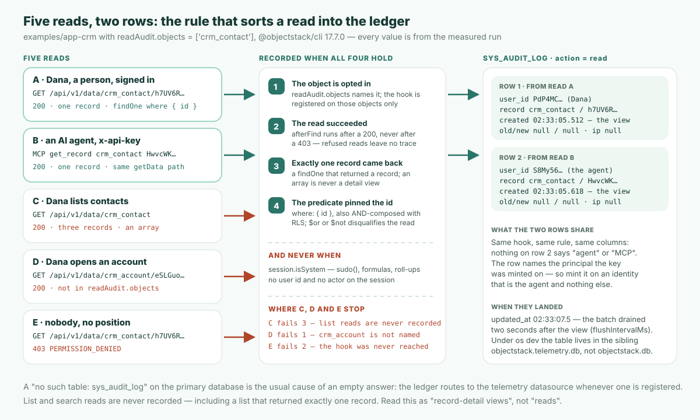

두 행. "오늘 오후 Ada Lovelace와 Linus Torvalds의 연락처 레코드를 누가 열었는가"라는 질문에 대한 답은 그게 전부입니다. `@objectstack/cli` 17.7.0에서 돌아가는 CRM의 원장은 이렇게 돌려줍니다.

| `created_at` | `action` | `user_id` | `object_name` | `record_id` | `old_value` | `new_value` | `ip_address` |
| --- | --- | --- | --- | --- | --- | --- | --- |
| `02:33:05.512Z` | `read` | `PdP4MC…` (영업 담당 Dana, REST) | `crm_contact` | `h7UV6R…` (Ada) | `null` | `null` | `null` |
| `02:33:05.618Z` | `read` | `S8My56…` (에이전트의 API 키, MCP) | `crm_contact` | `HwvcWK…` (Linus) | `null` | `null` | `null` |

다섯 번의 읽기가 이 두 행을 만들었습니다. 사람이 REST API로 연락처 하나를 열었고, AI 에이전트가 자기 API 키로 MCP `get_record`를 통해 다른 하나를 가져왔고, 같은 사람이 전체 연락처를 목록으로 조회했고, 거래처 하나를 열었으며(이 배포가 옵트인하지 않은 객체), 직위가 전혀 없는 사용자가 연락처를 열려다 `403`을 받았습니다. 목록, 거래처, 거부는 아무것도 남기지 않았습니다. 이것이 이 글이 끝까지 측정해 옹호하는 주장입니다. **ObjectStack의 레코드 조회 감사는 사람과 에이전트를 가리지 않고 누가 어떤 레코드를 언제 열었는지 기록하며, 그 범위는 기록하지 않는 것이 기록하는 것만큼 또렷이 읽힐 만큼 좁게 선언되어 있다.** 기억할 개념은 **발견되는 경계가 아니라 선언된 경계**입니다. 경계가 적혀 있는 컴플라이언스 기능은 감사 도중에 경계를 찾아내야 하는 기능보다 낫습니다.

## 권한 계층이 답하지 못하는 질문

모든 권한 계층은 *이 레코드를 누가 볼 수 있는가*에 답합니다. 객체 권한, 행 수준 보안, 필드 마스킹. 규제 산업의 검토는 그 다음 질문에서 시작합니다. ObjectStack의 레코드 조회 감사 문서는 두 번째 문장에서 그렇게 말합니다. 이 페이지는 "그 뒤에 오는 질문, 그리고 모든 규제 산업 검토가 첫머리에 던지는 질문에 답한다: **실제로 누가 그것을 열었고, 언제인가?**" (17.7.0 태그의 `content/docs/permissions/record-view-auditing.mdx` 8–9행).

이 블로그의 [EU AI Act 글](/ko/blog/eu-ai-act-runtime-audit/)은 감사인이 정책 문서가 아니라 *하나의* 행위에 대한 기록을 요구한다고 논했습니다. [권한 경계 글](/en/blog/objectos-agent-permission-boundaries/)은 검사가 *어디서* 실행되는지에 관한 것이었습니다. 둘 다 읽기는 다루지 않았습니다. 읽기는 아무것도 바꾸지 않는 유일한 행위이고, 따라서 알아채도록 만들어진 무언가가 없으면 아무것도 남기지 않습니다. ObjectStack에서 그 무언가는 `sys_audit_log`의 `read` 액션이며, `@objectstack/plugin-audit`가 `afterFind` 훅에서 씁니다. 같은 원장에는 라이프사이클 훅에서 오는 `create` / `update` / `delete` 행과 `services.audit` 슬롯을 통한 `login` / `logout` 행도 실립니다. 조회 행은 세 번째 면이고, 기본적으로 꺼져 있는 유일한 면입니다.

## 켜는 방법은 생성자 인수 하나뿐이다

감사 대상 집합은 플러그인이 설치되는 곳에서 한 번만 줍니다. CLI로 띄우는 앱에서 그곳은 스택의 `plugins` 배열입니다. 아래에서 쓴 CRM 예제에 필요한 변경은 둘뿐이었습니다. `pnpm add @objectstack/plugin-audit@17.7.0`, 그리고 `objectstack.config.ts`에 이것:

```ts
import { AuditPlugin } from '@objectstack/plugin-audit';

export default defineStack({
  // …manifest, objects, views, permissions…
  plugins: [
    new AuditPlugin({ readAudit: { objects: ['crm_contact'] } }),
  ],
});
```

`readAudit`는 정확히 세 키를 받습니다. `objects`(객체별 닫힌 옵트인, 기본은 빈 목록), `maxBatchSize`(기본 50), `flushIntervalMs`(기본 2000). 빈 목록은 "훅을 전혀 등록하지 않으므로" 아무것도 옵트인하지 않은 배포는 읽기 경로에서 아무 비용도 치르지 않습니다.

의도적으로 없는 것이 있는 것보다 더 중요합니다. 문서는 굵게 적습니다. "**객체 메타데이터 키도, 환경 변수도 없다.**" `enable.auditReads`는 존재하지 않고, 스택 설정의 `audit:` 블록이 객체를 지명하지도 않으며, `requires: ['audit']`는 플러그인을 부팅 필수 조건으로 만들 뿐 "옵션 없이 플러그인을 구성하고 객체를 지명할 자리를 어디에도 주지 않습니다". 제시된 이유가 바로 이 글을 설정 노트가 아닌 거버넌스 글로 만듭니다. 선언 가능한 키는 "이 플러그인을 한 번도 설치하지 않은 배포의 객체에도 설정될 수 있어, 감사된 것처럼 *읽히지만* 아무것도 기록하지 않는 메타데이터를 만든다. 컴플라이언스 면에서, 검토자가 커버리지로 오인하는 선언은 기능이 없는 것보다 더 나쁘다."

이 형태는 CLI에서 눈에 보이는 결과 하나를 낳습니다. `os serve`와 `os dev`는 당신의 `plugins`를 순회하기 전에 옵션 없는 자체 `AuditPlugin`을 자동 등록하고, 같은 이름의 나중 등록이 먼저 것을 대체합니다. 측정한 실행의 부팅 로그에는 옵트인이 적용됐음을 증명하는 줄이 있습니다.

```text
WARN Plugin superseded: 'com.objectstack.audit' — the later registration (v1.0.0)
REPLACED the earlier one (v1.0.0). Only the later instance is initialized and
started; the earlier one is discarded without ever running init().
```

문서는 이 줄이 "**옵트인이 작동하는 것**이지 잘못된 설정이 아니다"라고 명시합니다. 그리고 이것이 부팅 시점에 얻는 유일한 신호이기도 합니다. 17.7.0에서 "record-view auditing installed on N object(s)" 줄은 `info` 수준으로 기록되어 dev 서버의 기본 `warn` 수준 아래이므로, 기본 부팅에서 보이는 것은 superseded 경고입니다.

## 다섯 번의 읽기, 두 행

앱은 ObjectStack 저장소의 태그 `@objectstack/cli@17.7.0`에 있는 `examples/app-crm`으로, 모든 `@objectstack/*` 의존성을 게시된 17.7.0 패키지에 고정하고 위의 `plugins` 항목을 추가했습니다. `objectstack dev --compile --no-watch`로 시작해 오래된 `dist/objectstack.json`을 제공하는 대신 이 부팅에서 아티팩트를 컴파일하게 했습니다. 관리자 API로 계정 셋을 만들었습니다. `sales_rep` 직위를 가진 사람 Dana, AI 에이전트의 API 키를 발급받는 신원 `agent-svc`(역시 `sales_rep`), 그리고 직위가 전혀 없는 `nobody`. 예제의 권한 집합에서 `sales_rep` 직위는 `crm_contact: { allowRead: true, … }`를 가지므로 Dana와 에이전트는 연락처를 읽을 수 있고 `nobody`는 읽을 수 없습니다.

읽기 전, 원장 조회는 빈 페이지를 돌려줍니다.

```bash
curl -s -b admin.cookies 'http://localhost:49200/api/v1/data/sys_audit_log?filter={"action":"read"}'
```

```json
{ "object": "sys_audit_log", "records": [], "total": 0, "hasMore": false }
```

그리고 순서대로 다섯 번의 읽기.

| # | 누가 | 읽기 | 응답 | 행? |
| --- | --- | --- | --- | --- |
| A | Dana, 로그인 상태 | `GET /api/v1/data/crm_contact/h7UV6R…` | `200`, Ada의 레코드 | **있음** |
| B | 에이전트, `x-api-key: osk_…` | MCP `tools/call` `get_record` `{ objectName: "crm_contact", recordId: "HwvcWK…" }` | `200`, Linus의 레코드 | **있음** |
| C | Dana | `GET /api/v1/data/crm_contact` | `200`, 레코드 3건 | 없음 |
| D | Dana | `GET /api/v1/data/crm_account/eSLGuo…` | `200`, Acme의 레코드 | 없음 |
| E | `nobody` | `GET /api/v1/data/crm_contact/h7UV6R…` | `403 PERMISSION_DENIED` | 없음 |

에이전트의 호출은 앱의 `/api/v1/mcp` 엔드포인트에 대한 평범한 MCP 요청이며, 키만으로 인증됩니다.

```bash
curl -s -X POST http://localhost:49200/api/v1/mcp -H "x-api-key: $KEY" \
  -H 'content-type: application/json' -H 'accept: application/json, text/event-stream' \
  -d '{"jsonrpc":"2.0","id":3,"method":"tools/call","params":{"name":"get_record",
       "arguments":{"objectName":"crm_contact","recordId":"HwvcWKZh3n1TM55l"}}}'
```

```json
{ "result": { "content": [ { "type": "text",
  "text": "{ \"id\": \"HwvcWKZh3n1TM55l\", \"first_name\": \"Linus\", \"last_name\": \"Torvalds\", \"email\": \"linus@globex.example\", … }" } ] },
  "jsonrpc": "2.0", "id": 3 }
```

5초 뒤, 2 000 ms 플러시 간격이 지난 후 관리자로 같은 원장 조회를 보내면 이 글 맨 위의 정확히 그 두 행, `"total": 2`가 돌아옵니다.



이들을 가르는 규칙은 두 조건이며, 둘 다 문서에 있고 둘 다 측정 결과에 보입니다. 읽기는 "정확히 한 레코드를 실체화했고" "술어가 기본 키를 고정했을" 때 기록됩니다. `GET /data/:object/:id`는 엔진에 `findOne(object, { where: { id } })`로 도달합니다. MCP `get_record` 도구도 마찬가지로, HTTP 전송에서는 같은 데이터 프로토콜과 같은 `getData` 경로로 해석됩니다. 읽기 C는 첫 조건을 통과하지 못합니다(배열은 "결코 상세 조회가 아니므로 `find`는 해당하지 않는다"). 읽기 D는 규칙에 거부된 것이 아니라, `crm_account`가 그저 `readAudit.objects`에 없고 훅은 지명된 객체에만 등록되기 때문입니다. 읽기 E는 훅에 도달한 적이 없습니다. 그 요청의 서버 로그에는 `Access denied: operation 'findOne' on object 'crm_contact' is not permitted for positions [org_member, everyone]`이 적혀 있고, "`afterFind` 훅에는 성공한 읽기만 도달합니다".

이 글의 기획 카드는 술어 규칙으로부터의 추론으로 에이전트의 `get_record`가 해당*해야 한다*고 예측했습니다. 17.7.0에서 실제로 해당하며, 증거는 B행입니다.

## 조회 행이 기록하는 것

측정한 행을 문서의 열 표에 대조하면:

| 열 | 문서 | 측정값 (B행, 에이전트) |
| --- | --- | --- |
| `action` | `read` | `read` |
| `created_at` | "레코드가 **조회된** 순간이지, 배치가 비워진 순간이 아니다" | `02:33:05.618Z`; 행의 `updated_at`은 `02:33:07.513Z`, 2초 뒤의 기록 |
| `user_id` | "그것을 연 `sys_user` 주체" | `S8My5629…`, 키가 발급된 신원 |
| `actor` | "주체 레이블, `user_id`로 폴백" | `S8My5629…`, 폴백 값 |
| `object_name` / `record_id` | 열린 객체와 레코드 | `crm_contact` / `HwvcWKZh3n1TM55l` |
| `tenant_id` / `organization_id` | "**조회된 레코드** 자신의 조직, 조회자의 세션 조직으로 폴백" | 조회자의 `org_mvbs…`, 시드된 연락처의 `organization_id`가 `null`이므로 |
| `old_value` / `new_value` | "항상 `null`" | `null` / `null` |

이 표의 두 세부 사항이 감사인에게 무게를 가집니다. 타임스탬프는 조회이지 기록이 아니므로, 느린 원장이 사건의 시각을 옮기지 못합니다. 테넌트 스탬프는 조회자가 아니라 레코드를 따릅니다. 문서의 이유는, 조직 A의 레코드에 관한 행에 조회자의 조직 B를 찍으면 "조직 B의 테넌트 벽 뒤에 떨어져, 그 행이 관련된 유일한 테넌트 관리자에게 보이지 않게 된다"는 것입니다.

## 조회 행이 결코 기록하지 않는 네 가지

커버리지 매트릭스가 틀리기 쉬운 절반이고, 문서가 한 절을 통째로 쓰는 절반입니다. 넷 모두 측정한 행에서 관찰되었습니다.

1. **필드 값은, 결코.** `old_value`와 `new_value`는 `null`로 남습니다. 훅은 "보안 미들웨어 *안에서*, **필드 마스킹보다 앞서** 실행되므로, 보는 레코드는 마스킹 전 평문"입니다. 값을 복사해 넣으면 "필드 수준 보안이 가리는 바로 그것의 평문 사본을, 컴플라이언스 담당자가 폭넓은 접근을 부여받는 유일한 테이블 안에 찍어내게" 됩니다. 원장은 의도적으로 조회자보다 적게 압니다.
2. **조회자가 실제로 본 것이 아니다.** 첫째에서 따라옵니다. 행은 레코드가 열렸다고 말할 뿐, 마스킹 후 어떤 필드가 보였는지는 결코 말하지 않습니다. "이 사람이 어떤 열을 봤는가"를 요구하는 통제라면, 이 면은 답하지 않습니다.
3. **IP 주소도 user agent도 없다.** 두 열 모두 `sys_audit_log`에 존재하고, 두 행에서 모두 `null`입니다. 그것들은 `login`과 `logout` 행에 찍히지, 조회 행에는 찍히지 않습니다. A행과 B행이 똑같아 보이는 이유도 이것입니다. 원장은 **주체**를 기록하지 채널을 기록하지 않습니다. 에이전트의 행에는 "MCP", "API 키", "에이전트"라고 말하는 것이 아무것도 없고, 키가 속한 사용자 `S8My5629…`만 있습니다.
4. **거부되거나 실패한 읽기에 대해서는 아무것도.** 읽기 E가 증거입니다. 거부된 읽기는 "여기에 흔적을 남기지 않습니다". 남긴 흔적은 서버 로그의 `WARN [Security] Access denied` 줄이며, 그것은 다른 면, 다른 보존 기간입니다.

두 가지 경계가 더 있는데, 발견에 맡겨지지 않고 선언되어 있습니다. 시스템 승격 읽기는 행을 쓰지 않습니다. `session.isSystem`을 지닌 것, 예를 들어 `api.sudo()` 경로, 수식 재계산, 롤업은 "플랫폼이 자기 장부를 위해 읽는 것이지, 사람이 레코드를 여는 것이 아니며", `sudo()`는 호출자의 사용자 id를 유지하므로 이 플래그만이 둘을 가릅니다. 주체가 없는 읽기도 행을 쓰지 않습니다. "아무도 지명하지 않는 행은 이 기능이 존재하는 이유인 그 하나의 조회에 잡음만 보탤" 뿐이기 때문입니다.

## "AI 에이전트까지 포함해"의 뜻은, 당신이 준 신원으로서

B행은 조건을 하나 달고 제목의 질문에 답합니다. 에이전트의 열기는 Dana의 것과 같은 원장에, 같은 훅을 거쳐, 같은 두 조건 규칙 아래 실렸습니다. `get_record`가 호출자의 주체 아래에서 id로 하는 `findOne`이기 때문입니다. 설정할 에이전트 전용 감사 경로도 없고, 잊어버릴 것도 없습니다.

조건은 위의 3번입니다. 행은 주체를 지명하므로, 원장이 에이전트에 대해 증명할 수 있는 것은 그 키가 발급된 신원만큼만 좋습니다. 17.7.0의 MCP 연결 가이드는 그 선택을 명료하게 말합니다. "전권을 가진 로컬 에이전트라면 플랫폼 관리자나 전용 **서비스** 신원으로 키를 발급하고, 범위가 한정된 에이전트라면 가져야 할 접근 권한을 정확히 가진 사용자로 발급하라." 에이전트의 키를 어떤 사람의 계정으로 발급하면, 원장은 그 사람이 레코드를 열었다고 사실대로 보고합니다. 측정한 실행은 에이전트이기 위해서만 존재하는 사용자 `agent-svc`로 발급했고, 그래서 B행이 에이전트에 귀속될 수 있었습니다. 이것은 프로비저닝 결정이지 감사 기능이 아니며, 이 글이 당신에게 요청하는 유일한 결정입니다.

## 행은 어디에 있고, 어떻게 실패하는가

`os dev` 아래에서 `sys_audit_log`는 애플리케이션 데이터베이스에 있지 않습니다. 그 `audit` 라이프사이클 클래스는 `telemetry` 데이터소스가 등록되어 있으면 언제나 그리로 라우팅하며, dev 서버는 "기본적으로 하나를 형제 SQLite 파일로 준비합니다". 측정한 실행의 두 파일을 앱 자체의 SQLite 드라이버로 열면:

```text
objectstack.db            -> no such table: sys_audit_log
objectstack.telemetry.db  -> [{"action":"create","n":40},{"action":"login","n":5},
                              {"action":"read","n":2},{"action":"update","n":4}]
```

`read` 행은 맨 위 표의 두 행입니다. 행이 있어야 할 곳에서 감사 조회가 비어 돌아온다면 이 분리가 보통의 원인이며, 플러그인 자신의 실패 메시지도 그렇게 말합니다. 원장 쓰기에서의 "no such table"은 "보통 쓰기가 테이블이 만들어진 데이터소스와 다른 데이터소스에 대해 실행되었음을 뜻합니다".

의존하기 전에 알아야 할 다른 하나는 실패 자세입니다. 훅은 "큐에 넣고 돌아갑니다". 아무것도 기다리지 않으며, 감사 실패가 유효한 읽기를 오류로 바꾸는 일은 결코 없습니다. 행은 나중 틱에, `maxBatchSize`만큼의 조회가 버퍼되거나 배치의 첫 조회 이후 `flushIntervalMs`가 지났을 때 저장되고, `destroy()`는 정상 종료 시 남은 것을 비웁니다. 버퍼 넘침(고정 상한 10 000건을 넘으면 가장 오래된 것부터 버리고 프로세스당 한 번 경고)도, 원장 쓰기 실패(그 배치는 유실, 원인당 한 번 보고)도 재시도되지 않습니다. 문서 자신의 경고가 런북에 넣을 문장입니다. 두 실패는 "다른 어디에서도 보이지 않는다. 읽기 자체는 성공했고 200을 돌려줬다 … 결과 조회는 자신만만하고, 틀리고, **짧은** 답을 돌려준다."

## 이것이 해결하지 않는 것

- **목록과 검색 읽기는 결코 기록되지 않는다.** "우연히 정확히 한 레코드를 돌려준 목록 읽기를 포함해". 읽기 C가 측정값입니다. 커버리지 매트릭스는 "이를 '읽기'가 아니라 '레코드 상세 조회'로 읽어야 합니다". 목록 내보내기, 보고서 실행, 그리드 페이지 넘기기는 여기에 아무것도 남기지 않습니다.
- **조회자의 화면은 원장에 없다.** 행은 열었음을 증명하지, 본 것을 증명하지 않습니다.
- **원장의 귀속성은 당신의 신원만큼만 좋다.** 다시 3번입니다. 공유 키와 개인 계정으로 발급한 키는 행을 참이면서 동시에 쓸모없게 만듭니다.
- **추적을 읽는 것 자체가 게이트된다.** Dana 자신의 `sys_audit_log?filter={"action":"read"}` 조회는 `403 PERMISSION_DENIED`였습니다. 시스템 컨텍스트 밖에서 호출자는 자신이 읽을 수 있는 레코드의 조회 행만 제공받으며, 예외는 `view_all_audit_log` 권한 보유자입니다. 플랫폼 관리자는 기본으로 갖고, 다른 사람은 권한 집합을 통해서만 갖습니다. 행은 90일간 핫으로 보존되고 `archive` 데이터소스가 등록된 곳에서는 7년간 보관됩니다. Setup 앱에서는 플러그인이 Diagnostics 아래에 **Record Views** 목록을 제공하며, ObjectOS에서 그 면은 [읽기 전용이며 불변](https://docs.objectos.ai/docs/operate/audit-logs)으로 문서화되어 있습니다.

*요구사항*으로서 이 중 어느 것도 ObjectStack 고유가 아닙니다. 에이전트가 읽는 어떤 기록 시스템에도 이만큼 경계가 명시된 [조회 추적](/en/glossary/audit-trail/)이 필요합니다. 이 블로그의 [사고 글](/ko/blog/when-ai-agent-deletes-production-database/)은 쓰기 쪽에서 프롬프트보다 런타임 가드레일을 주장했습니다. 읽기 쪽은 같은 모양에 폭발 반경은 더 작고 기억은 더 깁니다.

## 에이전트를 여기로 향하게 하라

에이전트가 당신의 앱을 쓴다면, 고객 데이터를 가진 모든 객체에 대해 설정된 `AuditPlugin`을 `plugins`에 추가하고 같은 일을 한다고 주장하는 메타데이터 키는 거부하도록 요청하십시오. 17.7.0에는 그런 키가 없기 때문입니다. 그런 다음 diff를 검토하십시오. import 하나와 배열 항목 하나입니다. 에이전트가 당신의 앱을 *운영*한다면, 그 키를 에이전트이고 그 외 아무것도 아닌 신원으로 발급하고, 누군가 묻기 전에 첫날 위의 원장 조회를 실행하십시오.

```bash
npm create objectstack@latest my-app && cd my-app
pnpm add @objectstack/plugin-audit
# new AuditPlugin({ readAudit: { objects: ['…'] } })를 plugins에 추가한 뒤
npx os dev --compile
```

레코드 하나를 열고, 2초 기다리고, `action: read`로 `sys_audit_log`를 조회하십시오. 행 하나, 값은 없음.

같은 루프를 호스팅으로, 브라우저에서, 아무것도 설치하지 않고 쓰고 싶다면? 그것이 ObjectOS, ObjectStack 위에 구축된 상용 런타임 환경입니다.
