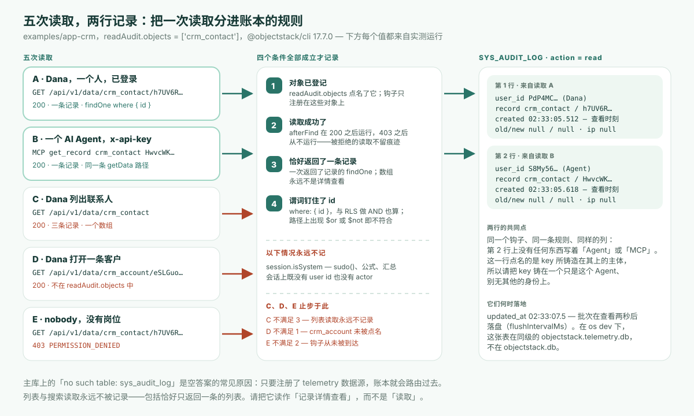

---
# @generated zh-Hant from zh-Hans (s2twp) — edit the zh-Hans file; delete this line to hand-maintain.
title: 能證明是誰打開了一條客戶記錄嗎——包括 AI Agent？記錄檢視審計，以及一行檢視記錄永遠不記的四件事
description: 在 @objectstack/cli 17.7.0 上，一個人經 REST 的讀取和一個 Agent 經 MCP get_record 的讀取各在 sys_audit_log 中留下一行 read；列表讀取、未登記的物件、被拒絕的讀取一行都沒有。這一行記了什麼，永遠不記哪四件事。
author: ObjectStack Team
date: 2026-10-26
status: published
topic: governance
audience: it
solutions: []
industries: []
cover: ./cover.svg
tags:
  - 審計追蹤
  - 記錄檢視審計
  - AI Agent
  - 合規
---

兩行。這就是「今天下午誰開啟過 Ada Lovelace 和 Linus Torvalds 的聯絡人記錄」這個問題的完整答案——一個跑在 `@objectstack/cli` 17.7.0 上的 CRM，它的賬本是這樣返回的：

| `created_at` | `action` | `user_id` | `object_name` | `record_id` | `old_value` | `new_value` | `ip_address` |
| --- | --- | --- | --- | --- | --- | --- | --- |
| `02:33:05.512Z` | `read` | `PdP4MC…`（Dana，一名銷售代表，經 REST） | `crm_contact` | `h7UV6R…`（Ada） | `null` | `null` | `null` |
| `02:33:05.618Z` | `read` | `S8My56…`（一個 Agent 的 API key，經 MCP） | `crm_contact` | `HwvcWK…`（Linus） | `null` | `null` | `null` |

五次讀取，產出這兩行。一個人通過 REST API 打開了一條聯絡人；一個 AI Agent 用自己的 API key 通過 MCP `get_record` 取了另一條；同一個人隨後列出了全部聯絡人；又打開了一條客戶（一個該部署沒有登記的物件）；一個沒有任何崗位的使用者試圖開啟一條聯絡人，得到 `403`。列表、客戶和被拒絕的那次，什麼都沒留下。這就是本文要端到端實測併為之辯護的論斷：**ObjectStack 的記錄檢視審計記錄的是誰在何時打開了哪條記錄，對人和 Agent 一視同仁；而且它的範圍宣告得足夠窄，以至於它不記什麼和它記什麼一樣清楚可讀**。值得記住的概念是**邊界靠宣告，而不是靠發現**：一個把邊界寫明白的合規功能，勝過一個要等審計時才摸清邊界的功能。

## 權限層回答不了的那個問題

每一層權限都在回答*誰可以看這條記錄*：物件授權、行級安全、欄位遮蔽。受監管行業的審查從下一個問題開始。ObjectStack 自己關於記錄檢視審計的文件第二句話就這麼說：這一頁「回答的是緊隨其後的那個問題，也是每一次受監管行業審查開篇就問的問題：**到底是誰打開了它，什麼時候？**」（17.7.0 標籤上的 `content/docs/permissions/record-view-auditing.mdx` 第 8–9 行）。

本部落格的[《EU AI Act》一文](/zh-Hant/blog/eu-ai-act-runtime-audit/)論證過，審計員要的是*一個*動作的記錄，而不是一份政策檔案。[《權限邊界》一文](/zh-Hant/blog/objectos-agent-permission-boundaries/)講的是檢查發生在*哪裡*。兩篇都沒有涉及讀取。讀取是唯一一種什麼都不改、因此除非專門有東西去留意否則什麼痕跡都不留的動作；在 ObjectStack 上，這個「東西」就是 `sys_audit_log` 中的 `read` 動作，由 `@objectstack/plugin-audit` 從一個 `afterFind` 鉤子寫入。同一本賬本還承載著來自生命週期鉤子的 `create`、`update`、`delete` 行，以及經 `services.audit` 槽位進入的 `login` / `logout` 行；檢視行是第三個面，也是唯一預設關閉的那一個。

## 開啟它是一個構造引數，別無他處

被審計的物件集合只給一次，在外掛被安裝的地方。對於由 CLI 啟動的應用，這個地方就是 stack 的 `plugins` 陣列。下文用到的 CRM 示例只需要兩處改動：`pnpm add @objectstack/plugin-audit@17.7.0`，以及在 `objectstack.config.ts` 中加上：

```ts
import { AuditPlugin } from '@objectstack/plugin-audit';

export default defineStack({
  // …manifest、objects、views、permissions…
  plugins: [
    new AuditPlugin({ readAudit: { objects: ['crm_contact'] } }),
  ],
});
```

`readAudit` 恰好接受三個鍵：`objects`（封閉的按物件登記，預設為空）、`maxBatchSize`（預設 50）和 `flushIntervalMs`（預設 2000）。空列表「根本不註冊鉤子」，所以一個什麼都不登記的部署在讀取路徑上不付任何代價。

刻意缺席的東西比存在的東西更重要。文件用粗體寫道：「**沒有物件後設資料鍵，也沒有環境變數**。」`enable.auditReads` 不存在，stack 配置中沒有任何 `audit:` 塊可以點名物件，`requires: ['audit']` 只是把外掛變成啟動硬性要求，但「用無選項構造外掛，沒有任何地方可以點名物件」。文件給出的理由，正是讓本文成為一篇治理文章而不是配置筆記的那條：一個可宣告的鍵「可以被設在一個從未安裝本外掛的部署裡的某個物件上，產生*讀起來*像已審計、實際什麼都不記的後設資料——在合規面上，一條會被審閱者誤認為覆蓋的宣告，比缺席的功能更糟。」

這種形態在 CLI 上有一個看得見的結果。`os serve` 和 `os dev` 會在遍歷你的 `plugins` 之前先自動註冊一個無選項的 `AuditPlugin`，而同名的後一次註冊會替換前一次。實測執行的啟動日誌裡有一行，證明登記生效了：

```text
WARN Plugin superseded: 'com.objectstack.audit' — the later registration (v1.0.0)
REPLACED the earlier one (v1.0.0). Only the later instance is initialized and
started; the earlier one is discarded without ever running init().
```

文件明確說這一行「**正是登記在起作用**，不是配置錯誤」。它也是你能拿到的唯一一個啟動期訊號：在 17.7.0 上，「record-view auditing installed on N object(s)」這行以 `info` 級別寫出，低於 dev server 預設的 `warn` 級別，所以預設啟動能看到的就是這條 superseded 警告。

## 五次讀取，兩行記錄

應用是 ObjectStack 倉庫 `@objectstack/cli@17.7.0` 標籤上的 `examples/app-crm`，所有 `@objectstack/*` 依賴釘在已釋出的 17.7.0 包上，並加上上面那條 `plugins` 項。用 `objectstack dev --compile --no-watch` 啟動，這樣本次啟動會重新編譯產物，而不是拿一份過期的 `dist/objectstack.json` 來服務。通過管理 API 建立了三個賬號：Dana，一個持有 `sales_rep` 崗位的人；`agent-svc`，AI Agent 的 API key 所鑄造在其上的身份，同樣是 `sales_rep`；以及 `nobody`，沒有任何崗位。示例的權限集中，`sales_rep` 崗位帶有 `crm_contact: { allowRead: true, … }`，所以 Dana 和 Agent 可以讀聯絡人，`nobody` 不可以。

讀取之前，賬本查詢返回空頁：

```bash
curl -s -b admin.cookies 'http://localhost:49200/api/v1/data/sys_audit_log?filter={"action":"read"}'
```

```json
{ "object": "sys_audit_log", "records": [], "total": 0, "hasMore": false }
```

然後是五次讀取，按順序。

| # | 誰 | 讀取 | 應答 | 有行？ |
| --- | --- | --- | --- | --- |
| A | Dana，已登入 | `GET /api/v1/data/crm_contact/h7UV6R…` | `200`，Ada 的記錄 | **有** |
| B | Agent，`x-api-key: osk_…` | MCP `tools/call` `get_record` `{ objectName: "crm_contact", recordId: "HwvcWK…" }` | `200`，Linus 的記錄 | **有** |
| C | Dana | `GET /api/v1/data/crm_contact` | `200`，三條記錄 | 無 |
| D | Dana | `GET /api/v1/data/crm_account/eSLGuo…` | `200`，Acme 的記錄 | 無 |
| E | `nobody` | `GET /api/v1/data/crm_contact/h7UV6R…` | `403 PERMISSION_DENIED` | 無 |

Agent 的呼叫是對應用 `/api/v1/mcp` 端點的一次普通 MCP 請求，只憑 key 認證：

```bash
curl -s -X POST http://localhost:49200/api/v1/mcp -H "x-api-key: $KEY" \
  -H 'content-type: application/json' -H 'accept: application/json, text/event-stream' \
  -d '{"jsonrpc":"2.0","id":3,"method":"tools/call","params":{"name":"get_record",
       "arguments":{"objectName":"crm_contact","recordId":"HwvcWKZh3n1TM55l"}}}'
```

```json
{ "result": { "content": [ { "type": "text",
  "text": "{ \"id\": \"HwvcWKZh3n1TM55l\", \"first_name\": \"Linus\", \"last_name\": \"Torvalds\", \"email\": \"linus@globex.example\", … }" } ] },
  "jsonrpc": "2.0", "id": 3 }
```

五秒之後，已經越過 2 000 毫秒的重新整理間隔，以管理員身份再做同一個賬本查詢，返回的恰好是本文開頭那兩行，`"total": 2`。



把它們分開的規則是兩個條件，都來自文件，也都能在實測結果中看到。一次讀取被記錄，當它「恰好物化了一條記錄」且「它的謂詞釘住了主鍵」。`GET /data/:object/:id` 到達引擎時是 `findOne(object, { where: { id } })`；MCP 的 `get_record` 工具也一樣，它在 HTTP 傳輸上經由同一個資料協議、同一條 `getData` 路徑解析。讀取 C 不滿足第一個條件（陣列「永遠不是詳情檢視，所以 `find` 永遠不符合」）。讀取 D 根本沒有被規則拒絕；`crm_account` 只是不在 `readAudit.objects` 裡，而鉤子只註冊在點名的物件上。讀取 E 從未到達鉤子：那次請求的伺服器日誌寫著 `Access denied: operation 'findOne' on object 'crm_contact' is not permitted for positions [org_member, everyone]`，而「`afterFind` 鉤子只會被成功的讀取到達」。

本文的選題卡預測 Agent 的 `get_record` *應該*符合條件——那是從謂詞規則推出的推斷。在 17.7.0 上它確實符合，證據就是第 B 行。

## 一行檢視記錄記了什麼

把實測的行對照文件的列表：

| 列 | 文件 | 實測（第 B 行，Agent） |
| --- | --- | --- |
| `action` | `read` | `read` |
| `created_at` | 「記錄被**檢視**的那一刻，不是它所在批次落盤的那一刻」 | `02:33:05.618Z`；該行的 `updated_at` 是 `02:33:07.513Z`，兩秒後落盤 |
| `user_id` | 「開啟它的 `sys_user` 主體」 | `S8My5629…`，key 所鑄造在其上的身份 |
| `actor` | 「主體標籤，回退為 `user_id`」 | `S8My5629…`，即回退值 |
| `object_name` / `record_id` | 被開啟的物件與記錄 | `crm_contact` / `HwvcWKZh3n1TM55l` |
| `tenant_id` / `organization_id` | 「**被檢視記錄**自身的組織，回退為檢視者的會話組織」 | 檢視者的 `org_mvbs…`，因為種子聯絡人的 `organization_id` 為 `null` |
| `old_value` / `new_value` | 「永遠為 `null`」 | `null` / `null` |

表中有兩個細節對審計員有分量。時間戳是檢視，不是寫入，所以慢的賬本不會挪動事情發生的時刻。租戶戳跟隨記錄而不是檢視者；文件給的理由是，一行關於 A 組織記錄的行若打上檢視者 B 組織的戳，「會落在 B 組織的租戶牆之後，對這一行真正關係到的那位租戶管理員不可見」。

## 一行檢視記錄永遠不記的四件事

這是一張覆蓋矩陣最容易寫錯的那一半，也是文件專門用整整一節來寫的那一半。四件在實測的行中都觀察到了。

1. **永遠沒有欄位值。**`old_value` 和 `new_value` 保持 `null`。鉤子「跑在安全中介軟體*之內*、**在欄位遮蔽之前**，所以它看到的記錄是遮蔽前的明文」。把值抄進去「會鑄出一份明文副本，內容正是欄位級安全所隱去的，而且放在合規人員被授予廣泛訪問權的那張表裡」。所以賬本刻意比檢視者知道得更少。
2. **不記檢視者實際看到了什麼**。由第一條推出：一行只說一條記錄被打開了，從不說遮蔽之後哪些欄位可見。如果你的控制要求「這個人看到了哪些列」，這個面回答不了。
3. **沒有 IP 地址，也沒有 user agent**。這兩列在 `sys_audit_log` 上存在，在那兩行裡都是 `null`。它們蓋在 `login` 和 `logout` 行上，不在檢視行上。這也是為什麼第 A 行和第 B 行長得一樣：賬本記的是**主體**，不是通道。Agent 那一行上沒有任何東西寫著「MCP」「API key」或「agent」；它寫的是 `S8My5629…`，即這把 key 所屬的使用者。
4. **關於被拒絕或失敗的讀取，什麼都沒有**。讀取 E 就是證據。一次被拒的讀取「在這裡不留痕跡」；它留下的痕跡是伺服器日誌中的 `WARN [Security] Access denied` 行——那是另一個面，有另一套保留期。

還有兩條邊界是宣告出來的，而不是留給人去發現的。系統提升的讀取不寫行：任何帶有 `session.isSystem` 的東西，比如 `api.sudo()` 路徑、公式重算或彙總，「是平臺為自己的簿記而讀，不是一個人在開啟記錄」，而且由於 `sudo()` 保留呼叫者的使用者 id，這個標誌是區分兩者的唯一依據。沒有主體的讀取不寫行，因為「一行誰都不點名的記錄，只會給這項能力存在的意義所在的那個查詢添噪聲」。

## 「包括 AI Agent」的意思是：以你給它的身份

第 B 行回答了標題裡的問題，但附帶一個條件。Agent 的開啟落進了同一本賬本，經同一個鉤子，受同一條兩條件規則，和 Dana 的一樣，因為 `get_record` 就是呼叫者主體之下的一次按 id 的 `findOne`。沒有 Agent 專用的審計路徑需要配置，也沒有哪條會被遺忘。

條件就是上面的第 3 點。這一行點名的是主體，所以賬本關於一個 Agent 能證明的東西，恰好和它的 key 所鑄造在其上的身份一樣好。17.7.0 的 MCP 連線指南把這個選擇說得很直白：「對於一個全權限的本地 Agent，把 key 鑄造在平臺管理員或專用的**服務**身份上；對於一個有範圍限制的 Agent，把 key 鑄造在一個恰好擁有它應有訪問權的使用者上。」把 Agent 的 key 鑄在某個人的賬號上，賬本就會如實報告是那個人打開了記錄。實測執行把它鑄在 `agent-svc` 上，一個只為充當 Agent 而存在的使用者，這正是第 B 行能歸因到 Agent 的原因。這是一個開通身份時的決定，不是一項審計功能，也是本文請你做的唯一決定。

## 這些行在哪裡，以及它們怎樣失效

在 `os dev` 下，`sys_audit_log` 不在應用資料庫裡。它的 `audit` 生命週期類會在註冊了 `telemetry` 資料來源時把它路由過去，而 dev server「預設配置一個，作為同級的 SQLite 檔案」。用應用自己的 SQLite 驅動開啟實測執行的兩個檔案：

```text
objectstack.db            -> no such table: sys_audit_log
objectstack.telemetry.db  -> [{"action":"create","n":40},{"action":"login","n":5},
                              {"action":"read","n":2},{"action":"update","n":4}]
```

`read` 行就是開頭表中的那兩行。如果一次審計查詢在你預期有行的地方返回空，這個拆分就是通常的原因，外掛自己的失敗訊息也這麼說：賬本寫入上的「no such table」「通常意味著寫入執行所在的資料來源，與建表的資料來源不是同一個」。

另一件在依賴它之前要知道的事，是它的失效姿態。鉤子「入隊即返回」；它什麼都不等待，一次審計失敗永遠不會把一次合法讀取變成錯誤。行在稍後的某個 tick 落盤：要麼緩衝了 `maxBatchSize` 次檢視，要麼距該批次第一次檢視已過 `flushIntervalMs`；`destroy()` 在乾淨關閉時排空尾批。緩衝區溢位（超過 10 000 條緩衝檢視的固定上限後丟棄最舊的，每程序只警告一次）和賬本寫入失敗（該批丟失，每種原因只報告一次）都不重試。文件自己的警告是該放進運維手冊的那句話：兩種失效「從其他任何地方都看不見。讀取本身成功並返回了 200……結果是查詢返回一個自信、錯誤、**偏短**的答案。」

## 這不解決什麼

- **列表與搜尋讀取永遠不被記錄**，「包括一次恰好只返回一條記錄的列表讀取」。讀取 C 就是實測。一張覆蓋矩陣「應當把它讀作『記錄詳情檢視』，而不是『讀取』」。匯出一個列表、跑一份報表、在網格中翻頁，在這裡都不留任何東西。
- **檢視者的螢幕不在賬本中**。行證明的是一次開啟，不是看到了什麼。
- **賬本的可歸因程度只和你的身份一樣好**。又是第 3 點：共享的 key、鑄在個人賬號上的 key，會讓這一行同時真實又無用。
- **讀賬本本身也受門控**。Dana 自己對 `sys_audit_log?filter={"action":"read"}` 的查詢應答了 `403 PERMISSION_DENIED`。在系統上下文之外，呼叫者只會被提供那些其自身能讀的記錄的檢視行，除非持有 `view_all_audit_log` 能力——平臺管理員預設持有，其他人只能通過權限集獲得。這些行熱保留 90 天，然後在註冊了 `archive` 資料來源的地方歸檔七年。在 Setup 應用中，外掛在 Diagnostics 下貢獻了一個 **Record Views** 列表；在 ObjectOS 上，該面被文件描述為[只讀且不可變](https://docs.objectos.ai/docs/operate/audit-logs)。

作為一項*要求*，這些都不是 ObjectStack 獨有的；任何會被 Agent 讀取的記錄系統，都需要一條邊界如此明確的[檢視追蹤](/zh-Hant/glossary/audit-trail/)。本部落格的[那篇事故文章](/zh-Hant/blog/when-ai-agent-deletes-production-database/)在寫入側論證了執行時護欄勝過提示詞；讀取側形態相同，爆炸半徑更小，記憶更長。

## 把你的 Agent 指向它

如果一個 Agent 在寫你的應用，請它為每一個持有客戶資料的物件把配置好的 `AuditPlugin` 加進 `plugins`，並拒絕任何聲稱能做同一件事的後設資料鍵——因為在 17.7.0 上並不存在這樣的鍵。然後審閱 diff：一個 import 和一個數組項。如果一個 Agent 在*操作*你的應用，把它的 key 鑄造在一個只是這個 Agent、別無其他的身份上，並在第一天就跑一遍上面的賬本查詢——在有人來問你之前。

```bash
npm create objectstack@latest my-app && cd my-app
pnpm add @objectstack/plugin-audit
# 把 new AuditPlugin({ readAudit: { objects: ['…'] } }) 加進 plugins，然後
npx os dev --compile
```

開啟一條記錄，等兩秒，按 `action: read` 查詢 `sys_audit_log`。一行，沒有值。

想把同一個迴圈託管起來、在瀏覽器裡用、什麼都不用安裝？那就是 ObjectOS——建立在 ObjectStack 之上的商業執行環境。
