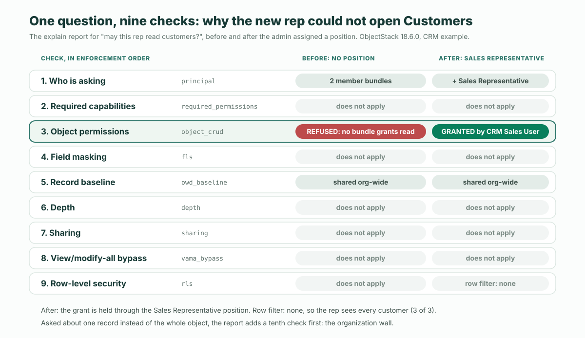

営業から「顧客が見えない」と言われたら、設定画面を何枚もたどって答えを組み立てるのはやめましょう。拒否したシステムそのものに聞くのです。アクセスの explain レポートは、その一人とその一つの操作について、プラットフォームがアクセスを適用するときと同じチェックを実行し、「いいえ」と言ったチェックと「はい」と言ったロールを示します。管理者は一行読み、一か所変え、返信する前にもう一度聞いて確かめます。これで、当て推量でアクセスを直すことを避けられます。当て推量で一番手っ取り早いのは、職務に必要な以上の権限を与えることだからです。代償は、レポートが説明するのは権限だけだという点です。存在しないレコードや画面側のフィルタは、やはり人が見る必要があります。

*ObjectStack 18.6.0（今日新規インストールで入るバージョン）で測定。リリースタグのオープンソース CRM サンプルを、公開済みパッケージに対して実行した。すべてのリクエストとレスポンスは[証拠](#証拠)にある。*

## チケットに答える

よくある場面です。管理者が新しい営業担当のアカウントを作ります。営業担当がサインインして顧客一覧を要求すると、拒否されます（リクエストはすべて画面ではなく、プラットフォームのプログラミングインターフェース経由で送りました）：「You do not have permission to perform this action. Contact your administrator if you need access.」続いてチケットが届きます。*営業が顧客を見られない。*

答え方は二つあります。一つは、ユーザーの設定を開き、各ロール、各権限のまとまり、顧客オブジェクトの共有ルールを順に見て、プラットフォームがどう判定するかを頭の中で計算すること。もう一つは、プラットフォームに何をどう判定したかを聞くことです。

ObjectStack は後者を **explain エンジン**と呼びます。人、オブジェクト、操作を指定すると、適用される順にチェックごとに一件ずつ返し、それぞれに判定、一文の説明、その判定を生んだものの名前が付きます。回答には二つのプラットフォーム用語が出てきます。**permission set** は名前の付いた権限のまとまりで、たとえば「CRM Sales User：顧客と商談の閲覧・作成・編集が可能、削除は不可」です。**position** はまとまりを配る職務ロールで、CRM サンプルでは Sales Representative の position が CRM Sales User を配ります。このサンプルでは顧客を *accounts*、商談を *opportunities* と呼び、証拠ではこの名前が使われます。

私たちはこのチケットと、ふつう続いて出てくる質問を CRM サンプル上の explain エンジンに投げ、それぞれの答えを、同じユーザーに対して適用層が実際に何をしたかと照らし合わせました。

| 管理者が聞いたこと | レポートの答え | あなたにとっての意味 |
|:--|:--|:--|
| 新しい営業担当はなぜ顧客を開けないのか | **オブジェクト権限で拒否**。顧客について「No resolved permission set grants read」。営業担当が持っていたのは、全メンバーが自動で受け取る 2 つのまとまりだけ。適用層も同じ読み取りを拒否した。 | アカウントはあるが営業ロールがない。共有ルールの問題でも、データの問題でも、バグでもない。 |
| 管理者が Sales Representative の position を割り当てた後、顧客を読めるか | **許可**。オブジェクト権限は **CRM Sales User が付与し、Sales Representative の position を通じて保持**。行フィルタ：なし。その後の顧客一覧は 3 件すべてを返した。 | 変更は一つ。営業に直ったと伝える前に、同じ質問で確認できる。 |
| 営業担当は商談を削除できるか | **オブジェクト権限で拒否**：削除を付与するまとまりがない。行レベルセキュリティも削除を絞り込む。特定の商談について聞くと、条件が示された：本人が作成した商談のみ。適用層は削除を拒否した。 | レポートによれば、営業のまとまりに削除を足すだけでは足りない。メンバーは自分が作成したものしか削除できない。削除を付与して試してはいない。 |
| 営業担当は商談を読めるか、どれを読めるか | **許可**。CRM Sales User が Sales Representative を通じて付与。行フィルタ：なし、つまりすべて。適用層は 12 件すべてを返した。 | 行フィルタは一覧やレポートが実際に適用する条件。許可された読み取りでは、「なし」はテーブル全体を意味する。 |
| 営業担当は商談をエクスポートできるか | **オブジェクト権限で拒否**：すべての商談を読めるにもかかわらず、エクスポートを付与するまとまりがない。適用層はエクスポートを拒否した。 | エクスポートは別の権限。「読めるか」と聞けば「はい」と返り、何もわからない。 |
| 誰がこれを聞けるか | 営業担当が自分について：回答あり。管理者ロールのないヘルプデスクの同僚が営業担当について：**拒否**。同じ同僚を組織の管理者にした後：回答あり。 | アクセスレポート自体がアクセス制御の対象。誰が何を持っているかを示すので、誰でも読めるわけではない。 |

どの行も一回のリクエストで答えが出ます。記録は[証拠](#証拠)にあります。管理者が読む時間は計測していないので、何分かかるかについては主張しません。



## 構造による説明

このレポートが役に立つのは、詳しいからではありません。適用層と食い違いようがないからです。ObjectStack のガイドは、explain エンジンは[「**適用ミドルウェアが実行するのと同じコードパス**をたどる……だからレポートは*構造による説明*（explained by construction）であり、ずれていきかねない並行の再実装ではない」](https://github.com/objectstack-ai/objectstack/blob/958ee03594968c651db1bc40ecb05bfe72f94b2d/content/docs/permissions/explain.mdx#L7-L13)と述べています。スキーマリファレンスはもっと短く、レポートは[「適用そのものであり、例外を投げないだけ」](https://github.com/objectstack-ai/objectstack/blob/958ee03594968c651db1bc40ecb05bfe72f94b2d/content/docs/references/security/explain.mdx#L12-L17)だと言います。

これが、権限の一覧表やロールの図との違いです。それらは誰かが設定*しようとした*ことを記述します。記述は古くなりえます。このレポートは二つ目の記述ではありません。設計上、営業担当を拒否したのと同じコードパスを、拒否せずに実行したものです。私たちはこの設計を一行ずつ監査したわけではありません。確かめたのはもっと狭い範囲です。今回の実行では、表の中で適用層が裏付けられた五つの判定のどれもが、その後に適用層が同じユーザーに対して行ったことと、リクエストごとに一致しました。

レポートは三か所を見れば読めます。

1. **判定**。この人、このオブジェクト、この操作について、許可か否か。
2. **「いいえ」と言ったチェック**。一件が拒否として示されます。私たちが測った拒否はどれも、オブジェクト権限でした。その人の持つまとまりのどれかが、この種類のレコードへのこの操作を許しているかを見るチェックです。
3. **誰が「はい」と言ったか**。付与した項目は、どのまとまりか、その人がどう保持しているかを示します。「CRM Sales User、Sales Representative の position を通じて」は、何を見ればよいかと、それがどこから来たかを管理者に伝えます。オブジェクト権限での拒否は誰の名前も挙げません。誰も付与していないからです。最初の項目にはその人が実際に持つまとまりがすべて並ぶので、欠けているものが見えます。

読み取りの場合、レポートには**行フィルタ**も含まれます。プラットフォームがその人の一覧、検索、レポートのすべてに加える条件です。CRM サンプルでは顧客も商談も組織全体で共有されているので、フィルタは空でした。営業担当が自分の商談しか見られないアプリなら、その条件が表示され、その条件こそが「なぜこの商談は見えてあの商談は見えないのか」への答えになります。

オブジェクトについて聞くと、レポートは九つのチェックを返します。特定のレコードについて聞くと十個返します。先頭に組織の壁が加わり、一つの組織しかない今回のインストールでは「適用外」と答えました。ObjectStack の二つのドキュメントが[九つ](https://github.com/objectstack-ai/objectstack/blob/958ee03594968c651db1bc40ecb05bfe72f94b2d/content/docs/permissions/explain.mdx#L20-L23)と[十個](https://github.com/objectstack-ai/objectstack/blob/958ee03594968c651db1bc40ecb05bfe72f94b2d/content/docs/references/security/explain.mdx#L19-L21)を挙げているのは、そのためです。

## 誰が聞けるか

アクセスレポートは、ある人がどのまとまりを持ち、それをどう得たかを示します。これは機密性が高いので、質問そのものが管理されています。18.6.0 のランタイムのルールはこうです。自分についてはいつでも。他のユーザーについては、ユーザーを管理する権利を持つか、そのユーザーが属する組織を管理しているか、そのユーザーをカバーする委任管理範囲を持つ場合に限る（[ソース](https://github.com/objectstack-ai/objectstack/blob/958ee03594968c651db1bc40ecb05bfe72f94b2d/packages/plugins/plugin-security/src/security-plugin-explain-access.ts#L134-L138)）。それ以外は拒否されます。

私たちは三通りの質問者を測りました。営業担当が自分について：回答あり。一般メンバーであるヘルプデスクの同僚が営業担当について：拒否。拒否メッセージには資格を得る三つの方法が書かれていました。管理者がその同僚を組織の管理者にすると、プラットフォームは組織管理者のまとまりを付与し、同じ質問に回答が返りました。つまり組織の管理者は、プラットフォーム全体のユーザー管理権を持たなくても、こうしたチケットに答えられます。委任範囲による経路は測っていません。これはヘルプデスクにこうしたチケットを答えさせる、より狭い方法です。

## 設定を読むほうがよい場合

explain レポートだけが良い道具ではなく、チケットによっては最善でもありません。

- **設定を読むのはどこでも使え、周辺も見える**。この CRM サンプルのようにロールが三つ、まとまりが一つなら、ロールを開くのは質問するのと同じくらい速く、プラットフォームに欠けているかもしれない機能に頼らず、一つの判定だけでなく、そのロールが付与するものすべてが見えます。
- **ユーザーとしてログインすれば画面が見える**。ObjectStack では管理者が[ユーザーになりすましてアクセスを確認できます](https://github.com/objectstack-ai/objectstack/blob/958ee03594968c651db1bc40ecb05bfe72f94b2d/content/docs/permissions/authentication.mdx#L1230-L1233)。多くのプラットフォームにも似た機能があります。苦情が「ボタンがない」「メニューが空」なら、チェックを読むより画面を見るほうが速いでしょう。レポートは判定がなぜそうなったかに答え、なりすましはその人に何が見えるかに答えます。
- **ポリシーの質問には、虫眼鏡より全体の走査**。「誰が商談を削除できるか」は全ロールにまたがる質問です。ObjectStack のガイド自身がこの線を引いています。explain は[「同じ評価ロジックを実行時に一つの判定へ向けたもの。マトリクスはビルド時にすべてを走査するもの」](https://github.com/objectstack-ai/objectstack/blob/958ee03594968c651db1bc40ecb05bfe72f94b2d/content/docs/permissions/access-matrix.mdx#L81-L83)です。マトリクスについては[AI による権限のサイレント変更を出荷前にどう見つけるか](/ja/blog/catch-ai-silent-permission-change-access-matrix-gate/)で扱いました。
- **直し方を見つけて直すのは設定の中**。拒否が伝えるのは何が欠けているかです。営業担当の持つまとまりのどれも、顧客の読み取りを付与していない。どのロールがそれを補うかは伝えません。それはロールとまとまりで調べ、変更もそこで行います。AI がそうした定義を書くプラットフォームでは、変更は diff として届き、誰かが[レビュー](/en/blog/how-to-review-ai-generated-app-changes/)します。

## レポートが解決しないこと

- **説明するのは権限であって、データではない**。一度も作られていない顧客、マージで消えた顧客、ビュー自体のフィルタで隠れた顧客は、苦情を言う人には同じに見えます。レポートは「許可」と言い、顧客は見つからないままです。人が確認する必要があります。
- **そのアクセスが正しいかは言わない**。レポートは、営業担当が商談をエクスポートできないと教えてくれました。営業がそれを*すべき*かどうかはポリシーの判断で、修正を position にするか、もっと狭いまとまりにするかも同じです。
- **修正がほかに何を付与するかは示さない**。私たちが聞いたのは顧客の読み取りです。割り当てた position は、顧客、連絡先、商談、商談の商品明細、リード、活動の作成と編集も営業担当に許します。レポートが確認したのは、聞いた一つの判定だけです。ロールがもたらすものをすべて見るには、ロールを読むか、ビルド時のマトリクスを使ってください。
- **二度聞かないとわからない答えもある**。削除について、オブジェクトレベルのレポートは行レベルセキュリティが行を絞り込むと言いましたが、条件は示しませんでした。特定の商談について聞くと示しました：本人が作成したものだけ。ルールには汎用的なラベルが付いていて、プラットフォームの既定のまとまりでのポリシー名ではありませんでした。証拠には両方を載せています。
- **行フィルタより先に判定を読む**。拒否された読み取りでも、レポートには空の行フィルタが入っていました。それだけ見れば「すべての行」を意味します。[スキーマリファレンス](https://github.com/objectstack-ai/objectstack/blob/958ee03594968c651db1bc40ecb05bfe72f94b2d/content/docs/references/security/explain.mdx#L110)は、判定とは許可の可否と行レベルのチェックを合わせたもので、フィルタ単体ではないとしています。
- **セキュリティプラグインが必要**。ガイドははっきり書いています。[「`@objectstack/plugin-security` のないデプロイは 501 を返す」](https://github.com/objectstack-ai/objectstack/blob/958ee03594968c651db1bc40ecb05bfe72f94b2d/content/docs/permissions/explain.mdx#L116)。つまりまったく答えられません。

ObjectStack のガイドは、Studio の Access 領域がこのレポートの上に[「このユーザーはなぜアクセスできるのか」パネル](https://github.com/objectstack-ai/objectstack/blob/958ee03594968c651db1bc40ecb05bfe72f94b2d/content/docs/permissions/explain.mdx#L120-L121)を構築しているとも述べています。私たちが測ったのはレポートのプログラミングインターフェースで、その画面ではありません。

## 開発中

レポートの形式は、いま埋めている以上の場所をすでに予約しています。スキーマリファレンスは、人ごとの立場（プラットフォーム管理者、組織管理者、メンバー、外部メンバー）と、どのチェックが組織の壁に属するかを示す印を、[「β エンジンと UI が埋める」](https://github.com/objectstack-ai/objectstack/blob/958ee03594968c651db1bc40ecb05bfe72f94b2d/content/docs/references/security/explain.mdx#L30-L34)語彙として記述しています。18.6.0 では、特定のレコードについて聞くと両方がすでに現れます。どのチェックにも壁の印が付き、営業担当の立場はメンバーとして返りました。オブジェクトレベルの回答にはどちらも現れません。リファレンスは、その後のエンジンと画面がほかに何を加えるかは述べておらず、私たちもこの二つのフィールド以外は測っていません。

## エージェントをレポートに向ける

アプリのロールとまとまりを AI エージェントが書くなら、explain レポートは、人が結果を判定ごとに確かめる方法であり、エージェントが diff を渡す前に自分の仕事を確かめる方法でもあります。[エージェントを ObjectStack に向け](/en/blog/how-to-point-your-agent-at-objectstack/)、いま付与したアクセスを説明させてください。こうしたチェックがエージェントの経路のどこで実行されるかは、[Where AI agent permissions are enforced](/en/blog/objectos-agent-permission-boundaries/) と [CRM のエージェントが権限を迂回せずに顧客データを読む方法](/ja/blog/crm-ai-understands-customers/)を参照してください。用語は[権限モデル](/en/glossary/permission-model/)と[行レベルセキュリティ](/ja/glossary/row-level-security/)を参照してください。

{/* the-proof */}
## 証拠

ここまでの内容はすべて 2026-11-23 に ObjectStack **18.6.0** で測定した。

```text
$ npm view @objectstack/cli dist-tags
{ next: '0.0.0-next-20261123013358', latest: '18.6.0' }
$ npm view @objectstack/cli dist-tags.latest
18.6.0
```

### 準備

タグ `@objectstack/cli@18.6.0`（コミット [`958ee03`](https://github.com/objectstack-ai/objectstack/commit/958ee03594968c651db1bc40ecb05bfe72f94b2d)）の CRM サンプルを、モノレポではなく公開済みの 18.6.0 パッケージに対してインストールした。`workspace:*` 依存は `18.6.0` に置き換え、テストフォルダとテスト専用の開発依存は除いた。

```text
$ git -C ~/objectstack archive '@objectstack/cli@18.6.0' examples/app-crm | tar -x --strip-components=2
$ npm install
$ npx os --version
@objectstack/cli/18.6.0 linux-x64 node-v22.22.0
$ npx os dev --fresh -p 3276
  ...
  Security: 3 Positions  2 Permissions
  ...
  🔑  Dev admin: admin@objectos.ai / admin123
  Tenancy: single
  Seeds:   com.example.crm 28 rows
```

`--fresh` は空の使い捨てデータベースで起動する。管理者がサインインし、`POST /api/v1/auth/admin/create-user` で二つのアカウントを作る：`rep@example.com` と `helpdesk@example.com`。どちらにも position はない。このインストールではセルフサインアップが閉じているので、管理者が作成する（同じインストールでの別の実行。生の出力は上のバージョン確認とともにスクリプトの横に保存してある）：

```text
$ curl -s -X POST http://localhost:3276/api/v1/auth/sign-up/email -H 'Content-Type: application/json' -d '{"email":"newhire@example.com","password":"…","name":"newhire"}'
{"code":"SELF_REGISTRATION_CLOSED","message":"Self-registration is closed (audience posture invite_only). Ask an administrator for an invitation."}
HTTP 403
```

各アカウントは `POST /api/v1/auth/sign-in/email` でサインインし、クッキーファイル `admin.jar`、`rep.jar`、`helpdesk.jar` がセッションを保持する。以下のユーザー ID はこの実行のもの。

サンプルの営業ロール（タグ時点、[`sales-positions.ts`](https://github.com/objectstack-ai/objectstack/blob/958ee03594968c651db1bc40ecb05bfe72f94b2d/examples/app-crm/src/security/sales-positions.ts#L12-L17)、[44–61 行](https://github.com/objectstack-ai/objectstack/blob/958ee03594968c651db1bc40ecb05bfe72f94b2d/examples/app-crm/src/security/sales-positions.ts#L44-L61)）：

```typescript
export const SalesRepPosition = definePosition({
  name: 'crm_sales_rep',
  label: 'Sales Representative',
  description: 'Front-line sales representative.',
  permissionSets: ['crm_sales_user'],
});
// ...
    crm_account: { allowRead: true, allowCreate: true, allowEdit: true, allowDelete: false },
    crm_opportunity: { allowRead: true, allowCreate: true, allowEdit: true, allowDelete: false },
```

どちらのオブジェクトも組織全体で共有されている：`sharingModel: 'public_read_write'`（[account、11 行](https://github.com/objectstack-ai/objectstack/blob/958ee03594968c651db1bc40ecb05bfe72f94b2d/examples/app-crm/src/objects/account.object.ts#L11)、[opportunity、12 行](https://github.com/objectstack-ai/objectstack/blob/958ee03594968c651db1bc40ecb05bfe72f94b2d/examples/app-crm/src/objects/opportunity.object.ts#L12)）。

### 1. チケット

```text
$ curl -b rep.jar http://localhost:3276/api/v1/data/crm_account
{"error":"You do not have permission to perform this action. Contact your administrator if you need access.","code":"PERMISSION_DENIED","object":"crm_account"}
HTTP 403
```

### 2. 管理者が理由を聞く：レポート全体

```text
$ curl -b admin.jar 'http://localhost:3276/api/v1/security/explain?object=crm_account&operation=read&userId=v45jiPqcuzi9PL9I8olqaJ2pbhUAr3zX'
```

```json
{
  "allowed": false,
  "object": "crm_account",
  "operation": "read",
  "principal": {
    "userId": "v45jiPqcuzi9PL9I8olqaJ2pbhUAr3zX",
    "positions": ["org_member", "everyone"],
    "permissionSets": ["member_default", "storage_attachment_member"],
    "principalKind": "human"
  },
  "layers": [
    {
      "layer": "principal",
      "verdict": "neutral",
      "detail": "Principal rep (rep@example.com; id v45jiPqcuzi9PL9I8olqaJ2pbhUAr3zX) holds position(s) [org_member, everyone] resolving to permission set(s) [member_default, storage_attachment_member] (union-merged, most-permissive).",
      "contributors": [
        { "kind": "position", "name": "org_member" },
        { "kind": "position", "name": "everyone" },
        { "kind": "permission_set", "name": "member_default", "via": "additive baseline (ADR-0090 D5)" },
        { "kind": "permission_set", "name": "storage_attachment_member", "via": "additive baseline (ADR-0090 D5)" }
      ]
    },
    { "layer": "required_permissions", "verdict": "not_applicable", "detail": "'crm_account' declares no requiredPermissions for read.", "contributors": [] },
    { "layer": "object_crud", "verdict": "denies", "detail": "No resolved permission set grants read on 'crm_account'.", "contributors": [] },
    { "layer": "fls", "verdict": "not_applicable", "detail": "No field-level masking applies.", "contributors": [] },
    { "layer": "owd_baseline", "verdict": "neutral", "detail": "Record baseline (OWD) is public_read_write: rows are org-shared at this baseline.", "contributors": [] },
    { "layer": "depth", "verdict": "not_applicable", "detail": "Depth axis does not apply (baseline already org-wide).", "contributors": [] },
    { "layer": "sharing", "verdict": "not_applicable", "detail": "Baseline already grants the rows sharing would add.", "contributors": [] },
    { "layer": "vama_bypass", "verdict": "not_applicable", "detail": "No View/Modify All Data bypass.", "contributors": [] },
    { "layer": "rls", "verdict": "not_applicable", "detail": "No RLS policy applies.", "contributors": [] }
  ],
  "readFilter": null
}
```

九件。JSON は返ってきたレスポンスそのままで、各項目を少ない行に折りたたんだだけ。

### 3. 修正と、同じ質問をもう一度

```text
$ curl -b admin.jar -X POST http://localhost:3276/api/v1/data/sys_user_position \
    -H 'Content-Type: application/json' \
    -d '{"user_id":"v45jiPqcuzi9PL9I8olqaJ2pbhUAr3zX","position":"crm_sales_rep","reason":"Ticket: rep cannot open customers"}'
{'display_title': 'rep → crm_sales_rep', 'granted_by': 'hsitZYEkgelqpLEjjjzndGTJU2M9jnnI', 'reason': 'Ticket: rep cannot open customers'}

$ curl -b admin.jar 'http://localhost:3276/api/v1/security/explain?object=crm_account&operation=read&userId=v45jiPqcuzi9PL9I8olqaJ2pbhUAr3zX'
allowed: True | layers: 9 | readFilter: null
  object_crud  grants  read on 'crm_account' is granted by [crm_sales_user].
               contributors: [{"kind": "permission_set", "name": "crm_sales_user", "via": "position:crm_sales_rep"}]
  (the other eight entries as in step 2; principal now lists crm_sales_rep and crm_sales_user)

$ curl -b rep.jar 'http://localhost:3276/api/v1/data/crm_account?fields=name&limit=50'
HTTP 200 | total: 3 | names: ['Acme Corp', 'Globex Ltd', 'Initech']
```

割り当ての行には、誰がなぜ付与したかが記録される。`allowed:` で始まる行は、スクリプトがレポートを一行に要約したもの。各リクエストの生の JSON はスクリプトの横に保存してある。

### 4. 商談：削除、読み取り、エクスポート、そして適用層の対応

```text
$ curl -b admin.jar 'http://localhost:3276/api/v1/security/explain?object=crm_opportunity&operation=delete&userId=v45jiPqcuzi9PL9I8olqaJ2pbhUAr3zX'
allowed: False | layers: 9 | readFilter: (absent)
  object_crud  denies   No resolved permission set grants delete on 'crm_opportunity'.
  rls          narrows  Row-level security narrows the row set (see readFilter for the composed predicate).

$ curl -b admin.jar 'http://localhost:3276/api/v1/security/explain?object=crm_opportunity&operation=read&userId=v45jiPqcuzi9PL9I8olqaJ2pbhUAr3zX'
allowed: True | layers: 9 | readFilter: null
  object_crud  grants   read on 'crm_opportunity' is granted by [crm_sales_user].  via position:crm_sales_rep

$ curl -b admin.jar 'http://localhost:3276/api/v1/security/explain?object=crm_opportunity&operation=export&userId=v45jiPqcuzi9PL9I8olqaJ2pbhUAr3zX'
allowed: False | layers: 9 | readFilter: null
  object_crud  denies   No resolved permission set grants export on 'crm_opportunity'.

$ curl -b rep.jar -X DELETE http://localhost:3276/api/v1/data/crm_opportunity/2qolV83IXvGaXxdA
{"error":"You do not have permission to perform this action. Contact your administrator if you need access.","code":"PERMISSION_DENIED","object":"crm_opportunity"}
HTTP 403

$ curl -b rep.jar 'http://localhost:3276/api/v1/data/crm_opportunity?fields=name&limit=50'
{"object":"crm_opportunity","records":[ … 12 deals … ],"total":12,"hasMore":false}
HTTP 200

$ curl -b rep.jar http://localhost:3276/api/v1/data/crm_opportunity/export
{"code":"EXPORT_NOT_PERMITTED","error":"Export is not permitted on object 'crm_opportunity' for this user","object":"crm_opportunity"}
HTTP 403
```

表示していない項目はステップ 2 と同じ。削除のレポートには `readFilter` フィールドがそもそもなく、`(absent)` はその意味。ガイドは、エクスポートに別の質問が必要な理由を説明している：[「`export` は、答えを `read` から推測できない唯一の操作」](https://github.com/objectstack-ai/objectstack/blob/958ee03594968c651db1bc40ecb05bfe72f94b2d/content/docs/permissions/explain.mdx#L77-L86)。permission set のページには、[組み込みのまとまりはどれもエクスポート権を持たない](https://github.com/objectstack-ai/objectstack/blob/958ee03594968c651db1bc40ecb05bfe72f94b2d/content/docs/permissions/permission-sets.mdx#L94-L101)とある。

### 5. 一つのレコード：十件

```text
$ curl -b admin.jar 'http://localhost:3276/api/v1/security/explain?object=crm_opportunity&operation=read&userId=v45jiPqcuzi9PL9I8olqaJ2pbhUAr3zX&recordId=2qolV83IXvGaXxdA'
allowed: True | layers: 10 | readFilter: null
  tenant_isolation  not_applicable  Layer 0 tenant isolation — the always-first org wall, AND-composed before any business RLS (ADR-0095 D1).
  principal … rls   (the nine entries of step 4's read, each now with kernelTier; principal adds "posture": "MEMBER")
record: {"recordId": "2qolV83IXvGaXxdA", "visible": true, "decidedBy": "object_crud"}

$ curl -b admin.jar 'http://localhost:3276/api/v1/security/explain?object=crm_opportunity&operation=delete&userId=v45jiPqcuzi9PL9I8olqaJ2pbhUAr3zX&recordId=2qolV83IXvGaXxdA'
allowed: False | layers: 10 | readFilter: (absent)
record: {"recordId": "2qolV83IXvGaXxdA", "visible": false, "decidedBy": "object_crud"}
```

オブジェクトレベルの回答にはテナント層がない。エンジンのソースがコメントでそう述べている：[「no tenant_isolation layer, no kernelTier, no posture」](https://github.com/objectstack-ai/objectstack/blob/958ee03594968c651db1bc40ecb05bfe72f94b2d/packages/plugins/plugin-security/src/explain-engine.ts#L2926-L2927)。

レコードレベルの削除での行レベルセキュリティの項目、返ってきたまま：

```json
{
  "layer": "rls",
  "verdict": "narrows",
  "detail": "Row-level security narrows the row set (see readFilter for the composed predicate).",
  "contributors": [],
  "record": {
    "outcome": "excluded",
    "rowFilter": { "created_by": "v45jiPqcuzi9PL9I8olqaJ2pbhUAr3zX" },
    "matchesRecord": false,
    "rules": [
      {
        "kind": "rls_policy",
        "name": "business_rls",
        "predicate": { "created_by": "v45jiPqcuzi9PL9I8olqaJ2pbhUAr3zX" },
        "effect": "excludes"
      }
    ],
    "detail": "The record does not satisfy the business row-level predicate."
  },
  "kernelTier": "layer_1_business"
}
```

この条件は、サインイン済みのメンバー全員が持つメンバー用のまとまりから来ている。そこでのポリシー名は `owner_only_deletes`（`created_by == current_user.id`、`org_member` に紐づく。[`default-permission-sets.ts` 928–934 行](https://github.com/objectstack-ai/objectstack/blob/958ee03594968c651db1bc40ecb05bfe72f94b2d/packages/plugins/plugin-security/src/objects/default-permission-sets.ts#L928-L934)）。シードされた商談は起動時に作られたもので営業担当が作ったものではないため、除外される。

### 6. 誰が聞けるか

```text
$ curl -b rep.jar 'http://localhost:3276/api/v1/security/explain?object=crm_opportunity&operation=delete'      # yourself: no userId
HTTP 200
allowed: False | layers: 9 | readFilter: (absent)

$ curl -b helpdesk.jar 'http://localhost:3276/api/v1/security/explain?object=crm_opportunity&operation=delete&userId=v45jiPqcuzi9PL9I8olqaJ2pbhUAr3zX'
{"success":false,"error":{"code":"PERMISSION_DENIED","message":"[Security] Access denied: explaining another user's access requires the 'manage_users' capability, organization administration of an organization that user is a member of, or a delegated adminScope covering that user (ADR-0090 D6/D12)."}}
HTTP 403

$ curl -b admin.jar -X POST http://localhost:3276/api/v1/auth/organization/update-member-role \
    -H 'Content-Type: application/json' -d '{"memberId":"mem_mwsnwe0oznkd4j6u","role":"admin"}'
{…,"role":"admin","id":"mem_mwsnwe0oznkd4j6u","outcome":"permission_set_granted","grantedPermissionSet":{"name":"organization_admin_no_bypass","label":"Organization Administrator (no record bypass)"}}
HTTP 200

$ curl -b admin.jar 'http://localhost:3276/api/v1/data/sys_user_permission_set?limit=50'    # the help desk's row, picked from the list by user_id
{'permission_set': 'organization_admin_no_bypass', 'organization_id': 'org_mwsnwbk2cl1ypwnm', 'reason': "auto-org-admin-grant: granted from membership grade 'admin' (sys_member mem_mwsnwe0oznkd4j6u) → organization_admin_no_bypass"}

$ curl -b helpdesk.jar 'http://localhost:3276/api/v1/security/explain?object=crm_opportunity&operation=delete&userId=v45jiPqcuzi9PL9I8olqaJ2pbhUAr3zX'
HTTP 200
allowed: False | layers: 9 | readFilter: (absent)
```

組織管理者のまとまりが持つのは `manage_org_users` で、`manage_users` ではない。[`default-permission-sets.ts` 461 行](https://github.com/objectstack-ai/objectstack/blob/958ee03594968c651db1bc40ecb05bfe72f94b2d/packages/plugins/plugin-security/src/objects/default-permission-sets.ts#L461)に `organization_admin` のシステム権限が並び、バイパスなしの派生版はそれをそのまま引き継ぐ（[1652–1656 行](https://github.com/objectstack-ai/objectstack/blob/958ee03594968c651db1bc40ecb05bfe72f94b2d/packages/plugins/plugin-security/src/objects/default-permission-sets.ts#L1652-L1656)）。ランタイムは呼び出し元チェックの組織管理者の分岐でこれを通す（[`security-plugin-explain-access.ts` 152–165 行](https://github.com/objectstack-ai/objectstack/blob/958ee03594968c651db1bc40ecb05bfe72f94b2d/packages/plugins/plugin-security/src/security-plugin-explain-access.ts#L152-L165)。拒否メッセージは [197–200 行](https://github.com/objectstack-ai/objectstack/blob/958ee03594968c651db1bc40ecb05bfe72f94b2d/packages/plugins/plugin-security/src/security-plugin-explain-access.ts#L197-L200)）。

### 7. 引用した箇所（18.6.0 タグ時点）

`content/docs/` で始まるパスは、その接頭辞を省いて示す。

- `permissions/explain.mdx`：[7–13 行](https://github.com/objectstack-ai/objectstack/blob/958ee03594968c651db1bc40ecb05bfe72f94b2d/content/docs/permissions/explain.mdx#L7-L13)（九層、構造による説明）、[20–23 行](https://github.com/objectstack-ai/objectstack/blob/958ee03594968c651db1bc40ecb05bfe72f94b2d/content/docs/permissions/explain.mdx#L20-L23)（九層の順序）、[77–86 行](https://github.com/objectstack-ai/objectstack/blob/958ee03594968c651db1bc40ecb05bfe72f94b2d/content/docs/permissions/explain.mdx#L77-L86)（エクスポート）、[97–109 行](https://github.com/objectstack-ai/objectstack/blob/958ee03594968c651db1bc40ecb05bfe72f94b2d/content/docs/permissions/explain.mdx#L97-L109)（誰が聞けるか）、[116 行](https://github.com/objectstack-ai/objectstack/blob/958ee03594968c651db1bc40ecb05bfe72f94b2d/content/docs/permissions/explain.mdx#L116)（セキュリティプラグインなしでは 501）、[120–121 行](https://github.com/objectstack-ai/objectstack/blob/958ee03594968c651db1bc40ecb05bfe72f94b2d/content/docs/permissions/explain.mdx#L120-L121)（Studio のパネル）。
- `references/security/explain.mdx`：[12–17 行](https://github.com/objectstack-ai/objectstack/blob/958ee03594968c651db1bc40ecb05bfe72f94b2d/content/docs/references/security/explain.mdx#L12-L17)（適用そのもの、例外を投げないだけ）、[19–21 行](https://github.com/objectstack-ai/objectstack/blob/958ee03594968c651db1bc40ecb05bfe72f94b2d/content/docs/references/security/explain.mdx#L19-L21)（十層）、[30–34 行](https://github.com/objectstack-ai/objectstack/blob/958ee03594968c651db1bc40ecb05bfe72f94b2d/content/docs/references/security/explain.mdx#L30-L34)（予約された語彙）。
- `packages/plugins/plugin-security/src/explain-engine.ts`：[2926–2927 行](https://github.com/objectstack-ai/objectstack/blob/958ee03594968c651db1bc40ecb05bfe72f94b2d/packages/plugins/plugin-security/src/explain-engine.ts#L2926-L2927)（オブジェクトレベルの回答にテナント層はない）。
- `packages/plugins/plugin-security/src/security-plugin-explain-access.ts`：[134–138 行](https://github.com/objectstack-ai/objectstack/blob/958ee03594968c651db1bc40ecb05bfe72f94b2d/packages/plugins/plugin-security/src/security-plugin-explain-access.ts#L134-L138)（誰が他のユーザーについて説明を求められるか）。
- `permissions/access-matrix.mdx`：[81–83 行](https://github.com/objectstack-ai/objectstack/blob/958ee03594968c651db1bc40ecb05bfe72f94b2d/content/docs/permissions/access-matrix.mdx#L81-L83)（虫眼鏡と全体の走査）。
- `permissions/authentication.mdx`：[1230–1233 行](https://github.com/objectstack-ai/objectstack/blob/958ee03594968c651db1bc40ecb05bfe72f94b2d/content/docs/permissions/authentication.mdx#L1230-L1233)（ユーザーになりすましてアクセスを確認する）。
