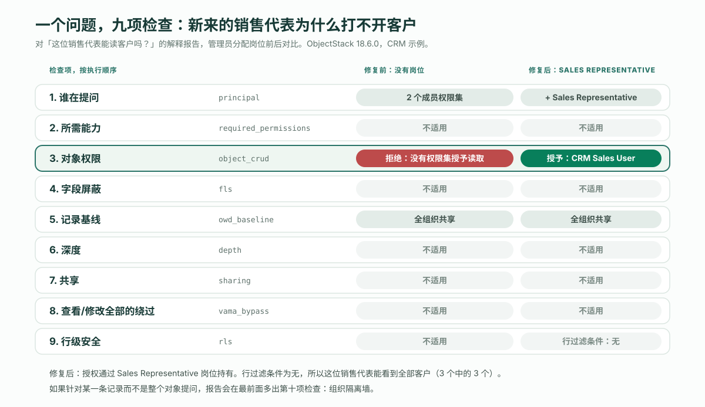

销售说看不到某个客户时，别从一页页设置里去拼答案，直接去问拒绝他们的那个系统。权限解释报告会针对这一个人、这一个操作，跑一遍平台执行访问控制时跑的同一套检查，并指出说「不」的是哪一项检查、说「行」的是哪个角色。管理员读一行，改一处，回复工单前再问一遍确认。这样可以避免凭猜测修权限，而最省事的猜法往往是给得比岗位需要的更多。代价是：它只解释权限，记录根本不存在、或被某个界面筛掉了，仍然要有人去看。

*测量基于 ObjectStack 18.6.0，即今天新安装得到的版本：用发布标签下的开源 CRM 示例，对着已发布的软件包运行。所有请求和响应见[证据](#证据)。*

## 工单，答上了

场景很平常。管理员给一位新来的销售代表开了账号。销售代表登录，请求客户列表，被拒绝了（我们的每个请求都是通过平台的编程接口发出的，而不是在界面上点的）：「You do not have permission to perform this action. Contact your administrator if you need access.」随后来了一张工单：*销售说看不到客户。*

回答它有两种办法。一种是打开这个用户的设置，再看每个角色、每组权限，再看客户对象的共享规则，然后在脑子里推算平台会怎么判。另一种是直接问平台：它判了什么，为什么。

ObjectStack 把第二种叫做**解释引擎**（explain engine）。你给出一个人、一个对象和一个操作，它按执行时的顺序，每项检查返回一条，每条带一个判定、一句说明，以及产生这个判定的来源名称。它的回答里会出现两个平台术语。**权限集**（permission set）是一组具名的权限，比如「CRM Sales User：可以读取、创建和编辑客户与商机，不能删除」**。岗位**（position）是分发权限集的工作角色：在 CRM 示例里，Sales Representative（销售代表）岗位分发 CRM Sales User。这个示例把客户叫做 *accounts*，把商机叫做 *opportunities*，证据里用的就是这两个名字。

我们把这张工单，以及通常紧跟着的几个问题，交给 CRM 示例上的解释引擎回答，再逐条对照执行层对同一个用户实际做了什么。

| 管理员问了什么 | 报告怎么答 | 对你意味着什么 |
|:--|:--|:--|
| 新来的销售代表为什么打不开客户？ | **在对象权限这一项被拒绝**。「No resolved permission set grants read」，没有任何权限集授予客户的读取权。这位销售代表只持有每个成员自动获得的两个权限集。执行层也拒绝了同一个读取请求。 | 账号存在，只是没有销售角色。不是共享规则问题，不是数据问题，也不是 bug。 |
| 管理员分配了 Sales Representative 岗位之后，他能读客户了吗？ | **允许**。对象权限**由 CRM Sales User 授予，通过 Sales Representative 岗位持有**。行过滤条件：无。随后他的客户列表返回了全部 3 个客户。 | 改一处，再用同一个问题确认，然后才告诉销售已经修好。 |
| 销售代表能删除商机吗？ | **在对象权限这一项被拒绝**：没有权限集授予删除权。行级安全还会收窄删除范围；针对某一条商机提问时，报告给出了条件：只能删自己创建的商机。执行层拒绝了删除。 | 按报告的说法，只在销售权限集里加上删除权还不够：成员只能删自己创建的记录。我们没有真的授予删除权去验证。 |
| 销售代表能读商机吗，能读哪些？ | **允许**，由 CRM Sales User 通过 Sales Representative 授予。行过滤条件：无，即全部商机。执行层列出了全部 12 条。 | 行过滤条件就是列表和报表实际套用的条件。在允许读取的前提下，「无」表示整张表。 |
| 销售代表能导出商机吗？ | **在对象权限这一项被拒绝**：没有权限集授予导出权，尽管他能读取每一条商机。执行层拒绝了导出。 | 导出是单独的一项授权。问「他能读吗？」得到的是「能」，但什么也说明不了。 |
| 谁可以问这些问题？ | 销售代表问自己：有回答。一位没有管理员角色的服务台同事问销售代表的情况：**被拒绝**。同一位同事被设为组织管理员之后：有回答。 | 访问报告本身也受访问控制。它说明谁持有什么，所以不是谁都能看。 |

每一行都只要一次请求就能回答；完整记录见[证据](#证据)。我们没有给管理员读报告计时，所以不对用时作任何断言。



## 由构造保证的解释

这份报告有用，不在于它详细，而在于它不可能和执行层说的不一样。ObjectStack 的指南说，解释引擎[「走的是**执行中间件运行的同一条代码路径**……所以报告是*由构造保证的解释*（explained by construction），而不是一个可能逐渐走样的平行重写。」](https://github.com/objectstack-ai/objectstack/blob/958ee03594968c651db1bc40ecb05bfe72f94b2d/content/docs/permissions/explain.mdx#L7-L13)Schema 参考文档说得更短：这份报告[「就是执行本身，只是去掉了抛错。」](https://github.com/objectstack-ai/objectstack/blob/958ee03594968c651db1bc40ecb05bfe72f94b2d/content/docs/references/security/explain.mdx#L12-L17)

这就是它和权限表格、角色示意图的区别：后者描述的是某人*本来想*怎么配置。描述会过时。这份报告不是第二份描述：按设计，它就是拒绝了这位销售代表的那条代码路径，只是不真的拒绝。我们没有逐行审计这个设计。我们核对的范围更窄：在这次运行里，表格中执行层能够印证的五个判定，每一个都和执行层随后对同一个用户的处理一致，逐个请求对得上。

读一份报告，看三处就够了：

1. **判定**。对这个人、这个对象、这个操作，允许还是不允许。
2. **说「不」的那项检查**。有一条会被标为拒绝。在我们测到的每一次拒绝里，它都是对象权限：检查这个人持有的权限集里，有没有哪一个允许对这类记录做这个操作。
3. **谁说了「行」**。授予的那一条会写明是哪个权限集、这个人通过什么方式持有它。「CRM Sales User，通过 Sales Representative 岗位」既告诉管理员该看什么，也告诉他来源在哪。在对象权限这一项被拒绝时，报告不会点任何名字，因为没有人授予。第一条会列出这个人实际持有的所有权限集，所以缺口一眼可见。

对读取请求，报告还会带上**行过滤条件**：平台给这个人的每个列表、搜索和报表加上的条件。在 CRM 示例里，每个客户和商机都在整个组织内共享，所以这个条件为空。如果在一个销售只能看到自己商机的应用里，它会把那个条件显示出来，而那个条件就是「为什么他看得到这些商机、看不到那一条」的答案。

针对一个对象提问，报告返回九项检查；针对某一条记录提问，返回十项：最前面多了一道组织隔离墙，在我们这个单组织的安装里它的回答是「不适用」。ObjectStack 的两份文档分别写着[九项](https://github.com/objectstack-ai/objectstack/blob/958ee03594968c651db1bc40ecb05bfe72f94b2d/content/docs/permissions/explain.mdx#L20-L23)和[十项](https://github.com/objectstack-ai/objectstack/blob/958ee03594968c651db1bc40ecb05bfe72f94b2d/content/docs/references/security/explain.mdx#L19-L21)，原因就在这里。

## 谁可以问

访问报告说明一个人持有哪些权限集、是怎么拿到的。这很敏感，所以提问本身也受控。在 18.6.0 上，运行时的规则是：问自己，随时可以；问别人，只有当你持有管理用户的权限、管理着那个用户所在的组织，或者持有覆盖那个用户的委派管理范围时才可以（[源码](https://github.com/objectstack-ai/objectstack/blob/958ee03594968c651db1bc40ecb05bfe72f94b2d/packages/plugins/plugin-security/src/security-plugin-explain-access.ts#L134-L138)）。其他人一律被拒绝。

我们测了三种提问者。销售代表问自己：有回答。一位服务台同事，普通成员，问这位销售代表的情况：被拒绝，拒绝信息列出了三种合格的方式。管理员把这位同事设为组织管理员之后，平台给了他组织管理员权限集，同一个问题就有了回答。所以，组织管理员不需要持有平台级的用户管理权限，也能回答这类工单。委派管理范围这条路我们没有测，它是让服务台回答这类工单更窄的一种方式。

## 为什么也可以去看配置

解释报告不是唯一的好工具，对某些工单也不是最好的那个。

- **看配置到哪儿都行，还能看到周边**。像这个 CRM 示例这样只有三个岗位、一个权限集时，打开角色看一眼和提问一样快，不依赖平台有没有某个功能，而且能看到这个角色授予的全部内容，而不只是这一个判定。
- **以用户身份登录能看到界面**。ObjectStack 允许管理员[模拟某个用户来核实其访问权限](https://github.com/objectstack-ai/objectstack/blob/958ee03594968c651db1bc40ecb05bfe72f94b2d/content/docs/permissions/authentication.mdx#L1230-L1233)，很多平台也有类似功能。如果投诉是「按钮不见了」或「菜单是空的」，看界面比读检查项快。报告回答的是一个判定为什么是这样；模拟登录回答的是这个人看到了什么。
- **问政策问题，全局扫描胜过单点放大**。「谁能删除商机？」是一个同时涉及所有角色的问题。ObjectStack 的指南自己就划了这条线：解释引擎[「是把同一套评估逻辑在运行时对准一个判定；访问矩阵是构建时对所有判定的全面扫描」](https://github.com/objectstack-ai/objectstack/blob/958ee03594968c651db1bc40ecb05bfe72f94b2d/content/docs/permissions/access-matrix.mdx#L81-L83)。访问矩阵我们在[怎样在 AI 悄悄改动权限之前就把它拦下？](/zh-Hans/blog/catch-ai-silent-permission-change-access-matrix-gate/)里讲过。
- **找到修法、动手修改，都在设置里**。一次拒绝告诉你缺的是什么：这位销售代表持有的权限集里，没有一个授予客户的读取权。它不会告诉你哪个角色能补上。你要去角色和权限集里查，改动也是在那里做的。在由 AI 编写这些定义的平台上，改动会以一份 diff 的形式出现，由人来[评审](/en/blog/how-to-review-ai-generated-app-changes/)。

## 报告解决不了的事

- **它解释权限，不解释数据**。一个从没被创建、已被合并掉、或者被某个视图自己的筛选条件挡住的客户，在投诉的人看来是一样的。报告会说「允许」，客户照样不见。得有人去看。
- **它不判断这个访问对不对**。它告诉我们销售代表不能导出商机。销售*该不该*能导出商机，是政策问题；修法是给一个岗位还是给一个更窄的权限集，也是。
- **它不显示这次修复还顺带授予了什么**。我们问的是读取客户。我们分配的岗位还让这位销售代表能创建和编辑客户、联系人、商机、商机产品明细、线索和活动。报告确认的只是我们问的那一个判定。要看一个角色带来的全部权限，去读这个角色，或者用构建时的访问矩阵。
- **有些答案要再问一次**。对删除操作，针对对象的报告说行级安全收窄了范围，但没有给出条件。针对某一条商机提问，它给出了：只能删自己创建的商机。它给这条规则贴的是一个通用标签，而不是这条策略在平台默认权限集里的名字；证据里两者都有。
- **先看判定，再看行过滤条件**。在一次被拒绝的读取里，报告仍然带着一个空的行过滤条件，单独看会被理解成「所有行」。[Schema 参考文档](https://github.com/objectstack-ai/objectstack/blob/958ee03594968c651db1bc40ecb05bfe72f94b2d/content/docs/references/security/explain.mdx#L110)说，判定要看「是否允许」加上行级安全那一项，而不是单看过滤条件。
- **它需要安全插件**。指南说得很直白：[「没有 `@objectstack/plugin-security` 的部署会返回 501」](https://github.com/objectstack-ai/objectstack/blob/958ee03594968c651db1bc40ecb05bfe72f94b2d/content/docs/permissions/explain.mdx#L116)，也就是根本无法回答。

ObjectStack 的指南还说，Studio 的 Access 区域就是在这份报告之上构建了它的[「这个用户为什么能访问？」面板](https://github.com/objectstack-ai/objectstack/blob/958ee03594968c651db1bc40ecb05bfe72f94b2d/content/docs/permissions/explain.mdx#L120-L121)。我们测的是报告的编程接口，不是那个界面。

## 开发中

报告的格式已经预留了比现在填充得更多的位置。Schema 参考文档描述了每个人的身份层级（平台管理员、组织管理员、成员、外部成员），以及一个标记哪些检查属于组织隔离墙的字段，称之为[「β 引擎和界面将会填充的」](https://github.com/objectstack-ai/objectstack/blob/958ee03594968c651db1bc40ecb05bfe72f94b2d/content/docs/references/security/explain.mdx#L30-L34)词汇。在 18.6.0 上，针对某一条记录提问时，这两样已经都出现了：每项检查都带着隔离墙标记，销售代表的身份层级返回为成员。针对对象的回答里两者都没有。参考文档没有说那个后续的引擎和界面还会增加什么，我们也没有测这两个字段之外的东西。

## 把你的 Agent 指向这份报告

如果你的应用的角色和权限集是 AI Agent 写的，解释报告就是人逐个判定检查结果的办法，也是 Agent 在把 diff 交给你之前检查自己工作的办法。[把你的 Agent 指向 ObjectStack](/en/blog/how-to-point-your-agent-at-objectstack/)，让它解释一下它刚刚授予的访问权限。这些检查在 Agent 的调用路径上在哪里执行，见[AI Agent 的权限在哪里执行](/zh-Hans/blog/objectos-agent-permission-boundaries/)和[CRM 里的 Agent 如何读取客户数据而不绕过权限](/zh-Hans/blog/crm-ai-understands-customers/)。相关术语见[权限模型](/zh-Hans/glossary/permission-model/)和[行级安全](/zh-Hans/glossary/row-level-security/)。

{/* the-proof */}
## 证据

以上所有内容均于 2026-11-23 在 ObjectStack **18.6.0** 上测得。

```text
$ npm view @objectstack/cli dist-tags
{ next: '0.0.0-next-20261123013358', latest: '18.6.0' }
$ npm view @objectstack/cli dist-tags.latest
18.6.0
```

### 准备

使用标签 `@objectstack/cli@18.6.0`（提交 [`958ee03`](https://github.com/objectstack-ai/objectstack/commit/958ee03594968c651db1bc40ecb05bfe72f94b2d)）下的 CRM 示例，安装的是已发布的 18.6.0 软件包，而不是单体仓库里的源码：它的 `workspace:*` 依赖改成了 `18.6.0`，去掉了测试目录和仅用于测试的开发依赖。

```text
$ git -C ~/objectstack archive '@objectstack/cli@18.6.0' examples/app-crm | tar -x --strip-components=2
$ npm install
$ npx os --version
@objectstack/cli/18.6.0 linux-x64 node-v22.22.0
$ npx os dev --fresh -p 3276
  ...
  Security: 3 Positions  2 Permissions
  ...
  🔑  Dev admin: admin@objectos.ai / admin123
  Tenancy: single
  Seeds:   com.example.crm 28 rows
```

`--fresh` 会在一个空的、用完即弃的数据库上启动。管理员登录后，用 `POST /api/v1/auth/admin/create-user` 创建两个账号：`rep@example.com` 和 `helpdesk@example.com`，都没有岗位。这个安装关闭了自助注册，所以由管理员来创建（这是在同一安装上的另一次运行，原始输出和上面的版本检查一起保存在脚本旁边）：

```text
$ curl -s -X POST http://localhost:3276/api/v1/auth/sign-up/email -H 'Content-Type: application/json' -d '{"email":"newhire@example.com","password":"…","name":"newhire"}'
{"code":"SELF_REGISTRATION_CLOSED","message":"Self-registration is closed (audience posture invite_only). Ask an administrator for an invitation."}
HTTP 403
```

每个账号用 `POST /api/v1/auth/sign-in/email` 登录，cookie 文件 `admin.jar`、`rep.jar` 和 `helpdesk.jar` 保存各自的会话。下面的用户 id 都来自这次运行。

示例里的销售角色，标签下的原文（[`sales-positions.ts`](https://github.com/objectstack-ai/objectstack/blob/958ee03594968c651db1bc40ecb05bfe72f94b2d/examples/app-crm/src/security/sales-positions.ts#L12-L17)，[第 44–61 行](https://github.com/objectstack-ai/objectstack/blob/958ee03594968c651db1bc40ecb05bfe72f94b2d/examples/app-crm/src/security/sales-positions.ts#L44-L61)）：

```typescript
export const SalesRepPosition = definePosition({
  name: 'crm_sales_rep',
  label: 'Sales Representative',
  description: 'Front-line sales representative.',
  permissionSets: ['crm_sales_user'],
});
// ...
    crm_account: { allowRead: true, allowCreate: true, allowEdit: true, allowDelete: false },
    crm_opportunity: { allowRead: true, allowCreate: true, allowEdit: true, allowDelete: false },
```

两个对象都在整个组织内共享：`sharingModel: 'public_read_write'`（[account，第 11 行](https://github.com/objectstack-ai/objectstack/blob/958ee03594968c651db1bc40ecb05bfe72f94b2d/examples/app-crm/src/objects/account.object.ts#L11)；[opportunity，第 12 行](https://github.com/objectstack-ai/objectstack/blob/958ee03594968c651db1bc40ecb05bfe72f94b2d/examples/app-crm/src/objects/opportunity.object.ts#L12)）。

### 1. 工单

```text
$ curl -b rep.jar http://localhost:3276/api/v1/data/crm_account
{"error":"You do not have permission to perform this action. Contact your administrator if you need access.","code":"PERMISSION_DENIED","object":"crm_account"}
HTTP 403
```

### 2. 管理员问原因：完整报告

```text
$ curl -b admin.jar 'http://localhost:3276/api/v1/security/explain?object=crm_account&operation=read&userId=v45jiPqcuzi9PL9I8olqaJ2pbhUAr3zX'
```

```json
{
  "allowed": false,
  "object": "crm_account",
  "operation": "read",
  "principal": {
    "userId": "v45jiPqcuzi9PL9I8olqaJ2pbhUAr3zX",
    "positions": ["org_member", "everyone"],
    "permissionSets": ["member_default", "storage_attachment_member"],
    "principalKind": "human"
  },
  "layers": [
    {
      "layer": "principal",
      "verdict": "neutral",
      "detail": "Principal rep (rep@example.com; id v45jiPqcuzi9PL9I8olqaJ2pbhUAr3zX) holds position(s) [org_member, everyone] resolving to permission set(s) [member_default, storage_attachment_member] (union-merged, most-permissive).",
      "contributors": [
        { "kind": "position", "name": "org_member" },
        { "kind": "position", "name": "everyone" },
        { "kind": "permission_set", "name": "member_default", "via": "additive baseline (ADR-0090 D5)" },
        { "kind": "permission_set", "name": "storage_attachment_member", "via": "additive baseline (ADR-0090 D5)" }
      ]
    },
    { "layer": "required_permissions", "verdict": "not_applicable", "detail": "'crm_account' declares no requiredPermissions for read.", "contributors": [] },
    { "layer": "object_crud", "verdict": "denies", "detail": "No resolved permission set grants read on 'crm_account'.", "contributors": [] },
    { "layer": "fls", "verdict": "not_applicable", "detail": "No field-level masking applies.", "contributors": [] },
    { "layer": "owd_baseline", "verdict": "neutral", "detail": "Record baseline (OWD) is public_read_write: rows are org-shared at this baseline.", "contributors": [] },
    { "layer": "depth", "verdict": "not_applicable", "detail": "Depth axis does not apply (baseline already org-wide).", "contributors": [] },
    { "layer": "sharing", "verdict": "not_applicable", "detail": "Baseline already grants the rows sharing would add.", "contributors": [] },
    { "layer": "vama_bypass", "verdict": "not_applicable", "detail": "No View/Modify All Data bypass.", "contributors": [] },
    { "layer": "rls", "verdict": "not_applicable", "detail": "No RLS policy applies.", "contributors": [] }
  ],
  "readFilter": null
}
```

九条。JSON 是原样返回的响应，只是把每一条折成了更少的行。

### 3. 修复，然后再问同一个问题

```text
$ curl -b admin.jar -X POST http://localhost:3276/api/v1/data/sys_user_position \
    -H 'Content-Type: application/json' \
    -d '{"user_id":"v45jiPqcuzi9PL9I8olqaJ2pbhUAr3zX","position":"crm_sales_rep","reason":"Ticket: rep cannot open customers"}'
{'display_title': 'rep → crm_sales_rep', 'granted_by': 'hsitZYEkgelqpLEjjjzndGTJU2M9jnnI', 'reason': 'Ticket: rep cannot open customers'}

$ curl -b admin.jar 'http://localhost:3276/api/v1/security/explain?object=crm_account&operation=read&userId=v45jiPqcuzi9PL9I8olqaJ2pbhUAr3zX'
allowed: True | layers: 9 | readFilter: null
  object_crud  grants  read on 'crm_account' is granted by [crm_sales_user].
               contributors: [{"kind": "permission_set", "name": "crm_sales_user", "via": "position:crm_sales_rep"}]
  (the other eight entries as in step 2; principal now lists crm_sales_rep and crm_sales_user)

$ curl -b rep.jar 'http://localhost:3276/api/v1/data/crm_account?fields=name&limit=50'
HTTP 200 | total: 3 | names: ['Acme Corp', 'Globex Ltd', 'Initech']
```

分配记录写明了是谁授予的、为什么授予。以 `allowed:` 开头的行是我们的脚本对报告的一行摘要；每个请求的原始 JSON 都保存在脚本旁边。

### 4. 商机：删除、读取、导出，以及执行层的处理

```text
$ curl -b admin.jar 'http://localhost:3276/api/v1/security/explain?object=crm_opportunity&operation=delete&userId=v45jiPqcuzi9PL9I8olqaJ2pbhUAr3zX'
allowed: False | layers: 9 | readFilter: (absent)
  object_crud  denies   No resolved permission set grants delete on 'crm_opportunity'.
  rls          narrows  Row-level security narrows the row set (see readFilter for the composed predicate).

$ curl -b admin.jar 'http://localhost:3276/api/v1/security/explain?object=crm_opportunity&operation=read&userId=v45jiPqcuzi9PL9I8olqaJ2pbhUAr3zX'
allowed: True | layers: 9 | readFilter: null
  object_crud  grants   read on 'crm_opportunity' is granted by [crm_sales_user].  via position:crm_sales_rep

$ curl -b admin.jar 'http://localhost:3276/api/v1/security/explain?object=crm_opportunity&operation=export&userId=v45jiPqcuzi9PL9I8olqaJ2pbhUAr3zX'
allowed: False | layers: 9 | readFilter: null
  object_crud  denies   No resolved permission set grants export on 'crm_opportunity'.

$ curl -b rep.jar -X DELETE http://localhost:3276/api/v1/data/crm_opportunity/2qolV83IXvGaXxdA
{"error":"You do not have permission to perform this action. Contact your administrator if you need access.","code":"PERMISSION_DENIED","object":"crm_opportunity"}
HTTP 403

$ curl -b rep.jar 'http://localhost:3276/api/v1/data/crm_opportunity?fields=name&limit=50'
{"object":"crm_opportunity","records":[ … 12 deals … ],"total":12,"hasMore":false}
HTTP 200

$ curl -b rep.jar http://localhost:3276/api/v1/data/crm_opportunity/export
{"code":"EXPORT_NOT_PERMITTED","error":"Export is not permitted on object 'crm_opportunity' for this user","object":"crm_opportunity"}
HTTP 403
```

没有列出的条目和第 2 步相同。删除报告根本没有 `readFilter` 字段，`(absent)` 就是这个意思。指南解释了为什么导出要单独问：[「`export` 是唯一一个无法从 `read` 推断出答案的操作」](https://github.com/objectstack-ai/objectstack/blob/958ee03594968c651db1bc40ecb05bfe72f94b2d/content/docs/permissions/explain.mdx#L77-L86)；权限集文档则说明[没有任何内置权限集带有导出授权](https://github.com/objectstack-ai/objectstack/blob/958ee03594968c651db1bc40ecb05bfe72f94b2d/content/docs/permissions/permission-sets.mdx#L94-L101)。

### 5. 针对一条记录：十条

```text
$ curl -b admin.jar 'http://localhost:3276/api/v1/security/explain?object=crm_opportunity&operation=read&userId=v45jiPqcuzi9PL9I8olqaJ2pbhUAr3zX&recordId=2qolV83IXvGaXxdA'
allowed: True | layers: 10 | readFilter: null
  tenant_isolation  not_applicable  Layer 0 tenant isolation — the always-first org wall, AND-composed before any business RLS (ADR-0095 D1).
  principal … rls   (the nine entries of step 4's read, each now with kernelTier; principal adds "posture": "MEMBER")
record: {"recordId": "2qolV83IXvGaXxdA", "visible": true, "decidedBy": "object_crud"}

$ curl -b admin.jar 'http://localhost:3276/api/v1/security/explain?object=crm_opportunity&operation=delete&userId=v45jiPqcuzi9PL9I8olqaJ2pbhUAr3zX&recordId=2qolV83IXvGaXxdA'
allowed: False | layers: 10 | readFilter: (absent)
record: {"recordId": "2qolV83IXvGaXxdA", "visible": false, "decidedBy": "object_crud"}
```

针对对象的回答没有租户这一层：引擎源码在一条注释里写明了，[「no tenant_isolation layer, no kernelTier, no posture」](https://github.com/objectstack-ai/objectstack/blob/958ee03594968c651db1bc40ecb05bfe72f94b2d/packages/plugins/plugin-security/src/explain-engine.ts#L2926-L2927)。

针对记录的删除请求里，行级安全那一条的原样返回：

```json
{
  "layer": "rls",
  "verdict": "narrows",
  "detail": "Row-level security narrows the row set (see readFilter for the composed predicate).",
  "contributors": [],
  "record": {
    "outcome": "excluded",
    "rowFilter": { "created_by": "v45jiPqcuzi9PL9I8olqaJ2pbhUAr3zX" },
    "matchesRecord": false,
    "rules": [
      {
        "kind": "rls_policy",
        "name": "business_rls",
        "predicate": { "created_by": "v45jiPqcuzi9PL9I8olqaJ2pbhUAr3zX" },
        "effect": "excludes"
      }
    ],
    "detail": "The record does not satisfy the business row-level predicate."
  },
  "kernelTier": "layer_1_business"
}
```

这个条件来自每个已登录成员都持有的成员权限集，策略名为 `owner_only_deletes`（`created_by == current_user.id`，绑定到 `org_member`；[`default-permission-sets.ts` 第 928–934 行](https://github.com/objectstack-ai/objectstack/blob/958ee03594968c651db1bc40ecb05bfe72f94b2d/packages/plugins/plugin-security/src/objects/default-permission-sets.ts#L928-L934)）。这条预置的商机是启动时创建的，不是这位销售代表创建的，所以被排除。

### 6. 谁可以问

```text
$ curl -b rep.jar 'http://localhost:3276/api/v1/security/explain?object=crm_opportunity&operation=delete'      # yourself: no userId
HTTP 200
allowed: False | layers: 9 | readFilter: (absent)

$ curl -b helpdesk.jar 'http://localhost:3276/api/v1/security/explain?object=crm_opportunity&operation=delete&userId=v45jiPqcuzi9PL9I8olqaJ2pbhUAr3zX'
{"success":false,"error":{"code":"PERMISSION_DENIED","message":"[Security] Access denied: explaining another user's access requires the 'manage_users' capability, organization administration of an organization that user is a member of, or a delegated adminScope covering that user (ADR-0090 D6/D12)."}}
HTTP 403

$ curl -b admin.jar -X POST http://localhost:3276/api/v1/auth/organization/update-member-role \
    -H 'Content-Type: application/json' -d '{"memberId":"mem_mwsnwe0oznkd4j6u","role":"admin"}'
{…,"role":"admin","id":"mem_mwsnwe0oznkd4j6u","outcome":"permission_set_granted","grantedPermissionSet":{"name":"organization_admin_no_bypass","label":"Organization Administrator (no record bypass)"}}
HTTP 200

$ curl -b admin.jar 'http://localhost:3276/api/v1/data/sys_user_permission_set?limit=50'    # the help desk's row, picked from the list by user_id
{'permission_set': 'organization_admin_no_bypass', 'organization_id': 'org_mwsnwbk2cl1ypwnm', 'reason': "auto-org-admin-grant: granted from membership grade 'admin' (sys_member mem_mwsnwe0oznkd4j6u) → organization_admin_no_bypass"}

$ curl -b helpdesk.jar 'http://localhost:3276/api/v1/security/explain?object=crm_opportunity&operation=delete&userId=v45jiPqcuzi9PL9I8olqaJ2pbhUAr3zX'
HTTP 200
allowed: False | layers: 9 | readFilter: (absent)
```

组织管理员权限集带的是 `manage_org_users`，不是 `manage_users`：[`default-permission-sets.ts` 第 461 行](https://github.com/objectstack-ai/objectstack/blob/958ee03594968c651db1bc40ecb05bfe72f94b2d/packages/plugins/plugin-security/src/objects/default-permission-sets.ts#L461)列出了 `organization_admin` 的系统权限，不带记录绕过的变体原样继承了它们（[第 1652–1656 行](https://github.com/objectstack-ai/objectstack/blob/958ee03594968c651db1bc40ecb05bfe72f94b2d/packages/plugins/plugin-security/src/objects/default-permission-sets.ts#L1652-L1656)）。运行时通过调用方检查里「组织管理员」这一分支放行它（[`security-plugin-explain-access.ts` 第 152–165 行](https://github.com/objectstack-ai/objectstack/blob/958ee03594968c651db1bc40ecb05bfe72f94b2d/packages/plugins/plugin-security/src/security-plugin-explain-access.ts#L152-L165)；拒绝信息见[第 197–200 行](https://github.com/objectstack-ai/objectstack/blob/958ee03594968c651db1bc40ecb05bfe72f94b2d/packages/plugins/plugin-security/src/security-plugin-explain-access.ts#L197-L200)）。

### 7. 引用的原文，在 18.6.0 标签下

以 `content/docs/` 开头的路径省略了这一前缀。

- `permissions/explain.mdx`：[第 7–13 行](https://github.com/objectstack-ai/objectstack/blob/958ee03594968c651db1bc40ecb05bfe72f94b2d/content/docs/permissions/explain.mdx#L7-L13)（九层，由构造保证的解释），[第 20–23 行](https://github.com/objectstack-ai/objectstack/blob/958ee03594968c651db1bc40ecb05bfe72f94b2d/content/docs/permissions/explain.mdx#L20-L23)（九层的顺序），[第 77–86 行](https://github.com/objectstack-ai/objectstack/blob/958ee03594968c651db1bc40ecb05bfe72f94b2d/content/docs/permissions/explain.mdx#L77-L86)（导出），[第 97–109 行](https://github.com/objectstack-ai/objectstack/blob/958ee03594968c651db1bc40ecb05bfe72f94b2d/content/docs/permissions/explain.mdx#L97-L109)（谁可以问），[第 116 行](https://github.com/objectstack-ai/objectstack/blob/958ee03594968c651db1bc40ecb05bfe72f94b2d/content/docs/permissions/explain.mdx#L116)（没有安全插件时返回 501），[第 120–121 行](https://github.com/objectstack-ai/objectstack/blob/958ee03594968c651db1bc40ecb05bfe72f94b2d/content/docs/permissions/explain.mdx#L120-L121)（Studio 面板）。
- `references/security/explain.mdx`：[第 12–17 行](https://github.com/objectstack-ai/objectstack/blob/958ee03594968c651db1bc40ecb05bfe72f94b2d/content/docs/references/security/explain.mdx#L12-L17)（就是执行本身，只是去掉了抛错），[第 19–21 行](https://github.com/objectstack-ai/objectstack/blob/958ee03594968c651db1bc40ecb05bfe72f94b2d/content/docs/references/security/explain.mdx#L19-L21)（十层），[第 30–34 行](https://github.com/objectstack-ai/objectstack/blob/958ee03594968c651db1bc40ecb05bfe72f94b2d/content/docs/references/security/explain.mdx#L30-L34)（预留的词汇）。
- `packages/plugins/plugin-security/src/explain-engine.ts`：[第 2926–2927 行](https://github.com/objectstack-ai/objectstack/blob/958ee03594968c651db1bc40ecb05bfe72f94b2d/packages/plugins/plugin-security/src/explain-engine.ts#L2926-L2927)（针对对象的回答没有租户层）。
- `packages/plugins/plugin-security/src/security-plugin-explain-access.ts`：[第 134–138 行](https://github.com/objectstack-ai/objectstack/blob/958ee03594968c651db1bc40ecb05bfe72f94b2d/packages/plugins/plugin-security/src/security-plugin-explain-access.ts#L134-L138)（谁可以查看另一个用户的情况）。
- `permissions/access-matrix.mdx`：[第 81–83 行](https://github.com/objectstack-ai/objectstack/blob/958ee03594968c651db1bc40ecb05bfe72f94b2d/content/docs/permissions/access-matrix.mdx#L81-L83)（单点放大与全局扫描）。
- `permissions/authentication.mdx`：[第 1230–1233 行](https://github.com/objectstack-ai/objectstack/blob/958ee03594968c651db1bc40ecb05bfe72f94b2d/content/docs/permissions/authentication.mdx#L1230-L1233)（模拟用户以核实访问权限）。
