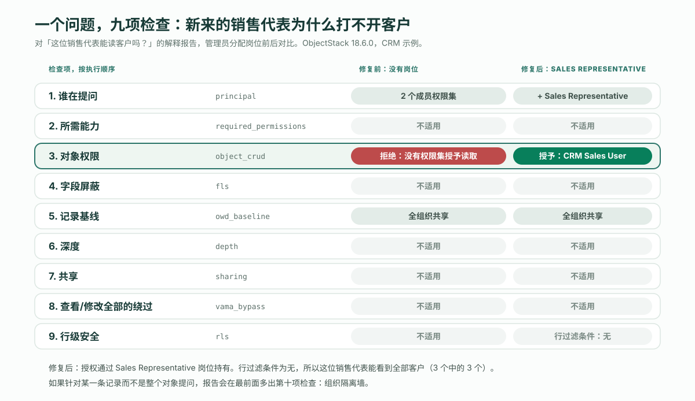

---
# @generated zh-Hant from zh-Hans (s2twp) — edit the zh-Hans file; delete this line to hand-maintain.
title: 銷售說看不到客戶：管理員怎麼回答？
description: 去問執行環境，而不是翻設定頁面：權限解釋報告跑的正是執行時的那些檢查，會指出是哪一項拒絕了、是哪個角色授予了。基於 ObjectStack 18.6.0 的 CRM 示例實測。
author: ObjectStack Team
date: 2026-11-30
status: published
topic: governance
audience: it
solutions: []
industries: []
cover: ./cover.svg
tags:
  - Agent 權限
  - RBAC
  - 權限解釋
---

銷售說看不到某個客戶時，別從一頁頁設定裡去拼答案，直接去問拒絕他們的那個系統。權限解釋報告會針對這一個人、這一個操作，跑一遍平台執行訪問控制時跑的同一套檢查，並指出說「不」的是哪一項檢查、說「行」的是哪個角色。管理員讀一行，改一處，回覆工單前再問一遍確認。這樣可以避免憑猜測修權限，而最省事的猜法往往是給得比崗位需要的更多。代價是：它只解釋權限，記錄根本不存在、或被某個介面篩掉了，仍然要有人去看。

*測量基於 ObjectStack 18.6.0，即今天新安裝得到的版本：用釋出標籤下的開源 CRM 示例，對著已釋出的軟體包執行。所有請求和響應見[證據](#證據)。*

## 工單，答上了

場景很平常。管理員給一位新來的銷售代表開了賬號。銷售代表登入，請求客戶列表，被拒絕了（我們的每個請求都是通過平台的程式設計介面發出的，而不是在介面上點的）：「You do not have permission to perform this action. Contact your administrator if you need access.」隨後來了一張工單：*銷售說看不到客戶。*

回答它有兩種辦法。一種是開啟這個使用者的設定，再看每個角色、每組權限，再看客戶物件的共享規則，然後在腦子裡推算平台會怎麼判。另一種是直接問平台：它判了什麼，為什麼。

ObjectStack 把第二種叫做**解釋引擎**（explain engine）。你給出一個人、一個物件和一個操作，它按執行時的順序，每項檢查返回一條，每條帶一個判定、一句說明，以及產生這個判定的來源名稱。它的回答裡會出現兩個平台術語。**權限集**（permission set）是一組具名的權限，比如「CRM Sales User：可以讀取、建立和編輯客戶與商機，不能刪除」**。崗位**（position）是分發權限集的工作角色：在 CRM 示例裡，Sales Representative（銷售代表）崗位分發 CRM Sales User。這個示例把客戶叫做 *accounts*，把商機叫做 *opportunities*，證據裡用的就是這兩個名字。

我們把這張工單，以及通常緊跟著的幾個問題，交給 CRM 示例上的解釋引擎回答，再逐條對照執行層對同一個使用者實際做了什麼。

| 管理員問了什麼 | 報告怎麼答 | 對你意味著什麼 |
|:--|:--|:--|
| 新來的銷售代表為什麼打不開客戶？ | **在物件權限這一項被拒絕**。「No resolved permission set grants read」，沒有任何權限集授予客戶的讀取權。這位銷售代表只持有每個成員自動獲得的兩個權限集。執行層也拒絕了同一個讀取請求。 | 賬號存在，只是沒有銷售角色。不是共享規則問題，不是資料問題，也不是 bug。 |
| 管理員分配了 Sales Representative 崗位之後，他能讀客戶了嗎？ | **允許**。物件權限**由 CRM Sales User 授予，通過 Sales Representative 崗位持有**。行過濾條件：無。隨後他的客戶列表返回了全部 3 個客戶。 | 改一處，再用同一個問題確認，然後才告訴銷售已經修好。 |
| 銷售代表能刪除商機嗎？ | **在物件權限這一項被拒絕**：沒有權限集授予刪除權。行級安全還會收窄刪除範圍；針對某一條商機提問時，報告給出了條件：只能刪自己建立的商機。執行層拒絕了刪除。 | 按報告的說法，只在銷售權限集里加上刪除權還不夠：成員只能刪自己建立的記錄。我們沒有真的授予刪除權去驗證。 |
| 銷售代表能讀商機嗎，能讀哪些？ | **允許**，由 CRM Sales User 通過 Sales Representative 授予。行過濾條件：無，即全部商機。執行層列出了全部 12 條。 | 行過濾條件就是列表和報表實際套用的條件。在允許讀取的前提下，「無」表示整張表。 |
| 銷售代表能匯出商機嗎？ | **在物件權限這一項被拒絕**：沒有權限集授予匯出權，儘管他能讀取每一條商機。執行層拒絕了匯出。 | 匯出是單獨的一項授權。問「他能讀嗎？」得到的是「能」，但什麼也說明不了。 |
| 誰可以問這些問題？ | 銷售代表問自己：有回答。一位沒有管理員角色的服務檯同事問銷售代表的情況：**被拒絕**。同一位同事被設為組織管理員之後：有回答。 | 訪問報告本身也受訪問控制。它說明誰持有什麼，所以不是誰都能看。 |

每一行都只要一次請求就能回答；完整記錄見[證據](#證據)。我們沒有給管理員讀報告計時，所以不對用時作任何斷言。



## 由構造保證的解釋

這份報告有用，不在於它詳細，而在於它不可能和執行層說的不一樣。ObjectStack 的指南說，解釋引擎[「走的是**執行中介軟體執行的同一條程式碼路徑**……所以報告是*由構造保證的解釋*（explained by construction），而不是一個可能逐漸走樣的平行重寫。」](https://github.com/objectstack-ai/objectstack/blob/958ee03594968c651db1bc40ecb05bfe72f94b2d/content/docs/permissions/explain.mdx#L7-L13)Schema 參考文件說得更短：這份報告[「就是執行本身，只是去掉了拋錯。」](https://github.com/objectstack-ai/objectstack/blob/958ee03594968c651db1bc40ecb05bfe72f94b2d/content/docs/references/security/explain.mdx#L12-L17)

這就是它和權限表格、角色示意圖的區別：後者描述的是某人*本來想*怎麼配置。描述會過時。這份報告不是第二份描述：按設計，它就是拒絕了這位銷售代表的那條程式碼路徑，只是不真的拒絕。我們沒有逐行審計這個設計。我們核對的範圍更窄：在這次執行裡，表格中執行層能夠印證的五個判定，每一個都和執行層隨後對同一個使用者的處理一致，逐個請求對得上。

讀一份報告，看三處就夠了：

1. **判定**。對這個人、這個物件、這個操作，允許還是不允許。
2. **說「不」的那項檢查**。有一條會被標為拒絕。在我們測到的每一次拒絕裡，它都是物件權限：檢查這個人持有的權限集裡，有沒有哪一個允許對這類記錄做這個操作。
3. **誰說了「行」**。授予的那一條會寫明是哪個權限集、這個人通過什麼方式持有它。「CRM Sales User，通過 Sales Representative 崗位」既告訴管理員該看什麼，也告訴他來源在哪。在物件權限這一項被拒絕時，報告不會點任何名字，因為沒有人授予。第一條會列出這個人實際持有的所有權限集，所以缺口一眼可見。

對讀取請求，報告還會帶上**行過濾條件**：平台給這個人的每個列表、搜尋和報表加上的條件。在 CRM 示例裡，每個客戶和商機都在整個組織內共享，所以這個條件為空。如果在一個銷售只能看到自己商機的應用裡，它會把那個條件顯示出來，而那個條件就是「為什麼他看得到這些商機、看不到那一條」的答案。

針對一個物件提問，報告返回九項檢查；針對某一條記錄提問，返回十項：最前面多了一道組織隔離牆，在我們這個單組織的安裝裡它的回答是「不適用」。ObjectStack 的兩份文件分別寫著[九項](https://github.com/objectstack-ai/objectstack/blob/958ee03594968c651db1bc40ecb05bfe72f94b2d/content/docs/permissions/explain.mdx#L20-L23)和[十項](https://github.com/objectstack-ai/objectstack/blob/958ee03594968c651db1bc40ecb05bfe72f94b2d/content/docs/references/security/explain.mdx#L19-L21)，原因就在這裡。

## 誰可以問

訪問報告說明一個人持有哪些權限集、是怎麼拿到的。這很敏感，所以提問本身也受控。在 18.6.0 上，執行環境的規則是：問自己，隨時可以；問別人，只有當你持有管理使用者的權限、管理著那個使用者所在的組織，或者持有覆蓋那個使用者的委派管理範圍時才可以（[原始碼](https://github.com/objectstack-ai/objectstack/blob/958ee03594968c651db1bc40ecb05bfe72f94b2d/packages/plugins/plugin-security/src/security-plugin-explain-access.ts#L134-L138)）。其他人一律被拒絕。

我們測了三種提問者。銷售代表問自己：有回答。一位服務檯同事，普通成員，問這位銷售代表的情況：被拒絕，拒絕資訊列出了三種合格的方式。管理員把這位同事設為組織管理員之後，平台給了他組織管理員權限集，同一個問題就有了回答。所以，組織管理員不需要持有平台級的使用者管理權限，也能回答這類工單。委派管理範圍這條路我們沒有測，它是讓服務檯回答這類工單更窄的一種方式。

## 為什麼也可以去看配置

解釋報告不是唯一的好工具，對某些工單也不是最好的那個。

- **看配置到哪兒都行，還能看到周邊**。像這個 CRM 示例這樣只有三個崗位、一個權限集時，開啟角色看一眼和提問一樣快，不依賴平台有沒有某個功能，而且能看到這個角色授予的全部內容，而不只是這一個判定。
- **以使用者身份登入能看到介面**。ObjectStack 允許管理員[模擬某個使用者來核實其訪問權限](https://github.com/objectstack-ai/objectstack/blob/958ee03594968c651db1bc40ecb05bfe72f94b2d/content/docs/permissions/authentication.mdx#L1230-L1233)，很多平台也有類似功能。如果投訴是「按鈕不見了」或「選單是空的」，看介面比讀檢查項快。報告回答的是一個判定為什麼是這樣；模擬登入回答的是這個人看到了什麼。
- **問政策問題，全域掃描勝過單點放大**。「誰能刪除商機？」是一個同時涉及所有角色的問題。ObjectStack 的指南自己就劃了這條線：解釋引擎[「是把同一套評估邏輯在執行時對準一個判定；訪問矩陣是構建時對所有判定的全面掃描」](https://github.com/objectstack-ai/objectstack/blob/958ee03594968c651db1bc40ecb05bfe72f94b2d/content/docs/permissions/access-matrix.mdx#L81-L83)。訪問矩陣我們在[怎樣在 AI 悄悄改動權限之前就把它攔下？](/zh-Hant/blog/catch-ai-silent-permission-change-access-matrix-gate/)裡講過。
- **找到修法、動手修改，都在設定裡**。一次拒絕告訴你缺的是什麼：這位銷售代表持有的權限集裡，沒有一個授予客戶的讀取權。它不會告訴你哪個角色能補上。你要去角色和權限集裡查，改動也是在那裡做的。在由 AI 編寫這些定義的平台上，改動會以一份 diff 的形式出現，由人來[評審](/en/blog/how-to-review-ai-generated-app-changes/)。

## 報告解決不了的事

- **它解釋權限，不解釋資料**。一個從沒被建立、已被合併掉、或者被某個檢視自己的篩選條件擋住的客戶，在投訴的人看來是一樣的。報告會說「允許」，客戶照樣不見。得有人去看。
- **它不判斷這個訪問對不對**。它告訴我們銷售代表不能匯出商機。銷售*該不該*能匯出商機，是政策問題；修法是給一個崗位還是給一個更窄的權限集，也是。
- **它不顯示這次修復還順帶授予了什麼**。我們問的是讀取客戶。我們分配的崗位還讓這位銷售代表能建立和編輯客戶、聯絡人、商機、商機產品明細、線索和活動。報告確認的只是我們問的那一個判定。要看一個角色帶來的全部權限，去讀這個角色，或者用構建時的訪問矩陣。
- **有些答案要再問一次**。對刪除操作，針對物件的報告說行級安全收窄了範圍，但沒有給出條件。針對某一條商機提問，它給出了：只能刪自己建立的商機。它給這條規則貼的是一個通用標籤，而不是這條策略在平台預設權限集裡的名字；證據裡兩者都有。
- **先看判定，再看行過濾條件**。在一次被拒絕的讀取裡，報告仍然帶著一個空的行過濾條件，單獨看會被理解成「所有行」。[Schema 參考文件](https://github.com/objectstack-ai/objectstack/blob/958ee03594968c651db1bc40ecb05bfe72f94b2d/content/docs/references/security/explain.mdx#L110)說，判定要看「是否允許」加上行級安全那一項，而不是單看過濾條件。
- **它需要安全外掛**。指南說得很直白：[「沒有 `@objectstack/plugin-security` 的部署會返回 501」](https://github.com/objectstack-ai/objectstack/blob/958ee03594968c651db1bc40ecb05bfe72f94b2d/content/docs/permissions/explain.mdx#L116)，也就是根本無法回答。

ObjectStack 的指南還說，Studio 的 Access 區域就是在這份報告之上構建了它的[「這個使用者為什麼能訪問？」面板](https://github.com/objectstack-ai/objectstack/blob/958ee03594968c651db1bc40ecb05bfe72f94b2d/content/docs/permissions/explain.mdx#L120-L121)。我們測的是報告的程式設計介面，不是那個介面。

## 開發中

報告的格式已經預留了比現在填充得更多的位置。Schema 參考文件描述了每個人的身份層級（平台管理員、組織管理員、成員、外部成員），以及一個標記哪些檢查屬於組織隔離牆的欄位，稱之為[「β 引擎和介面將會填充的」](https://github.com/objectstack-ai/objectstack/blob/958ee03594968c651db1bc40ecb05bfe72f94b2d/content/docs/references/security/explain.mdx#L30-L34)詞彙。在 18.6.0 上，針對某一條記錄提問時，這兩樣已經都出現了：每項檢查都帶著隔離牆標記，銷售代表的身份層級返回為成員。針對物件的回答裡兩者都沒有。參考文件沒有說那個後續的引擎和介面還會增加什麼，我們也沒有測這兩個欄位之外的東西。

## 把你的 Agent 指向這份報告

如果你的應用的角色和權限集是 AI Agent 寫的，解釋報告就是人逐個判定檢查結果的辦法，也是 Agent 在把 diff 交給你之前檢查自己工作的辦法。[把你的 Agent 指向 ObjectStack](/en/blog/how-to-point-your-agent-at-objectstack/)，讓它解釋一下它剛剛授予的訪問權限。這些檢查在 Agent 的呼叫路徑上在哪裡執行，見[AI Agent 的權限在哪裡執行](/zh-Hant/blog/objectos-agent-permission-boundaries/)和[CRM 裡的 Agent 如何讀取客戶資料而不繞過權限](/zh-Hant/blog/crm-ai-understands-customers/)。相關術語見[權限模型](/zh-Hant/glossary/permission-model/)和[行級安全](/zh-Hant/glossary/row-level-security/)。

{/* the-proof */}
## 證據

以上所有內容均於 2026-11-23 在 ObjectStack **18.6.0** 上測得。

```text
$ npm view @objectstack/cli dist-tags
{ next: '0.0.0-next-20261123013358', latest: '18.6.0' }
$ npm view @objectstack/cli dist-tags.latest
18.6.0
```

### 準備

使用標籤 `@objectstack/cli@18.6.0`（提交 [`958ee03`](https://github.com/objectstack-ai/objectstack/commit/958ee03594968c651db1bc40ecb05bfe72f94b2d)）下的 CRM 示例，安裝的是已釋出的 18.6.0 軟體包，而不是單體倉庫裡的原始碼：它的 `workspace:*` 依賴改成了 `18.6.0`，去掉了測試目錄和僅用於測試的開發依賴。

```text
$ git -C ~/objectstack archive '@objectstack/cli@18.6.0' examples/app-crm | tar -x --strip-components=2
$ npm install
$ npx os --version
@objectstack/cli/18.6.0 linux-x64 node-v22.22.0
$ npx os dev --fresh -p 3276
  ...
  Security: 3 Positions  2 Permissions
  ...
  🔑  Dev admin: admin@objectos.ai / admin123
  Tenancy: single
  Seeds:   com.example.crm 28 rows
```

`--fresh` 會在一個空的、用完即棄的資料庫上啟動。管理員登入後，用 `POST /api/v1/auth/admin/create-user` 建立兩個賬號：`rep@example.com` 和 `helpdesk@example.com`，都沒有崗位。這個安裝關閉了自助註冊，所以由管理員來建立（這是在同一安裝上的另一次執行，原始輸出和上面的版本檢查一起儲存在腳本旁邊）：

```text
$ curl -s -X POST http://localhost:3276/api/v1/auth/sign-up/email -H 'Content-Type: application/json' -d '{"email":"newhire@example.com","password":"…","name":"newhire"}'
{"code":"SELF_REGISTRATION_CLOSED","message":"Self-registration is closed (audience posture invite_only). Ask an administrator for an invitation."}
HTTP 403
```

每個賬號用 `POST /api/v1/auth/sign-in/email` 登入，cookie 檔案 `admin.jar`、`rep.jar` 和 `helpdesk.jar` 儲存各自的會話。下面的使用者 id 都來自這次執行。

示例裡的銷售角色，標籤下的原文（[`sales-positions.ts`](https://github.com/objectstack-ai/objectstack/blob/958ee03594968c651db1bc40ecb05bfe72f94b2d/examples/app-crm/src/security/sales-positions.ts#L12-L17)，[第 44–61 行](https://github.com/objectstack-ai/objectstack/blob/958ee03594968c651db1bc40ecb05bfe72f94b2d/examples/app-crm/src/security/sales-positions.ts#L44-L61)）：

```typescript
export const SalesRepPosition = definePosition({
  name: 'crm_sales_rep',
  label: 'Sales Representative',
  description: 'Front-line sales representative.',
  permissionSets: ['crm_sales_user'],
});
// ...
    crm_account: { allowRead: true, allowCreate: true, allowEdit: true, allowDelete: false },
    crm_opportunity: { allowRead: true, allowCreate: true, allowEdit: true, allowDelete: false },
```

兩個物件都在整個組織內共享：`sharingModel: 'public_read_write'`（[account，第 11 行](https://github.com/objectstack-ai/objectstack/blob/958ee03594968c651db1bc40ecb05bfe72f94b2d/examples/app-crm/src/objects/account.object.ts#L11)；[opportunity，第 12 行](https://github.com/objectstack-ai/objectstack/blob/958ee03594968c651db1bc40ecb05bfe72f94b2d/examples/app-crm/src/objects/opportunity.object.ts#L12)）。

### 1. 工單

```text
$ curl -b rep.jar http://localhost:3276/api/v1/data/crm_account
{"error":"You do not have permission to perform this action. Contact your administrator if you need access.","code":"PERMISSION_DENIED","object":"crm_account"}
HTTP 403
```

### 2. 管理員問原因：完整報告

```text
$ curl -b admin.jar 'http://localhost:3276/api/v1/security/explain?object=crm_account&operation=read&userId=v45jiPqcuzi9PL9I8olqaJ2pbhUAr3zX'
```

```json
{
  "allowed": false,
  "object": "crm_account",
  "operation": "read",
  "principal": {
    "userId": "v45jiPqcuzi9PL9I8olqaJ2pbhUAr3zX",
    "positions": ["org_member", "everyone"],
    "permissionSets": ["member_default", "storage_attachment_member"],
    "principalKind": "human"
  },
  "layers": [
    {
      "layer": "principal",
      "verdict": "neutral",
      "detail": "Principal rep (rep@example.com; id v45jiPqcuzi9PL9I8olqaJ2pbhUAr3zX) holds position(s) [org_member, everyone] resolving to permission set(s) [member_default, storage_attachment_member] (union-merged, most-permissive).",
      "contributors": [
        { "kind": "position", "name": "org_member" },
        { "kind": "position", "name": "everyone" },
        { "kind": "permission_set", "name": "member_default", "via": "additive baseline (ADR-0090 D5)" },
        { "kind": "permission_set", "name": "storage_attachment_member", "via": "additive baseline (ADR-0090 D5)" }
      ]
    },
    { "layer": "required_permissions", "verdict": "not_applicable", "detail": "'crm_account' declares no requiredPermissions for read.", "contributors": [] },
    { "layer": "object_crud", "verdict": "denies", "detail": "No resolved permission set grants read on 'crm_account'.", "contributors": [] },
    { "layer": "fls", "verdict": "not_applicable", "detail": "No field-level masking applies.", "contributors": [] },
    { "layer": "owd_baseline", "verdict": "neutral", "detail": "Record baseline (OWD) is public_read_write: rows are org-shared at this baseline.", "contributors": [] },
    { "layer": "depth", "verdict": "not_applicable", "detail": "Depth axis does not apply (baseline already org-wide).", "contributors": [] },
    { "layer": "sharing", "verdict": "not_applicable", "detail": "Baseline already grants the rows sharing would add.", "contributors": [] },
    { "layer": "vama_bypass", "verdict": "not_applicable", "detail": "No View/Modify All Data bypass.", "contributors": [] },
    { "layer": "rls", "verdict": "not_applicable", "detail": "No RLS policy applies.", "contributors": [] }
  ],
  "readFilter": null
}
```

九條。JSON 是原樣返回的響應，只是把每一條折成了更少的行。

### 3. 修復，然後再問同一個問題

```text
$ curl -b admin.jar -X POST http://localhost:3276/api/v1/data/sys_user_position \
    -H 'Content-Type: application/json' \
    -d '{"user_id":"v45jiPqcuzi9PL9I8olqaJ2pbhUAr3zX","position":"crm_sales_rep","reason":"Ticket: rep cannot open customers"}'
{'display_title': 'rep → crm_sales_rep', 'granted_by': 'hsitZYEkgelqpLEjjjzndGTJU2M9jnnI', 'reason': 'Ticket: rep cannot open customers'}

$ curl -b admin.jar 'http://localhost:3276/api/v1/security/explain?object=crm_account&operation=read&userId=v45jiPqcuzi9PL9I8olqaJ2pbhUAr3zX'
allowed: True | layers: 9 | readFilter: null
  object_crud  grants  read on 'crm_account' is granted by [crm_sales_user].
               contributors: [{"kind": "permission_set", "name": "crm_sales_user", "via": "position:crm_sales_rep"}]
  (the other eight entries as in step 2; principal now lists crm_sales_rep and crm_sales_user)

$ curl -b rep.jar 'http://localhost:3276/api/v1/data/crm_account?fields=name&limit=50'
HTTP 200 | total: 3 | names: ['Acme Corp', 'Globex Ltd', 'Initech']
```

分配記錄寫明瞭是誰授予的、為什麼授予。以 `allowed:` 開頭的行是我們的腳本對報告的一行摘要；每個請求的原始 JSON 都儲存在腳本旁邊。

### 4. 商機：刪除、讀取、匯出，以及執行層的處理

```text
$ curl -b admin.jar 'http://localhost:3276/api/v1/security/explain?object=crm_opportunity&operation=delete&userId=v45jiPqcuzi9PL9I8olqaJ2pbhUAr3zX'
allowed: False | layers: 9 | readFilter: (absent)
  object_crud  denies   No resolved permission set grants delete on 'crm_opportunity'.
  rls          narrows  Row-level security narrows the row set (see readFilter for the composed predicate).

$ curl -b admin.jar 'http://localhost:3276/api/v1/security/explain?object=crm_opportunity&operation=read&userId=v45jiPqcuzi9PL9I8olqaJ2pbhUAr3zX'
allowed: True | layers: 9 | readFilter: null
  object_crud  grants   read on 'crm_opportunity' is granted by [crm_sales_user].  via position:crm_sales_rep

$ curl -b admin.jar 'http://localhost:3276/api/v1/security/explain?object=crm_opportunity&operation=export&userId=v45jiPqcuzi9PL9I8olqaJ2pbhUAr3zX'
allowed: False | layers: 9 | readFilter: null
  object_crud  denies   No resolved permission set grants export on 'crm_opportunity'.

$ curl -b rep.jar -X DELETE http://localhost:3276/api/v1/data/crm_opportunity/2qolV83IXvGaXxdA
{"error":"You do not have permission to perform this action. Contact your administrator if you need access.","code":"PERMISSION_DENIED","object":"crm_opportunity"}
HTTP 403

$ curl -b rep.jar 'http://localhost:3276/api/v1/data/crm_opportunity?fields=name&limit=50'
{"object":"crm_opportunity","records":[ … 12 deals … ],"total":12,"hasMore":false}
HTTP 200

$ curl -b rep.jar http://localhost:3276/api/v1/data/crm_opportunity/export
{"code":"EXPORT_NOT_PERMITTED","error":"Export is not permitted on object 'crm_opportunity' for this user","object":"crm_opportunity"}
HTTP 403
```

沒有列出的條目和第 2 步相同。刪除報告根本沒有 `readFilter` 欄位，`(absent)` 就是這個意思。指南解釋了為什麼匯出要單獨問：[「`export` 是唯一一個無法從 `read` 推斷出答案的操作」](https://github.com/objectstack-ai/objectstack/blob/958ee03594968c651db1bc40ecb05bfe72f94b2d/content/docs/permissions/explain.mdx#L77-L86)；權限集文件則說明[沒有任何內建權限集帶有匯出授權](https://github.com/objectstack-ai/objectstack/blob/958ee03594968c651db1bc40ecb05bfe72f94b2d/content/docs/permissions/permission-sets.mdx#L94-L101)。

### 5. 針對一條記錄：十條

```text
$ curl -b admin.jar 'http://localhost:3276/api/v1/security/explain?object=crm_opportunity&operation=read&userId=v45jiPqcuzi9PL9I8olqaJ2pbhUAr3zX&recordId=2qolV83IXvGaXxdA'
allowed: True | layers: 10 | readFilter: null
  tenant_isolation  not_applicable  Layer 0 tenant isolation — the always-first org wall, AND-composed before any business RLS (ADR-0095 D1).
  principal … rls   (the nine entries of step 4's read, each now with kernelTier; principal adds "posture": "MEMBER")
record: {"recordId": "2qolV83IXvGaXxdA", "visible": true, "decidedBy": "object_crud"}

$ curl -b admin.jar 'http://localhost:3276/api/v1/security/explain?object=crm_opportunity&operation=delete&userId=v45jiPqcuzi9PL9I8olqaJ2pbhUAr3zX&recordId=2qolV83IXvGaXxdA'
allowed: False | layers: 10 | readFilter: (absent)
record: {"recordId": "2qolV83IXvGaXxdA", "visible": false, "decidedBy": "object_crud"}
```

針對物件的回答沒有租戶這一層：引擎原始碼在一條註釋裡寫明瞭，[「no tenant_isolation layer, no kernelTier, no posture」](https://github.com/objectstack-ai/objectstack/blob/958ee03594968c651db1bc40ecb05bfe72f94b2d/packages/plugins/plugin-security/src/explain-engine.ts#L2926-L2927)。

針對記錄的刪除請求裡，行級安全那一條的原樣返回：

```json
{
  "layer": "rls",
  "verdict": "narrows",
  "detail": "Row-level security narrows the row set (see readFilter for the composed predicate).",
  "contributors": [],
  "record": {
    "outcome": "excluded",
    "rowFilter": { "created_by": "v45jiPqcuzi9PL9I8olqaJ2pbhUAr3zX" },
    "matchesRecord": false,
    "rules": [
      {
        "kind": "rls_policy",
        "name": "business_rls",
        "predicate": { "created_by": "v45jiPqcuzi9PL9I8olqaJ2pbhUAr3zX" },
        "effect": "excludes"
      }
    ],
    "detail": "The record does not satisfy the business row-level predicate."
  },
  "kernelTier": "layer_1_business"
}
```

這個條件來自每個已登入成員都持有的成員權限集，策略名為 `owner_only_deletes`（`created_by == current_user.id`，繫結到 `org_member`；[`default-permission-sets.ts` 第 928–934 行](https://github.com/objectstack-ai/objectstack/blob/958ee03594968c651db1bc40ecb05bfe72f94b2d/packages/plugins/plugin-security/src/objects/default-permission-sets.ts#L928-L934)）。這條預置的商機是啟動時建立的，不是這位銷售代表建立的，所以被排除。

### 6. 誰可以問

```text
$ curl -b rep.jar 'http://localhost:3276/api/v1/security/explain?object=crm_opportunity&operation=delete'      # yourself: no userId
HTTP 200
allowed: False | layers: 9 | readFilter: (absent)

$ curl -b helpdesk.jar 'http://localhost:3276/api/v1/security/explain?object=crm_opportunity&operation=delete&userId=v45jiPqcuzi9PL9I8olqaJ2pbhUAr3zX'
{"success":false,"error":{"code":"PERMISSION_DENIED","message":"[Security] Access denied: explaining another user's access requires the 'manage_users' capability, organization administration of an organization that user is a member of, or a delegated adminScope covering that user (ADR-0090 D6/D12)."}}
HTTP 403

$ curl -b admin.jar -X POST http://localhost:3276/api/v1/auth/organization/update-member-role \
    -H 'Content-Type: application/json' -d '{"memberId":"mem_mwsnwe0oznkd4j6u","role":"admin"}'
{…,"role":"admin","id":"mem_mwsnwe0oznkd4j6u","outcome":"permission_set_granted","grantedPermissionSet":{"name":"organization_admin_no_bypass","label":"Organization Administrator (no record bypass)"}}
HTTP 200

$ curl -b admin.jar 'http://localhost:3276/api/v1/data/sys_user_permission_set?limit=50'    # the help desk's row, picked from the list by user_id
{'permission_set': 'organization_admin_no_bypass', 'organization_id': 'org_mwsnwbk2cl1ypwnm', 'reason': "auto-org-admin-grant: granted from membership grade 'admin' (sys_member mem_mwsnwe0oznkd4j6u) → organization_admin_no_bypass"}

$ curl -b helpdesk.jar 'http://localhost:3276/api/v1/security/explain?object=crm_opportunity&operation=delete&userId=v45jiPqcuzi9PL9I8olqaJ2pbhUAr3zX'
HTTP 200
allowed: False | layers: 9 | readFilter: (absent)
```

組織管理員權限集帶的是 `manage_org_users`，不是 `manage_users`：[`default-permission-sets.ts` 第 461 行](https://github.com/objectstack-ai/objectstack/blob/958ee03594968c651db1bc40ecb05bfe72f94b2d/packages/plugins/plugin-security/src/objects/default-permission-sets.ts#L461)列出了 `organization_admin` 的系統權限，不帶記錄繞過的變體原樣繼承了它們（[第 1652–1656 行](https://github.com/objectstack-ai/objectstack/blob/958ee03594968c651db1bc40ecb05bfe72f94b2d/packages/plugins/plugin-security/src/objects/default-permission-sets.ts#L1652-L1656)）。執行環境通過呼叫方檢查裡「組織管理員」這一分支放行它（[`security-plugin-explain-access.ts` 第 152–165 行](https://github.com/objectstack-ai/objectstack/blob/958ee03594968c651db1bc40ecb05bfe72f94b2d/packages/plugins/plugin-security/src/security-plugin-explain-access.ts#L152-L165)；拒絕資訊見[第 197–200 行](https://github.com/objectstack-ai/objectstack/blob/958ee03594968c651db1bc40ecb05bfe72f94b2d/packages/plugins/plugin-security/src/security-plugin-explain-access.ts#L197-L200)）。

### 7. 引用的原文，在 18.6.0 標籤下

以 `content/docs/` 開頭的路徑省略了這一字首。

- `permissions/explain.mdx`：[第 7–13 行](https://github.com/objectstack-ai/objectstack/blob/958ee03594968c651db1bc40ecb05bfe72f94b2d/content/docs/permissions/explain.mdx#L7-L13)（九層，由構造保證的解釋），[第 20–23 行](https://github.com/objectstack-ai/objectstack/blob/958ee03594968c651db1bc40ecb05bfe72f94b2d/content/docs/permissions/explain.mdx#L20-L23)（九層的順序），[第 77–86 行](https://github.com/objectstack-ai/objectstack/blob/958ee03594968c651db1bc40ecb05bfe72f94b2d/content/docs/permissions/explain.mdx#L77-L86)（匯出），[第 97–109 行](https://github.com/objectstack-ai/objectstack/blob/958ee03594968c651db1bc40ecb05bfe72f94b2d/content/docs/permissions/explain.mdx#L97-L109)（誰可以問），[第 116 行](https://github.com/objectstack-ai/objectstack/blob/958ee03594968c651db1bc40ecb05bfe72f94b2d/content/docs/permissions/explain.mdx#L116)（沒有安全外掛時返回 501），[第 120–121 行](https://github.com/objectstack-ai/objectstack/blob/958ee03594968c651db1bc40ecb05bfe72f94b2d/content/docs/permissions/explain.mdx#L120-L121)（Studio 面板）。
- `references/security/explain.mdx`：[第 12–17 行](https://github.com/objectstack-ai/objectstack/blob/958ee03594968c651db1bc40ecb05bfe72f94b2d/content/docs/references/security/explain.mdx#L12-L17)（就是執行本身，只是去掉了拋錯），[第 19–21 行](https://github.com/objectstack-ai/objectstack/blob/958ee03594968c651db1bc40ecb05bfe72f94b2d/content/docs/references/security/explain.mdx#L19-L21)（十層），[第 30–34 行](https://github.com/objectstack-ai/objectstack/blob/958ee03594968c651db1bc40ecb05bfe72f94b2d/content/docs/references/security/explain.mdx#L30-L34)（預留的詞彙）。
- `packages/plugins/plugin-security/src/explain-engine.ts`：[第 2926–2927 行](https://github.com/objectstack-ai/objectstack/blob/958ee03594968c651db1bc40ecb05bfe72f94b2d/packages/plugins/plugin-security/src/explain-engine.ts#L2926-L2927)（針對物件的回答沒有租戶層）。
- `packages/plugins/plugin-security/src/security-plugin-explain-access.ts`：[第 134–138 行](https://github.com/objectstack-ai/objectstack/blob/958ee03594968c651db1bc40ecb05bfe72f94b2d/packages/plugins/plugin-security/src/security-plugin-explain-access.ts#L134-L138)（誰可以檢視另一個使用者的情況）。
- `permissions/access-matrix.mdx`：[第 81–83 行](https://github.com/objectstack-ai/objectstack/blob/958ee03594968c651db1bc40ecb05bfe72f94b2d/content/docs/permissions/access-matrix.mdx#L81-L83)（單點放大與全域掃描）。
- `permissions/authentication.mdx`：[第 1230–1233 行](https://github.com/objectstack-ai/objectstack/blob/958ee03594968c651db1bc40ecb05bfe72f94b2d/content/docs/permissions/authentication.mdx#L1230-L1233)（模擬使用者以核實訪問權限）。
