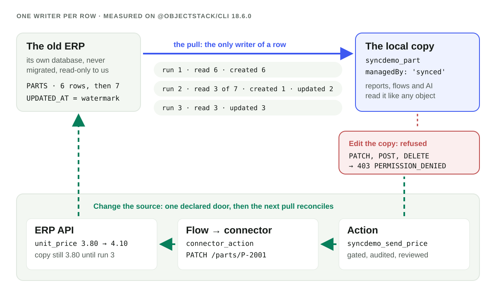

**データが秒単位で最新でなければならないとき、あるいは他のどこにも保存してはならないときは、ソースシステムをライブで読みます。人、レポート、AI がそれを結合し、絞り込み、全速で質問する必要があるときは、コピーして取り込みます**。どちらにも代償があります。ライブで読むと毎回ソースシステムを待つことになり、1 つのクエリで 2 つのデータベースを組み合わせることはできません。コピーの鮮度は、直近の定期更新の時点までです。コピーするなら、**1 行に書き手は 1 人**を守ってください。コピーに書き込むのは定期更新だけで、誰も編集できません。管理者もです。変更はソース側で、そのために用意した 1 つのアクションを通じて行い、次の更新がそれを取り込みます。私のテストでは、1 回の更新がソースの 7 行中 3 行だけを読み、コピーへの編集はメンバーも管理者も同じように拒否されました。

*ObjectStack 18.6.0 で実測。2026-11-20 時点で公開されていた最新版です。すべての記録は最後のセクション「証拠」にあります。*

## ライブで読むか、コピーして取り込むか？

**フェデレーション**は行を元の場所に置いたまま、クエリを 1 つずつソースへ転送します。**同期取り込み**（sync-in）は、行をスケジュールに沿って、プラットフォームが所有する通常のテーブルへコピーします。**コネクタアクション**は、ボタンや自動化から相手のシステムを呼び出し、その行を 1 行も保存しません。同期に関する ObjectStack の設計記録 ADR-0153（18.6.0 のタグ時点ではまだ「提案」ステータス）は、次のように選び分けます。

| あなたの状況 | 選択 |
|:--|:--|
| ライブのデータが要る、1 度に 1 テーブル。レガシーシステムに手を触れてはならない。ソースの外に保存してはならないデータ | **ライブで読む**（フェデレーション） |
| レポート、分析、AI への質問、ソースをまたぐ結合。遅い、または壊れやすいレガシーシステム。データウェアハウスの結果 | **コピーして取り込む**（同期取り込み） |
| 相手のシステムで何かを起こしたいだけ。行は保存しない | **どちらでもない**：コネクタアクション |

ライブで読む側の論拠は強力です。フェデレーションしたテーブルは常に最新で、ソースでの変更とメンバーが見る内容との間に遅れはありません。何も複製されないので、保護し、保持し、削除すべき個人データの 2 つ目のコピーもありません。そしてソースは、データが書き込まれる唯一の場所であり続けます。[姉妹記事](/ja/blog/ai-business-layer-over-an-existing-database/)はフェデレーションをそれ自身の論理でたどり、[既存システムとの連携](/ja/connect-existing-systems/)のページは 3 つを並べて比べています。必要なのがこうした性質なら、ここで止めてください。コピーは間違った道具です。

ライブで読む方式が限界に当たったときは、コピーのほうがよい選択です。プラットフォームは 2 つのデータベースを 1 つのクエリで結合できず（それぞれを読み、メモリ上で行を組み合わせます）、読み取りのたびにリモートシステムを待ち、追加のデータベースコネクタ経由の読み取りには最大行数の制限があります。設計記録の言葉では「行を通常のオブジェクトへコピーすれば、それらの制限はなくなる。インデックス、クエリ演算子、権限、稼働はプラットフォームのものになる」。コピーしてしまえば、それは既存の権限、レポート、AI ツールが変更なしで読めるもう 1 つのテーブルです。

## コピーを誠実に保つルール：1 行に書き手は 1 人

どんなコピーにも、2 つ目の記録システムへずれていくリスクがあります。誰かがコピー上で価格を直し、ソースはそれを知らず、両者が食い違うのです。1 行に書き手は 1 人は、ランタイムが強制する 4 つのルールでそれを防ぎます。

1. **行を書くのはプルです**。プルとは定期更新のことです。ソースを読んでコピーに書き込むジョブで、ユーザーではなくプラットフォーム自身の ID で動き、前回の実行以降に変わった分だけを読みます。その行を見つける手がかりが*ウォーターマーク*、つまりソース側の「最終更新」列です。
2. **ほかの誰も書きません**。コピーは*同期オブジェクト*として宣言されます。プルだけが行を書けるテーブルです。メンバー、管理者、API 呼び出し元による編集、追加、削除は、権限が何であっても拒否されます。
3. **変更はソースへ、宣言済みアクションを通じて行います**。*宣言済みアクション*とは、アプリ内で定義され、独自の権限チェックを持ち、ソース自身の API を呼び出すボタンです。コピーには触れず、次のプルがコピーを更新します。
4. **ほかの方向はありません**。双方向同期も、競合する編集のマージもありません。

ルール 4 が要です。双方向同期では 1 行に書き手が 2 人いるので、両側が変更した行のための方針が必要です。後勝ち、フィールド単位のマージ、人が解決しなければならない競合キュー。どれも、片方の変更を捨てるか、人が裁定する必要があるかのどちらかです。書き手が 1 人なら、そういう行は存在せず、失敗するマージもありません。



## 私が試したこと、そしてそれがあなたにとって意味すること

新しい ObjectStack アプリを「古い ERP」の代役である 6 つの部品の小さなデータベースにつなぎ、メンバーの Mia にコピーの読み取り権限と、わざと編集権限も与えて、権限でルールを回避できるかを確かめました。このテストでプルは 30 秒ごとに実行しました。遅れの大きさはあなたのスケジュールで決まります。時刻は 2026-11-20 の UTC です。

| 私がしたこと | システムの応答 | あなたにとっての意味 |
|:--|:--|:--|
| コピーから「synced」マーカーを外してアプリをビルドした | ビルドが失敗し、欠けているマーカーを名指しした | ビルドが通れば、保護は有効になっている |
| 02:38:30 にプルを 1 回実行させ、続いて Mia にコピーを一覧させた | 6 行を読み、6 行を作成し、完了。実行記録を 1 件残した。Mia には 6 行が見えた | 更新はすべて記録に残り、メンバーはコピーを他のテーブルと同じように読める |
| 編集権限を持つ Mia が P-2001 の価格を変えた。管理者も同じことを試した | 両方とも拒否。メッセージは代わりに何をすべきかを示した | 編集権限を持つメンバーも管理者も、アプリやその API からコピーを編集できない |
| ERP で直接 P-1003 を変更し、P-3002 を追加した | 次の実行、02:39:00：7 行中 3 行を読み、1 行作成、2 行更新 | 更新が読むのは変わった分で、テーブル全体ではない |
| Mia が P-2001 でアクション「Change price in ERP」を実行し、その行を読んだ | 許可。ERP の API が更新を 1 件記録した。コピーはまだ 3.8 だった | アクションが変えたのはソースで、コピーではない |
| 次の実行、02:39:30 を待った | 3 行を読み、3 行更新。P-2001 は 4.1 になった | コピーが示すのは、常に ERP が保持している値だけ |

細かい点が 2 つあります。2 回目の実行で「更新」された 2 行のうち、P-3001 は変わっていませんでした。実行は、前回止まった位置にある行を読み直すからです。この数は「変わった行」ではなく「書き込んだ行」と読んでください。また、定期ジョブは既定でオフです。デプロイ側でオンにしない限り、プルは一度も実行されません。

## コピーが受け継がないもの

- **ソースの権限**。ERP で誰がその行を読めるかは、行と一緒にはコピーされません。コピーの権限はアクセスなしから始まり、メンバーは付与を通じてのみ読めます。Mia は自分の権限セットでコピーを読み、付与のないソーステーブルでは拒否されました。目指すべき構成です。コピーした行には所有者がいないので、コピーを全メンバーが読めるようにするか、非公開のまま共有ルールで読み取りを付与します。
- **実行履歴（メンバーにとって）**。Mia が読もうとすると拒否されました。どのテーブルとも同じく、付与が必要です。
- **削除**。18.6.0 では、ソースで削除された行はコピーに残ります（ジョブガイド：「削除関連のキーはまだ何も変えない」。私はこれを実行していません）。そうした行に印を付ける機能は開発中です。下で触れます。
- **組織（複数組織のデプロイの場合）**。プラットフォームは推測しません。分離された複数組織モードで動かすと、同じアプリはソースが組織の範囲を宣言するまで起動を拒否し、その後はジョブが自分の組織を名乗るまでプルをスケジュールしませんでした。1 組織に 1 ジョブです。
- **パイプライン**。コピーは 1 つのソーステーブル、1 つのマッピング、1 つのターゲットです。設計記録：「ObjectStack はパイプラインや変換を作らない。ソースをまたぐ結合、クレンジング、集計はデータウェアハウスや ETL ベンダーの仕事であり、ObjectStack はその結果を同期して取り込む」。クレンジングと結合を済ませたビューが必要ですか？ ウェアハウスで作り、その結果をプルしてください。

## 開発中

以下は設計記録で設計されていますが、18.6.0 には含まれていません。このセクションでは何も実行していません。ここでの 18.6.0 に関する記述は、その変更履歴とガイドからの引用です。

- ソースで削除された行：設計では削除済みとして印を付け、決して取り除かない。
- すべての行に出どころの印：どこから来て、どの実行が書いたか。
- Studio の同期ウィザード。実行履歴を画面に表示する。
- データウェアハウス（Snowflake、BigQuery）をソースに。追加のコネクタ経由で。
- 同期ガイドとエージェント用スキル。

<details>
<summary>設計記録、変更履歴、ガイドの原文</summary>

- **削除ポリシー**。ソースから消えた行は印を付けられ、決して削除されない：「`deletePolicy: 'mark' | 'ignore'`、既定は `mark`、`_sync_deleted_at` を記録する」、そして「プルが行を物理的に削除することはない」。差分プルは、ソースの論理削除フィールド `deletedField` を通じて削除を検知する。18.4.0 の変更履歴によれば、これらのキーは解析され、「まだ何も変えないことを作者に警告し続ける」。18.6.0 でも `os validate` は、`deletePolicy` をまだ何も読まないと警告する（この節で実際に実行した唯一の確認）。
- **すべての行の出どころ列**。予約済みの接頭辞の下にある 5 つのプラットフォーム列：「`_sync_source`」「`_sync_external_id`」「`_sync_pulled_at`」「`_sync_run_id`」「`_sync_deleted_at`」。18.6.0 のプルはそのヘッダーでこう述べる：「削除の印付け（D3）、出どころ列（D4）、ドリフト（D6）は後続の変更である」。今は実行記録が出どころの記録であり、接頭辞はすでに予約済みなので、`_sync_…` という名前のフィールドは拒否される。
- **Studio の同期ウィザード**。「Studio の同期ウィザードは `synced` オブジェクト、`mapping`、その `job` を作成する」。実行時に作成できるジョブが必要で、記録はそれを「ジョブはコードでのみ定義する」の唯一の例外として設計している：「ランタイムの入口は、唯一の実行形式が `pull` である `job` を受け付ける」。Studio はさらに「同期オブジェクトとそのソースのページで実行履歴」を表示する予定。
- **ウェアハウスをソースに**。「修正 `6731744658` はウェアハウスを第一級のプルソースにする」。Snowflake と BigQuery のドライバーは「このリポジトリ外のプラグインパッケージ」で、プラグインドライバー適合性キットで検証される。正しさの下限で守られたプラグインドライバーは「両端に境界のあるウィンドウ」で読まれ、ウィンドウが行数上限を超えて返る間は「半分」にされる。
- **同期ガイドとスキル**。「三方向のルールとパートナーの立場（D10）、書き戻しへの答え（D5）、そして `SYNC_ARCHITECTURE.md` と `mapping` / `job` を指すスキル」。それまでは、ジョブガイドの「Pulling a mapping」節と mapping リファレンスがドキュメントになる。

</details>

## エージェントが書いたときのレビュー方法

エージェントが書く同期は 5 つの宣言で、書き戻しを含むならアクションとフローが加わります。確認するのは 4 点です。

1. **コピーに同期のマーカーがあること**（ターゲットの `managedBy: 'synced'`）。これがないとビルドが同期を拒否するので、ビルドが通っていれば付いています。
2. **誰がコピーを読めるか**：共有モデルと権限セット。どちらもアクセスなしから始まります。
3. **ソースの最終更新列とキー**。書き込みのたびに変わらない最終更新列は、変更を黙って失います。キーは一意で、決して空であってはなりません。プルはどちらも確認できず、ソース側が保証する必要があります。
4. **書き戻しアクションとそのフロー**（ある場合）：ソースへ戻る唯一の経路です。外部への呼び出しと同じようにレビューしてください。何を、誰に送り、誰が実行できるのか。

そのうえで、最初の実行記録の読み取り行数をソースの行数と比べてください。

## エージェントに向けてください

コーディングエージェントにジョブガイド（`objectstack.ai/docs/automation/jobs`、「Pulling a mapping」）と mapping リファレンスを渡し、ルールを 1 行で伝えてください。`datasourceSource` を持つ `mapping` と、`pull` がそれを指す `job` を通じて、`managedBy: 'synced'` のオブジェクトへコピーする。コピーには決して書き込まない。ソースは宣言済みアクションで変更する。[ObjectStack 向けにコーディングエージェントを設定するガイド](/en/blog/how-to-point-your-agent-at-objectstack/)が、このルールを運ぶルールファイルと MCP エンドポイントを扱っています。このマッピングは、[古いシステムからスプレッドシートをインポートする](/ja/blog/how-to-import-a-spreadsheet-from-an-old-system/)ときと同じ `fieldMapping` と `upsertKey` を使います。プルとは、そのインポートをジョブがライブのソースに対して実行するものであり、コピーは[オントロジー](/ja/glossary/ontology/)の中のもう 1 つのオブジェクトです。同期カーネルは、フェデレーションと同じく Apache-2.0 のオープンソースです。

## 証拠

ここにあるものはすべて `@objectstack/cli` 18.6.0 で実行しました。2026-11-20 に `npm view @objectstack/cli dist-tags` が `latest` と報告したバージョンで、新しい `npm create objectstack@latest` の雛形を使っています。

### 5 つの宣言

「古い ERP」は、アプリが所有しない SQLite ファイルで、テーブル `PARTS` が 1 つあり、6 つの部品と `UPDATED_AT` 列を持っています。

```ts
// 1. The ERP's database: external, so no DDL ever runs there.
export const Erp = defineDatasource({
  name: 'erp', driver: 'sqlite', schemaMode: 'external',
  config: { filename: './legacy/erp.db' },
  external: { allowWrites: false, validation: { onMismatch: 'fail', checkOnBoot: true } },
});

// 2. The PARTS table, federated. PART_NO is mapped onto `id`: that is the source key.
export const ErpPart = ObjectSchema.create({
  name: 'syncdemo_erp_part', datasource: 'erp', sharingModel: 'private',
  external: {
    remoteName: 'PARTS',
    columnMap: { PART_NO: 'id', DESCRIPTION: 'description', UNIT_PRICE: 'unit_price', UPDATED_AT: 'updated_at' },
  },
  fields: {
    description: Field.text({ label: 'Description' }),
    unit_price: Field.number({ label: 'Unit price', scale: 2 }),
    updated_at: Field.datetime({ label: 'Updated at (ERP)' }),
  },
});

// 3. The local copy: an ordinary object that only the pull writes.
export const Part = ObjectSchema.create({
  name: 'syncdemo_part', managedBy: 'synced', sharingModel: 'public_read',
  fields: {
    part_no: Field.text({ label: 'Part no', required: true }),
    description: Field.text({ label: 'Description' }),
    unit_price: Field.number({ label: 'Unit price', scale: 2 }),
    source_updated_at: Field.datetime({ label: 'Updated at (ERP)' }),
  },
});

// 4. The sync, defined on its target: where rows come from, how they map, how one matches.
export const ErpPartsPull = defineMapping({
  name: 'erp_parts_pull', targetObject: 'syncdemo_part',
  mode: 'upsert', upsertKey: ['part_no'],
  fieldMapping: [
    { source: 'id', target: 'part_no' },
    { source: 'description', target: 'description' },
    { source: 'unit_price', target: 'unit_price' },
    { source: 'updated_at', target: 'source_updated_at' },
  ],
  datasourceSource: { object: 'syncdemo_erp_part', watermark: { field: 'updated_at', start: '2026-01-01' } },
});

// 5. When. No code: `pull` names the mapping.
export const ErpPartsPullJob = defineJob({
  name: 'erp_parts_pull_job',
  schedule: { type: 'interval', intervalMs: 30000 },
  pull: { mapping: 'erp_parts_pull' },
});
```

`job` はスケジュールに沿ってマッピングを実行し、インポートランナーを通じてシステムとして書き込みます。spec の変更履歴は、`managedBy: 'synced'` が有効にするものを挙げています：「エンジンの書き込みガードはメンバーの汎用書き込みを拒否する（403）、`apiMethods` の調整はすべての書き込みメソッドを外す、`/me/permissions` のクランプは閉じた行をそのまま答える」。

### ビルドでの拒否

`objectstack validate` は通りました。ターゲットから `managedBy: 'synced'` を外すと、同じコマンドは 1 で終了しました：

```text
✗ Mapping 'erp_parts_pull' pulls rows into object 'syncdemo_part' through its datasourceSource,
  but that object is not managedBy: 'synced' (it is unset). A pulled copy is read-only to members,
  so a member's edit is never kept or lost silently by the next pull; declare managedBy: 'synced'
  on the target object (ADR-0153 D4).
```

変更履歴には、ビルド時と最初の読み取り前にもう一度実行される他の拒否も挙げられています。ソース付きマッピングは `upsertKey` を持つ `mode: 'upsert'` でなければならない、ソースは `columnMap` がある列を `id` に対応付けるフェデレーションオブジェクトでなければならない（`source_key_missing`）、ウォーターマークは `datetime`、`date`、または整数のフィールドでなければならない、そして `fieldMapping` のエントリがそれをそのままターゲットへコピーしなければならない（`watermark_field_unmapped`）。

### 実行

パッケージのジョブは、変数 `OS_AUTOMATION_SCHEDULED_WORK_ENABLED` が `true` の環境でのみスケジュールされます。ジョブガイドによれば、このスイッチは「**どのテナンシー形態でも、どのカーネルでも既定でオフ**」です。私はこれをオンにして `objectstack dev --fresh` を起動し、`syncdemo_part` の読み取りと、わざと編集も許可する権限セットを持つメンバー（Mia）を作成しました。最初のティックは 02:38:30 に実行され、Mia による `syncdemo_part` の一覧は `200` で 6 行を返しました。

**実行記録**。プルは毎回、ジョブの組織に `sys_sync_run` 行を 1 行残します。最初の 1 行を、重要なフィールドだけに絞ったもの：

```json
{ "mapping": "erp_parts_pull", "mapping_package": "com.example.syncdemo",
  "target_object": "syncdemo_part", "source_kind": "datasource", "source": "syncdemo_erp_part",
  "datasource": "erp", "read_path": "builtin", "trigger": "schedule", "status": "completed",
  "read_count": 6, "created_count": 6, "updated_count": 0, "refused_count": 0,
  "watermark_field": "updated_at",
  "watermark_from": "2026-01-01T00:00:00.000Z",
  "watermark_committed": "2026-11-09T16:05:00.000Z",
  "holds_position": true, "job_run_id": "run_741d4223-…", "failure_reason": null }
```

`watermark_committed` はこの実行が書いた最新の `UPDATED_AT` で、`holds_position: true` はこの行が次の実行の開始点であることを示します。ジョブ台帳とのつながりは `job_run_id`、つまりこの実行を起こしたティックの `sys_job_run` 行です。サービスの変更履歴は保持期間を定めています。行は「30 日間保持されるテレメトリで、ジョブ台帳の期間に合わせる。ただし、マッピング（パッケージと名前）と組織ごとに、読み取り位置を保持する 1 行は除く」。

**拒否された編集**。Mia はこのオブジェクトに `allowEdit: true` を持っています。P-2001 の価格に対する彼女の `PATCH`：

```json
HTTP 403
{ "error": "[Security] Access denied: 'syncdemo_part' is synced (managedBy:'synced', ADR-0153) — direct update via the data API is disabled. Its rows are copied from their source by a pull, which would keep or overwrite the change; change the source through a declared action instead, and the next pull brings it home.",
  "code": "PERMISSION_DENIED", "object": "syncdemo_part" }
```

管理者の `PATCH` も同じ本文を受け取りました。Mia の `POST` と `DELETE` は `403` を返し、同じ文の中でそれぞれ「direct insert」「direct delete」となっていました。呼び出し元がエージェントのとき、代わりに何をすべきかを伝えることこそ望ましい形です。

**差分実行、7 行中 3 行**。ERP 自身のユーザーがするように、ERP を直接変更しました。P-1003 の価格を 0.05 から 0.06 へ、そして新しい部品 P-3002 を追加し、どちらも `2026-11-20T02:38:32.393Z` のタイムスタンプです。次のティック、02:39:00：

```json
{ "read_count": 3, "created_count": 1, "updated_count": 2,
  "watermark_from": "2026-11-09T16:05:00.000Z",
  "watermark_committed": "2026-11-20T02:38:32.393Z", "status": "completed" }
```

そのとき ERP にあった 7 行のうち 3 行を読みました。P-1003、P-3002、そして前回の実行が確定した位置を共有する P-3001 です。ジョブガイドはこの読み直しを明記しています。実行は「それ以降に書かれた行と、その最後の位置を共有する行だけを読み、後者は upsert が無害にもう一度書く」。

**書き戻し**。アクションは `syncdemo_part` 上の `type: 'flow'` アクションです。そのフローには働くノードが 1 つあり、ERP 自身の HTTP API を指す `rest` コネクタを呼び出す `connector_action` です（ここでは `PARTS` を更新して `UPDATED_AT` を記録する 20 行の代役）：

```ts
{ id: 'patch_erp', type: 'connector_action',
  connectorConfig: {
    connectorId: 'erp_api', actionId: 'request',
    input: {
      method: 'PATCH',
      path: { dialect: 'cel', source: "'/parts/' + record.part_no" },
      body: { dialect: 'cel', source: '{ "unit_price": new_price }' },
    },
  },
}
```

Mia は REST で呼び出しました。レコードページのボタンが使うのと同じ入口です（「Console のボタンと API 呼び出しは同じゲートと同じハンドラーを通る」）：

```bash
curl -s -b mia.cookies -X POST http://localhost:49921/api/v1/actions/syncdemo_part/syncdemo_send_price \
  -H 'content-type: application/json' \
  -d '{"recordId":"1b9a46b4-…","params":{"new_price":4.1}}'
```

```text
HTTP 200  { "success": true, "data": { "success": true, "flowLabel": "Send price to ERP", … } }
ERP API:  2026-11-20T02:39:02.862Z PATCH /parts/P-2001 {"unit_price":4.1} -> changes=1
```

直後に読むと、コピーはまだ `"unit_price": 3.8` でした。書き戻しが変えたのは ERP だけだからです。30 秒後の 02:39:30、次の実行は 3 行（共有位置にある P-1003 と P-3002、そして P-2001）を読み、3 行を更新し、`2026-11-20T02:39:02.862Z` を確定し、P-2001 は `"unit_price": 4.1, "source_updated_at": "2026-11-20T02:39:02.862Z"` になりました。ERP が値を拒否したり丸めたりしていれば、コピーにはそれが表れたはずです（このループからの推論で、ここでは試していません）。

### 実測した限界

- **権限**。Mia がコピーを読んだのと同じセッションは、付与のないフェデレーションのソースオブジェクト `syncdemo_erp_part` で `403` を受けました。コピーした行は `owner_id` を持たないので、spec の変更履歴が同期オブジェクトに勧める lint の助言は「`sharingModel: 'public_read'` …… または読み取りを付与する共有ルール付きの `'private'`」です。
- **実行履歴**。`sys_sync_run` はデータ API に公開されていますが、Mia が読むと `403` でした。
- **組織**。`OS_TENANCY_POSTURE=isolated` で起動すると、この同じアプリは、フェデレーションのソースが組織の範囲を宣言するまで起動を拒否しました（「Stating nothing: 'syncdemo_erp_part'」）。ソースを共有と宣言すると、起動は `error` レベルで記録しました：「NOT SCHEDULED — job 'erp_parts_pull_job' declares no `organization`」（その後、無関係な分離形態の設定、つまりメンバーシップポリシーで止まりました。実際の複数組織デプロイならどのみち宣言するものです）。対処はジョブに `organization` を付けることで、1 組織に 1 ジョブです。変更履歴は、その形態でプル自体が返す拒否を名指ししています：`source_organization_scope_unstated` と `job_organization_missing`。

### 設計記録とガイドの原文

上のセクションはこれらのソースを言い換えています。以下が原文そのものです。

- **なぜコピーするのか**。「レポート、分析、AI への質問、ソースをまたぐ結合が、最初にこれらの制限に当たる。行を通常のオブジェクトへコピーすれば、それらの制限はなくなる。インデックス、クエリ演算子、権限、稼働はプラットフォームのものになる」。
- **データベースをまたぐ結合**。18.6.0 の分析コンパイラーのソースコメント：フェデレーションオブジェクトを含むデータセットは「ObjectQL の FK 展開パス（2 回の読み取りをメモリ上で結合）で提供され、これは構造上データソースをまたぐ」。
- **行数上限（ここでは未実行）**。18.6.0 の仮想オブジェクトガイド：「データソースの行数上限を超える行に一致する読み取りは、部分的な集合で答えるのではなく `422 EXTERNAL_ROW_CAP_EXCEEDED` で拒否される。上限はプラグインドライバーにのみ適用され、OData も含む」。「既定は 1000 行」で、プラットフォームの最大値は 10,000 です。
- **ルール 3、書き戻し**。ADR-0153 D5：「ソースデータの変更はソースで、宣言済みアクションを通じて行う……書き戻しはローカルの行を編集しない。**次のプルがそれを突き合わせる**」。
- **ルール 4、一方向**。「双方向同期なし、競合マージなし、Writeback-Dataset 風の編集オーバーレイなし」。
- **権限**。「オブジェクト権限はローカルでゼロから設定する……メンバーは付与を通じてのみ同期された行を読める」。
- **ウォーターマークとキー**。`watermark.field` について：「ソースでの書き込みは毎回、その行のウォーターマークに、ソースがすでに持つどの値以上の値を記録する」。`id` に対応付けた列について：一意で決して NULL でない、「ソースへの要件であり……プルは確認できない」。
- **削除**。18.6.0 のジョブガイド：「削除関連のキーはまだ何も変えず、`os validate` もそう伝える」。
- **ライセンス**。ADR-0153 D9：同期カーネルは「フェデレーションと同じく、このリポジトリで Apache-2.0 のもとで提供される」。
