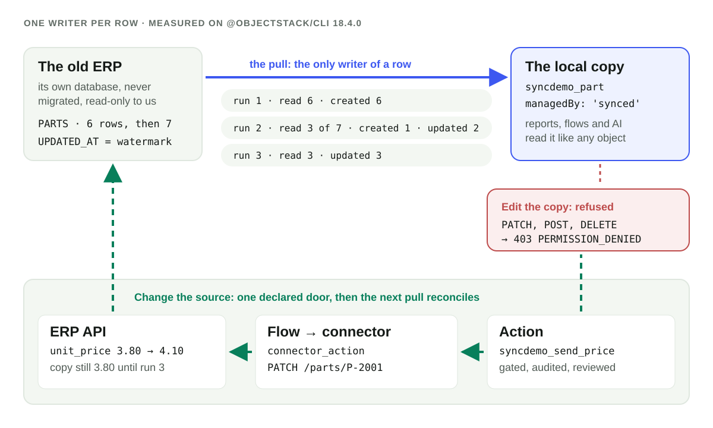

**データを常にライブに保つ必要がある、あるいはそもそも持ち込んではいけないなら、フェデレーション。人やレポートや AI がプラットフォームの速度で結合し、絞り込み、問いかける必要があるなら、コピーして取り込む。** コピーするなら、**1 行に書き手は 1 人**のコピーにします。スケジュールされたプルだけがコピーした行を書き、誰もそれを編集せず、データの変更は宣言された 1 つのアクションを通じてソースに戻り、次のプルがその結果を持ち帰る。書き手が 2 人いれば競合マージが要ります。1 人なら決して要りません。公開済みの `@objectstack/cli` 18.4.0 では、このコピーが今日動きます。以下の記録では、2 回目のプルがソースの **7 行のうち 3 行**だけを読みました。変わった行と、前回止まった位置と同じ値を持つ行です。それ以外は何も書いていません。

## 入り口は 2 つ、そしてどちらでもない 3 つ目

ObjectStack の設計記録 ADR-0153 は、フェデレーションにできないことから始まります。フェデレーションは行を元の場所に置いたままクエリを転送するので、ライブなデータや持ち込めないデータには正しい選択です。しかし「レポート、分析、AI の質問応答、ソースをまたぐ結合が最初にその限界にぶつかる。行を通常のオブジェクトにコピーすれば限界はなくなる。インデックス、クエリ演算子、権限、稼働はプラットフォームのものになる」。そのうえで、ガイドとスキルが教えるべきルールを示します。

| 必要なこと | 選ぶもの |
|:--|:--|
| ライブなデータ、一度に 1 テーブル。レガシーシステムに触れてはいけない。持ち込んではいけないデータ | **フェデレーション**：仮想オブジェクト |
| レポート、分析、AI の質問応答、ソースをまたぐ結合。遅い、または壊れやすいレガシーシステム。データウェアハウスの結果 | **同期取り込み**：`synced` オブジェクト、ソース付きの `mapping`、そして `job` |
| 外部システムで何かを起こす。行は持ち込まない | **コネクタアクション**：フローの `connector_action` ノード、または宣言されたアクション |

フェデレーションを選ぶ理由は強く、全力で述べておく価値があります。フェデレーションされたオブジェクトは常に最新で、ソースの変更とメンバーが見るものの間に遅れがありません。何も複製しないので、守り、保持し、削除すべき個人データの 2 つ目のコピーもありません。そしてソースが唯一の書き込み先であり続けます。フェデレーションそのものは[姉妹記事](/ja/blog/ai-business-layer-over-an-existing-database/)で扱っており、[既存システムとの連携](/ja/connect-existing-systems/)のページではフェデレーション、同期取り込み、コネクタアクションを並べて比べています。必要なのがこうした性質なら、ここで止めてください。コピーは間違った道具です。

コピーが意味を持つのは、フェデレーションの限界が効いてくるときです。エンジンはデータソースをまたいで結合できず、読み取りのたびにリモートシステムの遅延を払い、プラグインドライバーの読み取りには上限があります。コピーはリモートのテーブルを通常のオブジェクトに変えるので、既存の権限、レポート、データセット、フロー、MCP ツールがすべて変更なしにそれを読めます。

## 1 行に書き手は 1 人

コピーが安全なのは、2 つ目の記録システムへと漂流しない場合だけです。それが「1 行に書き手は 1 人」の意味で、18.4.0 ではランタイムが強制する 4 つのルールになっています。

1. **行を書くのはプル。** `datasourceSource` を持つ `mapping` が、フェデレーションされたオブジェクトとウォーターマークのフィールドを指します。`pull` がその mapping を指す `job` がスケジュールに従って実行し、インポートランナーを通じてシステムとして書き込みます。
2. **ほかには誰も書かない。** ターゲットは `managedBy: 'synced'` と宣言されます。18.4.0 の spec 変更履歴は、それで有効になるものを挙げています。「エンジンの書き込みガードがメンバーの汎用書き込みを拒否し（403）、`apiMethods` の調整がすべての書き込みメソッドを外し、`/me/permissions` のクランプは閉じた行を返す」。
3. **変更はソースへ、宣言されたアクションを通じて。** ADR-0153 D5：「ソースデータの変更はソースで、宣言されたアクションを通じて行う……書き戻しはローカルの行を編集しない。**次のプルがそれを整合させる**」。
4. **ほかの方向はない。** 「双方向同期なし、競合マージなし、Writeback-Dataset 型の編集オーバーレイなし」。

要点はルール 4 です。双方向同期ではすべての行に書き手が 2 人いるので、前回の同期以降に両側が変えた行のためのポリシーが要ります。後勝ち、フィールド単位のマージ、誰かが処理しなければならない競合キュー。どれもデータが静かに失われる場所です。書き手が 1 人なら、そんな行は存在せず、間違えるマージもありません。



## 構成：5 つの宣言だけ

実験台は新しく作った `npm create objectstack@latest` のスキャフォールドで、入ったのは `@objectstack/cli` 18.4.0、2026-11-14 に `npm view @objectstack/cli dist-tags` が `latest` と報告したバージョンです。「古い ERP」はアプリが所有しない SQLite ファイルで、テーブルは `PARTS` の 1 つだけ。部品 6 件と `UPDATED_AT` 列を持っています。5 つの宣言がそれらをつなぎます。

```ts
// 1. The ERP's database: external, so no DDL ever runs there.
export const Erp = defineDatasource({
  name: 'erp', driver: 'sqlite', schemaMode: 'external',
  config: { filename: './legacy/erp.db' },
  external: { allowWrites: false, validation: { onMismatch: 'fail', checkOnBoot: true } },
});

// 2. The PARTS table, federated. PART_NO is mapped onto `id`: that is the source key.
export const ErpPart = ObjectSchema.create({
  name: 'syncdemo_erp_part', datasource: 'erp', sharingModel: 'private',
  external: {
    remoteName: 'PARTS',
    columnMap: { PART_NO: 'id', DESCRIPTION: 'description', UNIT_PRICE: 'unit_price', UPDATED_AT: 'updated_at' },
  },
  fields: {
    description: Field.text({ label: 'Description' }),
    unit_price: Field.number({ label: 'Unit price', scale: 2 }),
    updated_at: Field.datetime({ label: 'Updated at (ERP)' }),
  },
});

// 3. The local copy: an ordinary object that only the pull writes.
export const Part = ObjectSchema.create({
  name: 'syncdemo_part', managedBy: 'synced', sharingModel: 'public_read',
  fields: {
    part_no: Field.text({ label: 'Part no', required: true }),
    description: Field.text({ label: 'Description' }),
    unit_price: Field.number({ label: 'Unit price', scale: 2 }),
    source_updated_at: Field.datetime({ label: 'Updated at (ERP)' }),
  },
});

// 4. The sync, defined on its target: where rows come from, how they map, how one matches.
export const ErpPartsPull = defineMapping({
  name: 'erp_parts_pull', targetObject: 'syncdemo_part',
  mode: 'upsert', upsertKey: ['part_no'],
  fieldMapping: [
    { source: 'id', target: 'part_no' },
    { source: 'description', target: 'description' },
    { source: 'unit_price', target: 'unit_price' },
    { source: 'updated_at', target: 'source_updated_at' },
  ],
  datasourceSource: { object: 'syncdemo_erp_part', watermark: { field: 'updated_at', start: '2026-01-01' } },
});

// 5. When. No code: `pull` names the mapping.
export const ErpPartsPullJob = defineJob({
  name: 'erp_parts_pull_job',
  schedule: { type: 'interval', intervalMs: 30000 },
  pull: { mapping: 'erp_parts_pull' },
});
```

`objectstack validate` は通りました。コピーを正直に保つ部分について、ビルドは厳格です。ターゲットから `managedBy: 'synced'` を外すと、同じコマンドは 1 で終了しました。

```text
✗ Mapping 'erp_parts_pull' pulls rows into object 'syncdemo_part' through its datasourceSource,
  but that object is not managedBy: 'synced' (it is unset). A pulled copy is read-only to members,
  so a member's edit is never kept or lost silently by the next pull; declare managedBy: 'synced'
  on the target object (ADR-0153 D4).
```

変更履歴は、ビルド時と最初の読み取りの前にもう一度判定されるほかの拒否を挙げています。ソース付きの mapping は `mode: 'upsert'` で `upsertKey` を持つこと、ソースは `columnMap` がある列を `id` に写すフェデレーションオブジェクトであること（`source_key_missing`）、ウォーターマークは `datetime`、`date`、または整数のフィールドであること、そして `fieldMapping` のエントリがそれをそのままターゲットへコピーすること（`watermark_field_unmapped`）。

見落としやすいスイッチが 1 つあります。パッケージのジョブがスケジュールされるのは 変数 `OS_AUTOMATION_SCHEDULED_WORK_ENABLED` が `true` のデプロイだけで、ジョブのガイドによれば「**すべてのテナンシー形態とすべてのカーネルでデフォルトでオフ**」です。それをオンにして `objectstack dev --fresh` を起動し、メンバー（Mia）を作り、`syncdemo_part` の読み取りと、わざと編集も許可する権限セットを与え、すべての応答を記録しました。

## 実行ログ

7 つの読み取りを起きた順に。時刻は 2026-11-14 の UTC です。

| # | 起きたこと | 返ってきたもの |
|:--|:--|:--|
| 1 | ジョブの最初のティック、04:42:41 | `sys_sync_run`：読み取り 6、作成 6、`completed` |
| 2 | Mia が `syncdemo_part` を一覧 | `200`、6 行 |
| 3 | Mia が P-2001 の価格を変更、管理者も同じことを試す | どちらも `403 PERMISSION_DENIED` |
| 4 | 誰かが ERP の中で P-1003 を編集し、P-3002 を追加 | 次の実行、04:43:11：読み取り 3、作成 1、更新 2 |
| 5 | Mia が P-2001 でアクション「Change price in ERP」を実行 | `200`。ERP の API が `PATCH` を 1 件記録 |
| 6 | Mia がすぐに P-2001 を読む | まだ `3.8` |
| 7 | 次の実行、04:43:41 | 読み取り 3、更新 3。P-2001 は `4.1` |

**読み取り 1：実行記録。** プルのたびに、ジョブの組織に `sys_sync_run` の行が 1 つ残ります。重要なフィールドだけに絞ると：

```json
{ "mapping": "erp_parts_pull", "mapping_package": "com.example.syncdemo",
  "target_object": "syncdemo_part", "source_kind": "datasource", "source": "syncdemo_erp_part",
  "datasource": "erp", "read_path": "builtin", "trigger": "schedule", "status": "completed",
  "read_count": 6, "created_count": 6, "updated_count": 0, "refused_count": 0,
  "watermark_field": "updated_at",
  "watermark_from": "2026-01-01T00:00:00.000Z",
  "watermark_committed": "2026-11-09T16:05:00.000Z",
  "holds_position": true, "job_run_id": "run_a02e22c1-…", "failure_reason": null }
```

`watermark_committed` はこの実行が書いた最新の `UPDATED_AT` で、`holds_position: true` は次の実行がここから始まることを示します。ジョブ台帳とのつながりは `job_run_id`、それを動かしたティックの `sys_job_run` 行です。保持期間はサービスの変更履歴が定めています。行は「30 日保持されるテレメトリで、ジョブ台帳の期間と同じ。ただし mapping（パッケージと名前）と組織ごとに、読み取り位置を保持する 1 行は除く」。

**読み取り 3：拒否された編集。** Mia はこのオブジェクトに `allowEdit: true` を持っています。応答は意に介しません。

```json
HTTP 403
{ "error": "[Security] Access denied: 'syncdemo_part' is synced (managedBy:'synced', ADR-0153) — direct update via the data API is disabled. Its rows are copied from their source by a pull, which would keep or overwrite the change; change the source through a declared action instead, and the next pull brings it home.",
  "code": "PERMISSION_DENIED", "object": "syncdemo_part" }
```

管理者の `PATCH` も同じ本文でした。Mia の `POST` と `DELETE` も `403` で、同じ文の中の言葉が「direct insert」と「direct delete」に変わるだけです。拒否は出口も示しています。呼び出しているのがエージェントのとき、まさに欲しい形です。

**読み取り 4：差分実行、7 行中 3 行。** ERP の利用者がするように、ERP を直接変えました。P-1003 の価格を 0.05 から 0.06 へ、そして新しい部品 P-3002 を追加。どちらも `2026-11-14T04:42:41.487Z` を刻印しています。次のティック：

```json
{ "read_count": 3, "created_count": 1, "updated_count": 2,
  "watermark_from": "2026-11-09T16:05:00.000Z",
  "watermark_committed": "2026-11-14T04:42:41.487Z", "status": "completed" }
```

その時点で ERP にあった 7 行のうち 3 行を読みました。P-1003、P-3002、そして前回の実行がコミットした位置と同じ値を持つ P-3001 です。この再読はジョブのガイドに書かれています。実行は「その後に書かれた行と、前回の位置と同じ値の行だけを読み、upsert が無害にもう一度書く」。したがって `updated_count` には変わっていない P-3001 も入ります。「変わった行」ではなく「書いた行」と読んでください。

**読み取り 5〜7：書き戻し。** アクションは `syncdemo_part` 上の `type: 'flow'` のアクションです。そのフローで仕事をするノードは 1 つだけ。ERP 自身の HTTP API を指す `rest` コネクタを呼ぶ `connector_action` です（ここでは `PARTS` を更新して `UPDATED_AT` を刻印する 20 行の代役）。

```ts
{ id: 'patch_erp', type: 'connector_action',
  connectorConfig: {
    connectorId: 'erp_api', actionId: 'request',
    input: {
      method: 'PATCH',
      path: { dialect: 'cel', source: "'/parts/' + record.part_no" },
      body: { dialect: 'cel', source: '{ "unit_price": new_price }' },
    },
  },
}
```

Mia は REST で呼びました。レコードページのボタンも同じ扉を通ります（「コンソールのボタンと API 呼び出しは同じゲートとハンドラーを通る」）。

```bash
curl -s -b mia.cookies -X POST http://localhost:49921/api/v1/actions/syncdemo_part/syncdemo_send_price \
  -H 'content-type: application/json' \
  -d '{"recordId":"07580e75-…","params":{"new_price":4.1}}'
```

```text
HTTP 200  { "success": true, "data": { "success": true, "flowLabel": "Send price to ERP", … } }
ERP API:  2026-11-14T04:43:12.035Z PATCH /parts/P-2001 {"unit_price":4.1} -> changes=1
```

直後に読むと、コピーはまだ `"unit_price": 3.8` でした。書き戻しが変えたのは ERP だけだからです。30 秒後、次の実行は 3 行（同じ位置にある P-1003 と P-3002、そして P-2001）を読み、3 行を更新し、`2026-11-14T04:43:12.035Z` をコミットしました。P-2001 は `"unit_price": 4.1, "source_updated_at": "2026-11-14T04:43:12.035Z"` になりました。コピーにある値は ERP が受け入れた値であって、ユーザーが入力した値ではありません。ERP が拒否したり丸めたりしていれば、コピーにはその結果が表示されます。

## コピーが受け継がないもの

- **ソースの権限。** ERP で誰がその行を読めるかは、行と一緒には来ません。ADR-0153：「オブジェクトの権限は、裁定のとおりローカルでゼロから設定する。メンバーが同期された行を読めるのは付与を通じてだけ」。この実行で Mia は権限セットを通じてコピーを読み、同じセッションでフェデレーションされたソースオブジェクトには `403` を受けました。そこには何の付与もないからです。目指すべき構成はこれです。メンバーはコピーを読み、ソースはプル以外誰も読まない。コピーした行には所有者がいないので（上の行には `owner_id` がありません）、spec の変更履歴が synced オブジェクトに勧める lint の助言は「`sharingModel: 'public_read'`……または読み取りを付与する共有ルール付きの `'private'`」です。
- **メンバーにとっての実行履歴。** `sys_sync_run` はデータ API に開かれていますが、Mia が読むと `403` でした。ほかのオブジェクトと同じく付与が要ります。
- **マルチ組織デプロイでの組織。** 壁のある形態では、プラットフォームは推測しません。`OS_TENANCY_POSTURE=isolated` で起動すると、同じアプリはフェデレーションされたソースが組織の範囲を宣言するまで起動を拒否しました（「Stating nothing: 'syncdemo_erp_part'」）。ソースを共有と宣言すると、起動ログは `error` で「NOT SCHEDULED — job 'erp_parts_pull_job' declares no `organization`」と記録しました（その後、無関係な壁のある形態の設定、メンバーシップポリシーで止まりました。実際のマルチ組織デプロイならいずれにせよ宣言するものです）。解決策はジョブに `organization` を書くこと、組織ごとに 1 つのジョブです。18.4.0 の変更履歴は、この形態でプル自体が返す拒否として `source_organization_scope_unstated` と `job_organization_missing` を挙げています。
- **パイプライン。** コピーはソーステーブル 1 つ、mapping 1 つ、ターゲット 1 つです。ADR-0153：「ObjectStack はパイプラインや変換を作らない。ソースをまたぐ結合、クレンジング、集計はデータウェアハウスや ETL ベンダーの仕事で、ObjectStack はその結果を同期して取り込む」。クレンジングして結合したビューが必要なら、ウェアハウスで作って結果をプルしてください。

これらすべてが動くカーネルはオープンソースです。ADR-0153 D9：同期カーネルは「フェデレーションと同じく、このリポジトリで Apache-2.0 のもとに出荷される」。

## 開発中

以下は ADR-0153（18.4.0 のタグ時点でステータスは *Proposed*）で設計されており、18.4.0 には含まれていません。この節の内容は何も実行していません。

- **削除ポリシー。** ソースから消えた行は削除されず、印が付けられます。「`deletePolicy: 'mark' | 'ignore'`、デフォルトは `mark`、`_sync_deleted_at` を刻印」、そして「プルは決して行を物理削除しない」。差分プルはソース側の論理削除フィールド `deletedField` を通じて削除を見ます。18.4.0 ではこれらのキーはパースされ、変更履歴によれば「まだ何も変えないと作者に警告する」状態です。現時点では、ソースで削除された行はコピーに残ります。
- **すべての行の来歴列。** 予約済みプレフィックスの下の 5 つのプラットフォーム列：「`_sync_source`」「`_sync_external_id`」「`_sync_pulled_at`」「`_sync_run_id`」「`_sync_deleted_at`」。18.4.0 のプルはヘッダーでこう述べています。「削除マーク（D3）、来歴列（D4）、ドリフト（D6）は後の変更」。現時点では実行記録が来歴です。プレフィックスはすでに予約されているので、`_sync_…` という名前のフィールドは拒否されます。
- **Studio の同期ウィザード。** 「Studio の同期ウィザードは `synced` オブジェクト、`mapping`、そしてその `job` を作る」。実行時に作成できるジョブが必要で、記録はそれを「ジョブはコードだけ」の唯一の例外として設計しています。「実行時の扉は、実行形式が `pull` だけの `job` を受け入れる」。Studio は「同期されたオブジェクトとそのソースのページで実行履歴」も表示する予定です。
- **ウェアハウスをソースに。** 「修正 `6731744658` がウェアハウスを第一級のプルソースにする」。Snowflake と BigQuery のドライバーは「このリポジトリの外のプラグインパッケージ」で、プラグインドライバーの適合キットで検証されます。フロアの下にあるプラグインドライバーは「両側に境界のあるウィンドウ」で読まれ、ウィンドウが行数上限を超えて返ってくる間は「半分に」されます。
- **同期ガイドとスキル。** 「3 方向のルールとパートナーの立場（D10）、書き戻しの答え（D5）、そして `mapping` / `job` を指す `SYNC_ARCHITECTURE.md` とスキル」。それまではジョブのガイドの「Pulling a mapping」節と mapping リファレンスがドキュメントです。

## エージェントが書いたときのレビュー方法

エージェントがアプリに同期を追加したら、diff は上の 5 つの宣言で、書き戻しが範囲内ならアクションとフローが加わります。まず 4 か所を読みます。

1. ターゲットの `managedBy: 'synced'`。なければビルドが mapping を拒否するので、ビルドが緑ならそこにあります。
2. ターゲットの `sharingModel` と権限セット。ゼロから始まり、何も受け継いでいません。
3. `watermark.field` とソースキー。ADR-0153 はウォーターマークに「ソースでのすべての書き込みが、その行のウォーターマークにソースがすでに持つどの値以上の値を刻む」ことを求め、キーには一意で決して NULL でないことを求めます。「不変条件 2 と同じく、プルには確認できないソースへの要件」です。書き込みのたびに更新されない列は、変更を静かに取りこぼします。
4. アクションとそのフロー（あれば）。ソースに戻る唯一の道なので、外向きの呼び出しと同じようにレビューします。何を送るか、誰に送るか、誰が実行できるか。

そして、デプロイが最初に書く `sys_sync_run` の行を読みます。`read_count` をソースの行数と見比べることが、その実行のレビューです。

## エージェントに向けてください

コーディングエージェントにジョブのガイド（`objectstack.ai/docs/automation/jobs` の「Pulling a mapping」）と mapping リファレンスを渡し、ルールを 1 行で伝えます。`datasourceSource` を持つ `mapping` と、それを `pull` で指す `job` を通じて `managedBy: 'synced'` オブジェクトへコピーする。コピーには決して書かない。ソースは宣言されたアクションで変える。[ObjectStack 向けにコーディングエージェントを設定するガイド](/en/blog/how-to-point-your-agent-at-objectstack/)が、このルールを運ぶルールファイルと MCP エンドポイントを扱っています。ここでの mapping は、[古いシステムからスプレッドシートをインポートする](/ja/blog/how-to-import-a-spreadsheet-from-an-old-system/)ときと同じ `fieldMapping` と `upsertKey` を使います。プルとは、そのインポートをジョブがライブなソースに対して実行するものです。そしてコピーは[オントロジー](/en/glossary/ontology/)の中のもう 1 つのオブジェクトにすぎないので、どのレポートも AI ツールも追加の作業なしに読めます。上記はすべて `@objectstack/cli` 18.4.0 で動かしました。
