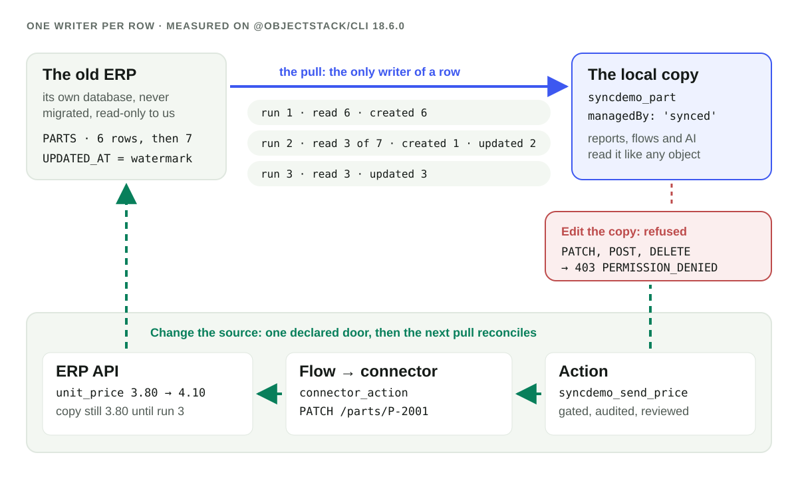

**데이터가 초 단위로 최신이어야 하거나 다른 어디에도 저장하면 안 될 때는 원본 시스템을 실시간으로 읽으십시오. 사람과 보고서, AI가 데이터를 조인하고 필터링하고 최고 속도로 질문해야 할 때는 복사해 들여오십시오.** 어느 쪽에도 대가가 있습니다. 실시간으로 읽으면 매번 원본 시스템을 기다려야 하고, 하나의 쿼리로 두 데이터베이스를 합칠 수 없습니다. 사본은 마지막 예약 새로 고침만큼만 최신입니다. 복사한다면 **행마다 작성자는 하나**라는 규칙을 지키십시오. 사본에 쓰는 것은 예약된 새로 고침뿐이고, 아무도 사본을 편집할 수 없습니다. 관리자도 마찬가지입니다. 변경은 원본에서, 그 용도로 만든 액션 하나를 통해 하고, 다음 새로 고침이 그것을 가져옵니다. 제 테스트에서 새로 고침 한 번은 원본 7행 중 3행만 읽었고, 사본 편집은 멤버와 관리자 모두에게 똑같이 거부되었습니다.

*ObjectStack 18.6.0에서 실측했습니다. 2026-11-20 기준으로 공개된 최신 버전입니다. 모든 기록은 마지막 섹션 "증거"에 있습니다.*

## 실시간으로 읽을까, 복사해 들여올까?

**페더레이션**은 행을 원래 자리에 두고 쿼리를 하나하나 원본으로 전달합니다. **동기화 가져오기**(sync-in)는 행을 일정에 따라 플랫폼이 소유한 일반 테이블로 복사합니다. **커넥터 액션**은 버튼이나 자동화에서 상대 시스템을 호출하고, 그 행은 하나도 저장하지 않습니다. 동기화에 관한 ObjectStack의 설계 기록 ADR-0153(18.6.0 태그 시점에도 여전히 "제안" 상태)은 이렇게 고릅니다.

| 상황 | 선택 |
|:--|:--|
| 실시간 데이터, 한 번에 테이블 하나. 레거시 시스템을 건드리면 안 됨. 원본 밖에 저장하면 안 되는 데이터 | **실시간으로 읽기**(페더레이션) |
| 보고서, 분석, AI 질의응답, 원본 간 조인. 느리거나 불안정한 레거시 시스템. 데이터 웨어하우스의 결과 | **복사해 들여오기**(동기화 가져오기) |
| 상대 시스템에서 무언가를 실행하기만 함. 행은 저장하지 않음 | **둘 다 아님**: 커넥터 액션 |

실시간으로 읽는 쪽의 근거는 탄탄합니다. 페더레이션된 테이블은 언제나 최신입니다. 원본의 변경과 멤버가 보는 내용 사이에 지연이 없습니다. 아무것도 복제되지 않으니 보호하고 보관하고 삭제해야 할 개인 데이터의 두 번째 사본도 없습니다. 그리고 원본은 데이터가 기록되는 유일한 곳으로 남습니다. [자매 글](/ko/blog/ai-business-layer-over-an-existing-database/)은 페더레이션을 그 자체의 논리로 따라가고, [기존 시스템 연동](/ko/connect-existing-systems/) 페이지는 세 가지를 나란히 놓고 비교합니다. 필요한 것이 이런 성질이라면 여기서 멈추십시오. 사본은 맞지 않는 도구입니다.

실시간 읽기가 한계에 부딪힐 때는 사본이 더 나은 선택입니다. 플랫폼은 두 데이터베이스를 하나의 쿼리로 조인할 수 없고(각각을 읽은 뒤 메모리에서 행을 합칩니다), 모든 읽기가 원격 시스템을 기다리며, 추가 설치한 데이터베이스 커넥터를 통한 읽기에는 최대 행 수 제한이 있습니다. 설계 기록의 표현으로는 "행을 일반 객체로 복사하면 그 제한이 사라진다. 그때부터 인덱스, 쿼리 연산자, 권한, 가용성은 플랫폼의 것이 된다." 일단 복사하면, 기존 권한과 보고서와 AI 도구가 아무 변경 없이 읽는 테이블이 하나 더 생길 뿐입니다.

## 사본을 정직하게 지키는 규칙: 행마다 작성자는 하나

모든 사본에는 두 번째 기록 시스템으로 변해 갈 위험이 있습니다. 누군가 사본에서 가격을 고치고, 원본은 그 사실을 모른 채, 둘이 어긋나는 것입니다. 행마다 작성자는 하나라는 규칙은 런타임이 강제하는 네 가지 규칙으로 이를 막습니다.

1. **행을 쓰는 것은 풀입니다.** 풀은 예약된 새로 고침입니다. 원본을 읽어 사본에 쓰는 작업으로, 사용자가 아니라 플랫폼 자신의 신원으로 동작하며, 지난 실행 이후 바뀐 것만 읽습니다. 그 행을 찾는 단서가 *워터마크*, 곧 원본의 "최종 수정 시각" 열입니다.
2. **다른 누구도 쓰지 않습니다.** 사본은 *동기화 객체*로 선언됩니다. 풀만 행을 쓸 수 있는 테이블입니다. 멤버, 관리자, API 호출자의 편집, 추가, 삭제는 권한이 무엇이든 거부됩니다.
3. **변경은 원본으로, 선언된 액션을 통해 갑니다.** *선언된 액션*은 앱 안에 정의된 버튼으로, 자체 권한 검사를 거쳐 원본 자신의 API를 호출합니다. 사본은 건드리지 않으며, 다음 풀이 사본을 갱신합니다.
4. **다른 방향은 없습니다.** 양방향 동기화도, 충돌하는 편집의 병합도 없습니다.

핵심은 규칙 4입니다. 양방향 동기화에는 행마다 작성자가 둘이므로, 양쪽이 모두 바꾼 행을 처리할 정책이 필요합니다. 마지막 작성자 우선, 필드 단위 병합, 사람이 해결해야 하는 충돌 대기열. 어느 것이든 한쪽의 변경을 버리거나, 사람이 판정해야 합니다. 작성자가 하나라면 그런 행은 존재하지 않고, 잘못될 병합도 없습니다.



## 제가 테스트한 것, 그리고 그것이 여러분에게 뜻하는 바

새 ObjectStack 앱을 "오래된 ERP"를 대신하는 부품 여섯 개짜리 작은 데이터베이스에 연결하고, 멤버 Mia에게 사본 읽기 권한과 일부러 편집 권한까지 주어 권한으로 규칙을 우회할 수 있는지 확인했습니다. 이 테스트에서 풀은 30초마다 실행되었습니다. 지연의 크기는 여러분의 일정이 정합니다. 시각은 2026-11-20 UTC입니다.

| 제가 한 일 | 시스템의 응답 | 여러분에게 뜻하는 바 |
|:--|:--|:--|
| 사본에서 "synced" 표시를 뺀 채 앱을 빌드했다 | 빌드가 실패하며 빠진 표시를 지목했다 | 빌드가 통과하면 보호가 켜져 있다 |
| 02:38:30에 풀을 한 번 실행한 뒤 Mia에게 사본을 조회하게 했다 | 6행을 읽고 6행을 만들고 완료했으며, 실행 기록을 남겼다. Mia에게 6행이 보였다 | 새로 고침은 모두 기록되고, 멤버는 사본을 다른 테이블처럼 읽는다 |
| 편집 권한이 있는 Mia가 P-2001의 가격을 바꿨고, 관리자도 같은 시도를 했다 | 둘 다 거부. 메시지가 대신 무엇을 해야 하는지 알려 주었다 | 편집 권한이 있는 멤버도, 관리자도 앱이나 그 API로 사본을 편집할 수 없다 |
| ERP에서 직접 P-1003을 바꾸고 P-3002를 추가했다 | 다음 실행, 02:39:00: 7행 중 3행을 읽고 1행 생성, 2행 갱신 | 새로 고침은 테이블 전체가 아니라 바뀐 것을 읽는다 |
| Mia가 P-2001에서 "Change price in ERP" 액션을 실행한 뒤 그 행을 읽었다 | 허용. ERP의 API가 갱신 한 건을 기록했다. 사본은 여전히 3.8이었다 | 액션이 바꾼 것은 사본이 아니라 원본이다 |
| 다음 실행, 02:39:30을 기다렸다 | 3행을 읽고 3행 갱신. P-2001은 이제 4.1 | 사본은 언제나 ERP가 가진 값만 보여 준다 |

세부 사항 두 가지가 있습니다. 두 번째 실행에서 "갱신"된 2행 가운데 P-3001은 바뀌지 않았습니다. 실행은 지난번이 멈춘 위치에 있는 행을 다시 읽기 때문입니다. 그러니 이 숫자는 "바뀐 행"이 아니라 "쓴 행"으로 읽으십시오. 그리고 예약 작업은 기본적으로 꺼져 있습니다. 배포에서 켜지 않으면 풀은 한 번도 실행되지 않습니다.

## 사본이 물려받지 않는 것

- **원본의 권한.** ERP에서 누가 그 행을 읽을 수 있는지는 행과 함께 복사되지 않습니다. 사본의 권한은 접근 권한이 전혀 없는 상태에서 시작하고, 멤버는 부여를 통해서만 읽습니다. Mia는 자기 권한 세트로 사본을 읽었고, 부여가 없는 원본 테이블에서는 거부되었습니다. 바로 목표로 삼을 구성입니다. 복사된 행에는 소유자가 없으니, 사본을 모든 멤버가 읽을 수 있게 하거나, 비공개로 두고 공유 규칙으로 읽기를 부여하십시오.
- **멤버에게는 실행 기록도.** Mia가 읽으려 하자 거부되었습니다. 다른 테이블처럼 부여가 필요합니다.
- **삭제.** 18.6.0에서는 원본에서 삭제된 행이 사본에 남습니다(작업 가이드: "삭제 관련 키는 아직 아무것도 바꾸지 않는다". 저는 이것을 실행하지 않았습니다). 그런 행에 표시를 다는 기능은 개발 중이며, 아래에서 다룹니다.
- **여러 조직을 둔 배포에서는 조직.** 플랫폼은 추측하지 않습니다. 격리된 다중 조직 모드로 실행하자, 같은 앱은 원본이 조직 범위를 선언할 때까지 시작을 거부했고, 이어서 작업이 자기 조직을 밝힐 때까지 풀을 예약하지 않았습니다. 조직 하나에 작업 하나입니다.
- **파이프라인.** 사본은 원본 테이블 하나, 매핑 하나, 대상 하나입니다. 설계 기록: "ObjectStack은 파이프라인이나 변환을 만들지 않는다. 원본 간 조인, 정제, 집계는 데이터 웨어하우스나 ETL 공급업체의 일이고, ObjectStack은 그 결과를 동기화해 들여온다." 정제하고 조인한 뷰가 필요하신가요? 웨어하우스에서 만들고 그 결과를 풀하십시오.

## 개발 중

아래 항목은 설계 기록에 설계되어 있지만 18.6.0에는 없습니다. 이 섹션에서는 아무것도 실행하지 않았습니다. 여기서 18.6.0에 대한 서술은 그 변경 로그와 가이드에서 인용한 것입니다.

- 원본에서 삭제된 행: 설계상 삭제됨으로 표시하고, 절대 제거하지 않는다.
- 모든 행에 출처 표시: 어디서 왔고 어느 실행이 썼는지.
- Studio의 동기화 마법사. 실행 기록을 화면에 보여 준다.
- 데이터 웨어하우스(Snowflake, BigQuery)를 원본으로. 추가 커넥터를 통해.
- 동기화 가이드와 에이전트용 스킬.

<details>
<summary>설계 기록, 변경 로그, 가이드의 원문</summary>

- **삭제 정책.** 원본에서 사라진 행은 표시될 뿐 삭제되지 않는다: "`deletePolicy: 'mark' | 'ignore'`, 기본값 `mark`, `_sync_deleted_at`을 기록", 그리고 "풀은 행을 물리적으로 삭제하지 않는다." 증분 풀은 원본의 소프트 삭제 필드 `deletedField`를 통해 삭제를 감지한다. 18.4.0 변경 로그에 따르면 이 키들은 파싱되며 "아직 아무것도 바꾸지 않는다고 작성자에게 계속 경고한다". 18.6.0에서도 `os validate`는 아직 아무것도 `deletePolicy`를 읽지 않는다고 경고한다(이 절에서 직접 실행한 유일한 확인).
- **모든 행의 출처 열.** 예약된 접두사 아래 다섯 개의 플랫폼 열: "`_sync_source`", "`_sync_external_id`", "`_sync_pulled_at`", "`_sync_run_id`", "`_sync_deleted_at`". 18.6.0의 풀은 헤더에서 이렇게 밝힌다: "삭제 표시(D3), 출처 열(D4), 드리프트(D6)는 이후의 변경이다". 지금은 실행 기록이 출처 기록이며, 접두사는 이미 예약되어 있어 `_sync_…`라는 이름의 필드는 거부된다.
- **Studio 동기화 마법사.** "Studio 동기화 마법사는 `synced` 객체, `mapping`, 그리고 그 `job`을 만든다." 런타임에 만들 수 있는 작업이 필요한데, 기록은 이를 '작업은 코드로만 정의한다'의 유일한 예외로 설계한다: "런타임 출입구는 유일한 실행 형태가 `pull`인 `job`을 받아들인다". Studio는 또한 "동기화 객체와 그 원본 페이지에서 실행 기록"을 보여 줄 예정이다.
- **웨어하우스를 원본으로.** "수정안 `6731744658`은 웨어하우스를 일급 풀 원본으로 만든다". Snowflake와 BigQuery 드라이버는 "이 저장소 밖의 플러그인 패키지"이며 플러그인 드라이버 적합성 키트로 검증되고, 정확성 하한으로 보호되는 플러그인 드라이버는 "양쪽 끝이 제한된 창"으로 읽히며, 창이 행 수 상한을 넘겨 돌아오는 동안 "절반으로" 줄어든다.
- **동기화 가이드와 스킬.** "삼방향 규칙과 파트너 입장(D10), 쓰기 반영에 대한 답(D5), 그리고 `SYNC_ARCHITECTURE.md`와 `mapping` / `job`을 가리키는 스킬". 그때까지는 작업 가이드의 "Pulling a mapping" 절과 mapping 참조가 문서다.

</details>

## 에이전트가 썼을 때 검토하는 법

에이전트가 쓴 동기화는 선언 다섯 개이고, 쓰기 반영이 포함되면 액션과 플로가 더해집니다. 네 가지를 확인하십시오.

1. **사본에 동기화 표시가 있는지**(대상의 `managedBy: 'synced'`). 이것이 없으면 빌드가 동기화를 거부하므로, 빌드가 통과했다면 표시가 있는 것입니다.
2. **누가 사본을 읽을 수 있는지**: 공유 모델과 권한 세트로, 둘 다 접근 권한이 없는 상태에서 시작합니다.
3. **원본의 최종 수정 시각 열과 키.** 쓸 때마다 바뀌지 않는 최종 수정 시각 열은 변경을 조용히 잃어버리고, 키는 고유해야 하며 절대 비어 있으면 안 됩니다. 풀은 둘 다 확인할 수 없으니 원본이 보장해야 합니다.
4. **쓰기 반영 액션과 그 플로**(있다면): 원본으로 돌아가는 유일한 경로입니다. 다른 외부 호출처럼 검토하십시오. 무엇을, 누구에게 보내며, 누가 실행할 수 있는지.

그런 다음 첫 실행 기록의 읽은 행 수를 원본의 행 수와 비교하십시오.

## 에이전트에게 맡기십시오

코딩 에이전트에게 작업 가이드(`objectstack.ai/docs/automation/jobs`, "Pulling a mapping")와 mapping 참조를 건네고, 규칙을 한 줄로 알려 주십시오. `datasourceSource`가 있는 `mapping`과, `pull`이 그것을 가리키는 `job`을 통해 `managedBy: 'synced'` 객체로 복사한다. 사본에는 절대 쓰지 않는다. 원본은 선언된 액션으로 바꾼다. [ObjectStack용 코딩 에이전트 설정 가이드](/en/blog/how-to-point-your-agent-at-objectstack/)가 이 규칙을 실어 나르는 규칙 파일과 MCP 엔드포인트를 다룹니다. 이 매핑은 [오래된 시스템에서 스프레드시트를 가져올](/ko/blog/how-to-import-a-spreadsheet-from-an-old-system/) 때와 같은 `fieldMapping`과 `upsertKey`를 씁니다. 풀은 그 가져오기를 작업이 실시간 원본을 상대로 실행하는 것이고, 사본은 [온톨로지](/ko/glossary/ontology/) 안의 객체 하나일 뿐입니다. 동기화 커널은 페더레이션과 마찬가지로 Apache-2.0 오픈 소스입니다.

## 증거

여기 있는 모든 것은 `@objectstack/cli` 18.6.0에서 실행했습니다. 2026-11-20에 `npm view @objectstack/cli dist-tags`가 `latest`로 보고한 버전이며, 새 `npm create objectstack@latest` 스캐폴드를 썼습니다.

### 다섯 가지 선언

"오래된 ERP"는 앱이 소유하지 않는 SQLite 파일로, 테이블 `PARTS` 하나에 부품 여섯 개와 `UPDATED_AT` 열이 있습니다.

```ts
// 1. The ERP's database: external, so no DDL ever runs there.
export const Erp = defineDatasource({
  name: 'erp', driver: 'sqlite', schemaMode: 'external',
  config: { filename: './legacy/erp.db' },
  external: { allowWrites: false, validation: { onMismatch: 'fail', checkOnBoot: true } },
});

// 2. The PARTS table, federated. PART_NO is mapped onto `id`: that is the source key.
export const ErpPart = ObjectSchema.create({
  name: 'syncdemo_erp_part', datasource: 'erp', sharingModel: 'private',
  external: {
    remoteName: 'PARTS',
    columnMap: { PART_NO: 'id', DESCRIPTION: 'description', UNIT_PRICE: 'unit_price', UPDATED_AT: 'updated_at' },
  },
  fields: {
    description: Field.text({ label: 'Description' }),
    unit_price: Field.number({ label: 'Unit price', scale: 2 }),
    updated_at: Field.datetime({ label: 'Updated at (ERP)' }),
  },
});

// 3. The local copy: an ordinary object that only the pull writes.
export const Part = ObjectSchema.create({
  name: 'syncdemo_part', managedBy: 'synced', sharingModel: 'public_read',
  fields: {
    part_no: Field.text({ label: 'Part no', required: true }),
    description: Field.text({ label: 'Description' }),
    unit_price: Field.number({ label: 'Unit price', scale: 2 }),
    source_updated_at: Field.datetime({ label: 'Updated at (ERP)' }),
  },
});

// 4. The sync, defined on its target: where rows come from, how they map, how one matches.
export const ErpPartsPull = defineMapping({
  name: 'erp_parts_pull', targetObject: 'syncdemo_part',
  mode: 'upsert', upsertKey: ['part_no'],
  fieldMapping: [
    { source: 'id', target: 'part_no' },
    { source: 'description', target: 'description' },
    { source: 'unit_price', target: 'unit_price' },
    { source: 'updated_at', target: 'source_updated_at' },
  ],
  datasourceSource: { object: 'syncdemo_erp_part', watermark: { field: 'updated_at', start: '2026-01-01' } },
});

// 5. When. No code: `pull` names the mapping.
export const ErpPartsPullJob = defineJob({
  name: 'erp_parts_pull_job',
  schedule: { type: 'interval', intervalMs: 30000 },
  pull: { mapping: 'erp_parts_pull' },
});
```

`job`은 일정에 따라 매핑을 실행하고, 가져오기 실행기를 통해 시스템으로서 씁니다. spec 변경 로그는 `managedBy: 'synced'`가 켜는 것을 나열합니다: "엔진 쓰기 가드는 멤버의 일반 쓰기를 거부하고(403), `apiMethods` 조정은 모든 쓰기 메서드를 제거하며, `/me/permissions` 클램프는 닫힌 행을 그대로 답한다".

### 빌드에서의 거부

`objectstack validate`는 통과했습니다. 대상에서 `managedBy: 'synced'`를 빼자 같은 명령이 1로 종료했습니다:

```text
✗ Mapping 'erp_parts_pull' pulls rows into object 'syncdemo_part' through its datasourceSource,
  but that object is not managedBy: 'synced' (it is unset). A pulled copy is read-only to members,
  so a member's edit is never kept or lost silently by the next pull; declare managedBy: 'synced'
  on the target object (ADR-0153 D4).
```

변경 로그는 빌드 시와 첫 읽기 전에 다시 실행되는 다른 거부도 나열합니다. 원본이 있는 매핑은 `upsertKey`를 가진 `mode: 'upsert'`여야 하고, 원본은 `columnMap`이 어떤 열을 `id`에 대응시키는 페더레이션 객체여야 하며(`source_key_missing`), 워터마크는 `datetime`, `date` 또는 정수 필드여야 하고, `fieldMapping` 항목 하나가 그것을 그대로 대상에 복사해야 합니다(`watermark_field_unmapped`).

### 실행

패키지의 작업은 변수 `OS_AUTOMATION_SCHEDULED_WORK_ENABLED`가 `true`인 곳에서만 예약됩니다. 작업 가이드에 따르면 이 스위치는 "**모든 테넌시 형태와 모든 커널에서 기본적으로 꺼져 있다**". 저는 이를 켜고 `objectstack dev --fresh`를 시작한 다음, `syncdemo_part`의 읽기와 일부러 편집까지 허용하는 권한 세트를 가진 멤버(Mia)를 만들었습니다. 첫 틱은 02:38:30에 실행되었고, Mia의 `syncdemo_part` 조회는 `200`과 6행으로 응답했습니다.

**실행 기록.** 풀은 실행할 때마다 작업의 조직에 `sys_sync_run` 행 하나를 남깁니다. 첫 행을 중요한 필드만 남겨 줄이면:

```json
{ "mapping": "erp_parts_pull", "mapping_package": "com.example.syncdemo",
  "target_object": "syncdemo_part", "source_kind": "datasource", "source": "syncdemo_erp_part",
  "datasource": "erp", "read_path": "builtin", "trigger": "schedule", "status": "completed",
  "read_count": 6, "created_count": 6, "updated_count": 0, "refused_count": 0,
  "watermark_field": "updated_at",
  "watermark_from": "2026-01-01T00:00:00.000Z",
  "watermark_committed": "2026-11-09T16:05:00.000Z",
  "holds_position": true, "job_run_id": "run_741d4223-…", "failure_reason": null }
```

`watermark_committed`는 이 실행이 쓴 가장 최근의 `UPDATED_AT`이고, `holds_position: true`는 이 행이 다음 실행의 시작점임을 표시합니다. 작업 원장과의 연결은 `job_run_id`, 즉 이 실행을 일으킨 틱의 `sys_job_run` 행입니다. 서비스 변경 로그가 보존 기간을 정합니다. 이 행들은 "30일간 보존되는 텔레메트리로, 작업 원장의 기간과 같다. 단, 매핑(패키지와 이름)과 조직마다 읽기 위치를 보유한 한 행은 예외다".

**거부된 편집.** Mia는 이 객체에 `allowEdit: true`를 가지고 있습니다. P-2001 가격에 대한 그녀의 `PATCH`:

```json
HTTP 403
{ "error": "[Security] Access denied: 'syncdemo_part' is synced (managedBy:'synced', ADR-0153) — direct update via the data API is disabled. Its rows are copied from their source by a pull, which would keep or overwrite the change; change the source through a declared action instead, and the next pull brings it home.",
  "code": "PERMISSION_DENIED", "object": "syncdemo_part" }
```

관리자의 `PATCH`도 같은 본문을 받았습니다. Mia의 `POST`와 `DELETE`는 `403`으로 응답했고, 같은 문장 안에서 각각 "direct insert"와 "direct delete"였습니다. 호출하는 쪽이 에이전트일 때, 대신 무엇을 해야 하는지 알려 주는 것이 바로 원하는 형태입니다.

**증분 실행, 7행 중 3행.** ERP 자신의 사용자처럼 ERP를 직접 바꿨습니다. P-1003의 가격을 0.05에서 0.06으로, 그리고 새 부품 P-3002를 추가했고, 둘 다 타임스탬프는 `2026-11-20T02:38:32.393Z`입니다. 다음 틱, 02:39:00:

```json
{ "read_count": 3, "created_count": 1, "updated_count": 2,
  "watermark_from": "2026-11-09T16:05:00.000Z",
  "watermark_committed": "2026-11-20T02:38:32.393Z", "status": "completed" }
```

그때 ERP에 있던 일곱 행 중 세 행을 읽었습니다. P-1003, P-3002, 그리고 지난 실행이 확정한 위치를 공유하는 P-3001입니다. 작업 가이드는 이 재읽기를 명시합니다. 실행은 "그 이후 쓰인 행과 그 마지막 위치를 공유하는 행만 읽으며, 후자는 upsert가 해 없이 다시 쓴다".

**쓰기 반영.** 액션은 `syncdemo_part`의 `type: 'flow'` 액션입니다. 그 플로에는 일하는 노드가 하나 있는데, ERP 자신의 HTTP API를 가리키는 `rest` 커넥터를 호출하는 `connector_action`입니다(여기서는 `PARTS`를 갱신하고 `UPDATED_AT`을 기록하는 20줄짜리 대역):

```ts
{ id: 'patch_erp', type: 'connector_action',
  connectorConfig: {
    connectorId: 'erp_api', actionId: 'request',
    input: {
      method: 'PATCH',
      path: { dialect: 'cel', source: "'/parts/' + record.part_no" },
      body: { dialect: 'cel', source: '{ "unit_price": new_price }' },
    },
  },
}
```

Mia는 REST로 호출했습니다. 레코드 페이지의 버튼이 쓰는 것과 같은 진입점입니다("Console 버튼과 API 호출은 같은 관문과 같은 핸들러를 거친다"):

```bash
curl -s -b mia.cookies -X POST http://localhost:49921/api/v1/actions/syncdemo_part/syncdemo_send_price \
  -H 'content-type: application/json' \
  -d '{"recordId":"1b9a46b4-…","params":{"new_price":4.1}}'
```

```text
HTTP 200  { "success": true, "data": { "success": true, "flowLabel": "Send price to ERP", … } }
ERP API:  2026-11-20T02:39:02.862Z PATCH /parts/P-2001 {"unit_price":4.1} -> changes=1
```

곧바로 읽자 사본은 여전히 `"unit_price": 3.8`이었습니다. 쓰기 반영은 ERP만 바꿨기 때문입니다. 30초 뒤인 02:39:30에 다음 실행이 3행(공유 위치의 P-1003과 P-3002, 그리고 P-2001)을 읽고 3행을 갱신했으며, `2026-11-20T02:39:02.862Z`를 확정했고, P-2001은 `"unit_price": 4.1, "source_updated_at": "2026-11-20T02:39:02.862Z"`이 되었습니다. ERP가 값을 거부하거나 반올림했다면 사본에 그대로 나타났을 것입니다(이 순환에서 추론한 것이며, 여기서 테스트하지는 않았습니다).

### 실측한 한계

- **권한.** Mia가 사본을 읽은 바로 그 세션은, 부여가 없는 페더레이션 원본 객체 `syncdemo_erp_part`에서 `403`을 받았습니다. 복사된 행에는 `owner_id`가 없으므로, spec 변경 로그가 동기화 객체에 주는 lint 조언은 "`sharingModel: 'public_read'` … 또는 읽기를 부여하는 공유 규칙을 둔 `'private'`"입니다.
- **실행 기록.** `sys_sync_run`은 데이터 API에 열려 있지만, Mia가 읽자 `403`이었습니다.
- **조직.** `OS_TENANCY_POSTURE=isolated`로 시작하자, 이 같은 앱은 페더레이션 원본이 조직 범위를 선언할 때까지 시작을 거부했습니다("Stating nothing: 'syncdemo_erp_part'"). 원본을 공유로 선언하자, 시작 과정이 `error` 수준으로 기록했습니다: "NOT SCHEDULED — job 'erp_parts_pull_job' declares no `organization`"(그 뒤 관련 없는 격리 형태 설정, 즉 멤버십 정책에서 멈췄습니다. 실제 다중 조직 배포라면 어차피 선언하는 것입니다). 해결책은 작업에 `organization`을 다는 것이며, 조직 하나에 작업 하나입니다. 변경 로그는 그 형태에서 풀 자체가 내놓는 거부를 지목합니다: `source_organization_scope_unstated`와 `job_organization_missing`.

### 설계 기록과 가이드의 원문

위 섹션들은 이 출처들을 풀어 썼습니다. 아래가 원문 그대로입니다.

- **왜 복사하는가.** "보고서, 분석, AI 질의응답, 원본 간 조인이 가장 먼저 이 한계에 부딪힌다. 행을 일반 객체로 복사하면 그 한계가 사라진다. 그때부터 인덱스, 쿼리 연산자, 권한, 가용성은 플랫폼의 것이 된다."
- **데이터베이스를 넘나드는 조인.** 18.6.0 분석 컴파일러의 소스 주석: 페더레이션 객체가 있는 데이터셋은 "ObjectQL FK 확장 경로(두 번 읽고 메모리에서 조인)로 제공되며, 이는 구조상 데이터 소스를 넘나든다".
- **행 수 상한(여기서는 실행하지 않음).** 18.6.0 가상 객체 가이드: "데이터 소스의 행 수 상한보다 많은 행에 일치하는 읽기는 부분 집합으로 답하지 않고 `422 EXTERNAL_ROW_CAP_EXCEEDED`로 거부된다. 상한은 OData를 포함한 플러그인 드라이버에만 적용된다". "기본값은 1000행"이며, 플랫폼 최댓값은 10,000입니다.
- **규칙 3, 쓰기 반영.** ADR-0153 D5: "원본 데이터의 변경은 원본에서, 선언된 액션을 통해 이루어진다 … 쓰기 반영은 로컬 행을 편집하지 않는다. **다음 풀이 그것을 맞춘다**."
- **규칙 4, 한 방향.** "양방향 동기화 없음, 충돌 병합 없음, Writeback-Dataset 방식의 편집 오버레이 없음".
- **권한.** "객체 권한은 로컬에서 처음부터 설정한다 … 멤버는 부여를 통해서만 동기화된 행을 읽는다."
- **워터마크와 키.** `watermark.field`에 대해: "원본에서의 모든 쓰기는 그 행의 워터마크에 원본이 이미 가진 어떤 값 이상인 값을 기록한다". `id`에 대응시킨 열에 대해: 고유하고 절대 NULL이 아니어야 하며, "원본에 대한 요구 사항으로 … 풀은 확인할 수 없다".
- **삭제.** 18.6.0 작업 가이드: "삭제 관련 키는 아직 아무것도 바꾸지 않으며, `os validate`도 그렇게 알려 준다."
- **라이선스.** ADR-0153 D9: 동기화 커널은 "페더레이션과 마찬가지로 이 저장소에서 Apache-2.0으로 배포된다".
