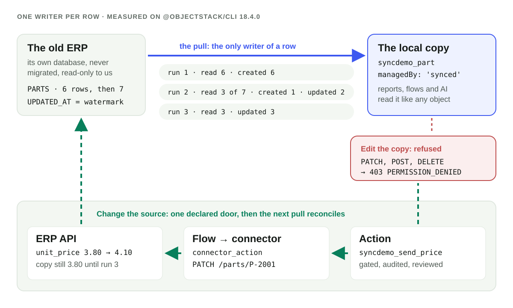

**데이터가 늘 실시간이어야 하거나 아예 들여오면 안 된다면 페더레이션. 사람과 보고서와 AI가 플랫폼의 속도로 조인하고, 필터링하고, 질문해야 한다면 복사해 들여오기.** 복사한다면 **행마다 작성자는 하나**인 사본으로 만드십시오. 예약된 풀만이 복사된 행을 쓰고, 아무도 그 행을 편집하지 않으며, 데이터 변경은 선언된 액션 하나를 통해 원본으로 돌아가고, 다음 풀이 그 결과를 가져옵니다. 작성자가 둘이면 충돌 병합이 필요합니다. 하나면 절대 필요 없습니다. 공개된 `@objectstack/cli` 18.4.0에서 이 사본은 오늘 동작합니다. 아래 기록에서 두 번째 풀은 원본의 **7행 중 3행**만 읽었습니다. 바뀐 행들, 그리고 지난 실행이 멈춘 위치와 같은 값을 가진 행입니다. 그 밖에는 아무것도 쓰지 않았습니다.

## 들어오는 길 둘, 그리고 둘 다 아닌 세 번째

ObjectStack의 설계 기록 ADR-0153은 페더레이션이 못 하는 일에서 출발합니다. 페더레이션은 행을 제자리에 두고 쿼리를 하나씩 전달하므로 실시간 데이터나 들여오면 안 되는 데이터에는 맞는 선택입니다. 그러나 "보고서, 분석, AI 질의응답, 원본을 넘나드는 조인이 먼저 그 한계에 부딪힌다. 행을 일반 객체로 복사하면 한계가 사라진다. 인덱스, 쿼리 연산자, 권한, 가동은 플랫폼의 몫이 된다." 그리고 가이드와 스킬이 가르칠 규칙을 제시합니다.

| 필요 | 선택 |
|:--|:--|
| 실시간 데이터, 한 번에 테이블 하나. 레거시 시스템을 건드리면 안 됨. 들여오면 안 되는 데이터 | **페더레이션**: 가상 객체 |
| 보고서, 분석, AI 질의응답, 원본을 넘나드는 조인. 느리거나 불안정한 레거시 시스템. 데이터 웨어하우스의 결과 | **동기화 반입**: `synced` 객체, 원본이 있는 `mapping`, 그리고 `job` |
| 외부 시스템에서 무언가를 일으킴. 행은 들어오지 않음 | **커넥터 액션**: 플로의 `connector_action` 노드, 또는 선언된 액션 |

페더레이션을 고를 이유는 강하고, 온전히 말해 둘 가치가 있습니다. 페더레이션 객체는 언제나 최신이어서, 원본의 변경과 구성원이 보는 것 사이에 지연이 없습니다. 아무것도 복제하지 않으니 보호하고 보존하고 삭제해야 할 개인정보의 두 번째 사본도 없습니다. 그리고 원본이 계속 유일하게 데이터가 쓰이는 곳입니다. 페더레이션 자체는 [자매 글](/ko/blog/ai-business-layer-over-an-existing-database/)에서 다루며, [기존 시스템 연동](/ko/connect-existing-systems/) 페이지는 페더레이션, 동기화 반입, 커넥터 액션을 나란히 놓고 보여 줍니다. 필요한 것이 이런 성질이라면 여기서 멈추십시오. 사본은 맞지 않는 도구입니다.

사본이 제값을 하는 것은 페더레이션의 한계가 실제로 걸릴 때입니다. 엔진은 데이터 소스를 넘나들며 조인할 수 없고, 읽을 때마다 원격 시스템의 지연을 치르며, 플러그인 드라이버의 읽기에는 상한이 있습니다. 사본은 원격 테이블을 일반 객체로 바꾸므로 기존의 모든 권한, 보고서, 데이터셋, 플로, MCP 도구가 변경 없이 읽습니다.

## 행마다 작성자는 하나

사본이 안전한 것은 두 번째 기록 시스템으로 표류하지 않을 때뿐입니다. 그것이 "행마다 작성자는 하나"의 뜻이며, 18.4.0에서는 런타임이 강제하는 네 가지 규칙입니다.

1. **행은 풀이 쓴다.** `datasourceSource`가 있는 `mapping`이 페더레이션 객체와 워터마크 필드를 가리킵니다. `pull`이 그 mapping을 가리키는 `job`이 일정에 따라 실행하고, 가져오기 실행기를 통해 시스템으로서 씁니다.
2. **그 밖에는 아무도 쓰지 않는다.** 대상은 `managedBy: 'synced'`로 선언됩니다. 18.4.0 spec 변경 로그는 그로써 켜지는 것을 나열합니다. "엔진 쓰기 가드가 구성원의 일반 쓰기를 거부하고(403), `apiMethods` 조정이 모든 쓰기 메서드를 걷어내며, `/me/permissions` 클램프는 닫힌 행을 답한다".
3. **변경은 원본으로, 선언된 액션을 통해.** ADR-0153 D5: "원본 데이터의 변경은 원본에서, 선언된 액션을 통해 이루어진다 … 쓰기 반영은 로컬 행을 편집하지 않는다. **다음 풀이 그것을 맞춘다**."
4. **다른 방향은 없다.** "양방향 동기화 없음, 충돌 병합 없음, Writeback-Dataset 방식의 편집 오버레이 없음".

핵심은 규칙 4입니다. 양방향 동기화에서는 모든 행에 작성자가 둘이므로, 지난 동기화 이후 양쪽이 모두 바꾼 행을 위한 정책이 필요합니다. 나중 쓴 쪽 우선, 필드 단위 병합, 누군가 처리해야 하는 충돌 대기열. 어느 것이든 데이터가 조용히 사라지는 자리입니다. 작성자가 하나면 그런 행은 없고, 그르칠 병합도 없습니다.



## 구성: 선언 다섯 개뿐

시험대는 새로 만든 `npm create objectstack@latest` 스캐폴드이고, 설치된 것은 `@objectstack/cli` 18.4.0, 즉 2026-11-14에 `npm view @objectstack/cli dist-tags`가 `latest`로 보고한 버전입니다. "오래된 ERP"는 앱이 소유하지 않는 SQLite 파일로, 테이블은 `PARTS` 하나뿐이며 부품 여섯 개와 `UPDATED_AT` 열을 담고 있습니다. 선언 다섯 개가 이들을 잇습니다.

```ts
// 1. The ERP's database: external, so no DDL ever runs there.
export const Erp = defineDatasource({
  name: 'erp', driver: 'sqlite', schemaMode: 'external',
  config: { filename: './legacy/erp.db' },
  external: { allowWrites: false, validation: { onMismatch: 'fail', checkOnBoot: true } },
});

// 2. The PARTS table, federated. PART_NO is mapped onto `id`: that is the source key.
export const ErpPart = ObjectSchema.create({
  name: 'syncdemo_erp_part', datasource: 'erp', sharingModel: 'private',
  external: {
    remoteName: 'PARTS',
    columnMap: { PART_NO: 'id', DESCRIPTION: 'description', UNIT_PRICE: 'unit_price', UPDATED_AT: 'updated_at' },
  },
  fields: {
    description: Field.text({ label: 'Description' }),
    unit_price: Field.number({ label: 'Unit price', scale: 2 }),
    updated_at: Field.datetime({ label: 'Updated at (ERP)' }),
  },
});

// 3. The local copy: an ordinary object that only the pull writes.
export const Part = ObjectSchema.create({
  name: 'syncdemo_part', managedBy: 'synced', sharingModel: 'public_read',
  fields: {
    part_no: Field.text({ label: 'Part no', required: true }),
    description: Field.text({ label: 'Description' }),
    unit_price: Field.number({ label: 'Unit price', scale: 2 }),
    source_updated_at: Field.datetime({ label: 'Updated at (ERP)' }),
  },
});

// 4. The sync, defined on its target: where rows come from, how they map, how one matches.
export const ErpPartsPull = defineMapping({
  name: 'erp_parts_pull', targetObject: 'syncdemo_part',
  mode: 'upsert', upsertKey: ['part_no'],
  fieldMapping: [
    { source: 'id', target: 'part_no' },
    { source: 'description', target: 'description' },
    { source: 'unit_price', target: 'unit_price' },
    { source: 'updated_at', target: 'source_updated_at' },
  ],
  datasourceSource: { object: 'syncdemo_erp_part', watermark: { field: 'updated_at', start: '2026-01-01' } },
});

// 5. When. No code: `pull` names the mapping.
export const ErpPartsPullJob = defineJob({
  name: 'erp_parts_pull_job',
  schedule: { type: 'interval', intervalMs: 30000 },
  pull: { mapping: 'erp_parts_pull' },
});
```

`objectstack validate`는 통과했습니다. 사본을 정직하게 지키는 부분에서 빌드는 엄격합니다. 대상에서 `managedBy: 'synced'`를 빼자 같은 명령이 1로 종료했습니다.

```text
✗ Mapping 'erp_parts_pull' pulls rows into object 'syncdemo_part' through its datasourceSource,
  but that object is not managedBy: 'synced' (it is unset). A pulled copy is read-only to members,
  so a member's edit is never kept or lost silently by the next pull; declare managedBy: 'synced'
  on the target object (ADR-0153 D4).
```

변경 로그는 빌드 시와 첫 읽기 전에 다시 판정되는 다른 거부들도 나열합니다. 원본이 있는 mapping은 `mode: 'upsert'`와 `upsertKey`를 가져야 하고, 원본은 `columnMap`이 어떤 열을 `id`로 매핑하는 페더레이션 객체여야 하며(`source_key_missing`), 워터마크는 `datetime`, `date` 또는 정수 필드여야 하고, `fieldMapping` 항목 하나가 그것을 그대로 대상에 복사해야 합니다(`watermark_field_unmapped`).

놓치기 쉬운 스위치가 하나 있습니다. 패키지의 작업은 변수 `OS_AUTOMATION_SCHEDULED_WORK_ENABLED`가 `true`인 배포에서만 예약되며, 작업 가이드에 따르면 이는 "**모든 테넌시 형태와 모든 커널에서 기본적으로 꺼져 있다**". 이를 켠 채 `objectstack dev --fresh`를 기동하고, 구성원(Mia)을 만들어 `syncdemo_part`의 읽기와, 일부러 편집까지 허용하는 권한 세트를 주고, 모든 응답을 기록했습니다.

## 실행 로그

일곱 개의 읽기를 일어난 순서대로. 시각은 2026-11-14 UTC입니다.

| # | 일어난 일 | 돌아온 것 |
|:--|:--|:--|
| 1 | 작업의 첫 틱, 04:42:41 | `sys_sync_run`: 읽음 6, 생성 6, `completed` |
| 2 | Mia가 `syncdemo_part` 목록 조회 | `200`, 6행 |
| 3 | Mia가 P-2001 가격 수정, 관리자도 같은 시도 | 둘 다 `403 PERMISSION_DENIED` |
| 4 | 누군가 ERP 안에서 P-1003을 고치고 P-3002를 추가 | 다음 실행, 04:43:11: 읽음 3, 생성 1, 갱신 2 |
| 5 | Mia가 P-2001에서 액션 "Change price in ERP" 실행 | `200`. ERP의 API가 `PATCH` 하나를 기록 |
| 6 | Mia가 곧바로 P-2001을 읽음 | 여전히 `3.8` |
| 7 | 다음 실행, 04:43:41 | 읽음 3, 갱신 3. P-2001은 `4.1` |

**읽기 1: 실행 기록.** 풀마다 작업의 조직에 `sys_sync_run` 행 하나가 남습니다. 중요한 필드만 추리면:

```json
{ "mapping": "erp_parts_pull", "mapping_package": "com.example.syncdemo",
  "target_object": "syncdemo_part", "source_kind": "datasource", "source": "syncdemo_erp_part",
  "datasource": "erp", "read_path": "builtin", "trigger": "schedule", "status": "completed",
  "read_count": 6, "created_count": 6, "updated_count": 0, "refused_count": 0,
  "watermark_field": "updated_at",
  "watermark_from": "2026-01-01T00:00:00.000Z",
  "watermark_committed": "2026-11-09T16:05:00.000Z",
  "holds_position": true, "job_run_id": "run_a02e22c1-…", "failure_reason": null }
```

`watermark_committed`는 이번 실행이 쓴 가장 새로운 `UPDATED_AT`이고, `holds_position: true`는 다음 실행이 여기서 시작함을 표시합니다. 작업 원장과의 연결은 `job_run_id`, 즉 이 실행을 일으킨 틱의 `sys_job_run` 행입니다. 보존 기간은 서비스 변경 로그가 정합니다. 행은 "30일 보존되는 텔레메트리로 작업 원장의 기간과 같다. 단, mapping(패키지와 이름)과 조직마다 읽기 위치를 담은 한 행은 예외".

**읽기 3: 거부된 편집.** Mia는 이 객체에 `allowEdit: true`를 갖고 있습니다. 응답은 개의치 않습니다.

```json
HTTP 403
{ "error": "[Security] Access denied: 'syncdemo_part' is synced (managedBy:'synced', ADR-0153) — direct update via the data API is disabled. Its rows are copied from their source by a pull, which would keep or overwrite the change; change the source through a declared action instead, and the next pull brings it home.",
  "code": "PERMISSION_DENIED", "object": "syncdemo_part" }
```

관리자의 `PATCH`도 같은 본문을 받았습니다. Mia의 `POST`와 `DELETE`도 `403`이었고, 같은 문장에서 단어만 "direct insert"와 "direct delete"로 바뀌었습니다. 거부 응답은 나갈 길도 알려 줍니다. 호출하는 쪽이 에이전트일 때 바로 원하는 모양입니다.

**읽기 4: 증분 실행, 7행 중 3행.** ERP 사용자들이 하듯 ERP를 직접 바꿨습니다. P-1003의 가격을 0.05에서 0.06으로, 그리고 새 부품 P-3002를 추가했고, 둘 다 `2026-11-14T04:42:41.487Z`를 찍었습니다. 다음 틱:

```json
{ "read_count": 3, "created_count": 1, "updated_count": 2,
  "watermark_from": "2026-11-09T16:05:00.000Z",
  "watermark_committed": "2026-11-14T04:42:41.487Z", "status": "completed" }
```

그 시점 ERP의 일곱 행 중 세 행을 읽었습니다. P-1003, P-3002, 그리고 지난 실행이 커밋한 위치와 같은 값을 가진 P-3001입니다. 이 재읽기는 작업 가이드에 적혀 있습니다. 실행은 "그 이후 쓰인 행과, 지난 위치와 같은 값을 가진 행만 읽고, upsert가 그것을 해 없이 다시 쓴다". 그래서 `updated_count`에는 바뀌지 않은 P-3001도 들어갑니다. "바뀐 행"이 아니라 "쓴 행"으로 읽으십시오.

**읽기 5~7: 쓰기 반영.** 액션은 `syncdemo_part`의 `type: 'flow'` 액션입니다. 그 플로에서 일하는 노드는 하나, ERP 자체의 HTTP API를 가리키는 `rest` 커넥터를 호출하는 `connector_action`입니다(여기서는 `PARTS`를 갱신하고 `UPDATED_AT`을 찍는 20줄짜리 대역).

```ts
{ id: 'patch_erp', type: 'connector_action',
  connectorConfig: {
    connectorId: 'erp_api', actionId: 'request',
    input: {
      method: 'PATCH',
      path: { dialect: 'cel', source: "'/parts/' + record.part_no" },
      body: { dialect: 'cel', source: '{ "unit_price": new_price }' },
    },
  },
}
```

Mia는 REST로 호출했습니다. 레코드 페이지의 버튼도 같은 문을 지납니다("콘솔 버튼과 API 호출은 같은 게이트와 핸들러를 거친다").

```bash
curl -s -b mia.cookies -X POST http://localhost:49921/api/v1/actions/syncdemo_part/syncdemo_send_price \
  -H 'content-type: application/json' \
  -d '{"recordId":"07580e75-…","params":{"new_price":4.1}}'
```

```text
HTTP 200  { "success": true, "data": { "success": true, "flowLabel": "Send price to ERP", … } }
ERP API:  2026-11-14T04:43:12.035Z PATCH /parts/P-2001 {"unit_price":4.1} -> changes=1
```

바로 이어 읽으니 사본은 여전히 `"unit_price": 3.8`이었습니다. 쓰기 반영이 바꾼 것은 ERP뿐이기 때문입니다. 30초 뒤 다음 실행이 3행(같은 위치의 P-1003과 P-3002, 그리고 P-2001)을 읽고 3행을 갱신하고 `2026-11-14T04:43:12.035Z`를 커밋했으며, P-2001은 `"unit_price": 4.1, "source_updated_at": "2026-11-14T04:43:12.035Z"`가 되었습니다. 사본의 값은 ERP가 받아들인 값이지 사용자가 입력한 값이 아닙니다. ERP가 거부했거나 반올림했다면 사본은 그 결과를 보여 줍니다.

## 사본이 물려받지 않는 것

- **원본의 권한.** ERP에서 누가 그 행을 읽을 수 있는지는 행과 함께 오지 않습니다. ADR-0153: "객체 권한은 판정대로 로컬에서 0부터 구성한다. 구성원은 부여를 통해서만 동기화된 행을 읽는다." 이 실행에서 Mia는 권한 세트로 사본을 읽었고, 같은 세션에서 페더레이션된 원본 객체에는 `403`을 받았습니다. 거기에는 아무 부여도 없기 때문입니다. 지향할 구성이 바로 이것입니다. 구성원은 사본을 읽고, 원본은 풀 말고는 아무도 읽지 않는다. 복사된 행에는 소유자가 없으므로(위 행들에는 `owner_id`가 없습니다) spec 변경 로그가 synced 객체에 권하는 lint 조언은 "`sharingModel: 'public_read'` … 또는 읽기를 부여하는 공유 규칙이 있는 `'private'`"입니다.
- **구성원에게 실행 이력.** `sys_sync_run`은 데이터 API에 열려 있지만 Mia가 읽자 `403`이었습니다. 다른 객체처럼 부여가 필요합니다.
- **다중 조직 배포에서의 조직.** 장벽이 있는 형태에서는 플랫폼이 추측하지 않습니다. `OS_TENANCY_POSTURE=isolated`로 기동하자 같은 앱은 페더레이션 원본이 조직 범위를 선언할 때까지 시작을 거부했습니다("Stating nothing: 'syncdemo_erp_part'"). 원본을 공유로 선언하자 기동 로그가 `error` 수준으로 "NOT SCHEDULED — job 'erp_parts_pull_job' declares no `organization`"을 남겼습니다(그 뒤 관련 없는 장벽 형태 설정인 멤버십 정책에서 멈췄습니다. 실제 다중 조직 배포라면 어차피 선언하는 값입니다). 해결책은 작업에 `organization`을 적는 것이고, 조직마다 작업 하나입니다. 18.4.0 변경 로그는 이 형태에서 풀 자체가 답하는 거부로 `source_organization_scope_unstated`와 `job_organization_missing`을 듭니다.
- **파이프라인.** 사본은 원본 테이블 하나, mapping 하나, 대상 하나입니다. ADR-0153: "ObjectStack은 파이프라인이나 변환을 만들지 않는다. 원본을 넘나드는 조인, 정제, 집계는 데이터 웨어하우스나 ETL 업체의 일이며, ObjectStack은 그 결과를 동기화해 들여온다." 정제되고 조인된 뷰가 필요하면 웨어하우스에서 만들고 그 결과를 풀하십시오.

이 모든 것이 도는 커널은 오픈 소스입니다. ADR-0153 D9: 동기화 커널은 "페더레이션과 마찬가지로 이 저장소에서 Apache-2.0으로 배포된다".

## 개발 중

아래는 ADR-0153(18.4.0 태그 시점 상태 *Proposed*)에 설계되어 있지만 18.4.0에는 없습니다. 이 절의 내용은 하나도 실행하지 않았습니다.

- **삭제 정책.** 원본에서 사라진 행은 삭제되지 않고 표시됩니다. "`deletePolicy: 'mark' | 'ignore'`, 기본값 `mark`, `_sync_deleted_at`을 찍음", 그리고 "풀은 결코 행을 물리적으로 삭제하지 않는다". 증분 풀은 원본의 논리 삭제 필드 `deletedField`를 통해 삭제를 봅니다. 18.4.0에서 이 키들은 파싱되며, 변경 로그에 따르면 "아직 아무것도 바꾸지 않는다고 작성자에게 경고"합니다. 현재는 원본에서 삭제된 행이 사본에 남습니다.
- **모든 행의 출처 열.** 예약된 접두사 아래의 플랫폼 열 다섯 개: "`_sync_source`", "`_sync_external_id`", "`_sync_pulled_at`", "`_sync_run_id`", "`_sync_deleted_at`". 18.4.0의 풀은 헤더에서 이렇게 밝힙니다. "삭제 표시(D3), 출처 열(D4), 드리프트(D6)는 이후의 변경". 현재는 실행 기록이 출처입니다. 접두사는 이미 예약되어 있어 `_sync_…`라는 이름의 필드는 거부됩니다.
- **Studio 동기화 마법사.** "Studio 동기화 마법사는 `synced` 객체, `mapping`, 그리고 그 `job`을 만든다." 런타임에 만들 수 있는 작업이 필요하며, 기록은 이를 "작업은 코드로만"의 유일한 예외로 설계합니다. "런타임 문은 실행 형태가 `pull`뿐인 `job`을 받아들인다". Studio는 "동기화된 객체와 그 원본 페이지에서 실행 이력"도 보여 줄 예정입니다.
- **웨어하우스를 원본으로.** "수정 `6731744658`이 웨어하우스를 일급 풀 원본으로 만든다". Snowflake와 BigQuery 드라이버는 "이 저장소 밖의 플러그인 패키지"이며 플러그인 드라이버 적합성 키트로 검증됩니다. 하한 보호를 받는 플러그인 드라이버는 "양쪽에 경계가 있는 창"으로 읽히고, 창이 행 상한을 넘어 돌아오는 동안 "절반으로" 나뉩니다.
- **동기화 가이드와 스킬.** "3방향 규칙과 파트너 입장(D10), 쓰기 반영의 답(D5), 그리고 `mapping` / `job`을 가리키는 `SYNC_ARCHITECTURE.md`와 스킬". 그때까지는 작업 가이드의 "Pulling a mapping" 절과 mapping 레퍼런스가 문서입니다.

## 에이전트가 썼을 때 검토하는 법

에이전트가 앱에 동기화를 추가했다면 diff는 위의 선언 다섯 개이고, 쓰기 반영이 범위에 있으면 액션과 플로가 더해집니다. 먼저 네 곳을 읽으십시오.

1. 대상의 `managedBy: 'synced'`. 없으면 빌드가 mapping을 거부하므로, 빌드가 초록이면 거기 있습니다.
2. 대상의 `sharingModel`과 권한 세트. 0에서 시작하며, 아무것도 물려받지 않았습니다.
3. `watermark.field`와 원본 키. ADR-0153은 워터마크에 "원본의 모든 쓰기가 그 행의 워터마크에 원본이 이미 가진 어떤 값 이상의 값을 찍는다"를 요구하고, 키에는 유일하고 결코 NULL이 아님을 요구합니다. "불변식 2와 마찬가지로 풀이 확인할 수 없는 원본에 대한 요구"입니다. 쓸 때마다 갱신되지 않는 열은 변경을 조용히 놓칩니다.
4. 액션과 그 플로(있다면). 원본으로 돌아가는 유일한 길이니, 다른 외부 호출처럼 검토하십시오. 무엇을, 누구에게 보내며, 누가 실행할 수 있는가.

그리고 배포가 처음 쓰는 `sys_sync_run` 행을 읽으십시오. `read_count`를 원본의 행 수와 맞대어 보는 것이 그 실행의 검토입니다.

## 에이전트에게 맡기십시오

코딩 에이전트에게 작업 가이드(`objectstack.ai/docs/automation/jobs`의 "Pulling a mapping")와 mapping 레퍼런스를 건네고 규칙을 한 줄로 알려 주십시오. `datasourceSource`가 있는 `mapping`과 그것을 `pull`로 가리키는 `job`을 통해 `managedBy: 'synced'` 객체로 복사한다. 사본에는 절대 쓰지 않는다. 원본은 선언된 액션으로 바꾼다. [ObjectStack용 코딩 에이전트 설정 가이드](/en/blog/how-to-point-your-agent-at-objectstack/)가 이 규칙을 실어 나르는 규칙 파일과 MCP 엔드포인트를 다룹니다. 여기의 mapping은 [오래된 시스템에서 스프레드시트를 가져올](/ko/blog/how-to-import-a-spreadsheet-from-an-old-system/) 때와 같은 `fieldMapping`과 `upsertKey`를 씁니다. 풀이란 그 가져오기를 작업이 살아 있는 원본을 상대로 돌리는 것입니다. 그리고 사본은 [온톨로지](/en/glossary/ontology/) 안의 객체 하나일 뿐이어서, 모든 보고서와 AI 도구가 추가 작업 없이 읽습니다. 위의 모든 것은 `@objectstack/cli` 18.4.0에서 실행했습니다.
