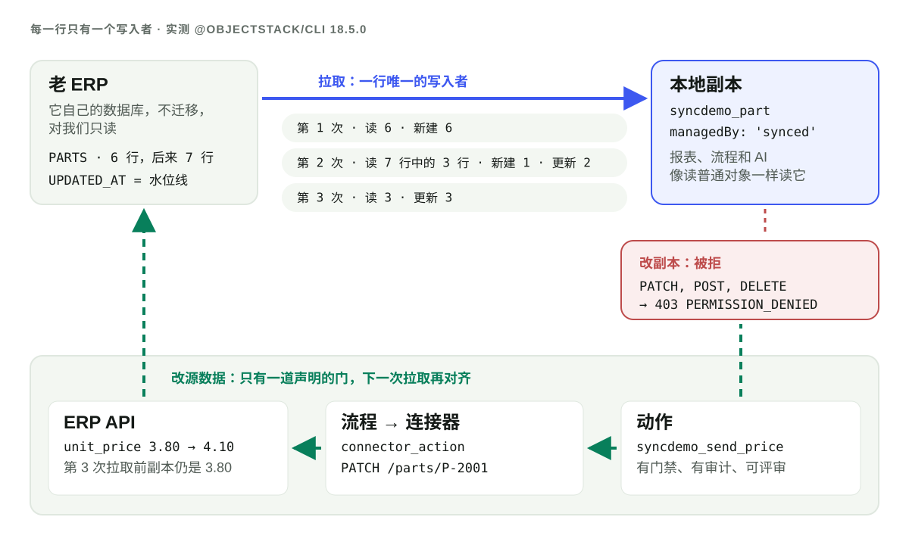

**数据必须精确到秒地保持最新，或者绝不能存到别处，就实时读取源系统；人、报表和 AI 需要全速地关联、筛选、提问，就把它复制进来**。两者各有代价。实时读取每次都要等源系统响应，而且一次查询无法合并两个数据库。副本则只和最近一次定时刷新一样新。如果复制，就坚持**每一行只有一个写入者**：只有定时刷新能写副本，谁都不能改它，管理员也不行。要改数据，就在源系统里改，经一个专门为此建好的动作，下一次刷新再把结果取回来。在我的测试里，一次刷新只读了源表 7 行中的 3 行；对副本的编辑，普通成员和管理员一样被拒。

*在 ObjectStack 18.5.0 上实测，即 2026-11-16 时已发布的最新版。全部实录都在最后一节「证据」里。*

## 实时读取，还是复制进来？

**联邦**让数据行留在原处，把每个查询转给源系统。**同步进来**按计划把数据行复制进平台自己拥有的一张普通表。**连接器动作**从一个按钮或一条自动化去调用对方系统，不存它的任何数据行。ObjectStack 关于同步的设计记录 ADR-0153（在 18.5.0 标签时仍是「提议」状态）是这样选的：

| 你的情况 | 选择 |
|:--|:--|
| 要实时数据，一次一张表；遗留系统不能碰；数据不能存到源系统之外 | **实时读取**（联邦） |
| 报表、分析、AI 问答、跨来源关联；遗留系统慢或脆弱；数仓的结果 | **复制进来**（同步进来） |
| 只想在对方系统里触发一件事；不存任何数据行 | **两者都不是**：连接器动作 |

实时读取的理由很充分。联邦表永远是最新的：源头的改动和成员看到的内容之间没有延迟。没有任何重复，所以没有第二份个人数据需要保护、留存或删除。而源系统始终是唯一写入数据的地方。一篇[姊妹文章](/zh-Hans/blog/ai-business-layer-over-an-existing-database/)按联邦自己的逻辑完整走了一遍，[连接现有系统](/zh-Hans/connect-existing-systems/)页面把三者并排列出。如果你要的正是这些特性，就到此为止：副本是错的工具。

当实时读取碰到它的极限时，副本是更好的选择。平台无法在一次查询里关联两个数据库（它分别读取，再在内存里合并数据行），每次读取都要等远程系统，而经附加数据库连接器的读取有最大行数限制。用设计记录的话说：「把数据行复制进一个普通对象就消除了这些限制：此后索引、查询运算符、权限和可用性都归平台所有。」复制之后，它就是又一张表，现有的权限、报表和 AI 工具无需改动就能读它。

## 让副本保持诚实的规则：每一行只有一个写入者

任何副本的风险，都是它慢慢变成第二个记录系统：有人在副本中改了一个价格，源系统从不知道，两边从此不一致。每一行只有一个写入者，用运行时强制执行的四条规则防止这种情况：

1. **拉取写入数据行**。拉取就是定时刷新：一个任务读取源系统、写入副本，用的是平台自己的身份而不是某个用户的，并且只读上次运行以来变过的内容。它靠*水位线*找到这些行：源系统里的一个「最后更新时间」列。
2. **别人都不写**。副本被声明为*同步对象*：一张只有拉取能写的表。成员、管理员或 API 调用方的编辑、新增或删除一律被拒，不管他们的权限怎么说。
3. **改动去源系统，经一个声明的动作**。*声明的动作*是在应用里定义的一个按钮，有自己的权限检查，它调用源系统自己的 API。它不碰副本；下一次拉取会更新副本。
4. **没有另一个方向**。没有双向同步，也没有冲突编辑的合并。

第 4 条是关键。双向同步每一行有两个写入者，所以需要一条策略来处理两边都改过的那一行：后写者胜、字段级合并、一个必须由人来处理的冲突队列。每一种要么丢掉一方的改动，要么需要一个人来裁决。只有一个写入者，就不存在这样的行，也就没有会出错的合并。



## 我测了什么，对你意味着什么

我把一个全新的 ObjectStack 应用连到一个充当「旧 ERP」的替身上，一个有六个零件的小数据库，并给一位成员 Mia 授予了副本的读权限，还特意给了编辑权限，看权限能不能绕过这条规则。这次测试里拉取每 30 秒运行一次；你的计划决定延迟有多长。时间均为 2026-11-16 的 UTC 时间。

| 我做了什么 | 系统怎么回答 | 对你意味着什么 |
|:--|:--|:--|
| 去掉副本上的「synced」标记后构建应用 | 构建失败，并点名缺少的标记 | 构建通过，保护就是开着的 |
| 让拉取在 02:31:21 运行一次，然后让 Mia 列出副本 | 读 6 行、新建 6 行、完成，并留下一条运行记录；Mia 看到这 6 行 | 每次刷新都有记录，成员读副本就像读任何别的表 |
| 持有编辑权限的 Mia 改了 P-2001 的价格；一位管理员也试了一次 | 两人都被拒；报错信息说明了该怎么做 | 无论是有编辑权限的成员还是管理员，都无法通过应用或其 API 编辑副本 |
| 直接在 ERP 里改了 P-1003，并新增了 P-3002 | 下一次运行，02:31:51：读 7 行中的 3 行，新建 1 行，更新 2 行 | 一次刷新读的是变过的内容，不是整张表 |
| Mia 对 P-2001 运行了动作「Change price in ERP」，然后读这一行 | 允许；ERP 的 API 记录了一次更新。副本仍是 3.8 | 动作改的是源系统，不是副本 |
| 等下一次运行，02:32:21 | 读 3 行、更新 3 行；P-2001 现在是 4.1 | 副本显示的永远只是 ERP 里存着的值 |

两个细节。第二次运行「更新」的 2 行里，有一行 P-3001 并没有变：一次运行会重读停在上次停止位置上的那些行，所以这个数要读作「写入的行」，而不是「变过的行」。另外，定时任务默认是关的：部署必须把它打开，否则拉取一次都不会跑。

## 副本不继承什么

- **源系统的权限**。在 ERP 里谁能读某一行，不会随它一起复制过来：副本上的权限从无权访问开始，成员只能经授权才能读。Mia 通过她的权限集读到了副本，在源表上则被拒，因为她在那里没有授权：这正是该追求的配置。复制来的行没有所有者，所以要么让副本对所有成员可读，要么保持私有，再用共享规则授予读权限。
- **运行历史，对成员而言**。Mia 读它时被拒：和任何表一样，它需要授权。
- **删除**。在 18.5.0 上，源系统里删掉的行会留在副本中（任务指南：「删除相关的键暂时什么都不改变」；这一点我没有运行）。标记这类行的功能在开发中，见下文。
- **组织，在多组织部署里**。平台不会去猜。在隔离的多组织模式下运行时，同一个应用在源对象声明它的组织范围之前拒绝启动，之后又在任务写明它的组织之前不肯调度拉取：一个组织一个任务。
- **管道**。副本就是一张源表、一个映射、一个目标。设计记录：「ObjectStack 不构建管道或转换。跨来源的关联、清洗和聚合是数仓或 ETL 厂商的事；ObjectStack 把结果同步进来。」需要清洗、关联好的视图？在数仓里建好，再把结果拉进来。

## 开发中

下面这些在设计记录里已有设计，但不在 18.5.0 里。本节没有运行任何东西；这里关于 18.5.0 的说法引自它的变更日志和指南。

- 源系统里删掉的行：设计是把它们标记为已删除，从不移除。
- 每一行都带来源标记：它从哪里来、由哪次运行写入。
- Studio 里的同步向导，并在界面上显示运行历史。
- 数据仓库（Snowflake、BigQuery）作为来源，经附加连接器接入。
- 同步指南和 agent 技能。

<details>
<summary>设计记录、变更日志和指南的原话</summary>

- **删除策略**。从源系统消失的行将被标记，从不删除：「`deletePolicy: 'mark' | 'ignore'`，默认 `mark`，写入 `_sync_deleted_at`」，以及「拉取从不物理删除一行」。增量拉取将通过源系统的软删除字段 `deletedField` 看到删除。变更日志说，在 18.5.0 上这些键能解析，并且「仍会提醒作者它们暂时什么都不改变」。
- **每一行的来源列**。保留前缀下的五个平台列：「`_sync_source`」「`_sync_external_id`」「`_sync_pulled_at`」「`_sync_run_id`」和「`_sync_deleted_at`」。18.5.0 的拉取在它的文件头里这样写：「删除标记（D3）、来源列（D4）和漂移（D6）是后续的改动」。今天，运行记录就是来源记录；前缀已经保留，所以名为 `_sync_…` 的字段会被拒。
- **Studio 同步向导**。「Studio 同步向导会创建 `synced` 对象、`mapping` 和那个 `job`。」它需要一个能在运行时创建的任务，设计记录把它设计为「任务只能写在代码里」的唯一例外：「运行时入口接受一个唯一运行形式是 `pull` 的 `job`」。Studio 还要显示「同步对象上和它的来源页面上的运行历史」。
- **数仓作为来源**。「修订 `6731744658` 让数仓成为一等的拉取来源」；Snowflake 和 BigQuery 驱动是「这个仓库之外的插件包」，由插件驱动一致性套件验证，对有下限保护的插件驱动，按「两端都有界的窗口」读取，一个窗口返回的行数超过行数上限时就「减半」。
- **同步指南和技能**。「三向规则和合作伙伴立场（D10）、写回的答案（D5），以及 `SYNC_ARCHITECTURE.md` 和指向 `mapping` / `job` 的技能」。在那之前，任务指南的「Pulling a mapping」一节和 mapping 参考就是文档。

</details>

## agent 写出来时怎么评审

agent 写的同步就是五个声明，如果涉及写回，再加一个动作和一个流程。先查四件事：

1. **副本被标记为同步对象**（目标上的 `managedBy: 'synced'`）。没有它，构建会拒绝这个同步，所以构建通过，它就在。
2. **谁能读副本**：它的共享模型和权限集，起点是无权访问。
3. **源系统的最后更新时间列和它的键**。最后更新时间列如果不是每次写入都更新，就会悄无声息地丢掉改动；键必须唯一，而且永不为空。拉取两者都检查不了，只能由源系统保证。
4. **写回动作和它的流程**，如果有的话：它是回到源系统的唯一路径。像审任何对外调用一样审它：发什么、发给谁、谁能运行它。

然后把第一条运行记录里读取的行数，和源表的行数对一对。

## 把你的 agent 指向它

把任务指南（`objectstack.ai/docs/automation/jobs`，「Pulling a mapping」一节）和 mapping 参考交给你的编码 agent，再用一句话告诉它规则：经一个带 `datasourceSource` 的 `mapping` 和一个 `pull` 指向它的 `job`，复制进一个 `managedBy: 'synced'` 对象；永不写副本；经一个声明的动作去改源系统。[为 ObjectStack 配置编码 agent 的指南](/en/blog/how-to-point-your-agent-at-objectstack/)讲了承载这条规则的规则文件和 MCP 端点。这个映射用的 `fieldMapping` 和 `upsertKey`，和你[从旧系统导入一份电子表格](/zh-Hans/blog/how-to-import-a-spreadsheet-from-an-old-system/)时用的一样：拉取就是那次导入，只是由任务对着一个在线来源来跑；副本也只是[本体](/zh-Hans/glossary/ontology/)里的又一个对象。同步内核和联邦一样，以 Apache-2.0 开源。

## 证据

这里的一切都在 `@objectstack/cli` 18.5.0 上运行，即 2026-11-16 时 `npm view @objectstack/cli dist-tags` 报告为 `latest` 的版本，用的是一个全新的 `npm create objectstack@latest` 脚手架。

### 五个声明

「旧 ERP」是一个应用并不拥有的 SQLite 文件，里面一张表 `PARTS`，存着六个零件和一个 `UPDATED_AT` 列。

```ts
// 1. The ERP's database: external, so no DDL ever runs there.
export const Erp = defineDatasource({
  name: 'erp', driver: 'sqlite', schemaMode: 'external',
  config: { filename: './legacy/erp.db' },
  external: { allowWrites: false, validation: { onMismatch: 'fail', checkOnBoot: true } },
});

// 2. The PARTS table, federated. PART_NO is mapped onto `id`: that is the source key.
export const ErpPart = ObjectSchema.create({
  name: 'syncdemo_erp_part', datasource: 'erp', sharingModel: 'private',
  external: {
    remoteName: 'PARTS',
    columnMap: { PART_NO: 'id', DESCRIPTION: 'description', UNIT_PRICE: 'unit_price', UPDATED_AT: 'updated_at' },
  },
  fields: {
    description: Field.text({ label: 'Description' }),
    unit_price: Field.number({ label: 'Unit price', scale: 2 }),
    updated_at: Field.datetime({ label: 'Updated at (ERP)' }),
  },
});

// 3. The local copy: an ordinary object that only the pull writes.
export const Part = ObjectSchema.create({
  name: 'syncdemo_part', managedBy: 'synced', sharingModel: 'public_read',
  fields: {
    part_no: Field.text({ label: 'Part no', required: true }),
    description: Field.text({ label: 'Description' }),
    unit_price: Field.number({ label: 'Unit price', scale: 2 }),
    source_updated_at: Field.datetime({ label: 'Updated at (ERP)' }),
  },
});

// 4. The sync, defined on its target: where rows come from, how they map, how one matches.
export const ErpPartsPull = defineMapping({
  name: 'erp_parts_pull', targetObject: 'syncdemo_part',
  mode: 'upsert', upsertKey: ['part_no'],
  fieldMapping: [
    { source: 'id', target: 'part_no' },
    { source: 'description', target: 'description' },
    { source: 'unit_price', target: 'unit_price' },
    { source: 'updated_at', target: 'source_updated_at' },
  ],
  datasourceSource: { object: 'syncdemo_erp_part', watermark: { field: 'updated_at', start: '2026-01-01' } },
});

// 5. When. No code: `pull` names the mapping.
export const ErpPartsPullJob = defineJob({
  name: 'erp_parts_pull_job',
  schedule: { type: 'interval', intervalMs: 30000 },
  pull: { mapping: 'erp_parts_pull' },
});
```

`job` 按计划运行这个映射，以系统身份经导入执行器写入。spec 变更日志列出了 `managedBy: 'synced'` 打开的东西：「引擎写入守卫拒绝成员的通用写入（403），`apiMethods` 协调去掉每一个写方法，`/me/permissions` 钳制如实回答这一行是关闭的」。

### 构建拒绝

`objectstack validate` 通过了。把目标上的 `managedBy: 'synced'` 去掉后，同一条命令以 1 退出：

```text
✗ Mapping 'erp_parts_pull' pulls rows into object 'syncdemo_part' through its datasourceSource,
  but that object is not managedBy: 'synced' (it is unset). A pulled copy is read-only to members,
  so a member's edit is never kept or lost silently by the next pull; declare managedBy: 'synced'
  on the target object (ADR-0153 D4).
```

变更日志列出了其它在构建时、并在第一次读取前再次运行的拒绝：带来源的映射必须是带 `upsertKey` 的 `mode: 'upsert'`，来源必须是一个联邦对象，且它的 `columnMap` 把某一列映射到 `id`（`source_key_missing`），水位线必须是 `datetime`、`date` 或整数字段，并且必须有一条 `fieldMapping` 把它原样复制进目标（`watermark_field_unmapped`）。

### 运行

一个包的任务只在变量 `OS_AUTOMATION_SCHEDULED_WORK_ENABLED` 为 `true` 的地方才会被调度，任务指南说这个开关「在每一种租户形态、每一个内核里**默认都是关的**」。我把它打开后用 `objectstack dev --fresh` 启动，并创建了一位成员（Mia），给她一个权限集，授予 `syncdemo_part` 的读权限，并特意授予编辑权限。第一次触发在 02:31:21；Mia 列出 `syncdemo_part`，回答是 `200`，6 行。

**运行记录**。每次拉取都会在任务所属组织中留下一行 `sys_sync_run`。第一行，只保留要紧的字段：

```json
{ "mapping": "erp_parts_pull", "mapping_package": "com.example.syncdemo",
  "target_object": "syncdemo_part", "source_kind": "datasource", "source": "syncdemo_erp_part",
  "datasource": "erp", "read_path": "builtin", "trigger": "schedule", "status": "completed",
  "read_count": 6, "created_count": 6, "updated_count": 0, "refused_count": 0,
  "watermark_field": "updated_at",
  "watermark_from": "2026-01-01T00:00:00.000Z",
  "watermark_committed": "2026-11-09T16:05:00.000Z",
  "holds_position": true, "job_run_id": "run_0b31fc19-…", "failure_reason": null }
```

`watermark_committed` 是这次运行写入的最新 `UPDATED_AT`，`holds_position: true` 标明下一次运行从这一行开始。账本链接是 `job_run_id`，即驱动这次运行的那次触发的 `sys_job_run` 行。服务变更日志规定了保留期：这些行是「保留 30 天的遥测，即任务账本的窗口，但每个映射（包和名称）和组织持有读取位置的那一行除外」。

**被拒的编辑**。Mia 在这个对象上持有 `allowEdit: true`。她对 P-2001 价格的 `PATCH`：

```json
HTTP 403
{ "error": "[Security] Access denied: 'syncdemo_part' is synced (managedBy:'synced', ADR-0153) — direct update via the data API is disabled. Its rows are copied from their source by a pull, which would keep or overwrite the change; change the source through a declared action instead, and the next pull brings it home.",
  "code": "PERMISSION_DENIED", "object": "syncdemo_part" }
```

管理员的 `PATCH` 得到同样的响应体。Mia 的 `POST` 和 `DELETE` 回答 `403`，同一句话里分别是「direct insert」和「direct delete」。当发起调用的是 agent 时，告诉它该怎么做，正是你想要的。

**增量运行，7 行中的 3 行**。我像 ERP 自己的用户那样直接改了 ERP：P-1003 的价格从 0.05 改成 0.06，并新增零件 P-3002，两者的时间戳都是 `2026-11-16T02:31:22.383Z`。下一次触发，在 02:31:51：

```json
{ "read_count": 3, "created_count": 1, "updated_count": 2,
  "watermark_from": "2026-11-09T16:05:00.000Z",
  "watermark_committed": "2026-11-16T02:31:22.383Z", "status": "completed" }
```

ERP 当时有七行，读了三行：P-1003、P-3002，以及和上次运行提交的位置同值的 P-3001。任务指南写明了这次重读：一次运行「只读此后写入的行，加上和最后那个位置同值的行，upsert 会无害地再写一遍」。

**写回**。这个动作是 `syncdemo_part` 上的一个 `type: 'flow'` 动作。它的流程只有一个干活的节点，一个 `connector_action`，调用一个指向 ERP 自己 HTTP API 的 `rest` 连接器（这里是一个 20 行的替身，它更新 `PARTS` 并写入 `UPDATED_AT`）：

```ts
{ id: 'patch_erp', type: 'connector_action',
  connectorConfig: {
    connectorId: 'erp_api', actionId: 'request',
    input: {
      method: 'PATCH',
      path: { dialect: 'cel', source: "'/parts/' + record.part_no" },
      body: { dialect: 'cel', source: '{ "unit_price": new_price }' },
    },
  },
}
```

Mia 通过 REST 调用了它，和记录页上的按钮用的是同一个入口（「Console 按钮和 API 调用走同一道关卡和同一个处理器」）：

```bash
curl -s -b mia.cookies -X POST http://localhost:49921/api/v1/actions/syncdemo_part/syncdemo_send_price \
  -H 'content-type: application/json' \
  -d '{"recordId":"6b7fe890-…","params":{"new_price":4.1}}'
```

```text
HTTP 200  { "success": true, "data": { "success": true, "flowLabel": "Send price to ERP", … } }
ERP API:  2026-11-16T02:31:52.833Z PATCH /parts/P-2001 {"unit_price":4.1} -> changes=1
```

紧接着读，副本仍然是 `"unit_price": 3.8`，因为写回只改了 ERP，别的什么都没改。三十秒后，在 02:32:21，下一次运行读了 3 行（共享位置上的 P-1003 和 P-3002，以及 P-2001），更新 3 行，提交 `2026-11-16T02:31:52.833Z`，P-2001 读出来是 `"unit_price": 4.1, "source_updated_at": "2026-11-16T02:31:52.833Z"`。如果 ERP 拒绝或舍入了这个值，副本也会显示出来（这是从这个闭环推断的，这里没有测试）。

### 实测的局限

- **权限**。Mia 读到副本的同一个会话，在联邦源对象 `syncdemo_erp_part` 上得到 `403`，她在那里没有授权。复制来的行不带 `owner_id`，所以 spec 变更日志对同步对象的 lint 建议是「`sharingModel: 'public_read'` …… 或 `'private'` 加一条授予读权限的共享规则」。
- **运行历史**。`sys_sync_run` 对数据 API 开放，但 Mia 读它时回答是 `403`。
- **组织**。用 `OS_TENANCY_POSTURE=isolated` 启动时，同一个应用在联邦源对象声明它的组织范围之前拒绝启动（「Stating nothing: 'syncdemo_erp_part'」）。把来源声明为共享后，启动以 `error` 级别记录：「NOT SCHEDULED — job 'erp_parts_pull_job' declares no `organization`」（之后它停在一个无关的隔离形态设置上，即成员资格策略，真正的多组织部署本来就会声明它）。解决办法是在任务上写 `organization`，一个组织一个任务。变更日志点名了拉取本身在这种形态下给出的拒绝：`source_organization_scope_unstated` 和 `job_organization_missing`。

### 设计记录和指南的原话

上文转述了这些来源；这里是原话。

- **为什么复制**。「报表、分析、AI 问答和跨来源关联最先碰到这些限制。把数据行复制进一个普通对象就消除了这些限制：此后索引、查询运算符、权限和可用性都归平台所有。」
- **跨数据库关联**。18.5.0 分析编译器的源码注释：带联邦对象的数据集「由 ObjectQL 外键展开路径提供（两次读取，在内存里关联）——它天然跨数据源」。
- **行数上限（这里没有运行）**。18.5.0 的虚拟对象指南：「匹配行数超过数据源行数上限的读取，会以 `422 EXTERNAL_ROW_CAP_EXCEEDED` 被拒，而不是用部分结果来回答。上限只适用于插件驱动，包括 OData」。「默认是 1000 行」，平台最大值是 10,000。
- **第 3 条，写回**。ADR-0153 D5：「对源数据的修改在源系统里进行，经一个声明的动作……写回不编辑本地行；**下一次拉取会把它对齐**。」
- **第 4 条，单一方向**。「没有双向同步，没有冲突合并，没有 Writeback-Dataset 式的编辑覆盖层」。
- **权限**。「对象权限在本地从零开始配置……成员只有经授权才能读同步来的行。」
- **水位线和键**。关于 `watermark.field`：「源系统的每一次写入，都给该行的水位线写一个不低于源系统已有任何值的值」。关于映射到 `id` 的列：唯一且永不为 NULL，「这是对源系统的要求……拉取检查不了」。
- **删除**。18.5.0 的任务指南：「删除相关的键暂时什么都不改变，`os validate` 也会这样说。」
- **许可证**。ADR-0153 D9：同步内核「和联邦一样，以 Apache-2.0 在这个仓库里发布」。
