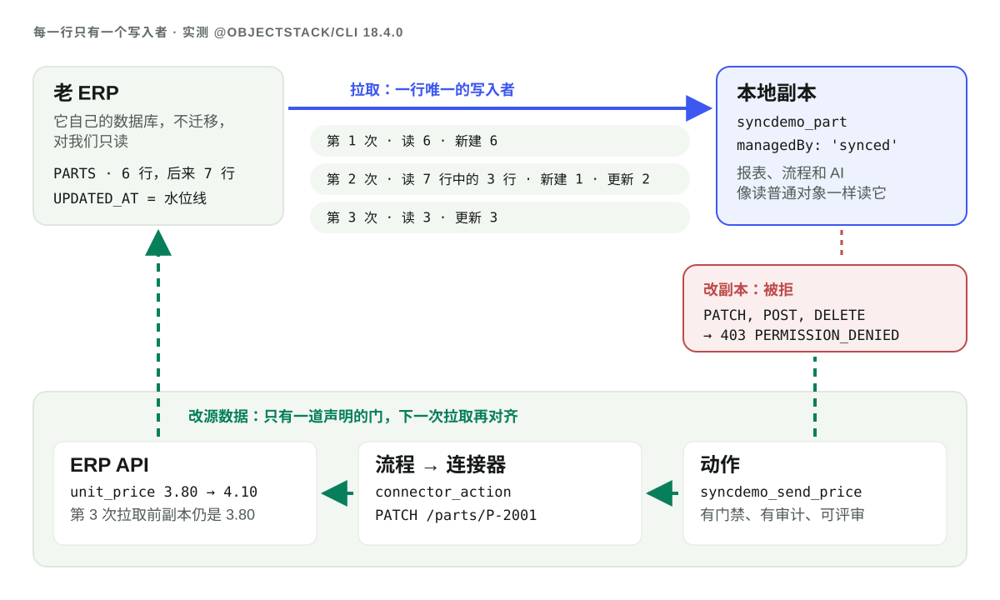

**数据必须保持实时、或者根本不能落地，就用联邦；人、报表和 AI 需要以平台的速度关联、筛选、提问，就复制进来。** 如果复制，就做成**每一行只有一个写入者**的副本：定时拉取是唯一写入副本行的东西，谁都不改它；要改数据，就通过一个声明好的动作回到源系统去改，下一次拉取再把结果带回来。两个写入者需要冲突合并，一个写入者永远不需要。在已发布的 `@objectstack/cli` 18.4.0 上，这样的副本今天就能跑：在下文的实录里，第二次拉取只读了**源表 7 行中的 3 行**——变了的那几行，以及和上次停下的位置同值的那一行——别的什么都没写。

## 两条进来的路，外加一件两者都不是的事

ObjectStack 为此写的设计记录 ADR-0153，从联邦做不到的事说起。联邦让数据留在原处、逐个转发查询，这对实时数据或不能落地的数据是对的，但「报表、分析、AI 问答和跨源关联最先撞上这些限制。把行复制进普通对象就消除了它们：索引、查询算子、权限和可用性都归平台所有。」随后它给出了指南和技能要教的规则：

| 需求 | 选择 |
|:--|:--|
| 实时数据，一次一张表；不能动旧系统；不能落地的数据 | **联邦**：虚拟对象 |
| 报表、分析、AI 问答、跨源关联；又慢又脆的旧系统；数仓的结果 | **同步进来**：一个 `synced` 对象、一个带源的 `mapping` 和一个 `job` |
| 在外部系统里触发一件事；不落任何行 | **连接器动作**：流程里的 `connector_action` 节点，或一个声明的动作 |

联邦的理由很充分，值得完整地讲出来。联邦对象永远是最新的，源头一改，成员看到的立刻就是新的，中间没有延迟。没有任何复制，所以不存在第二份需要保护、保留或删除的个人数据。源系统也一直是唯一写数据的地方。另有一篇[姊妹文章](/zh-Hans/blog/ai-business-layer-over-an-existing-database/)专门讲联邦本身，[对接现有系统](/zh-Hans/connect-existing-systems/)页面则把联邦、同步进来和连接器动作并排列出。如果你要的正是这些性质，读到这里就够了：副本是错的工具。

当联邦的限制真正卡住你时，副本才值得。引擎不能跨数据源关联，每次读取都要付远端系统的延迟，插件驱动的读取有行数上限。副本把远端表变成一个普通对象，现有的每一条权限、每一张报表、每个数据集、流程和 MCP 工具都无需改动就能读它。

## 每一行只有一个写入者

副本只有在不会漂移成第二个记录系统时才安全。这就是「每一行只有一个写入者」的意思，在 18.4.0 上它是运行时强制执行的四条规则：

1. **拉取写这些行。** 一个带 `datasourceSource` 的 `mapping` 指向一个联邦对象和一个水位线字段。一个 `pull` 指向该 mapping 的 `job` 按计划运行它，以系统身份经导入执行器写入。
2. **别的谁都不写。** 目标对象声明为 `managedBy: 'synced'`。18.4.0 的 spec 变更日志列出了它打开的东西：「引擎写守卫拒绝成员的通用写入（403），`apiMethods` 对齐会去掉每一个写方法，`/me/permissions` 钳制回答封闭的那一行」。
3. **改动去源头，经一个声明的动作。** ADR-0153 D5：「对源数据的修改在源头进行，经一个声明的动作……写回不编辑本地行；**下一次拉取会把它对齐**。」
4. **没有另一个方向。** 「没有双向同步，没有冲突合并，没有 Writeback-Dataset 式的编辑覆盖层」。

第 4 条才是重点。双向同步的每一行都有两个写入者，所以它需要一套策略来处理自上次同步以来两边都改过的那一行：后写者胜、字段级合并、一个得有人去处理的冲突队列。每一种都是数据会悄悄丢失的地方。只有一个写入者，就不存在这样的行，也就没有会出错的合并。



## 搭建：五个声明，别无其它

试验台是一个全新的 `npm create objectstack@latest` 脚手架，装上的是 `@objectstack/cli` 18.4.0，也就是 2026-11-14 当天 `npm view @objectstack/cli dist-tags` 报告的 `latest`。「老 ERP」是一个应用并不拥有的 SQLite 文件，只有一张表 `PARTS`，存着六个零件和一列 `UPDATED_AT`。五个声明把它们连起来。

```ts
// 1. The ERP's database: external, so no DDL ever runs there.
export const Erp = defineDatasource({
  name: 'erp', driver: 'sqlite', schemaMode: 'external',
  config: { filename: './legacy/erp.db' },
  external: { allowWrites: false, validation: { onMismatch: 'fail', checkOnBoot: true } },
});

// 2. The PARTS table, federated. PART_NO is mapped onto `id`: that is the source key.
export const ErpPart = ObjectSchema.create({
  name: 'syncdemo_erp_part', datasource: 'erp', sharingModel: 'private',
  external: {
    remoteName: 'PARTS',
    columnMap: { PART_NO: 'id', DESCRIPTION: 'description', UNIT_PRICE: 'unit_price', UPDATED_AT: 'updated_at' },
  },
  fields: {
    description: Field.text({ label: 'Description' }),
    unit_price: Field.number({ label: 'Unit price', scale: 2 }),
    updated_at: Field.datetime({ label: 'Updated at (ERP)' }),
  },
});

// 3. The local copy: an ordinary object that only the pull writes.
export const Part = ObjectSchema.create({
  name: 'syncdemo_part', managedBy: 'synced', sharingModel: 'public_read',
  fields: {
    part_no: Field.text({ label: 'Part no', required: true }),
    description: Field.text({ label: 'Description' }),
    unit_price: Field.number({ label: 'Unit price', scale: 2 }),
    source_updated_at: Field.datetime({ label: 'Updated at (ERP)' }),
  },
});

// 4. The sync, defined on its target: where rows come from, how they map, how one matches.
export const ErpPartsPull = defineMapping({
  name: 'erp_parts_pull', targetObject: 'syncdemo_part',
  mode: 'upsert', upsertKey: ['part_no'],
  fieldMapping: [
    { source: 'id', target: 'part_no' },
    { source: 'description', target: 'description' },
    { source: 'unit_price', target: 'unit_price' },
    { source: 'updated_at', target: 'source_updated_at' },
  ],
  datasourceSource: { object: 'syncdemo_erp_part', watermark: { field: 'updated_at', start: '2026-01-01' } },
});

// 5. When. No code: `pull` names the mapping.
export const ErpPartsPullJob = defineJob({
  name: 'erp_parts_pull_job',
  schedule: { type: 'interval', intervalMs: 30000 },
  pull: { mapping: 'erp_parts_pull' },
});
```

`objectstack validate` 通过了。对于让副本诚实的那几处，构建很严格。把目标对象上的 `managedBy: 'synced'` 去掉，同一条命令以 1 退出：

```text
✗ Mapping 'erp_parts_pull' pulls rows into object 'syncdemo_part' through its datasourceSource,
  but that object is not managedBy: 'synced' (it is unset). A pulled copy is read-only to members,
  so a member's edit is never kept or lost silently by the next pull; declare managedBy: 'synced'
  on the target object (ADR-0153 D4).
```

变更日志列出了构建时、以及第一次读取前会再判一遍的其它拒绝：带源的 mapping 必须是 `mode: 'upsert'` 并带 `upsertKey`；源必须是一个联邦对象，其 `columnMap` 把某一列映射到 `id`（`source_key_missing`）；水位线必须是 `datetime`、`date` 或整数字段；并且必须有一条 `fieldMapping` 把它原样复制进目标（`watermark_field_unmapped`）。

有一个开关很容易漏掉：包里的任务只在变量 `OS_AUTOMATION_SCHEDULED_WORK_ENABLED` 为 `true` 的部署上才会被调度，任务指南说它「**在每种租户形态、每个内核里都默认关闭**」。我在打开它的情况下启动了 `objectstack dev --fresh`，建了一个成员（Mia），给她一个权限集，授予对 `syncdemo_part` 的读权限，并且故意也授予了编辑权限，然后记录每一个回答。

## 运行日志

七个读数，按发生顺序。时间为 2026-11-14 的 UTC。

| # | 发生了什么 | 回来了什么 |
|:--|:--|:--|
| 1 | 任务第一次触发，04:42:41 | `sys_sync_run`：读 6，新建 6，`completed` |
| 2 | Mia 列出 `syncdemo_part` | `200`，6 行 |
| 3 | Mia 修改 P-2001 的价格；管理员也试一次 | 两人都是 `403 PERMISSION_DENIED` |
| 4 | 有人在 ERP 里改了 P-1003，又加了 P-3002 | 下一次运行，04:43:11：读 3，新建 1，更新 2 |
| 5 | Mia 对 P-2001 运行动作「Change price in ERP」 | `200`；ERP 的 API 记下一次 `PATCH` |
| 6 | Mia 立刻读 P-2001 | 仍是 `3.8` |
| 7 | 下一次运行，04:43:41 | 读 3，更新 3；P-2001 读出 `4.1` |

**读数 1：运行记录。** 每次拉取都在任务所属组织中留下一行 `sys_sync_run`。只留关键字段：

```json
{ "mapping": "erp_parts_pull", "mapping_package": "com.example.syncdemo",
  "target_object": "syncdemo_part", "source_kind": "datasource", "source": "syncdemo_erp_part",
  "datasource": "erp", "read_path": "builtin", "trigger": "schedule", "status": "completed",
  "read_count": 6, "created_count": 6, "updated_count": 0, "refused_count": 0,
  "watermark_field": "updated_at",
  "watermark_from": "2026-01-01T00:00:00.000Z",
  "watermark_committed": "2026-11-09T16:05:00.000Z",
  "holds_position": true, "job_run_id": "run_a02e22c1-…", "failure_reason": null }
```

`watermark_committed` 是这次运行写入的最新 `UPDATED_AT`，`holds_position: true` 表示下一次运行从这一行开始。与任务台账的关联是 `job_run_id`，即驱动它的那次触发的 `sys_job_run` 行。服务的变更日志规定了保留期：这些行是「保留 30 天的遥测，与任务台账的窗口相同，但每个 mapping（包和名称）和组织保留读取位置的那一行除外」。

**读数 3：被拒的编辑。** Mia 对该对象持有 `allowEdit: true`。回答并不理会：

```json
HTTP 403
{ "error": "[Security] Access denied: 'syncdemo_part' is synced (managedBy:'synced', ADR-0153) — direct update via the data API is disabled. Its rows are copied from their source by a pull, which would keep or overwrite the change; change the source through a declared action instead, and the next pull brings it home.",
  "code": "PERMISSION_DENIED", "object": "syncdemo_part" }
```

管理员的 `PATCH` 得到同样的回答体。Mia 的 `POST` 和 `DELETE` 也答 `403`，同一句话里写的是「direct insert」和「direct delete」。拒绝信息还指明了出路——当发起调用的是一个 agent 时，这正是你想要的形状。

**读数 4：增量运行，7 行中的 3 行。** 我像 ERP 自己的用户那样直接改了 ERP：P-1003 的价格从 0.05 改成 0.06，再加一个新零件 P-3002，两者都打上 `2026-11-14T04:42:41.487Z`。下一次触发：

```json
{ "read_count": 3, "created_count": 1, "updated_count": 2,
  "watermark_from": "2026-11-09T16:05:00.000Z",
  "watermark_committed": "2026-11-14T04:42:41.487Z", "status": "completed" }
```

ERP 当时有七行，读了三行：P-1003、P-3002，以及 P-3001——它和上次运行提交的位置同值。任务指南写明了这次重读：一次运行「只读此后写入的行，加上与上次位置同值的行，upsert 会无害地再写一遍」。所以 `updated_count` 也把没变的 P-3001 算进去了。把它读作「写了的行」，而不是「变了的行」。

**读数 5 到 7：写回。** 这个动作是 `syncdemo_part` 上一个 `type: 'flow'` 的动作。它的流程只有一个干活的节点：一个 `connector_action`，调用指向 ERP 自己 HTTP API 的 `rest` 连接器（这里是一个 20 行的替身，它更新 `PARTS` 并打上 `UPDATED_AT`）：

```ts
{ id: 'patch_erp', type: 'connector_action',
  connectorConfig: {
    connectorId: 'erp_api', actionId: 'request',
    input: {
      method: 'PATCH',
      path: { dialect: 'cel', source: "'/parts/' + record.part_no" },
      body: { dialect: 'cel', source: '{ "unit_price": new_price }' },
    },
  },
}
```

Mia 通过 REST 调用它，记录页上的按钮走的也是这道门（「控制台按钮和 API 调用经过同一道门禁和处理程序」）：

```bash
curl -s -b mia.cookies -X POST http://localhost:49921/api/v1/actions/syncdemo_part/syncdemo_send_price \
  -H 'content-type: application/json' \
  -d '{"recordId":"07580e75-…","params":{"new_price":4.1}}'
```

```text
HTTP 200  { "success": true, "data": { "success": true, "flowLabel": "Send price to ERP", … } }
ERP API:  2026-11-14T04:43:12.035Z PATCH /parts/P-2001 {"unit_price":4.1} -> changes=1
```

紧接着读，副本仍是 `"unit_price": 3.8`，因为写回只改了 ERP，别的什么都没动。三十秒后，下一次运行读了 3 行（同值位置上的 P-1003 和 P-3002，以及 P-2001），更新 3 行，提交 `2026-11-14T04:43:12.035Z`，P-2001 读出 `"unit_price": 4.1, "source_updated_at": "2026-11-14T04:43:12.035Z"`。副本中的值是 ERP 接受的值，而不是用户敲进去的值。如果 ERP 拒绝了或者四舍五入了，副本显示的就是那个结果。

## 副本不继承什么

- **源系统的权限。** ERP 里谁能读某一行，这件事一点也不会跟着行过来。ADR-0153：「对象权限在本地从零配置，如裁决所说：成员只有通过授权才能读同步来的行。」在这次运行里，Mia 通过她的权限集读到了副本，而同一个会话读联邦源对象时得到 `403`——她在那个对象上没有任何授权。这正是该追求的配置：成员读副本，除了拉取谁都不读源。复制来的行没有所有者（上面的行都不带 `owner_id`），所以 spec 变更日志对 synced 对象的 lint 建议是「`sharingModel: 'public_read'`……或带一条授予读权限的共享规则的 `'private'`」。
- **对成员而言的运行历史。** `sys_sync_run` 对数据 API 开放，但 Mia 读它答 `403`：和任何对象一样，它需要授权。
- **多组织部署里的组织。** 在有组织墙的形态下，平台不会去猜。以 `OS_TENANCY_POSTURE=isolated` 启动时，同一个应用拒绝启动，直到联邦源声明了它的组织范围（「Stating nothing: 'syncdemo_erp_part'」）。把源声明为共享后，启动日志在 `error` 级别写下：「NOT SCHEDULED — job 'erp_parts_pull_job' declares no `organization`」（随后它因为一个无关的有墙形态设置——成员加入策略——停下，真实的多组织部署本来就会声明它）。解决办法是在任务上写 `organization`，每个组织一个任务。18.4.0 的变更日志给出了拉取本身在这种形态下会答的拒绝：`source_organization_scope_unstated` 和 `job_organization_missing`。
- **数据管道。** 副本就是一张源表、一个 mapping、一个目标。ADR-0153：「ObjectStack 不做管道或加工。跨源关联、清洗和聚合是数仓或 ETL 厂商的事；ObjectStack 把结果同步进来。」如果你需要一个清洗过、关联过的视图，在数仓里建好，再把结果拉进来。

这一切运行所依托的内核是开源的。ADR-0153 D9：同步内核「以 Apache-2.0 在本仓库发布，和联邦一样」。

## 开发中

以下部分在 ADR-0153（18.4.0 标签处状态为 *Proposed*）里已有设计，但不在 18.4.0 中。本节内容都没有运行过。

- **删除策略。** 从源头消失的行会被标记，而不是删除：「`deletePolicy: 'mark' | 'ignore'`，默认 `mark`，打上 `_sync_deleted_at`」，以及「拉取从不物理删除一行」。增量拉取会通过源端的软删除字段 `deletedField` 看到删除。在 18.4.0 上这些键能解析，变更日志说它们「仍会警告作者：它们暂时什么都不改变」。今天，源头删掉的行会留在副本中。
- **每一行上的来源列。** 保留前缀下的五个平台列：「`_sync_source`」「`_sync_external_id`」「`_sync_pulled_at`」「`_sync_run_id`」和「`_sync_deleted_at`」。18.4.0 的拉取在文件头里写明：「删除标记（D3）、来源列（D4）和漂移（D6）是后续的改动」。今天，运行记录就是来源；前缀已经保留，所以名为 `_sync_…` 的字段会被拒绝。
- **Studio 同步向导。** 「Studio 同步向导创建 `synced` 对象、`mapping` 和那个 `job`。」它需要一个能在运行时创建的任务，记录把它设计为「任务只能写在代码里」的唯一例外：「运行时之门接受唯一运行形式为 `pull` 的 `job`」。Studio 还要显示「同步对象上及其源页面上的运行历史」。
- **数仓作为源。** 「修订 `6731744658` 让数仓成为一等拉取源」；Snowflake 和 BigQuery 驱动是「本仓库之外的插件包」，由插件驱动一致性测试套件验证；有下限保护的插件驱动按「两侧都有界的窗口」读取，窗口超出行数上限时就「减半」。
- **同步指南和技能。** 「三向规则和合作伙伴立场（D10）、写回的答案（D5），以及指向 `mapping` / `job` 的 `SYNC_ARCHITECTURE.md` 和技能」。在那之前，任务指南的「Pulling a mapping」一节和 mapping 参考就是文档。

## agent 写出来时怎么评审

如果 agent 给你的应用加了一个同步，diff 就是上面五个声明，写回在范围内的话再加一个动作和一个流程。先看四处：

1. 目标对象上的 `managedBy: 'synced'`。没有它构建会拒绝这个 mapping，所以构建是绿的，它就在。
2. 目标对象上的 `sharingModel` 和权限集。它们从零开始，什么都没有继承。
3. `watermark.field` 和源键。ADR-0153 对水位线的要求是「源头的每一次写入，都给该行的水位线打上一个不低于源中已有任何值的值」，对键的要求是唯一且永不为 NULL，「这是对源的要求，和不变式 2 一样，拉取无法检查」。一个不是每次写入都会更新的列，会悄悄丢掉改动。
4. 动作和它的流程（如果有）。那是回到源头的唯一路径，像审任何外呼一样审它：发了什么、发给谁、谁能运行。

然后读部署写下的第一行 `sys_sync_run`。拿 `read_count` 对照源表的行数，就是对这次运行的评审。

## 把你的 agent 指向它

把任务指南（`objectstack.ai/docs/automation/jobs` 的「Pulling a mapping」）和 mapping 参考交给你的编码 agent，再用一句话告诉它规则：通过一个带 `datasourceSource` 的 `mapping` 和一个 `pull` 指向它的 `job`，复制进一个 `managedBy: 'synced'` 对象；永远不写副本；通过声明的动作修改源头。[给 ObjectStack 配置编码 agent 的指南](/en/blog/how-to-point-your-agent-at-objectstack/)讲了承载这条规则的规则文件和 MCP 端点。这里的 mapping 用的 `fieldMapping` 和 `upsertKey`，和你[从旧系统导入电子表格](/zh-Hans/blog/how-to-import-a-spreadsheet-from-an-old-system/)时用的一样；拉取就是那次导入，由任务对着一个在线的源来跑。而副本只是[本体](/zh-Hans/glossary/ontology/)里又一个对象，所以每张报表和每个 AI 工具都不用额外工作就能读它。上文的一切都运行在 `@objectstack/cli` 18.4.0 上。
