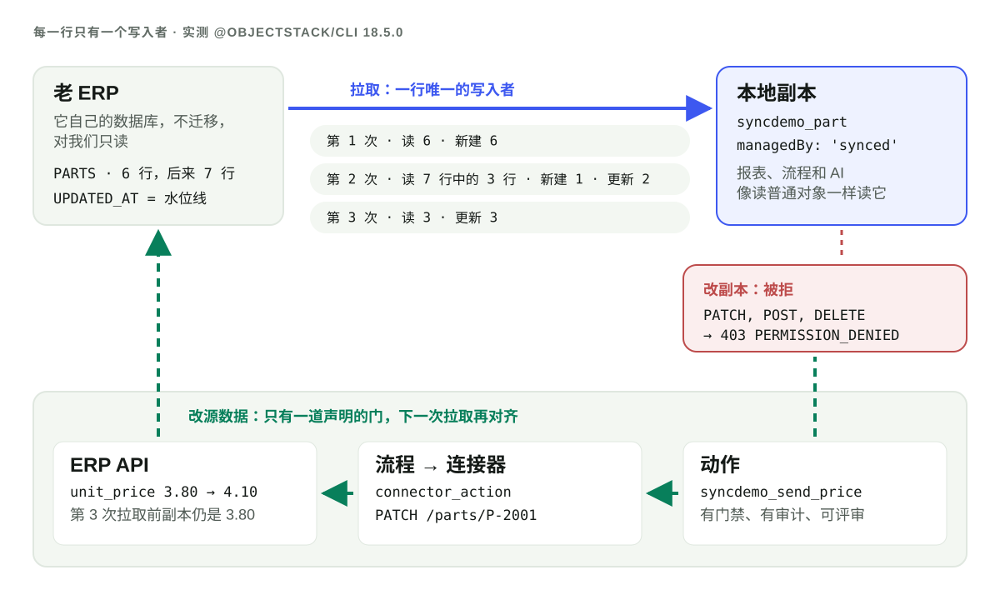

---
# @generated zh-Hant from zh-Hans (s2twp) — edit the zh-Hans file; delete this line to hand-maintain.
title: 外部資料該即時讀取，還是複製進來？
description: 資料必須即時、或不能另存一份，就即時讀取源系統；報表和 AI 要用，就複製進來，並堅持每一行只有一個寫入者。在 ObjectStack 18.5.0 上實測。
author: ObjectStack Team
date: 2026-11-20
status: published
topic: integration-data
audience: it
solutions: []
industries: []
cover: ./cover.svg
tags:
  - 資料同步
  - 聯邦
  - 外部資料
---

**資料必須精確到秒地保持最新，或者絕不能存到別處，就即時讀取源系統；人、報表和 AI 需要全速地關聯、篩選、提問，就把它複製進來**。兩者各有代價。即時讀取每次都要等源系統響應，而且一次查詢無法合併兩個資料庫。副本則只和最近一次定時重新整理一樣新。如果複製，就堅持**每一行只有一個寫入者**：只有定時重新整理能寫副本，誰都不能改它，管理員也不行。要改資料，就在源系統裡改，經一個專門為此建好的動作，下一次重新整理再把結果取回來。在我的測試裡，一次重新整理只讀了源表 7 行中的 3 行；對副本的編輯，普通成員和管理員一樣被拒。

*在 ObjectStack 18.5.0 上實測，即 2026-11-16 時已釋出的最新版。全部實錄都在最後一節「證據」裡。*

## 即時讀取，還是複製進來？

**聯邦**讓資料行留在原處，把每個查詢轉給源系統。**同步進來**按計劃把資料行復制進平台自己擁有的一張普通表。**聯結器動作**從一個按鈕或一條自動化去呼叫對方系統，不存它的任何資料行。ObjectStack 關於同步的設計記錄 ADR-0153（在 18.5.0 標籤時仍是「提議」狀態）是這樣選的：

| 你的情況 | 選擇 |
|:--|:--|
| 要即時資料，一次一張表；遺留系統不能碰；資料不能存到源系統之外 | **即時讀取**（聯邦） |
| 報表、分析、AI 問答、跨來源關聯；遺留系統慢或脆弱；數倉的結果 | **複製進來**（同步進來） |
| 只想在對方系統裡觸發一件事；不存任何資料行 | **兩者都不是**：聯結器動作 |

即時讀取的理由很充分。聯邦表永遠是最新的：源頭的改動和成員看到的內容之間沒有延遲。沒有任何重複，所以沒有第二份個人資料需要保護、留存或刪除。而源系統始終是唯一寫入資料的地方。一篇[姊妹文章](/zh-Hans/blog/ai-business-layer-over-an-existing-database/)按聯邦自己的邏輯完整走了一遍，[連線現有系統](/zh-Hant/connect-existing-systems/)頁面把三者並排列出。如果你要的正是這些特性，就到此為止：副本是錯的工具。

當即時讀取碰到它的極限時，副本是更好的選擇。平台無法在一次查詢裡關聯兩個資料庫（它分別讀取，再在記憶體裡合併資料行），每次讀取都要等遠端系統，而經附加資料庫聯結器的讀取有最大行數限制。用設計記錄的話說：「把資料行復制進一個普通物件就消除了這些限制：此後索引、查詢運算子、權限和可用性都歸平台所有。」複製之後，它就是又一張表，現有的權限、報表和 AI 工具無需改動就能讀它。

## 讓副本保持誠實的規則：每一行只有一個寫入者

任何副本的風險，都是它慢慢變成第二個記錄系統：有人在副本中改了一個價格，源系統從不知道，兩邊從此不一致。每一行只有一個寫入者，用執行環境強制執行的四條規則防止這種情況：

1. **拉取寫入資料行**。拉取就是定時重新整理：一個任務讀取源系統、寫入副本，用的是平台自己的身份而不是某個使用者的，並且只讀上次執行以來變過的內容。它靠*水位線*找到這些行：源系統裡的一個「最後更新時間」列。
2. **別人都不寫**。副本被宣告為*同步物件*：一張只有拉取能寫的表。成員、管理員或 API 呼叫方的編輯、新增或刪除一律被拒，不管他們的權限怎麼說。
3. **改動去源系統，經一個宣告的動作**。*宣告的動作*是在應用裡定義的一個按鈕，有自己的權限檢查，它呼叫源系統自己的 API。它不碰副本；下一次拉取會更新副本。
4. **沒有另一個方向**。沒有雙向同步，也沒有衝突編輯的合併。

第 4 條是關鍵。雙向同步每一行有兩個寫入者，所以需要一條策略來處理兩邊都改過的那一行：後寫者勝、欄位級合併、一個必須由人來處理的衝突佇列。每一種要麼丟掉一方的改動，要麼需要一個人來裁決。只有一個寫入者，就不存在這樣的行，也就沒有會出錯的合併。



## 我測了什麼，對你意味著什麼

我把一個全新的 ObjectStack 應用連到一個充當「舊 ERP」的替身上，一個有六個零件的小資料庫，並給一位成員 Mia 授予了副本的讀權限，還特意給了編輯權限，看權限能不能繞過這條規則。這次測試里拉取每 30 秒執行一次；你的計劃決定延遲有多長。時間均為 2026-11-16 的 UTC 時間。

| 我做了什麼 | 系統怎麼回答 | 對你意味著什麼 |
|:--|:--|:--|
| 去掉副本上的「synced」標記後構建應用 | 構建失敗，並點名缺少的標記 | 構建通過，保護就是開著的 |
| 讓拉取在 02:31:21 執行一次，然後讓 Mia 列出副本 | 讀 6 行、新建 6 行、完成，並留下一條執行記錄；Mia 看到這 6 行 | 每次重新整理都有記錄，成員讀副本就像讀任何別的表 |
| 持有編輯權限的 Mia 改了 P-2001 的價格；一位管理員也試了一次 | 兩人都被拒；報錯資訊說明了該怎麼做 | 無論是有編輯權限的成員還是管理員，都無法通過應用或其 API 編輯副本 |
| 直接在 ERP 裡改了 P-1003，並新增了 P-3002 | 下一次執行，02:31:51：讀 7 行中的 3 行，新建 1 行，更新 2 行 | 一次重新整理讀的是變過的內容，不是整張表 |
| Mia 對 P-2001 運行了動作「Change price in ERP」，然後讀這一行 | 允許；ERP 的 API 記錄了一次更新。副本仍是 3.8 | 動作改的是源系統，不是副本 |
| 等下一次執行，02:32:21 | 讀 3 行、更新 3 行；P-2001 現在是 4.1 | 副本顯示的永遠只是 ERP 裡存著的值 |

兩個細節。第二次執行「更新」的 2 行裡，有一行 P-3001 並沒有變：一次執行會重讀停在上次停止位置上的那些行，所以這個數要讀作「寫入的行」，而不是「變過的行」。另外，定時任務預設是關的：部署必須把它開啟，否則拉取一次都不會跑。

## 副本不繼承什麼

- **源系統的權限**。在 ERP 裡誰能讀某一行，不會隨它一起復制過來：副本上的權限從無權訪問開始，成員只能經授權才能讀。Mia 通過她的權限集讀到了副本，在源表上則被拒，因為她在那裡沒有授權：這正是該追求的配置。複製來的行沒有所有者，所以要麼讓副本對所有成員可讀，要麼保持私有，再用共享規則授予讀權限。
- **執行歷史，對成員而言**。Mia 讀它時被拒：和任何表一樣，它需要授權。
- **刪除**。在 18.5.0 上，源系統裡刪掉的行會留在副本中（任務指南：「刪除相關的鍵暫時什麼都不改變」；這一點我沒有執行）。標記這類行的功能在開發中，見下文。
- **組織，在多組織部署裡**。平台不會去猜。在隔離的多組織模式下執行環境，同一個應用在源物件宣告它的組織範圍之前拒絕啟動，之後又在任務寫明它的組織之前不肯排程拉取：一個組織一個任務。
- **管道**。副本就是一張源表、一個對映、一個目標。設計記錄：「ObjectStack 不構建管道或轉換。跨來源的關聯、清洗和聚合是數倉或 ETL 廠商的事；ObjectStack 把結果同步進來。」需要清洗、關聯好的檢視？在數倉裡建好，再把結果拉進來。

## 開發中

下面這些在設計記錄裡已有設計，但不在 18.5.0 裡。本節沒有執行任何東西；這裡關於 18.5.0 的說法引自它的變更日誌和指南。

- 源系統裡刪掉的行：設計是把它們標記為已刪除，從不移除。
- 每一行都帶來源標記：它從哪裡來、由哪次執行寫入。
- Studio 裡的同步嚮導，並在介面上顯示執行歷史。
- 資料倉儲（Snowflake、BigQuery）作為來源，經附加聯結器接入。
- 同步指南和 agent 技能。

<details>
<summary>設計記錄、變更日誌和指南的原話</summary>

- **刪除策略**。從源系統消失的行將被標記，從不刪除：「`deletePolicy: 'mark' | 'ignore'`，預設 `mark`，寫入 `_sync_deleted_at`」，以及「拉取從不物理刪除一行」。增量拉取將通過源系統的軟刪除欄位 `deletedField` 看到刪除。變更日誌說，在 18.5.0 上這些鍵能解析，並且「仍會提醒作者它們暫時什麼都不改變」。
- **每一行的來源列**。保留字首下的五個平台列：「`_sync_source`」「`_sync_external_id`」「`_sync_pulled_at`」「`_sync_run_id`」和「`_sync_deleted_at`」。18.5.0 的拉取在它的檔案頭裡這樣寫：「刪除標記（D3）、來源列（D4）和漂移（D6）是後續的改動」。今天，執行記錄就是來源記錄；字首已經保留，所以名為 `_sync_…` 的欄位會被拒。
- **Studio 同步嚮導**。「Studio 同步嚮導會建立 `synced` 物件、`mapping` 和那個 `job`。」它需要一個能在執行時建立的任務，設計記錄把它設計為「任務只能寫在程式碼裡」的唯一例外：「執行環境入口接受一個唯一執行形式是 `pull` 的 `job`」。Studio 還要顯示「同步物件上和它的來源頁面上的執行歷史」。
- **數倉作為來源**。「修訂 `6731744658` 讓數倉成為一等的拉取來源」；Snowflake 和 BigQuery 驅動是「這個倉庫之外的外掛包」，由外掛驅動一致性套件驗證，對有下限保護的外掛驅動，按「兩端都有界的視窗」讀取，一個視窗返回的行數超過行數上限時就「減半」。
- **同步指南和技能**。「三向規則和合作夥伴立場（D10）、寫回的答案（D5），以及 `SYNC_ARCHITECTURE.md` 和指向 `mapping` / `job` 的技能」。在那之前，任務指南的「Pulling a mapping」一節和 mapping 參考就是文件。

</details>

## agent 寫出來時怎麼評審

agent 寫的同步就是五個宣告，如果涉及寫回，再加一個動作和一個流程。先查四件事：

1. **副本被標記為同步物件**（目標上的 `managedBy: 'synced'`）。沒有它，構建會拒絕這個同步，所以構建通過，它就在。
2. **誰能讀副本**：它的共享模型和權限集，起點是無權訪問。
3. **源系統的最後更新時間列和它的鍵**。最後更新時間列如果不是每次寫入都更新，就會悄無聲息地丟掉改動；鍵必須唯一，而且永不為空。拉取兩者都檢查不了，只能由源系統保證。
4. **寫回動作和它的流程**，如果有的話：它是回到源系統的唯一路徑。像審任何對外呼叫一樣審它：發什麼、發給誰、誰能執行它。

然後把第一條執行記錄裡讀取的行數，和源表的行數對一對。

## 把你的 agent 指向它

把任務指南（`objectstack.ai/docs/automation/jobs`，「Pulling a mapping」一節）和 mapping 參考交給你的編碼 agent，再用一句話告訴它規則：經一個帶 `datasourceSource` 的 `mapping` 和一個 `pull` 指向它的 `job`，複製進一個 `managedBy: 'synced'` 物件；永不寫副本；經一個宣告的動作去改源系統。[為 ObjectStack 配置編碼 agent 的指南](/en/blog/how-to-point-your-agent-at-objectstack/)講了承載這條規則的規則檔案和 MCP 端點。這個對映用的 `fieldMapping` 和 `upsertKey`，和你[從舊系統匯入一份電子表格](/zh-Hant/blog/how-to-import-a-spreadsheet-from-an-old-system/)時用的一樣：拉取就是那次匯入，只是由任務對著一個線上來源來跑；副本也只是[本體](/zh-Hant/glossary/ontology/)裡的又一個物件。同步核心和聯邦一樣，以 Apache-2.0 開源。

## 證據

這裡的一切都在 `@objectstack/cli` 18.5.0 上執行，即 2026-11-16 時 `npm view @objectstack/cli dist-tags` 報告為 `latest` 的版本，用的是一個全新的 `npm create objectstack@latest` 腳手架。

### 五個宣告

「舊 ERP」是一個應用並不擁有的 SQLite 檔案，裡面一張表 `PARTS`，存著六個零件和一個 `UPDATED_AT` 列。

```ts
// 1. The ERP's database: external, so no DDL ever runs there.
export const Erp = defineDatasource({
  name: 'erp', driver: 'sqlite', schemaMode: 'external',
  config: { filename: './legacy/erp.db' },
  external: { allowWrites: false, validation: { onMismatch: 'fail', checkOnBoot: true } },
});

// 2. The PARTS table, federated. PART_NO is mapped onto `id`: that is the source key.
export const ErpPart = ObjectSchema.create({
  name: 'syncdemo_erp_part', datasource: 'erp', sharingModel: 'private',
  external: {
    remoteName: 'PARTS',
    columnMap: { PART_NO: 'id', DESCRIPTION: 'description', UNIT_PRICE: 'unit_price', UPDATED_AT: 'updated_at' },
  },
  fields: {
    description: Field.text({ label: 'Description' }),
    unit_price: Field.number({ label: 'Unit price', scale: 2 }),
    updated_at: Field.datetime({ label: 'Updated at (ERP)' }),
  },
});

// 3. The local copy: an ordinary object that only the pull writes.
export const Part = ObjectSchema.create({
  name: 'syncdemo_part', managedBy: 'synced', sharingModel: 'public_read',
  fields: {
    part_no: Field.text({ label: 'Part no', required: true }),
    description: Field.text({ label: 'Description' }),
    unit_price: Field.number({ label: 'Unit price', scale: 2 }),
    source_updated_at: Field.datetime({ label: 'Updated at (ERP)' }),
  },
});

// 4. The sync, defined on its target: where rows come from, how they map, how one matches.
export const ErpPartsPull = defineMapping({
  name: 'erp_parts_pull', targetObject: 'syncdemo_part',
  mode: 'upsert', upsertKey: ['part_no'],
  fieldMapping: [
    { source: 'id', target: 'part_no' },
    { source: 'description', target: 'description' },
    { source: 'unit_price', target: 'unit_price' },
    { source: 'updated_at', target: 'source_updated_at' },
  ],
  datasourceSource: { object: 'syncdemo_erp_part', watermark: { field: 'updated_at', start: '2026-01-01' } },
});

// 5. When. No code: `pull` names the mapping.
export const ErpPartsPullJob = defineJob({
  name: 'erp_parts_pull_job',
  schedule: { type: 'interval', intervalMs: 30000 },
  pull: { mapping: 'erp_parts_pull' },
});
```

`job` 按計劃執行這個對映，以系統身份經匯入執行器寫入。spec 變更日誌列出了 `managedBy: 'synced'` 開啟的東西：「引擎寫入守衛拒絕成員的通用寫入（403），`apiMethods` 協調去掉每一個寫方法，`/me/permissions` 鉗制如實回答這一行是關閉的」。

### 構建拒絕

`objectstack validate` 通過了。把目標上的 `managedBy: 'synced'` 去掉後，同一條命令以 1 退出：

```text
✗ Mapping 'erp_parts_pull' pulls rows into object 'syncdemo_part' through its datasourceSource,
  but that object is not managedBy: 'synced' (it is unset). A pulled copy is read-only to members,
  so a member's edit is never kept or lost silently by the next pull; declare managedBy: 'synced'
  on the target object (ADR-0153 D4).
```

變更日誌列出了其它在構建時、並在第一次讀取前再次執行的拒絕：帶來源的對映必須是帶 `upsertKey` 的 `mode: 'upsert'`，來源必須是一個聯邦物件，且它的 `columnMap` 把某一列對映到 `id`（`source_key_missing`），水位線必須是 `datetime`、`date` 或整數字段，並且必須有一條 `fieldMapping` 把它原樣複製進目標（`watermark_field_unmapped`）。

### 執行

一個包的任務只在變數 `OS_AUTOMATION_SCHEDULED_WORK_ENABLED` 為 `true` 的地方才會被排程，任務指南說這個開關「在每一種租戶形態、每一個核心裡**預設都是關的**」。我把它開啟後用 `objectstack dev --fresh` 啟動，並建立了一位成員（Mia），給她一個權限集，授予 `syncdemo_part` 的讀權限，並特意授予編輯權限。第一次觸發在 02:31:21；Mia 列出 `syncdemo_part`，回答是 `200`，6 行。

**執行記錄**。每次拉取都會在任務所屬組織中留下一行 `sys_sync_run`。第一行，只保留要緊的欄位：

```json
{ "mapping": "erp_parts_pull", "mapping_package": "com.example.syncdemo",
  "target_object": "syncdemo_part", "source_kind": "datasource", "source": "syncdemo_erp_part",
  "datasource": "erp", "read_path": "builtin", "trigger": "schedule", "status": "completed",
  "read_count": 6, "created_count": 6, "updated_count": 0, "refused_count": 0,
  "watermark_field": "updated_at",
  "watermark_from": "2026-01-01T00:00:00.000Z",
  "watermark_committed": "2026-11-09T16:05:00.000Z",
  "holds_position": true, "job_run_id": "run_0b31fc19-…", "failure_reason": null }
```

`watermark_committed` 是這次執行寫入的最新 `UPDATED_AT`，`holds_position: true` 標明下一次執行從這一行開始。賬本連結是 `job_run_id`，即驅動這次執行的那次觸發的 `sys_job_run` 行。服務變更日誌規定了保留期：這些行是「保留 30 天的遙測，即任務賬本的視窗，但每個對映（包和名稱）和組織持有讀取位置的那一行除外」。

**被拒的編輯**。Mia 在這個物件上持有 `allowEdit: true`。她對 P-2001 價格的 `PATCH`：

```json
HTTP 403
{ "error": "[Security] Access denied: 'syncdemo_part' is synced (managedBy:'synced', ADR-0153) — direct update via the data API is disabled. Its rows are copied from their source by a pull, which would keep or overwrite the change; change the source through a declared action instead, and the next pull brings it home.",
  "code": "PERMISSION_DENIED", "object": "syncdemo_part" }
```

管理員的 `PATCH` 得到同樣的響應體。Mia 的 `POST` 和 `DELETE` 回答 `403`，同一句話裡分別是「direct insert」和「direct delete」。當發起呼叫的是 agent 時，告訴它該怎麼做，正是你想要的。

**增量執行，7 行中的 3 行**。我像 ERP 自己的使用者那樣直接改了 ERP：P-1003 的價格從 0.05 改成 0.06，並新增零件 P-3002，兩者的時間戳都是 `2026-11-16T02:31:22.383Z`。下一次觸發，在 02:31:51：

```json
{ "read_count": 3, "created_count": 1, "updated_count": 2,
  "watermark_from": "2026-11-09T16:05:00.000Z",
  "watermark_committed": "2026-11-16T02:31:22.383Z", "status": "completed" }
```

ERP 當時有七行，讀了三行：P-1003、P-3002，以及和上次執行提交的位置同值的 P-3001。任務指南寫明瞭這次重讀：一次執行「只讀此後寫入的行，加上和最後那個位置同值的行，upsert 會無害地再寫一遍」。

**寫回**。這個動作是 `syncdemo_part` 上的一個 `type: 'flow'` 動作。它的流程只有一個幹活的節點，一個 `connector_action`，呼叫一個指向 ERP 自己 HTTP API 的 `rest` 聯結器（這裡是一個 20 行的替身，它更新 `PARTS` 並寫入 `UPDATED_AT`）：

```ts
{ id: 'patch_erp', type: 'connector_action',
  connectorConfig: {
    connectorId: 'erp_api', actionId: 'request',
    input: {
      method: 'PATCH',
      path: { dialect: 'cel', source: "'/parts/' + record.part_no" },
      body: { dialect: 'cel', source: '{ "unit_price": new_price }' },
    },
  },
}
```

Mia 通過 REST 呼叫了它，和記錄頁上的按鈕用的是同一個入口（「Console 按鈕和 API 呼叫走同一道關卡和同一個處理器」）：

```bash
curl -s -b mia.cookies -X POST http://localhost:49921/api/v1/actions/syncdemo_part/syncdemo_send_price \
  -H 'content-type: application/json' \
  -d '{"recordId":"6b7fe890-…","params":{"new_price":4.1}}'
```

```text
HTTP 200  { "success": true, "data": { "success": true, "flowLabel": "Send price to ERP", … } }
ERP API:  2026-11-16T02:31:52.833Z PATCH /parts/P-2001 {"unit_price":4.1} -> changes=1
```

緊接著讀，副本仍然是 `"unit_price": 3.8`，因為寫回只改了 ERP，別的什麼都沒改。三十秒後，在 02:32:21，下一次執行讀了 3 行（共享位置上的 P-1003 和 P-3002，以及 P-2001），更新 3 行，提交 `2026-11-16T02:31:52.833Z`，P-2001 讀出來是 `"unit_price": 4.1, "source_updated_at": "2026-11-16T02:31:52.833Z"`。如果 ERP 拒絕或舍入了這個值，副本也會顯示出來（這是從這個閉環推斷的，這裡沒有測試）。

### 實測的侷限

- **權限**。Mia 讀到副本的同一個會話，在聯邦源物件 `syncdemo_erp_part` 上得到 `403`，她在那裡沒有授權。複製來的行不帶 `owner_id`，所以 spec 變更日誌對同步物件的 lint 建議是「`sharingModel: 'public_read'` …… 或 `'private'` 加一條授予讀權限的共享規則」。
- **執行歷史**。`sys_sync_run` 對資料 API 開放，但 Mia 讀它時回答是 `403`。
- **組織**。用 `OS_TENANCY_POSTURE=isolated` 啟動時，同一個應用在聯邦源物件宣告它的組織範圍之前拒絕啟動（「Stating nothing: 'syncdemo_erp_part'」）。把來源宣告為共享後，啟動以 `error` 級別記錄：「NOT SCHEDULED — job 'erp_parts_pull_job' declares no `organization`」（之後它停在一個無關的隔離形態設定上，即成員資格策略，真正的多組織部署本來就會宣告它）。解決辦法是在任務上寫 `organization`，一個組織一個任務。變更日誌點名了拉取本身在這種形態下給出的拒絕：`source_organization_scope_unstated` 和 `job_organization_missing`。

### 設計記錄和指南的原話

上文轉述了這些來源；這裡是原話。

- **為什麼複製**。「報表、分析、AI 問答和跨來源關聯最先碰到這些限制。把資料行復制進一個普通物件就消除了這些限制：此後索引、查詢運算子、權限和可用性都歸平台所有。」
- **跨資料庫關聯**。18.5.0 分析編譯器的原始碼註釋：帶聯邦物件的資料集「由 ObjectQL 外部索引鍵展開路徑提供（兩次讀取，在記憶體裡關聯）——它天然跨資料來源」。
- **行數上限（這裡沒有執行）**。18.5.0 的虛擬物件指南：「匹配行數超過資料來源行數上限的讀取，會以 `422 EXTERNAL_ROW_CAP_EXCEEDED` 被拒，而不是用部分結果來回答。上限只適用於外掛驅動，包括 OData」。「預設是 1000 行」，平台最大值是 10,000。
- **第 3 條，寫回**。ADR-0153 D5：「對源資料的修改在源系統裡進行，經一個宣告的動作……寫回不編輯本地行；**下一次拉取會把它對齊**。」
- **第 4 條，單一方向**。「沒有雙向同步，沒有衝突合併，沒有 Writeback-Dataset 式的編輯覆蓋層」。
- **權限**。「物件權限在本地從零開始配置……成員只有經授權才能讀同步來的行。」
- **水位線和鍵**。關於 `watermark.field`：「源系統的每一次寫入，都給該行的水位線寫一個不低於源系統已有任何值的值」。關於對映到 `id` 的列：唯一且永不為 NULL，「這是對源系統的要求……拉取檢查不了」。
- **刪除**。18.5.0 的任務指南：「刪除相關的鍵暫時什麼都不改變，`os validate` 也會這樣說。」
- **許可證**。ADR-0153 D9：同步核心「和聯邦一樣，以 Apache-2.0 在這個倉庫裡釋出」。
