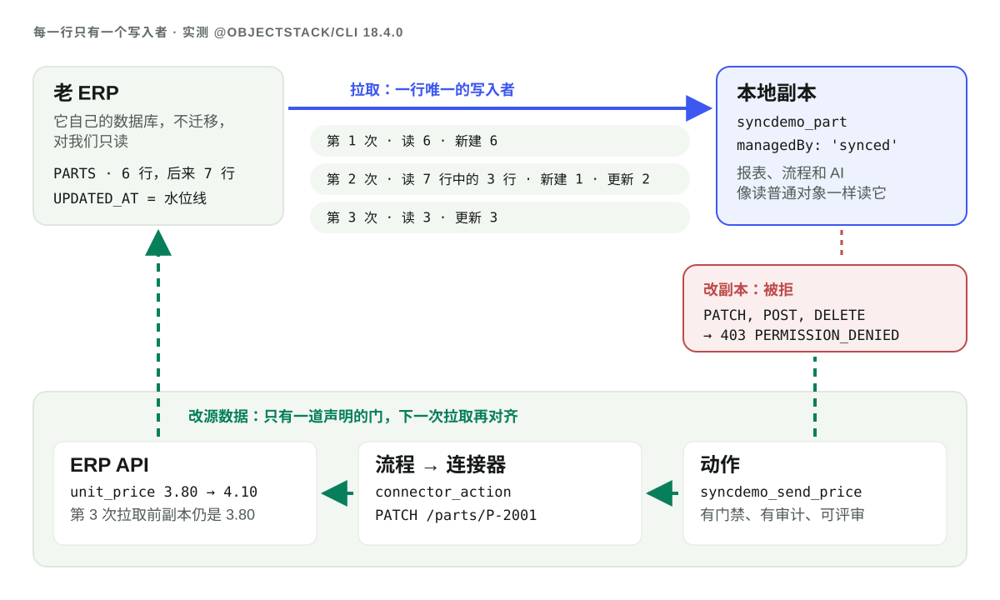

---
# @generated zh-Hant from zh-Hans (s2twp) — edit the zh-Hans file; delete this line to hand-maintain.
title: 外部資料該聯邦還是複製進來？單向同步：每一行只有一個寫入者
description: 聯邦即時讀取外部表；單向同步把它複製成一個只有拉取任務能寫的普通物件。在 ObjectStack 18.4.0 上實測：拉取任務、執行記錄、被拒的編輯、讀 7 行中 3 行的增量執行、經動作寫回。
author: ObjectStack Team
date: 2026-11-20
status: published
topic: integration-data
audience: it
solutions: []
industries: []
cover: ./cover.svg
tags:
  - 資料同步
  - 聯邦
  - 外部資料
---

**資料必須保持即時、或者根本不能落地，就用聯邦；人、報表和 AI 需要以平台的速度關聯、篩選、提問，就複製進來。** 如果複製，就做成**每一行只有一個寫入者**的副本：定時拉取是唯一寫入副本行的東西，誰都不改它；要改資料，就通過一個宣告好的動作回到源系統去改，下一次拉取再把結果帶回來。兩個寫入者需要衝突合併，一個寫入者永遠不需要。在已釋出的 `@objectstack/cli` 18.4.0 上，這樣的副本今天就能跑：在下文的實錄裡，第二次拉取只讀了**源表 7 行中的 3 行**——變了的那幾行，以及和上次停下的位置同值的那一行——別的什麼都沒寫。

## 兩條進來的路，外加一件兩者都不是的事

ObjectStack 為此寫的設計記錄 ADR-0153，從聯邦做不到的事說起。聯邦讓資料留在原處、逐個轉發查詢，這對即時資料或不能落地的資料是對的，但「報表、分析、AI 問答和跨源關聯最先撞上這些限制。把行復制進普通物件就消除了它們：索引、查詢運算元、權限和可用性都歸平台所有。」隨後它給出了指南和技能要教的規則：

| 需求 | 選擇 |
|:--|:--|
| 即時資料，一次一張表；不能動舊系統；不能落地的資料 | **聯邦**：虛擬物件 |
| 報表、分析、AI 問答、跨源關聯；又慢又脆的舊系統；數倉的結果 | **同步進來**：一個 `synced` 物件、一個帶源的 `mapping` 和一個 `job` |
| 在外部系統裡觸發一件事；不落任何行 | **聯結器動作**：流程裡的 `connector_action` 節點，或一個宣告的動作 |

聯邦的理由很充分，值得完整地講出來。聯邦物件永遠是最新的，源頭一改，成員看到的立刻就是新的，中間沒有延遲。沒有任何複製，所以不存在第二份需要保護、保留或刪除的個人資料。源系統也一直是唯一寫資料的地方。另有一篇姊妹文章專門講聯邦本身。如果你要的正是這些性質，讀到這裡就夠了：副本是錯的工具。

當聯邦的限制真正卡住你時，副本才值得。引擎不能跨資料來源關聯，每次讀取都要付遠端系統的延遲，外掛驅動的讀取有行數上限。副本把遠端表變成一個普通物件，現有的每一條權限、每一張報表、每個資料集、流程和 MCP 工具都無需改動就能讀它。

## 每一行只有一個寫入者

副本只有在不會漂移成第二個記錄系統時才安全。這就是「每一行只有一個寫入者」的意思，在 18.4.0 上它是執行環境強制執行的四條規則：

1. **拉取寫這些行。** 一個帶 `datasourceSource` 的 `mapping` 指向一個聯邦物件和一個水位線欄位。一個 `pull` 指向該 mapping 的 `job` 按計劃執行它，以系統身份經匯入執行器寫入。
2. **別的誰都不寫。** 目標物件宣告為 `managedBy: 'synced'`。18.4.0 的 spec 變更日誌列出了它開啟的東西：「引擎寫守衛拒絕成員的通用寫入（403），`apiMethods` 對齊會去掉每一個寫方法，`/me/permissions` 鉗制回答封閉的那一行」。
3. **改動去源頭，經一個宣告的動作。** ADR-0153 D5：「對源資料的修改在源頭進行，經一個宣告的動作……寫回不編輯本地行；**下一次拉取會把它對齊**。」
4. **沒有另一個方向。** 「沒有雙向同步，沒有衝突合併，沒有 Writeback-Dataset 式的編輯覆蓋層」。

第 4 條才是重點。雙向同步的每一行都有兩個寫入者，所以它需要一套策略來處理自上次同步以來兩邊都改過的那一行：後寫者勝、欄位級合併、一個得有人去處理的衝突佇列。每一種都是資料會悄悄丟失的地方。只有一個寫入者，就不存在這樣的行，也就沒有會出錯的合併。



## 搭建：五個宣告，別無其它

試驗檯是一個全新的 `npm create objectstack@latest` 腳手架，裝上的是 `@objectstack/cli` 18.4.0，也就是 2026-11-14 當天 `npm view @objectstack/cli dist-tags` 報告的 `latest`。「老 ERP」是一個應用並不擁有的 SQLite 檔案，只有一張表 `PARTS`，存著六個零件和一列 `UPDATED_AT`。五個宣告把它們連起來。

```ts
// 1. The ERP's database: external, so no DDL ever runs there.
export const Erp = defineDatasource({
  name: 'erp', driver: 'sqlite', schemaMode: 'external',
  config: { filename: './legacy/erp.db' },
  external: { allowWrites: false, validation: { onMismatch: 'fail', checkOnBoot: true } },
});

// 2. The PARTS table, federated. PART_NO is mapped onto `id`: that is the source key.
export const ErpPart = ObjectSchema.create({
  name: 'syncdemo_erp_part', datasource: 'erp', sharingModel: 'private',
  external: {
    remoteName: 'PARTS',
    columnMap: { PART_NO: 'id', DESCRIPTION: 'description', UNIT_PRICE: 'unit_price', UPDATED_AT: 'updated_at' },
  },
  fields: {
    description: Field.text({ label: 'Description' }),
    unit_price: Field.number({ label: 'Unit price', scale: 2 }),
    updated_at: Field.datetime({ label: 'Updated at (ERP)' }),
  },
});

// 3. The local copy: an ordinary object that only the pull writes.
export const Part = ObjectSchema.create({
  name: 'syncdemo_part', managedBy: 'synced', sharingModel: 'public_read',
  fields: {
    part_no: Field.text({ label: 'Part no', required: true }),
    description: Field.text({ label: 'Description' }),
    unit_price: Field.number({ label: 'Unit price', scale: 2 }),
    source_updated_at: Field.datetime({ label: 'Updated at (ERP)' }),
  },
});

// 4. The sync, defined on its target: where rows come from, how they map, how one matches.
export const ErpPartsPull = defineMapping({
  name: 'erp_parts_pull', targetObject: 'syncdemo_part',
  mode: 'upsert', upsertKey: ['part_no'],
  fieldMapping: [
    { source: 'id', target: 'part_no' },
    { source: 'description', target: 'description' },
    { source: 'unit_price', target: 'unit_price' },
    { source: 'updated_at', target: 'source_updated_at' },
  ],
  datasourceSource: { object: 'syncdemo_erp_part', watermark: { field: 'updated_at', start: '2026-01-01' } },
});

// 5. When. No code: `pull` names the mapping.
export const ErpPartsPullJob = defineJob({
  name: 'erp_parts_pull_job',
  schedule: { type: 'interval', intervalMs: 30000 },
  pull: { mapping: 'erp_parts_pull' },
});
```

`objectstack validate` 通過了。對於讓副本誠實的那幾處，構建很嚴格。把目標物件上的 `managedBy: 'synced'` 去掉，同一條命令以 1 退出：

```text
✗ Mapping 'erp_parts_pull' pulls rows into object 'syncdemo_part' through its datasourceSource,
  but that object is not managedBy: 'synced' (it is unset). A pulled copy is read-only to members,
  so a member's edit is never kept or lost silently by the next pull; declare managedBy: 'synced'
  on the target object (ADR-0153 D4).
```

變更日誌列出了構建時、以及第一次讀取前會再判一遍的其它拒絕：帶源的 mapping 必須是 `mode: 'upsert'` 並帶 `upsertKey`；源必須是一個聯邦物件，其 `columnMap` 把某一列對映到 `id`（`source_key_missing`）；水位線必須是 `datetime`、`date` 或整數字段；並且必須有一條 `fieldMapping` 把它原樣複製進目標（`watermark_field_unmapped`）。

有一個開關很容易漏掉：包裡的任務只在變數 `OS_AUTOMATION_SCHEDULED_WORK_ENABLED` 為 `true` 的部署上才會被排程，任務指南說它「**在每種租戶形態、每個核心裡都預設關閉**」。我在開啟它的情況下啟動了 `objectstack dev --fresh`，建了一個成員（Mia），給她一個權限集，授予對 `syncdemo_part` 的讀權限，並且故意也授予了編輯權限，然後記錄每一個回答。

## 執行日誌

七個讀數，按發生順序。時間為 2026-11-14 的 UTC。

| # | 發生了什麼 | 回來了什麼 |
|:--|:--|:--|
| 1 | 任務第一次觸發，04:42:41 | `sys_sync_run`：讀 6，新建 6，`completed` |
| 2 | Mia 列出 `syncdemo_part` | `200`，6 行 |
| 3 | Mia 修改 P-2001 的價格；管理員也試一次 | 兩人都是 `403 PERMISSION_DENIED` |
| 4 | 有人在 ERP 裡改了 P-1003，又加了 P-3002 | 下一次執行，04:43:11：讀 3，新建 1，更新 2 |
| 5 | Mia 對 P-2001 執行動作「Change price in ERP」 | `200`；ERP 的 API 記下一次 `PATCH` |
| 6 | Mia 立刻讀 P-2001 | 仍是 `3.8` |
| 7 | 下一次執行，04:43:41 | 讀 3，更新 3；P-2001 讀出 `4.1` |

**讀數 1：執行記錄。** 每次拉取都在任務所屬組織中留下一行 `sys_sync_run`。只留關鍵欄位：

```json
{ "mapping": "erp_parts_pull", "mapping_package": "com.example.syncdemo",
  "target_object": "syncdemo_part", "source_kind": "datasource", "source": "syncdemo_erp_part",
  "datasource": "erp", "read_path": "builtin", "trigger": "schedule", "status": "completed",
  "read_count": 6, "created_count": 6, "updated_count": 0, "refused_count": 0,
  "watermark_field": "updated_at",
  "watermark_from": "2026-01-01T00:00:00.000Z",
  "watermark_committed": "2026-11-09T16:05:00.000Z",
  "holds_position": true, "job_run_id": "run_a02e22c1-…", "failure_reason": null }
```

`watermark_committed` 是這次執行寫入的最新 `UPDATED_AT`，`holds_position: true` 表示下一次執行從這一行開始。與任務臺賬的關聯是 `job_run_id`，即驅動它的那次觸發的 `sys_job_run` 行。服務的變更日誌規定了保留期：這些行是「保留 30 天的遙測，與任務臺賬的視窗相同，但每個 mapping（包和名稱）和組織保留讀取位置的那一行除外」。

**讀數 3：被拒的編輯。** Mia 對該物件持有 `allowEdit: true`。回答並不理會：

```json
HTTP 403
{ "error": "[Security] Access denied: 'syncdemo_part' is synced (managedBy:'synced', ADR-0153) — direct update via the data API is disabled. Its rows are copied from their source by a pull, which would keep or overwrite the change; change the source through a declared action instead, and the next pull brings it home.",
  "code": "PERMISSION_DENIED", "object": "syncdemo_part" }
```

管理員的 `PATCH` 得到同樣的回答體。Mia 的 `POST` 和 `DELETE` 也答 `403`，同一句話裡寫的是「direct insert」和「direct delete」。拒絕資訊還指明瞭出路——當發起呼叫的是一個 agent 時，這正是你想要的形狀。

**讀數 4：增量執行，7 行中的 3 行。** 我像 ERP 自己的使用者那樣直接改了 ERP：P-1003 的價格從 0.05 改成 0.06，再加一個新零件 P-3002，兩者都打上 `2026-11-14T04:42:41.487Z`。下一次觸發：

```json
{ "read_count": 3, "created_count": 1, "updated_count": 2,
  "watermark_from": "2026-11-09T16:05:00.000Z",
  "watermark_committed": "2026-11-14T04:42:41.487Z", "status": "completed" }
```

ERP 當時有七行，讀了三行：P-1003、P-3002，以及 P-3001——它和上次執行提交的位置同值。任務指南寫明瞭這次重讀：一次執行「只讀此後寫入的行，加上與上次位置同值的行，upsert 會無害地再寫一遍」。所以 `updated_count` 也把沒變的 P-3001 算進去了。把它讀作「寫了的行」，而不是「變了的行」。

**讀數 5 到 7：寫回。** 這個動作是 `syncdemo_part` 上一個 `type: 'flow'` 的動作。它的流程只有一個幹活的節點：一個 `connector_action`，呼叫指向 ERP 自己 HTTP API 的 `rest` 聯結器（這裡是一個 20 行的替身，它更新 `PARTS` 並打上 `UPDATED_AT`）：

```ts
{ id: 'patch_erp', type: 'connector_action',
  connectorConfig: {
    connectorId: 'erp_api', actionId: 'request',
    input: {
      method: 'PATCH',
      path: { dialect: 'cel', source: "'/parts/' + record.part_no" },
      body: { dialect: 'cel', source: '{ "unit_price": new_price }' },
    },
  },
}
```

Mia 通過 REST 呼叫它，記錄頁上的按鈕走的也是這道門（「控制台按鈕和 API 呼叫經過同一道門禁和處理程序」）：

```bash
curl -s -b mia.cookies -X POST http://localhost:49921/api/v1/actions/syncdemo_part/syncdemo_send_price \
  -H 'content-type: application/json' \
  -d '{"recordId":"07580e75-…","params":{"new_price":4.1}}'
```

```text
HTTP 200  { "success": true, "data": { "success": true, "flowLabel": "Send price to ERP", … } }
ERP API:  2026-11-14T04:43:12.035Z PATCH /parts/P-2001 {"unit_price":4.1} -> changes=1
```

緊接著讀，副本仍是 `"unit_price": 3.8`，因為寫回只改了 ERP，別的什麼都沒動。三十秒後，下一次執行讀了 3 行（同值位置上的 P-1003 和 P-3002，以及 P-2001），更新 3 行，提交 `2026-11-14T04:43:12.035Z`，P-2001 讀出 `"unit_price": 4.1, "source_updated_at": "2026-11-14T04:43:12.035Z"`。副本中的值是 ERP 接受的值，而不是使用者敲進去的值。如果 ERP 拒絕了或者四捨五入了，副本顯示的就是那個結果。

## 副本不繼承什麼

- **源系統的權限。** ERP 裡誰能讀某一行，這件事一點也不會跟著行過來。ADR-0153：「物件權限在本地從零配置，如裁決所說：成員只有通過授權才能讀同步來的行。」在這次執行裡，Mia 通過她的權限集讀到了副本，而同一個會話讀聯邦源物件時得到 `403`——她在那個物件上沒有任何授權。這正是該追求的配置：成員讀副本，除了拉取誰都不讀源。複製來的行沒有所有者（上面的行都不帶 `owner_id`），所以 spec 變更日誌對 synced 物件的 lint 建議是「`sharingModel: 'public_read'`……或帶一條授予讀權限的共享規則的 `'private'`」。
- **對成員而言的執行歷史。** `sys_sync_run` 對資料 API 開放，但 Mia 讀它答 `403`：和任何物件一樣，它需要授權。
- **多組織部署裡的組織。** 在有組織牆的形態下，平台不會去猜。以 `OS_TENANCY_POSTURE=isolated` 啟動時，同一個應用拒絕啟動，直到聯邦源聲明瞭它的組織範圍（「Stating nothing: 'syncdemo_erp_part'」）。把源宣告為共享後，啟動日誌在 `error` 級別寫下：「NOT SCHEDULED — job 'erp_parts_pull_job' declares no `organization`」（隨後它因為一個無關的有牆形態設定——成員加入策略——停下，真實的多組織部署本來就會宣告它）。解決辦法是在任務上寫 `organization`，每個組織一個任務。18.4.0 的變更日誌給出了拉取本身在這種形態下會答的拒絕：`source_organization_scope_unstated` 和 `job_organization_missing`。
- **資料管道。** 副本就是一張源表、一個 mapping、一個目標。ADR-0153：「ObjectStack 不做管道或加工。跨源關聯、清洗和聚合是數倉或 ETL 廠商的事；ObjectStack 把結果同步進來。」如果你需要一個清洗過、關聯過的檢視，在數倉裡建好，再把結果拉進來。

這一切執行所依託的核心是開源的。ADR-0153 D9：同步核心「以 Apache-2.0 在本倉庫釋出，和聯邦一樣」。

## 開發中

以下部分在 ADR-0153（18.4.0 標籤處狀態為 *Proposed*）裡已有設計，但不在 18.4.0 中。本節內容都沒有執行過。

- **刪除策略。** 從源頭消失的行會被標記，而不是刪除：「`deletePolicy: 'mark' | 'ignore'`，預設 `mark`，打上 `_sync_deleted_at`」，以及「拉取從不物理刪除一行」。增量拉取會通過源端的軟刪除欄位 `deletedField` 看到刪除。在 18.4.0 上這些鍵能解析，變更日誌說它們「仍會警告作者：它們暫時什麼都不改變」。今天，源頭刪掉的行會留在副本中。
- **每一行上的來源列。** 保留字首下的五個平台列：「`_sync_source`」「`_sync_external_id`」「`_sync_pulled_at`」「`_sync_run_id`」和「`_sync_deleted_at`」。18.4.0 的拉取在檔案頭裡寫明：「刪除標記（D3）、來源列（D4）和漂移（D6）是後續的改動」。今天，執行記錄就是來源；字首已經保留，所以名為 `_sync_…` 的欄位會被拒絕。
- **Studio 同步嚮導。** 「Studio 同步嚮導建立 `synced` 物件、`mapping` 和那個 `job`。」它需要一個能在執行時建立的任務，記錄把它設計為「任務只能寫在程式碼裡」的唯一例外：「執行環境之門接受唯一執行形式為 `pull` 的 `job`」。Studio 還要顯示「同步物件上及其源頁面上的執行歷史」。
- **數倉作為源。** 「修訂 `6731744658` 讓數倉成為一等拉取源」；Snowflake 和 BigQuery 驅動是「本倉庫之外的外掛包」，由外掛驅動一致性測試套件驗證；有下限保護的外掛驅動按「兩側都有界的視窗」讀取，視窗超出行數上限時就「減半」。
- **同步指南和技能。** 「三向規則和合作夥伴立場（D10）、寫回的答案（D5），以及指向 `mapping` / `job` 的 `SYNC_ARCHITECTURE.md` 和技能」。在那之前，任務指南的「Pulling a mapping」一節和 mapping 參考就是文件。

## agent 寫出來時怎麼評審

如果 agent 給你的應用加了一個同步，diff 就是上面五個宣告，寫回在範圍內的話再加一個動作和一個流程。先看四處：

1. 目標物件上的 `managedBy: 'synced'`。沒有它構建會拒絕這個 mapping，所以構建是綠的，它就在。
2. 目標物件上的 `sharingModel` 和權限集。它們從零開始，什麼都沒有繼承。
3. `watermark.field` 和源鍵。ADR-0153 對水位線的要求是「源頭的每一次寫入，都給該行的水位線打上一個不低於源中已有任何值的值」，對鍵的要求是唯一且永不為 NULL，「這是對源的要求，和不變式 2 一樣，拉取無法檢查」。一個不是每次寫入都會更新的列，會悄悄丟掉改動。
4. 動作和它的流程（如果有）。那是回到源頭的唯一路徑，像審任何外呼一樣審它：發了什麼、發給誰、誰能執行。

然後讀部署寫下的第一行 `sys_sync_run`。拿 `read_count` 對照源表的行數，就是對這次執行的評審。

## 把你的 agent 指向它

把任務指南（`objectstack.ai/docs/automation/jobs` 的「Pulling a mapping」）和 mapping 參考交給你的編碼 agent，再用一句話告訴它規則：通過一個帶 `datasourceSource` 的 `mapping` 和一個 `pull` 指向它的 `job`，複製進一個 `managedBy: 'synced'` 物件；永遠不寫副本；通過宣告的動作修改源頭。[給 ObjectStack 配置編碼 agent 的指南](/en/blog/how-to-point-your-agent-at-objectstack/)講了承載這條規則的規則檔案和 MCP 端點。這裡的 mapping 用的 `fieldMapping` 和 `upsertKey`，和你[從舊系統匯入電子表格](/zh-Hant/blog/how-to-import-a-spreadsheet-from-an-old-system/)時用的一樣；拉取就是那次匯入，由任務對著一個線上的源來跑。而副本只是[本體](/zh-Hant/glossary/ontology/)裡又一個物件，所以每張報表和每個 AI 工具都不用額外工作就能讀它。上文的一切都執行在 `@objectstack/cli` 18.4.0 上。
