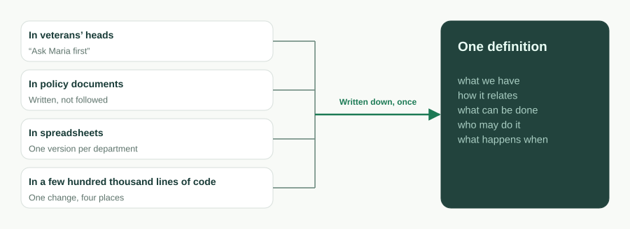
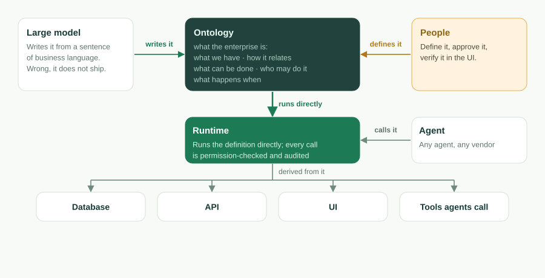
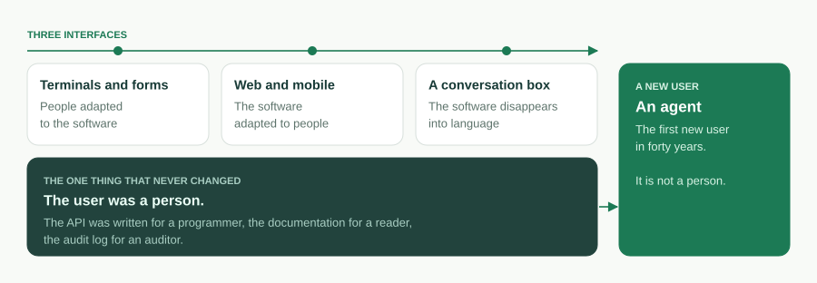
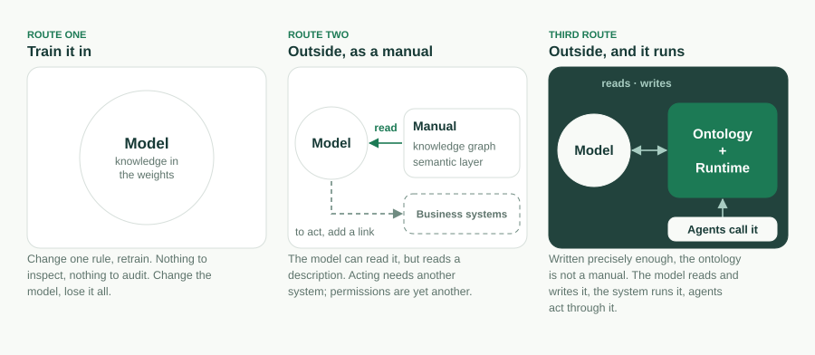

Unternehmenssoftware hat ihre Oberfläche dreimal gewechselt. Terminals und
Formulare, bei denen sich die Menschen an die Software anpassten. Web und Mobile,
bei denen sich die Software an die Menschen anpasste. Und jetzt ein
Gesprächsfenster, in dem die Software in Sprache zu verschwinden scheint. Durch
alle drei hindurch hat sich eines nie geändert: Der Benutzer war ein Mensch. Die
API wurde für einen Programmierer geschrieben, die Dokumentation für einen Leser,
das Audit-Log für einen Prüfer.

Genau das ändert sich jetzt, und es ändert mehr, als die Oberfläche je verändert
hat. Der erste Benutzer der nächsten Generation von Unternehmenssoftware ist ein
Agent. Objekte sind Tools. Aktionen sind Tools. Berechtigungen entscheiden, was
ein Agent aufrufen darf, und das Audit zeichnet auf, was er getan hat. Ein
Gesprächsfenster ist nur der Ort, an dem ein Mensch mit *seinem* Agent spricht;
womit der Agent dann spricht, ist das Unternehmen.

Die Frage ist also nicht, wie die nächste Oberfläche aussieht. Sie lautet, was ein
Unternehmen sein muss, damit ein Agent es lesen, ausführen und von ihm gestoppt
werden kann. Unsere Antwort ist ein einziger Satz, der heute die README dieses
Projekts eröffnet:

> **Die Ontologie ist die Software.** Eine ausführbare Geschäftsontologie. AI
> schreibt sie, die Runtime führt sie aus, Agents bedienen sie, Sie besitzen sie.

Dieser Beitrag ist die Langfassung dieses Satzes: was wir mit dem Wort meinen,
warum Code zurücktritt, warum das jetzt möglich ist und vor fünf Jahren nicht war,
welche Mechanismen jedes der vier Versprechen tragen, was die Ontologie *nicht*
ist und was wir noch nicht gelöst haben.

## Was ein Unternehmen eigentlich sagen will

Reduziert man eine beliebige Geschäftsanwendung auf das, was das Geschäft damit
gemeint hat, bleibt ein Satz aus fünf Teilen: *was wir haben, wie es
zusammenhängt, was man damit tun kann, wer es tun darf und was wann passiert.*

- **Was wir haben** – die Objekte und ihre Felder. Ein Ticket hat einen Betreff,
  eine Priorität, einen Status und ein Fälligkeitsdatum.
- **Wie es zusammenhängt** – Lookups und Master-Detail-Beziehungen. Ein Ticket
  gehört zu einem Account; eine Position gehört zu einem Auftrag.
- **Was man damit tun kann** – Aktionen. Ein Ticket *lösen*; einen Lead
  *konvertieren*.
- **Wer es tun darf** – Berechtigungen. Rollenbasierter Zugriff, Sicherheit auf
  Zeilen- und Feldebene, Freigaberegeln.
- **Was wann passiert** – Flows. Ein Datensatz-Trigger, ein geplanter Job, eine
  Genehmigungskette, eine Workflow-Zustandsmaschine.

Dieser Satz ist die **Geschäftsontologie** des Unternehmens. Seit vierzig Jahren
wird sie in Code übersetzt: dieselbe Absicht „Telefonnummer ist Pflicht“, neu
formuliert als Datenbank-Constraint, als ORM-Annotation, als Formularvalidator
und als Zeile in der API-Dokumentation – vier Stellen, die unabhängig
voneinander auseinanderdriften. Die Codebasis ist nicht das Geschäft; sie ist
die Übersetzung des Geschäfts in die einzige Form, die ein Computer ausführen
konnte.



Hier ist derselbe Satz, einmal geschrieben, so wie ObjectStack ihn liest:

```ts
import { ObjectSchema, Field } from '@objectstack/spec/data';

export const Ticket = ObjectSchema.create({
  name: 'support_desk_ticket',
  label: 'Ticket',
  sharingModel: 'private',
  fields: {
    subject: Field.text({ label: 'Subject', required: true, searchable: true }),
    status: Field.select({
      label: 'Status',
      required: true,
      options: [
        { label: 'Open', value: 'open', default: true },
        { label: 'Resolved', value: 'resolved' },
      ],
    }),
    due_date: Field.date({ label: 'Due Date' }),
  },
});
```

In dem Moment, in dem dieses Objekt existiert, existiert seine Tabelle, sein
REST-Endpunkt, seine Listen- und Formularansicht und sein MCP-Tool. Niemand
schreibt den Controller. Die Ontologie ist kein Designdokument, das eine
Codebasis anschließend implementiert. Sie ist das, was läuft.

Zwei Grenzen halten das Wort ehrlich, und wir nennen sie jedes Mal, wenn wir es
verwenden. Erstens besteht der Kern der Ontologie aus diesen fünf Dingen plus
den Agent- und Tool-Definitionen, die eine App mitbringt. Views, Dashboards,
Apps und Übersetzungen werden ebenfalls in Metadaten geschrieben, aber sie sind
**Projektionen** des Kerns, nicht Teil davon: Ändern Sie den Kern, folgen die
Projektionen; löschen Sie eine Projektion, bleibt das Geschäft, das sie zeigte,
unverändert. Zweitens ist dies eine **ausführbare** Ontologie, keine der
Wissensrepräsentation. Es gibt keine Klassenvererbung, keine Axiome, keinen
Reasoner. Die Definition wird validiert und dann ausgeführt.

## Warum Code zurücktritt

Code ist die Übersetzung der Ontologie. Solange die Übersetzung von Hand
geschehen musste, *war* die Übersetzung das Produkt: das, wofür man einstellte,
das, was man wartete, das, was verrottete. Sobald man die Übersetzung
überspringen kann, folgen drei Dinge.

**Die Ontologie wird zum Vermögenswert und der Code zum Derivat.** Eine Runtime,
die die Definition direkt ausführt, oder eine Toolchain, die die Derivate bei
Bedarf erzeugt, macht die Codebasis zu etwas, das man nicht mehr von Hand
schreibt – so wie niemand Assembler von Hand schreibt. Code verschwindet nicht.
Er wandert *in die Runtime*: der Treiber, der ein Objekt auf eine
Postgres-Tabelle abbildet, der Server, der den Endpunkt bereitstellt, die
Durchsetzung einer Berechtigung bei jedem Aufruf. Was in der Anwendung selbst
bleibt, ist klein und deklariert: Hooks und Aktionsrümpfe, CEL-Ausdrücke in
Formeln und Prädikaten, eingeschränktes JSX für eigene Seiten, das in einen
UI-Baum geparst und nie als Code ausgeführt wird.



**Das ganze System wird klein genug, um es zu überblicken.** Das mitgelieferte
CRM-Beispiel in diesem Repository – Accounts, Kontakte, Leads, Opportunities,
Aktivitäten, Views, ein Dashboard, ein Lead-Konvertierungs-Flow,
Berechtigungssätze, Aktionen, Übersetzungen – umfasst 30 Dateien und rund 17.500
Tokens, gemessen bei Commit
[`7a6ba0310`](https://github.com/objectstack-ai/objectstack/tree/7a6ba03109dbb7e91359eb0f7f3e64dd1263bca8/examples/app-crm).
Das ist die ganze Anwendung, nicht ein Modul davon. Ein Agent kann sie von Anfang
bis Ende laden, beantworten, *was kaputtgeht, wenn ich das ändere*, und über
Daten, API, UI und Berechtigungen hinweg in einer einzigen Änderung refaktorieren.
Warum genau diese Zahl zählt, haben wir in <span lang="en">[The Constraint Isn't Typing Speed. It's the Context Window.](/en/blog/context-window-is-the-constraint/)</span>
(englisch) beschrieben. Dieser Beitrag ist sein Nachfolger: Sobald das System
hineinpasst, wird die Frage, was das System *ist*.

**Die Definition wird prüfbar, wie Code es nie war.** Eine Codebasis kann man nur
ausführen. Eine Definition kann man validieren: `os validate` parst jedes
CEL-Prädikat, prüft, dass jedes `record.field` aufgelöst wird, verifiziert jede
Widget-Bindung und lehnt eine fehlende Sicherheitshaltung ab – mit einer
lokalisierten, korrigierenden Meldung, die ein Agent lesen und beheben kann. Die
meisten AI-Fehler in Metadaten bestehen die Typprüfung und scheitern dann still
zur Laufzeit; ein Gate, das sie schon beim Schreiben ablehnt, macht „AI schreibt
sie“ überhaupt erst überlebensfähig.

## Warum jetzt

Nichts davon war vor fünf Jahren möglich, und drei Bedingungen mussten
gleichzeitig reifen.

1. **Modelle lesen und schreiben strukturierte Definitionen.** Ein Sprachmodell,
   das aus einem Satz Geschäftssprache ein typisiertes, validiertes Schema
   schreiben und seine eigenen lokalisierten Fehler beheben kann, macht aus
   „AI schreibt sie“ eine Schleife statt einer Demo.
2. **Das Kontextfenster fasst die Ontologie eines Unternehmens.** Wenn die
   Definition eines ganzen Geschäftssystems in ein Fenster passt, greppt der
   Agent nicht mehr und hofft. Er denkt über das Ganze nach.
3. **Agents können die Definition direkt bedienen.** Das Model Context Protocol
   hat Agents eine Standardmethode gegeben, Tools aufzurufen. Eine Ontologie,
   deren Objekte und Aktionen Tools *sind*, gibt diesem Aufruf erst Bedeutung.

Andrej Karpathy beschreibt die dritte Generation von Software so, dass das
Kontextfenster das Programm ist. Für Unternehmenssoftware ist das Programm aus
unserer Sicht die Ontologie, und das Kontextfenster ist der Ort, an dem sie
gelesen wird.



## Vier Versprechen, vier Mechanismen

Der Slogan ist eine Haltung. Die Zeile darunter ist eine Reihe von Versprechen,
und jedes Versprechen ist ein Mechanismus, den Sie in diesem Repository
nachprüfen können.

### Die Runtime führt sie aus

Aus dem kompilierten Artefakt **leitet** die Runtime **ab**: das
Datenbankschema auf einem austauschbaren Treiber, eine generierte REST- und
Realtime-API, servergesteuerte UI für die Console und einen MCP-Server. Und sie
**setzt** die Definition bei jedem Aufruf **durch**: RBAC, Sicherheit auf
Zeilen- und Feldebene, Freigaben und Audit gelten für eine REST-Anfrage, einen
Klick in der Console und den Tool-Aufruf eines Agents gleichermaßen. Zur
Laufzeit wird nichts erschlossen. Was läuft, ist das, was validiert wurde.

### AI schreibt sie

Der Scaffolder installiert das AI-Skills-Bündel und schreibt eine `AGENTS.md`,
sodass ein Coding-Agent mit den geladenen Regeln des Protokolls startet statt
mit generischen „Schreib mir etwas TypeScript“-Vorannahmen. Der Agent schreibt
die Definition. Vier Gates stehen zwischen ihr und der Produktion: Striktes
TypeScript und Zod fangen Formfehler im Editor ab; `os validate` fängt die Fehler
ab, die die Typprüfung bestehen und still scheitern würden; ein Mensch genehmigt
einen kleinen, lesbaren Diff in der Console; und die Governance der Runtime
sorgt dafür, dass selbst eine falsche App innerhalb des Zauns bleibt. Die
Arbeitsteilung ist gewollt: Der Agent übernimmt die mechanische, fehleranfällige
Oberfläche, und der Mensch übernimmt die eine Frage, die kein Schema prüfen
kann: *Hat er das gebaut, was ich gemeint habe?*

### Agents bedienen sie

Weil die App aus typisierten Metadaten besteht, stellt die Runtime sie als
MCP-Server bereit, standardmäßig eingeschaltet. Richten Sie einen beliebigen
MCP-Client darauf, und ein Agent kann die App untersuchen und bedienen – unter
denselben Berechtigungen und derselben Sicherheit auf Zeilenebene wie ein
Mensch. Objekte werden automatisch bereitgestellt; Aktionen werden mit
`ai: { exposed: true }` freigeschaltet. Die Reichweite eines Agents ist genau
das, was die Ontologie sagt – und das ist die einzige Art von Agent, die ein
Unternehmen sich leisten kann, von der Leine zu lassen. Ein Agent braucht eine
Ontologie; eine Tool-Oberfläche, die keine ist, ist eine Haftung, und ein
Chatfenster, das an eine REST-API angeschraubt wird, ist der häufigste Weg, eine
zu bauen.

### Sie besitzen sie

Die Ontologie liegt als gewöhnliches TypeScript in Ihrem Repository, versioniert
in Ihrer VCS, als Diff prüfbar, kompiliert in ein Artefakt mit Prüfsumme,
spezifiziert und lizenziert unter Apache-2.0. Wechseln Sie die Runtime, das
Modell oder den Anbieter, und die Definition kommt mit. Die Gesprächsfenster
werden sich angleichen; die Agents werden sich vervielfachen; das eine, was ein
Unternehmen wirklich besitzt und als einziges besitzen muss, ist diese
Definition. Je spezifischer Ihr Geschäft ist, desto weniger davon hat irgendein
Modell je gesehen, und desto mehr ist die Ontologie wert. Das ist zugleich der
stärkste Grund, sie niemand anderem zu überlassen.

## Was sie nicht ist

Das Wort „Ontologie“ trägt zweitausend Jahre Philosophie und dreißig Jahre
Knowledge Engineering mit sich, und das meiste, was der Enterprise-AI-Markt
heute damit meint, ist etwas anderes. Präzision ist das, was die Behauptung
verteidigbar hält.

**Keine Wissensontologie.** In Grubers Definition von 1993 ist eine Ontologie <span lang="en">„an explicit specification of a conceptualization“</span>, eine explizite
Spezifikation einer Konzeptualisierung; in OWL und RDF trägt sie
Klassenhierarchien und Axiome und wird von einer Inferenzmaschine
ausgewertet. Guarinos Programm der *ontologiegetriebenen Informationssysteme*
von 1998 stellte Ontologien in den Mittelpunkt des Systementwurfs, aber als
Beschreibung, gegen die man entwirft, nicht als etwas, das man ausführt. Die
Ontologie von ObjectStack beschreibt nichts im Allgemeinen. Sie ist die
Anwendung eines einzelnen Unternehmens, so präzise definiert, dass sie
ausgeführt werden kann, und genau deshalb wurde der Schlüssel `abstract` aus der
Spezifikation entfernt.

**Nicht der Semantic Layer der Branche.** Palantirs Ontology und die Semantic
Layers, die gerade in Databricks, Snowflake und vergleichbare Plattformen
eingebaut werden, bilden bestehende Systeme auf Geschäftsbegriffe ab, damit ein
Agent über sie nachdenken kann. Sie sind überwiegend lesend, und die Systeme,
die sie beschreiben, leben anderswo. Unsere Ontologie *ist* das System; eine
externe Datenquelle in sie zu föderieren ist möglich, standardmäßig nur lesend
und noch früh.



**Auch nicht die Metadaten von Salesforce, obwohl sie der nächste Vorfahr sind.**
Das Paper von Weissman und Bobrowski aus dem Jahr 2009 über die mandantenfähige
Architektur von Force.com beschrieb einen kompilierten Runtime-Kernel, der
Metadaten pro Mandant ausführt, und das funktionierte im großen Maßstab. Was es
nicht war: ein offenes Format, etwas, das man mitnehmen konnte, oder etwas, das
für einen Agent zum Lesen geschrieben war. Jede der vier Linien oben hält eines
oder zwei der vier Versprechen. Alle vier in einer Definition zu halten, ist die
Position, die dieses Projekt einnimmt.

## Was wir noch nicht gelöst haben

Ein Positionierungs-Statement, das keine offenen Probleme zugibt, ist Marketing.
Das sind unsere.

**Die Größenobergrenze.** „Klein genug, um es zu überblicken“ ist für ein CRM
eine gemessene Tatsache und für ein ganzes Unternehmen ein Argument.
Kontextfenster wachsen, und die Trennung von Kern und Projektion begrenzt, was
ein Agent laden muss, aber eine Ontologie mit Hunderten von Objekten wird die
Behauptung auf die Probe stellen. Wir benennen die Grenze lieber, als sie zu
verstecken.

**Verantwortung.** Wenn ein Agent innerhalb des Zauns handelt und das Ergebnis
trotzdem falsch ist, hat der Zaun seine Arbeit getan, und trotzdem ist jemand
verantwortlich. Unsere Arbeitsregel lautet: Umkehrbare Aktionen gehen an Agents,
unumkehrbare bleiben bei Menschen, und die Grenze steht in der Definition, statt
zur Laufzeit dem Ermessen überlassen zu werden. Das ist eine Regel, keine Lösung.

**Interoperabilität.** Ein Unternehmen, eine Ontologie ist der einfache Fall.
Zwei Unternehmen, deren Agents miteinander Geschäfte abwickeln müssen, sind der
Punkt, an dem ein offenes Protokoll aufhört, ein Prinzip zu sein, und zur
Infrastruktur wird. Das Format ist offen; das gemeinsame Vokabular gibt es noch
nicht.

**Klassifikation ist Macht.** Wer festlegen darf, was ein „Kunde“ ist, war zwei
Jahrtausende lang eine philosophische Frage und ist in jedem Unternehmen eine
Frage zwischen Abteilungen. Die Ontologie explizit zu machen, entscheidet diesen
Streit nicht. Sie verlagert ihn in einen Diff, wo er wenigstens sichtbar ist.

## Wo das den Stack lässt

Alles in diesem Repository ist der offene Stack: Protokoll, Mikrokernel, SDK,
CLI und die Produktions-Runtime, Apache-2.0 ohne Open-Core-Sternchen. Sie bauen
und fragen mit Claude Code oder jedem anderen Coding-Agent; der Agent schreibt
die Ontologie in Ihr Repository und bedient die laufende App über MCP. Dieselbe
Schleife, gehostet, ist [ObjectOS](/de/).

Beginnen Sie mit einem Objekt:

```bash
npm create objectstack@latest my-app && cd my-app
```

Beschreiben Sie das Geschäft in einfacher Sprache, lassen Sie den Agent die
Definition schreiben, führen Sie `npm run validate` aus, öffnen Sie die Console
und verbinden Sie dann einen Agent:

```bash
claude mcp add --transport http my-app http://localhost:3000/api/v1/mcp
```

Was Sie dann haben, ist keine App, die zufällig eine AI geschrieben hat. Es ist
eine Ontologie, die die Runtime ausführt, die AI schreiben kann, die Agents
bedienen können und die Sie besitzen. Die Ontologie ist die Software.

---

*Weiterführende Literatur.* Thomas R. Gruber, <span lang="en">„A Translation Approach to Portable Ontology Specifications“</span> (1993).
Nicola Guarino, <span lang="en">„Formal Ontology and Information Systems“</span> (FOIS 1998).
Craig D. Weissman und Steve Bobrowski, <span lang="en">„The Design of the Force.com Multitenant Internet Application Development Platform“</span> (SIGMOD 2009).
In der ObjectStack-Dokumentation (englisch): <span lang="en">[Business Ontology](https://objectstack.ai/docs/concepts/ontology), [How AI Development Works](https://objectstack.ai/docs/getting-started/how-ai-development-works), [Connect an MCP Client](https://objectstack.ai/docs/ai/connect-mcp)</span>.

*Als Vortrag.* Dasselbe Argument als Deck mit siebzehn Folien, <span lang="en">„The Ontology Is the Software — How a large model reads an enterprise“</span> (englisch):
[PDF herunterladen](https://objectstack.ai/decks/the-ontology-is-the-software.pdf).
