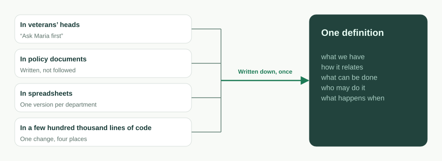
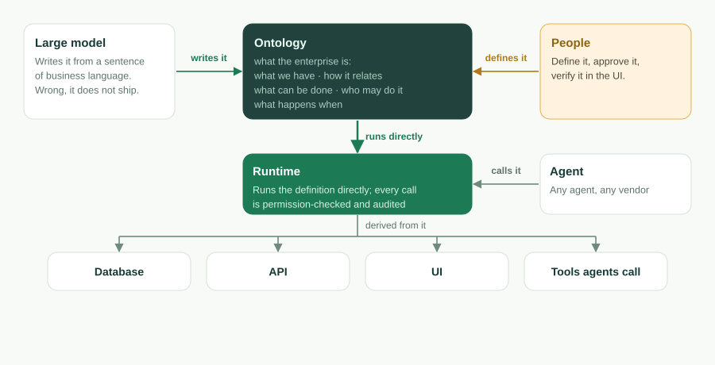
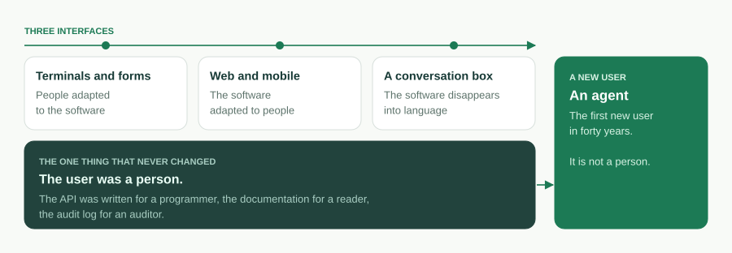
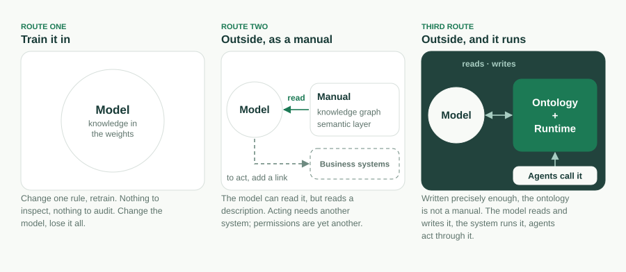

El software empresarial ha cambiado de interfaz tres veces. Terminales y
formularios, donde las personas se adaptaban al software. Web y móvil, donde el
software se adaptaba a las personas. Y ahora una caja de conversación, donde el
software parece disolverse en el lenguaje. A lo largo de las tres, una cosa no
cambió nunca: el usuario era una persona. La API se escribía para un
programador, la documentación para un lector, el registro de auditoría para un
auditor.

Esa es la parte que cambia ahora, y cambia más de lo que cambió nunca la
interfaz. El primer usuario de la próxima generación de software empresarial es
un agente. Los objetos son herramientas. Las acciones son herramientas. Los
permisos deciden qué puede llamar un agente, y la auditoría registra lo que hizo.
Una caja de conversación es solo el lugar donde una persona habla con *su*
agente; aquello con lo que el agente habla después es la empresa.

Así que la pregunta no es qué aspecto tendrá la próxima interfaz. Es qué tiene
que ser una empresa para que un agente pueda leerla, ejecutarla y ser detenido
por ella. Nuestra respuesta es una sola frase que hoy abre el README de este
proyecto:

> **La ontología es el software.** Una ontología de negocio ejecutable. La AI la
> escribe, el runtime la ejecuta, los agentes la operan, tú la posees.

Este artículo es la versión larga de esa frase: qué queremos decir con la
palabra, por qué el código retrocede, por qué esto es posible ahora y no lo era
hace cinco años, qué mecanismos respaldan cada una de las cuatro promesas, qué
*no* es la ontología y qué no hemos resuelto todavía.

## Lo que una empresa quiere decir de verdad

Despoja cualquier aplicación de negocio hasta quedarte con lo que el negocio
quería decir con ella, y obtienes una frase de cinco partes: *qué tenemos, cómo
se relaciona, qué se le puede hacer, quién puede hacerlo y qué pasa cuándo.*

- **Qué tenemos**: los objetos y sus campos. Un ticket tiene un asunto, una
  prioridad, un estado y una fecha de vencimiento.
- **Cómo se relaciona**: búsquedas (lookups) y vínculos maestro-detalle. Un
  ticket pertenece a una cuenta; una línea de pedido pertenece a un pedido.
- **Qué se le puede hacer**: acciones. *Resolver* un ticket; *convertir* un lead.
- **Quién puede hacerlo**: permisos. Acceso basado en roles, seguridad a nivel de
  fila y de campo, reglas de compartición.
- **Qué pasa cuándo**: flujos. Un disparador de registro, una tarea programada,
  una cadena de aprobación, una máquina de estados de workflow.

Esa frase es la **ontología de negocio** de la empresa. Durante cuarenta años se
ha traducido a código: la misma intención de «el número de teléfono es
obligatorio» reformulada como restricción de base de datos, como anotación del
ORM, como validador de formulario y como una línea de la documentación de la
API, cuatro lugares que derivan cada uno por su lado. La base de código no es el
negocio; es la traducción del negocio a la única forma que un ordenador podía
ejecutar.



Esta es la misma frase escrita una sola vez, tal como la lee ObjectStack:

```ts
import { ObjectSchema, Field } from '@objectstack/spec/data';

export const Ticket = ObjectSchema.create({
  name: 'support_desk_ticket',
  label: 'Ticket',
  sharingModel: 'private',
  fields: {
    subject: Field.text({ label: 'Subject', required: true, searchable: true }),
    status: Field.select({
      label: 'Status',
      required: true,
      options: [
        { label: 'Open', value: 'open', default: true },
        { label: 'Resolved', value: 'resolved' },
      ],
    }),
    due_date: Field.date({ label: 'Due Date' }),
  },
});
```

En el momento en que ese objeto existe, existe su tabla, existe su endpoint REST,
existen sus vistas de lista y de formulario, y existe su herramienta MCP. Nadie
escribe el controlador. La ontología no es un documento de diseño que una base de
código implementa después. Es lo que se ejecuta.

Dos límites mantienen honesta la palabra, y los enunciamos cada vez que la
usamos. Primero, el núcleo de la ontología son esas cinco cosas más las
definiciones de agentes y herramientas que trae una app. Las vistas, los paneles,
las apps y las traducciones también se escriben en metadatos, pero son
**proyecciones** del núcleo, no parte de él: cambia el núcleo y las proyecciones
lo siguen; borra una proyección y el negocio que mostraba no cambia. Segundo,
esta es una ontología **ejecutable**, no una de representación del conocimiento.
No hay herencia de clases, ni axiomas, ni razonador. La definición se valida y
después se ejecuta.

## Por qué el código retrocede

El código es la traducción de la ontología. Mientras la traducción tuvo que
hacerse a mano, la traducción *era* el producto: aquello por lo que se
contrataba, lo que se mantenía, lo que se pudría. En cuanto la traducción se
puede saltar, se siguen tres cosas.

**La ontología se convierte en el activo y el código en un derivado.** Un runtime
que ejecuta la definición directamente, o una cadena de herramientas que genera
los derivados bajo demanda, convierte la base de código en algo que ya no se
escribe a mano, igual que nadie escribe ensamblador a mano. El código no
desaparece. Se traslada *al runtime*: el driver que asigna un objeto a una tabla
de Postgres, el servidor que monta el endpoint, la aplicación de un permiso en
cada llamada. Lo que queda en la propia aplicación es pequeño y declarado: hooks
y cuerpos de acción, expresiones CEL en fórmulas y predicados, y JSX restringido
para páginas personalizadas, que se analiza en un árbol de UI y nunca se ejecuta
como código.



**El sistema entero se vuelve lo bastante pequeño como para abarcarlo.** El CRM
de ejemplo incluido en este repositorio (cuentas, contactos, leads,
oportunidades, actividades, vistas, un panel, un flujo de conversión de leads,
conjuntos de permisos, acciones, traducciones) son 30 archivos y unos 17.500
tokens, medidos en el commit
[`7a6ba0310`](https://github.com/objectstack-ai/objectstack/tree/7a6ba03109dbb7e91359eb0f7f3e64dd1263bca8/examples/app-crm).
Es la aplicación entera, no un módulo. Un agente puede cargarla de principio a
fin, responder *qué se rompe si cambio esto* y refactorizar a través de datos,
API, UI y permisos en un solo cambio. Por qué ese es el número que importa lo
explicamos en
[The Constraint Isn't Typing Speed. It's the Context Window.](/en/blog/context-window-is-the-constraint/)
(en inglés). Este artículo es su sucesor: una vez que el sistema cabe, la
pregunta pasa a ser qué *es* el sistema.

**La definición se vuelve verificable como el código nunca lo fue.** Una base de
código solo se puede ejecutar. Una definición se puede validar: `os validate`
analiza cada predicado CEL, comprueba que cada `record.field` se resuelve,
verifica cada enlace de widget y rechaza una postura de seguridad ausente, con
un mensaje localizado y correctivo que un agente puede leer y corregir. La
mayoría de los errores de la AI en metadatos pasan la comprobación de tipos y
luego fallan en silencio en tiempo de ejecución; una puerta que los rechaza al
escribirlos es lo que vuelve viable «la AI la escribe».

## Por qué ahora

Nada de esto era posible hace cinco años, y tres condiciones tuvieron que madurar
a la vez.

1. **Los modelos leen y escriben definiciones estructuradas.** Un modelo de
   lenguaje capaz de redactar un esquema tipado y validado a partir de una frase
   en lenguaje de negocio, y de corregir sus propios errores localizados,
   convierte «la AI la escribe» de una demo en un bucle.
2. **La ventana de contexto contiene la ontología de una empresa.** Cuando la
   definición de un sistema de negocio entero cabe en una ventana, el agente ya
   no hace grep y cruza los dedos. Razona sobre el conjunto.
3. **Los agentes pueden operar la definición directamente.** El Model Context
   Protocol dio a los agentes una forma estándar de llamar herramientas. Una
   ontología cuyos objetos y acciones *son* herramientas es lo que hace que esa
   llamada signifique algo.

Andrej Karpathy describe la tercera generación del software como aquella en la
que la ventana de contexto es el programa. Para el software empresarial, creemos
que el programa es la ontología, y la ventana de contexto es donde se lee.



## Cuatro promesas, cuatro mecanismos

El eslogan es una postura. La línea que va debajo es un conjunto de promesas, y
cada promesa es un mecanismo que puedes inspeccionar en este repositorio.

### El runtime la ejecuta

A partir del artefacto compilado, el runtime **deriva** el esquema de la base de
datos sobre un driver intercambiable, una API REST y en tiempo real generada, UI
dirigida por el servidor para la Console, y un servidor MCP. Y **aplica** la
definición en cada llamada: RBAC, seguridad a nivel de fila y de campo,
compartición y auditoría se aplican por igual a una petición REST, a un clic en
la Console y a la llamada a una herramienta de un agente. Nada se razona en
tiempo de ejecución. Lo que se ejecuta es lo que se validó.

### La AI la escribe

El scaffolder instala el paquete de skills de AI y escribe un `AGENTS.md`, de
modo que un agente de programación empieza con las reglas del protocolo
cargadas en lugar de con prejuicios genéricos del tipo «escríbeme algo de
TypeScript». El agente escribe la definición. Cuatro puertas se interponen entre
ella y producción: TypeScript estricto y Zod atrapan errores de forma en el
editor; `os validate` atrapa los errores que pasan la comprobación de tipos y
fallarían en silencio; una persona aprueba un diff pequeño y legible en la
Console; y la gobernanza del runtime hace que incluso una app equivocada se
quede dentro de la valla. El reparto del trabajo es deliberado: el agente se
ocupa de la superficie mecánica y propensa a errores, y la persona de la única
pregunta que ningún esquema puede comprobar: *¿ha construido lo que yo quería
decir?*

### Los agentes la operan

Como la app son metadatos tipados, el runtime la sirve como servidor MCP, activo
por defecto. Apunta cualquier cliente MCP hacia ella y un agente puede
inspeccionar y operar la app, bajo los mismos permisos y la misma seguridad a
nivel de fila que una persona. Los objetos se exponen automáticamente; las
acciones se habilitan con `ai: { exposed: true }`. El alcance de un agente es
exactamente lo que dice la ontología, y ese es el único tipo de agente que una
empresa puede permitirse soltar. Un agente necesita una ontología; una
superficie de herramientas que no lo es resulta un pasivo, y una caja de chat
atornillada a una API REST es la forma más común de construir uno.

### Tú la posees

La ontología vive en tu repositorio como TypeScript ordinario, versionada en tu
VCS, revisable como un diff, compilada en un artefacto con checksum,
especificada y licenciada bajo Apache-2.0. Cambia el runtime, cambia el modelo,
cambia de proveedor, y la definición viene contigo. Las cajas de conversación
convergerán; los agentes se multiplicarán; lo único que una empresa posee de
verdad, y lo único que necesita poseer, es esta definición. Cuanto más
específico es tu negocio, menos de él ha visto ningún modelo, y más vale la
ontología. Esa es también la razón más fuerte para no dejar que nadie más la
tenga.

## Lo que no es

La palabra «ontología» carga con dos mil años de filosofía y treinta de
ingeniería del conocimiento, y la mayor parte de lo que el mercado de la AI
empresarial quiere decir con ella hoy es otra cosa. La precisión es lo que
mantiene defendible la afirmación.

**No es una ontología del conocimiento.** En la definición de Gruber de 1993,
una ontología es «an explicit specification of a conceptualization», una
especificación explícita de una conceptualización; en OWL y RDF lleva
jerarquías de clases y axiomas, y un motor de inferencia razona sobre ella. El
programa de *sistemas de información guiados por ontologías* que Guarino planteó
en 1998 puso las ontologías en el centro del diseño de sistemas, pero como una
descripción contra la que diseñar, no como algo que ejecutar. La ontología de
ObjectStack no describe nada en general. Es la aplicación de un negocio concreto,
definida con la precisión suficiente para ejecutarse, y la clave `abstract` se
eliminó de la especificación exactamente por esa razón.

**No es la capa semántica de la industria.** La Ontology de Palantir, y las
capas semánticas que se están construyendo ahora en Databricks, Snowflake y sus
pares, asignan los sistemas existentes a conceptos de negocio para que un agente
pueda razonar sobre ellos. Son mayoritariamente de lectura, y los sistemas que
describen viven en otra parte. Nuestra ontología *es* el sistema; federar en ella
una fuente de datos externa es posible, de solo lectura por defecto, y todavía
temprano.



**Tampoco son los metadatos de Salesforce, aunque sean el antepasado más
cercano.** El artículo de Weissman y Bobrowski de 2009 sobre la arquitectura
multitenant de Force.com describía un kernel de runtime compilado que ejecutaba
metadatos por tenant, y funcionó a escala. Lo que no era: un formato abierto,
algo que pudieras llevarte, o algo escrito para que lo leyera un agente. Cada
uno de los cuatro linajes anteriores sostiene una o dos de las cuatro promesas.
Sostener las cuatro en una sola definición es la posición que ocupa este
proyecto.

## Lo que no hemos resuelto

Una declaración de posicionamiento que no admite problemas abiertos es
marketing. Estos son los nuestros.

**El techo de tamaño.** «Lo bastante pequeño como para abarcarlo entero» es un
hecho medido para un CRM y un argumento para una empresa. Las ventanas de
contexto crecen, y la separación entre núcleo y proyección acota lo que un agente
debe cargar, pero una ontología con cientos de objetos pondrá a prueba la
afirmación. Preferimos enunciar el límite antes que esconderlo.

**La responsabilidad.** Cuando un agente actúa dentro de la valla y el resultado
sigue siendo erróneo, la valla hizo su trabajo y alguien sigue siendo
responsable. Nuestra regla de trabajo es que las acciones reversibles van a los
agentes y las irreversibles se quedan con las personas, y que esa frontera se
escribe en la definición, no se deja al criterio en tiempo de ejecución. Es una
regla, no una solución.

**La interoperabilidad.** Una empresa, una ontología es el caso fácil. Dos
empresas cuyos agentes necesitan hacer transacciones es donde un protocolo
abierto deja de ser un principio y se convierte en infraestructura. El formato
es abierto; el vocabulario compartido todavía no existe.

**Clasificar es poder.** Quién decide qué es un «cliente» fue una pregunta
filosófica durante dos milenios y es una pregunta entre departamentos en cada
empresa. Hacer explícita la ontología no zanja esa discusión. La traslada a un
diff, donde al menos se puede ver.

## Dónde deja esto al stack

Todo en este repositorio es el stack abierto: protocolo, microkernel, SDK, CLI y
el runtime de producción, Apache-2.0 sin asteriscos de open core. Construyes y
preguntas con Claude Code o con cualquier agente de programación; el agente
escribe la ontología en tu repositorio y opera la app en ejecución a través de
MCP. El mismo bucle, alojado, es [ObjectOS](/es/).

Empieza con un objeto:

```bash
npm create objectstack@latest my-app && cd my-app
```

Describe el negocio en lenguaje llano, deja que el agente escriba la definición,
ejecuta `npm run validate`, abre la Console y luego conecta un agente:

```bash
claude mcp add --transport http my-app http://localhost:3000/api/v1/mcp
```

Lo que tendrás no es una app que la AI escribió por casualidad. Es una ontología
que el runtime ejecuta, que la AI puede escribir, que los agentes pueden operar
y que tú posees. La ontología es el software.

---

*Lecturas adicionales.* Thomas R. Gruber, «A Translation Approach to Portable
Ontology Specifications» (1993). Nicola Guarino, «Formal Ontology and
Information Systems» (FOIS 1998). Craig D. Weissman y Steve Bobrowski, «The
Design of the Force.com Multitenant Internet Application Development Platform»
(SIGMOD 2009). En la documentación de ObjectStack (en inglés):
[Business Ontology](https://objectstack.ai/docs/concepts/ontology),
[How AI Development Works](https://objectstack.ai/docs/getting-started/how-ai-development-works),
[Connect an MCP Client](https://objectstack.ai/docs/ai/connect-mcp).

*Como charla.* El mismo argumento en una presentación de diecisiete
diapositivas, «The Ontology Is the Software — How a large model reads an
enterprise» (en inglés):
[descarga el PDF](https://objectstack.ai/decks/the-ontology-is-the-software.pdf).
