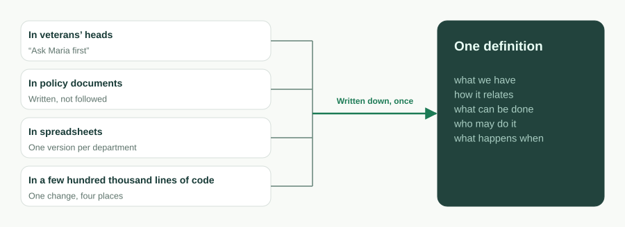
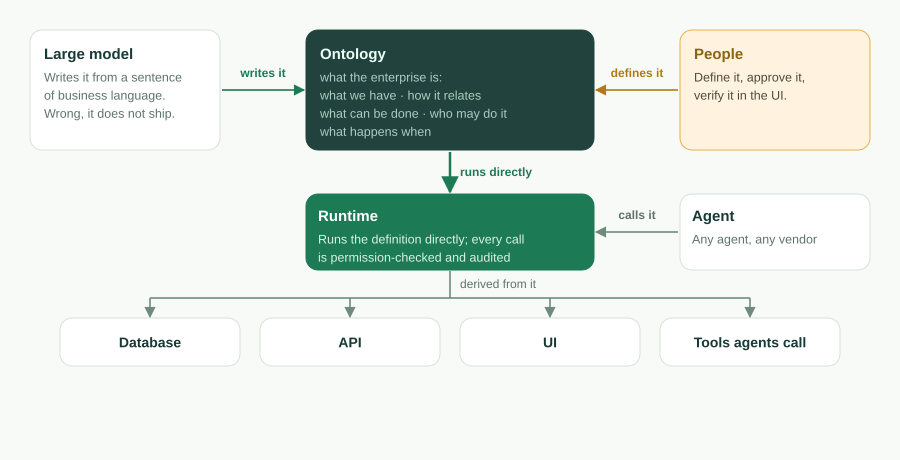
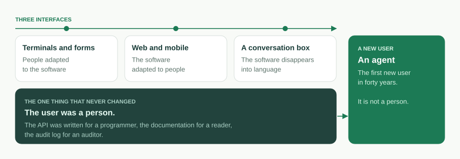
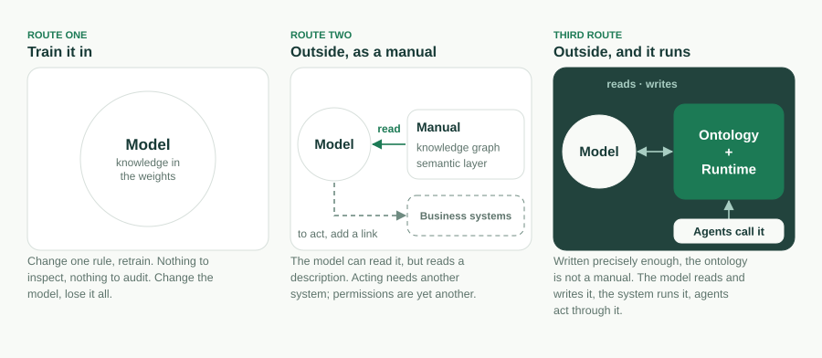

Le logiciel d’entreprise a changé trois fois d’interface. Les terminaux et les
formulaires, où les gens s’adaptaient au logiciel. Le web et le mobile, où le
logiciel s’adaptait aux gens. Et maintenant une boîte de conversation, où le
logiciel semble se dissoudre dans le langage. Au fil des trois, une chose n’a
jamais changé : l’utilisateur était une personne. L’API était écrite pour un
programmeur, la documentation pour un lecteur, le journal d’audit pour un
auditeur.

C’est cette partie-là qui change maintenant, et elle change davantage que
l’interface n’a jamais changé. Le premier utilisateur de la prochaine génération
de logiciels d’entreprise est un agent. Les objets sont des outils. Les actions
sont des outils. Les permissions décident de ce qu’un agent peut appeler, et
l’audit enregistre ce qu’il a fait. Une boîte de conversation n’est que l’endroit
où une personne parle à *son* agent ; ce à quoi l’agent parle ensuite, c’est
l’entreprise.

La question n’est donc pas de savoir à quoi ressemblera la prochaine interface.
C’est de savoir ce qu’une entreprise doit être pour qu’un agent puisse la lire,
l’exécuter, et être arrêté par elle. Notre réponse tient en une phrase, qui ouvre
désormais le README de ce projet :

> **L’ontologie est le logiciel.** Une ontologie métier exécutable. L’AI
> l’écrit, le runtime l’exécute, les agents l’opèrent, vous la possédez.

Ce billet est la version longue de cette phrase : ce que nous entendons par ce
mot, pourquoi le code recule, pourquoi c’est possible aujourd’hui et ne l’était
pas il y a cinq ans, quels mécanismes soutiennent chacune des quatre promesses,
ce que l’ontologie n’est *pas*, et ce que nous n’avons pas encore résolu.

## Ce qu’une entreprise veut vraiment dire

Dépouillez n’importe quelle application métier jusqu’à ce que le métier voulait
dire par elle, et vous obtenez une phrase en cinq parties : *ce que nous avons,
comment cela se relie, ce qu’on peut en faire, qui a le droit de le faire, et ce
qui se passe quand.*

- **Ce que nous avons** : les objets et leurs champs. Un ticket a un sujet, une
  priorité, un statut, une date d’échéance.
- **Comment cela se relie** : les lookups et les liens maître-détail. Un ticket
  appartient à un compte ; une ligne de commande appartient à une commande.
- **Ce qu’on peut en faire** : les actions. *Résoudre* un ticket ; *convertir*
  un lead.
- **Qui a le droit de le faire** : les permissions. Accès par rôle, sécurité au
  niveau ligne et champ, règles de partage.
- **Ce qui se passe quand** : les flux. Un déclencheur d’enregistrement, une
  tâche planifiée, une chaîne d’approbation, une machine à états de workflow.

Cette phrase est l’**ontologie métier** de l’entreprise. Depuis quarante ans,
elle est traduite en code : la même intention « le numéro de téléphone est
obligatoire » reformulée en contrainte de base de données, en annotation d’ORM,
en validateur de formulaire et en ligne de la documentation de l’API, quatre
endroits qui dérivent chacun de leur côté. La base de code n’est pas le métier ;
c’est la traduction du métier dans la seule forme qu’un ordinateur pouvait
exécuter.



Voici la même phrase écrite une seule fois, telle qu’ObjectStack la lit :

```ts
import { ObjectSchema, Field } from '@objectstack/spec/data';

export const Ticket = ObjectSchema.create({
  name: 'support_desk_ticket',
  label: 'Ticket',
  sharingModel: 'private',
  fields: {
    subject: Field.text({ label: 'Subject', required: true, searchable: true }),
    status: Field.select({
      label: 'Status',
      required: true,
      options: [
        { label: 'Open', value: 'open', default: true },
        { label: 'Resolved', value: 'resolved' },
      ],
    }),
    due_date: Field.date({ label: 'Due Date' }),
  },
});
```

Dès que cet objet existe, sa table existe, son endpoint REST existe, ses vues
liste et formulaire existent, et son outil MCP existe. Personne n’écrit le
contrôleur. L’ontologie n’est pas un document de conception qu’une base de code
implémente ensuite. C’est la chose qui tourne.

Deux limites gardent le mot honnête, et nous les énonçons chaque fois que nous
l’employons. D’abord, le noyau de l’ontologie, ce sont ces cinq choses, plus les
définitions d’agents et d’outils qu’une app embarque. Les vues, les tableaux de
bord, les apps et les traductions sont eux aussi écrits en métadonnées, mais ce
sont des **projections** du noyau, pas des parties de celui-ci : changez le
noyau et les projections suivent ; supprimez une projection et le métier qu’elle
montrait reste inchangé. Ensuite, c’est une ontologie **exécutable**, pas une
ontologie de représentation des connaissances. Il n’y a ni héritage de classes,
ni axiomes, ni raisonneur. La définition est validée, puis exécutée.

## Pourquoi le code recule

Le code est la traduction de l’ontologie. Tant que la traduction devait se faire
à la main, la traduction *était* le produit : ce pour quoi on recrutait, ce
qu’on maintenait, ce qui pourrissait. Dès que l’on peut sauter la traduction,
trois choses s’ensuivent.

**L’ontologie devient l’actif et le code devient un dérivé.** Un runtime qui
exécute directement la définition, ou une chaîne d’outils qui génère les dérivés
à la demande, fait de la base de code quelque chose qu’on n’écrit plus à la
main, comme plus personne n’écrit d’assembleur à la main. Le code ne disparaît
pas. Il se déplace *dans le runtime* : le pilote qui associe un objet à une table
Postgres, le serveur qui monte l’endpoint, l’application d’une permission à
chaque appel. Ce qui reste dans l’application elle-même est petit et déclaré :
des hooks et des corps d’action, des expressions CEL dans les formules et les
prédicats, du JSX contraint pour les pages personnalisées, analysé en arbre d’UI
et jamais exécuté comme du code.



**Le système entier devient assez petit pour être tenu d’un seul tenant.** Le
CRM d’exemple livré dans ce dépôt (comptes, contacts, leads, opportunités,
activités, vues, un tableau de bord, un flux de conversion de leads, des
ensembles de permissions, des actions, des traductions) tient en 30 fichiers et
environ 17 500 tokens, mesurés au commit
[`7a6ba0310`](https://github.com/objectstack-ai/objectstack/tree/7a6ba03109dbb7e91359eb0f7f3e64dd1263bca8/examples/app-crm).
C’est l’application entière, pas un de ses modules. Un agent peut la charger de
bout en bout, répondre à *qu’est-ce qui casse si je change ceci*, et refactorer
à travers les données, l’API, l’UI et les permissions en une seule modification.
Nous avons expliqué pourquoi ce chiffre est celui qui compte dans <span lang="en">[The Constraint Isn't Typing Speed. It's the Context Window.](/en/blog/context-window-is-the-constraint/)</span>
(en anglais). Ce billet en est la suite : une fois que le système tient, la
question devient ce que le système *est*.

**La définition devient vérifiable comme le code ne l’a jamais été.** Une base de
code ne peut qu’être exécutée. Une définition peut être validée : `os validate`
analyse chaque prédicat CEL, vérifie que chaque `record.field` se résout,
contrôle chaque liaison de widget et refuse une posture de sécurité manquante,
avec un message localisé et correctif qu’un agent peut lire et corriger. La
plupart des erreurs de l’AI dans les métadonnées passent la vérification de types
puis échouent silencieusement à l’exécution ; une porte qui les rejette dès
l’écriture est ce qui rend « l’AI l’écrit » viable.

## Pourquoi maintenant

Rien de tout cela n’était possible il y a cinq ans, et trois conditions devaient
mûrir en même temps.

1. **Les modèles lisent et écrivent des définitions structurées.** Un modèle de
   langage capable de rédiger un schéma typé et validé à partir d’une phrase de
   langage métier, et de corriger ses propres erreurs localisées, fait passer
   « l’AI l’écrit » de la démo à la boucle.
2. **La fenêtre de contexte contient l’ontologie d’une entreprise.** Quand la
   définition d’un système métier entier tient dans une fenêtre, l’agent ne fait
   plus de grep en espérant tomber juste. Il raisonne sur l’ensemble.
3. **Les agents peuvent opérer la définition directement.** Le Model Context
   Protocol a donné aux agents une manière standard d’appeler des outils. Une
   ontologie dont les objets et les actions *sont* des outils est ce qui donne
   un sens à cet appel.

Andrej Karpathy décrit la troisième génération du logiciel comme celle où la
fenêtre de contexte est le programme. Pour le logiciel d’entreprise, nous
pensons que le programme est l’ontologie, et que la fenêtre de contexte est
l’endroit où on la lit.



## Quatre promesses, quatre mécanismes

Le slogan est une prise de position. La ligne en dessous est un ensemble de
promesses, et chaque promesse est un mécanisme que vous pouvez inspecter dans ce
dépôt.

### Le runtime l’exécute

À partir de l’artefact compilé, le runtime **dérive** le schéma de base de
données sur un pilote interchangeable, une API REST et temps réel générée, une
UI pilotée par le serveur pour la Console, et un serveur MCP. Et il **applique**
la définition à chaque appel : RBAC, sécurité au niveau ligne et champ, partage
et audit s’appliquent de la même façon à une requête REST, à un clic dans la
Console et à l’appel d’outil d’un agent. Rien n’est raisonné à l’exécution. Ce
qui tourne, c’est ce qui a été validé.

### L’AI l’écrit

Le scaffolder installe le paquet de skills d’AI et écrit un `AGENTS.md`, de sorte
qu’un agent de code démarre avec les règles du protocole déjà chargées plutôt
qu’avec des a priori génériques du type « écris-moi du TypeScript ». L’agent
écrit la définition. Quatre portes se dressent entre elle et la production :
TypeScript strict et Zod attrapent les erreurs de forme dans l’éditeur ;
`os validate` attrape les erreurs qui passent la vérification de types et
échoueraient silencieusement ; une personne approuve un diff petit et lisible
dans la Console ; et la gouvernance du runtime fait que même une app erronée
reste à l’intérieur de la clôture. La division du travail est délibérée :
l’agent prend en charge la surface mécanique et sujette aux erreurs, et la
personne la seule question qu’aucun schéma ne peut vérifier : *a-t-il construit
ce que je voulais dire ?*

### Les agents l’opèrent

Parce que l’app est faite de métadonnées typées, le runtime la sert comme
serveur MCP, activé par défaut. Pointez n’importe quel client MCP vers elle et
un agent peut inspecter et opérer l’app, sous les mêmes permissions et la même
sécurité au niveau ligne qu’un humain. Les objets sont exposés automatiquement ;
les actions s’activent avec `ai: { exposed: true }`. La portée d’un agent est
exactement ce que dit l’ontologie, et c’est le seul genre d’agent qu’une
entreprise peut se permettre de laisser libre. Un agent a besoin d’une
ontologie ; une surface d’outils qui n’en est pas une est un passif, et une
boîte de chat boulonnée sur une API REST est la façon la plus courante d’en
construire un.

### Vous la possédez

L’ontologie vit dans votre dépôt comme du TypeScript ordinaire, versionnée dans
votre VCS, relisible comme un diff, compilée en un artefact doté d’une somme de
contrôle, spécifiée et sous licence Apache-2.0. Changez de runtime, changez de
modèle, changez de fournisseur, et la définition vous suit. Les boîtes de
conversation vont converger ; les agents vont se multiplier ; la seule chose
qu’une entreprise possède vraiment, et la seule qu’elle a besoin de posséder,
c’est cette définition. Plus votre métier est spécifique, moins un modèle en a
jamais vu, et plus l’ontologie a de valeur. C’est aussi la raison la plus forte
de ne laisser personne d’autre la détenir.

## Ce qu’elle n’est pas

Le mot « ontologie » porte deux mille ans de philosophie et trente ans
d’ingénierie des connaissances, et l’essentiel de ce que le marché de l’AI
d’entreprise entend par là aujourd’hui est autre chose. La précision est ce qui
garde l’affirmation défendable.

**Pas une ontologie de connaissances.** Dans la définition de Gruber de 1993,
une ontologie est <span lang="en">« an explicit specification of a conceptualization »</span>, une
spécification explicite d’une conceptualisation ; en OWL et en RDF, elle porte
des hiérarchies de classes et des axiomes, et un moteur d’inférence raisonne
dessus. Le programme des *systèmes d’information guidés par les ontologies* que
Guarino a formulé en 1998 a placé les ontologies au centre de la conception des
systèmes, mais comme une description d’après laquelle concevoir, pas comme une
chose à exécuter. L’ontologie d’ObjectStack ne décrit rien en général. C’est
l’application d’une entreprise, définie assez précisément pour être exécutée, et
la clé `abstract` a été retirée de la spécification exactement pour cette raison.

**Pas la couche sémantique du secteur.** L’Ontology de Palantir, et les couches
sémantiques en cours de construction dans Databricks, Snowflake et leurs pairs,
font correspondre des systèmes existants à des concepts métier pour qu’un agent
puisse raisonner sur eux. Elles sont essentiellement en lecture, et les systèmes
qu’elles décrivent vivent ailleurs. Notre ontologie *est* le système ; y fédérer
une source de données externe est possible, en lecture seule par défaut, et
encore précoce.



**Pas non plus les métadonnées de Salesforce, même si c’en est l’ancêtre le plus
proche.** L’article de Weissman et Bobrowski de 2009 sur l’architecture
multitenant de Force.com décrivait un noyau de runtime compilé exécutant des
métadonnées par tenant, et cela a fonctionné à grande échelle. Ce que ce n’était
pas : un format ouvert, une chose que l’on pouvait emporter, ou une chose écrite
pour qu’un agent la lise. Chacune des quatre lignées ci-dessus tient une ou deux
des quatre promesses. Les tenir toutes les quatre dans une seule définition est
la position qu’occupe ce projet.

## Ce que nous n’avons pas résolu

Une déclaration de positionnement qui n’admet aucun problème ouvert, c’est du
marketing. Voici les nôtres.

**Le plafond de taille.** « Assez petit pour être tenu d’un seul tenant » est un
fait mesuré pour un CRM et un argument pour une entreprise. Les fenêtres de
contexte grandissent, et la séparation entre noyau et projection borne ce qu’un
agent doit charger, mais une ontologie de plusieurs centaines d’objets mettra
l’affirmation à l’épreuve. Nous préférons énoncer la limite plutôt que la
cacher.

**La responsabilité.** Quand un agent agit à l’intérieur de la clôture et que le
résultat est quand même faux, la clôture a fait son travail et quelqu’un reste
responsable. Notre règle de travail : les actions réversibles vont aux agents,
les irréversibles restent aux personnes, et cette frontière est écrite dans la
définition, pas laissée au jugement à l’exécution. C’est une règle, pas une
solution.

**L’interopérabilité.** Une entreprise, une ontologie, c’est le cas facile. Deux
entreprises dont les agents doivent conclure des transactions, c’est là qu’un
protocole ouvert cesse d’être un principe et devient une infrastructure. Le
format est ouvert ; le vocabulaire partagé n’existe pas encore.

**Classer, c’est le pouvoir.** Qui a le droit de définir ce qu’est un « client »
a été une question philosophique pendant deux millénaires, et c’est une question
entre services dans chaque entreprise. Rendre l’ontologie explicite ne tranche
pas ce débat. Cela le déplace dans un diff, où au moins on peut le voir.

## Où cela laisse la pile

Tout dans ce dépôt est la pile ouverte : protocole, micro-noyau, SDK, CLI et le
runtime de production, sous Apache-2.0 sans astérisque open-core. Vous
construisez et vous demandez avec Claude Code ou n’importe quel agent de code ;
l’agent écrit l’ontologie dans votre dépôt et opère l’app en cours d’exécution
via MCP. La même boucle, hébergée, c’est [ObjectOS](/fr/).

Commencez par un objet :

```bash
npm create objectstack@latest my-app && cd my-app
```

Décrivez le métier en langage courant, laissez l’agent écrire la définition,
lancez `npm run validate`, ouvrez la Console, puis connectez un agent :

```bash
claude mcp add --transport http my-app http://localhost:3000/api/v1/mcp
```

Ce que vous aurez n’est pas une app que l’AI a écrite par hasard. C’est une
ontologie que le runtime exécute, que l’AI peut écrire, que les agents peuvent
opérer, et que vous possédez. L’ontologie est le logiciel.

---

*Pour aller plus loin.* Thomas R. Gruber, <span lang="en">« A Translation Approach to Portable Ontology Specifications »</span> (1993).
Nicola Guarino, <span lang="en">« Formal Ontology and Information Systems »</span> (FOIS 1998).
Craig D. Weissman et Steve Bobrowski, <span lang="en">« The Design of the Force.com Multitenant Internet Application Development Platform »</span> (SIGMOD 2009).
Dans la documentation d’ObjectStack (en anglais) : <span lang="en">[Business Ontology](https://objectstack.ai/docs/concepts/ontology), [How AI Development Works](https://objectstack.ai/docs/getting-started/how-ai-development-works), [Connect an MCP Client](https://objectstack.ai/docs/ai/connect-mcp)</span>.

*En conférence.* Le même argument sous forme de présentation de dix-sept diapositives, <span lang="en">« The Ontology Is the Software — How a large model reads an enterprise »</span> (en anglais) :
[télécharger le PDF](https://objectstack.ai/decks/the-ontology-is-the-software.pdf).
