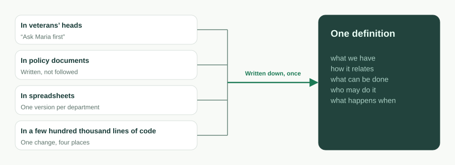
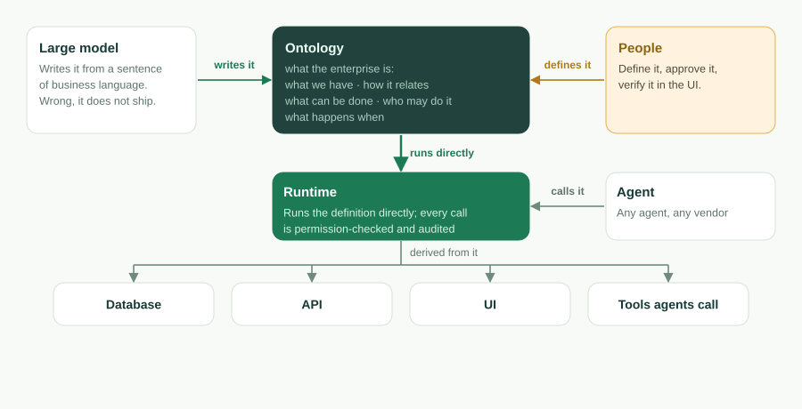
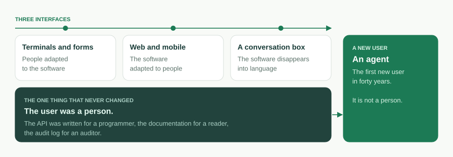
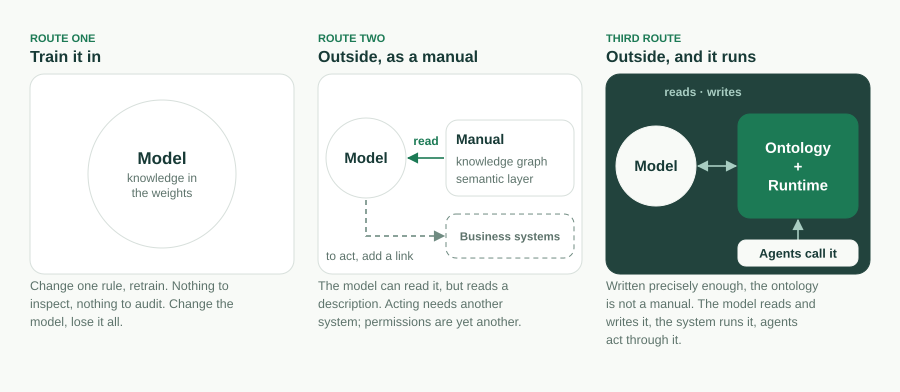

企業ソフトウェアは、インターフェースを三度変えてきた。人がソフトウェアに合わせた端末とフォーム。ソフトウェアが人に合わせた Web とモバイル。そして今、ソフトウェアが言葉の中へ消えていくように見える会話ボックス。三つの時代を通じて、ひとつだけ変わらなかったことがある。ユーザーは人だった。API はプログラマーのために、ドキュメントは読み手のために、監査ログは監査人のために書かれていた。

今変わるのはその部分であり、その変化はインターフェースのどの変化よりも大きい。次世代の企業ソフトウェアの最初のユーザーは、エージェントである。オブジェクトはツールだ。アクションもツールだ。パーミッションはエージェントが何を呼べるかを決め、監査はそれが何をしたかを記録する。会話ボックスは、人が「自分の」エージェントと話す場所にすぎない。そのエージェントが次に話しかける相手は、企業そのものだ。

だから問うべきは、次のインターフェースがどんな姿をしているかではない。エージェントが読み、動かし、そしてそれによって止められるために、企業は何でなければならないか、である。私たちの答えは一文で、それは今このプロジェクトの README の冒頭に置かれている。

> **オントロジーがソフトウェアである**。実行可能なビジネスオントロジーをひとつ。AI が書き、ランタイムが動かし、エージェントが操作し、あなたが所有する。

本稿はこの一文の長い版だ。この語で何を意味するのか。なぜコードは後退するのか。なぜそれが今は可能で、五年前には不可能だったのか。四つの約束それぞれを、どの仕組みが裏付けるのか。オントロジーが何ではないのか。そして、私たちがまだ答えを出せていないことは何か。

## 企業が本当に言いたいこと

どんな業務アプリケーションでも、ビジネスがそれによって意味していたことだけを残して削ぎ落とすと、五つの部分からなる一文が残る。「何を持っているか、それがどう関係するか、それに何ができるか、誰がそれをしてよいか、いつ何が起きるか」。

- **何を持っているか**——オブジェクトとそのフィールド。チケットには件名、優先度、ステータス、期日がある。
- **どう関係するか**——ルックアップと主従（master-detail）のリンク。チケットは取引先に属し、明細行は注文に属する。
- **何ができるか**——アクション。チケットを「解決」する。リードを「転換」する。
- **誰がしてよいか**——パーミッション。ロールベースのアクセス、行レベルとフィールドレベルのセキュリティ、共有ルール。
- **いつ何が起きるか**——フロー。レコードトリガー、スケジュールジョブ、承認チェーン、ワークフローのステートマシン。

この一文が、その企業の**ビジネスオントロジー**である。四十年間、それはコードへと翻訳されてきた。「電話番号は必須」という同じ意図が、データベース制約として、ORM のアノテーションとして、フォームのバリデーターとして、API ドキュメントの一行として言い直され、その四か所がそれぞれ勝手にずれていく。コードベースはビジネスではない。コンピューターが実行できる唯一の形へと翻訳されたビジネスである。



同じ一文を一度だけ書くと、ObjectStack ではこう読まれる。

```ts
import { ObjectSchema, Field } from '@objectstack/spec/data';

export const Ticket = ObjectSchema.create({
  name: 'support_desk_ticket',
  label: 'Ticket',
  sharingModel: 'private',
  fields: {
    subject: Field.text({ label: 'Subject', required: true, searchable: true }),
    status: Field.select({
      label: 'Status',
      required: true,
      options: [
        { label: 'Open', value: 'open', default: true },
        { label: 'Resolved', value: 'resolved' },
      ],
    }),
    due_date: Field.date({ label: 'Due Date' }),
  },
});
```

このオブジェクトが存在した瞬間に、テーブルが存在し、REST エンドポイントが存在し、リストビューとフォームビューが存在し、MCP ツールが存在する。コントローラーを書く人はいない。オントロジーは、コードベースが後から実装する設計文書ではない。それ自体が動くものである。

この語を正直に保つための境界が二つあり、私たちはこの語を使うたびにそれを明言する。第一に、オントロジーの中核はこの五つと、アプリに同梱されるエージェントとツールの定義である。ビュー、ダッシュボード、アプリ、翻訳もメタデータで書かれるが、それらは中核の**投影**であって、中核の一部ではない。中核を変えれば投影は追従し、投影を削除しても、それが示していたビジネスは変わらない。第二に、これは**実行可能な**オントロジーであり、知識表現のオントロジーではない。クラス継承も、公理も、推論器もない。定義は検証され、そして実行される。

## なぜコードは後退するのか

コードはオントロジーの翻訳である。翻訳を人の手でやるしかなかった間は、翻訳こそが製品だった。人を雇う理由であり、保守する対象であり、腐っていくものだった。翻訳を飛ばせるようになると、三つのことが起きる。

**オントロジーが資産になり、コードは派生物になる**。定義を直接実行するランタイム、あるいは派生物を必要に応じて生成するツールチェーンがあれば、コードベースはもう手で書くものではなくなる。誰もアセンブリを手で書かないのと同じだ。コードは消えない。ランタイムの「中へ」移るのである。オブジェクトを Postgres のテーブルに対応付けるドライバー、エンドポイントをマウントするサーバー、呼び出しのたびに行われるパーミッションの強制。アプリケーション自体に残るのは、小さく、宣言されたものだけだ。フックとアクション本体、数式と述語の中の CEL 式、そしてカスタムページ用の制約付き JSX。この JSX は UI ツリーに解析され、コードとして実行されることは決してない。



**システム全体が、丸ごと抱えられるほど小さくなる**。このリポジトリに同梱された CRM サンプル——取引先、担当者、リード、商談、活動、ビュー、ダッシュボード、リード転換フロー、パーミッションセット、アクション、翻訳——は、コミット [`7a6ba0310`](https://github.com/objectstack-ai/objectstack/tree/7a6ba03109dbb7e91359eb0f7f3e64dd1263bca8/examples/app-crm) で計測して 30 ファイル、約 17,500 トークンだ。これはモジュールではなく、アプリケーション全体である。エージェントはそれを端から端まで読み込み、「これを変えたら何が壊れるか」に答え、データ、API、UI、パーミッションをまたぐリファクタリングを一回の変更で行える。この数字がなぜ重要なのかは、英語記事 [The Constraint Isn't Typing Speed. It's the Context Window.](/en/blog/context-window-is-the-constraint/) に書いた。本稿はその続編である。システムが収まるようになると、問いは、そのシステムが「何であるか」へ移る。

**定義が、コードには決してできなかった形で検査可能になる**。コードベースは実行することしかできない。定義は検証できる。`os validate` はすべての CEL 述語を解析し、それぞれの `record.field` が解決されることを確かめ、ウィジェットのバインディングをすべて検証し、欠けたセキュリティ姿勢を拒否する。しかも、エージェントが読んで直せる、位置が特定された訂正のためのメッセージで。メタデータにおける AI の誤りの多くは、型チェックを通ったうえで実行時に静かに失敗する。それを作成時に拒否するゲートこそが、「AI が書く」を生き延びられるものにしている。

## なぜ今なのか

五年前には、このどれも不可能だった。三つの条件が同時に成熟する必要があった。

1. **モデルが構造化された定義を読み書きする**。ビジネスの言葉一文から型付きで検証されたスキーマを書き、位置が特定された自分の誤りを直せる言語モデルは、「AI が書く」をデモからループに変える。
2. **コンテキストウィンドウが企業のオントロジーを収める**。業務システム全体の定義がひとつのウィンドウに収まれば、エージェントはもう grep して当たりを祈るのではない。全体について推論する。
3. **エージェントが定義を直接操作できる**。Model Context Protocol は、エージェントにツールを呼ぶ標準的な方法を与えた。オブジェクトとアクションがそのままツール「である」オントロジーこそが、その呼び出しに意味を与える。

Andrej Karpathy は第三世代のソフトウェアを、コンテキストウィンドウがプログラムである、と捉えた。企業ソフトウェアについて言えば、プログラムはオントロジーであり、コンテキストウィンドウはそれが読まれる場所だと私たちは考える。



## 四つの約束、四つの仕組み

スローガンは姿勢である。その下の記述は約束の集まりであり、どの約束も、このリポジトリで確かめられる仕組みだ。

### ランタイムが動かす

コンパイルされたアーティファクトから、ランタイムは**導出する**。交換可能なドライバー上のデータベーススキーマ、生成された REST とリアルタイムの API、Console 向けのサーバー駆動 UI、そして MCP サーバー。そして呼び出しのたびに定義を**強制する**。RBAC、行レベルとフィールドレベルのセキュリティ、共有、監査は、REST リクエストにも、Console のクリックにも、エージェントのツール呼び出しにも等しく適用される。実行時に推論されるものは何もない。動くのは、検証されたものである。

### AI が書く

スキャフォルダーは AI スキルバンドルをインストールし、`AGENTS.md` を書く。だからコーディングエージェントは、「TypeScript を書いて」という汎用的な先入観ではなく、プロトコルのルールを読み込んだ状態で始まる。エージェントが定義を書く。それと本番環境の間には四つのゲートがある。厳格な TypeScript と Zod が、エディターの中で形の誤りを捕まえる。`os validate` が、型チェックは通るが静かに失敗するはずの誤りを捕まえる。人が Console で、小さく読みやすい diff を承認する。そしてランタイムのガバナンスによって、間違ったアプリでさえフェンスの内側にとどまる。この分業は意図的だ。エージェントは機械的で誤りやすい面を受け持ち、人はどのスキーマにも検査できないひとつの問いを受け持つ。「それは、私が意図したものを作ったか」という問いである。

### エージェントが操作する

アプリが型付きメタデータなので、ランタイムはそれを MCP サーバーとして提供する。デフォルトでオンだ。任意の MCP クライアントを向ければ、エージェントは人間と同じパーミッションと行レベルセキュリティのもとで、アプリを調べ、操作できる。オブジェクトは自動的に公開され、アクションは `ai: { exposed: true }` でオプトインする。エージェントの手が届く範囲は、オントロジーが言うとおりの範囲に正確に一致する。企業が解き放つ余裕のあるエージェントは、その種類だけだ。エージェントにはオントロジーが必要である。オントロジーではないツール面は負債であり、REST API にチャット欄をボルトで留めたものは、それを作る最もありふれた方法だ。

### あなたが所有する

オントロジーは通常の TypeScript としてあなたのリポジトリに置かれ、あなたの VCS でバージョン管理され、diff としてレビューでき、チェックサム付きのアーティファクトにコンパイルされ、Apache-2.0 で仕様化・ライセンスされる。ランタイムを替えても、モデルを替えても、ベンダーを替えても、定義はついてくる。会話ボックスは収斂していく。エージェントは増えていく。企業が本当に所有している、そして所有しさえすればよい唯一のものが、この定義だ。あなたのビジネスが固有であるほど、どのモデルもそれを見たことがなく、オントロジーの価値は高まる。それはまた、それを他の誰にも持たせない最も強い理由でもある。

## それではないもの

「オントロジー」という語は、二千年の哲学と三十年の知識工学を背負っている。そして今日の企業 AI 市場がこの語で意味するものの多くは、別のものだ。主張を守れるものにしておくのは、精確さである。

**知識オントロジーではない**。Gruber の 1993 年の定義では、オントロジーは「概念化の明示的な仕様」（an explicit specification of a conceptualization）である。OWL や RDF では、オントロジーはクラス階層と公理を持ち、推論エンジンによって推論される。Guarino が 1998 年に掲げた「オントロジー駆動情報システム」の構想は、オントロジーをシステム設計の中心に置いたが、それは設計の拠り所となる記述としてであって、実行するものとしてではなかった。ObjectStack のオントロジーは、一般的な何かを記述するものではない。一企業のアプリケーションを、実行できるほど精確に定義したものであり、`abstract` キーはまさにその理由で仕様から取り除かれた。

**業界のセマンティックレイヤーでもない**。Palantir の Ontology や、今 Databricks、Snowflake とその同業者に組み込まれつつあるセマンティックレイヤーは、既存システムをビジネス概念に対応付け、エージェントがそれについて推論できるようにする。それらは主に読み取り用で、記述対象のシステムは別の場所にある。私たちのオントロジーはシステム「そのもの」だ。外部データソースをそこへフェデレーションすることは可能で、デフォルトで読み取り専用、まだ初期段階にある。



**Salesforce のメタデータでもない。最も近い祖先ではあるけれども**。Weissman と Bobrowski による 2009 年の Force.com マルチテナントアーキテクチャの論文は、テナントごとのメタデータを実行するコンパイル済みのランタイムカーネルを記述しており、それは大規模に機能した。そうでなかったものは何か。オープンなフォーマットでも、持ち出せるものでも、エージェントが読むために書かれたものでもなかった。上の四つの系譜はそれぞれ、四つの約束のうち一つか二つを持っている。四つすべてをひとつの定義に持つこと、それがこのプロジェクトの立ち位置である。

## まだ答えが出ていないこと

未解決の問題をひとつも認めないポジショニングは、マーケティングだ。以下が私たちの未解決問題である。

**サイズの上限**。「丸ごと抱えられるほど小さい」は、CRM については計測された事実であり、企業全体については論証にとどまる。コンテキストウィンドウは大きくなり、中核と投影の分割はエージェントが読み込むべきものを限定する。それでも、数百のオブジェクトを持つオントロジーはこの主張を試すだろう。私たちは限界を隠すより、明言することを選ぶ。

**責任**。エージェントがフェンスの内側で行動し、それでも結果が間違っていたとき、フェンスは役目を果たしており、それでも誰かが責任を負う。私たちの作業ルールは、可逆なアクションはエージェントに任せ、不可逆なアクションは人に残すこと、そしてその境界を実行時の判断に任せず、定義に書き込むことだ。これはルールであって、解決策ではない。

**相互運用性**。一企業にひとつのオントロジーは簡単なケースだ。二つの企業のエージェントが取引する必要が生じたとき、オープンなプロトコルは原則であることをやめ、インフラになる。フォーマットはオープンだ。共有の語彙は、まだない。

**分類は権力である**。「顧客」とは何かを誰が定義するのか。それは二千年にわたって哲学の問いであり、どの会社でも部門間の問いである。オントロジーを明示しても、その議論は決着しない。議論を diff の中へ移すだけだ。そこなら少なくとも、見える。

## スタックの現在地

このリポジトリにあるものはすべてオープンスタックだ。プロトコル、マイクロカーネル、SDK、CLI、そして本番ランタイム。Apache-2.0 で、オープンコアの但し書きはない。Claude Code か任意のコーディングエージェントで作り、問いかける。エージェントはあなたのリポジトリにオントロジーを書き、動いているアプリを MCP 越しに操作する。同じループをホスト型で提供するのが [ObjectOS](/ja/) だ。

オブジェクトひとつから始めよう。

```bash
npm create objectstack@latest my-app && cd my-app
```

ビジネスを平易な言葉で説明し、エージェントに定義を書かせ、`npm run validate` を実行し、Console を開く。それからエージェントを接続する。

```bash
claude mcp add --transport http my-app http://localhost:3000/api/v1/mcp
```

手に入るのは、たまたま AI が書いたアプリではない。ランタイムが動かし、AI が書け、エージェントが操作でき、あなたが所有するオントロジーだ。オントロジーがソフトウェアである。

---

**参考文献**：Thomas R. Gruber, "A Translation Approach to Portable Ontology Specifications" (1993)。Nicola Guarino, "Formal Ontology and Information Systems" (FOIS 1998)。Craig D. Weissman and Steve Bobrowski, "The Design of the Force.com Multitenant Internet Application Development Platform" (SIGMOD 2009)。ObjectStack ドキュメント（英語）：[Business Ontology](https://objectstack.ai/docs/concepts/ontology)、[How AI Development Works](https://objectstack.ai/docs/getting-started/how-ai-development-works)、[Connect an MCP Client](https://objectstack.ai/docs/ai/connect-mcp)。

**講演版**：同じ論旨を 17 枚のスライドにまとめたデッキ「The Ontology Is the Software — How a large model reads an enterprise」（英語）を [PDF でダウンロード](https://objectstack.ai/decks/the-ontology-is-the-software.pdf)できる。
