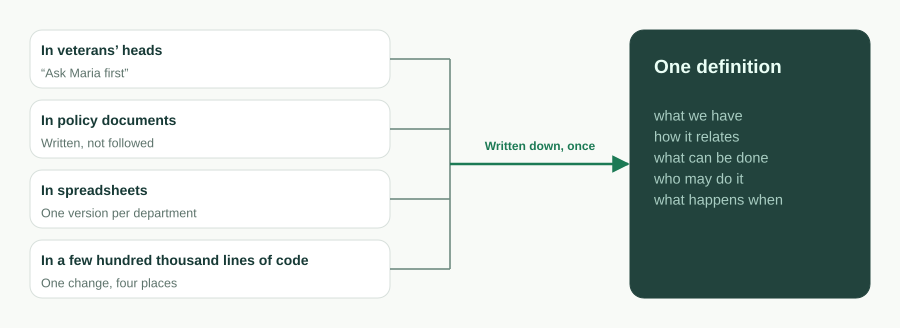
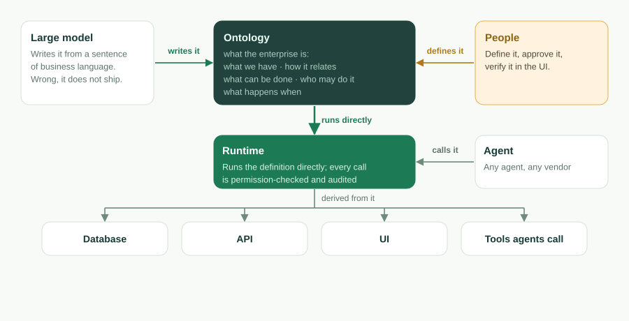
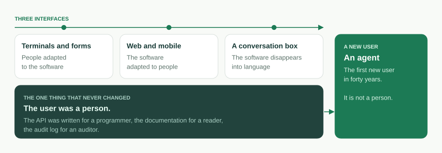
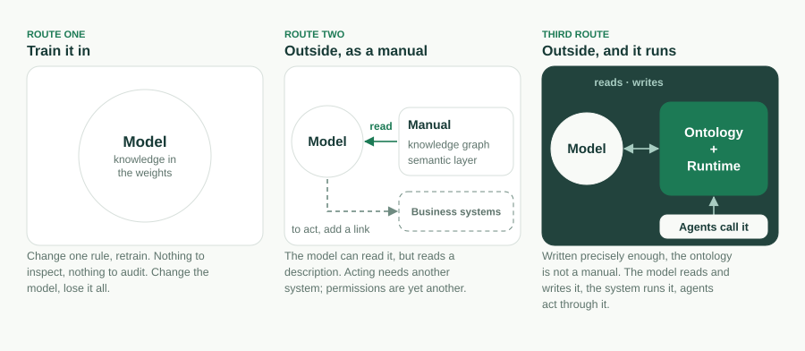

기업 소프트웨어는 인터페이스를 세 번 바꿨다. 사람이 소프트웨어에 맞추던 터미널과 폼. 소프트웨어가 사람에게 맞추던 웹과 모바일. 그리고 지금, 소프트웨어가 언어 속으로 사라지는 것처럼 보이는 대화창. 세 번 내내 한 가지는 변하지 않았다. 사용자는 사람이었다. API는 프로그래머를 위해, 문서는 읽는 사람을 위해, 감사 로그는 감사인을 위해 쓰였다.

지금 바뀌는 것은 바로 그 부분이고, 그 변화는 인터페이스의 어떤 변화보다 크다. 다음 세대 기업 소프트웨어의 첫 번째 사용자는 에이전트다. 객체는 도구다. 액션도 도구다. 권한은 에이전트가 무엇을 호출할 수 있는지 정하고, 감사는 그것이 무엇을 했는지 기록한다. 대화창은 사람이 *자기* 에이전트와 이야기하는 자리일 뿐이다. 그 에이전트가 그다음 이야기하는 상대는 기업이다.

그러니 물어야 할 것은 다음 인터페이스가 어떤 모습이냐가 아니다. 에이전트가 읽고, 실행하고, 그리고 그것에 의해 멈춰 세워질 수 있으려면 기업이 무엇이어야 하느냐다. 우리의 답은 한 문장이고, 그 문장은 지금 이 프로젝트 README의 첫머리에 있다.

> **온톨로지가 곧 소프트웨어다.** 실행 가능한 비즈니스 온톨로지 하나. AI가 쓰고, 런타임이 실행하고, 에이전트가 운영하고, 당신이 소유합니다.

이 글은 그 문장의 긴 버전이다. 이 말로 무엇을 뜻하는지, 왜 코드가 물러나는지, 왜 이것이 지금은 가능하고 5년 전에는 불가능했는지, 네 가지 약속 각각을 어떤 메커니즘이 뒷받침하는지, 온톨로지가 무엇이 *아닌지*, 그리고 우리가 아직 풀지 못한 것은 무엇인지.

## 기업이 실제로 말하고 싶은 것

어떤 업무 애플리케이션이든 비즈니스가 그것으로 뜻했던 바만 남기고 걷어 내면, 다섯 부분으로 된 한 문장이 남는다. *무엇을 가지고 있는가, 그것들이 어떻게 관계되는가, 거기에 무엇을 할 수 있는가, 누가 그것을 해도 되는가, 그리고 언제 무슨 일이 일어나는가.*

- **무엇을 가지고 있는가** — 객체와 그 필드. 티켓에는 제목, 우선순위, 상태, 마감일이 있다.
- **어떻게 관계되는가** — 룩업과 마스터-디테일 링크. 티켓은 거래처에 속하고, 주문 품목은 주문에 속한다.
- **무엇을 할 수 있는가** — 액션. 티켓을 *해결*한다. 리드를 *전환*한다.
- **누가 해도 되는가** — 권한. 역할 기반 접근, 행 수준·필드 수준 보안, 공유 규칙.
- **언제 무슨 일이 일어나는가** — 플로우. 레코드 트리거, 예약 작업, 승인 체인, 워크플로 상태 머신.

그 문장이 기업의 **비즈니스 온톨로지**다. 사십 년 동안 그것은 코드로 번역되어 왔다. "전화번호는 필수"라는 같은 의도가 데이터베이스 제약으로, ORM 애너테이션으로, 폼 검증기로, API 문서의 한 줄로 다시 쓰였고, 그 네 곳은 제각각 어긋나 갔다. 코드베이스는 비즈니스가 아니다. 컴퓨터가 실행할 수 있는 유일한 형태로 번역된 비즈니스다.



같은 문장을 한 번만 쓰면, ObjectStack은 이렇게 읽는다.

```ts
import { ObjectSchema, Field } from '@objectstack/spec/data';

export const Ticket = ObjectSchema.create({
  name: 'support_desk_ticket',
  label: 'Ticket',
  sharingModel: 'private',
  fields: {
    subject: Field.text({ label: 'Subject', required: true, searchable: true }),
    status: Field.select({
      label: 'Status',
      required: true,
      options: [
        { label: 'Open', value: 'open', default: true },
        { label: 'Resolved', value: 'resolved' },
      ],
    }),
    due_date: Field.date({ label: 'Due Date' }),
  },
});
```

그 객체가 존재하는 순간, 그 테이블이 존재하고, REST 엔드포인트가 존재하고, 목록 뷰와 폼 뷰가 존재하고, MCP 도구가 존재한다. 컨트롤러를 쓰는 사람은 없다. 온톨로지는 코드베이스가 나중에 구현하는 설계 문서가 아니다. 그것이 실행되는 것이다.

이 말을 정직하게 지키는 경계가 둘 있고, 우리는 이 말을 쓸 때마다 그것을 밝힌다. 첫째, 온톨로지의 핵심은 그 다섯 가지에 앱이 함께 배포하는 에이전트와 도구 정의를 더한 것이다. 뷰, 대시보드, 앱, 번역도 메타데이터로 작성되지만, 그것들은 핵심의 **투영**이지 핵심의 일부가 아니다. 핵심을 바꾸면 투영이 따라오고, 투영을 지워도 그것이 보여 주던 비즈니스는 그대로다. 둘째, 이것은 **실행 가능한** 온톨로지이지 지식 표현 온톨로지가 아니다. 클래스 상속도, 공리도, 추론기도 없다. 정의는 검증되고, 그다음 실행된다.

## 왜 코드가 물러나는가

코드는 온톨로지의 번역이다. 번역을 손으로 해야만 했던 동안에는 번역이 곧 제품이었다. 사람을 뽑는 이유였고, 유지보수하는 대상이었고, 썩어 가는 것이었다. 번역을 건너뛸 수 있게 되면 세 가지가 따라온다.

**온톨로지가 자산이 되고 코드는 파생물이 된다.** 정의를 직접 실행하는 런타임, 또는 파생물을 필요할 때 생성하는 툴체인은 코드베이스를 더 이상 손으로 쓰지 않는 것으로 바꾼다. 아무도 어셈블리를 손으로 쓰지 않는 것처럼. 코드는 사라지지 않는다. *런타임 안으로* 옮겨 간다. 객체를 Postgres 테이블에 매핑하는 드라이버, 엔드포인트를 마운트하는 서버, 모든 호출에서의 권한 강제. 애플리케이션 자체에 남는 것은 작고 선언된 것들이다. 훅과 액션 본문, 수식과 술어 안의 CEL 표현식, 그리고 커스텀 페이지를 위한 제한된 JSX. 이 JSX는 UI 트리로 파싱되며 코드로 실행되는 일은 결코 없다.



**시스템 전체가 통째로 쥘 수 있을 만큼 작아진다.** 이 저장소에 함께 실린 예제 CRM — 거래처, 연락처, 리드, 영업 기회, 활동, 뷰, 대시보드, 리드 전환 플로우, 권한 세트, 액션, 번역 — 은 커밋 [`7a6ba0310`](https://github.com/objectstack-ai/objectstack/tree/7a6ba03109dbb7e91359eb0f7f3e64dd1263bca8/examples/app-crm) 기준으로 측정해 30개 파일, 약 17,500 토큰이다. 이것은 모듈 하나가 아니라 애플리케이션 전체다. 에이전트는 그것을 처음부터 끝까지 로드해 *이것을 바꾸면 무엇이 깨지는가*에 답하고, 데이터, API, UI, 권한을 가로지르는 리팩터링을 한 번의 변경으로 할 수 있다. 왜 그 숫자가 중요한지는 영어 글 <span lang="en">[The Constraint Isn't Typing Speed. It's the Context Window.](/en/blog/context-window-is-the-constraint/)</span>에 썼다. 이 글은 그 후속편이다. 시스템이 들어맞게 되면, 질문은 그 시스템이 *무엇인가*로 옮겨 간다.

**정의는 코드가 결코 그럴 수 없었던 방식으로 검사 가능해진다.** 코드베이스는 실행해 볼 수밖에 없다. 정의는 검증할 수 있다. `os validate`는 모든 CEL 술어를 파싱하고, 각 `record.field`가 해석되는지 확인하고, 모든 위젯 바인딩을 검증하며, 빠진 보안 태세를 거부한다. 그것도 에이전트가 읽고 고칠 수 있는, 위치가 특정된 교정용 메시지로. 메타데이터에서 AI가 저지르는 실수 대부분은 타입 검사를 통과한 뒤 런타임에서 조용히 실패한다. 그것을 작성 시점에 거부하는 게이트가 「AI가 쓴다」를 살아남을 수 있게 만든다.

## 왜 지금인가

5년 전에는 이 중 어느 것도 가능하지 않았고, 세 가지 조건이 동시에 무르익어야 했다.

1. **모델이 구조화된 정의를 읽고 쓴다.** 비즈니스 언어 한 문장으로부터 타입이 있고 검증된 스키마를 작성하고, 위치가 특정된 자신의 오류를 고칠 수 있는 언어 모델은 「AI가 쓴다」를 데모에서 루프로 바꾼다.
2. **컨텍스트 윈도우가 기업의 온톨로지를 담는다.** 비즈니스 시스템 전체의 정의가 한 윈도우에 들어가면, 에이전트는 더 이상 grep하고 운에 맡기지 않는다. 전체에 대해 추론한다.
3. **에이전트가 정의를 직접 운영할 수 있다.** Model Context Protocol은 에이전트에게 도구를 호출하는 표준 방식을 주었다. 객체와 액션이 *곧* 도구인 온톨로지가 그 호출에 의미를 부여한다.

Andrej Karpathy는 소프트웨어의 세 번째 세대를 컨텍스트 윈도우가 곧 프로그램인 것으로 규정했다. 기업 소프트웨어에서는 프로그램이 온톨로지이고, 컨텍스트 윈도우는 그것이 읽히는 자리라고 우리는 생각한다.



## 네 가지 약속, 네 가지 메커니즘

슬로건은 입장이다. 그 아래의 서술은 약속들의 묶음이고, 각 약속은 이 저장소에서 들여다볼 수 있는 메커니즘이다.

### 런타임이 실행한다

컴파일된 아티팩트로부터 런타임은 **도출한다**: 교체 가능한 드라이버 위의 데이터베이스 스키마, 생성된 REST와 실시간 API, Console을 위한 서버 주도 UI, 그리고 MCP 서버. 그리고 모든 호출에서 정의를 **강제한다**: RBAC, 행 수준·필드 수준 보안, 공유, 감사는 REST 요청에도, Console 클릭에도, 에이전트의 도구 호출에도 똑같이 적용된다. 런타임에서 추론되는 것은 아무것도 없다. 실행되는 것은 검증된 것이다.

### AI가 쓴다

스캐폴더는 AI 스킬 번들을 설치하고 `AGENTS.md`를 써 준다. 그래서 코딩 에이전트는 "TypeScript 좀 써 줘" 식의 일반적인 사전 지식이 아니라, 프로토콜의 규칙이 로드된 상태로 시작한다. 에이전트가 정의를 쓴다. 그것과 프로덕션 사이에는 네 개의 게이트가 있다. 엄격한 TypeScript와 Zod가 에디터에서 형태 오류를 잡는다. `os validate`가 타입 검사는 통과하지만 조용히 실패할 실수를 잡는다. 사람이 Console에서 작고 읽기 쉬운 diff를 승인한다. 그리고 런타임의 거버넌스 덕분에 잘못된 앱조차 울타리 안에 머문다. 이 분업은 의도된 것이다. 에이전트는 기계적이고 오류가 잦은 표면을 맡고, 사람은 어떤 스키마도 검사할 수 없는 단 하나의 질문을 맡는다. *내가 뜻한 것을 만들었는가?*

### 에이전트가 운영한다

앱이 타입이 있는 메타데이터이기 때문에, 런타임은 그것을 MCP 서버로 제공한다. 기본으로 켜져 있다. 아무 MCP 클라이언트나 연결하면, 에이전트는 사람과 같은 권한과 행 수준 보안 아래에서 앱을 살펴보고 운영할 수 있다. 객체는 자동으로 노출되고, 액션은 `ai: { exposed: true }`로 옵트인한다. 에이전트의 손이 닿는 범위는 정확히 온톨로지가 말하는 만큼이고, 기업이 풀어 놓을 수 있는 에이전트는 그런 에이전트뿐이다. 에이전트에게는 온톨로지가 필요하다. 온톨로지가 아닌 도구 표면은 부채이고, REST API에 채팅창을 덧붙인 것은 그런 부채를 만드는 가장 흔한 방법이다.

### 당신이 소유한다

온톨로지는 평범한 TypeScript로 당신의 저장소에 살고, 당신의 VCS에서 버전이 관리되고, diff로 검토할 수 있으며, 체크섬이 붙은 아티팩트로 컴파일되고, Apache-2.0으로 명세되고 라이선스된다. 런타임을 바꾸든, 모델을 바꾸든, 벤더를 바꾸든 정의는 당신과 함께 간다. 대화창들은 수렴할 것이다. 에이전트는 늘어날 것이다. 기업이 진정으로 소유하는 것, 그리고 소유하기만 하면 되는 단 하나가 이 정의다. 비즈니스가 고유할수록 어떤 모델도 그것을 본 적이 없고, 온톨로지의 가치는 커진다. 그것은 또한 다른 누구에게도 그것을 맡기지 말아야 할 가장 강력한 이유이기도 하다.

## 그것이 아닌 것

「온톨로지」라는 말은 이천 년의 철학과 삼십 년의 지식 공학을 짊어지고 있고, 오늘날 기업 AI 시장이 이 말로 뜻하는 것의 대부분은 다른 무엇이다. 주장을 방어 가능하게 지키는 것은 정확함이다.

**지식 온톨로지가 아니다.** Gruber의 1993년 정의에서 온톨로지는 "개념화의 명시적 명세"(<span lang="en">an explicit specification of a conceptualization</span>)다. OWL과 RDF에서 온톨로지는 클래스 계층과 공리를 가지며 추론 엔진에 의해 추론된다. Guarino가 1998년에 제시한 *온톨로지 주도 정보 시스템* 프로그램은 온톨로지를 시스템 설계의 중심에 두었지만, 그것은 설계의 기준이 되는 서술로서였지 실행하는 무엇으로서가 아니었다. ObjectStack의 온톨로지는 일반적인 무엇도 서술하지 않는다. 그것은 한 비즈니스의 애플리케이션을 실행할 수 있을 만큼 정확하게 정의한 것이고, `abstract` 키가 명세에서 제거된 것도 바로 그 이유에서다.

**업계의 시맨틱 레이어도 아니다.** Palantir의 Ontology, 그리고 지금 Databricks, Snowflake와 그 동종 업체들에 구축되고 있는 시맨틱 레이어는 기존 시스템을 비즈니스 개념에 매핑해 에이전트가 그것에 대해 추론할 수 있게 한다. 그것들은 주로 읽기용이고, 그것들이 서술하는 시스템은 다른 곳에 있다. 우리의 온톨로지는 시스템 *그 자체*다. 외부 데이터 소스를 거기에 페더레이션하는 것은 가능하지만, 기본이 읽기 전용이고 아직 초기 단계다.



**Salesforce의 메타데이터도 아니다. 가장 가까운 조상이긴 하지만.** Weissman과 Bobrowski의 2009년 Force.com 멀티테넌트 아키텍처 논문은 테넌트별 메타데이터를 실행하는 컴파일된 런타임 커널을 서술했고, 그것은 대규모로 작동했다. 그것이 아니었던 것은 이렇다. 열린 포맷도, 가지고 나갈 수 있는 것도, 에이전트가 읽도록 쓰인 것도 아니었다. 위의 네 계보는 각각 네 가지 약속 중 하나나 둘을 갖고 있다. 네 가지 모두를 하나의 정의에 담는 것이 이 프로젝트가 서 있는 자리다.

## 우리가 아직 풀지 못한 것

열린 문제를 하나도 인정하지 않는 포지셔닝은 마케팅이다. 우리의 열린 문제는 이렇다.

**크기의 상한.** 「통째로 쥘 수 있을 만큼 작다」는 CRM에 대해서는 측정된 사실이고, 기업 전체에 대해서는 논증이다. 컨텍스트 윈도우는 커지고, 핵심과 투영의 분리는 에이전트가 로드해야 할 것을 제한하지만, 객체가 수백 개인 온톨로지는 이 주장을 시험할 것이다. 우리는 한계를 숨기기보다 밝히는 쪽을 택한다.

**책임.** 에이전트가 울타리 안에서 행동했는데도 결과가 틀렸다면, 울타리는 제 할 일을 했고 그래도 누군가는 책임을 진다. 우리의 작업 규칙은 되돌릴 수 있는 액션은 에이전트에게, 되돌릴 수 없는 액션은 사람에게 남기는 것이며, 그 경계는 런타임의 판단에 맡기지 않고 정의 안에 적는 것이다. 이것은 규칙이지 해법이 아니다.

**상호운용성.** 한 기업, 하나의 온톨로지는 쉬운 경우다. 두 기업의 에이전트가 거래해야 할 때, 열린 프로토콜은 원칙이기를 멈추고 인프라가 된다. 포맷은 열려 있다. 공유 어휘는 아직 없다.

**분류는 권력이다.** 「고객」이 무엇인지를 누가 정하는가는 이천 년 동안 철학의 질문이었고, 모든 회사에서는 부서 간의 질문이다. 온톨로지를 명시적으로 만든다고 그 논쟁이 끝나지는 않는다. 논쟁을 diff 안으로 옮길 뿐이다. 거기서는 적어도 보인다.

## 스택은 지금 어디에 있는가

이 저장소의 모든 것은 열린 스택이다. 프로토콜, 마이크로커널, SDK, CLI, 그리고 프로덕션 런타임, Apache-2.0에 오픈코어 별표 없음. Claude Code나 어떤 코딩 에이전트로든 만들고 묻는다. 에이전트는 당신의 저장소에 온톨로지를 쓰고, 실행 중인 앱을 MCP로 운영한다. 같은 루프를 호스팅으로 제공하는 것이 [ObjectOS](/ko/)다.

객체 하나로 시작하라.

```bash
npm create objectstack@latest my-app && cd my-app
```

비즈니스를 평이한 말로 설명하고, 에이전트에게 정의를 쓰게 하고, `npm run validate`를 실행하고, Console을 연 다음, 에이전트를 연결하라.

```bash
claude mcp add --transport http my-app http://localhost:3000/api/v1/mcp
```

손에 쥐게 되는 것은 AI가 어쩌다 쓴 앱이 아니다. 런타임이 실행하고, AI가 쓸 수 있고, 에이전트가 운영할 수 있고, 당신이 소유하는 온톨로지다. 온톨로지가 곧 소프트웨어다.

---

*더 읽을거리.* Thomas R. Gruber, <span lang="en">"A Translation Approach to Portable Ontology Specifications"</span> (1993). Nicola Guarino, <span lang="en">"Formal Ontology and Information Systems"</span> (FOIS 1998). Craig D. Weissman and Steve Bobrowski, <span lang="en">"The Design of the Force.com Multitenant Internet Application Development Platform"</span> (SIGMOD 2009). ObjectStack 문서(영어): <span lang="en">[Business Ontology](https://objectstack.ai/docs/concepts/ontology), [How AI Development Works](https://objectstack.ai/docs/getting-started/how-ai-development-works), [Connect an MCP Client](https://objectstack.ai/docs/ai/connect-mcp)</span>.

*발표 자료.* 같은 논증을 열일곱 장의 슬라이드로 담은 덱 <span lang="en">"The Ontology Is the Software — How a large model reads an enterprise"</span>(영어): [PDF 내려받기](https://objectstack.ai/decks/the-ontology-is-the-software.pdf).
