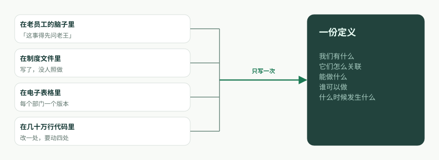
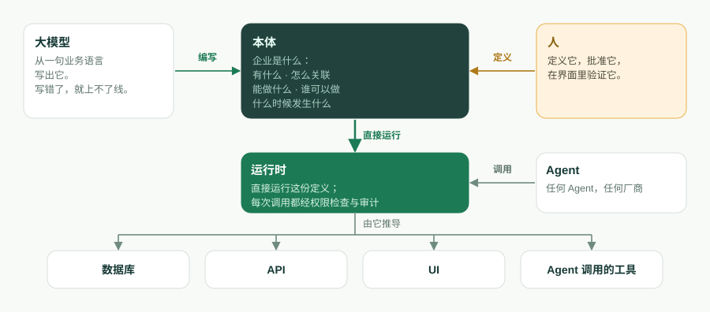
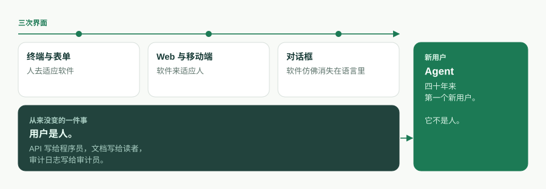
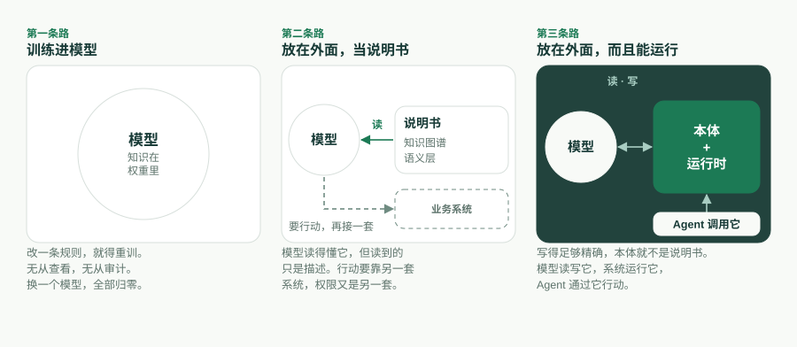

企业软件换过三次界面。第一次是终端和表单，人去适应软件；第二次是 Web 和移动端，软件来适应人；第三次是对话框，软件仿佛消失在了语言里。三次之中有一件事从来没变：用户是人。API 写给程序员，文档写给读者，审计日志写给审计员。

现在变的正是这一点，而且比界面的任何一次变化都大：下一代企业软件的第一个用户是 Agent。对象是工具，动作是工具，权限决定 Agent 能调用什么，审计记录它做过什么。对话框只是一个人和**自己的** Agent 说话的地方；Agent 转过身去打交道的，是整个企业。

所以要问的不是下一代界面长什么样，而是：一家企业得是什么样子，Agent 才能读懂它、运行它，并且被它拦住。我们的回答是一句话，如今就写在 ObjectStack README 的开头：

> **本体即软件。**
>
> 一份可执行的业务本体。AI 编写它，运行时运行它，Agent 操作它，你拥有它。

本文是这句话的长篇版：这个词指的是什么，代码为什么退居幕后，为什么是现在而不是五年前，四个承诺各由什么机制撑着，本体**不是**什么，以及我们还没想清楚的事。

## 企业真正想说的是什么

把任何一个业务应用剥到只剩业务方的本意，剩下的是一句有五个成分的话：**我们有什么，它们怎么关联，能对它们做什么，谁可以做，什么时候发生什么。**

- **我们有什么**——对象和字段。一张工单有主题、优先级、状态和截止日期。
- **它们怎么关联**——查找（lookup）与主从（master-detail）关系。工单属于某个客户；订单明细属于某张订单。
- **能做什么**——动作。**解决**一张工单；**转化**一条线索。
- **谁可以做**——权限。基于角色的访问控制，行级与字段级安全，共享规则。
- **什么时候发生什么**——流程。记录触发器、定时任务、审批链、工作流状态机。

这句话，就是企业的**业务本体**。四十年来它一直被翻译成代码：同一个「电话号码必填」的意图，要在数据库约束、ORM 注解、表单校验和 API 文档里各写一遍，四处各自漂移。代码库不是业务本身，它是业务被翻译成计算机唯一能运行的那种形式之后的译本。



同一句话只写一次，就是 ObjectStack 读到的样子：

```ts
import { ObjectSchema, Field } from '@objectstack/spec/data';

export const Ticket = ObjectSchema.create({
  name: 'support_desk_ticket',
  label: 'Ticket',
  sharingModel: 'private',
  fields: {
    subject: Field.text({ label: 'Subject', required: true, searchable: true }),
    status: Field.select({
      label: 'Status',
      required: true,
      options: [
        { label: 'Open', value: 'open', default: true },
        { label: 'Resolved', value: 'resolved' },
      ],
    }),
    due_date: Field.date({ label: 'Due Date' }),
  },
});
```

这个对象一存在，它的表就存在了，它的 REST 接口、列表视图和表单视图、MCP 工具也都存在了。没有人去写控制器。本体不是一份等着代码库去实现的设计文档，它就是在跑的那个东西。

为了让这个词站得住，有两条边界我们每次用它都会讲清楚。第一，本体的核心就是上面五样，再加上应用自带的 Agent 与工具定义。视图、仪表盘、应用和翻译也用元数据编写，但它们是核心的**投影**，不属于核心：改动核心，投影跟着变；删掉一个投影，它所展示的业务不变。第二，这是一份**可执行**的本体，不是知识表示意义上的本体。没有类继承，没有公理，没有推理器。定义先被校验，然后被运行。

## 代码为什么退居幕后

代码是本体的译本。只要翻译还得靠人手做，译本**就是**产品：招人是为了它，维护的是它，腐烂的也是它。一旦翻译这一步可以跳过，接下来会发生三件事。

**本体成为资产，代码成为派生物。** 一个直接执行定义的运行时，或者一套按需生成派生物的工具链，会让代码库变成不再需要手写的东西，就像今天没有人手写汇编。代码并没有消失，它搬进了**运行时**：把对象映射成 Postgres 表的驱动，挂载接口的服务器，每一次调用时对权限的强制执行。留在应用本身里的东西很少，而且都是声明出来的：钩子和动作体，公式与谓词里的 CEL 表达式，以及自定义页面用的受限 JSX——它被解析成一棵 UI 树，永远不会作为代码执行。



**整个系统小到可以被整个装下。** ObjectStack 仓库自带的 CRM 示例——客户、联系人、线索、商机、活动、视图、一个仪表盘、一条线索转化流程、权限集、动作、翻译——一共 30 个文件，约 17,500 个 token，测量于提交 [`7a6ba0310`](https://github.com/objectstack-ai/objectstack/tree/7a6ba03109dbb7e91359eb0f7f3e64dd1263bca8/examples/app-crm)。这是整个应用，不是其中一个模块。Agent 可以把它从头到尾装进上下文，回答「我改了这里会弄坏什么」，并在一次改动里跨数据、API、UI 和权限完成重构。为什么这个数字才是关键，我们在[《瓶颈不是打字速度，是上下文窗口》](/en/blog/context-window-is-the-constraint/)（英文）里写过。本文是它的续篇：系统一旦装得下，要问的就变成了系统**是**什么。

**定义可以被检查，代码从来不行。** 代码库只能运行。定义可以被校验：`os validate` 解析每一个 CEL 谓词，检查每个 `record.field` 都能解析到，核对每一个组件绑定，并拒绝缺失的安全姿态，报错带位置、可纠正，Agent 读得懂也改得了。AI 在元数据里犯的错，大多能通过类型检查，然后在运行时静默失败；一道在编写时就把它们拒掉的门禁，才让「AI 编写它」经得起推敲。

## 为什么是现在

五年前这一切都不可能，三个条件必须同时成熟。

1. **模型能读写结构化定义。** 一个能从一句业务语言写出类型化、可校验的 schema，又能根据带位置的报错改正自己的语言模型，把「AI 编写它」从演示变成了循环。
2. **上下文窗口装得下一家企业的本体。** 当一整套业务系统的定义能放进一个窗口，Agent 就不再是一边 grep 一边碰运气，而是对整体做推理。
3. **Agent 可以直接操作定义。** Model Context Protocol（MCP）给了 Agent 调用工具的标准方式。一份对象和动作本身**就是**工具的本体，才让这种调用有了意义。

Andrej Karpathy 对第三代软件的说法是：上下文窗口就是程序。放到企业软件上，我们认为程序是本体，上下文窗口是读它的地方。



## 四个承诺，四个机制

口号是一种立场。口号下面那一行描述是一组承诺，每一个承诺都对应一个你能在 ObjectStack 仓库里查到的机制。

### 运行时运行它

运行时从编译好的工件里**推导**出：可互换驱动之上的数据库结构、生成的 REST 与实时 API、控制台的服务端驱动 UI，以及一个 MCP 服务器。它还在每一次调用时**强制执行**这份定义：RBAC、行级与字段级安全、共享和审计，对一次 REST 请求、一次控制台点击和一次 Agent 工具调用一视同仁。运行时不做任何推理。跑的就是被校验过的东西。

### AI 编写它

脚手架会安装 AI 技能包并写入一份 `AGENTS.md`，所以编码 Agent 一开始就装载了协议的规则，而不是带着「帮我写点 TypeScript」那种泛泛的先验。Agent 写定义，它和生产环境之间隔着四道门：严格的 TypeScript 和 Zod 在编辑器里拦住形状错误；`os validate` 拦住那些能通过类型检查、却会静默失败的错误；一个人在控制台里批准一份小而可读的 diff；运行时的治理则保证，就算应用写错了，也还在围栏之内。这样分工是刻意的：Agent 处理机械、易错的那一面，人回答那个任何 schema 都检查不了的问题——**它造出来的，是我想要的那个东西吗？**

### Agent 操作它

因为应用是类型化的元数据，运行时把它作为一个 MCP 服务器提供出来，默认开启。把任何 MCP 客户端指向它，Agent 就能查看并操作这个应用，受到与人相同的权限和行级安全约束。对象自动暴露；动作要用 `ai: { exposed: true }` 主动开放。Agent 能触达的范围，恰好就是本体写明的范围——企业唯一敢放手的，也只有这种 Agent。Agent 需要一份本体；不是本体的工具面是一种负债，而在 REST API 上拴一个聊天框，是造出这种负债最常见的办法。

### 你拥有它

本体以普通 TypeScript 的形式住在你的仓库里，在你的版本控制里有版本，可以作为 diff 审阅，编译成带校验和的工件，规范与许可都是 Apache-2.0。换运行时、换模型、换厂商，定义都跟着你走。对话框会趋同，Agent 会越来越多，一家企业真正拥有、也只需要拥有的，就是这份定义。你的业务越特殊，任何模型见过的就越少，本体就越值钱。这也是最有力的理由：别让任何人替你握着它。

## 它不是什么

「本体」这个词背着两千年的哲学和三十年的知识工程，而今天的企业 AI 市场说起它，多半指的是别的东西。说得精确，这个主张才守得住。

**不是知识本体。** 在 Gruber 1993 年的定义里，本体是「对概念化的明确规范」；在 OWL 和 RDF 里，它带着类层级和公理，由推理引擎来推理。Guarino 1998 年提出的「本体驱动的信息系统」把本体放在系统设计的中心，但那是一份照着去设计的描述，不是一个拿来运行的东西。ObjectStack 的本体不描述任何一般性的东西。它是一家企业的应用，被定义到足以执行的精确程度；规范里的 `abstract` 键正是因此被移除的。

**不是业界说的语义层。** Palantir 的 Ontology，以及 Databricks、Snowflake 和同类平台正在内建的语义层，是把现有系统映射到业务概念上，好让 Agent 对它们做推理。它们以读为主，所描述的系统住在别处。我们的本体**就是**系统本身；把外部数据源联邦接入进来是可以的，默认只读，而且还处于早期。



**也不是 Salesforce 的元数据，尽管那是最近的祖先。** Weissman 和 Bobrowski 2009 年关于 Force.com 多租户架构的论文，描述了一个编译好的运行时内核执行各租户的元数据，而且它在规模上行得通。它不是的东西是：一种开放格式，一样你能带走的东西，或者一样写给 Agent 读的东西。上面四条谱系，各自握着四个承诺中的一两个。在同一份定义里同时握住四个，是这个项目所站的位置。

## 我们还没想清楚的事

一份不承认任何未解问题的定位声明，就是营销。下面这些是我们的。

**规模上限。** 「小到能整个装下」，对一个 CRM 是测量出来的事实，对一家企业还只是一个论证。上下文窗口在变大，核心与投影的划分也限定了 Agent 必须装下的范围，但一份有几百个对象的本体会考验这个主张。我们宁可把上限说出来，也不藏着。

**责任。** 当 Agent 在围栏之内行动、结果却仍然错了，围栏尽到了职责，但总得有人为结果负责。我们的工作规则是：可逆的动作交给 Agent，不可逆的留给人，并且这条边界写在定义里，而不是留到运行时临场判断。这是一条规则，不是一个解决方案。

**互操作。** 一家企业、一份本体，是容易的情形。两家企业的 Agent 需要彼此交易时，开放协议才从一条原则变成基础设施。格式是开放的；共享的词汇还没有。

**分类即权力。** 「客户」由谁来定义，两千年来是哲学问题，在每家公司里则是部门之间的问题。把本体写明白，并不能终结这场争论。它把争论搬进了一份 diff，至少在那里看得见。

## 这套栈落在哪里

ObjectStack 仓库里的一切都是开放栈：协议、微内核、SDK、CLI 和生产运行时，Apache-2.0，没有开放核心的小字。你用 Claude Code 或任何编码 Agent 来搭建和提问；Agent 在你的仓库里编写本体，并通过 MCP 操作运行中的应用。同一个循环也有现成的产品形态，就是 [ObjectOS](/zh-Hans/)。ObjectOS 有三个版本：ObjectOS Community，开源、可免费自托管；ObjectOS Cloud，托管在浏览器中、无需安装；ObjectOS Enterprise，自管部署在你自己的基础设施上。你的本体是普通的 ObjectStack 元数据。从 ObjectOS Cloud 或 ObjectOS Enterprise 导出本体、在开源的 ObjectStack 运行时上运行，目前尚在计划中。

先从一个对象开始：

```bash
npm create objectstack@latest my-app && cd my-app
```

用平常的话描述你的业务，让 Agent 写出定义，运行 `npm run validate`，打开控制台，然后接入一个 Agent：

```bash
claude mcp add --transport http my-app http://localhost:3000/api/v1/mcp
```

你最后得到的，不是一个碰巧由 AI 写出来的应用，而是一份运行时运行、AI 能编写、Agent 能操作、归你所有的本体。本体即软件。

---

*延伸阅读。* Thomas R. Gruber，《A Translation Approach to Portable Ontology Specifications》（1993）。Nicola Guarino，《Formal Ontology and Information Systems》（FOIS 1998）。Craig D. Weissman 与 Steve Bobrowski，《The Design of the Force.com Multitenant Internet Application Development Platform》（SIGMOD 2009）。ObjectStack 文档（英文）：[业务本体](https://objectstack.ai/docs/concepts/ontology)、[AI 开发如何运作](https://objectstack.ai/docs/getting-started/how-ai-development-works)、[连接 MCP 客户端](https://objectstack.ai/docs/ai/connect-mcp)。

*演讲版。* 同一个论证的十七页幻灯片，《The Ontology Is the Software — How a large model reads an enterprise》（英文）：[下载 PDF](https://objectstack.ai/decks/the-ontology-is-the-software.pdf)。
