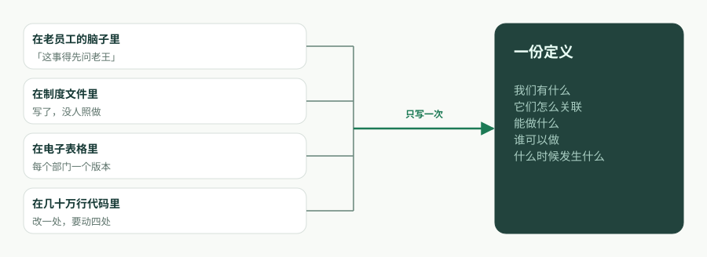
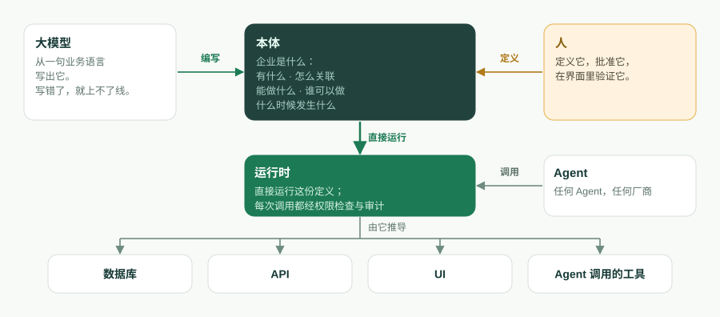
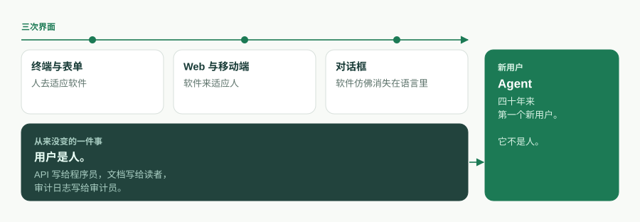
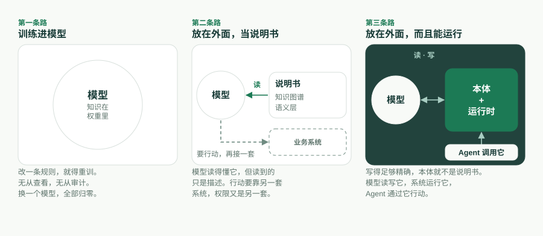

---
# @generated zh-Hant from zh-Hans (s2twp) — edit the zh-Hans file; delete this line to hand-maintain.
title: 本體即軟體：當企業軟體的第一個使用者變成 Agent
description: 企業軟體換了三次介面，使用者卻始終是人。Agent 是四十年來第一個新使用者，它需要的不是又一套 API，而是一份執行環境執行、AI 編寫、Agent 操作、歸你所有的本體。
author: ObjectStack Team
date: 2026-10-05
status: published
topic: ai-agents
audience: general
solutions: []
industries: []
cover: ./cover.svg
tags:
  - 本體
  - AI Agent
  - 可執行業務本體
---
企業軟體換過三次介面。第一次是終端和表單，人去適應軟體；第二次是 Web 和移動端，軟體來適應人；第三次是對話方塊，軟體彷彿消失在了語言裡。三次之中有一件事從來沒變：使用者是人。API 寫給程式設計師，文件寫給讀者，審計日誌寫給審計員。

現在變的正是這一點，而且比介面的任何一次變化都大：下一代企業軟體的第一個使用者是 Agent。物件是工具，動作是工具，權限決定 Agent 能呼叫什麼，審計記錄它做過什麼。對話方塊只是一個人和**自己的** Agent 說話的地方；Agent 轉過身去打交道的，是整個企業。

所以要問的不是下一代介面長什麼樣，而是：一家企業得是什麼樣子，Agent 才能讀懂它、執行它，並且被它攔住。我們的回答是一句話，如今就寫在 ObjectStack README 的開頭：

> **本體即軟體。**
>
> 一份可執行的業務本體。AI 編寫它，執行環境執行它，Agent 操作它，你擁有它。

本文是這句話的長篇版：這個詞指的是什麼，程式碼為什麼退居幕後，為什麼是現在而不是五年前，四個承諾各由什麼機制撐著，本體**不是**什麼，以及我們還沒想清楚的事。

## 企業真正想說的是什麼

把任何一個業務應用剝到只剩業務方的本意，剩下的是一句有五個成分的話：**我們有什麼，它們怎麼關聯，能對它們做什麼，誰可以做，什麼時候發生什麼。**

- **我們有什麼**——物件和欄位。一張工單有主題、優先順序、狀態和截止日期。
- **它們怎麼關聯**——查詢（lookup）與主從（master-detail）關係。工單屬於某個客戶；訂單明細屬於某張訂單。
- **能做什麼**——動作。**解決**一張工單；**轉化**一條線索。
- **誰可以做**——權限。基於角色的訪問控制，行級與欄位級安全，共享規則。
- **什麼時候發生什麼**——流程。記錄觸發器、定時任務、審批鏈、工作流狀態機。

這句話，就是企業的**業務本體**。四十年來它一直被翻譯成程式碼：同一個「電話號碼必填」的意圖，要在資料庫約束、ORM 註解、表單校驗和 API 文件裡各寫一遍，四處各自漂移。程式碼庫不是業務本身，它是業務被翻譯成計算機唯一能執行的那種形式之後的譯本。



同一句話只寫一次，就是 ObjectStack 讀到的樣子：

```ts
import { ObjectSchema, Field } from '@objectstack/spec/data';

export const Ticket = ObjectSchema.create({
  name: 'support_desk_ticket',
  label: 'Ticket',
  sharingModel: 'private',
  fields: {
    subject: Field.text({ label: 'Subject', required: true, searchable: true }),
    status: Field.select({
      label: 'Status',
      required: true,
      options: [
        { label: 'Open', value: 'open', default: true },
        { label: 'Resolved', value: 'resolved' },
      ],
    }),
    due_date: Field.date({ label: 'Due Date' }),
  },
});
```

這個物件一存在，它的表就存在了，它的 REST 介面、列表檢視和表單檢視、MCP 工具也都存在了。沒有人去寫控制器。本體不是一份等著程式碼庫去實現的設計文件，它就是在跑的那個東西。

為了讓這個詞站得住，有兩條邊界我們每次用它都會講清楚。第一，本體的核心就是上面五樣，再加上應用自帶的 Agent 與工具定義。檢視、儀表盤、應用和翻譯也用中繼資料編寫，但它們是核心的**投影**，不屬於核心：改動核心，投影跟著變；刪掉一個投影，它所展示的業務不變。第二，這是一份**可執行**的本體，不是知識表示意義上的本體。沒有類繼承，沒有公理，沒有推理器。定義先被校驗，然後被執行。

## 程式碼為什麼退居幕後

程式碼是本體的譯本。只要翻譯還得靠人手做，譯本**就是**產品：招人是為了它，維護的是它，腐爛的也是它。一旦翻譯這一步可以跳過，接下來會發生三件事。

**本體成為資產，程式碼成為派生物。** 一個直接執行定義的執行環境，或者一套按需生成派生物的工具鏈，會讓程式碼庫變成不再需要手寫的東西，就像今天沒有人手寫彙編。程式碼並沒有消失，它搬進了**執行環境**：把物件對映成 Postgres 表的驅動，掛載介面的伺服器，每一次呼叫時對權限的強制執行。留在應用本身裡的東西很少，而且都是宣告出來的：鉤子和動作體，公式與謂詞裡的 CEL 表示式，以及自定義頁面用的受限 JSX——它被解析成一棵 UI 樹，永遠不會作為程式碼執行。



**整個系統小到可以被整個裝下。** ObjectStack 倉庫自帶的 CRM 示例——客戶、聯絡人、線索、商機、活動、檢視、一個儀表盤、一條線索轉化流程、權限集、動作、翻譯——一共 30 個檔案，約 17,500 個 token，測量於提交 [`7a6ba0310`](https://github.com/objectstack-ai/objectstack/tree/7a6ba03109dbb7e91359eb0f7f3e64dd1263bca8/examples/app-crm)。這是整個應用，不是其中一個模組。Agent 可以把它從頭到尾裝進上下文，回答「我改了這裡會弄壞什麼」，並在一次改動裡跨資料、API、UI 和權限完成重構。為什麼這個數字才是關鍵，我們在[《瓶頸不是打字速度，是上下文視窗》](/en/blog/context-window-is-the-constraint/)（英文）裡寫過。本文是它的續篇：系統一旦裝得下，要問的就變成了系統**是**什麼。

**定義可以被檢查，程式碼從來不行。** 程式碼庫只能執行。定義可以被校驗：`os validate` 解析每一個 CEL 謂詞，檢查每個 `record.field` 都能解析到，核對每一個元件繫結，並拒絕缺失的安全姿態，報錯帶位置、可糾正，Agent 讀得懂也改得了。AI 在中繼資料裡犯的錯，大多能通過型別檢查，然後在執行時靜默失敗；一道在編寫時就把它們拒掉的門禁，才讓「AI 編寫它」經得起推敲。

## 為什麼是現在

五年前這一切都不可能，三個條件必須同時成熟。

1. **模型能讀寫結構化定義。** 一個能從一句業務語言寫出型別化、可校驗的 schema，又能根據帶位置的報錯改正自己的語言模型，把「AI 編寫它」從演示變成了迴圈。
2. **上下文視窗裝得下一家企業的本體。** 當一整套業務系統的定義能放進一個視窗，Agent 就不再是一邊 grep 一邊碰運氣，而是對整體做推理。
3. **Agent 可以直接操作定義。** Model Context Protocol（MCP）給了 Agent 呼叫工具的標準方式。一份物件和動作本身**就是**工具的本體，才讓這種呼叫有了意義。

Andrej Karpathy 對第三代軟體的說法是：上下文視窗就是程式。放到企業軟體上，我們認為程式是本體，上下文視窗是讀它的地方。



## 四個承諾，四個機制

口號是一種立場。口號下面那一行描述是一組承諾，每一個承諾都對應一個你能在 ObjectStack 倉庫裡查到的機制。

### 執行環境執行它

執行環境從編譯好的工件裡**推導**出：可互換驅動之上的資料庫結構、生成的 REST 與即時 API、控制台的服務端驅動 UI，以及一個 MCP 伺服器。它還在每一次呼叫時**強制執行**這份定義：RBAC、行級與欄位級安全、共享和審計，對一次 REST 請求、一次控制台點選和一次 Agent 工具呼叫一視同仁。執行環境不做任何推理。跑的就是被校驗過的東西。

### AI 編寫它

腳手架會安裝 AI 技能包並寫入一份 `AGENTS.md`，所以編碼 Agent 一開始就裝載了協議的規則，而不是帶著「幫我寫點 TypeScript」那種泛泛的先驗。Agent 寫定義，它和生產環境之間隔著四道門：嚴格的 TypeScript 和 Zod 在編輯器裡攔住形狀錯誤；`os validate` 攔住那些能通過型別檢查、卻會靜默失敗的錯誤；一個人在控制台裡批准一份小而可讀的 diff；執行環境的治理則保證，就算應用寫錯了，也還在圍欄之內。這樣分工是刻意的：Agent 處理機械、易錯的那一面，人回答那個任何 schema 都檢查不了的問題——**它造出來的，是我想要的那個東西嗎？**

### Agent 操作它

因為應用是型別化的中繼資料，執行環境把它作為一個 MCP 伺服器提供出來，預設開啟。把任何 MCP 客戶端指向它，Agent 就能檢視並操作這個應用，受到與人相同的權限和行級安全約束。物件自動暴露；動作要用 `ai: { exposed: true }` 主動開放。Agent 能觸達的範圍，恰好就是本體寫明的範圍——企業唯一敢放手的，也只有這種 Agent。Agent 需要一份本體；不是本體的工具面是一種負債，而在 REST API 上拴一個聊天框，是造出這種負債最常見的辦法。

### 你擁有它

本體以普通 TypeScript 的形式住在你的倉庫裡，在你的版本控制裡有版本，可以作為 diff 審閱，編譯成帶校驗和的工件，規範與許可都是 Apache-2.0。換執行環境、換模型、換廠商，定義都跟著你走。對話方塊會趨同，Agent 會越來越多，一家企業真正擁有、也只需要擁有的，就是這份定義。你的業務越特殊，任何模型見過的就越少，本體就越值錢。這也是最有力的理由：別讓任何人替你握著它。

## 它不是什麼

「本體」這個詞揹著兩千年的哲學和三十年的知識工程，而今天的企業 AI 市場說起它，多半指的是別的東西。說得精確，這個主張才守得住。

**不是知識本體。** 在 Gruber 1993 年的定義裡，本體是「對概念化的明確規範」；在 OWL 和 RDF 裡，它帶著類層級和公理，由推理引擎來推理。Guarino 1998 年提出的「本體驅動的資訊系統」把本體放在系統設計的中心，但那是一份照著去設計的描述，不是一個拿來執行的東西。ObjectStack 的本體不描述任何一般性的東西。它是一家企業的應用，被定義到足以執行的精確程度；規範裡的 `abstract` 鍵正是因此被移除的。

**不是業界說的語義層。** Palantir 的 Ontology，以及 Databricks、Snowflake 和同類平台正在內建的語義層，是把現有系統對映到業務概念上，好讓 Agent 對它們做推理。它們以讀為主，所描述的系統住在別處。我們的本體**就是**系統本身；把外部資料來源聯邦接入進來是可以的，預設只讀，而且還處於早期。



**也不是 Salesforce 的中繼資料，儘管那是最近的祖先。** Weissman 和 Bobrowski 2009 年關於 Force.com 多租戶架構的論文，描述了一個編譯好的執行環境核心執行各租戶的中繼資料，而且它在規模上行得通。它不是的東西是：一種開放格式，一樣你能帶走的東西，或者一樣寫給 Agent 讀的東西。上面四條譜系，各自握著四個承諾中的一兩個。在同一份定義裡同時握住四個，是這個專案所站的位置。

## 我們還沒想清楚的事

一份不承認任何未解問題的定位宣告，就是營銷。下面這些是我們的。

**規模上限。** 「小到能整個裝下」，對一個 CRM 是測量出來的事實，對一家企業還只是一個論證。上下文視窗在變大，核心與投影的劃分也限定了 Agent 必須裝下的範圍，但一份有幾百個物件的本體會考驗這個主張。我們寧可把上限說出來，也不藏著。

**責任。** 當 Agent 在圍欄之內行動、結果卻仍然錯了，圍欄盡到了職責，但總得有人為結果負責。我們的工作規則是：可逆的動作交給 Agent，不可逆的留給人，並且這條邊界寫在定義裡，而不是留到執行環境臨場判斷。這是一條規則，不是一個解決方案。

**互操作。** 一家企業、一份本體，是容易的情形。兩家企業的 Agent 需要彼此交易時，開放協議才從一條原則變成基礎設施。格式是開放的；共享的詞彙還沒有。

**分類即權力。** 「客戶」由誰來定義，兩千年來是哲學問題，在每家公司裡則是部門之間的問題。把本體寫明白，並不能終結這場爭論。它把爭論搬進了一份 diff，至少在那裡看得見。

## 這套棧落在哪裡

ObjectStack 倉庫裡的一切都是開放棧：協議、微核心、SDK、CLI 和生產執行環境，Apache-2.0，沒有開放核心的小字。你用 Claude Code 或任何編碼 Agent 來搭建和提問；Agent 在你的倉庫裡編寫本體，並通過 MCP 操作執行中的應用。同一個迴圈也有現成的產品形態，就是 [ObjectOS](/zh-Hant/)。ObjectOS 有三個版本：ObjectOS Community，開源、可免費自託管；ObjectOS Cloud，託管在瀏覽器中、無需安裝；ObjectOS Enterprise，自管部署在你自己的基礎設施上。你的本體是普通的 ObjectStack 中繼資料。從 ObjectOS Cloud 或 ObjectOS Enterprise 匯出本體、在開源的 ObjectStack 執行環境上執行，目前尚在計劃中。

先從一個物件開始：

```bash
npm create objectstack@latest my-app && cd my-app
```

用平常的話描述你的業務，讓 Agent 寫出定義，執行 `npm run validate`，開啟控制台，然後接入一個 Agent：

```bash
claude mcp add --transport http my-app http://localhost:3000/api/v1/mcp
```

你最後得到的，不是一個碰巧由 AI 寫出來的應用，而是一份執行環境執行、AI 能編寫、Agent 能操作、歸你所有的本體。本體即軟體。

---

*延伸閱讀。* Thomas R. Gruber，《A Translation Approach to Portable Ontology Specifications》（1993）。Nicola Guarino，《Formal Ontology and Information Systems》（FOIS 1998）。Craig D. Weissman 與 Steve Bobrowski，《The Design of the Force.com Multitenant Internet Application Development Platform》（SIGMOD 2009）。ObjectStack 文件（英文）：[業務本體](https://objectstack.ai/docs/concepts/ontology)、[AI 開發如何運作](https://objectstack.ai/docs/getting-started/how-ai-development-works)、[連線 MCP 客戶端](https://objectstack.ai/docs/ai/connect-mcp)。

*演講版。* 同一個論證的十七頁幻燈片，《The Ontology Is the Software — How a large model reads an enterprise》（英文）：[下載 PDF](https://objectstack.ai/decks/the-ontology-is-the-software.pdf)。
