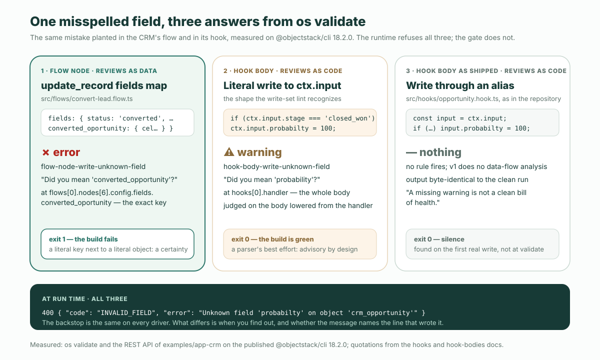

**結論から。** ObjectStack アプリのビジネスルールには 3 つの住まいがあり、どこに置くかは好みではなく表で決まります。書き込まれる 1 件のレコードだけから、I/O なしに判定できるルールは、オブジェクト上の**バリデーションルール**。保存される前に、そのレコード自体を書き換えなければならないルールは**before フック**。それ以外 — 副作用、承認、途中で止まるもの、時計で動くもの — はすべて**フロー**で、ドキュメントはフローを既定にしています：「フローはアプリケーションロジックの既定の置き場所であり、フックはノードグラフで表現できないもののための最後の受け皿である」。理由は構造的で、それこそがレビュアーが実際に確認する点です：**フローはデータとしてレビューされ、フックはコードとしてレビューされる。** ObjectStack リポジトリに同梱の CRM は、こうしたルールを **7 つ** — バリデーション 5、フック 1、フロー 1 — 宣言しており、どれも表が示す場所に置かれています。以下では、その表、7 つのルール、各住まいが書き込みを拒否または書き換える REST トランスクリプト、そして同じタイプミスを 2 つの住まいに仕込んで 2 つのレビュー強度を見せる実験を示します。すべて公開版 `@objectstack/cli` 17.7.0 — `npm create objectstack@latest` がインストールするバージョン — で計測しました。

## エージェントが受け取る一文

プロダクトオーナーが計画書に一行書きます：*40% を超える値引きには承認が必要。* これを実装するよう頼まれたエージェントは、その一文を 3 つの場所に置くことができ、3 つともパースされ、ビルドされ、起動します：

- `crm_opportunity` 上の**バリデーションルール**として — 書き込みを拒否する CEL 述語；
- **フック**として — `ctx.input` を調べて throw するか、黙ってフィールドを設定する `beforeInsert` / `beforeUpdate` ハンドラ；
- **フロー**として — 承認リクエストを開き、誰かが決めるまでレコードを留め置くレコード変更トリガー。

ルールの*形*ごとに正しい住まいは 1 つだけで、「40% を超える値引きには承認が必要」は実は一文に 2 つのルールが入っています。「例外なしに 40% 超は許されない」はレコードに対する述語 — バリデーションルール。「誰かが例外を承認しなければならない」は止まって人を待つ — フロー。フックはどちらも得意ではありません：インラインで動くので止まれず、書き込みを拒否するとしても、誰もフィールド単位で diff できないコードとして拒否します。

ObjectStack モノレポに同梱の [CRM サンプル](https://github.com/objectstack-ai/objectstack/tree/%40objectstack/cli%4017.7.0/examples/app-crm)は、すでにその判断をしています。`discount_cap` ルールはバリデーションで、オブジェクトの中に、データとして置かれています：

```ts
// examples/app-crm/src/objects/opportunity.object.ts  (@objectstack/cli@17.7.0)
validations: [
  {
    type: 'script' as const,
    name: 'discount_cap',
    label: 'Discount Cap 40%',
    description: 'Discounts over 40% require special approval.',
    condition: P`record.discount_percent != null && record.discount_percent > 40`,
    message: 'Discount cannot exceed 40% without an approved exception.',
    severity: 'error' as const,
  },
```

これが 1 つ目の住まいです。残る 2 つも同じオブジェクト上にあり、本稿の残りはそれらを見分けることに充てます。

## 判断を、表として

3 つのドキュメントの箇所が問いを決めており、どれも「場合による」とは言っていません。

バリデーションのドキュメントはバリデーションルールが*何であるか*を定義し、その定義がそのまま判定基準です：「バリデーションルールは、単一レコードに対する決定的・同期的・副作用のない述語である — 入ってくる書き込み（更新時は加えて以前のレコード）から、I/O なしに判定可能でなければならない」。それらは「書き込みパス（insert/update）で自動的に実行される」。バリデーションに見える 3 つのものは明示的に別の場所へ送られています：非同期・リモートのチェックはフォーム層へ；カスタムハンドラは `beforeInsert` / `beforeUpdate` フックへ；削除時のガードは `beforeDelete` フックへ、「`'delete'` バリデーションイベントは存在しない」からです。

フックのドキュメントは、残る 2 つの住まいの間の実務ルール — 「**フローはアプリケーションロジックの既定の置き場所であり、フックは最後の受け皿**、ノードグラフで表現できないもののためのもの」 — と 6 行の表を与えます。バリデーションの定義と合わせると、判断全体が 1 つの表に収まります：

| そのルールは…… | 住まい | 理由 |
| :--- | :--- | :--- |
| 書き込まれる 1 件のレコードだけから、I/O なしに判定できる | オブジェクト上の**バリデーションルール** | 述語である；誰が書こうと、エンジンがすべての insert と update で評価する |
| 同じ書き込みの中で、保存前にレコードを書き換えなければならない | **before フック** | ドキュメントがフックに割り当てる行：エンジンが保存しようとしているペイロードを書き換える；フローノードは通常の呼び出し元として、自身の書き込みで書く |
| オブジェクトをまたぎ、誰が書こうと、あらゆる書き込みパスで守られる不変条件 | **フック** | 「最後の受け皿という役目そのもの」 |
| 読み取りを横取りする（`beforeFind` / `afterFind`） | **フック** | フローには読み取りイベントがない |
| 保存後に副作用がある — レコード作成、通知、HTTP 呼び出し、承認依頼 | **フロー**（`record_change`） | 既定の置き場所 |
| 止まる — 承認、画面、タイマー、シグナル | **フロー** | 「フックはインラインで動き、止まれない」 |
| 時計で、あるいは日付を基準に動く | **フロー**（`schedule` / `timeRelative`） | どの組織として動くかを宣言する |
| 削除をブロックしなければならない | **`beforeDelete` フック** | バリデーションルールには削除イベントがない |


この表で取り違えやすい点が 2 つあります。バリデーションルールは削除では決して動きません — 削除には検証すべきレコードのペイロードがない — ので、「未クローズの明細を持つ商談は削除できない」は `beforeDelete` フックであってルールではありません。そして「既定」はドキュメントの言葉であり、ゆるい好みではありません：フックでもフローでも表現できるルールでは、そのルールがフックにしかないもの — 保存前のレコード、または読み取りイベント — を必要としない限り、フローが勝ちます。

## 7 つのルール、1 つの CRM

17.7.0 タグの CRM サンプルは、6 つのオブジェクトにわたって 7 つのビジネスルールを宣言しています。それぞれが住む場所と、そこへ置いた表の行を示します。この数がタイトルの数字で、`src/objects/*.object.ts` の `validations` 配列と `src/hooks/`、`src/flows/` から自分で数え直せます。

| # | ルールを一文で | 住まい | 構成要素 | 表の行 |
| :-- | :--- | :--- | :--- | :--- |
| 1 | 承認済みの例外なしに 40% を超える値引きは拒否される | `crm_opportunity` のバリデーション — `discount_cap` | `script`、CEL 述語 | レコードだけから判定できる |
| 2 | 未クローズの商談は過去のクローズ日では作成できない | `crm_opportunity` のバリデーション — `opp_close_date_not_past` | `cross_field`、`events: ['insert']` | `script` と同じ述語エンジン；エラーは `close_date` に付く |
| 3 | ステージは順に進む；`closed_won` は終端 | `crm_opportunity` のバリデーション — `opp_stage_transitions` | `state_machine` | 以前の状態と次の状態、I/O なし |
| 4 | リードのステータスは順に進む；`converted` と `disqualified` は終端 | `crm_lead` のバリデーション — `lead_status_transitions` | `state_machine` | 同上 |
| 5 | リードスコアは 0 から 100 の間 | `crm_lead` のバリデーション — `lead_score_range` | `script` | 述語 |
| 6 | 受注した商談の確度は 100、失注は 0 | フック — `opportunity_stage_probability` | `beforeInsert`、`beforeUpdate` | 同じ書き込みの中でレコードを書き換える |
| 7 | リードの変換は顧客と商談を作成し、リードを変換済みにする — 一度だけ | フロー — `crm_convert_lead_wizard` | 画面フロー；`update_record` ノード | 入力を待って止まり、レコードを作成し、別のオブジェクトに書く |

ルール 6 は唯一のフックで、全文を読む価値があります。表がフックに取っておいた形そのもの — 入ってくるレコードの書き換えで、それ以外は何もしない — だからです：

```ts
// examples/app-crm/src/hooks/opportunity.hook.ts  (@objectstack/cli@17.7.0)
export const OpportunityStageHook = defineHook({
  name: 'opportunity_stage_probability',
  object: 'crm_opportunity',
  events: ['beforeInsert', 'beforeUpdate'],
  priority: 100,
  handler: async (ctx: HookContext) => {
    const input = ctx.input as { stage?: string; probability?: number };
    if (input.stage === 'closed_won') input.probability = 100;
    if (input.stage === 'closed_lost') input.probability = 0;
  },
});
```

ルール 7 は唯一のフローで、その最後のノードが書き込みを行います。その書き込みセットはコードではなく、リテラルなオブジェクト名の隣にあるリテラルなフィールド名のマップです：

```ts
// examples/app-crm/src/flows/convert-lead.flow.ts  (@objectstack/cli@17.7.0)
{
  id: 'update_lead',
  type: 'update_record',
  label: 'Mark Lead Converted',
  config: {
    objectName: 'crm_lead',
    filter: { id: '{recordId}' },
    fields: {
      status:                'converted',
      account:               '{account_id}',
      converted_opportunity: '{opportunity_id}',
    },
  },
},
```

この 2 つの形を並べて見てください。それが議論のすべてです。

## API で見る 3 つの住まい

サンプルを 17.7.0 で起動し（`objectstack dev --compile`）、サーバーが空のデータベースにシードする開発管理者として一度サインインし — 起動バナーにアカウントが表示されます — 生成された REST API を叩きます。4 回の呼び出し、ルールの形ごとに 1 回ずつ。

**住まい 1、`script` バリデーション。** 45% の値引きで商談を作成：

```text
POST /api/v1/data/crm_opportunity
{ "name": "Acme — Deep Discount Deal", "account": "<acme id>", "stage": "prospecting",
  "amount": 50000, "discount_percent": 45 }

400 { "error": "Discount cannot exceed 40% without an approved exception.",
      "code": "VALIDATION_FAILED",
      "fields": [ { "field": "_record", "code": "rule_violation",
                    "message": "Discount cannot exceed 40% without an approved exception." } ],
      "object": "crm_opportunity" }
```

同じ呼び出しを `discount_percent: 40` で行うと `201` が返り、レコードにはフィールドの宣言済み既定値 `probability: 50` が付きます。メッセージは `discount_cap` に書かれたもので、アンカーは `_record` — 素の `script` ルールはレコード全体に付くからです。

**再び住まい 1、`cross_field` バリデーション。** `close_date` が過去のものを作成：

```text
POST /api/v1/data/crm_opportunity
{ "name": "Acme — Back-dated Deal", "account": "<acme id>", "stage": "prospecting",
  "amount": 10000, "close_date": "2026-01-15" }

400 { "error": "Close Date must be today or a future date.",
      "code": "VALIDATION_FAILED",
      "fields": [ { "field": "close_date", "code": "rule_violation",
                    "message": "Close Date must be today or a future date." } ],
      "object": "crm_opportunity" }
```

同じエンジン、同じエンベロープ、違いは 1 つ：エラーが `close_date` に付いています。`cross_field` は「`script` と同一に評価され」、`fields[0]` が「エラーの付くフィールドを示す」ものだからです。これが 2 つの型の違いのすべてで、強制ではなく表示の選択です。

**住まい 2、before フック。** シードされた「Acme — Q3 Platform Renewal」 — ステージ `proposal`、確度 70 — をクローズします：

```text
PATCH /api/v1/data/crm_opportunity/1YgCIjOainwOGgaR
{ "stage": "closed_won" }

200 { "record": { "name": "Acme — Q3 Platform Renewal", "stage": "closed_won",
                  "probability": 100, "expected_revenue": 120000, … } }

GET /api/v1/data/crm_opportunity/1YgCIjOainwOGgaR
200 { "record": { "stage": "closed_won", "probability": 100, … } }
```

誰も `probability` を送っていません。フックがエンジンの保存前にレコードを書き換え、読み戻しも一致します。これはドキュメントが before フックに割り当てる行 — 「同じ書き込みの中で、保存前にレコードを書き換える」 — です。フローの `update_record` ノードは、フィールドを通常の呼び出し元ペイロードとしてエンジンに渡す、それ自身の 1 回の書き込みであり、すでに進行中のレコードを編集するものではないからです。

**住まい 1、`state_machine` バリデーション。** 「Initech — Expansion」 — ステージ `prospecting` — を一気にクローズしてみます：

```text
PATCH /api/v1/data/crm_opportunity/Ifv5H8Vukee1ecja
{ "stage": "closed_won" }

400 { "error": "Invalid stage transition.",
      "code": "VALIDATION_FAILED",
      "fields": [ { "field": "stage", "code": "invalid_transition", "label": "Stage",
                    "constraint": { "from": "prospecting", "to": "closed_won" } } ],
      "object": "crm_opportunity" }
```

宣言済みの遷移 `prospecting → qualification` は `200` を返します。述語が書き込みを拒否する前にフックが `probability` を書き換えたかどうかは外からは見えず、問題にもなりません：書き込みは届かず、レコードは元のままです。

3 つの住まい、見分けられる 3 つのエンベロープ：ルール違反は `VALIDATION_FAILED` と書かれたメッセージを運び、フックは変えた値以外の痕跡を残さず、フロー — ルール 7 — は画面から駆動されるので単一の REST 呼び出しを持たない。それ自体が、どこに住んでいるかを示す事実です。

## 同じタイプミスを 2 つの住まいに

表の「理由」列が依拠する計測です。1 つの間違い — 書き込みのフィールド名のつづりミス — をフローとフックに仕込み、17.7.0 で `os validate` を実行します。

フローの `update_record` ノードで `converted_opportunity` をつづり間違えると：

```text
✗ Author-time rules failed (1 issue)
  • flow "crm_convert_lead_wizard" › node "Mark Lead Converted": update_record
    writes 'converted_oportunity', but object 'crm_lead' declares no such field.
    The node hands its fields map to the engine as an ordinary caller payload,
    so the declared-field door REFUSES the whole write — INVALID_FIELD / 400,
    identically on every datasource, before any statement is built. …
      Did you mean 'converted_opportunity'? Fix the field name, or declare
      'converted_oportunity' on the object. This gates the build rather than
      warning: the key is literal and so is the object, so unlike the
      hook/action body rules there is nothing here that could have been
      mis-extracted.
      rule: flow-node-write-unknown-field  at flows[0].nodes[6].config.fields.converted_oportunity
exit=1
```

フック本体で、書き込みセットのリンターが認識するリテラル形式 — `ctx.input.probabilty = 100` — で `probability` をつづり間違えると：

```text
✓ Validation passed (564ms)
  ⚠ hook "opportunity_stage_probability" › body: body writes 'probabilty' to its
    input, but object 'crm_opportunity' declares no such field. The sandboxed
    script runs clean and the value is copied back onto the record payload
    unfiltered, so the write is then REFUSED at run time — INVALID_FIELD / 400,
    identically on every driver. The record is never written, and the refusal
    names the field far from the body that wrote it. (judged on the metadata
    body lowered from the inline handler)
    rule: hook-body-write-unknown-field
exit=0
```

同じ間違い、同じ直し方、2 つの強度。フローノードは「もしかして」付きの**エラー**で非ゼロ終了、フック本体は**警告**でビルドは緑。ドキュメントは理由を一文で述べます：ノードの `fields` は「リテラルな `objectName` の隣にあるリテラルなマップなので、何も読み違えようがない」のに対し、フック本体の書き込みセットは「パーサーが認識できるリテラルなパターンに限って」チェックされる。フィールドの存在は、書き込みがデータなら*確実*、コードなら*最善努力*なのです。



そして 3 つ目の答えがあり、これがレビューの仕方を変えるべきものです。CRM に出荷されているフックは `ctx.input.probability` を直接書きません。ローカル別名経由 — `const input = ctx.input; … input.probability = 100` — で書いており、ドキュメントは別名化された入力を、ルールが「*黙って*あきらめる」形の一つに挙げています。「v1 はデータフロー解析をしない」からです。リポジトリに書かれた通りの形でフィールドをつづり間違えると、`os validate` は**何も言いません**：終了コード 0、警告なし、出力はクリーンな実行とバイト単位で同一。ドキュメント自身のこの一行を覚えておくべきです：「**警告が出ないことは、健全性の証明ではない。**」

3 つとも実行時には同じ場所に着地します。CRM の書き込みパスはどのドライバーでも未知のフィールドを拒否し、手打ちのペイロードに対しても同様です：

```text
PATCH /api/v1/data/crm_opportunity/S1wBMgLWazLLQ6ns
{ "probabilty": 100 }

400 { "error": "Unknown field 'probabilty' on object 'crm_opportunity'",
      "code": "INVALID_FIELD", "field": "probabilty", "object": "crm_opportunity" }
```

つまり間違いが永続化されることはありません。違うのは*いつ分かるか*と*誰が教えてくれるか*です：フローは `validate` 時に、直し方も明示して；リテラル形式のフックは `validate` 時に、助言として；別名形式のフックは最初の実際の書き込み時に、「書いた本体から遠く離れた場所でフィールド名を告げる」拒否によって。

## データとしてレビューできる、コードとしてレビューできる

この性質を**データとしてレビューできる**（reviewable as data）と呼びましょう。ルールの意味が、ゲートが宣言済みスキーマに対して解決できる構造化メタデータ — `fields` マップ、`transitions` 表、CEL の `condition` — で運ばれ、レビュアーは値の diff を読み、バリデータは同じ値を確実に読める。そのとき、ルールはデータとしてレビューできます。ルールの意味が関数本体で運ばれるとき — ゲートはリテラルな形だけをパースでき残りはあきらめねばならず、レビュアーは値ではなくロジックを読む — ルールは**コードとしてレビューできる**（reviewable as code）ものです。

CRM のすべてのバリデーションルールはデータとしてレビューできます。`state_machine` が最も明快な例で、レビュアーは `closed_won: []` を読めば、何も実行せずに受注が終端であると分かります。フローの `update_record` ノードもデータとしてレビューできます；ドキュメントは端的に述べます：「ノードグラフはフィールド単位で diff され、Console デザイナーにノードごとの実行履歴付きで描画される；フック本体はコードとしてしかレビューできない」。フックはコードとしてレビューされ、CRM のフックが良いフックであるのは、まさにそのコードが 3 行で、どんなデータの形でも表現できない仕事 — 入ってくるレコードの書き換え — をしているからです。

これはAI が書いた変更をレビューする人に、「これは正しいか？」より速い問いを与えます：**このルールは、データとしてレビューできる住まいにあるか？** フック本体の中のしきい値、ハンドラの `if` で強制されるステータス遷移、throw するフックで実装された承認 — どれもパースされ、ビルドされ、動きますが、どれも指摘事項です。同じルールには、ゲートが値としてチェックし、レビュアーが値として読める住まいがあるからです。直し方はコードをより厳しくレビューすることではありません。ルールを移すことです。

ドキュメントはこの議論の唯一の抜け穴を閉じています。本当にコードが必要なロジックも「フックである必要はない：`defineStack({ functions })` で登録した関数を呼ぶフローの `script` ノードは、オーケストレーションをチェック済みメタデータに、コードを名前付きのテスト可能な単一ユニットに保つ」。コードは最小の箱に入れ、周囲の形はデータのままにする。

## 本稿が決めないこと

- **しきい値。** 上のどこにも、40% が正しい上限か、財務が正しい承認者か、ステージの順序が実際の売り方と合っているかは書かれていません。正しい住まいにあるルールも、人が同意すべきルールであることは変わりません。本稿は、その不同意を見つけるコストを下げるだけです。
- **`cross_field` はより強いチェックではない。** `script` と同じ述語を実行します。エンジンがフィールドをまたいで何か追加でやってくれると期待して選ぶなら、それは起きません。選んでいるのはエラーメッセージの付き先です。
- **書き込みセットのリンターはパーサーの限界を持つ。** 計算されたキー、スプレッド、動的なオブジェクト名、別名化された入力、別パッケージが宣言したオブジェクトは、設計上すべて見えません — 偽陽性は助言リンターを殺すからです。実行時の受け皿はどのドライバーでも同じですが、それは受け皿です。ドキュメントの実務ルールは変わりません：`hook-body-write-unknown-field` は慣例としてビルド失敗扱いにし、パーサーが見えないものは手で確認する。
- **この CRM にはレコード起動のフローがない。** 唯一のフローはユーザーが起動する画面ウィザードです。冒頭の一文の「誰かが例外を承認する」半分は `approval` ノードを持つフローで、ObjectStack リポジトリはその実例をより大きな showcase サンプルに置いており、ここにはありません。決定表はそれを扱いますが、この CRM は演習していません。
- **7 はこの CRM の数**、`@objectstack/cli@17.7.0` 時点のものです。`origin/main` のドキュメントは次のメジャーを記述しています；上で引用した 3 つの箇所はタグと `origin/main` でバイト単位で同一なので本稿は引用できますが、インストールしたバージョンでトランスクリプトを再実行してください。

## エージェントに表を向ける

ルールを正しい住まいに置く最も安い方法は、エージェントが最初のルールを書く前に表を伝えることです。`AGENTS.md` か、エージェントが読むルールファイルに 3 行で足ります：

```text
A business rule that can be decided from the one record being written, with no I/O,
is a validation rule on the object (script / cross_field / state_machine). A rule that
must change the record before it is saved is a before hook. Everything else — side
effects, approvals, anything that pauses or runs on a clock — is a flow. Flows are
the default; hooks are the backstop. Validation rules never run on delete.
```

そして diff をレビューするときは 1 点だけ見ます：データとしてレビューできる住まいがあるのに、コードとしてしかレビューできない場所に住んでいるルールはないか。どちらかはゲートがすでに教えています — 一度はエラーとして、一度は警告として、そして入力を別名化したフックなら一度は、何も言わずに。

これがこのターゲットフォーマットが作られたループです。実行可能なビジネスオントロジーをひとつ。AI が書き、ランタイムが動かし、エージェントが操作し、あなたが所有する。上の 7 つのルールはオントロジーの動詞であり、そのすべてが読めるファイルの中にあります。

```bash
npm create objectstack@latest crm && cd crm
pnpm run validate     # ゲート、編集のたびに
pnpm run dev          # API、開発管理者はバナーに表示される
```

関連：[1 つの CRM をエージェントと構築した全記録、壊れた点も含めて](/en/blog/how-to-build-a-crm-with-an-ai-agent/)（英語）— ルール 3 の `state_machine` が最初に登場した記事；[4 パスのレビュー順](/en/blog/how-to-review-ai-generated-app-changes/)（英語）— 本稿はそれに 5 つ目の問いを加えます；[トリガーモデル](/en/blog/automation-trigger-model/)（英語）— フローが*どこから始まるか*；そして用語集の [declared vs. enforced](/en/glossary/declared-vs-enforced/)（英語）— 間違った住まいのルールが静かに再び開ける隙間。
