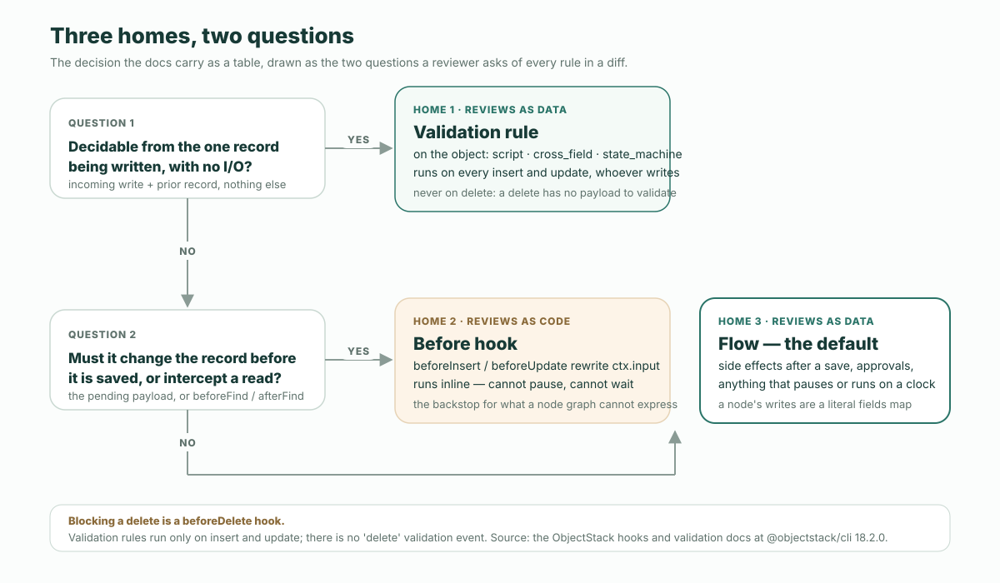

**결론부터.** ObjectStack 앱의 비즈니스 규칙에는 세 곳의 집이 있고, 어디에 둘지는 취향이 아니라 표로 정해집니다. 지금 쓰이는 레코드 하나만으로, I/O 없이 판정할 수 있는 규칙은 객체 위의 **검증 규칙**입니다. 저장되기 전에 그 레코드 자체를 바꿔야 하는 규칙은 **before 훅**입니다. 나머지 모두 — 부수 효과, 승인, 멈추는 것, 시계에 따라 도는 것 — 는 **플로우**이며, 문서는 플로우를 기본값으로 둡니다: “플로우는 애플리케이션 로직의 기본 표면이고, 훅은 노드 그래프가 표현할 수 없는 것을 위한 최후의 받침이다.” 이유는 구조적이며, 그것이 바로 리뷰어가 실제로 확인하는 지점입니다: **플로우는 데이터로 리뷰되고, 훅은 코드로 리뷰됩니다.** ObjectStack 저장소에 번들된 CRM은 이런 규칙을 **일곱 개** — 검증 다섯, 훅 하나, 플로우 하나 — 선언하고, 하나하나가 표가 가리키는 자리에 있습니다. 아래에는 그 표, 일곱 규칙, 각 집이 쓰기를 거부하거나 다시 쓰는 REST 트랜스크립트, 그리고 같은 오타를 두 집에 심어 두 가지 리뷰 강도를 보이는 실험이 있습니다. 모두 공개된 `@objectstack/cli` 17.7.0 — `npm create objectstack@latest`가 설치하는 버전 — 에서 측정했습니다.

## 에이전트가 받는 한 문장

프로덕트 오너가 기획 문서에 한 줄을 적습니다: *40%를 넘는 할인은 승인이 필요하다.* 이를 구현하라는 요청을 받은 에이전트는 그 문장을 세 곳에 둘 수 있고, 셋 모두 파싱되고 빌드되고 부팅됩니다:

- `crm_opportunity` 위의 **검증 규칙**으로 — 쓰기를 거부하는 CEL 술어;
- **훅**으로 — `ctx.input`을 살펴 throw하거나 조용히 필드를 설정하는 `beforeInsert` / `beforeUpdate` 핸들러;
- **플로우**로 — 승인 요청을 열고 누군가 결정할 때까지 레코드를 세워 두는 레코드 변경 트리거.

규칙의 *형태*마다 맞는 집은 하나뿐이며, “40%를 넘는 할인은 승인이 필요하다”는 사실 한 문장을 입은 두 규칙입니다. “예외 없이 40% 초과는 허용되지 않는다”는 레코드에 대한 술어 — 검증 규칙입니다. “누군가 그 예외를 승인해야 한다”는 멈춰서 사람을 기다립니다 — 플로우입니다. 훅은 둘 다 잘하지 못합니다: 인라인으로 돌기 때문에 멈출 수 없고, 쓰기를 거부한다 해도 누구도 필드 단위로 diff할 수 없는 코드로 거부합니다.

ObjectStack 모노레포에 들어 있는 [CRM 예제](https://github.com/objectstack-ai/objectstack/tree/%40objectstack/cli%4017.7.0/examples/app-crm)는 이미 그 선택을 했습니다. `discount_cap` 규칙은 검증이고, 객체 안에, 데이터로 있습니다:

```ts
// examples/app-crm/src/objects/opportunity.object.ts  (@objectstack/cli@17.7.0)
validations: [
  {
    type: 'script' as const,
    name: 'discount_cap',
    label: 'Discount Cap 40%',
    description: 'Discounts over 40% require special approval.',
    condition: P`record.discount_percent != null && record.discount_percent > 40`,
    message: 'Discount cannot exceed 40% without an approved exception.',
    severity: 'error' as const,
  },
```

이것이 첫 번째 집입니다. 나머지 둘은 같은 객체 위에 있고, 이 글의 나머지는 그 둘을 가르는 일입니다.

## 결정을 표로

문서의 세 구절이 질문을 매듭짓고, 어느 것도 “상황에 따라”라고 말하지 않습니다.

검증 문서는 검증 규칙이 *무엇인지* 정의하고, 그 정의가 곧 판정 기준입니다: “검증 규칙은 단일 레코드에 대한 결정적이고, 동기적이며, 부수 효과 없는 술어다 — 들어오는 쓰기(그리고 업데이트 시에는 이전 레코드)만으로, I/O 없이 판정 가능해야 한다.” 이들은 “쓰기 경로(insert/update)에서 자동으로 실행된다.” 검증처럼 보이는 세 가지는 명시적으로 다른 곳으로 보내집니다: 비동기 또는 원격 검사는 폼 계층으로; 커스텀 핸들러는 `beforeInsert` / `beforeUpdate` 훅으로; 삭제 시점의 가드는 `beforeDelete` 훅으로 — “`'delete'` 검증 이벤트는 존재하지 않기” 때문입니다.

훅 문서는 나머지 두 집 사이의 작업 규칙 — “**플로우는 애플리케이션 로직의 기본 표면이고, 훅은 최후의 받침**, 노드 그래프가 표현할 수 없는 것을 위한 것” — 과 여섯 행짜리 표를 줍니다. 검증 정의와 합치면 결정 전체가 표 하나에 들어갑니다:

| 이 규칙은… | 집 | 이유 |
| :--- | :--- | :--- |
| 지금 쓰이는 레코드 하나만으로, I/O 없이 판정할 수 있다 | 객체 위의 **검증 규칙** | 술어다; 누가 쓰든 엔진이 모든 insert와 update에서 평가한다 |
| 같은 쓰기 안에서, 저장 전에 대기 중인 레코드를 바꿔야 한다 | **before 훅** | 문서가 훅에 남겨 둔 행: 엔진이 곧 저장할 페이로드를 다시 쓴다; 플로우 노드는 일반 호출자로서, 자기 자신의 쓰기로 쓴다 |
| 객체를 가로질러, 모든 쓰기 경로에서, 누가 쓰든 지켜지는 불변식이다 | **훅** | “최후의 받침이라는 의무 그 자체” |
| 읽기를 가로챈다 (`beforeFind` / `afterFind`) | **훅** | 플로우에는 읽기 이벤트가 없다 |
| 저장 후 부수 효과가 있다 — 레코드 생성, 알림, HTTP 호출, 승인 요청 | **플로우** (`record_change`) | 기본 표면 |
| 멈춘다 — 승인, 화면, 타이머, 시그널 | **플로우** | “훅은 인라인으로 돌고 멈출 수 없다” |
| 시계에 따라, 또는 날짜를 기준으로 돈다 | **플로우** (`schedule` / `timeRelative`) | 어느 조직으로 도는지 선언한다 |
| 삭제를 막아야 한다 | **`beforeDelete` 훅** | 검증 규칙에는 삭제 이벤트가 없다 |



이 표에서 뒤집기 쉬운 것이 둘 있습니다. 검증 규칙은 삭제에서 절대 돌지 않습니다 — 삭제에는 검증할 레코드 페이로드가 없습니다 — 그래서 “미결 품목이 있는 기회는 삭제할 수 없다”는 `beforeDelete` 훅이지 규칙이 아닙니다. 그리고 “기본값”은 문서의 단어이며, 느슨한 선호가 아닙니다: 훅과 플로우가 모두 한 규칙을 표현할 수 있을 때는, 그 규칙이 훅에만 있는 것 — 대기 중인 레코드나 읽기 이벤트 — 을 필요로 하지 않는 한 플로우가 이깁니다.

## 규칙 일곱, CRM 하나

17.7.0 태그의 CRM 예제는 여섯 객체에 걸쳐 일곱 개의 비즈니스 규칙을 선언합니다. 각 규칙이 사는 집과, 그곳에 놓은 표의 행을 함께 적습니다. 이 수가 제목의 숫자이며, `src/objects/*.object.ts`의 `validations` 배열과 `src/hooks/`, `src/flows/`에서 직접 다시 셀 수 있습니다.

| # | 규칙을 한 문장으로 | 집 | 구성 요소 | 표의 행 |
| :-- | :--- | :--- | :--- | :--- |
| 1 | 승인된 예외 없이 40%를 넘는 할인은 거부된다 | `crm_opportunity`의 검증 — `discount_cap` | `script`, CEL 술어 | 레코드만으로 판정 가능 |
| 2 | 열린 기회는 과거의 마감일로 생성할 수 없다 | `crm_opportunity`의 검증 — `opp_close_date_not_past` | `cross_field`, `events: ['insert']` | `script`와 같은 술어 엔진; 오류는 `close_date`에 붙는다 |
| 3 | 단계는 순서대로 진행한다; `closed_won`은 종착 상태 | `crm_opportunity`의 검증 — `opp_stage_transitions` | `state_machine` | 이전 상태와 다음 상태, I/O 없음 |
| 4 | 리드 상태는 순서대로 진행한다; `converted`와 `disqualified`는 종착 상태 | `crm_lead`의 검증 — `lead_status_transitions` | `state_machine` | 같음 |
| 5 | 리드 점수는 0에서 100 사이다 | `crm_lead`의 검증 — `lead_score_range` | `script` | 술어 |
| 6 | 수주한 딜의 확률은 100, 실주한 딜은 0 | 훅 — `opportunity_stage_probability` | `beforeInsert`, `beforeUpdate` | 같은 쓰기 안에서 대기 중인 레코드를 바꾼다 |
| 7 | 리드 전환은 고객과 기회를 만들고 리드를 전환됨으로 표시한다 — 한 번만 | 플로우 — `crm_convert_lead_wizard` | 화면 플로우; `update_record` 노드 | 입력을 기다리며 멈추고, 레코드를 만들고, 다른 객체에 쓴다 |

규칙 6은 유일한 훅이며 전부 읽어 볼 가치가 있습니다. 표가 훅에 남겨 둔 바로 그 형태 — 들어오는 레코드의 변경, 그 외에는 아무것도 없음 — 이기 때문입니다:

```ts
// examples/app-crm/src/hooks/opportunity.hook.ts  (@objectstack/cli@17.7.0)
export const OpportunityStageHook = defineHook({
  name: 'opportunity_stage_probability',
  object: 'crm_opportunity',
  events: ['beforeInsert', 'beforeUpdate'],
  priority: 100,
  handler: async (ctx: HookContext) => {
    const input = ctx.input as { stage?: string; probability?: number };
    if (input.stage === 'closed_won') input.probability = 100;
    if (input.stage === 'closed_lost') input.probability = 0;
  },
});
```

규칙 7은 유일한 플로우이고, 그 마지막 노드가 쓰기를 하는 노드입니다. 그 쓰기 집합은 코드가 아닙니다. 리터럴 객체 이름 옆에 놓인 리터럴 필드 이름 맵입니다:

```ts
// examples/app-crm/src/flows/convert-lead.flow.ts  (@objectstack/cli@17.7.0)
{
  id: 'update_lead',
  type: 'update_record',
  label: 'Mark Lead Converted',
  config: {
    objectName: 'crm_lead',
    filter: { id: '{recordId}' },
    fields: {
      status:                'converted',
      account:               '{account_id}',
      converted_opportunity: '{opportunity_id}',
    },
  },
},
```

이 두 형태를 나란히 놓고 보십시오. 그것이 논증의 전부입니다.

## API에서 본 집 세 곳

예제를 17.7.0에서 부팅하고(`objectstack dev --compile`), 서버가 빈 데이터베이스에 시드하는 개발 관리자로 한 번 로그인한 뒤 — 부팅 배너가 계정을 출력합니다 — 생성된 REST API를 호출합니다. 네 번의 호출, 규칙 형태마다 하나씩.

**집 1, `script` 검증.** 45% 할인으로 기회를 생성:

```text
POST /api/v1/data/crm_opportunity
{ "name": "Acme — Deep Discount Deal", "account": "<acme id>", "stage": "prospecting",
  "amount": 50000, "discount_percent": 45 }

400 { "error": "Discount cannot exceed 40% without an approved exception.",
      "code": "VALIDATION_FAILED",
      "fields": [ { "field": "_record", "code": "rule_violation",
                    "message": "Discount cannot exceed 40% without an approved exception." } ],
      "object": "crm_opportunity" }
```

같은 호출을 `discount_percent: 40`으로 하면 `201`과 함께 필드의 선언된 기본값 `probability: 50`이 찍힌 레코드가 돌아옵니다. 메시지는 `discount_cap`에 작성된 그것이고, 앵커는 `_record`입니다 — 단순 `script` 규칙은 레코드 전체에 붙기 때문입니다.

**다시 집 1, `cross_field` 검증.** `close_date`가 과거인 것을 생성:

```text
POST /api/v1/data/crm_opportunity
{ "name": "Acme — Back-dated Deal", "account": "<acme id>", "stage": "prospecting",
  "amount": 10000, "close_date": "2026-01-15" }

400 { "error": "Close Date must be today or a future date.",
      "code": "VALIDATION_FAILED",
      "fields": [ { "field": "close_date", "code": "rule_violation",
                    "message": "Close Date must be today or a future date." } ],
      "object": "crm_opportunity" }
```

같은 엔진, 같은 봉투, 차이는 하나: 오류가 `close_date`에 앵커되어 있습니다. `cross_field`는 “`script`와 동일하게 평가되고”, `fields[0]`이 “오류가 붙는 필드를 표시하는” 항목이기 때문입니다. 이것이 두 타입 사이의 차이 전부이며, 강제가 아니라 표시의 선택입니다.

**집 2, before 훅.** 시드된 “Acme — Q3 Platform Renewal” — 단계 `proposal`, 확률 70 — 을 마감합니다:

```text
PATCH /api/v1/data/crm_opportunity/1YgCIjOainwOGgaR
{ "stage": "closed_won" }

200 { "record": { "name": "Acme — Q3 Platform Renewal", "stage": "closed_won",
                  "probability": 100, "expected_revenue": 120000, … } }

GET /api/v1/data/crm_opportunity/1YgCIjOainwOGgaR
200 { "record": { "stage": "closed_won", "probability": 100, … } }
```

누구도 `probability`를 보내지 않았습니다. 훅이 엔진이 저장하기 전에 대기 중인 레코드를 다시 썼고, 다시 읽은 결과도 일치합니다. 이것이 문서가 before 훅에 남겨 둔 표의 행 — “같은 쓰기 안에서, 저장 전에 대기 중인 레코드를 바꾸는 것” — 입니다. 플로우의 `update_record` 노드는 필드를 일반 호출자 페이로드로 엔진에 건네는, 그 자체로 한 번의 쓰기이며, 이미 가는 길에 있는 레코드를 편집하는 것이 아니기 때문입니다.

**집 1, `state_machine` 검증.** “Initech — Expansion” — 단계 `prospecting` — 을 한 번에 마감해 봅니다:

```text
PATCH /api/v1/data/crm_opportunity/Ifv5H8Vukee1ecja
{ "stage": "closed_won" }

400 { "error": "Invalid stage transition.",
      "code": "VALIDATION_FAILED",
      "fields": [ { "field": "stage", "code": "invalid_transition", "label": "Stage",
                    "constraint": { "from": "prospecting", "to": "closed_won" } } ],
      "object": "crm_opportunity" }
```

선언된 전이인 `prospecting → qualification`은 `200`을 돌려줍니다. 술어가 쓰기를 거부하기 전에 훅이 `probability`를 다시 썼는지는 밖에서 보이지 않고, 중요하지도 않습니다: 쓰기는 착지하지 않았고, 레코드는 원래대로입니다.

집 세 곳, 구별되는 봉투 세 가지: 규칙 위반은 `VALIDATION_FAILED`와 작성된 메시지를 지니고; 훅은 바꾼 값 외에는 흔적을 남기지 않으며; 플로우 — 규칙 7 — 는 화면에서 구동되므로 단일 REST 호출이 없는데, 그것 자체가 어디에 사는지에 대한 사실입니다.

## 같은 오타를 두 집에

표의 “이유” 열이 기대고 있는 측정입니다. 실수 하나 — 쓰기에서 잘못 쓴 필드 이름 — 를 플로우와 훅에 심습니다. 그리고 17.7.0에서 `os validate`를 실행합니다.

플로우의 `update_record` 노드에서 `converted_opportunity`를 잘못 쓰면:

```text
✗ Author-time rules failed (1 issue)
  • flow "crm_convert_lead_wizard" › node "Mark Lead Converted": update_record
    writes 'converted_oportunity', but object 'crm_lead' declares no such field.
    The node hands its fields map to the engine as an ordinary caller payload,
    so the declared-field door REFUSES the whole write — INVALID_FIELD / 400,
    identically on every datasource, before any statement is built. …
      Did you mean 'converted_opportunity'? Fix the field name, or declare
      'converted_oportunity' on the object. This gates the build rather than
      warning: the key is literal and so is the object, so unlike the
      hook/action body rules there is nothing here that could have been
      mis-extracted.
      rule: flow-node-write-unknown-field  at flows[0].nodes[6].config.fields.converted_oportunity
exit=1
```

훅 본문에서, 쓰기 집합 린트가 인식하는 리터럴 형태 — `ctx.input.probabilty = 100` — 로 `probability`를 잘못 쓰면:

```text
✓ Validation passed (564ms)
  ⚠ hook "opportunity_stage_probability" › body: body writes 'probabilty' to its
    input, but object 'crm_opportunity' declares no such field. The sandboxed
    script runs clean and the value is copied back onto the record payload
    unfiltered, so the write is then REFUSED at run time — INVALID_FIELD / 400,
    identically on every driver. The record is never written, and the refusal
    names the field far from the body that wrote it. (judged on the metadata
    body lowered from the inline handler)
    rule: hook-body-write-unknown-field
exit=0
```

같은 실수, 같은 고침, 두 가지 강도. 플로우 노드는 “이걸 쓰려 했나요”가 붙은 **오류**이며 0이 아닌 종료 코드; 훅 본문은 **경고**이며 빌드는 녹색입니다. 문서는 그 이유를 한 문장으로 말합니다: 노드의 `fields`는 “리터럴 `objectName` 옆에 놓인 리터럴 맵이어서 무엇도 잘못 읽을 수 없었다”, 반면 훅 본문의 쓰기 집합은 “파서가 인식할 수 있는 리터럴 패턴에 대해서만” 검사됩니다. 필드의 존재는 쓰기가 데이터일 때 *확실한 사실*이고, 쓰기가 코드일 때 *최선의 노력*입니다.


그리고 세 번째 답이 있는데, 리뷰 방식을 바꿔야 하는 것은 바로 그것입니다. CRM이 출하하는 훅은 `ctx.input.probability`를 직접 쓰지 않습니다. 로컬 별칭을 통해 씁니다 — `const input = ctx.input; … input.probability = 100` — 그리고 문서는 별칭이 붙은 입력을 규칙이 “*조용히* 포기하는” 형태 중 하나로 올려 두었습니다. “v1은 데이터 흐름 분석을 하지 않기” 때문입니다. 저장소에 쓰인 그대로의 훅에서 필드를 잘못 쓰면 `os validate`는 **아무 말도 하지 않습니다**: 종료 코드 0, 경고 없음, 출력은 깨끗한 실행과 바이트 단위로 동일합니다. 이 일에 대한 문서 자신의 한 줄이 기억해야 할 문장입니다: “**경고가 없다는 것은 건강 증명서가 아니다.**”

셋 모두 런타임에서는 같은 자리에 떨어집니다. CRM의 쓰기 경로는 모든 드라이버에서 알려지지 않은 필드를 거부하며, 손으로 친 페이로드에도 똑같이 합니다:

```text
PATCH /api/v1/data/crm_opportunity/S1wBMgLWazLLQ6ns
{ "probabilty": 100 }

400 { "error": "Unknown field 'probabilty' on object 'crm_opportunity'",
      "code": "INVALID_FIELD", "field": "probabilty", "object": "crm_opportunity" }
```

그러니 실수는 절대 영속화되지 않습니다. 다른 것은 *언제 알게 되는가*와 *누가 말해 주는가*입니다: 플로우는 `validate`에서, 고침까지 적어서; 리터럴 훅은 `validate`에서, 권고로; 별칭 훅은 첫 실제 쓰기에서, “그것을 쓴 본문에서 멀리 떨어진 곳에서 필드 이름을 말하는” 거부로.

## 데이터로 리뷰 가능, 코드로 리뷰 가능

이 성질을 **데이터로 리뷰 가능**(reviewable as data)이라 부르겠습니다. 규칙의 의미가 게이트가 선언된 스키마에 대해 해석할 수 있는 구조화된 메타데이터 — `fields` 맵, `transitions` 표, CEL `condition` — 에 담겨 있어, 리뷰어는 값의 diff를 읽고 검증기는 같은 값을 확실하게 읽을 때, 그 규칙은 데이터로 리뷰 가능합니다. 규칙의 의미가 함수 본문에 담겨 있을 때 — 게이트는 리터럴 형태만 파싱할 수 있고 나머지는 포기해야 하며, 리뷰어는 값이 아니라 로직을 읽는다 — 그 규칙은 **코드로 리뷰 가능**(reviewable as code)합니다.

CRM의 모든 검증 규칙은 데이터로 리뷰 가능합니다. `state_machine`이 가장 깨끗한 경우입니다 — 리뷰어는 `closed_won: []`을 읽고, 무엇도 실행하지 않고, 수주한 딜이 종착 상태임을 압니다. 플로우의 `update_record` 노드도 데이터로 리뷰 가능합니다; 문서는 바로 말합니다: “노드 그래프는 필드 단위로 diff되고 Console 디자이너에서 노드별 실행 이력과 함께 렌더링된다; 훅 본문은 코드로만 리뷰된다.” 훅은 코드로 리뷰되며, CRM의 훅이 좋은 훅인 이유는 바로 그 코드가 세 줄이고, 어떤 데이터 형태로도 표현할 수 없는 일 — 들어오는 레코드를 다시 쓰는 일 — 을 하기 때문입니다.

이것은 AI가 쓴 변경을 리뷰하는 사람에게 “이게 맞나?”보다 빠른 질문을 줍니다: **이 규칙은 데이터로 리뷰 가능한 집에 있는가?** 훅 본문 안의 임계값, 핸들러의 `if`로 강제되는 상태 전이, throw하는 훅으로 구현된 승인 — 각각 파싱되고, 빌드되고, 돌지만, 각각이 지적 사항입니다. 같은 규칙에는 게이트가 값으로 검사하고 리뷰어가 값으로 읽을 집이 있기 때문입니다. 고침은 코드를 더 세게 리뷰하는 것이 아닙니다. 규칙을 옮기는 것입니다.

문서는 이 논증의 유일한 빈틈을 막습니다. 정말로 코드가 필요한 로직도 “여전히 훅이어야 할 필요는 없다: `defineStack({ functions })`로 등록한 함수를 호출하는 플로우 `script` 노드는 오케스트레이션을 검사된 메타데이터에, 코드를 이름 있는 테스트 가능한 단위 하나에 둔다.” 코드는 가장 작은 상자에 넣고, 그 둘레의 형태는 데이터로 남깁니다.

## 이 글이 정하지 않는 것

- **임계값.** 위의 어느 것도 40%가 맞는 상한인지, 재무가 맞는 승인자인지, 단계 순서가 회사가 실제로 파는 방식과 맞는지 말하지 않습니다. 맞는 집에 있는 규칙도 여전히 사람이 동의해야 하는 규칙입니다; 이 글은 그 불일치를 찾는 비용만 낮춥니다.
- **`cross_field`는 더 강한 검사가 아닙니다.** `script`와 같은 술어를 실행합니다. 엔진이 필드를 가로질러 무언가를 더 해 주리라 기대하고 고르면 그런 일은 일어나지 않습니다; 오류 메시지가 어디에 떨어질지를 고르는 것뿐입니다.
- **쓰기 집합 린트는 파서에 묶여 있습니다.** 계산된 키, 스프레드, 동적 객체 이름, 별칭 입력, 다른 패키지가 선언한 객체는 모두 설계상 보이지 않습니다 — 거짓 양성은 권고 린트를 죽입니다. 런타임 받침은 모든 드라이버에서 같지만, 그것은 받침입니다. 문서의 실무 규칙은 그대로입니다: `hook-body-write-unknown-field`를 관례적으로 빌드 실패로 취급하고, 파서가 볼 수 없는 것은 손으로 확인하십시오.
- **이 CRM에는 레코드로 트리거되는 플로우가 없습니다.** 유일한 플로우는 사용자가 띄우는 화면 위저드입니다. 첫 문장의 “누군가 예외를 승인한다” 절반은 `approval` 노드가 있는 플로우이고, ObjectStack 저장소는 그 승인 플로우 예시를 더 큰 showcase 예제에 두었으며 여기에는 없습니다. 결정 표는 그것을 다루지만, 이 CRM은 연습하지 않습니다.
- **일곱은 이 CRM의 수**이며, `@objectstack/cli@17.7.0` 기준입니다. `origin/main`의 문서는 다음 메이저를 기술합니다; 위에 인용한 세 구절은 태그와 `origin/main` 사이에서 바이트 단위로 동일해서 이 글이 인용할 수 있지만, 설치하는 버전에서 트랜스크립트를 다시 실행하십시오.

## 에이전트를 표로 향하게 하기

규칙을 맞는 집에 넣는 가장 싼 방법은 에이전트가 첫 규칙을 쓰기 전에 표를 알려 주는 것입니다. `AGENTS.md`에, 또는 에이전트가 읽는 규칙 파일에 세 줄이면 충분합니다:

```text
A business rule that can be decided from the one record being written, with no I/O,
is a validation rule on the object (script / cross_field / state_machine). A rule that
must change the record before it is saved is a before hook. Everything else — side
effects, approvals, anything that pauses or runs on a clock — is a flow. Flows are
the default; hooks are the backstop. Validation rules never run on delete.
```

그런 다음 diff를 한 가지만 보고 리뷰하십시오: 데이터로 리뷰 가능한 집이 있는데도 코드로 리뷰 가능한 자리에 사는 규칙이 있는가. 게이트는 어느 쪽인지 이미 말해 주었습니다 — 한 번은 오류로, 한 번은 경고로, 그리고 훅이 입력에 별칭을 붙였다면 한 번은, 아무 말도 없이.

이것이 이 대상 포맷이 만들어진 루프입니다. 실행 가능한 비즈니스 온톨로지 하나. AI가 쓰고, 런타임이 실행하고, 에이전트가 운영하고, 당신이 소유합니다. 위의 일곱 규칙은 온톨로지의 동사이고, 하나하나가 당신이 읽을 수 있는 파일 안에 있습니다.

```bash
npm create objectstack@latest crm && cd crm
pnpm run validate     # 게이트, 편집할 때마다
pnpm run dev          # API, 개발 관리자는 배너에 출력된다
```

관련 글: [에이전트로 CRM 하나를 만든 전 과정, 무엇이 깨졌는지까지](/en/blog/how-to-build-a-crm-with-an-ai-agent/) (영어) — 규칙 3의 `state_machine`이 처음 등장한 글; [네 단계 리뷰 순서](/en/blog/how-to-review-ai-generated-app-changes/) (영어) — 이 글은 거기에 다섯 번째 질문을 더합니다; [트리거 모델](/en/blog/automation-trigger-model/) (영어) — 플로우가 *어디서 시작하는지*; 그리고 용어집의 [declared vs. enforced](/en/glossary/declared-vs-enforced/) (영어) — 잘못된 집에 놓인 규칙이 조용히 다시 여는 틈.
