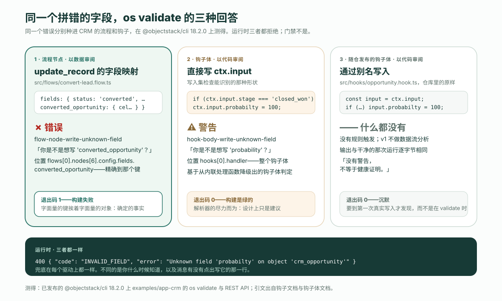

**先给结论。** ObjectStack 应用里的一条业务规则有三个可能的家，选哪一个是一张表，不是口味。只凭正在写入的那一条记录就能判定、不做任何 I/O 的规则，是对象上的**校验规则**。必须在保存之前改写待保存记录的规则，是**前置钩子**。其余的一切——副作用、审批、任何会暂停的东西、任何按时钟走的东西——是**流程**，而且文档把流程定为默认：「流程是应用逻辑的默认落点；钩子是节点图表达不了的东西的兜底。」理由是结构性的，也正是审阅者真正要核对的那件事：**流程以数据的形式接受审阅，钩子以代码的形式接受审阅。** ObjectStack 仓库自带的 CRM 声明了**七条**这样的规则——五条校验、一个钩子、一个流程——每一条都落在表里说的位置。下面依次是：这张表；七条规则；一份 REST 记录，三个家各自拒绝或改写一次写入；以及把同一个拼写错误分别种进两个家，看两种审阅强度。全部在已发布的 `@objectstack/cli` 17.7.0 上测得，也就是 `npm create objectstack@latest` 装上的那个版本。

## Agent 拿到的那句话

产品负责人在计划文档里写了一行：*折扣超过 40% 需要审批。* 被要求实现它的 Agent 可以把这句话放进三个地方，三种写法都能通过解析、构建和启动：

- 作为 `crm_opportunity` 上的一条**校验规则**——一个拒绝写入的 CEL 谓词；
- 作为一个**钩子**——`beforeInsert` / `beforeUpdate` 处理函数，检查 `ctx.input` 后抛错，或者悄悄改一个字段；
- 作为一个**流程**——记录变更触发器，发起一个审批请求，把记录停在那里，直到有人做决定。

对每一种*形状*的规则，只有一个家是对的，而「折扣超过 40% 需要审批」其实是两条规则穿了一句话。「没有例外批准，超过 40% 不允许」是对记录的谓词——校验规则。「得有人批准这个例外」会暂停并等一个人——流程。钩子两样都做不好：它内联运行，所以不能暂停；如果它拒绝写入，它是以一段没人能逐字段 diff 的代码拒绝的。

ObjectStack 单仓里自带的 [CRM 示例](https://github.com/objectstack-ai/objectstack/tree/%40objectstack/cli%4017.7.0/examples/app-crm)已经做了这个选择。它的 `discount_cap` 规则是一条校验，住在对象里，是数据：

```ts
// examples/app-crm/src/objects/opportunity.object.ts  (@objectstack/cli@17.7.0)
validations: [
  {
    type: 'script' as const,
    name: 'discount_cap',
    label: 'Discount Cap 40%',
    description: 'Discounts over 40% require special approval.',
    condition: P`record.discount_percent != null && record.discount_percent > 40`,
    message: 'Discount cannot exceed 40% without an approved exception.',
    severity: 'error' as const,
  },
```

这是第一个家。另外两个家在同一个对象上，本文剩下的部分就是把它们分开。

## 决策，写成一张表

三段文档把问题定了下来，没有一段说「看情况」。

校验文档定义了校验规则*是什么*，而定义本身就是判据：「校验规则是对单条记录的确定性、同步、无副作用的谓词——它必须只凭传入的写入（更新时再加上先前的记录）就能判定，不做任何 I/O。」它们「在写入路径（insert/update）上自动运行」。三样看起来像校验的东西被明确送去了别处：异步或远程检查归表单层；自定义处理函数归 `beforeInsert` / `beforeUpdate` 钩子；删除时的守卫归 `beforeDelete` 钩子，因为「不存在 `'delete'` 校验事件」。

钩子文档给出了另外两个家之间的工作规则——「**流程是应用逻辑的默认落点；钩子是兜底**，留给节点图表达不了的东西」——以及一张六行的表。与校验的定义合并之后，整个决策装进一张表：

| 这条规则…… | 家 | 为什么 |
| :--- | :--- | :--- |
| 只凭正在写入的那一条记录就能判定，不做 I/O | 对象上的**校验规则** | 它是谓词；无论谁写，引擎在每次 insert 和 update 上都评估它 |
| 必须在同一次写入里、保存之前改写待保存记录 | **前置钩子** | 文档专门留给钩子的那一行：它改写引擎即将保存的载荷；流程节点以普通调用方的身份、在自己的一次写入里写 |
| 是跨对象、覆盖每条写入路径、不论谁写的不变量 | **钩子** | 「兜底职责本身」 |
| 拦截读取（`beforeFind` / `afterFind`） | **钩子** | 流程没有读取事件 |
| 保存之后有副作用——创建记录、通知、调用 HTTP、发起审批 | **流程**（`record_change`） | 默认落点 |
| 会暂停——审批、屏幕、计时器、信号 | **流程** | 「钩子内联运行，不能暂停」 |
| 按时钟运行，或相对某个日期运行 | **流程**（`schedule` / `timeRelative`） | 声明它以哪个组织的身份运行 |
| 必须阻止一次删除 | **`beforeDelete` 钩子** | 校验规则没有删除事件 |


表里有两处容易弄反。校验规则从不在删除上运行——删除不携带可供校验的记录载荷——所以「有未关闭明细的商机不能删」是一个 `beforeDelete` 钩子，不是一条规则。还有，「默认」是文档的用词，不是一种软性偏好：当钩子和流程都能表达一条规则时，流程胜出，除非这条规则需要只有钩子才有的东西，也就是待保存记录或读取事件。

## 七条规则，一个 CRM

17.7.0 标签处的 CRM 示例，在六个对象上声明了七条业务规则。下面逐条列出它住的家，以及把它放到那里的那一行表。这个数就是标题里的数字；你可以从 `src/objects/*.object.ts` 的 `validations` 数组，再加上 `src/hooks/` 和 `src/flows/`，自己重数一遍。

| # | 规则，写成一句话 | 家 | 构造 | 表里的哪一行 |
| :-- | :--- | :--- | :--- | :--- |
| 1 | 没有批准的例外，折扣超过 40% 被拒绝 | `crm_opportunity` 上的校验——`discount_cap` | `script`，CEL 谓词 | 只凭记录就能判定 |
| 2 | 未关闭的商机不能以过去的关闭日期创建 | `crm_opportunity` 上的校验——`opp_close_date_not_past` | `cross_field`，`events: ['insert']` | 与 `script` 同一个谓词引擎；错误挂在 `close_date` 上 |
| 3 | 阶段按顺序推进；`closed_won` 是终态 | `crm_opportunity` 上的校验——`opp_stage_transitions` | `state_machine` | 先前状态加下一状态，不做 I/O |
| 4 | 线索状态按顺序推进；`converted` 和 `disqualified` 是终态 | `crm_lead` 上的校验——`lead_status_transitions` | `state_machine` | 同上 |
| 5 | 线索评分在 0 到 100 之间 | `crm_lead` 上的校验——`lead_score_range` | `script` | 谓词 |
| 6 | 赢单的商机概率为 100，丢单为 0 | 钩子——`opportunity_stage_probability` | `beforeInsert`、`beforeUpdate` | 在同一次写入里改写待保存记录 |
| 7 | 转化线索会创建一个客户和一个商机，并把线索标记为已转化——只做一次 | 流程——`crm_convert_lead_wizard` | 屏幕流程；`update_record` 节点 | 暂停等待输入、创建记录、写另一个对象 |

第 6 条是唯一的钩子，值得整个读一遍，因为它正是表留给钩子的那种形状——改写一条正在进来的记录，别的什么都不做：

```ts
// examples/app-crm/src/hooks/opportunity.hook.ts  (@objectstack/cli@17.7.0)
export const OpportunityStageHook = defineHook({
  name: 'opportunity_stage_probability',
  object: 'crm_opportunity',
  events: ['beforeInsert', 'beforeUpdate'],
  priority: 100,
  handler: async (ctx: HookContext) => {
    const input = ctx.input as { stage?: string; probability?: number };
    if (input.stage === 'closed_won') input.probability = 100;
    if (input.stage === 'closed_lost') input.probability = 0;
  },
});
```

第 7 条是唯一的流程，它的最后一个节点就是写入的那个。它的写入集不是代码，而是一张字面量的字段名映射，旁边是一个字面量的对象名：

```ts
// examples/app-crm/src/flows/convert-lead.flow.ts  (@objectstack/cli@17.7.0)
{
  id: 'update_lead',
  type: 'update_record',
  label: 'Mark Lead Converted',
  config: {
    objectName: 'crm_lead',
    filter: { id: '{recordId}' },
    fields: {
      status:                'converted',
      account:               '{account_id}',
      converted_opportunity: '{opportunity_id}',
    },
  },
},
```

把这两个形状并排放着。它们就是整个论证。

## 三个家，在 API 上

在 17.7.0 上启动示例（`objectstack dev --compile`），以服务器在空数据库上播种的开发管理员登录一次——启动横幅会打印这个账号——然后驱动生成的 REST API。四次调用，每种规则形状一次。

**家 1，一条 `script` 校验。** 以 45% 的折扣创建一个商机：

```text
POST /api/v1/data/crm_opportunity
{ "name": "Acme — Deep Discount Deal", "account": "<acme id>", "stage": "prospecting",
  "amount": 50000, "discount_percent": 45 }

400 { "error": "Discount cannot exceed 40% without an approved exception.",
      "code": "VALIDATION_FAILED",
      "fields": [ { "field": "_record", "code": "rule_violation",
                    "message": "Discount cannot exceed 40% without an approved exception." } ],
      "object": "crm_opportunity" }
```

同一个调用在 `discount_percent: 40` 下返回 `201`，记录带着 `probability: 50`，也就是字段声明的默认值。消息是在 `discount_cap` 上编写的那条；锚点是 `_record`，因为普通的 `script` 规则挂在整条记录上。

**还是家 1，一条 `cross_field` 校验。** 创建一个 `close_date` 在过去的商机：

```text
POST /api/v1/data/crm_opportunity
{ "name": "Acme — Back-dated Deal", "account": "<acme id>", "stage": "prospecting",
  "amount": 10000, "close_date": "2026-01-15" }

400 { "error": "Close Date must be today or a future date.",
      "code": "VALIDATION_FAILED",
      "fields": [ { "field": "close_date", "code": "rule_violation",
                    "message": "Close Date must be today or a future date." } ],
      "object": "crm_opportunity" }
```

同一个引擎，同一个信封，只有一处不同：错误挂在 `close_date` 上，因为 `cross_field`「与 `script` 的评估完全相同」，而 `fields[0]` 是「标记错误挂到哪个字段」的那一项。这就是两种类型之间的全部区别，它是展示上的选择，不是执行上的。

**家 2，前置钩子。** 取种子数据里的「Acme — Q3 Platform Renewal」——阶段 `proposal`，概率 70——把它关掉：

```text
PATCH /api/v1/data/crm_opportunity/1YgCIjOainwOGgaR
{ "stage": "closed_won" }

200 { "record": { "name": "Acme — Q3 Platform Renewal", "stage": "closed_won",
                  "probability": 100, "expected_revenue": 120000, … } }

GET /api/v1/data/crm_opportunity/1YgCIjOainwOGgaR
200 { "record": { "stage": "closed_won", "probability": 100, … } }
```

没有人发送 `probability`。钩子在引擎保存之前改写了待保存记录，读回来的结果一致。这正是文档留给前置钩子的那一行——「在同一次写入里、保存之前改写待保存记录」——因为流程的 `update_record` 节点是以普通调用方载荷的身份把字段交给引擎，是它自己的一次写入，而不是去编辑那条已经在路上的记录。

**家 1，一条 `state_machine` 校验。** 取「Initech — Expansion」——阶段 `prospecting`——试着一步关单：

```text
PATCH /api/v1/data/crm_opportunity/Ifv5H8Vukee1ecja
{ "stage": "closed_won" }

400 { "error": "Invalid stage transition.",
      "code": "VALIDATION_FAILED",
      "fields": [ { "field": "stage", "code": "invalid_transition", "label": "Stage",
                    "constraint": { "from": "prospecting", "to": "closed_won" } } ],
      "object": "crm_opportunity" }
```

`prospecting → qualification` 是声明过的转换，返回 `200`。钩子有没有在谓词拒绝写入之前改写 `probability`，从外面看不见，也无关紧要：写入没有落地，记录保持原样。

三个家，三种分得开的信封：规则失败带着 `VALIDATION_FAILED` 和编写好的消息；钩子除了它改掉的那个值之外不留痕迹；流程——第 7 条——是从屏幕驱动的，所以没有单独的一次 REST 调用，这本身就是关于它住在哪的事实。

## 同一个拼写错误，两个家

这是表里「为什么」一列所依据的测量。拿一个错误——写入里拼错一个字段名——分别种进流程和钩子，然后在 17.7.0 上跑 `os validate`。

在流程的 `update_record` 节点里，把 `converted_opportunity` 拼错：

```text
✗ Author-time rules failed (1 issue)
  • flow "crm_convert_lead_wizard" › node "Mark Lead Converted": update_record
    writes 'converted_oportunity', but object 'crm_lead' declares no such field.
    The node hands its fields map to the engine as an ordinary caller payload,
    so the declared-field door REFUSES the whole write — INVALID_FIELD / 400,
    identically on every datasource, before any statement is built. …
      Did you mean 'converted_opportunity'? Fix the field name, or declare
      'converted_oportunity' on the object. This gates the build rather than
      warning: the key is literal and so is the object, so unlike the
      hook/action body rules there is nothing here that could have been
      mis-extracted.
      rule: flow-node-write-unknown-field  at flows[0].nodes[6].config.fields.converted_oportunity
exit=1
```

在钩子体里，以写入集检查能识别的字面形式把 `probability` 拼错——`ctx.input.probabilty = 100`：

```text
✓ Validation passed (564ms)
  ⚠ hook "opportunity_stage_probability" › body: body writes 'probabilty' to its
    input, but object 'crm_opportunity' declares no such field. The sandboxed
    script runs clean and the value is copied back onto the record payload
    unfiltered, so the write is then REFUSED at run time — INVALID_FIELD / 400,
    identically on every driver. The record is never written, and the refusal
    names the field far from the body that wrote it. (judged on the metadata
    body lowered from the inline handler)
    rule: hook-body-write-unknown-field
exit=0
```

同一个错误，同一种修法，两种强度。流程节点是一个**错误**，带着「你是不是想写」和非零退出码；钩子体是一个**警告**，构建是绿的。文档用一句话说明了原因：节点的 `fields`「是一张字面量映射，旁边是字面量的 `objectName`，所以没有什么能把它读错」，而钩子体的写入集「只按解析器能识别的字面模式」检查。当写入是数据时，字段是否存在是一个*确定的事实*；当写入是代码时，它只是*尽力而为*。



还有第三种回答，而它才是应该改变你审阅方式的那个。CRM 随仓发布的钩子并不直接写 `ctx.input.probability`。它通过一个本地别名写——`const input = ctx.input; … input.probability = 100`——而文档把别名化的输入列在规则「*静默*放弃」的形状里，因为「v1 不做数据流分析」。按仓库里的原样在钩子里拼错这个字段，`os validate` **什么都不说**：退出码 0，没有警告，输出与干净的那次运行逐字节相同。文档自己给这件事的那一句，正是应该记住的那一句：「**没有警告，不等于健康证明。**」

三种写法在运行时落到同一个地方。CRM 的写入路径在每个驱动上都拒绝未知字段，对手工敲出来的载荷也一样：

```text
PATCH /api/v1/data/crm_opportunity/S1wBMgLWazLLQ6ns
{ "probabilty": 100 }

400 { "error": "Unknown field 'probabilty' on object 'crm_opportunity'",
      "code": "INVALID_FIELD", "field": "probabilty", "object": "crm_opportunity" }
```

所以这个错误永远不会被持久化。不同的是*你什么时候知道*和*谁告诉你*：流程在 `validate` 时就知道，而且修法已经写明；字面写法的钩子在 `validate` 时知道，但只是建议；别名写法的钩子要等到第一次真实写入，由一个「在远离写它的那段代码的地方点出字段名」的拒绝来告诉你。

## 以数据审阅，以代码审阅

把这个性质叫作**以数据审阅**（reviewable as data）。当一条规则的含义由门禁能对照已声明 schema 解析的结构化元数据承载——一张 `fields` 映射、一张 `transitions` 表、一个 CEL `condition`——使得审阅者读到的是一份值的 diff、校验器读到的是同一些值并且读得确定，这条规则就是以数据审阅的。当一条规则的含义由一段函数体承载——门禁能解析字面形状、其余的只能放弃，审阅者读的是逻辑而不是值——这条规则就是**以代码审阅**（reviewable as code）的。

CRM 里的每一条校验规则都是以数据审阅的。`state_machine` 是最干净的例子——审阅者读到 `closed_won: []` 就知道赢单是终态，什么都不用跑。流程的 `update_record` 节点是以数据审阅的；文档说得很直接：「节点图逐字段地 diff，在 Console 设计器里渲染，带每个节点的运行历史；钩子体只能以代码审阅。」钩子是以代码审阅的，而 CRM 的钩子之所以是个好钩子，恰恰因为它的代码只有三行，干的是任何数据形状都表达不了的活——改写一条正在进来的记录。

这给了审阅 AI 所写改动的人一个比「这对不对？」更快的问题：**这条规则住在它能以数据审阅的家里吗？** 藏在钩子体里的阈值、用处理函数里的 `if` 执行的状态转换、用会抛错的钩子实现的审批——每一个都能解析、构建、运行，每一个都是一个发现，因为同一条规则有一个家，在那里门禁会把它当作值来检查，审阅者会把它当作值来读。修法不是把代码审得更狠，而是把规则搬家。

文档堵上了这个论证里唯一的漏洞。真正需要代码的逻辑「仍然不必是钩子：一个流程 `script` 节点调用通过 `defineStack({ functions })` 注册的函数，让编排留在受检查的元数据里，让代码待在一个有名字、可测试的单元里。」代码放进最小的盒子；盒子周围的形状仍然是数据。

## 这篇没有解决的

- **阈值本身。** 上面没有一句话说 40% 是不是正确的上限、财务是不是正确的审批人、阶段顺序是不是符合业务实际的销售方式。住对了家的规则仍然是一条人得同意的规则；本文只是让不同意变得便宜。
- **`cross_field` 不是更强的检查。** 它跑的是和 `script` 一样的谓词。如果你指望它让引擎跨字段多做点什么，它不会；你只是在选错误消息落在哪里。
- **写入集检查受解析器所限。** 计算键、展开、动态对象名、别名化的输入，以及由另一个包声明的对象，对它全都不可见，这是设计使然——一个误报会杀死一条建议性的 lint。运行时兜底在每个驱动上都一样，但它是兜底。文档的实用规则仍然成立：按惯例把 `hook-body-write-unknown-field` 当作构建失败，解析器看不见的东西用手检查。
- **这个 CRM 没有记录触发的流程。** 它唯一的流程是用户发起的屏幕向导。开头那句话的「得有人批准这个例外」那一半，是一个带 `approval` 节点的流程，而 ObjectStack 仓库把演示用的审批流程放在更大的 showcase 示例里，不在这里。决策表覆盖了它；这个 CRM 没有演练它。
- **七是这个 CRM 的数，** 在 `@objectstack/cli@17.7.0` 处。`origin/main` 上的文档描述的是下一个大版本；上面引用的三段在标签和 `origin/main` 之间逐字节相同，所以本文可以引用它们，但请在你装到的任何版本上重跑这份记录。

## 把 Agent 指向这张表

让规则住进正确的家，最便宜的办法是在 Agent 写第一条之前就把表告诉它。在 `AGENTS.md`、或你的 Agent 读的任何规则文件里，写三行就够：

```text
A business rule that can be decided from the one record being written, with no I/O,
is a validation rule on the object (script / cross_field / state_machine). A rule that
must change the record before it is saved is a before hook. Everything else — side
effects, approvals, anything that pauses or runs on a clock — is a flow. Flows are
the default; hooks are the backstop. Validation rules never run on delete.
```

然后审阅 diff 时只看一件事：有没有一条规则住在只能以代码审阅的地方，而它本有一个能以数据审阅的家。门禁已经告诉过你它是哪一种——一次是错误，一次是警告，还有一次，如果钩子给输入起了别名，就什么都不说。

这就是这个目标格式为之而建的循环。一份可执行的业务本体。AI 编写它，运行时运行它，Agent 操作它，你拥有它。上面的七条规则是这份本体的动词，每一条都在一个你读得到的文件里。

```bash
npm create objectstack@latest crm && cd crm
pnpm run validate     # 门禁，每次编辑之后
pnpm run dev          # API，开发管理员打印在横幅里
```

延伸阅读：[用 Agent 构建一个 CRM 的全过程，包括出了什么问题](/en/blog/how-to-build-a-crm-with-an-ai-agent/)（英文），第 3 条规则的 `state_machine` 最早出现在那里；[四遍审阅顺序](/en/blog/how-to-review-ai-generated-app-changes/)（英文），本文给它添了第五个问题；[触发器模型](/zh-Hans/blog/automation-trigger-model/)，讲一个流程从哪里*开始*；以及术语表里的[声明 vs 执行](/zh-Hans/glossary/declared-vs-enforced/)，住错了家的规则会悄悄重新打开的那道缝。
