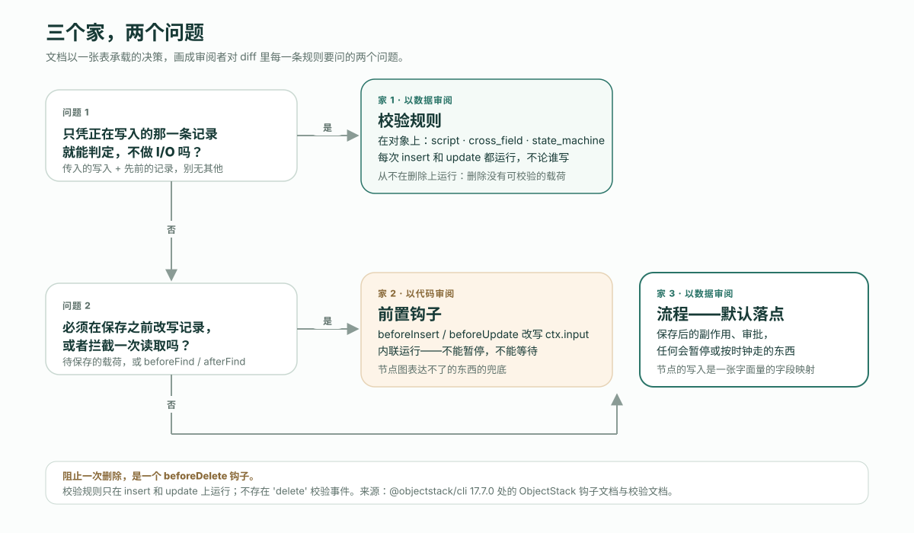

---
# @generated zh-Hant from zh-Hans (s2twp) — edit the zh-Hans file; delete this line to hand-maintain.
title: 校驗規則、鉤子還是流程？AI 寫的應用裡，一條業務規則該住在哪——一個 CRM、七條規則、三個家
description: 同一個 CRM 上的七條業務規則，每條都有三個可能的家。選擇是一張表，不是口味：對單條記錄的謂詞是校驗規則，改寫待儲存記錄的是鉤子，其餘都是流程——因為流程以資料的形式接受審閱。
author: ObjectStack Team
date: 2026-10-21
status: published
topic: app-building
audience: developer
solutions:
  - crm
industries: []
cover: ./cover.svg
tags:
  - AI Agent
  - 業務規則
---

**先給結論。** ObjectStack 應用裡的一條業務規則有三個可能的家，選哪一個是一張表，不是口味。只憑正在寫入的那一條記錄就能判定、不做任何 I/O 的規則，是物件上的**校驗規則**。必須在儲存之前改寫待儲存記錄的規則，是**前置鉤子**。其餘的一切——副作用、審批、任何會暫停的東西、任何按時鐘走的東西——是**流程**，而且文件把流程定為預設：「流程是應用邏輯的預設落點；鉤子是節點圖表達不了的東西的兜底。」理由是結構性的，也正是審閱者真正要核對的那件事：**流程以資料的形式接受審閱，鉤子以程式碼的形式接受審閱。** ObjectStack 倉庫自帶的 CRM 聲明瞭**七條**這樣的規則——五條校驗、一個鉤子、一個流程——每一條都落在表裡說的位置。下面依次是：這張表；七條規則；一份 REST 記錄，三個家各自拒絕或改寫一次寫入；以及把同一個拼寫錯誤分別種進兩個家，看兩種審閱強度。全部在已釋出的 `@objectstack/cli` 18.2.0 上測得，也就是 `npm create objectstack@latest` 裝上的那個版本。

## Agent 拿到的那句話

產品負責人在計劃文件裡寫了一行：*折扣超過 40% 需要審批。* 被要求實現它的 Agent 可以把這句話放進三個地方，三種寫法都能通過解析、構建和啟動：

- 作為 `crm_opportunity` 上的一條**校驗規則**——一個拒絕寫入的 CEL 謂詞；
- 作為一個**鉤子**——`beforeInsert` / `beforeUpdate` 處理函式，檢查 `ctx.input` 後拋錯，或者悄悄改一個欄位；
- 作為一個**流程**——記錄變更觸發器，發起一個審批請求，把記錄停在那裡，直到有人做決定。

對每一種*形狀*的規則，只有一個家是對的，而「折扣超過 40% 需要審批」其實是兩條規則穿了一句話。「沒有例外批准，超過 40% 不允許」是對記錄的謂詞——校驗規則。「得有人批准這個例外」會暫停並等一個人——流程。鉤子兩樣都做不好：它內聯執行，所以不能暫停；如果它拒絕寫入，它是以一段沒人能逐欄位 diff 的程式碼拒絕的。

ObjectStack 單倉裡自帶的 [CRM 示例](https://github.com/objectstack-ai/objectstack/tree/%40objectstack/cli%4018.2.0/examples/app-crm)已經做了這個選擇。它的 `discount_cap` 規則是一條校驗，住在物件裡，是資料：

```ts
// examples/app-crm/src/objects/opportunity.object.ts  (@objectstack/cli@18.2.0)
validations: [
  {
    type: 'script' as const,
    name: 'discount_cap',
    label: 'Discount Cap 40%',
    description: 'Discounts over 40% require special approval.',
    condition: P`record.discount_percent != null && record.discount_percent > 40`,
    message: 'Discount cannot exceed 40% without an approved exception.',
    severity: 'error' as const,
  },
```

這是第一個家。另外兩個家在同一個物件上，本文剩下的部分就是把它們分開。

## 決策，寫成一張表

三段文件把問題定了下來，沒有一段說「看情況」。

校驗文件定義了校驗規則*是什麼*，而定義本身就是判據：「校驗規則是對單條記錄的確定性、同步、無副作用的謂詞——它必須只憑傳入的寫入（更新時再加上先前的記錄）就能判定，不做任何 I/O。」它們「在寫入路徑（insert/update）上自動執行」。三樣看起來像校驗的東西被明確送去了別處：非同步或遠端檢查歸表單層；自定義處理函式歸 `beforeInsert` / `beforeUpdate` 鉤子；刪除時的守衛歸 `beforeDelete` 鉤子，因為「不存在 `'delete'` 校驗事件」。

鉤子文件給出了另外兩個家之間的工作規則——「**流程是應用邏輯的預設落點；鉤子是兜底**，留給節點圖表達不了的東西」——以及一張六行的表。與校驗的定義合併之後，整個決策裝進一張表：

| 這條規則…… | 家 | 為什麼 |
| :--- | :--- | :--- |
| 只憑正在寫入的那一條記錄就能判定，不做 I/O | 物件上的**校驗規則** | 它是謂詞；無論誰寫，引擎在每次 insert 和 update 上都評估它 |
| 必須在同一次寫入裡、儲存之前改寫待儲存記錄 | **前置鉤子** | 文件專門留給鉤子的那一行：它改寫引擎即將儲存的載荷；流程節點以普通呼叫方的身份、在自己的一次寫入裡寫 |
| 是跨物件、覆蓋每條寫入路徑、不論誰寫的不變數 | **鉤子** | 「兜底職責本身」 |
| 攔截讀取（`beforeFind` / `afterFind`） | **鉤子** | 流程沒有讀取事件 |
| 儲存之後有副作用——建立記錄、通知、呼叫 HTTP、發起審批 | **流程**（`record_change`） | 預設落點 |
| 會暫停——審批、螢幕、計時器、訊號 | **流程** | 「鉤子內聯執行，不能暫停」 |
| 按時鐘執行，或相對某個日期執行 | **流程**（`schedule` / `timeRelative`） | 宣告它以哪個組織的身份執行 |
| 必須阻止一次刪除 | **`beforeDelete` 鉤子** | 校驗規則沒有刪除事件 |



表裡有兩處容易弄反。校驗規則從不在刪除上執行——刪除不攜帶可供校驗的記錄載荷——所以「有未關閉明細的商機不能刪」是一個 `beforeDelete` 鉤子，不是一條規則。還有，「預設」是文件的用詞，不是一種軟性偏好：當鉤子和流程都能表達一條規則時，流程勝出，除非這條規則需要只有鉤子才有的東西，也就是待儲存記錄或讀取事件。

## 七條規則，一個 CRM

18.2.0 標籤處的 CRM 示例，在六個物件上聲明瞭七條業務規則。下面逐條列出它住的家，以及把它放到那裡的那一行表。這個數就是標題裡的數字；你可以從 `src/objects/*.object.ts` 的 `validations` 陣列，再加上 `src/hooks/` 和 `src/flows/`，自己重數一遍。

| # | 規則，寫成一句話 | 家 | 構造 | 表裡的哪一行 |
| :-- | :--- | :--- | :--- | :--- |
| 1 | 沒有批准的例外，折扣超過 40% 被拒絕 | `crm_opportunity` 上的校驗——`discount_cap` | `script`，CEL 謂詞 | 只憑記錄就能判定 |
| 2 | 未關閉的商機不能以過去的關閉日期建立 | `crm_opportunity` 上的校驗——`opp_close_date_not_past` | `cross_field`，`events: ['insert']` | 與 `script` 同一個謂詞引擎；錯誤掛在 `close_date` 上 |
| 3 | 階段按順序推進；`closed_won` 是終態 | `crm_opportunity` 上的校驗——`opp_stage_transitions` | `state_machine` | 先前狀態加下一狀態，不做 I/O |
| 4 | 線索狀態按順序推進；`converted` 和 `disqualified` 是終態 | `crm_lead` 上的校驗——`lead_status_transitions` | `state_machine` | 同上 |
| 5 | 線索評分在 0 到 100 之間 | `crm_lead` 上的校驗——`lead_score_range` | `script` | 謂詞 |
| 6 | 贏單的商機機率為 100，丟單為 0 | 鉤子——`opportunity_stage_probability` | `beforeInsert`、`beforeUpdate` | 在同一次寫入裡改寫待儲存記錄 |
| 7 | 轉化線索會建立一個客戶和一個商機，並把線索標記為已轉化——只做一次 | 流程——`crm_convert_lead_wizard` | 螢幕流程；`update_record` 節點 | 暫停等待輸入、建立記錄、寫另一個物件 |

第 6 條是唯一的鉤子，值得整個讀一遍，因為它正是表留給鉤子的那種形狀——改寫一條正在進來的記錄，別的什麼都不做：

```ts
// examples/app-crm/src/hooks/opportunity.hook.ts  (@objectstack/cli@18.2.0)
export const OpportunityStageHook = defineHook({
  name: 'opportunity_stage_probability',
  object: 'crm_opportunity',
  events: ['beforeInsert', 'beforeUpdate'],
  priority: 100,
  handler: async (ctx: HookContext) => {
    const input = ctx.input as { stage?: string; probability?: number };
    if (input.stage === 'closed_won') input.probability = 100;
    if (input.stage === 'closed_lost') input.probability = 0;
  },
});
```

第 7 條是唯一的流程，它的最後一個節點就是寫入的那個。它的寫入集不是程式碼，而是一張字面量的欄位名對映，旁邊是一個字面量的物件名；它要計算的兩個值是 CEL 值信封——仍然是資料，不是函式體：

```ts
// examples/app-crm/src/flows/convert-lead.flow.ts  (@objectstack/cli@18.2.0)
{
  id: 'update_lead',
  type: 'update_record',
  label: 'Mark Lead Converted',
  config: {
    objectName: 'crm_lead',
    filter: { id: { dialect: 'cel', source: 'recordId' } },
    fields: {
      status:                'converted',
      account:               { dialect: 'cel', source: 'account_id' },
      converted_opportunity: { dialect: 'cel', source: 'opportunity_id' },
    },
  },
},
```

把這兩個形狀並排放著。它們就是整個論證。

## 三個家，在 API 上

在 18.2.0 上啟動示例（`objectstack dev --compile`），以伺服器在空資料庫上播種的開發管理員登入一次——啟動橫幅會列印這個賬號——然後驅動生成的 REST API。四次呼叫，每種規則形狀一次。

**家 1，一條 `script` 校驗。** 以 45% 的折扣建立一個商機：

```text
POST /api/v1/data/crm_opportunity
{ "name": "Acme — Deep Discount Deal", "account": "<acme id>", "stage": "prospecting",
  "amount": 50000, "discount_percent": 45 }

400 { "error": "Discount cannot exceed 40% without an approved exception.",
      "code": "VALIDATION_FAILED",
      "fields": [ { "field": "_record", "code": "rule_violation",
                    "message": "Discount cannot exceed 40% without an approved exception." } ],
      "object": "crm_opportunity" }
```

同一個呼叫在 `discount_percent: 40` 下返回 `201`，記錄帶著 `probability: 50`，也就是欄位宣告的預設值。訊息是在 `discount_cap` 上編寫的那條；錨點是 `_record`，因為普通的 `script` 規則掛在整條記錄上。

**還是家 1，一條 `cross_field` 校驗。** 建立一個 `close_date` 在過去的商機：

```text
POST /api/v1/data/crm_opportunity
{ "name": "Acme — Back-dated Deal", "account": "<acme id>", "stage": "prospecting",
  "amount": 10000, "close_date": "2026-01-15" }

400 { "error": "Close Date must be today or a future date.",
      "code": "VALIDATION_FAILED",
      "fields": [ { "field": "close_date", "code": "rule_violation",
                    "message": "Close Date must be today or a future date." } ],
      "object": "crm_opportunity" }
```

同一個引擎，同一個信封，只有一處不同：錯誤掛在 `close_date` 上，因為 `cross_field`「與 `script` 的評估完全相同」，而 `fields[0]` 是「標記錯誤掛到哪個欄位」的那一項。這就是兩種型別之間的全部區別，它是展示上的選擇，不是執行上的。

**家 2，前置鉤子。** 取種子資料裡的「Acme — Q3 Platform Renewal」——階段 `proposal`，機率 70——把它關掉：

```text
PATCH /api/v1/data/crm_opportunity/WQwHS5B2yI9pOTqc
{ "stage": "closed_won" }

200 { "record": { "name": "Acme — Q3 Platform Renewal", "stage": "closed_won",
                  "probability": 100, "expected_revenue": 120000, … } }

GET /api/v1/data/crm_opportunity/WQwHS5B2yI9pOTqc
200 { "record": { "stage": "closed_won", "probability": 100, … } }
```

沒有人傳送 `probability`。鉤子在引擎儲存之前改寫了待儲存記錄，讀回來的結果一致。這正是文件留給前置鉤子的那一行——「在同一次寫入裡、儲存之前改寫待儲存記錄」——因為流程的 `update_record` 節點是以普通呼叫方載荷的身份把欄位交給引擎，是它自己的一次寫入，而不是去編輯那條已經在路上的記錄。

**家 1，一條 `state_machine` 校驗。** 取「Initech — Expansion」——階段 `prospecting`——試著一步關單：

```text
PATCH /api/v1/data/crm_opportunity/WsD7hH7IEgUvPhDK
{ "stage": "closed_won" }

400 { "error": "Invalid stage transition.",
      "code": "VALIDATION_FAILED",
      "fields": [ { "field": "stage", "code": "invalid_transition",
                    "message": "Invalid stage transition.", "label": "Stage",
                    "constraint": { "from": "prospecting", "to": "closed_won" } } ],
      "object": "crm_opportunity" }
```

`prospecting → qualification` 是宣告過的轉換，返回 `200`。鉤子有沒有在謂詞拒絕寫入之前改寫 `probability`，從外面看不見，也無關緊要：寫入沒有落地，記錄保持原樣。

三個家，三種分得開的信封：規則失敗帶著 `VALIDATION_FAILED` 和編寫好的訊息；鉤子除了它改掉的那個值之外不留痕跡（文件說，鉤子若拒絕寫入，API 回答的是帶程式碼 `VALIDATION_ERROR` 的 `400`，而不是規則的 `VALIDATION_FAILED`）；流程——第 7 條——是從螢幕驅動的，所以沒有單獨的一次 REST 呼叫，這本身就是關於它住在哪的事實。

## 同一個拼寫錯誤，兩個家

這是表裡「為什麼」一列所依據的測量。拿一個錯誤——寫入裡拼錯一個欄位名——分別種進流程和鉤子，然後在 18.2.0 上跑 `os validate`。

在流程的 `update_record` 節點裡，把 `converted_opportunity` 拼錯：

```text
✗ Author-time rules failed (1 issue)
  • flow "crm_convert_lead_wizard" › node "Mark Lead Converted": update_record
    writes 'converted_oportunity', but object 'crm_lead' declares no such field,
    so the write is refused (INVALID_FIELD / 400) and the step fails the run
      fix: Did you mean 'converted_opportunity'? Fix the field name, or declare
      'converted_oportunity' on the object
      rule: flow-node-write-unknown-field  at flows[0].nodes[6].config.fields.converted_oportunity
      — `os explain flow-node-write-unknown-field` for why an undeclared field write is refused
exit=1
```

在鉤子體裡，以寫入集檢查能識別的字面形式把 `probability` 拼錯——`ctx.input.probabilty = 100`：

```text
✓ Validation passed (542ms)
  …
  ⚠ hook "opportunity_stage_probability" › body: body writes 'probabilty' to its
    input, but object 'crm_opportunity' declares no such field, so the write is
    refused (INVALID_FIELD / 400) (judged on the metadata body lowered from the
    inline handler)
    fix: Did you mean 'probability'? Fix the field name, or declare 'probabilty'
    on the object
    rule: hook-body-write-unknown-field  at hooks[0].handler
    — `os explain hook-body-write-unknown-field` for why an undeclared field write is refused
exit=0
```

同一個錯誤，同一種修法，兩種強度。兩個回答都把修法寫了出來——`Did you mean …?`——不同的是強度和錨點：流程節點是一個**錯誤**，釘在 `fields` 裡那個確切的鍵上，帶非零退出碼；鉤子體是一個**警告**，釘在整個 `handler` 上，構建是綠的。文件用一句話說明了原因：節點的 `fields`「是一張字面量對映，旁邊是字面量的 `objectName`，所以沒有什麼能把它讀錯」，而鉤子體的寫入集「只按解析器能識別的字面模式」檢查。當寫入是資料時，欄位是否存在是一個*確定的事實*；當寫入是程式碼時，它只是*盡力而為*。（第二份記錄裡省略的幾行是棧的摘要；乾淨運行同樣會列印的九條 `field-no-consumers` 建議跟在鉤子警告之後。）


還有第三種回答，而它才是應該改變你審閱方式的那個。CRM 隨倉釋出的鉤子並不直接寫 `ctx.input.probability`。它通過一個本地別名寫——`const input = ctx.input; … input.probability = 100`——而文件把別名化的輸入列在規則「*靜默*放棄」的形狀裡，因為「v1 不做資料流分析」。按倉庫裡的原樣在鉤子裡拼錯這個欄位，`os validate` **什麼都不說**：退出碼 0，沒有警告，輸出與乾淨的那次執行逐位元組相同。文件自己給這件事的那一句，正是應該記住的那一句：「**沒有警告，不等於健康證明。**」

三種寫法在執行時落到同一個地方。CRM 的寫入路徑在每個驅動上都拒絕未知欄位，對手工敲出來的載荷也一樣：

```text
PATCH /api/v1/data/crm_opportunity/emhPM9WKJqqGzaME
{ "probabilty": 100 }

400 { "error": "Unknown field 'probabilty' on object 'crm_opportunity'",
      "code": "INVALID_FIELD", "field": "probabilty", "object": "crm_opportunity" }
```

所以這個錯誤永遠不會被持久化。不同的是*你什麼時候知道*和*誰告訴你*：流程在 `validate` 時就知道，而且修法已經寫明；字面寫法的鉤子在 `validate` 時知道，但只是建議；別名寫法的鉤子要等到第一次真實寫入，由一個點出欄位名、卻不點出寫它的那段程式碼的拒絕來告訴你。

## 以資料審閱，以程式碼審閱

把這個性質叫作**以資料審閱**（reviewable as data）。當一條規則的含義由門禁能對照已宣告 schema 解析的結構化後設資料承載——一張 `fields` 對映、一張 `transitions` 表、一個 CEL `condition`——使得審閱者讀到的是一份值的 diff、校驗器讀到的是同一些值並且讀得確定，這條規則就是以資料審閱的。當一條規則的含義由一段函式體承載——門禁能解析字面形狀、其餘的只能放棄，審閱者讀的是邏輯而不是值——這條規則就是**以程式碼審閱**（reviewable as code）的。

CRM 裡的每一條校驗規則都是以資料審閱的。`state_machine` 是最乾淨的例子——審閱者讀到 `closed_won: []` 就知道贏單是終態，什麼都不用跑。流程的 `update_record` 節點是以資料審閱的；文件說得很直接：「節點圖逐欄位地 diff，在 Console 設計器裡渲染，帶每個節點的執行歷史；鉤子體只能以程式碼審閱。」鉤子是以程式碼審閱的，而 CRM 的鉤子之所以是個好鉤子，恰恰因為它的程式碼只有三行，乾的是任何資料形狀都表達不了的活——改寫一條正在進來的記錄。

這給了審閱 AI 所寫改動的人一個比「這對不對？」更快的問題：**這條規則住在它能以資料審閱的家裡嗎？** 藏在鉤子體裡的閾值、用處理函數裡的 `if` 執行的狀態轉換、用會拋錯的鉤子實現的審批——每一個都能解析、構建、執行，每一個都是一個發現，因為同一條規則有一個家，在那裡門禁會把它當作值來檢查，審閱者會把它當作值來讀。修法不是把程式碼審得更狠，而是把規則搬家。

文件堵上了這個論證裡唯一的漏洞。真正需要程式碼的邏輯「仍然不必是鉤子：一個流程 `script` 節點呼叫通過 `defineStack({ functions })` 註冊的函式，讓編排留在受檢查的後設資料裡，讓程式碼待在一個有名字、可測試的單元裡。」程式碼放進最小的盒子；盒子周圍的形狀仍然是資料。

## 這篇沒有解決的

- **閾值本身。** 上面沒有一句話說 40% 是不是正確的上限、財務是不是正確的審批人、階段順序是不是符合業務實際的銷售方式。住對了家的規則仍然是一條人得同意的規則；本文只是讓不同意變得便宜。
- **`cross_field` 不是更強的檢查。** 它跑的是和 `script` 一樣的謂詞。如果你指望它讓引擎跨欄位多做點什麼，它不會；你只是在選錯誤訊息落在哪裡。
- **寫入集檢查受解析器所限。** 計算鍵、展開、動態物件名、別名化的輸入，以及由另一個包宣告的物件，對它全都不可見，這是設計使然——一個誤報會殺死一條建議性的 lint。執行時兜底在每個驅動上都一樣，但它是兜底。文件的實用規則仍然成立：按慣例把 `hook-body-write-unknown-field` 當作構建失敗，解析器看不見的東西用手檢查。
- **這個 CRM 沒有記錄觸發的流程。** 它唯一的流程是使用者發起的螢幕嚮導。開頭那句話的「得有人批准這個例外」那一半，是一個帶 `approval` 節點的流程，而 ObjectStack 倉庫把演示用的審批流程放在更大的 showcase 示例裡，不在這裡。決策表覆蓋了它；這個 CRM 沒有演練它。
- **七是這個 CRM 的數，** 在 `@objectstack/cli@18.2.0` 處，上面引用的三段文件也是在同一個標籤處讀的。請在你裝到的任何版本上重跑這份記錄：最近兩個版本之間，數仍是七，而流程節點裡計算的值卻換了形狀，從 `'{…}'` 模板變成了 CEL 值信封——重跑抓到的正是這種漂移。

## 把 Agent 指向這張表

讓規則住進正確的家，最便宜的辦法是在 Agent 寫第一條之前就把表告訴它。在 `AGENTS.md`、或你的 Agent 讀的任何規則檔案裡，寫三行就夠：

```text
A business rule that can be decided from the one record being written, with no I/O,
is a validation rule on the object (script / cross_field / state_machine). A rule that
must change the record before it is saved is a before hook. Everything else — side
effects, approvals, anything that pauses or runs on a clock — is a flow. Flows are
the default; hooks are the backstop. Validation rules never run on delete.
```

然後審閱 diff 時只看一件事：有沒有一條規則住在只能以程式碼審閱的地方，而它本有一個能以資料審閱的家。門禁已經告訴過你它是哪一種——一次是錯誤，一次是警告，還有一次，如果鉤子給輸入起了別名，就什麼都不說。

這就是這個目標格式為之而建的迴圈。一份可執行的業務本體。AI 編寫它，執行時執行它，Agent 操作它，你擁有它。上面的七條規則是這份本體的動詞，每一條都在一個你讀得到的檔案裡。

```bash
npm create objectstack@latest crm && cd crm
pnpm run validate     # 門禁，每次編輯之後
pnpm run dev          # API，開發管理員列印在橫幅裡
```

延伸閱讀：[用 Agent 構建一個 CRM 的全過程，包括出了什麼問題](/en/blog/how-to-build-a-crm-with-an-ai-agent/)（英文），第 3 條規則的 `state_machine` 最早出現在那裡；[四遍審閱順序](/en/blog/how-to-review-ai-generated-app-changes/)（英文），本文給它添了第五個問題；[觸發器模型](/zh-Hant/blog/automation-trigger-model/)，講一個流程從哪裡*開始*；以及術語表裡的[宣告 vs 執行](/zh-Hant/glossary/declared-vs-enforced/)，住錯了家的規則會悄悄重新開啟的那道縫。
