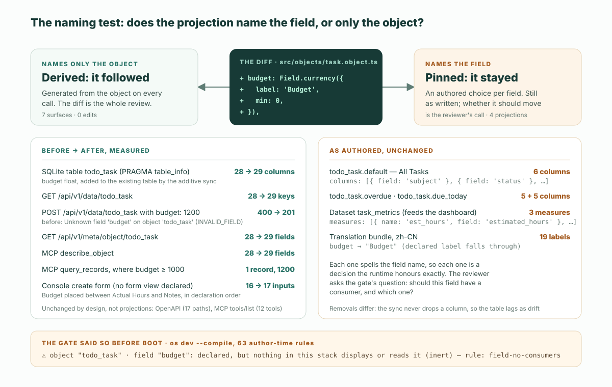

これが diff の全部だ。五行、項目一つ。ObjectStack リポジトリに同梱されている Todo サンプルの `todo_task` オブジェクトに足したものである：

```diff
     actual_hours: Field.number({
       label: 'Actual Hours',
       scale: 2,
       min: 0,
     }),
+
+    budget: Field.currency({
+      label: 'Budget',
+      min: 0,
+    }),
```

ObjectStack ランタイムで起動すると、この五行はデータベースのテーブル、REST の読み取りと書き込み、メタデータエンドポイント、MCP の `describe_object` と `query_records` の応答、そして Console の新規作成フォームを変えた。七つの面で、どれ一つ編集していない。三つのリストビュー、ダッシュボードのデータセット、中国語の翻訳は変わらなかった。どれも項目を名前で指しているからだ。前者のグループは定義から導出され、後者は定義に固定されている。**命名テスト**は、どの投影でも開く前に二つのどちらかへ振り分ける：*項目の名前を書いているなら、あなたがレビューする。オブジェクトの名前しか書いていないなら、ランタイムがもう済ませている。* 本稿の残りは、この一文の裏にある計測だ。ObjectStack `18.3.0`——実行時点で npm の `latest` だったリリース——で、サンプルのソースはそのリリースのコミット `83d7e4ae` から取った。あわせて、それが diff の読み方の何を変えるかを書く。

## 投影の定義はどこにあるか

投影とは何かは、すでに三か所で定義されていて、本稿はそれを繰り返さない。[『オントロジーがソフトウェアである』](/ja/blog/the-ontology-is-the-software/)というエッセイも、この語を使うたびに守る二つの境界の一つ目として、同じ線を引いている。[定義の記事](/ja/blog/what-does-the-ontology-is-the-software-mean/)は四つの投影を挙げ、中核と投影を見分ける削除テストを示す。[オントロジーのページ](/en/ontology/)は規則を一行で述べる：中核を変えれば投影は追従する。投影を取り除いても、それが示していたビジネスは変わらない。[用語集の項目](/en/glossary/ontology-projection/)はレビュアーにとっての帰結を足す：投影だけに触れる diff は見せ方を変え、中核に触れる diff は権限を変える。

どれも書いていないのは、投影が*どうやって*追従するかだ。「追従する」には二つの異なる仕組みが含まれていて、レビュアーは目の前にあるのがどちらなのかを知る必要がある。以下の実行が答えるのはその問いである。

## 実行：項目一つ、読み取り十一個

対象は同梱の Todo サンプル（`examples/app-todo`）だ。リポジトリのコミット `83d7e4ae`（`@objectstack/cli@18.3.0` のリリースタグ）からコピーし、公開済みの `18.3.0` パッケージを使って `os dev` で動かした。データベースはローカルの SQLite ファイルで、API キーはシードされた開発用管理者から REST で発行した。読み取りはすべて二回行った。一回はコミットされた定義のまま、もう一回は上の五行の diff を当てて `--compile` 付きで再起動したあとだ。「前」と「後」がその二つの答えである。

| 面 | 読み方 | 前 | 後 | 追従するか |
| :--- | :--- | :--- | :--- | :--- |
| データベースのテーブル `todo_task` | SQLite ファイルへの `PRAGMA table_info` | 28 列 | 29 列。既存のテーブルに `budget float` が追加 | 導出 |
| REST の読み取り | `GET /api/v1/data/todo_task` | レコードあたり 28 キー | 29 キー | 導出 |
| REST の書き込み | `budget: 1200` 付きの `POST /api/v1/data/todo_task` | `400`——`Unknown field 'budget' on object 'todo_task'`、コード `INVALID_FIELD` | `201`、レコード作成 | 導出 |
| メタデータエンドポイント | `GET /api/v1/meta/object/todo_task` | 28 項目 | 29 項目。`{ label: 'Budget', type: 'currency', min: 0, … }` | 導出 |
| MCP `describe_object` | `/api/v1/mcp` への `tools/call` | 28 項目 | 29 項目 | 導出 |
| MCP `query_records` | `where: { budget: { $gte: 1000 } }, fields: ['subject', 'budget']` | — | `[["Renew the domain", 1200]]` | 導出 |
| Console の新規作成フォーム | `/_console/apps/com.example.todo/todo_task/new` | 入力欄 16 | 17。*Budget* が宣言順どおり *Actual Hours* と *Notes* の間に | 導出 |
| Console のレコード詳細 | 新しいレコードのページ | — | *Overview* タブに `BUDGET 1,200.00` | 導出 |
| Console のリストビュー *All Tasks* | `GET /api/v1/meta/view` → `todo_task.default` | 6 列 | 6 列、変化なし | 固定 |
| 翻訳 `zh-CN` | `Accept-Language: zh-CN` 付きの `GET /api/v1/meta/object/todo_task` | `subject` → 主题 | `budget` → `Budget`（英語にフォールバック） | 固定 |
| ダッシュボードのデータセット `task_metrics` | データセットの定義 | 6 ディメンション、3 メジャー、どれも項目を名指し | 変化なし。メジャーが `budget` を名指すまで、何も `budget` をグラフにできない | 固定 |

動かなかった読み取りが二つあり、どちらも投影ではない。OpenAPI ドキュメントは `todo_task` について相変わらず 17 本のパスを並べ、項目ごとのスキーマはない。MCP の `tools/list` も相変わらず同じ 12 個のツール（`list_objects`、`describe_object`、`validate_expression`、`query_records`、`aggregate_records`、`get_record`、`create_record`、`update_record`、`delete_record`、`list_actions`、`run_action`、`resume_run`）を返す。どちらも項目ではなくオブジェクトを記述している。項目は応答の中身には現れるが、その形には現れない。



もう一つの読み取りはおまけで付いてきた。`os dev --compile` は成果物を書き出す前にオーサリング時ルールを走らせる。ゲートが新しい項目について出力したのはこれだ：

```text
⚠ object "todo_task" · field "budget": declared, but nothing in this stack displays or reads it (inert)
  fix: add it to a view column or a form section, or remove the declaration
  rule: field-no-consumers  at objects[0].fields.budget — `os explain field-no-consumers` for what counts as a consumer
```

`os explain field-no-consumers` は消費者を <span lang="en">"a view column, an inline grid column, a form section, a page binding, a flow node, a dataset or cube member, a dashboard widget, a formula, a validation, a hook or an action that names it"</span>（それを名指すビュー列、インライングリッド列、フォームセクション、ページバインディング、フローノード、データセットまたはキューブのメンバー、ダッシュボードウィジェット、数式、検証、フック、アクション）と定義する。18.3.0 の文面はさらに、宣言された項目グループと、シードやインポートマッピングの照合キーも数に入れる。そして消費者を、<span lang="en">"names a field without reading it"</span>（項目を読まずに名指すだけ）の運び手から区別する。例は <span lang="en">"a translation label, a seed value, an import-mapping target, a permission grant"</span>（翻訳ラベル、シード値、インポートマッピングの宛先、権限の付与）だ。ゲートのこの一覧は、表の右側の列そのものだ。どの投影が項目に固定されているか、そしてそのどれもまだこの項目を拾っていないことを、ランタイムが起動前に教えている。

## 命名テスト

なぜ七つの面が追従し、四つはその場に留まるのか。どれかがより重要だからではない。それぞれが何を名指しているかの違いだ。

テーブル、REST ルート、メタデータエンドポイント、MCP ツールはオブジェクトから生成される。SQL ドライバのスキーマ同期は `obj.fields` をたどり、エントリごとに列を作る。データルートはオブジェクトごとに登録され、オブジェクトが持つ項目をそのまま読む。`describe_object` は `Object.entries(def.fields)` を応答に写す。Console は `todo_task` にフォームビューが宣言されていないのを見て、オブジェクト自身の項目を並べる。どれも項目名のリストを持っていない。持っているのはオブジェクトの名前で、残りは呼ばれるたびに定義へ尋ねる。だから項目は編集なしで全部に届き、しかも宣言順に届いた。

リストビュー、データセット、翻訳バンドルもオーサリングされたメタデータであり、どれも項目名を書き出している：`columns: [{ field: 'subject' }, { field: 'status' }, …]`、`measures: [{ name: 'est_hours', field: 'estimated_hours', … }]`、`fields: { subject: { label: '主题' }, … }`。項目を名指す投影は、その項目について選択をしている——この列、このラベル、この集計——そしてランタイムはその選択を正確に守る。頼んでいないものは足さない。

だから、レビュアー向けに言い直したテストはこうなる：

> **命名テスト。** diff が届きうる投影の一つひとつについて、それが項目を名指しているのか、オブジェクトしか名指していないのかを問う。オブジェクトしか名指していなければ、それは導出されている。読んでいる diff が変更の全部で、ランタイムはもう伝播させた。項目を名指していれば、それは固定されている。動いていないし、動くべきだったかどうかはあなたが決める。

これは定義の記事の削除テストと組み合わさる。削除テストは定義を中核か投影かに振り分ける。命名テストは、中核の変更が届きうる投影を導出か固定かに振り分ける。二つがあれば、レビュアーは diff だけから、ランタイムが何をしたか、何がまだ判断を待っているかがわかる。

## diff の読み方の何が変わるか

実際の帰結は作業の順番であり、多くのチームが従っている順番より短い。

**第一に、定義の行が、導出されるすべての面のレビューになる。** 横に並べて読むテーブルのマイグレーションも、シリアライザも、コントローラも、ツールのマニフェストもない。上の実行で `budget` 列があるのは項目があるからで、REST の書き込みが `budget` を受け付けるのも項目があるからで、エージェントの `describe_object` に出るのも項目があるからだ。項目が正しければそれらも正しく、項目が間違っていれば、それらも項目とまったく同じ形で間違う。五行をレビューすれば七つの面をレビューしたことになる。それがタイトルの約束した一文であり、用語集が「中核に触れる diff は権限を変える」と言うときの意味でもある。

**第二に、固定された投影の中で項目の名前を検索する——そして何も見つからないと予想しておく。** 足された項目は、どのビューにも、データセットにも、翻訳にも現れない。どれも編集されていないからだ。それはランタイムが隠した漏れではない。ゲートが出力した警告そのものだ。レビュアーの問いは、ゲートの `fix:` 行が投げかける問いと同じだ：この項目には消費者が要るか、要るならどれか。`budget` なら、おそらく *All Tasks* の列と `zh-CN` のラベル。ダッシュボードのメジャーはたぶんまだ要らない。三つの名前のあるファイルへの、三つの小さく意図的な編集で、どれも最初の五行と同じくらいレビューしやすい。

**第三に、削除は別の種類の変更として扱う。** ここまでの話はすべて項目の追加についてだ。ドライバのスキーマ同期は追加しかしない。欠けたテーブルを作り、欠けた列を足すが、既存の列を変更したり削除したりは決してしない。だから削除や改名された項目は列を置き去りにし、それは `os migrate` が報告して人が突き合わせるドリフトになる。導出される面は削除にすぐ追従する——REST のレコードからキーが消え、`describe_object` から項目が消える——が、テーブルは追従しない。そして削除された項目をまだ名指している固定の投影はすべて間違いになり、同じゲートがそれを宙に浮いたバインディングとして教えてくれる。命名テストはそのまま使える。見るべきものの一覧が長くなり、マイグレーションから始まるだけだ。

この順番は、[四段階のレビューチェックリスト](/en/blog/how-to-review-ai-generated-app-changes/)の欠けていた半分でもある。その四段階目は「項目とビューは最後に」だ。命名テストはどのビューかを言う：その項目を名指しているビューだ。残りは、項目をレビューしたときにレビュー済みである。

## 固定の弁護

表の右側の列を制約として読むのは簡単だが、誠実な読み方はその逆だ。

新しい列を自動で全部足すグリッドは、開発者がフローの書き込み先として項目を一つ足すたびに画面を並べ替えてしまう。数値項目を全部グラフにするダッシュボードは `recurrence_interval` までグラフにする。ラベルを勝手に作る翻訳は、誰も書いていない翻訳だ。固定された投影が固定されているのは、人が見せ方について決めたからで、それを黙って上書きするランタイムこそ、この形式が防ぐために存在するもの——誰も宣言していない振る舞い——になる。Console 自身のフォールバック——フォームビューが宣言されていなければ全項目を並べる——は、規則を裏付ける例外だ。まだ誰も何も決めていない場所でしか効かない。

この形式がレビュアーに与えるのは、固定された投影が追従することではなく、それが*見つけられる*ことだ。同じリポジトリのメタデータで、項目を名指していて、ゲートが列挙する。手書きのコードベースでの代わりは、React コンポーネントの中の列リスト、別のディレクトリのシリアライザ、JSON ファイルのラベル、第三のシステムのグラフ設定で、それらが同じ項目についてのものだと知っているものは何もない。

## 本稿が扱わないこと

一つのサンプルでの計測は、一つのサンプルでの計測だ。四つのことがその外に残る。

**手で調整したビューは手で調整したままだ。** Todo サンプルのリストビューはすべて列を宣言しており、CRM サンプルのビューも同じだ。新しい項目が固定のグリッドに届くのは誰かが足したときだけで、その誰かは多くの場合、同じ PR で項目を足したエージェントだ。命名テストはそこを見ろと言う。見るのはテストではない。

**翻訳は書かれなければならない。** ランタイムは宣言されたラベルにフォールバックするので、`zh-CN` のエントリが欠けていれば何もないのではなく `Budget` と表示される。それは正しいデフォルトだが、中国語のユーザーには見える穴でもある。翻訳は最も厳密な意味で固定された投影だ。その中の文字列はどれも一つの決定である。

**外部の消費者はスタックの外にいる。** ゲート自身がそう言っている：<span lang="en">"a consumer can legitimately live outside the stack — an API client, a hook or package this stack does not carry, a Studio-authored view"</span>（消費者は正当にスタックの外にいることがある——API クライアント、このスタックが持たないフックやパッケージ、Studio で作られたビュー）。別のツールで `estimated_hours` を名前で選ぶダッシュボードはその項目に固定されているが、リポジトリの中の何もそれを知らない。命名テストはそれにも当てはまる。列挙は当てはまらない。

**意味の変更は構造の変更ではない。** 項目の追加は簡単なケースで、だからこそ前後をきれいに比べるために選んだ。代わりに項目の*意味*を変える——たとえば `status` に `cancelled` という選択肢を足す——と、導出される面は同じように忠実に追従する。だが Todo サンプルの *Overdue Tasks* ビューと *Overdue Tasks* 指標はどちらも期限切れを `status != completed` として書いているので、期限を過ぎたキャンセル済みのタスクは両方で期限切れに数えられる。項目自身はその定義を一度だけ宣言している——`due_date` は `` dueLike: true, settledWhen: P`record.status == 'completed'` `` を持つ（18.3.0 の `examples/app-todo/src/objects/task.object.ts` 73–74 行目）——が、仕様は両方のキーを表示専用と定めており、読むのは Console の日付セルだ。だからビューのフィルタと指標は、いまも規則をそれぞれ自分で書いている。これはビュー、ダッシュボード、オブジェクトの定義を読んだ結果であって計測ではない。そして命名テストが指し示す——三つとも `status` を名指している——が、代わりに決めてはくれない種類の帰結である。

## エージェントをここに向ける

上の実行はリポジトリから再現でき、パッケージをインストールしたあとなら一分ほどで終わる。つまりエージェントが代わりにやれることでもある。コーディングエージェントを ObjectStack プロジェクトに向ける——スキャフォルダは `AGENTS.md` を書きスキルバンドルをインストールし、動いているアプリは `/api/v1/mcp` で MCP を提供し、[設定のしかた](/en/blog/how-to-point-your-agent-at-objectstack/)がルールファイル、スキル、ツールサーバーを扱っている。そしてエージェントが項目への変更を出してきたら、その diff 自身の命名テストの表を求める：どの面が追従したか、どの投影がその項目を名指しているか、それぞれについてどうするつもりか。ゲートの `field-no-consumers` の行がその表の最初の一行で、エージェントはあなたより先にそれを読める。

本稿のすべてはオープンソースのスタックで動いた。「同じループをホスト型で、ブラウザだけで、何もインストールせずに使いたい？それが ObjectOS — ObjectStack の上に構築された商用ランタイム環境です。」ObjectOS は、ブラウザ上でホストされインストール不要の ObjectOS Cloud としても、自社インフラでセルフマネージドの ObjectOS Enterprise としても動作します。オントロジーは通常の ObjectStack メタデータです。ObjectOS Cloud または ObjectOS Enterprise からエクスポートしてオープンソースの ObjectStack ランタイムで実行する機能は、計画中です。命名テストはホストによって変わらない。それが読む定義は同じファイルだ。
