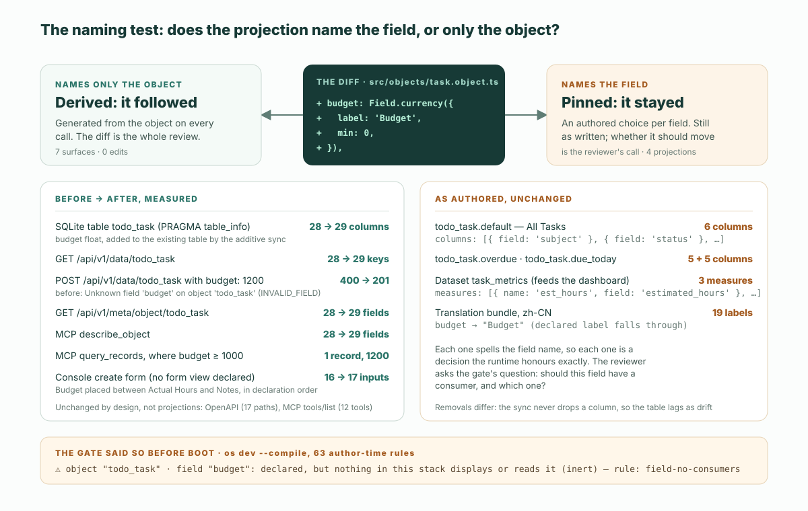

이것이 diff 전부다. 다섯 줄, 필드 하나. ObjectStack 저장소에 함께 들어 있는 Todo 예제의 `todo_task` 객체에 더한 것이다:

```diff
     actual_hours: Field.number({
       label: 'Actual Hours',
       scale: 2,
       min: 0,
     }),
+
+    budget: Field.currency({
+      label: 'Budget',
+      min: 0,
+    }),
```

ObjectStack 런타임에서 띄우자 이 다섯 줄은 데이터베이스 테이블, REST 읽기와 쓰기, 메타데이터 엔드포인트, MCP의 `describe_object`와 `query_records` 응답, 그리고 Console의 새로 만들기 폼을 바꿨다. 일곱 개의 면이고, 그중 어느 것도 편집하지 않았다. 세 개의 목록 뷰, 대시보드의 데이터셋, 중국어 번역은 바뀌지 않았다. 각각이 필드를 이름으로 가리키기 때문이다. 앞의 무리는 정의에서 파생되고, 뒤의 무리는 정의에 고정되어 있다. **명명 테스트**는 어떤 투영이든 열어 보기 전에 둘 중 하나로 나눈다: *필드의 이름을 적고 있으면 당신이 리뷰한다. 객체의 이름만 적고 있으면 런타임이 이미 했다.* 이 글의 나머지는 그 문장 뒤에 있는 측정이다. ObjectStack `18.3.0`——실행 시점에 npm의 `latest`였던 릴리스——에서, 예제 소스는 그 릴리스의 커밋 `83d7e4ae`에서 가져왔다. 그리고 그것이 diff를 읽는 방식에서 무엇을 바꾸는지를 쓴다.

## 투영의 정의는 어디에 있는가

투영이 무엇인지는 이미 세 곳에서 정의되어 있고, 이 글은 그것을 되풀이하지 않는다. [「온톨로지가 곧 소프트웨어다」](/ko/blog/the-ontology-is-the-software/)라는 에세이도, 이 말을 쓸 때마다 지키는 두 경계 중 첫 번째로 같은 선을 긋는다. [정의 글](/ko/blog/what-does-the-ontology-is-the-software-mean/)은 네 가지 투영을 꼽고, 핵심과 투영을 가르는 제거 테스트를 제시한다. [온톨로지 페이지](/en/ontology/)는 규칙을 한 줄로 말한다: 핵심을 바꾸면 투영이 따라온다. 투영을 제거해도 그것이 보여 주던 비즈니스는 바뀌지 않는다. [용어집 항목](/en/glossary/ontology-projection/)은 리뷰어에게 주는 귀결을 더한다: 투영만 건드리는 diff는 보여 주는 방식을 바꾸고, 핵심을 건드리는 diff는 권한을 바꾼다.

그 어느 곳도 말하지 않는 것은 투영이 *어떻게* 따라오는가다. 「따라온다」에는 서로 다른 두 메커니즘이 들어 있고, 리뷰어는 눈앞의 것이 어느 쪽인지 알아야 한다. 아래의 실행이 답하는 것이 바로 그 질문이다.

## 실행: 필드 하나, 판독 열한 개

대상은 함께 들어 있는 Todo 예제(`examples/app-todo`)다. 저장소의 커밋 `83d7e4ae`(`@objectstack/cli@18.3.0` 릴리스 태그)에서 복사해, 공개된 `18.3.0` 패키지로 `os dev`를 실행했다. 데이터베이스는 로컬 SQLite 파일이고, API 키는 시드된 개발용 관리자로 REST를 통해 발급했다. 모든 판독은 두 번 했다. 한 번은 커밋된 정의 그대로, 한 번은 위의 다섯 줄 diff를 적용하고 `--compile`로 재시작한 뒤다. 「전」과 「후」가 그 두 답이다.

| 면 | 읽은 방법 | 전 | 후 | 따라오는가 |
| :--- | :--- | :--- | :--- | :--- |
| 데이터베이스 테이블 `todo_task` | SQLite 파일에 `PRAGMA table_info` | 28열 | 29열. 기존 테이블에 `budget float` 추가 | 파생 |
| REST 읽기 | `GET /api/v1/data/todo_task` | 레코드당 키 28개 | 키 29개 | 파생 |
| REST 쓰기 | `budget: 1200`을 담은 `POST /api/v1/data/todo_task` | `400` — `Unknown field 'budget' on object 'todo_task'`, 코드 `INVALID_FIELD` | `201`, 레코드 생성 | 파생 |
| 메타데이터 엔드포인트 | `GET /api/v1/meta/object/todo_task` | 필드 28개 | 29개. `{ label: 'Budget', type: 'currency', min: 0, … }` | 파생 |
| MCP `describe_object` | `/api/v1/mcp`에 `tools/call` | 필드 28개 | 29개 | 파생 |
| MCP `query_records` | `where: { budget: { $gte: 1000 } }, fields: ['subject', 'budget']` | — | `[["Renew the domain", 1200]]` | 파생 |
| Console 새로 만들기 폼 | `/_console/apps/com.example.todo/todo_task/new` | 입력란 16개 | 17개. *Budget*이 선언 순서대로 *Actual Hours*와 *Notes* 사이에 | 파생 |
| Console 레코드 상세 | 새 레코드의 페이지 | — | *Overview* 탭에 `BUDGET 1,200.00` | 파생 |
| Console 목록 뷰 *All Tasks* | `GET /api/v1/meta/view` → `todo_task.default` | 6열 | 6열, 변화 없음 | 고정 |
| 번역, `zh-CN` | `Accept-Language: zh-CN`을 붙인 `GET /api/v1/meta/object/todo_task` | `subject` → 主题 | `budget` → `Budget`(영어로 폴백) | 고정 |
| 대시보드 데이터셋 `task_metrics` | 데이터셋 정의 | 디멘션 6개, 메저 3개, 각각 필드 하나를 지목 | 변화 없음. 어떤 메저가 `budget`을 지목하기 전까지는 아무것도 그것을 차트로 그릴 수 없다 | 고정 |

움직이지 않은 판독이 둘 있고, 둘 다 투영이 아니다. OpenAPI 문서는 `todo_task`에 대해 여전히 경로 17개를 나열하며 필드별 스키마는 없다. MCP `tools/list`도 여전히 같은 도구 12개(`list_objects`, `describe_object`, `validate_expression`, `query_records`, `aggregate_records`, `get_record`, `create_record`, `update_record`, `delete_record`, `list_actions`, `run_action`, `resume_run`)를 응답한다. 둘 다 필드가 아니라 객체를 기술한다. 필드는 응답의 내용 안에는 나타나지만 그 모양에는 나타나지 않는다.



판독 하나는 덤으로 따라왔다. `os dev --compile`은 산출물을 쓰기 전에 작성 시점 규칙을 돌린다. 게이트가 새 필드에 대해 출력한 것은 이것이다:

```text
⚠ object "todo_task" · field "budget": declared, but nothing in this stack displays or reads it (inert)
  fix: add it to a view column or a form section, or remove the declaration
  rule: field-no-consumers  at objects[0].fields.budget — `os explain field-no-consumers` for what counts as a consumer
```

`os explain field-no-consumers`는 소비자를 <span lang="en">"a view column, an inline grid column, a form section, a page binding, a flow node, a dataset or cube member, a dashboard widget, a formula, a validation, a hook or an action that names it"</span>(그것을 지목하는 뷰 열, 인라인 그리드 열, 폼 섹션, 페이지 바인딩, 플로 노드, 데이터셋 또는 큐브 멤버, 대시보드 위젯, 수식, 검증, 훅, 액션)으로 정의한다. 18.3.0의 문구는 이어서 선언된 필드 그룹과, 시드나 가져오기 매핑의 매칭 키도 셈에 넣는다. 그리고 소비자를 <span lang="en">"names a field without reading it"</span>(필드를 읽지 않고 이름만 적는) 운반자와 구분한다. 예로 <span lang="en">"a translation label, a seed value, an import-mapping target, a permission grant"</span>(번역 라벨, 시드 값, 가져오기 매핑의 대상, 권한 부여)를 든다. 게이트의 이 목록이 곧 표의 오른쪽 열이다. 어떤 투영이 필드에 고정되어 있는지, 그리고 그중 어느 것도 아직 이 필드를 받아들이지 않았다는 것을 런타임이 부팅 전에 알려 주는 것이다.

## 명명 테스트

왜 일곱 개의 면은 따라오고 네 개는 제자리에 있는가? 어떤 것이 더 중요해서가 아니다. 각각이 무엇을 지목하느냐 때문이다.

테이블, REST 라우트, 메타데이터 엔드포인트, MCP 도구는 객체에서 생성된다. SQL 드라이버의 스키마 동기화는 `obj.fields`를 훑으며 항목마다 열을 만든다. 데이터 라우트는 객체별로 등록되고 객체가 가진 필드를 그대로 읽는다. `describe_object`는 `Object.entries(def.fields)`를 응답으로 옮긴다. Console은 `todo_task`에 폼 뷰가 선언되지 않은 것을 보고 객체 자신의 필드를 배치한다. 이 중 어느 것도 필드 이름의 목록을 들고 있지 않다. 들고 있는 것은 객체의 이름이고, 나머지는 호출될 때마다 정의에 묻는다. 그래서 필드는 편집 없이 모두에 닿았고, 선언 순서대로 닿았다.

목록 뷰, 데이터셋, 번역 번들도 작성된 메타데이터이고, 각각 필드 이름을 적어 둔다: `columns: [{ field: 'subject' }, { field: 'status' }, …]`, `measures: [{ name: 'est_hours', field: 'estimated_hours', … }]`, `fields: { subject: { label: '主题' }, … }`. 필드를 지목하는 투영은 그 필드에 대해 선택을 하고 있다 — 이 열, 이 라벨, 이 집계 — 그리고 런타임은 그 선택을 정확히 지킨다. 요청하지 않은 것은 더하지 않는다.

그래서 리뷰어를 위해 말하면 테스트는 이렇다:

> **명명 테스트.** diff가 닿을 수 있는 투영 하나하나에 대해, 그것이 필드를 지목하는지 객체만 지목하는지 묻는다. 객체만 지목한다면 파생된 것이다. 당신이 읽고 있는 diff가 변경의 전부이고, 런타임은 이미 그것을 전파했다. 필드를 지목한다면 고정된 것이다. 움직이지 않았고, 움직였어야 하는지는 당신이 판단한다.

이것은 정의 글의 제거 테스트와 맞물린다. 제거 테스트는 정의를 핵심과 투영으로 나눈다. 명명 테스트는 핵심 변경이 닿을 수 있는 투영을 파생과 고정으로 나눈다. 둘이 있으면 리뷰어는 diff만 보고도 런타임이 무엇을 했고 무엇이 아직 결정을 기다리는지 안다.

## diff를 읽는 방식에서 무엇이 바뀌는가

실제 귀결은 작업 순서이고, 대부분의 팀이 따르는 순서보다 짧다.

**첫째, 정의 줄이 모든 파생 면에 대한 리뷰다.** 곁에 두고 읽을 테이블 마이그레이션도, 직렬화기도, 컨트롤러도, 도구 매니페스트도 없다. 위의 실행에서 `budget` 열이 있는 것은 필드가 있어서이고, REST 쓰기가 `budget`을 받아들이는 것도 필드가 있어서이고, 에이전트의 `describe_object`에 그것이 보이는 것도 필드가 있어서다. 필드가 맞으면 그것들도 맞고, 필드가 틀리면 그것들도 필드와 정확히 같은 방식으로 틀린다. 다섯 줄을 리뷰하면 일곱 개의 면을 리뷰한 것이다. 그것이 제목이 약속한 문장이고, 용어집 항목이 「핵심을 건드리는 diff는 권한을 바꾼다」고 할 때의 뜻이다.

**둘째, 고정된 투영에서 필드 이름을 검색한다 — 그리고 아무것도 찾지 못할 것으로 예상한다.** 더해진 필드는 어떤 뷰에도, 데이터셋에도, 번역에도 나타나지 않는다. 그중 어느 것도 편집되지 않았기 때문이다. 그것은 런타임이 숨긴 누락이 아니라 게이트가 출력한 경고다. 리뷰어의 질문은 게이트의 `fix:` 줄이 던지는 질문과 같다: 이 필드에 소비자가 있어야 하는가, 있다면 무엇인가? `budget`이라면 아마 *All Tasks*의 열 하나와 `zh-CN` 라벨 하나다. 대시보드 메저는 아마 아직 아니다. 이름 붙은 세 파일에 대한 작고 의도적인 편집 세 개이고, 각각이 처음의 다섯 줄만큼 리뷰하기 쉽다.

**셋째, 삭제는 다른 종류의 변경으로 다룬다.** 위의 모든 것은 필드를 추가하는 이야기다. 드라이버의 스키마 동기화는 추가만 한다. 빠진 테이블을 만들고 빠진 열을 더하지만, 기존 열을 바꾸거나 지우지는 않는다. 그래서 삭제되거나 이름이 바뀐 필드는 자기 열을 남겨 두고, 그것은 `os migrate`가 보고하고 사람이 맞춰 보는 드리프트가 된다. 파생 면은 삭제를 곧바로 따른다 — REST 레코드에서 키가 사라지고 `describe_object`에서 필드가 사라진다 — 하지만 테이블은 따르지 않는다. 그리고 삭제된 필드를 여전히 지목하는 고정 투영은 모두 틀린 것이 되며, 같은 게이트가 그것을 매달린 바인딩으로 알려 준다. 명명 테스트는 그대로 적용된다. 살펴볼 목록이 더 길어지고, 마이그레이션에서 시작할 뿐이다.

이 순서는 [네 단계 리뷰 체크리스트](/en/blog/how-to-review-ai-generated-app-changes/)에서 빠져 있던 절반이기도 하다. 그 네 번째 단계는 「필드와 뷰는 마지막에」다. 명명 테스트는 어떤 뷰인지 말해 준다: 그 필드를 지목하는 뷰다. 나머지는 필드를 리뷰할 때 이미 리뷰되었다.

## 고정을 변호하며

표의 오른쪽 열을 한계로 읽기는 쉽지만, 정직한 읽기는 그 반대다.

새 열을 모두 자동으로 더하는 그리드는, 개발자가 플로의 쓰기 대상으로 필드 하나를 더할 때마다 화면을 다시 배치할 것이다. 숫자 필드를 모두 그리는 대시보드는 `recurrence_interval`까지 그릴 것이다. 라벨을 지어내는 번역은 아무도 쓰지 않은 번역이다. 고정된 투영이 고정된 것은 사람이 보여 주는 방식에 대해 결정했기 때문이고, 그것을 조용히 덮어쓰는 런타임이야말로 이 형식이 막으려고 존재하는 것 — 아무도 선언하지 않은 동작 — 이 된다. Console 자신의 폴백 — 폼 뷰가 선언되지 않으면 모든 필드를 배치한다 — 은 규칙을 증명하는 예외다. 아직 아무도 아무것도 결정하지 않은 곳에서만 작동한다.

이 형식이 리뷰어에게 주는 것은 고정된 투영이 따라온다는 것이 아니라 그것을 *찾을 수 있다*는 것이다. 같은 저장소의 메타데이터이고, 필드를 지목하며, 게이트가 열거한다. 손으로 쓴 코드베이스에서의 대안은 React 컴포넌트 안의 열 목록, 다른 디렉터리의 직렬화기, JSON 파일의 라벨, 세 번째 시스템의 차트 설정이고, 그것들이 같은 필드에 관한 것임을 아는 것은 아무것도 없다.

## 이 글이 다루지 않는 것

예제 하나에서의 측정은 예제 하나에서의 측정이다. 네 가지가 그 바깥에 남는다.

**손으로 다듬은 뷰는 손으로 다듬은 그대로다.** Todo 예제의 모든 목록 뷰는 열을 선언하고, CRM 예제의 모든 뷰도 그렇다. 새 필드가 고정된 그리드에 닿는 것은 누군가 그것을 더할 때뿐이고, 그 누군가는 대개 같은 PR에서 필드를 더한 에이전트다. 명명 테스트는 거기를 보라고 말한다. 보는 일 자체를 하지는 않는다.

**번역은 누군가 써야 한다.** 런타임은 선언된 라벨로 폴백하므로, `zh-CN` 항목이 빠져 있으면 빈칸이 아니라 `Budget`이 표시된다. 그것은 옳은 기본값이지만 중국어 사용자에게는 여전히 보이는 빈틈이다. 번역은 가장 엄격한 의미의 고정 투영이다. 그 안의 모든 문자열이 하나의 결정이다.

**외부 소비자는 스택 바깥에 있다.** 게이트 스스로 그렇게 말한다: <span lang="en">"a consumer can legitimately live outside the stack — an API client, a hook or package this stack does not carry, a Studio-authored view"</span>(소비자는 정당하게 스택 바깥에 있을 수 있다 — API 클라이언트, 이 스택이 담고 있지 않은 훅이나 패키지, Studio에서 작성한 뷰). 다른 도구에서 `estimated_hours`를 이름으로 고르는 대시보드는 그 필드에 고정되어 있지만, 저장소 안의 어떤 것도 그것을 모른다. 명명 테스트는 거기에도 적용된다. 열거는 적용되지 않는다.

**의미의 변경은 구조의 변경이 아니다.** 필드 추가는 쉬운 경우이고, 그래서 깔끔한 전후 비교를 위해 골랐다. 대신 필드의 *의미*를 바꿔 보자 — 이를테면 `status`에 `cancelled` 선택지를 더한다 — 그러면 파생 면은 똑같이 충실하게 따라오지만, Todo 예제의 *Overdue Tasks* 뷰와 *Overdue Tasks* 지표는 둘 다 기한 초과를 `status != completed`로 적어 두었으므로, 기한이 지난 취소된 작업은 두 곳 모두에서 기한 초과로 셈해진다. 필드 자신은 그 정의를 한 번 선언해 두었다 — `due_date`에는 `` dueLike: true, settledWhen: P`record.status == 'completed'` ``가 있다(18.3.0의 `examples/app-todo/src/objects/task.object.ts` 73–74행) — 하지만 사양은 두 키를 표시 전용으로 규정하고 그것을 읽는 것은 Console의 날짜 셀이다. 그래서 뷰의 필터와 지표는 여전히 규칙을 저마다 다시 적고 있다. 이것은 뷰, 대시보드, 객체 정의를 읽은 결과이지 측정이 아니며, 명명 테스트가 가리켜 주지만 — 셋 다 `status`를 지목한다 — 대신 결정해 주지는 않는 종류의 귀결이다.

## 에이전트를 여기에 향하게 하라

위의 실행은 저장소에서 재현할 수 있고, 패키지를 설치한 뒤라면 1분쯤 걸린다. 즉 에이전트가 대신 해 줄 수 있는 일이기도 하다. 코딩 에이전트를 ObjectStack 프로젝트에 향하게 하라 — 스캐폴더는 `AGENTS.md`를 쓰고 스킬 번들을 설치하며, 실행 중인 앱은 `/api/v1/mcp`에서 MCP를 제공하고, [설정하는 방법](/en/blog/how-to-point-your-agent-at-objectstack/)이 규칙 파일, 스킬, 도구 서버를 다룬다. 그리고 에이전트가 필드에 대한 변경을 내놓으면, 그 diff 자신의 명명 테스트 표를 요구하라: 어떤 면이 따라왔는지, 어떤 투영이 그 필드를 지목하는지, 각각에 대해 무엇을 하려는지. 게이트의 `field-no-consumers` 줄이 그 표의 첫 행이고, 에이전트는 당신보다 먼저 그것을 읽을 수 있다.

이 글의 모든 것은 오픈소스 스택에서 실행되었다. 「이를 실행하기 위해 ObjectStack 저장소는 ObjectOS Community(ghcr.io/objectstack-ai/objectstack 이미지, os start, Console로 이루어진 무료 직접 호스팅 에디션)를 제공하며, ObjectOS Cloud는 호스팅 에디션, ObjectOS Enterprise는 직접 운영하는 라이선스 에디션입니다.」 온톨로지는 일반적인 ObjectStack 메타데이터입니다. ObjectOS Cloud 또는 ObjectOS Enterprise에서 내보내 오픈소스 ObjectStack 런타임에서 실행하는 기능은 계획 중입니다. 명명 테스트는 호스트에 따라 바뀌지 않는다. 그것이 읽는 정의는 같은 파일이다.
