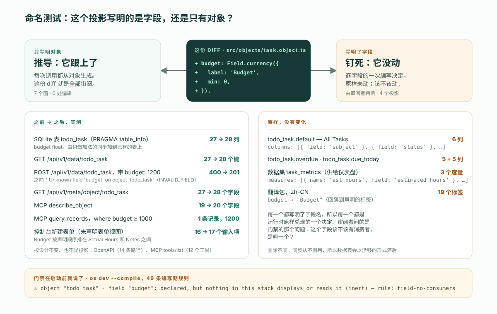

---
# @generated zh-Hant from zh-Hans (s2twp) — edit the zh-Hans file; delete this line to hand-maintain.
title: 檢視、儀表盤和應用是本體的投影：這對審閱意味著什麼
description: 給 ObjectStack 自帶示例加一個欄位並逐面實測：資料表、REST、MCP 與控制台表單自己跟上，釘死欄位名的檢視、資料集和翻譯沒動。命名測試告訴審閱者哪個是哪個。
author: ObjectStack Team
date: 2026-11-10
status: published
topic: app-building
audience: developer
solutions: []
industries: []
cover: ./cover.svg
tags:
  - 本體
  - 可執行業務本體
  - 可審閱的 diff
  - 後設資料審閱
---

下面就是整份 diff。五行，一個欄位，加在 ObjectStack 倉庫自帶的 Todo 示例的 `todo_task` 物件上：

```diff
     actual_hours: Field.number({
       label: 'Actual Hours',
       scale: 2,
       min: 0,
     }),
+
+    budget: Field.currency({
+      label: 'Budget',
+      min: 0,
+    }),
```

在 ObjectStack 執行時上啟動之後，這五行改動了資料庫表、REST 的讀與寫、後設資料介面、MCP 的 `describe_object` 與 `query_records` 應答，以及控制台的新建表單——七個面，沒有一個被編輯過。它們沒有改動三個列表檢視、儀表盤的資料集和中文翻譯，因為這三樣東西都逐個寫明瞭欄位名。前一組是從定義推匯出來的，後一組是釘在定義上的。**命名測試**在你開啟任何一個投影之前就能把它歸到兩組之一：它寫明瞭這個欄位，你就審它；它只寫明瞭物件，執行時已經替你審過了。本文餘下的部分，是這句話背後的測量——在 ObjectStack `18.0.0-next.2` 上、示例原始碼取自提交 `43567a8f`——以及它對讀一份 diff 這件事改變了什麼。

## 投影的定義住在哪裡

投影是什麼，已經有三處定義，本文不重複。[定義那篇](/zh-Hant/blog/what-does-the-ontology-is-the-software-mean/)點名了四種投影，並給出區分核心與投影的刪除測試。[本體頁](/zh-Hant/ontology/)用一句話說明規則：改動核心，投影跟著變；刪掉一個投影，它所展示的業務不變。[術語表條目](/zh-Hant/glossary/ontology-projection/)補上了對審閱者的推論：只碰投影的 diff 改的是呈現，碰到核心的 diff 改的是權限與事實。

它們都沒說的是，投影是*怎麼*跟著變的。「跟著變」底下藏著兩種不同的機制，審閱者得知道眼前的是哪一種。下面這次執行回答的就是這個問題。

## 這次執行：一個欄位，十一個讀數

物件是自帶的 Todo 示例（`examples/app-todo`），從倉庫提交 `43567a8f` 複製出來，用已釋出的 `18.0.0-next.2` 包以 `os dev` 啟動。資料庫是預設的 SQLite 檔案；API key 用種子化的開發管理員通過 REST 簽發。每個讀數取兩次：一次在提交原樣的定義上，一次在上面那五行 diff 之後、帶 `--compile` 重啟之後。「之前」和「之後」就是這兩次的答案。

| 面 | 怎麼讀的 | 之前 | 之後 | 跟著變？ |
| :--- | :--- | :--- | :--- | :--- |
| 資料庫表 `todo_task` | 對 SQLite 檔案執行 `PRAGMA table_info` | 27 列 | 28 列；`budget float` 加到了已有的表上 | 推導 |
| REST 讀 | `GET /api/v1/data/todo_task` | 每條記錄 27 個鍵 | 28 個鍵 | 推導 |
| REST 寫 | `POST /api/v1/data/todo_task`，帶 `budget: 1200` | `400`——`Unknown field 'budget' on object 'todo_task'`，錯誤碼 `INVALID_FIELD` | `201`，記錄已建立 | 推導 |
| 後設資料介面 | `GET /api/v1/meta/object/todo_task` | 27 個欄位 | 28 個；`{ label: 'Budget', type: 'currency', min: 0, … }` | 推導 |
| MCP `describe_object` | 對 `/api/v1/mcp` 發 `tools/call` | 19 個欄位 | 20 個 | 推導 |
| MCP `query_records` | `where: { budget: { $gte: 1000 } }, fields: ['subject', 'budget']` | — | `[["Renew the domain", 1200]]` | 推導 |
| 控制台新建表單 | `/_console/apps/todo_app/todo_task/new` | 16 個輸入項 | 17 個；*Budget* 按宣告順序出現在 *Actual Hours* 和 *Notes* 之間 | 推導 |
| 控制台記錄詳情 | 新記錄的頁面 | — | *Details* 區顯示 `BUDGET 1,200.00` | 推導 |
| 控制台列表檢視 *All Tasks* | `GET /api/v1/meta/view` → `todo_task.default` | 6 列 | 6 列，沒有變化 | 釘死 |
| 翻譯，`zh-CN` | 帶 `Accept-Language: zh-CN` 的 `GET /api/v1/meta/object/todo_task` | `subject` → 主題 | `budget` → `Budget`（回落到英文） | 釘死 |
| 儀表盤資料集 `task_metrics` | 資料集定義本身 | 6 個維度、3 個度量，每個都點名一個欄位 | 沒有變化；在某個度量點名 `budget` 之前，沒有任何圖表能畫它 | 釘死 |

另有兩個讀數沒有變化，而它們也不是投影：OpenAPI 文件仍然為 `todo_task` 列出 14 條路徑，沒有逐欄位的 schema；MCP 的 `tools/list` 仍然應答同樣的 12 個工具（`list_objects`、`describe_object`、`validate_expression`、`query_records`、`aggregate_records`、`get_record`、`create_record`、`update_record`、`delete_record`、`list_actions`、`run_action`、`resume_run`）。兩者描述的都是物件，不是欄位；欄位出現在它們的應答裡，而不是它們的形狀裡。



還有一個讀數是白送的。`os dev --compile` 在寫出工件之前會跑一遍編寫期規則，下面是門禁對這個新欄位列印的原話：

```text
⚠ object "todo_task" · field "budget": declared, but nothing in this stack displays or reads it (inert)
  fix: add it to a view column or a form section, or remove the declaration
  rule: field-no-consumers  at objects[0].fields.budget
```

`os explain field-no-consumers` 把「消費者」定義為「a view column, an inline grid column, a form section, a page binding, a flow node, a dataset or cube member, a dashboard widget, a formula, a validation, a hook or an action that names it」，並把它和「載體」區分開——載體「names a field without reading it」，例如「a translation label, a seed value, an import-mapping target, a permission grant」。門禁的這份清單，正是上表的右半欄。這是執行時在啟動之前就告訴你：哪些投影是釘在欄位上的，而其中還沒有任何一個接住這個新欄位。

## 命名測試

為什麼七個面跟著變、四個面原地不動？不是因為有的更重要。是因為它們各自寫明瞭什麼。

資料表、REST 路由、後設資料介面和 MCP 工具都是從物件生成的。SQL 驅動的結構同步遍歷 `obj.fields`，為每一項建一列；資料路由按物件註冊，讀物件當下有的全部欄位；`describe_object` 把 `Object.entries(def.fields)` 對映成它的應答；控制台發現 `todo_task` 沒有宣告表單檢視，就按物件自己的欄位排版。這些地方沒有一處持有一份欄位名清單。它們持有的是物件名，每次呼叫時向定義要其餘的一切——所以欄位不經編輯就到達了它們全部，而且是按宣告順序到達的。

列表檢視、資料集和翻譯包同樣是編寫出來的後設資料，而且每一個都逐字寫明欄位名：`columns: [{ field: 'subject' }, { field: 'status' }, …]`、`measures: [{ name: 'est_hours', field: 'estimated_hours', … }]`、`fields: { subject: { label: '主題' }, … }`。寫明瞭欄位的投影是在對這個欄位做一個選擇——這一列、這個標籤、這個聚合——執行時會原封不動地兌現這個選擇。你沒要的，它不會替你加。

於是，把測試說給審閱者聽：

> **命名測試。** 對這份 diff 可能波及的每一個投影，問一句：它寫明的是這個欄位，還是隻有物件？只寫明物件的，是推匯出來的：你正在讀的 diff 就是全部改動，執行時已經把它傳播到位。寫明瞭欄位的，是釘死的：它沒有動，該不該動，由你判斷。

它和定義那篇的刪除測試是配套的。刪除測試把一份定義歸為核心或投影；命名測試把一次核心改動能波及的投影歸為推導或釘死。兩條合在一起，審閱者光憑 diff 就知道執行時做了什麼、還有什麼在等一個決定。

## 這對讀 diff 改變了什麼

實際後果是一套工作順序，而且比多數團隊現在遵循的那套更短。

**第一，定義那幾行，就是對所有推導面的審閱。** 沒有要陪著讀的建表遷移，沒有序列化器，沒有控制器，沒有工具清單。在上面的執行裡，`budget` 列存在是因為欄位存在；REST 寫入接受 `budget` 是因為欄位存在；Agent 的 `describe_object` 顯示它是因為欄位存在。欄位對，它們就對；欄位錯，它們就以和欄位一模一樣的方式錯。審五行審掉了七個面——這正是標題承諾的那句話，也正是術語表條目所謂「碰到核心的 diff 改的是權限與事實」的意思。

**第二，在釘死的投影裡搜這個欄位的名字——並且預期什麼都搜不到。** 新加的欄位不會出現在任何檢視、資料集或翻譯裡，因為它們一個都沒被編輯過。這不是執行時藏起來的遺漏，而是門禁打印出來的那條警告。審閱者要問的，正是門禁 `fix:` 那一行提出的問題：這個欄位該不該有一個消費者，是哪一個？對 `budget` 來說，大機率是 *All Tasks* 上的一列和一個 `zh-CN` 標籤；大機率暫時不是一個儀表盤度量。那是對三個具名檔案的三處小而有意的編輯，每一處都和最初那五行一樣可審。

**第三，把刪除當成另一種改動。** 上面說的全是加欄位。驅動的結構同步只做加法：它建缺失的表、加缺失的列，從不修改或刪除已有的列，所以一個被刪掉或改名的欄位會把它的列留在原地，成為 `os migrate` 報告出來、由人來對賬的漂移。推導面會立刻跟上刪除——REST 記錄丟掉那個鍵，`describe_object` 丟掉那個欄位——資料表卻不會。而每一個仍然寫明被刪欄位的釘死投影現在都錯了，同一道門禁會把它當作懸空繫結報出來。命名測試照樣適用；只是要看的清單更長，而且從遷移開始。

這套順序也補上了[四遍審閱清單](/en/blog/how-to-review-ai-generated-app-changes/)缺的那一半——它的第四遍是「欄位和檢視，放最後」。命名測試說的是：哪些檢視。寫明瞭這個欄位的那些。其餘的，在審欄位的時候已經審過了。

## 替釘死說句話

把上表的右半欄讀成一種侷限很容易，而誠實的讀法恰恰相反。

一張會自動把所有新列加進來的網格，會在每次開發者為了讓某條流程有地方寫而加個欄位時，把整個頁面重排一遍。一張會把所有數值欄位都畫出來的儀表盤，會把 `recurrence_interval` 畫出來。一份會自己發明標籤的翻譯，是一份沒人寫過的翻譯。釘死的投影之所以釘死，是因為有人做過一個呈現上的決定；一個悄悄推翻這個決定的執行時，正是這整套格式要防止的那件事——沒有任何人宣告過的行為。控制台自己的回退——沒宣告表單檢視時就把所有欄位排出來——恰好是證明這條規則的例外：它只在還沒有任何人做過決定的地方生效。

這套格式給審閱者的，不是釘死的投影會跟著變，而是它們*找得到*。它們是同一個倉庫裡的後設資料，它們寫明瞭欄位名，門禁能把它們枚舉出來。另一種情況——一份手寫的程式碼庫——是某個 React 元件裡的一份列清單、另一個目錄裡的一個序列化器、一個 JSON 檔案裡的一個標籤、第三套系統裡的一份圖表配置，而沒有任何東西知道它們說的是同一個欄位。

## 本文不覆蓋的

在一個示例上的測量，就是在一個示例上的測量。有四件事留在它之外。

**手工調過的檢視仍然是手工的。** Todo 示例裡每個列表檢視都聲明瞭列，CRM 示例裡每個檢視也是。新欄位到達一張釘死的網格，只能靠有人把它加進去——而這個「有人」常常就是加這個欄位的那個 Agent，在同一個 PR 裡。命名測試告訴你往那裡看；它不替你看。

**翻譯必須有人寫。** 執行時會回落到宣告的標籤，所以缺一條 `zh-CN` 會渲染成 `Budget`，而不是空白。這是對的預設值，但仍然是中文使用者看得見的缺口。翻譯是最嚴格意義上的釘死投影：它裡面的每一個字串都是一個決定。

**外部消費者在棧之外。** 門禁自己就這麼說：「a consumer can legitimately live outside the stack — an API client, a hook or package this stack does not carry, a Studio-authored view」。另一個工具裡按名字選取 `estimated_hours` 的儀表盤，釘在那個欄位上，而倉庫裡沒有任何東西知道它。命名測試對它適用；列舉對它不適用。

**語義改動不是結構改動。** 加欄位是最簡單的情形，所以才選它來做一次乾淨的前後對照。換成改一個欄位的*含義*——比如給 `status` 加一個 `cancelled` 選項——推導面會同樣忠實地跟上，但 Todo 示例的 *Overdue Tasks* 檢視和它的 *Overdue Tasks* 指標都把「逾期」編碼成 `status != completed`，於是一條截止日期已過的已取消任務，在兩處都會被算作逾期。這是對檢視和資料集定義的一次閱讀，不是一次測量，而它正是命名測試會把你指過去——兩個投影都寫明瞭 `status`——卻不替你拍板的那類後果。

## 把你的 Agent 指向它

上面這次執行可以從倉庫復現，包裝好之後大約一分鐘，這意味著它也是你的 Agent 可以替你做的事。把一個編碼 Agent 指向一個 ObjectStack 專案——腳手架會寫出 `AGENTS.md` 並安裝技能包，執行中的應用在 `/api/v1/mcp` 提供 MCP，[如何配置它](/en/blog/how-to-point-your-agent-at-objectstack/)覆蓋了規則檔案、技能和工具伺服器——當它開出一個改欄位的變更時，向它要它自己這份 diff 的命名測試表：哪些面跟上了，哪些投影寫明瞭這個欄位，它打算對每一個怎麼辦。門禁那行 `field-no-consumers` 是這張表的第一行，而 Agent 可以比你先讀到它。

本文的一切都跑在開源棧上。「想把同一個迴圈託管起來、在瀏覽器裡用、什麼都不用安裝？那就是 ObjectOS——建立在 ObjectStack 之上的商業執行環境。」ObjectOS 既可託管在瀏覽器中、無需安裝（ObjectOS Cloud），也可自管部署在你自己的基礎設施上（ObjectOS Enterprise）；無論哪個版本，你都可以匯出本體，拿到開源的 ObjectStack 執行時上執行。命名測試不隨宿主而變；它讀的那份定義，是同一個檔案。
