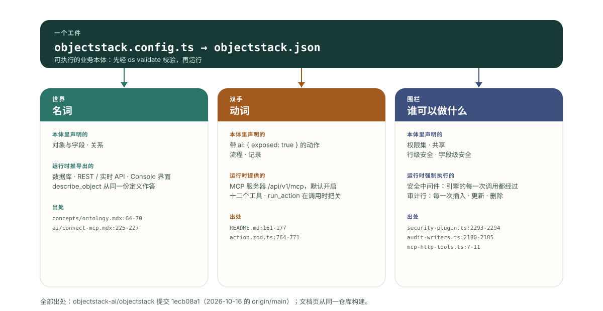

---
# @generated zh-Hant from zh-Hans (s2twp) — edit the zh-Hans file; delete this line to hand-maintain.
title: AI 模型進了企業還缺什麼？一個世界、一雙手、一道圍欄
description: 缺的不是智力。模型進到一家公司，缺一個可以推理的世界、一雙能動手的手、一道圍住動作的圍欄。一份可執行的業務本體同時供給這三樣；文中一張帶出處的表，把每一樣對到執行時裡供給它的機制。
author: ObjectStack Team
date: 2026-11-03
status: published
topic: ai-agents
audience: it
solutions: []
industries: []
cover: ./cover.svg
tags:
  - AI Agent
  - 可執行業務本體
  - MCP
  - Agent 權限
---

**世界**：這家企業裡有什麼，每樣東西是什麼型別，彼此怎麼連。

**雙手**：Agent 可以對這個世界做哪些操作，以它能呼叫的工具的形式給出。

**圍欄**：誰可以做什麼，每一次呼叫都判一次而不是隻判一次，事後留下記錄。

這三樣，是 AI 模型進到一家企業時缺的東西；智力不在其中。這句話出自 ObjectStack 的首頁，「00 · The idea」那一節：「What the model lacks is not intelligence: a world, hands, and a fence.」（模型缺的不是智力，而是一個世界、一雙手和一道圍欄。）本文要做的，是把這句話背後那條更窄、可核驗的主張講清楚：一份可執行的業務本體，用同一個工件同時供給這三樣，而且每一樣都能對到執行時裡一個有名有姓的機制，原始碼裡讀得到。下面那張表就是這份對照，每個格子都給到檔案和行號。表之後依次是：三樣東西各自是什麼；在自帶的 CRM 示例上量出來的一個數字；把最強的替代方案公平地擺出來；以及這一切解決不了什麼。

## 這句話從哪裡來

objectstack.ai 的首頁用三句話陳述這個想法，頁面原始碼裡原樣保留（`apps/docs/app/[lang]/page.tsx` 第 127–131 行）：

> An enterprise is definition plus execution. When execution is nearly free, it is its definition.
>
> What the model lacks is not intelligence: a world, hands, and a fence.
>
> An ontology written clearly enough is software. Models change; the ontology stays.

三句話的意思依次是：企業等於定義加執行，當執行幾乎免費時，企業就是它的定義；模型缺的不是智力，而是一個世界、一雙手和一道圍欄；一份寫得足夠清楚的本體就是軟體，模型會換，本體留下。

把中間那句當作一份診斷來讀。幾乎每一個企業 AI 試點，都是把一個很能幹的模型接進公司，然後一次事故一次事故地發現：模型不知道「客戶」在這家公司裡到底指什麼（沒有世界）；它其實改不動一個客戶記錄（沒有手）；或者它改了一條不該碰的記錄（沒有圍欄）。常見的應對是把缺的三樣分別買齊：一層檢索供給世界，一層函式呼叫供給雙手，一層策略引擎供給圍欄。這是合理的應對，本文後半會給它應有的篇幅。而第一句和第三句說的，是 ObjectStack 為什麼走另一條路：如果業務的定義寫得精確到可以直接執行，那同一份定義就是世界，就聲明瞭雙手，也自帶圍欄——而且不管這個季度讀它的是哪個模型，它都在。

## 三樣供給，一個工件

ObjectStack README 的一行定義是「一份可執行的業務本體。AI 編寫它，執行時執行它，Agent 操作它，你擁有它。」概念頁把它的核心列為六類東西：物件與欄位、關係、動作、權限、流程、Agent 與工具定義。本文的主張是：這六類正好歸入三樣供給，而執行時把每一樣都變成 Agent 直接可用的東西，中間不需要任何人寫膠水程式碼。下面是對照表。所有出處都是 `objectstack-ai/objectstack` 倉庫在提交 `1ecb08a1`（2026-10-16 的 `origin/main`）上的檔案，或者從同一倉庫構建出來的文件頁。

| 模型缺的 | 本體裡供給它的 | 執行時機制，以及寫在哪裡 |
| :--- | :--- | :--- |
| **一個世界**——名詞：有哪些實體，每個是什麼型別，彼此什麼關係 | 物件與欄位；關係（六類中的兩類） | 一份型別化定義編譯成 `objectstack.json`；執行時從它推匯出資料庫結構、REST 與即時 API、Console 介面和一個 MCP 伺服器（`ontology.mdx:64-70`）。Agent 用 `list_objects` 和 `describe_object` 讀這個世界（`connect-mcp.mdx:225-227`）。 |
| **一雙手**——動詞：可以對這些名詞做什麼 | 動作、流程，以及記錄本身 | 執行中的應用就是一個 MCP 伺服器，位於 `/api/v1/mcp`，預設開啟；物件自動暴露，動作要用 `ai: { exposed: true }` 主動開啟（`README.md:161-177`）。這個開關是一個 schema 欄位，預設 `false`，開啟時必須附一段不少於 40 個字元、面向模型的描述（`action.zod.ts:764-771`）。 |
| **一道圍欄**——誰可以做什麼、對哪些行哪些欄位，每次呼叫都查，查完留痕 | 權限、行級與欄位級安全、共享、審計 | 安全是註冊在 ObjectQL 引擎上的中介軟體，引擎的每一次操作都要經過它（`security-plugin.ts:2293-2294`）。MCP 工具以呼叫者的身份執行，走的是「與 REST API 相同的權限/RLS 強制路徑」（`mcp-http-tools.ts:7-11`）。審計行由引擎鉤子在每一次插入、更新、刪除時寫入（`audit-writers.ts:2180-2185`）。 |

這些檔案在哪裡，方便按出處翻開：`README.md` 在倉庫根；`ontology.mdx` 在 `content/docs/concepts/`，`connect-mcp.mdx` 在 `content/docs/ai/`；`action.zod.ts` 在 `packages/spec/src/ui/`；`security-plugin.ts` 在 `packages/plugins/plugin-security/src/`；`mcp-http-tools.ts` 在 `packages/mcp/src/`；`audit-writers.ts` 在 `packages/plugins/plugin-audit/src/`。行號以提交 `1ecb08a1` 為準。

概念頁把右邊那一列壓成一句話，值得整句保留：執行時「在每一次呼叫上強制執行這份定義。RBAC、行級與欄位級安全、共享和審計，對一個 REST 請求、一次 Console 點選和一次 Agent 的工具呼叫一視同仁。執行時不做任何推理：跑的就是校驗過的。」（原文：enforces the definition on every call. RBAC, row-level and field-level security, sharing, and audit apply to a REST request, a Console click and an agent's tool call alike. Nothing is reasoned over at runtime: what runs is what was validated.）



接下來逐行展開這張表。

## 世界：一份執行時也在讀的定義

模型的世界要同時滿足兩個讀者。模型需要它足夠小、足夠明確，能一次裝進上下文整體把握；執行時需要它足夠精確，能直接執行。文件只滿足第一個讀者：一份檢索出來的制度 PDF 能告訴模型「商機」是什麼，但沒有任何東西檢查資料庫是否同意。

可執行本體的世界，就是那份型別化定義本身。概念頁說，本體「是你的業務裡那份由執行時執行的定義：以型別化後設資料寫在 `objectstack.config.ts` 裡，編譯成 `objectstack.json` 工件」。物件與欄位宣告實體及其型別化屬性；關係宣告查詢和主從連結。執行時從這份定義推匯出表和介面，MCP 伺服器的 `describe_object` 工具也從這同一份定義作答。於是 Agent 讀到的世界，在構造上就是正在執行的那個世界。沒有第二份描述可以漂移。

由此推出兩個結論，這個部落格上都已經有專文論證，這裡只指向，不重複。第一，世界是有邊界的：檢視、儀表盤、應用和翻譯是本體的投影，不是它的一部分，這正是 Agent 能從核心而不是從每一個螢幕出發推理業務的原因（[那篇定義文章](/zh-Hant/blog/what-does-the-ontology-is-the-software-mean/)裡有一條「刪除測試」用來區分二者）。第二，世界先校驗後執行：`os validate` 會拒絕那些型別檢查通過、執行時卻會靜默失敗的定義，包括缺失的安全姿態；所以交到 Agent 手裡的世界，已經為其中每一處懸空引用被拒絕過一次。

## 雙手：由作者武裝的工具，不是模型猜出來的工具

雙手是大多數企業 AI 技術棧已經有的部分，形態就是函式呼叫。可執行本體帶來的差別，在於由誰決定哪些手存在。

物件預設帶手。因為定義是型別化的，執行時把它作為 MCP 伺服器提供出來：「物件是工具，動作是工具，權限決定 Agent 可以呼叫什麼，審計記錄它做了什麼。」（`README.md:163-164`，原文 Objects are tools, actions are tools, permissions decide what an agent may call, and audit records what it did.）connect-mcp 頁面把 Agent 拿到的東西列為「十二個工具，由你的後設資料生成」：發現（`list_objects`、`describe_object`、`validate_expression`），讀取（`query_records`、`get_record`、`aggregate_records`），寫入（`create_record`、`update_record`、`delete_record`），以及動作（`list_actions`、`run_action`、`resume_run`）。沒有人為新物件寫工具定義；物件就是工具。

動作預設不帶手，這是刻意設計的部分。一個動作只有在作者寫下 `ai: { exposed: true }`、並寫好模型據以選擇它的描述之後，才成為 Agent 可呼叫的工具。`action.zod.ts` 裡的 schema 註釋說明了原因：「這是一道刻意設定的治理閘門：在一個由 AI 編寫的世界裡，平臺的價值就在於人可以精確管住 Agent 群被允許呼叫哪些能力——一個半成品的、未經評審的動作，絕不能被靜默地武裝起來。」（原文：This is a deliberate governance gate: in an AI-authoring world the platform's value is that a human can govern exactly which capabilities the agent fleet is allowed to invoke — a half-finished or unreviewed action must never be silently armed.）最小的自帶示例 todo 應用，是這樣武裝一個動作的（`examples/app-todo/src/actions/task.actions.ts`，去掉了只與介面相關的鍵）：

```ts
export const CompleteTaskAction = defineAction({
  name: 'complete_task',
  label: 'Mark Complete',
  objectName: 'todo_task',
  type: 'script',
  target: 'completeTask',
  ai: {
    exposed: true,
    description: 'Mark a todo task as complete. Use when the user says a task is done or finished.',
  },
});
```

自帶的 CRM 則一個也沒有武裝。它唯一的動作「Convert Lead」是一個 `flow` 型別的動作，沒有 `ai` 塊，所以連上這個應用的 Agent 擁有六個物件上的全部資料工具，而 `list_actions` 返回空。這不是示例的缺口，這是規則在起作用：對業務邏輯的手，由定義裡一行經過評審的程式碼授予，絕不因為介面上有個按鈕就被預設擁有。

為什麼偏偏寫操作需要這一份受治理的定義，而不是在介面旁邊另開一條工具通路，是[本體動作那篇](/zh-Hant/blog/objectos-action-tools/)的主題，這裡不重複。

## 圍欄：由執行時在每一次呼叫上裁決

寫在提示詞裡的圍欄，是一個請求。架在工具前面的策略服務裡的圍欄，是一道針對呼叫的閘。可執行本體自帶的圍欄在資料路徑上，這個區別決定了一次錯誤能夠到達多遠。

機制是中介軟體。`plugin-security` 把它的強制執行註冊在 ObjectQL 引擎上（`ql.registerMiddleware(...)`，`security-plugin.ts:2294`），而引擎是每一次讀寫都必經的地方，不管請求來自 REST 路由、Console 點選還是 MCP 工具。MCP 工具模組在自己的檔案頭裡就宣告它從不直接觸碰資料引擎：「所有讀寫都經過一個注入的 McpDataBridge，由宿主接到與 REST API 相同的權限/RLS 強制路徑上。這個模組只負責工具的形狀；橋負責執行與安全。」沒有一道專給 Agent 的圍欄需要和給人的那道保持同步，因為只有一道圍欄。每一處檢查到底在哪裡執行、為什麼事後過濾模型輸出已經太晚，[Agent 權限在哪裡強制執行](/zh-Hant/blog/objectos-agent-permission-boundaries/)一文有完整論證。

這道圍欄有三個性質值得點名，因為替代方案通常至少缺其中一個。

**它裁決的是行和欄位，不只是呼叫。** 權限集授予物件級的增、讀、改、刪；行級安全過濾呼叫者能看到哪些記錄；欄位級安全遮住哪些列。安全服務契約把行過濾的失敗姿態寫得很直白：「收窄訪問的回答失敗時關閉……解析失敗返回一個 DENY 過濾器（零行），絕不返回 `undefined`」（`packages/spec/src/contracts/security-service.ts:28-31`）。一個什麼都想要的模型，拿到的是它的使用者被允許看到的。

**它單獨把守業務邏輯，因為邏輯背後沒有兜底。** 物件的增刪改查在每一行上都被 RLS 和 FLS 框住。動作體不是：一旦被呼叫，它「作為受信任的應用程式碼執行」，所以橋「在呼叫時把關：`ai.exposed`（作者明確的 AI 開啟，ADR-0011）加上 ADR-0066 D4 的能力閘」（`mcp-http-tools.ts:1128-1133`）。雙手和圍欄正是在這裡相遇：武裝一個動作的那一行，就是圍欄檢查的那一行。

**它留記錄。** 審計寫入器是掛在 `afterInsert`、`afterUpdate`、`afterDelete` 上的引擎鉤子（`audit-writers.ts:2180-2185`），所以 Agent 用 `update_record` 改過的一行，和在 Console 裡改過的一行，以同樣的方式、帶著操作者身份落進審計日誌。README 的第四道閘把後果寫成一句：「執行時在每一次呼叫上強制權限和審計，所以哪怕是一個寫錯了的應用，也留在圍欄之內。」（原文：The runtime enforces permissions and audit on every call, so even a wrong app stays inside the fence.）

## 在自帶的 CRM 上量一個數

一個數字，用 README「measure it yourself」一節印出來的那條命令，在提交 `1ecb08a1` 的 `examples/app-crm` 上量得：

```bash
find examples/app-crm/src -name '*.ts' -not -name '*.test.ts' | xargs cat | wc -l
# 1844
```

**30 個檔案、1,844 行**，是整個應用。把它的目錄歸入三樣供給：

| 供給 | 目錄 | 行數 | 裡面是什麼 |
| :--- | :--- | ---: | :--- |
| 世界 | `src/objects/` | 486 | 六個物件（客戶、聯絡人、線索、商機、商機明細、活動）及其欄位和查詢關係 |
| 雙手 | `src/actions/` + `src/flows/` | 240 | 一個動作「Convert Lead」，以及它啟動的螢幕流程 |
| 圍欄 | `src/security/` | 88 | 其中 `sales-positions.ts` 佔 78 行：兩個權限集、三個崗位 |
| 管道 | 工具註冊、鑑權中介軟體、審計程式碼 | 0 | 在 `src/` 下搜尋 `registerTool`、`middleware`、`authoriz`、`checkPermission` 和 `audit`，只有兩處命中，都在註釋裡 |

其餘是投影（檢視、一個儀表盤、一個應用、一個頁面、翻譯、一個分析資料集）和種子資料，不在本文範圍內。

把頭條數字叫作 **78 行圍欄**。這是一個六物件 CRM 的全部授權宣告，而同樣這 78 行管著 REST API、Console 和全部十二個 MCP 工具，因為三者都通過圍欄所在的那個引擎觸達資料。與之互補的數字是那個零：應用聲明瞭它的世界、它的雙手和它的圍欄，卻不含一行把它們接到模型上的程式碼。接線是執行時的事，這正是「一個工件」這四個字的全部內容。

關於這次測量，兩條誠實的腳註。78 行是應用自己的宣告；它們所隱含的行過濾和欄位遮蔽，由執行時根據每個物件上的 `sharingModel` 和這些權限集算出來，所以執行中的系統裡，「圍欄」比它的宣告要大，這也是應該的。還有，如前所述，這個 CRM 沒有向 AI 暴露任何動作，所以在作者武裝一個動作之前，它在業務邏輯上的手是零。

## 把替代方案公平地擺出來

供給這三樣東西的常見做法是一個技術棧：對文件和 schema 做檢索供給世界，函式呼叫（或者你自己寫一個工具服務）供給雙手，一個策略引擎或閘道器架在工具前面供給圍欄。它值得被公平對待，因為在好幾種情形下它就是正確答案。

它能和你已經在跑的系統一起工作。什麼都不用遷移；檢索器索引已有的東西，工具包裝已有的 API。每一層都是各自領域裡最好的、可替換的，換一個更好的檢索器或更嚴的策略引擎，不必動其他層。這些模式人人熟悉，供應商眾多，一個已經有工具閘道器的團隊，圍欄的大半已經就位。如果 Agent 的工作是橫跨十幾個遺留系統讀取、卻不寫入任何一個，這個技術棧大概就是你要的——而架在那些系統之上的可執行本體，目前是隻讀的、早期的。

它解決不了的，正是首頁第一句話說的那件事：三樣供給是三個工件，三個主人，沒有任何東西檢查它們是否一致。

| | 檢索 + 函式呼叫 + 策略層 | 一份可執行本體 |
| :--- | :--- | :--- |
| **世界** | 模型讀的一個語料庫；系統不讀它 | 執行時執行的那份定義；`describe_object` 從它作答 |
| **雙手** | 手寫的工具 schema，一個操作一個，在系統旁邊另行維護 | 物件自動成為工具；動作用一行經過評審的程式碼開啟 |
| **圍欄** | 架在工具呼叫上的閘，每個工具背後通常是一個服務賬號的權限 | 資料路徑上的中介軟體，以呼叫使用者的權限執行，連行和欄位一起管 |
| **漂移** | 對業務的三份描述，每一份都可能過期 | 一個工件，先校驗後執行 |
| **審計** | 記下了呼叫；行的變更是下游系統的事 | 行的變更帶著身份被記錄，每條路徑都一樣 |

出事的時候，圍欄那一行最要緊。架在 `get_customer` 工具前面的策略層，可以裁決 Agent 能不能呼叫它。它通常裁決不了結果裡哪些行是 Agent 的使用者被允許看的，因為工具是用整合拿到的那份憑據在跑。資料路徑上的行級和欄位級安全，對每一個呼叫者都回答這個問題，而且對人和 Agent 的回答是同一個。

## 這些解決不了什麼

一篇講圍欄的文章，應該說清圍欄到哪裡為止。

**它不供給判斷力。** 圍欄讓一次錯誤呼叫可以被拒絕、可以被追溯，但不會讓這次呼叫變對。模型仍然可能選錯工具、讀錯欄位，或者要求一個它本不該想要的動作。世界和圍欄框住損害的範圍；而選擇，仍然由模型確實帶來的那樣東西——智力——來做。

**開啟閘門只把守執行時擁有的那些門。** `ai.exposed` 這道閘在 MCP 的 `run_action` 工具所到達的動作門上強制執行。spec 自己的註釋說得明白：「REST `/actions` 不受 `ai.exposed` 把守，在這道閘之外，所以那條路由前面要不要有個人，仍然由你安排。」（`packages/spec/src/ai/tool.zod.ts:95-98`）那條路由上權限照常生效；AI 開啟不生效。

**讀審計比寫審計窄。** 每一次插入、更新、刪除都有記錄。記錄單條記錄的詳情檢視是按物件逐個開啟的，列表和搜尋結果不審計（`packages/plugins/plugin-audit/src/audit-plugin.ts:38-49`）。一個大量讀取的 Agent，留下的痕跡比一個寫入的少。

**世界只到執行時所執行的應用為止。** 對它不執行的系統，聯邦一個外部資料來源預設只讀，並被標明為早期。三樣供給覆蓋的是本體所執行的部分；其餘的 IT 資產仍然需要上面那個技術棧，或者一次遷移。

**暴露出去的動作是受信任的程式碼。** `run_action` 工具在它自己的描述裡就對模型說了：動作體「作為受信任的應用程式碼執行，擁有應用的全部資料權限」。所以武裝一個動作是一項評審決定，不是一個開關；對那些應該先問人的動作，有 `requiresConfirmation: true`。

## 託管，或者放在你自己的基礎設施上

上面的一切都是開放棧，Apache-2.0，在同一個倉庫裡：定義是你手裡的一個檔案。README 接著說：「想把同一個迴圈託管起來、在瀏覽器裡用、什麼都不用安裝？那就是 ObjectOS——建立在 ObjectStack 之上的商業執行環境。」ObjectOS 既可託管在瀏覽器中、無需安裝（ObjectOS Cloud），也可自管部署在你自己的基礎設施上（ObjectOS Enterprise）；無論哪個版本，你都可以匯出本體，拿到開源的 ObjectStack 執行時上執行。三樣供給隨著工件一起走，它跑在哪臺主機上都一樣。

## 讓你的 Agent 指向它

上面這張對照表不需要靠信任來接受；執行中的應用會把它展示給任何一個 MCP 客戶端。

1. 用 `npm create objectstack@latest my-app` 搭一個專案。腳手架會寫好 `AGENTS.md` 並安裝技能包，編碼 Agent 一開始就帶著協議規則；工具伺服器怎麼接，見文末的 Connect an MCP Client 頁面。
2. 向 Agent 要一個世界：幾個帶欄位的物件，物件之間有一個查詢關係。讓它跑 `npm run validate`，先看 diff，再看 Console。
3. 用 `npx os dev --ui` 啟動應用，把任意 MCP 客戶端指向 `http://localhost:3000/api/v1/mcp`。Agent 以一個使用者的身份連進來——走部署自己的 OAuth 伺服器，或者一把 API key——`describe_object` 返回的就是你剛評審過的那個世界。
4. 武裝一隻手：給一個動作加上 `ai: { exposed: true }` 和一段描述，再校驗一次，看著 `list_actions` 從空變成一個。
5. 用第二個使用者測圍欄：讓他缺一項第一個使用者有的權限，讀那條拒絕，再讀那條審計記錄。

[Connect an MCP Client](https://objectstack.ai/docs/ai/connect-mcp) 頁面有每種客戶端的一行命令，[Business Ontology](https://objectstack.ai/docs/concepts/ontology) 頁面是定義本身的權威出處。把兩頁都交給你的 Agent。世界、雙手和圍欄，就在它即將寫下的同一個檔案裡。
