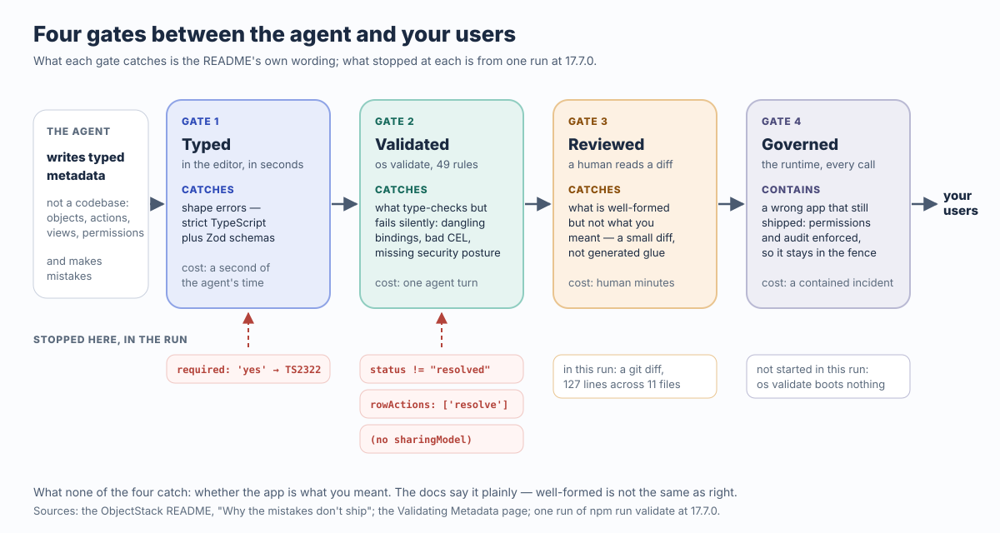
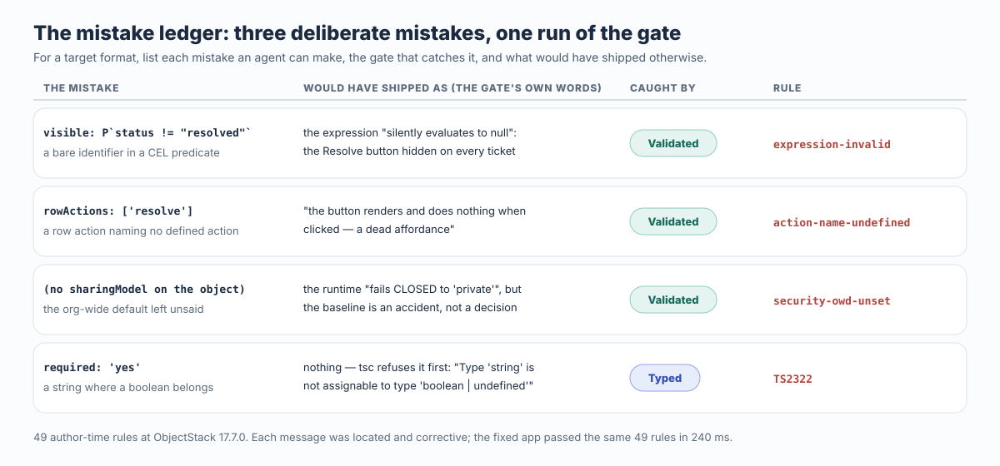

ビジネスアプリが「AI が書ける」と言えるのは、エージェントが必ず犯すミスが、ユーザーに届く前に死ねる場所を持っているときだ。それはモデルの性質ではなく、対象フォーマットの性質である。ObjectStack の README はそうした場所を四つ挙げ、ゲートと呼ぶ：**型（Typed）**、**検証（Validated）**、**レビュー（Reviewed）**、**ガバナンス（Governed）**。型のエラーはエディタの中で死ぬ。検証のエラーは `os validate` で死ぬ——型チェックは通るが実行時に静かに壊れるメタデータを、この一つのコマンドが拒否する。レビューのエラーは、人がまるごと読める diff の中で死ぬ。ガバナンスのエラーは、たとえ出荷されても、ランタイムの権限と監査のフェンスの内側にとどまる。以下は ObjectStack 17.7.0 で、スキャフォールドしたサポートデスクに対して前二つのゲートを実際に走らせた記録だ。README が挙げる三つの種類のミスを一つずつ故意に仕込み、49 ルールのゲートがそれぞれを位置を特定し修正方法を添えて拒否し、直した後にクリーンに通過するまでを示す。

## すでに成り立っている二つのこと

ゲートの前に、反対側の言い分を最大限に立てておく。この文章の論証は、どちらかが間違っていることを必要としないからだ。

**Vibe coding で作ったアプリは動く。** モデルにサポートデスクを説明すれば、午後のうちに動くものが手に入る。画面があり、データベースがあり、API があり、言語はモデルが一番得意なものだ。プロトタイプ、一回限りのツール、捨てる前提のデモなら、それが正しいトレードオフであり、以下にそれへの反論は一行もない。モデルはもうボトルネックではない。

**手書きのコードはレビューでき、そのツールは成熟している。** シニアエンジニアがプルリクエストを読み、型システムがあり、テストスイートがあり、コードレビューのプロセスがある。それらは毎日、本物の欠陥を捕まえている。新規のロジックに代替はなく、ObjectStack 自身もそう言う。「コードは消えない。フック、アクション本体、CEL、制約付き JSX として、ランタイムの中へ移る」——そしてそのコードは、やはり人が読む。

どちらも答えていないのは、エージェントが書き手になった瞬間に重要になる問いだ。*間違った一行はどこへ行くのか？* 自由形式のコードベースでは、間違った認可チェックは何千もの `if` のうちの一つで、レビューの対象面はリポジトリ全体で、ランタイムは権限について何も強制しない。スキャフォールドされたプロジェクトの CI ファイルは、メタデータについての一文でそれを言い切っている（ゲートのないフォーマットなら何にでも当てはまる）。ミスは「何も起こさず、最初にそれを踏んだ人に対して間違った振る舞いをするだけだ」。AI が書けるとは、この一文が成り立たなくなったということだ。

## 四つのゲート、README の言葉で

README のその節は「Why the mistakes don't ship」（ミスが出荷されない理由）と題され、表は丸ごと訳せるほど短い：

| ゲート | 何を捕まえるか |
| :--- | :--- |
| **型（Typed）** | 厳格な TypeScript + Zod——形のエラーはエディタの中で、エージェントが書いた数秒後に死ぬ |
| **検証（Validated）** | `os validate` が、型チェックは通るが実行時に静かに壊れるメタデータを拒否する：宙に浮いたバインディング、誤った CEL 述語、欠けたセキュリティ姿勢 |
| **レビュー（Reviewed）** | あなたが Console で、小さく読める diff を承認する——生成された糊のコードの山ではなく |
| **ガバナンス（Governed）** | ランタイムがすべての呼び出しで権限と監査を強制するので、間違ったアプリでさえフェンスの内側にとどまる |



この表について三つのことが、約束が本物かどうかを決める。記録を見る前に述べておく価値がある。

第一に、ゲートはコストの順に並んでいる。形のエラーはエージェントの一秒を使う。検証のエラーは一ターンを使う。レビューは人の数分を使う。ガバナンスで止まった失敗は、封じ込められたインシデントだ。README が「これが機能する理由」として述べるのは最初の二行にある。「エージェントのエラーは、位置が特定され、修正方法の示されたテキストになり、エージェント自身が読んで直せる」。

第二に、二番目のゲートが存在するのは最初のゲートでは足りないからで、ドキュメントはその理由を一文で言う。「ObjectStack のメタデータはデータであって、コードパスではない——だから大半のミスは TypeScript コンパイラに**捕まらない**。`tsc` を通り、問題なくロードされ、そして**実行時に静かに壊れる**。」述語は文字列だ。行アクションは名前だ。共有モデルは任意のキーだ。三つとも、ミスを抱えたまま型チェックを通る。検証ゲートはこの種のエラーのために作られ、以下の実走が狙うのもこの種だ。

第三に、後ろの二つのゲートは人とランタイムであって、ツールではない。この文章はそうでないふりをしない。ドキュメントの言うレビューゲートは Studio の「Review N changes」の diff だが、以下の実走では人が読む `git diff` だ。ガバナンスゲートはランタイムの認可チェーンと監査ログで、この実走はそれを一度も起動していない。記録が証明するのは、安価な二つのゲートが README の言う通りのものを捕まえることだ。証明できないことは末尾に書く。

## サポートデスク一つ、ミス三つ、実走一回

以下はすべて、再構成ではなく実際に走らせたものだ。Node 22、公開パッケージ。スキャフォールドは README 自身の最初の一歩：

```bash
$ npm create objectstack@latest support-desk
  ╔═══════════════════════════════════╗
  ║   ◆ Create ObjectStack v17.7.0    ║
  ╚═══════════════════════════════════╝

◆ New Environment
────────────────────────────────────────
  Environment: support-desk
  Namespace: support_desk
  Template: blank — Minimal starter — one object, REST API, ready to extend

  ✓ Template files written (20)
  → Installing dependencies...
  → Installing AI skills for your coding agent...
  ✓ Environment created!
```

スキャフォールドは `AGENTS.md` を書き、その中で唯一譲れない一行がゲートだ。「**Never report a metadata change as done until `npm run validate` passes.**」（`npm run validate` が通るまで、メタデータの変更を完了と報告してはならない。）CI ワークフローも書かれ、その唯一のジョブは `pnpm validate`、`pnpm lint`、`pnpm typecheck` を走らせる。ビジネスオブジェクトが一つも存在する前に、ゲートは配線されている。

次に README の要件を、エージェントが書くであろう形で書く。件名、説明、優先度の選択、ステータスの選択を持つ `support_desk_ticket` オブジェクト。まだ解決していないチケットにだけ表示される **Resolve** アクション。「未解決チケット」のリストビュー。Support ナビゲーショングループ。そしてサポート担当者向けの権限セット一つ。アプリ全体で **11 ファイル、追加 127 行**。ミスが入ることになる二つのファイル：

```ts
// src/actions/resolve-ticket.action.ts
export const ResolveTicketAction = defineAction({
  name: 'resolve_ticket',
  label: 'Resolve',
  objectName: 'support_desk_ticket',
  locations: ['record_header', 'list_item'],
  visible: P`record.status != "resolved"`,   // only on tickets not yet resolved
  operation: 'update',
  patch: { status: 'resolved' },
  confirmText: 'Mark this ticket as resolved?',
});
```

```ts
// src/views/ticket.view.ts
export const TicketViews = defineView({
  list: {
    label: 'All tickets',
    type: 'grid',
    data,
    columns: ['subject', 'priority', 'status'],
    rowActions: ['resolve_ticket'],
  },
  // ... form, and an "Open tickets" list view filtered on status = open
});
```

まずクリーンな実走を。ルール数を記録に残すためだ：

```text
$ npm run validate
◆ Validate
────────────────────────────────────────
  → Loading configuration...
  → Validating against ObjectStack Protocol...
  → Running author-time rules (49)...
  → Checking that every required capability has a provider installable in this edition...
  → Checking package docs (ADR-0046)...

  ✓ Validation passed (327ms)

  Support Desk v0.1.0

  Data: 2 Objects  6 Fields
  UI: 1 Apps  1 Views  1 Actions
  Logic: 0 Flows
  Security: 1 Permissions
  Runtime: 3 plugins
```

17.7.0 で 49 のオーサリング時ルール。[このサイトが前回同じゲートを走らせた](/en/blog/how-to-point-your-agent-at-objectstack/)のは 17.2.0 で、そのときは 41 だった。ルール表は成長しており、ゲートにとってはそれが正しい方向だ。この数はツール自身が出力し、公開パッケージ `@objectstack/lint` の `AUTHORING_RULES.length` に等しい。突き合わせるべき第二の数字はない。

### 三つのミス

ここで README の三つの分類に、故意のミスを一つずつ。三つとも、ふつうの JavaScript で訓練されたエージェントが手を伸ばしがちなもので、三つとも型チェックを通る：

```diff
 // 1 · a bad CEL predicate: the bare identifier most template languages use
-  visible: P`record.status != "resolved"`,
+  visible: P`status != "resolved"`,

 // 2 · a dangling binding: a row action that names nothing
-    rowActions: ['resolve_ticket'],
+    rowActions: ['resolve'],

 // 3 · a missing security posture: the org-wide default left unsaid
-  sharingModel: 'private',
```

三つを入れたままでも `npm run typecheck` は緑だ。`tsc` は文字列の中身にも、配列の中の名前にも、任意のキーにも意見を持たない。ゲートは持つ：

```text
$ npm run validate
◆ Validate
────────────────────────────────────────
  → Loading configuration...
  → Validating against ObjectStack Protocol...
  → Running author-time rules (49)...

  ✗ Author-time rules failed (3 issues)
  • stack · action 'resolve_ticket' visible: bare reference `status` — a formula/validation expression binds the record as the `record` namespace, not at top level, so `status` resolves to nothing and the expression silently evaluates to null. Write `record.status`.
      source: `status != "resolved"`
      rule: expression-invalid  at stack · action 'resolve_ticket' visible
  • view "#0" · list · rowActions: Row-action menu names action "resolve", which is defined by no action in this stack (neither `stack.actions` nor any object's `actions`). The button renders and does nothing when clicked — a dead affordance the runtime cannot dispatch. Did you mean "resolve_ticket"?
      Define an action named "resolve" (in `stack.actions` or the object's `actions`) with the location this surface needs, remove the reference, or ignore this if the action is contributed by another installed package. Defined actions: resolve_ticket.
      rule: action-name-undefined  at views[0].list.rowActions[0]
  • object "support_desk_ticket": custom object "support_desk_ticket" declares no sharingModel (OWD). The runtime fails CLOSED to 'private' (ADR-0090 D1), but the baseline must be an authored decision, not an accident — this is the exact shape of the leave_request incident, where an object with no sharingModel let an ordinary read/write grant read and edit every other user's records.
      Declare sharingModel explicitly: 'private' (owner + shares; recommended default), 'public_read', 'public_read_write', or 'controlled_by_parent' (master-detail children).
      rule: security-owd-unset  at objects[1].sharingModel
 ELIFECYCLE  Command failed with exit code 1.
```

この三つのメッセージをエラーとしてではなく台帳として読んでほしい。どれも、ゲートがなければ実行時に何が起きたかを明記しているからだ。これを**ミスの台帳**と呼ぶ。ある対象フォーマットについて、エージェントが犯しうるミスの種類、それを捕まえるゲート、そして捕まえなければ実行時に現れたはずの症状を並べたリストだ。フォーマットが「AI が書ける」のは、正確にこの台帳に空の行がない範囲までである。



| ミス | 出荷されていたらどうなったか | 捕まえたゲート · ルール |
| :--- | :--- | :--- |
| `` visible: P`status != "resolved"` `` | 述語は「静かに null に評価され」、Resolve ボタンはすべてのチケットで隠れる | 検証 · `expression-invalid` |
| `rowActions: ['resolve']` | 「ボタンは描画されるがクリックしても何も起きない——ランタイムがディスパッチできない死んだアフォーダンス」 | 検証 · `action-name-undefined` |
| オブジェクトに `sharingModel` がない | ランタイムは「'private' にフェイルクローズする」が、言葉にされていないベースラインは「leave_request インシデントとまったく同じ形」 | 検証 · `security-owd-unset` |
| フィールドの `required: 'yes'` | 何も出荷されない：`tsc` が「Type 'string' is not assignable to type 'boolean \| undefined'」で拒否する | 型 · `TS2322` |

四行目は型のゲートで、バリデータの記録を検証だけのものに保つために、クリーンなツリー上で別に走らせた。`required: true` を `required: 'yes'` に変えると、`npm run typecheck` はそのメッセージとともに終了コード 2 で終わる。ほかの何かが動く前に。もっとも安価でもっとも面白みのないゲートであり、それが最初に置かれている意味だ。

メッセージの二つの性質が、約束のすべてを担っている。それらは**位置が特定されている**：アクションと述語のスロット、ビューと配列のインデックス、オブジェクトとキーパス。そして**修正方法が示されている**：「Write `record.status`」、「Did you mean `resolve_ticket`?」、`sharingModel` の四つの正しい値。これを読んだエージェントは一ターンでループを閉じる。[エージェントを ObjectStack 向けに設定する記事](/en/blog/how-to-point-your-agent-at-objectstack/)はこれを*修正的エラー*（corrective error）と呼び、フォーマットが持つ最もレバレッジの高いものはドキュメントではなくエラーメッセージだと論じた。この実走はそのための新たな三つのデータ点だ。

三行を元に戻すと、ゲートはまた静かになる：

```text
$ npm run validate
  → Running author-time rules (49)...

  ✓ Validation passed (240ms)

  Data: 2 Objects  6 Fields
  UI: 1 Apps  1 Views  1 Actions
  Security: 1 Permissions
  Runtime: 3 plugins
```

実走からもう一行、ここに置くべきものがある。ゲートが拒否よりも微妙なことをしている場面だ。権限セットの最初の版は、プライベートなオブジェクトに対して読み・作成・編集を与えながら、読みがどこまで届くかを言っていなかった。クリーンな実走にはこのアドバイザリが付いていた。「`permission set "support_agent": "support_desk_ticket" is private (OWD) and this set grants allowRead without a readScope — holders see ONLY records they own (plus explicit shares).`」（権限セット「support_agent」：「support_desk_ticket」はプライベート（OWD）で、このセットは readScope なしに allowRead を与えている——保持者は自分が所有するレコード（と明示的に共有されたもの）しか見えない。）これはエラーではなく、ゲートがエラーにしないのも正しい。担当者が自分のチケットしか見えないサポートデスクは、正当な設計だ。これは、決めなければならない人の前に浮上した、決めかけの決定である。修正は `readScope: 'org'` というキー一つで、それは訂正ではなくプロダクト上の決定だった。

## ゲートが捕まえないもの

ゲートについての記事は、ゲートがどこで止まるかを言わなければならない。出典はこの点について珍しく率直だ。

**ビジネスロジックの正しさ。** ドキュメント：「ガードレール 1–3 はメタデータが*正しい形をしている*ことを証明する。それが*あなたの意図したもの*であることは証明できない。」ゲートは `record.status` が解決することを確認した。チケットをリストから直接解決できてよいか、`resolved` が正しい終端状態か、サポート担当者が組織のすべてのチケットを見てよいかについて、ゲートは何の意見も持たない。先の記事は同じ限界を「ゲートは構造を検査する。意図ではない」と言い、49 のルールはそれを何も変えない。

**レビュアーが見落とす要件。** レビューゲートは、人が diff を読むことだ。構造上それは小さい——アプリ全体で 127 行、三つのミスで三行——だが、小さいことと読まれたことは同じではない。契約社員も `support_agent` セットを持つのかを尋ねずに `readScope: 'org'` を承認したレビュアーは、決定を出荷したのであって、ゲートは止めない。メタデータは正しい形をしているからだ。アドバイザリのチャネルが役に立つのは、誰かがそれを読む範囲までである。

**新規のロジック。** フックとアクション本体はコードだ。「ビジネスオントロジー」の概念ページはそれらが「ランタイムの権限と監査のフェンスの内側で実行される」と言い、フェンスは間違った本体が触れる範囲を限定する。本体を正しくはしない。それはやはりコードレビューだ。

**この実走が試していないこと。** 記録はコマンドライン上の最初の二つのゲートだ。ドキュメントが述べるレビューゲート——変更が本番に出る前に人が承認する Studio の diff——はここでは `git diff` だった。ガバナンスゲート——ドキュメントが匿名拒否からフィールドレベルセキュリティまで、各層がフェイルクローズする六層として述べる認可チェーンと、すべての呼び出しの監査——は起動していない。`os validate` はアーティファクトを書かずサーバーも立ち上げない、オーサリング時のチェックだからだ。README のこのゲートに関する主張は「間違ったアプリでさえフェンスの内側にとどまる」であり、この記事はそれを実演するのではなく引用する。

**そして、二つの言い分は立ったままだ。** 捨てる前提のプロトタイプに四つのゲートは要らない。良いテストと注意深いレビュアーを持つ手書きのサービスには、ツールではなく人が埋める、それ自身の台帳がある。ここでの主張は「こちらの方が良い」より狭い。エージェントが書き、企業が動かすアプリについては、台帳はフォーマットが埋めるべきだ、ということだ。エージェントは覚えていないし、レビュアーはすべてを読めないからである。

## 同じゲートを、ブラウザから

ターミナルを開かない人に対しても四つのゲートの話を正直に保つ事実が一つある。`os validate` は唯一の扉ではない。ドキュメントは四番目の扉を述べる。「すべてのメタデータの**書き込み**——Studio のデザイナー、`PUT /api/v1/meta/*`、MCP/AI の書き手——は `saveMetaItem` に着地し、#4463 以降、**`state: 'active'`** へ向かう書き込みは永続化の前に同じ表を走らせる。」上で 49 と出力されたのと同じ `AUTHORING_RULES` が、Studio から公開された宙に浮いたバインディングを持つダッシュボードを、同じ位置特定済みのメッセージで拒否する。検証ゲートはランタイムの性質であって、CLI の性質ではない。

そして README 自身のループについての最後の一文：「同じループをホスト型で、ブラウザだけで、何もインストールせずに使いたい？それが ObjectOS — ObjectStack の上に構築された商用ランタイム環境です。」ObjectOS は、ブラウザ上でホストされインストール不要の ObjectOS Cloud としても、自社インフラでセルフマネージドの ObjectOS Enterprise としても動作します。どちらのエディションでも、オントロジーをエクスポートしてオープンソースの ObjectStack ランタイムで実行できます。

## 自分の台帳を埋める

上の実走は README の五分の道をたどった。唯一の変更は、ミスを故意に犯したことだ。フォーマットがこの記事の意味で「AI が書ける」かどうかを知る最速の方法である。

```bash
npm create objectstack@latest my-app && cd my-app
# コーディングエージェントで開き、業務の要件を伝える
npx os dev --ui
```

README の述べるサポートデスクを頼む。そして Console を見る前に diff を開き、この実走と同じことをする。述語から `record.` を落とし、ビューの中でアクション名を綴り間違え、`sharingModel` を消して、`npm run validate` を走らせる。ゲートが埋めた行と、あなたに残された行を数える。[エージェントに渡すルールファイル](/ja/blog/give-your-agent-rules-for-governable-apps/)はミスがいくつ生まれるかを決め、四つのゲートはそれがどこで止まるかを決める。あなたの台帳は、その両方の正直な尺度だ。
